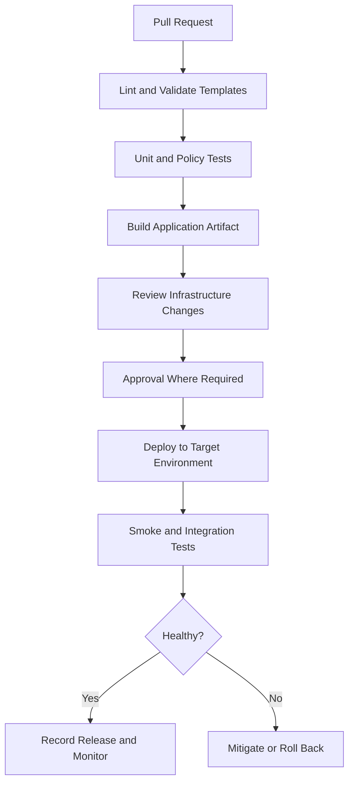

# 06- Infrastructure as Code for Lambda

## Overview

Infrastructure as Code (IaC) defines AWS Lambda functions and their supporting resources through version-controlled configuration rather than manual console operations. It makes infrastructure reproducible, reviewable, testable, and suitable for automated CI/CD pipelines.

A production Lambda deployment typically includes more than application code:

- Lambda functions, runtimes, architectures, memory, timeouts, and environment variables.
- Execution roles, IAM policies, and resource-based invocation permissions.
- API Gateway integrations, event source mappings, and EventBridge rules.
- SQS queues, dead-letter queues, DynamoDB tables, and S3 buckets.
- CloudWatch log groups, metrics, alarms, and tracing configuration.
- Lambda versions, aliases, provisioned concurrency, and deployment policies.
- VPC subnets, security groups, endpoints, and database connectivity.

Managing these resources as code reduces configuration drift and makes infrastructure changes part of the software delivery lifecycle.

For backend engineers, the objective is to treat infrastructure configuration like application code: review it, test it, deploy it through controlled pipelines, and preserve the ability to reproduce or recover an environment.

## Why Infrastructure as Code Matters

Manual resource creation can work for experiments, but it becomes difficult to maintain consistency across development, staging, and production.

| Problem | IaC capability |
|---|---|
| Inconsistent environments | Reusable templates and environment-specific parameters |
| Untracked console changes | Version-controlled desired state and drift detection |
| Difficult recovery | Reproducible resource definitions |
| Risky infrastructure changes | Pull requests, change sets, and deployment plans |
| Inconsistent permissions | Explicit, reviewable IAM policies and resource relationships |
| Unreliable releases | Automated deployment and verification |
| Resource sprawl | Centralized ownership and lifecycle management |
| Poor auditability | Reviewable changes and deployment history |

IaC does not automatically make infrastructure secure or reliable. An incorrect template can consistently reproduce excessive permissions, unsafe networking, or expensive configurations. Validation, testing, and operational controls remain necessary.

## IaC Tools for AWS Lambda

AWS supports several approaches to infrastructure management. Choose a tool based on the team's deployment model, application architecture, and existing engineering practices.

| Tool | Model | Best suited for | Trade-offs |
|---|---|---|---|
| AWS CloudFormation | Declarative AWS resource templates | Native AWS resource management | Can become verbose for large systems |
| AWS SAM | Serverless-focused abstraction built on CloudFormation | Lambda functions, APIs, and event-driven applications | Primarily focused on serverless application development |
| AWS CDK | Infrastructure defined using programming languages | Reusable constructs and complex infrastructure composition | Requires synthesis, code review, and language-specific testing |
| Terraform | Declarative infrastructure with state management | Organizations standardizing infrastructure across providers | Requires secure state management and provider lifecycle management |

### AWS CloudFormation

CloudFormation describes AWS resources using YAML or JSON. AWS provisions and updates resources according to the template and stack lifecycle.

CloudFormation is useful when teams need native AWS infrastructure management, explicit resource dependencies, stack-level change management, and integration with AWS deployment tooling.

A CloudFormation template can define a Lambda function, its execution role, log group, event source, and associated permissions as a single infrastructure unit or across multiple related stacks.

### AWS Serverless Application Model

AWS SAM adds serverless-specific resource types and commands to the CloudFormation model. It reduces boilerplate for Lambda functions, API integrations, and supported event sources.

SAM is appropriate when the primary deliverable is a serverless application and the team wants an integrated build, local testing, and deployment workflow.

### AWS Cloud Development Kit

AWS CDK lets engineers define infrastructure using languages such as Python and TypeScript. Constructs encapsulate reusable infrastructure patterns, and synthesis produces CloudFormation templates.

CDK is useful when infrastructure needs reusable abstractions, composition, or programming-language-based validation. However, successful synthesis does not prove that generated permissions, networking, or deployment behavior are correct.

### Terraform

Terraform defines infrastructure declaratively and tracks managed resources in a state file. The state connects the configuration with resources Terraform manages.

Terraform is useful when an organization standardizes on it across AWS and other platforms. Protect its state with appropriate access controls, encryption, concurrency protection, and recovery procedures. Never commit sensitive state files or credentials to source control.

## Recommended Resource Boundaries

Group infrastructure according to ownership, lifecycle, and operational responsibility.

A small Lambda application might use this structure:

```text
order-service/
    src/
        app.py
        requirements.txt
    tests/
        test_app.py
    infrastructure/
        template.yaml
    scripts/
        package.sh
    .github/
        workflows/
            deploy.yml
```

The source directory contains application code. The infrastructure directory contains resource definitions, while the CI/CD workflow coordinates testing, artifact creation, and deployment.

For a larger system, separate stacks or modules may manage:

- Shared networking and VPC resources.
- Application-specific Lambda functions and IAM roles.
- Queues, tables, and other data resources.
- API Gateway and routing resources.
- Observability and operational alarms.

Avoid creating a separate stack for every resource without a lifecycle reason. Excessive stack boundaries introduce dependency management and deployment coordination overhead.

## Define Lambda Infrastructure with AWS SAM

AWS SAM is a practical starting point for Python-based Lambda applications because it supports serverless resource definitions, local workflows, packaging, and CloudFormation-backed deployment.

### Application code

Create `src/app.py`:

```python
import json


def lambda_handler(event, context):
    return {
        "statusCode": 200,
        "headers": {
            "content-type": "application/json",
        },
        "body": json.dumps({
            "message": "Order service is healthy",
            "request_id": context.aws_request_id,
        }),
    }
```

This handler returns an API Gateway proxy-style response. It demonstrates the infrastructure integration rather than a complete business API.

### SAM template

Create `template.yaml`:

```yaml
AWSTemplateFormatVersion: "2010-09-09"
Transform: AWS::Serverless-2016-10-31
Description: Order service Lambda API

Globals:
  Function:
    Runtime: python3.12
    Architectures:
      - arm64
    MemorySize: 512
    Timeout: 10
    Tracing: Active

Resources:
  OrderApi:
    Type: AWS::Serverless::Api
    Properties:
      StageName: prod

  OrderFunction:
    Type: AWS::Serverless::Function
    Properties:
      CodeUri: src/
      Handler: app.lambda_handler
      Description: Handles order service API requests
      Events:
        Health:
          Type: Api
          Properties:
            RestApiId: !Ref OrderApi
            Path: /health
            Method: GET

Outputs:
  ApiUrl:
    Description: API Gateway endpoint
    Value: !Sub
      - "https://${ApiId}.execute-api.${AWS::Region}.${AWS::URLSuffix}/prod/health"
      - ApiId: !Ref OrderApi
```

SAM generates an execution role when the function does not specify an explicit role. This example does not grant application-specific AWS permissions because the handler does not access other AWS resources.

The runtime must be supported in the target Region and compatible with the application's dependencies. Confirm runtime lifecycle and architecture requirements before using this template in production.

### Build and validate

Prerequisites include the AWS CLI, AWS SAM CLI, valid AWS credentials, and permission to provision the required resources.

Build the application:

```bash
sam build
```

Validate the template:

```bash
sam validate --lint
```

A successful build verifies aspects of packaging, while template validation checks infrastructure syntax and structure. Neither proves that the application will behave correctly after deployment.

### Deploy the stack

For an initial interactive deployment:

```bash
sam deploy --guided
```

Follow the prompts to configure the stack name, Region, artifact storage, and confirmation settings. Review the generated deployment configuration before reusing it in automation.

For subsequent deployments, if a `prod` configuration environment has been defined in `samconfig.toml`:

```bash
sam deploy --config-env prod
```

Deployment can create billable resources. Use an appropriate non-production account or environment for initial experimentation.

### Verify the deployment

Inspect stack outputs:

```bash
aws cloudformation describe-stacks \
  --stack-name order-service \
  --query 'Stacks[0].Outputs' \
  --output table
```

Use the returned API URL to test the endpoint:

```bash
curl -i "https://API_ID.execute-api.REGION.amazonaws.com/prod/health"
```

Replace `API_ID` and `REGION` with the deployed values.

Expected behavior is an HTTP success response containing JSON with a health message and request ID. If the request fails, inspect API Gateway configuration, Lambda invocation permissions, function errors, and CloudWatch logs.

## Environment-Specific Configuration

Development, staging, and production should use explicit configuration rather than undocumented console changes.

Typical environment-specific values include:

- Resource names and identifiers.
- API stages and domain names.
- DynamoDB table names.
- SQS queue ARNs.
- VPC and security group identifiers.
- Log retention periods.
- Reserved concurrency limits.
- Alarm thresholds.
- Secret references.

Use template parameters, stack configuration, or separate deployment environments to manage these differences.

Avoid duplicating entire templates when a small set of controlled parameters can express the differences safely. Conversely, do not force production and development to share resources when their security or lifecycle requirements differ.

### Environment variables

Use infrastructure configuration for non-sensitive application settings:

```yaml
Environment:
  Variables:
    LOG_LEVEL: INFO
    ORDERS_TABLE_NAME: !Ref OrdersTable
```

The example is a fragment that belongs inside a function's properties. `OrdersTable` must be a defined resource or a valid parameter.

### Secrets management

Do not embed database passwords, API tokens, or other credentials directly in source-controlled templates. Reference AWS Secrets Manager or Systems Manager Parameter Store as appropriate, and grant the execution role only the required access.

Design secret retrieval and caching deliberately. Fetching a secret on every invocation can add latency and service calls, while caching a secret in a reused execution environment requires a strategy for rotation and expiration.

## IAM and Infrastructure Security

Infrastructure definitions are security-critical because they determine which identities can invoke functions, access data, and modify production resources.

### Execution role versus deployment role

These roles have distinct responsibilities:

| Role | Responsibility |
|---|---|
| Lambda execution role | Allows application code to access required AWS services |
| CI/CD deployment role | Allows the pipeline to deploy code and manage approved infrastructure |
| Human operator role | Allows authorized troubleshooting, review, or emergency operations |

Do not reuse a broadly privileged deployment role as a function's execution role.

For example, a function that accesses one DynamoDB table should not automatically receive `dynamodb:*` across every table in the account.

An illustrative SAM policy fragment is:

```yaml
Policies:
  - Statement:
      - Effect: Allow
        Action:
          - dynamodb:GetItem
          - dynamodb:PutItem
          - dynamodb:UpdateItem
        Resource: !GetAtt OrdersTable.Arn
```

Use only the actions required by the workload. Additional permissions may be needed for indexes, transactions, encryption, or other integrations.

### Resource-based permissions

Some integrations require a Lambda resource-based policy allowing a service principal to invoke the function. Examples include API Gateway and S3, depending on the integration and event configuration.

Manage these permissions through IaC so resource relationships remain reviewable and reproducible. Avoid manually adding broad permissions that are absent from the template.

### Deployment credentials

For GitHub Actions, prefer short-lived credentials through OpenID Connect rather than long-lived AWS access keys stored as repository secrets.

The deployment role's trust policy should restrict which repository, branch, environment, or workflow identity may assume it. Its permissions should be limited to the resources and operations required by the pipeline.

## State, Drift, and Change Management

IaC describes desired infrastructure state, but deployed resources can still differ from that state.

Common causes include:

- Manual console changes.
- Emergency operational modifications.
- Changes made by another automation system.
- Untracked resources.
- Differences between environments.
- Template changes that do not update or replace a resource as expected.

Use change review and drift detection appropriate to the chosen tool.

### Inspect CloudFormation stack state

The following commands are read-only:

```bash
aws cloudformation describe-stacks \
  --stack-name order-service \
  --query 'Stacks[0].[StackStatus,StackStatusReason]' \
  --output table
```

```bash
aws cloudformation describe-stack-events \
  --stack-name order-service \
  --max-items 20
```

These commands help identify failed resource operations and stack-level errors.

### Detect drift

For a stack that supports drift detection, initiate a detection operation:

```bash
aws cloudformation detect-stack-drift \
  --stack-name order-service
```

This command starts an asynchronous operation and returns a detection ID. Retrieve its status using `describe-stack-drift-detection-status` with that ID.

Drift detection does not prove application correctness and does not detect every possible operational discrepancy. Use it alongside code review, deployment history, and runtime monitoring.

Before applying infrastructure changes, review the expected changes, identify replacements and destructive operations, and confirm the recovery approach.

## CI/CD for Infrastructure as Code

A production pipeline should treat infrastructure changes with the same rigor as application changes.



A practical pipeline should include:

- Source control and protected deployment branches.
- Static validation and template linting.
- Unit tests and infrastructure policy checks.
- Artifact creation and integrity verification.
- A reviewable infrastructure change plan or CloudFormation change set.
- Environment-specific approvals.
- Deployment through short-lived credentials.
- Post-deployment smoke tests and monitoring.
- Documented recovery and ownership.

Avoid deploying unreviewed infrastructure changes to production simply because application tests passed. Infrastructure changes can replace resources, change permissions, alter networking, or cause data loss independently of application correctness.

## Managing Lambda Versions and Aliases with IaC

Published versions and aliases should be part of the release design rather than unmanaged console objects.

A SAM function can use `AutoPublishAlias` to publish versions and maintain an alias:

```yaml
Resources:
  OrderFunction:
    Type: AWS::Serverless::Function
    Properties:
      CodeUri: src/
      Handler: app.lambda_handler
      Runtime: python3.12
      AutoPublishAlias: production
```

This is a partial function definition. Add required runtime settings, permissions, environment configuration, and other application-specific resources as appropriate.

For progressive deployments, SAM can integrate with CodeDeploy through `DeploymentPreference`. For example, a canary policy can expose a new version to a small portion of traffic before increasing exposure. Such configurations require appropriate deployment permissions and monitoring alarms.

Use the supported SAM deployment configuration and validate the complete template before deployment. Confirm the deployment type and any runtime or integration constraints rather than assuming every traffic-shifting configuration is interchangeable.

A canary release requires meaningful alarms and enough representative traffic to detect regressions. Configure and test rollback behavior explicitly.

Avoid mixing IaC-managed alias changes with unrelated manual updates. Multiple controllers modifying the same resource can create drift and confusing rollback behavior.

## Infrastructure Change Safety

Not all infrastructure changes have the same risk. Classify changes by their effects before deploying them.

| Change category | Examples | Primary concern |
|---|---|---|
| Application release | New ZIP package or container image | Runtime behavior and compatibility |
| Configuration update | Timeout, memory, environment variables | Performance or behavior changes |
| Permission update | Execution role or resource policy | Security exposure or invocation failures |
| Networking update | Subnets, security groups, endpoints | Connectivity and isolation |
| Data resource change | Table, bucket, queue configuration | Data loss or incompatible behavior |
| Resource replacement | Recreating a stateful resource | Downtime, data retention, and recovery |
| Event integration change | Batch size, filtering, retry policy | Delivery semantics and processing behavior |

Before applying a risky change:

1. Review the proposed resource operations.
2. Identify stateful resources and retention requirements.
3. Confirm compatibility with the currently deployed application.
4. Verify the rollback or recovery procedure.
5. Deploy through the intended environment.
6. Run smoke tests and inspect operational signals.
7. Record the outcome and any follow-up work.

CloudFormation stack rollback does not reverse every external side effect. A function may already have written data, sent messages, or triggered downstream workflows before a deployment failure is detected.

## Common IaC Pitfalls

| Pitfall | Impact | Mitigation |
|---|---|---|
| Broad IAM policies in templates | Excessive application or deployment privileges | Apply least privilege and review policy changes |
| Secrets committed to templates | Credential exposure | Use managed secret services and controlled references |
| Manual console changes | Configuration drift | Manage production changes through IaC or documented emergency procedures |
| Unsafe resource replacement | Downtime or data loss | Review change sets and preserve critical resources |
| Unpinned dependencies or actions | Non-reproducible builds | Pin versions and maintain dependency updates |
| Shared state without concurrency protection | Conflicting infrastructure operations | Use supported locking and controlled deployment concurrency |
| Application and infrastructure changes deployed without coordination | Incompatible schemas or broken integrations | Use staged, backward-compatible changes |
| Assuming rollback reverses all changes | Persistent data changes or external side effects | Plan recovery for application, infrastructure, and data separately |
| Treating template validation as proof of correctness | Runtime or permission errors remain | Run integration tests and post-deployment verification |
| Applying changes without reviewing resource replacement | Unexpected downtime or resource loss | Review the plan and confirm retention and recovery controls |

## Production Readiness Checklist

Before applying infrastructure changes to a production Lambda service, verify the following:

- [ ] Infrastructure definitions are version-controlled and reviewed.
- [ ] Templates or modules pass validation and policy checks.
- [ ] Expected resource changes and replacements have been reviewed.
- [ ] Execution and deployment roles have separate, least-privilege permissions.
- [ ] Secrets are not embedded in source-controlled files.
- [ ] Environment-specific configuration is explicit.
- [ ] Critical resources have appropriate retention, backup, or recovery controls.
- [ ] Logging, metrics, tracing, and alarms are configured.
- [ ] Deployment and rollback behavior has been tested.
- [ ] Application, database, and event contracts remain compatible during rollout.
- [ ] Drift detection and failed deployment procedures are documented.
- [ ] Resource costs, quotas, and cleanup responsibilities are understood.

## Key Takeaways

- Infrastructure as Code makes Lambda infrastructure reproducible, reviewable, and suitable for controlled CI/CD delivery.
- Choose CloudFormation, SAM, CDK, or Terraform based on application needs and team operating practices.
- Treat IAM roles, resource policies, secret references, and network configuration as security-critical code.
- Review infrastructure plans, resource replacements, drift, and lifecycle behavior before applying production changes.
- A successful infrastructure deployment is not proof of application health; validate the deployed system and maintain a tested recovery strategy.