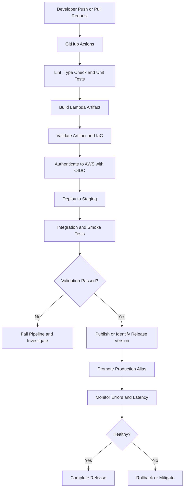
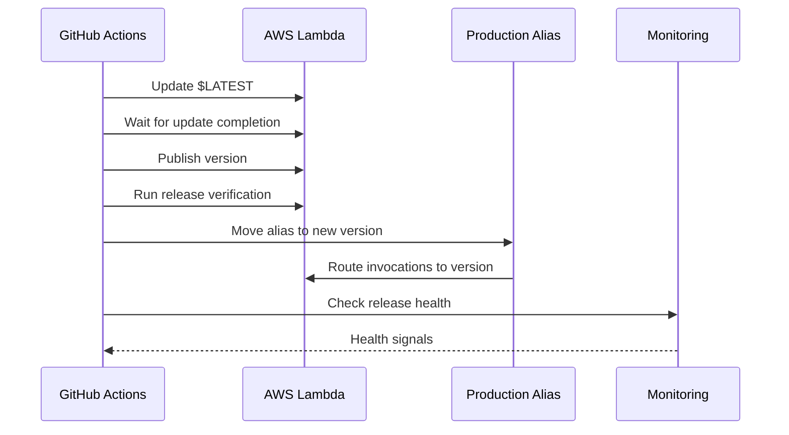

# 07- CI-CD with GitHub Actions

## Overview

Continuous Integration and Continuous Delivery (CI/CD) automate the process of validating, packaging, deploying, and verifying AWS Lambda applications. GitHub Actions provides workflow automation directly within a GitHub repository, making it suitable for Python-based serverless applications and infrastructure managed through AWS SAM, CloudFormation, or other Infrastructure as Code (IaC) tools.

A production Lambda pipeline should do more than upload a ZIP package. It should validate application code, test dependencies, build a reproducible artifact, deploy infrastructure safely, publish a release version, promote traffic, and verify the deployed application.

A typical pipeline includes:

- Automated linting, type checking, and unit tests.
- Dependency installation and deployment artifact creation.
- Infrastructure validation and security checks.
- Authentication to AWS using short-lived credentials.
- Deployment to development, staging, and production environments.
- Lambda version publication and alias promotion.
- Smoke tests, monitoring, and rollback procedures.

The key design principle is to separate **building an artifact, deploying it, and promoting it to production**. These are related but distinct operations with different permissions and failure modes.

## CI/CD Architecture for Lambda

A practical architecture uses GitHub Actions as the automation layer, AWS IAM as the authorization layer, and Lambda plus its supporting resources as the deployment target.



Not every pipeline needs every stage on every commit. Pull requests should generally validate changes without deploying to production, while protected release workflows perform privileged deployment operations.

## CI/CD Workflow Design

GitHub Actions workflows are YAML files stored under `.github/workflows/`.

A workflow contains jobs, and each job contains ordered steps. Jobs can run on separate runners and can depend on other jobs through `needs`.

| Stage | Responsibility | Typical failure condition |
|---|---|---|
| Static checks | Linting, formatting, type checking | Code quality violations |
| Unit tests | Validate application behavior | Incorrect business logic |
| Build | Package source and dependencies | Missing or incompatible dependencies |
| Infrastructure validation | Validate SAM or CloudFormation templates | Invalid configuration or policy |
| Artifact validation | Inspect package contents and imports | Missing handler or deployment files |
| Deployment | Update the target environment | AWS authorization or resource errors |
| Smoke tests | Validate the deployed endpoint or function | Runtime or integration failure |
| Promotion | Route production traffic to the new version | Failed approval or release checks |
| Monitoring | Observe the release after promotion | Elevated errors, latency, or business failures |

Keep workflow responsibilities explicit. A workflow that mixes testing, resource creation, destructive changes, and production promotion without clear gates is difficult to audit and recover.

## Configure AWS Authentication with OIDC

GitHub Actions can assume an AWS IAM role through OpenID Connect (OIDC), avoiding long-lived AWS access keys stored in GitHub secrets.

The authentication flow is:

1. A workflow requests an OIDC token from GitHub.
2. AWS STS validates the token against the configured identity provider and role trust policy.
3. The workflow receives temporary AWS credentials.
4. AWS evaluates the deployment role's permissions for each requested operation.
5. The credentials expire according to the session configuration.

### Create the AWS identity provider

The AWS account must have a GitHub OIDC identity provider configured for:

`https://token.actions.githubusercontent.com`

The provider's audience should be `sts.amazonaws.com`.

This setup is typically performed once per AWS account. Follow the current AWS IAM and GitHub Actions documentation when configuring the provider.

### Configure the role trust policy

A trust policy should restrict which GitHub repository and workflow identity may assume the role.

For example, a trust policy for a production deployment restricted to a GitHub environment named `production` can use a subject condition resembling:

```json
{
  "Version": "2012-10-17",
  "Statement": [
    {
      "Effect": "Allow",
      "Principal": {
        "Federated": "arn:aws:iam::123456789012:oidc-provider/token.actions.githubusercontent.com"
      },
      "Action": "sts:AssumeRoleWithWebIdentity",
      "Condition": {
        "StringEquals": {
          "token.actions.githubusercontent.com:aud": "sts.amazonaws.com",
          "token.actions.githubusercontent.com:sub": "repo:OWNER/REPOSITORY:environment:production"
        }
      }
    }
  ]
}
```

Replace the account ID, owner, and repository with actual values.

When a workflow uses a GitHub environment, the OIDC subject format differs from the normal branch-based subject. Configure the trust policy to match the actual subject claims for the repository and environment. Do not use broad wildcard conditions unless they are explicitly justified and constrained.

### Grant minimum deployment permissions

The deployment role should have only the permissions required by the pipeline.

Depending on the deployment model, these may include:

- Updating Lambda code and configuration.
- Publishing Lambda versions and updating aliases.
- Creating or updating CloudFormation stacks.
- Reading deployment artifacts from S3.
- Managing explicitly approved infrastructure resources.
- Passing an approved Lambda execution role through `iam:PassRole`.
- Writing deployment artifacts to an approved S3 bucket.

CloudFormation deployments may require permissions for the resources managed by the stack. Scope permissions to the required resources and operations wherever supported, and consider CloudFormation service roles to separate infrastructure provisioning from workflow identity permissions.

Avoid giving the deployment role unrestricted administrator access merely to simplify initial setup.

## Repository Structure

A maintainable Python Lambda repository can use the following structure:

```text
order-service/
    src/
        app.py
    tests/
        test_app.py
    requirements.txt
    requirements-dev.txt
    template.yaml
    samconfig.toml
    .gitignore
    .github/
        workflows/
            ci.yml
            deploy-staging.yml
            deploy-production.yml
```

The exact structure depends on the packaging model. A function deployed as a ZIP may package its dependencies alongside the handler, while a container-image deployment uses a Dockerfile and image registry.

Keep test-only dependencies separate from production dependencies where practical. Avoid including test frameworks, local configuration, or development artifacts in the Lambda deployment package.

## Build a Reproducible Lambda Artifact

The deployment artifact should contain everything needed to run the function, excluding dependencies supplied by the Lambda runtime or explicitly provided through other supported mechanisms.

For a ZIP-based Python Lambda, dependencies commonly need to be installed into the package directory.

Example:

```bash
rm -rf build function.zip
mkdir -p build

python -m pip install \
  --requirement requirements.txt \
  --target build/

cp src/app.py build/

cd build
zip -r ../function.zip .
cd ..
```

This example assumes the handler is `app.lambda_handler` and that `requirements.txt` contains production dependencies.

### Native dependency compatibility

Build dependencies in an environment compatible with the target Lambda runtime, operating system, and CPU architecture.

Packages containing native extensions may fail if built on an incompatible operating system or architecture. For example, building a dependency on Windows and packaging it directly for a Linux Lambda environment may produce an unusable artifact.

For production pipelines:

- Pin and review dependency versions.
- Build using a compatible Linux environment or the appropriate Lambda build image.
- Match the configured runtime and architecture.
- Validate imports from the packaged artifact.
- Inspect package contents before deployment.
- Scan dependencies and retain artifact metadata.

A successful ZIP operation does not prove that the resulting package can run on Lambda.

## Complete CI Workflow

The following workflow runs quality checks and unit tests on pull requests and pushes to `main`. It does not deploy to AWS.

Assumptions:

- The handler module is `src/app.py`.
- Application dependencies are declared in `requirements.txt`.
- Development dependencies are declared in `requirements-dev.txt`.
- Tests are stored under `tests/`.

Create `.github/workflows/ci.yml`:

```yaml
name: Lambda CI

on:
  pull_request:
    branches:
      - main
  push:
    branches:
      - main

permissions:
  contents: read

jobs:
  test:
    runs-on: ubuntu-latest

    steps:
      - name: Checkout source
        uses: actions/checkout@v4

      - name: Set up Python
        uses: actions/setup-python@v5
        with:
          python-version: "3.12"
          cache: pip

      - name: Install dependencies
        run: |
          python -m pip install --upgrade pip
          python -m pip install -r requirements.txt
          python -m pip install -r requirements-dev.txt

      - name: Run lint
        run: ruff check .

      - name: Run tests
        run: pytest -q

      - name: Validate SAM template
        run: sam validate --lint
```

This workflow assumes `ruff`, `pytest`, and the SAM CLI are available. The example installs Python packages but does not install the SAM CLI, so the runner must have the CLI available through a separately configured installation step or a suitable pinned tool setup. In production, explicitly install and pin required tooling rather than depending on an incidental runner environment.

The `cache: pip` setting improves dependency installation performance. It does not replace dependency pinning or guarantee a reproducible build.

## Deployment Workflow Using GitHub Actions

A deployment workflow can package a Lambda function and update an existing function using AWS OIDC.

The following example demonstrates the deployment mechanics. It assumes the target function already exists, its runtime and handler configuration are correct, and its required infrastructure is managed separately.

Create `.github/workflows/deploy-staging.yml`:

```yaml
name: Deploy Lambda to Staging

on:
  push:
    branches:
      - main

permissions:
  contents: read
  id-token: write

concurrency:
  group: lambda-staging-deployment
  cancel-in-progress: false

jobs:
  deploy:
    runs-on: ubuntu-latest

    env:
      AWS_REGION: ap-south-1
      FUNCTION_NAME: order-processor

    steps:
      - name: Checkout source
        uses: actions/checkout@v4

      - name: Set up Python
        uses: actions/setup-python@v5
        with:
          python-version: "3.12"

      - name: Install dependencies
        run: |
          python -m pip install --upgrade pip
          python -m pip install -r requirements.txt
          python -m pip install pytest

      - name: Run tests
        run: pytest -q

      - name: Build package
        run: |
          rm -rf build function.zip
          mkdir -p build

          python -m pip install \
            --requirement requirements.txt \
            --target build/

          cp src/app.py build/

          cd build
          zip -r ../function.zip .
          cd ..

      - name: Configure AWS credentials
        uses: aws-actions/configure-aws-credentials@v4
        with:
          role-to-assume: ${{ secrets.AWS_STAGING_DEPLOY_ROLE_ARN }}
          aws-region: ${{ env.AWS_REGION }}

      - name: Deploy function code
        run: |
          aws lambda update-function-code \
            --function-name "$FUNCTION_NAME" \
            --zip-file fileb://function.zip

      - name: Wait for function update
        run: |
          aws lambda wait function-updated \
            --function-name "$FUNCTION_NAME"

      - name: Verify deployed configuration
        run: |
          aws lambda get-function-configuration \
            --function-name "$FUNCTION_NAME" \
            --query '{State:State,LastUpdateStatus:LastUpdateStatus,Runtime:Runtime,Handler:Handler}' \
            --output json
```

The example deliberately does not publish a version or change a production alias. Those operations belong in a release workflow with explicit promotion and verification controls.

Before using this example, ensure that the AWS role's trust policy matches the repository's OIDC subject and that the workflow has the necessary permissions. The role should be restricted to the intended staging function and operations.

The workflow uses `update-function-code`, which modifies `$LATEST`. It does not deploy infrastructure changes, update environment variables, or automatically roll back application changes.

## Deploy Infrastructure with AWS SAM

When infrastructure is managed with SAM, the pipeline should validate and deploy the application through SAM instead of independently managing every resource through AWS CLI commands.

A common workflow is:

1. Run linting and unit tests.
2. Build the SAM application.
3. Validate the template.
4. Review infrastructure changes.
5. Authenticate to AWS.
6. Deploy the stack to the target environment.
7. Run smoke tests.
8. Monitor the deployed service.

A deployment step may use:

```bash
sam build
sam validate --lint
sam deploy --config-env staging
```

The staging environment must exist in `samconfig.toml`, and the AWS identity must have the permissions needed by the stack.

For production, consider using CloudFormation change sets and an explicit approval step when infrastructure changes may replace resources, modify permissions, or affect stateful services.

Do not mix independent deployment controllers for the same resources without a deliberate ownership model. For example, manually updating a function through AWS CLI while SAM manages the same function can cause the next stack deployment to overwrite the manual change.

## Versioning and Alias Promotion

Publishing a Lambda version creates a stable release snapshot of the function's code and versioned configuration. An alias provides a stable name that can point to a published version.

A production release can follow this sequence:



The diagram shows a simplified release flow. A production pipeline should complete the appropriate tests before promotion and define what happens if post-promotion health checks fail.

### Publish a version

```bash
aws lambda publish-version \
  --function-name order-processor \
  --description "CI release"
```

Record the returned version number alongside the commit SHA and artifact identity.

### Update an existing alias

```bash
aws lambda update-alias \
  --function-name order-processor \
  --name production \
  --function-version 13
```

Replace `13` with the actual published version. The alias must already exist.

### Verify the alias

```bash
aws lambda get-alias \
  --function-name order-processor \
  --name production
```

Use aliases for stable production invocation targets where supported. Do not assume every integration automatically uses the alias; configure and verify the actual integration target.

For canary or linear traffic shifting, use a supported deployment mechanism such as CodeDeploy with the required deployment configuration, alarms, and permissions. Do not implement percentage-based routing by repeatedly overwriting `$LATEST`.

## Production Promotion and Approval

Staging deployment and production promotion should be separate authorization decisions.

A production workflow can use a GitHub environment named `production` with configured protection rules and required reviewers.

Example:

```yaml
jobs:
  deploy-production:
    runs-on: ubuntu-latest
    environment: production
    permissions:
      contents: read
      id-token: write
```

Configure the environment's required reviewers and other protection rules in GitHub. The AWS trust policy must match the OIDC subject associated with this environment.

A production release should promote the exact artifact or published version that passed validation. Rebuilding the source separately for production can introduce differences in dependencies or packaging.

Recommended controls include:

- Protected branches and reviewed pull requests.
- Separate staging and production deployment roles.
- Approval for high-risk infrastructure changes.
- Explicit release metadata and artifact identity.
- Automated smoke tests after deployment.
- Health checks and rollback procedures.
- Deployment concurrency controls to prevent conflicting releases.

## Testing and Deployment Verification

Testing should cover both application correctness and deployment behavior.

| Test type | Purpose |
|---|---|
| Unit tests | Validate business logic |
| Contract tests | Validate event payloads and downstream interfaces |
| Integration tests | Verify interactions with AWS services |
| Artifact tests | Check handler imports and packaged dependencies |
| Smoke tests | Verify the deployed function or API |
| Failure-path tests | Validate retries, timeouts, and error handling |
| Security checks | Detect vulnerable dependencies and excessive permissions |
| Performance tests | Measure latency, memory, concurrency, and downstream pressure |

For API-based functions, a smoke test can invoke the deployed endpoint and validate its status code and response structure.

For asynchronous functions, a successful invocation response does not prove that the event was processed successfully. Verify the relevant queue, destination, logs, or business outcome.

A production deployment should fail or pause when required validation fails. Define explicit success criteria rather than relying solely on the exit status of the deployment command.

## Rollback Strategy

A deployment pipeline needs a recovery procedure before production releases begin.

For alias-based releases, rollback commonly means moving the production alias back to a known-good published version.

```bash
aws lambda update-alias \
  --function-name order-processor \
  --name production \
  --function-version 12
```

This command modifies the alias. Confirm that version `12` is the intended recovery target and that the execution role, configuration, downstream contracts, and shared data remain compatible.

A rollback may not reverse:

- Database writes performed by the new version.
- Messages already published to queues or event buses.
- External API calls or other side effects.
- Infrastructure changes outside the Lambda version.
- Environment variables or shared configuration changes.
- Data schema migrations.

Use backward-compatible database and event-schema changes, and plan data recovery or compensating actions when required.

## Observability and Release Health

Monitor technical and business signals during deployment and after promotion.

Useful signals include:

- Lambda invocation count, errors, and duration.
- Throttles and concurrency utilization.
- API Gateway errors and integration latency.
- Queue depth and age of the oldest message.
- Downstream database and API failures.
- Business operation success rates.
- Cost and invocation anomalies.

Configure alarms with thresholds that reflect the service's actual reliability objectives. A low-volume function may not generate enough traffic during a short canary interval to reveal rare failures, so combine metrics with representative smoke tests and other validation signals.

Ensure that logs include useful correlation information without exposing credentials, personal data, or other sensitive content.

## Security Best Practices

GitHub Actions workflows that deploy production infrastructure are privileged systems.

Apply the following controls:

- Use OIDC and short-lived AWS credentials.
- Restrict IAM trust policies to approved repository and workflow identities.
- Scope deployment permissions to required functions, stacks, and operations.
- Keep deployment roles separate from Lambda execution roles.
- Require approval for sensitive production changes.
- Pin and review third-party GitHub Actions according to organizational policy.
- Scan dependencies and validate deployment artifacts.
- Avoid printing secrets or sensitive environment variables in workflow logs.
- Audit deployment activity and preserve release metadata.
- Review changes to IAM, networking, and resource policies as security-sensitive changes.

The `id-token: write` workflow permission enables token issuance; it does not itself grant AWS access. AWS access is determined by the OIDC trust policy and the permissions attached to the assumed role.

## Common CI/CD Mistakes

| Mistake | Consequence | Prevention |
|---|---|---|
| Storing long-lived AWS access keys in GitHub secrets | Credentials can be exposed or remain valid longer than intended | Use OIDC and temporary credentials |
| Giving CI/CD administrator permissions | A compromised workflow can affect unrelated resources | Apply least privilege and resource restrictions |
| Building on an incompatible platform | Native dependencies fail at runtime | Build for the target runtime and architecture |
| Updating `$LATEST` without controlled promotion | Production traffic may receive unverified code if it targets the unqualified function | Use published versions and configured aliases |
| Rebuilding separately for production | The deployed artifact may differ from the tested artifact | Promote the same verified artifact |
| Treating deployment success as application success | Runtime or integration failures go unnoticed | Add smoke tests and health monitoring |
| Deploying infrastructure without reviewing replacements | Data loss or downtime | Review change sets and recovery procedures |
| Running conflicting deployment workflows | Releases can overwrite one another | Use workflow concurrency controls and a single ownership model |
| Assuming alias rollback reverses data changes | Incompatible schemas or irreversible side effects remain | Design backward-compatible changes and data recovery |
| Ignoring asynchronous processing results | Events may fail after the initial invocation succeeds | Monitor processing outcomes, retries, and failure destinations |

## Production Readiness Checklist

Before enabling automated Lambda production deployments, verify the following:

- [ ] Pull requests run linting, unit tests, and infrastructure validation.
- [ ] Deployment artifacts contain the required production dependencies.
- [ ] Build environments match the target runtime and architecture.
- [ ] AWS authentication uses short-lived credentials.
- [ ] OIDC trust policies restrict approved repositories and environments.
- [ ] Deployment and execution roles are separate and follow least privilege.
- [ ] Infrastructure changes are reviewed before application.
- [ ] Production promotion requires the appropriate approvals.
- [ ] The tested artifact is the artifact promoted to production.
- [ ] Smoke tests verify deployed behavior.
- [ ] Logs, metrics, alarms, and business-level checks are configured.
- [ ] Rollback targets and recovery procedures are documented and tested.
- [ ] Asynchronous failures and downstream effects are monitored.
- [ ] Workflow concurrency prevents conflicting deployments.
- [ ] Release metadata records the commit, artifact, and deployed version.

## Key Takeaways

- Use GitHub Actions to automate testing, packaging, infrastructure validation, deployment, and post-deployment verification.
- Prefer OIDC-based authentication with short-lived AWS credentials and narrowly scoped deployment roles.
- Build a reproducible artifact and promote the same tested release through staging and production.
- Use published Lambda versions and aliases for controlled promotion, and configure monitoring and rollback explicitly.
- A successful deployment command does not prove application health; validate runtime behavior, asynchronous outcomes, and downstream compatibility.