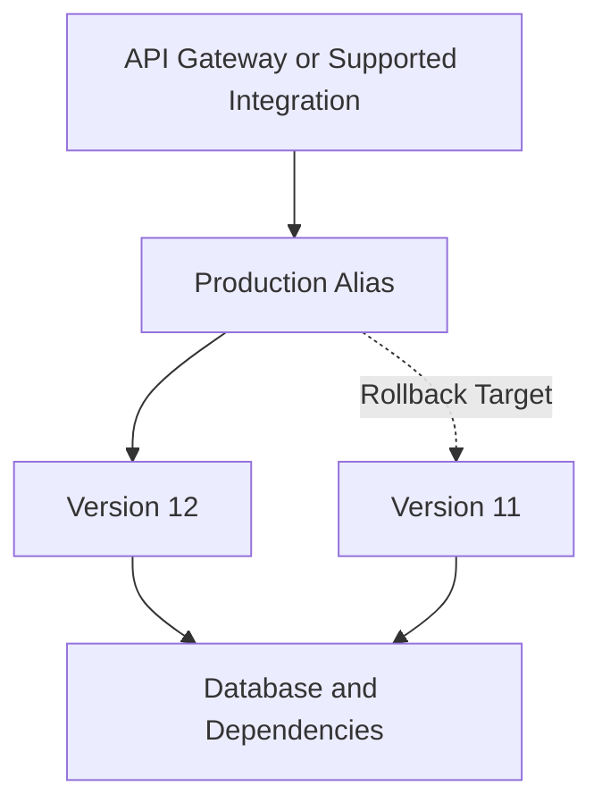
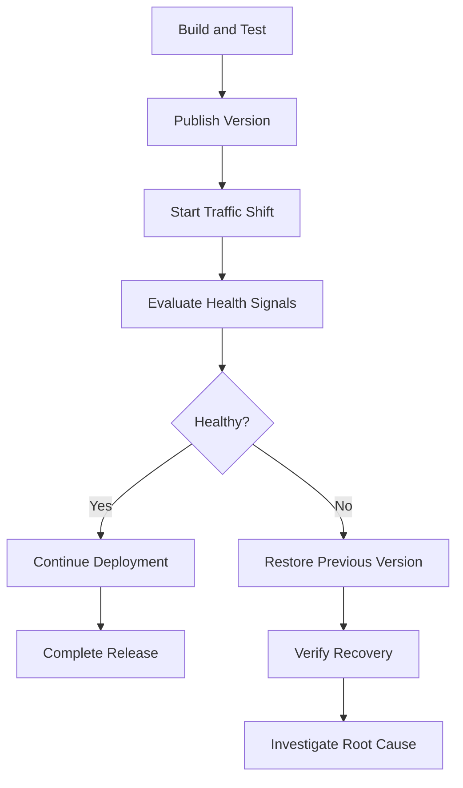
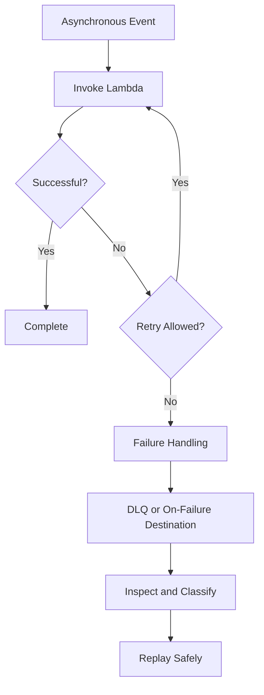

# 09- Rollback and Recovery Strategies

## Overview

Rollback and recovery strategies are critical to operating AWS Lambda workloads reliably. A production deployment can introduce application defects, incompatible dependencies, incorrect configuration, IAM authorization failures, performance regressions, or unexpected interactions with downstream services. A reliable recovery strategy minimizes customer impact while preserving data integrity and preventing repeated failures.

Lambda supports immutable published versions, aliases, weighted routing, and integrations with deployment services that help manage releases. However, restoring a previous function version does not automatically reverse database migrations, undo external API calls, recover deleted data, or replay failed events.

A production recovery strategy must address the complete system:

- Application code and deployment artifacts.
- Function configuration, IAM permissions, and networking.
- Database schema and data compatibility.
- Synchronous and asynchronous invocation paths.
- Event retries, duplicate processing, and failed-event recovery.
- Infrastructure configuration, observability, and disaster recovery.

The objective is not simply to restore an earlier version of the code. It is to restore a known-good operational state and verify that the system is behaving correctly.

## Understand the Failure Domain

Identify the component responsible for the incident before selecting a recovery action.

| Failure domain | Example | Recommended recovery direction |
|---|---|---|
| Application code | New handler produces incorrect responses | Restore a known-good published version |
| Runtime or dependencies | Import error after deployment | Restore a compatible artifact or correct the dependency package |
| Function configuration | Incorrect timeout or environment variable | Restore the intended configuration |
| IAM authorization | Function can no longer access a secret | Correct the relevant execution-role or resource policy |
| Downstream dependency | Database connection exhaustion | Reduce pressure, restore dependency capacity, or correct connection handling |
| Event processing | Messages repeatedly fail | Correct retry configuration, isolate poison messages, and replay safely |
| Data compatibility | New schema breaks the old application version | Apply a compatible schema repair or forward fix |
| Infrastructure | Incorrect event source mapping | Restore the intended infrastructure configuration |
| Regional outage | Required service becomes unavailable | Execute the tested disaster recovery procedure |

A single incident may involve multiple failure domains. For example, a new Lambda version might increase database connection usage, causing connection exhaustion. Rolling back the application may reduce the load, but the incident may continue until excessive concurrency and connection behavior are addressed.

## Lambda Versions and Aliases

Versions and aliases provide the foundation for controlled releases and rapid application rollback.

### Published versions

A published Lambda version is an immutable snapshot of function code and versioned configuration. Updating `$LATEST` does not change an already published version.

Published versions allow teams to:

- Retain known-good releases.
- Test new code without replacing the current production target.
- Compare behavior across releases.
- Roll back application traffic to a previous version.

A published version does not freeze every external dependency. IAM policies, secrets, databases, event source mappings, and other AWS resources can change independently.

### Aliases

An alias is a named pointer to a published version. Production integrations can invoke an alias rather than referencing a version number directly.

Common aliases include:

- `dev` for development.
- `staging` for pre-production validation.
- `prod` for production traffic.

An alias can also distribute traffic between two published versions using weighted routing, subject to the supported invocation path and integration.



The production alias points to version 12. Version 11 remains available as a potential rollback target.

### Inspect versions and aliases

The following commands are read-only.

List published versions:

```bash
aws lambda list-versions-by-function \
  --function-name order-processor \
  --region ap-south-1
```

List aliases:

```bash
aws lambda list-aliases \
  --function-name order-processor \
  --region ap-south-1
```

Inspect the production alias:

```bash
aws lambda get-alias \
  --function-name order-processor \
  --name prod \
  --region ap-south-1
```

Before rollback, confirm the current alias target, routing configuration, and identity of the previous healthy release. The most recently published version is not necessarily the last known-good version.

## Rollback Using an Alias

An alias rollback changes the version that receives traffic through the alias. It is generally safer than attempting to reconstruct a previous deployment by modifying `$LATEST`.

Assume the following deployment state:

| Property | Value |
|---|---|
| Function | `order-processor` |
| Alias | `prod` |
| Current version | `12` |
| Previous healthy version | `11` |

Update the alias to version 11:

```bash
aws lambda update-alias \
  --function-name order-processor \
  --name prod \
  --function-version 11 \
  --region ap-south-1
```

This is a state-changing operation. It redirects alias-based invocations but does not reverse external side effects or restore unrelated infrastructure.

Verify the resulting alias:

```bash
aws lambda get-alias \
  --function-name order-processor \
  --name prod \
  --region ap-south-1 \
  --query '{Alias:Name,Version:FunctionVersion,Routing:RoutingConfig}'
```

Confirm that the alias points to version 11 and that no unintended weighted-routing configuration remains.

### When alias rollback is appropriate

Use alias rollback when:

- The defect is isolated to the new application version.
- The previous version is known to be healthy.
- The previous runtime and dependencies remain usable.
- The previous version is compatible with current data and API contracts.
- Required permissions and downstream dependencies remain compatible.

Alias rollback alone is unlikely to resolve a failure caused by a shared database, changed IAM policy, broken network route, or unavailable external service.

## Automated Rollback with AWS CodeDeploy

AWS CodeDeploy supports Lambda deployments that coordinate traffic shifting between published versions through aliases.

Common deployment strategies include:

| Strategy | Behavior | Appropriate use |
|---|---|---|
| All-at-once | Shifts traffic to the new version in one step | Low-risk releases with strong verification and recovery controls |
| Canary | Sends a small portion of traffic to the new version before increasing it | Limiting the initial blast radius |
| Linear | Increases traffic in stages | Progressive releases with staged verification |

Exact predefined deployment configurations should be checked against current AWS CodeDeploy documentation.

For automated rollback, configure deployment settings and CloudWatch alarms to detect meaningful regressions.

Useful signals include:

- Lambda `Errors`.
- Lambda `Throttles`.
- Lambda `Duration`.
- API Gateway 5xx responses.
- Business-level failures, such as unsuccessful orders or payments.

An alarm should reflect actual service health. A harmless exception may not justify rollback, while a sustained increase in customer-visible failures may require immediate action.

### Deployment and recovery flow



Automated rollback reduces recovery time but does not replace smoke tests, incident ownership, or post-deployment verification.

## Canary Releases and Weighted Aliases

Weighted aliases distribute traffic between two published Lambda versions. This can limit exposure to a defective release while the team evaluates production behavior.

For example, direct 95% of traffic to version 11 and 5% to version 12:

```bash
aws lambda update-alias \
  --function-name order-processor \
  --name prod \
  --function-version 11 \
  --routing-config '{"AdditionalVersionWeights":{"12":0.05}}' \
  --region ap-south-1
```

This state-changing command sets version 11 as the primary target and version 12 as the additional weighted target.

Verify the configuration:

```bash
aws lambda get-alias \
  --function-name order-processor \
  --name prod \
  --region ap-south-1 \
  --query '{Primary:FunctionVersion,Routing:RoutingConfig}'
```

Weighted routing has important limitations:

- The distribution is probabilistic, not an exact per-request guarantee.
- Traffic is shifted only for invocations that use the alias through a compatible integration.
- Not every event source or invocation path uses alias routing in the same way.
- Weighted routing does not provide automatic health evaluation by itself.
- Both versions must remain compatible with shared data and downstream systems.

Use CodeDeploy or another controlled deployment workflow when you need scheduled traffic increases, alarm evaluation, and coordinated rollback.

## Recovering from Configuration Failures

A published Lambda version captures versioned function configuration, but external dependencies and related infrastructure can change independently.

Common configuration failures include:

- Incorrect environment variables.
- Invalid handler configuration.
- Unsuitable memory or timeout settings.
- Incorrect secret identifiers or parameter paths.
- Changed execution-role permissions.
- VPC settings that prevent access to required services.

### Recovery procedure

1. Inspect the current function configuration.
2. Compare it with the last known-good release or IaC definition.
3. Identify whether the failure belongs to the function, IAM, networking, or an external resource.
4. Restore the intended configuration using the approved deployment mechanism.
5. Run a controlled test invocation or smoke test.
6. Confirm recovery through logs, metrics, and dependent-service health.

Inspect the function configuration:

```bash
aws lambda get-function-configuration \
  --function-name order-processor \
  --region ap-south-1
```

This command is read-only.

For production systems, Infrastructure as Code should be the source of truth for managed configuration. Unrecorded console or CLI changes create configuration drift and can be overwritten by subsequent deployments.

## Infrastructure as Code Recovery

Infrastructure as Code makes resource creation and configuration reproducible. AWS CloudFormation, AWS SAM, and AWS CDK can manage Lambda resources and their dependencies.

An IaC-based recovery process can restore:

- Function definitions and deployment configuration.
- Aliases and permissions.
- Execution roles and resource policies.
- Event source mappings.
- Dead-letter queues and failure destinations.
- API Gateway integrations.
- CloudWatch alarms and log configuration.
- VPC and networking resources.

IaC does not automatically restore database contents or reverse external business operations. Data recovery and event replay require separate procedures.

### Reconcile emergency changes

During an incident, a manual change may be necessary to restore service quickly. Record the change and reconcile it with the repository afterward.

1. Apply the approved emergency mitigation.
2. Record the change, its justification, and its impact.
3. Update the IaC definition to represent the intended state.
4. Review the planned infrastructure changes.
5. Apply the reviewed changes.
6. Verify the resulting configuration and remove temporary resources or permissions.

Do not blindly redeploy an outdated template during an incident. It may remove resources or overwrite a deliberate emergency mitigation.

## Recovering Asynchronous Invocations

Lambda asynchronous invocation has its own retry and failure-handling behavior. Rolling back a function version does not automatically replay all failed events.

Depending on the invocation configuration, recovery may involve:

- Maximum event age.
- Maximum retry attempts.
- Dead-letter queues.
- On-failure destinations.
- Monitoring for failed or discarded events.

For asynchronous invocations, Lambda can retry function errors and route exhausted failures according to the configured failure-handling mechanism. Exact behavior depends on the invocation model and configuration.



A dead-letter queue and an on-failure destination are different mechanisms. A dead-letter queue retains failed events for later handling. An on-failure destination can carry additional invocation context, depending on the destination and invocation type.

### Replay failed events safely

Before replaying events:

- Determine whether the original operation partially succeeded.
- Verify that side effects are protected by idempotency.
- Separate transient errors from permanent validation failures.
- Rate-limit replay to protect downstream dependencies.
- Preserve correlation identifiers and original event metadata.
- Monitor replay success, queue depth, and repeated failures.

Blind replay can duplicate payments, orders, notifications, or database updates.

## Recovering from SQS Event Source Mapping Failures

An event source mapping polls supported event sources such as Amazon SQS and invokes Lambda with batches of records.

For SQS, failed messages can become visible again after the queue's visibility timeout and be processed again. This behavior differs from direct asynchronous Lambda invocation.

Configure the visibility timeout with the Lambda timeout and batching behavior in mind. Follow current AWS guidance for the selected queue and mapping configuration.

### Partial batch responses

For SQS event source mappings, partial batch responses allow the function to identify individual records that failed rather than failing the entire batch.

Enable `ReportBatchItemFailures` on the event source mapping and return failed message identifiers in the expected response structure.

```python
def lambda_handler(event, context):
    batch_item_failures = []

    for record in event.get("Records", []):
        message_id = record["messageId"]

        try:
            process_message(record)
        except RetryableProcessingError:
            batch_item_failures.append({
                "itemIdentifier": message_id
            })
        except PermanentProcessingError:
            # Persist a rejection record or route the message through
            # a controlled failure-handling workflow.
            record_permanent_failure(record)

    return {
        "batchItemFailures": batch_item_failures
    }
```

`process_message`, `RetryableProcessingError`, `PermanentProcessingError`, and `record_permanent_failure` are application-defined components and must be implemented.

A permanently invalid message should not be silently acknowledged unless its disposition has been durably recorded. Otherwise, the system may lose the ability to investigate the failure.

### SQS recovery checklist

- Configure partial batch responses where appropriate.
- Configure a redrive policy and dead-letter queue.
- Make processing idempotent.
- Monitor queue depth, message age, and dead-letter queue depth.
- Avoid replaying an entire backlog at unrestricted speed.
- Verify batch size, concurrency, retry behavior, and event source mapping configuration.

## Recovering from DynamoDB Streams and Other Event Sources

DynamoDB Streams, Kinesis, and other event sources have their own ordering, checkpointing, and retry semantics.

A processing failure may delay progress on a shard or partition while the event source mapping retries the batch. The impact depends on the source, mapping configuration, batch behavior, and failure-handling settings.

For these integrations:

- Understand when checkpoints advance.
- Use partial batch responses where supported.
- Configure retry limits and failure destinations when available.
- Monitor `IteratorAge` or the relevant source-lag metric.
- Preserve ordering when business correctness depends on it.
- Make replayed records safe to process more than once.

Do not apply SQS visibility-timeout assumptions to stream event sources. Recovery procedures must be designed for the actual source's delivery, ordering, and checkpointing behavior.

## Database and Data Recovery

Database recovery is often more difficult than application rollback because the new version may already have modified persistent state.

A release can:

- Add or remove schema elements.
- Change the meaning of existing fields.
- Write a new event schema.
- Delete or transform records.
- Trigger external side effects.
- Partially complete a multi-step operation.

### Use backward-compatible migrations

An expand-and-contract migration reduces the risk that a code rollback will encounter an incompatible database schema.

1. Add new schema elements without immediately removing the old ones.
2. Deploy code that supports both representations.
3. Migrate existing data safely.
4. Verify that all active application versions and consumers support the new representation.
5. Remove obsolete schema elements only after the rollback window has passed.

### Data recovery options

| Incident | Potential response |
|---|---|
| Defective application release | Roll back the application version |
| Invalid records written by new code | Identify affected records and apply a reviewed repair |
| Accidental deletion | Restore from backups or use point-in-time recovery where supported and configured |
| Duplicate business operations | Reconcile using idempotency keys and business records |
| Incompatible schema migration | Apply a compatible repair or restore a supported schema |
| Incorrectly published events | Publish compensating events or perform business-level reconciliation |

Restoring a backup can discard legitimate writes made after the recovery point. Define recovery point objectives (RPO) and recovery time objectives (RTO) before an incident, and test the recovery procedure.

## VPC and Downstream Dependency Recovery

A Lambda function may become unhealthy even when its code has not changed.

Possible causes include:

- Security group changes.
- Incorrect subnet routes.
- Missing VPC endpoints or NAT connectivity.
- DNS resolution failures.
- Database connection exhaustion.
- Downstream service rate limits.
- Expired or rotated credentials.

Inspect the function's VPC configuration:

```bash
aws lambda get-function-configuration \
  --function-name order-processor \
  --region ap-south-1 \
  --query '{Vpc:VpcConfig,Role:Role,State:State,LastUpdateStatus:LastUpdateStatus}'
```

This command is read-only. Continue with targeted inspection of relevant security groups, subnet routes, network ACLs, endpoints, IAM policies, and downstream service metrics.

For database connection exhaustion, reducing Lambda concurrency may be more effective than rolling back code. A traffic spike can create many concurrent database connections; restoring an older version without controlling the load may reproduce the same incident.

Potential mitigations include:

- Reserved concurrency to cap function concurrency.
- RDS Proxy for supported RDS and Aurora workloads.
- Connection reuse within execution environments.
- Bounded connection and query timeouts.
- Exponential backoff with jitter.
- Circuit breakers or graceful degradation where appropriate.

Use these controls to protect downstream capacity rather than simply suppressing symptoms.

## Disaster Recovery and Regional Failures

Rollback typically addresses a defective release or configuration change. Disaster recovery addresses broader failures, such as a Region becoming unavailable or a required dependency being inaccessible.

A Lambda disaster recovery plan should cover:

- Deployment artifacts and infrastructure templates.
- IAM roles and policies.
- Environment-specific configuration and secrets.
- Databases and durable data.
- Event sources, queues, and routing.
- API endpoints and DNS configuration.
- Monitoring, alarms, and operational access.
- Regional service availability and quotas.

### Disaster recovery strategies

| Strategy | Description | Trade-off |
|---|---|---|
| Backup and restore | Recreate resources and restore data after failure | Lower standby cost, but potentially longer recovery |
| Pilot light | Maintain critical data and a minimal resource set in another Region | Faster than rebuilding everything, but requires activation work |
| Warm standby | Keep a reduced operational environment in another Region | Faster recovery with additional ongoing cost |
| Active-active | Run workloads in multiple Regions | Potentially faster failover, but more data consistency and routing complexity |

Select a strategy based on RTO, RPO, cost, data consistency, and operational requirements.

### Regional recovery checklist

- Verify runtime and feature availability in the target Region.
- Confirm regional quotas and concurrency capacity.
- Replicate or restore data to the required recovery point.
- Recreate secrets and permissions securely.
- Validate event sources and downstream dependencies.
- Test routing changes and failback procedures.
- Confirm that the secondary Region is ready before sending production traffic.

A secondary Region is not a complete disaster recovery solution until the full workload has been deployed, tested, and shown to meet its recovery objectives.

## Monitoring and Recovery Signals

Effective rollback depends on detecting meaningful regressions and distinguishing them from normal operational variation.

| Signal | Purpose |
|---|---|
| Lambda `Errors` | Identifies handler failures and runtime errors |
| Lambda `Throttles` | Indicates invocations rejected due to concurrency limits |
| Lambda `Duration` | Highlights latency increases and timeout risk |
| Lambda `ConcurrentExecutions` | Shows active execution demand |
| Lambda `IteratorAge` | Helps identify lag for applicable stream event sources |
| API Gateway 5xx responses | Measures customer-visible integration failures |
| SQS queue depth and message age | Reveals backlog growth and slow processing |
| Dead-letter queue depth | Identifies events that could not be processed successfully |
| Business-level success rate | Detects failures that infrastructure metrics alone may miss |

Configure CloudWatch alarms with appropriate thresholds, evaluation periods, and missing-data behavior.

For critical workloads, combine infrastructure metrics with business-level indicators such as order completion rate, payment success rate, or processing backlog age. A function can return successful responses while still producing incorrect business outcomes.

## Incident Response and Recovery Runbook

A rollback should follow a controlled incident process with clear ownership.

### Recovery sequence

1. **Detect:** Confirm the failure through alarms, dashboards, logs, and customer-impact indicators.
2. **Assess:** Identify the affected function, alias, deployment, event source, and downstream services.
3. **Contain:** Pause an unsafe rollout, reduce traffic, or limit concurrency if necessary.
4. **Choose:** Decide whether the failure requires code rollback, configuration correction, dependency recovery, or data repair.
5. **Execute:** Apply the approved mitigation and record the change.
6. **Verify:** Run smoke tests and inspect error rates, latency, queue age, and business outcomes.
7. **Stabilize:** Monitor for recurring failures, delayed events, and downstream recovery.
8. **Reconcile:** Update IaC and deployment records to match the intended state.
9. **Review:** Identify root causes and add preventive tests, alarms, or operational controls.

### Incident checklist

- [ ] Identify the last known-good published version.
- [ ] Verify compatibility with the current database schema and configuration.
- [ ] Inspect alias routing and active deployments.
- [ ] Identify whether the failure affects synchronous requests, asynchronous invocations, or event source mappings.
- [ ] Check whether downstream services are overloaded.
- [ ] Apply the selected recovery action.
- [ ] Verify customer-facing health and infrastructure metrics.
- [ ] Check failed-event queues and pending retries.
- [ ] Record the change and reconcile IaC.
- [ ] Assign follow-up actions for root-cause remediation.

## Common Mistakes

### Rolling back code without checking data compatibility

An older application version may fail against a newer schema or data format. Use backward-compatible migrations and test rollback with realistic data.

### Assuming rollback reverses side effects

A payment, email, or event publication may already have occurred. Use idempotency keys, transactional patterns where supported, and compensating actions when business operations must be reversed.

### Replaying failed events immediately

Unbounded replay can overwhelm downstream services and reproduce the original failure. Replay gradually, monitor the backlog, and confirm that processing is idempotent.

### Relying exclusively on Lambda error metrics

A function can return successful responses while producing incorrect business results. Add application-level metrics and verification checks.

### Allowing manual configuration drift

Emergency CLI changes can diverge from IaC and be overwritten by the next deployment. Record and reconcile all emergency changes.

### Retaining no known-good artifact

Rollback becomes difficult if the previous version, container image, deployment template, or required configuration has been removed. Define retention policies for deployment artifacts and recovery dependencies.

### Treating a second Region as automatic failover

A secondary Region may lack sufficient capacity, current data, valid secrets, permissions, or working event integrations. Test complete failover and failback procedures.

## Production Best Practices

- Publish immutable Lambda versions and route production integrations through controlled aliases.
- Use canary or linear traffic shifting for high-impact releases when appropriate.
- Define alarms that represent customer impact and meaningful service degradation.
- Automate rollback only when the failure signal is reliable and the rollback target is safe.
- Use backward-compatible database migrations and versioned event contracts.
- Make event processing idempotent and preserve enough information for safe replay.
- Configure retries, dead-letter queues, destinations, and partial batch responses according to the event source.
- Protect downstream systems with concurrency limits, connection management, and bounded retries.
- Manage function and infrastructure configuration through reviewed IaC.
- Retain known-good artifacts and document their compatibility requirements.
- Establish and test RTO and RPO for workloads with disaster recovery requirements.
- Rehearse rollback and recovery procedures in a non-production environment before relying on them during an incident.

## Key Takeaways

- Lambda versions and aliases enable controlled deployments and rapid code rollback, but they do not reverse external side effects or restore unrelated infrastructure.
- Choose recovery actions according to the failure domain: application code, configuration, permissions, dependencies, event processing, data, or regional availability.
- Event retries and replay must account for delivery semantics, duplicate processing, idempotency, and downstream capacity.
- Backward-compatible migrations, reviewed IaC, meaningful alarms, and verified rollback procedures reduce recovery risk.
- Disaster recovery requires tested restoration of data, configuration, permissions, event integrations, and regional capacity against explicit RTO and RPO targets.