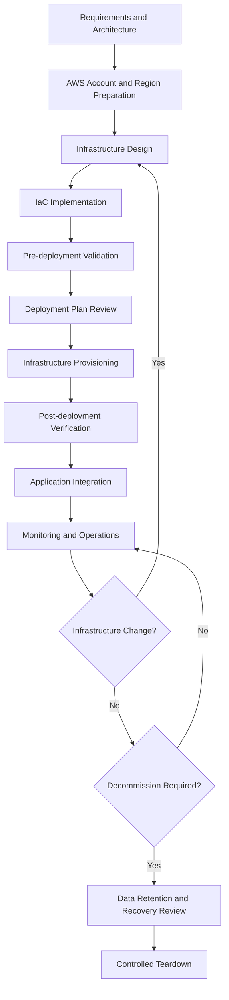
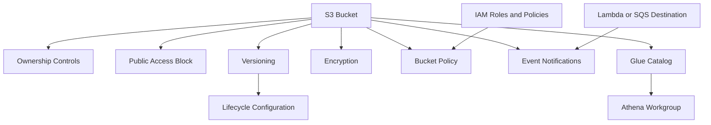
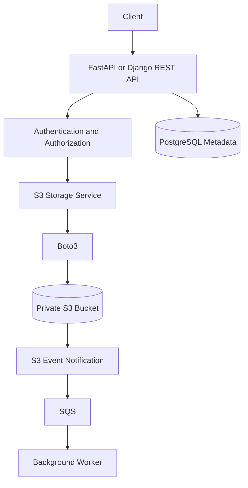
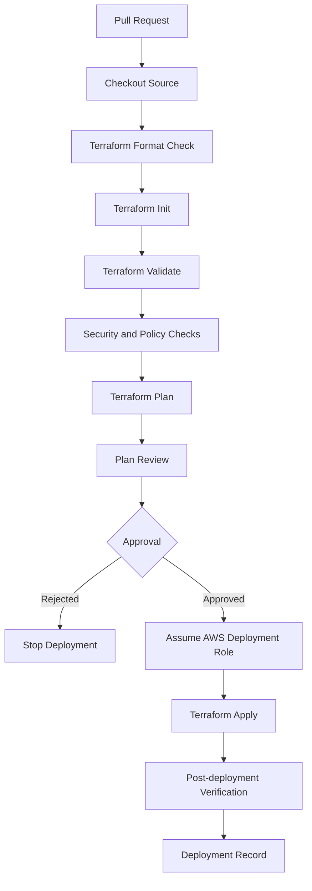
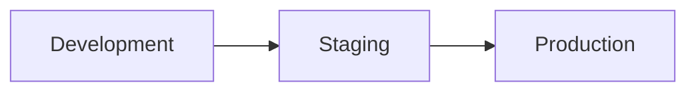
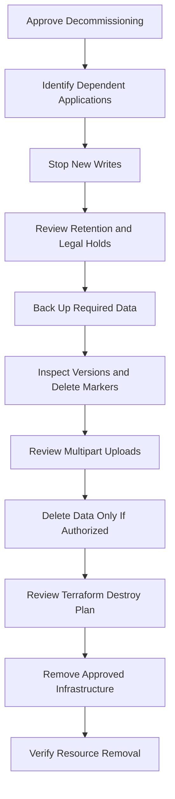

# 01- S3 Deployment Lifecycle

## Overview

The S3 deployment lifecycle defines how Amazon S3 infrastructure is designed, provisioned, validated, released, operated, updated, and eventually decommissioned.

A production deployment involves more than creating a bucket. It requires coordinated management of storage configuration, identity and access permissions, encryption, infrastructure dependencies, application integrations, deployment state, monitoring, and data retention.

A reliable deployment process should ensure that:

- Infrastructure is reproducible and version-controlled.
- Development, staging, and production environments are isolated.
- Security controls are applied before applications access the bucket.
- Infrastructure changes are reviewed before execution.
- Deployment failures can be diagnosed and recovered.
- Existing data is protected during updates and teardown.
- Every deployment can be independently verified.

For backend systems, S3 deployment commonly supports file uploads, document storage, static content delivery, event-driven processing, data ingestion, and analytics workloads.

## S3 Deployment Lifecycle

A deployment lifecycle consists of distinct stages. Each stage has its own inputs, validation requirements, and failure conditions.



| Stage | Primary responsibility | Expected outcome |
|---|---|---|
| Requirements | Define workload, access, retention, and availability needs | Deployment requirements |
| Environment preparation | Configure AWS account, Region, and identity | Deployment-ready environment |
| Infrastructure design | Define bucket and dependent resources | Approved architecture |
| IaC implementation | Encode infrastructure in Terraform, CloudFormation, or CDK | Version-controlled configuration |
| Validation | Check syntax, configuration, permissions, and security | Valid deployment artifacts |
| Planning | Review proposed infrastructure changes | Approved deployment plan |
| Provisioning | Create or modify AWS resources | Provisioned infrastructure |
| Verification | Inspect deployed resource configuration | Verified deployment state |
| Integration | Connect backend applications and AWS services | Working application workflow |
| Operations | Monitor security, performance, reliability, and cost | Managed production environment |
| Teardown | Remove resources safely when no longer required | Controlled decommissioning |

## Deployment Requirements and Design Decisions

Infrastructure should not be provisioned until workload requirements are understood.

### Workload Requirements

Identify the type of workload that will use S3.

| Workload | Typical S3 usage | Important design decisions |
|---|---|---|
| Backend file storage | User uploads and downloads | Private access, object ownership, upload limits |
| Static website | Website asset storage | CloudFront, private origin, caching |
| Media processing | Image and video storage | Event notifications, processing prefixes |
| Data lake | Raw and processed datasets | Prefix conventions, partitioning, lifecycle |
| Backup storage | Database and application backups | Retention, versioning, recovery |
| Cross-account storage | Shared datasets and artifacts | Resource policies, IAM roles, ownership |

### Define Deployment Constraints

Document the following before choosing infrastructure settings:

- AWS account and deployment Region.
- Bucket naming and ownership requirements.
- Expected object volume and average object size.
- Upload frequency and request patterns.
- Required storage classes.
- Data retention and deletion requirements.
- Encryption requirements.
- Application and service access patterns.
- Cross-account access requirements.
- Recovery objectives and backup requirements.
- Expected storage, request, retrieval, and transfer costs.

These requirements influence bucket configuration, IAM policies, lifecycle rules, replication, and infrastructure dependencies.

## AWS Account and Region Preparation

### Account Selection

AWS resources belong to an AWS account. Deployment pipelines must use the intended account rather than relying on whichever credentials happen to be active locally.

Inspect the active identity:

```bash
aws sts get-caller-identity
```

Example output:

```json
{
  "UserId": "AIDXXXXXXXXXXXXXXX",
  "Account": "123456789012",
  "Arn": "arn:aws:iam::123456789012:user/deployment-user"
}
```

Validate the account ID and principal before applying infrastructure changes.

For production deployments, prefer an assumed IAM role or federated identity over long-lived IAM user access keys.

### Region Selection

Choose the Region based on application location, data residency, service availability, and latency requirements.

Example:

```bash
export AWS_REGION="ap-south-1"
```

Verify the configured Region:

```bash
aws configure get region
```

A Region mismatch can cause deployment scripts and application clients to inspect different resource endpoints or fail when accessing regional services.

S3 bucket names are globally unique within the applicable AWS partition, not merely within one account or Region. A bucket name must therefore be selected and validated before deployment.

### Credential Configuration

The AWS SDK and CLI support multiple credential providers.

Preferred approaches include:

- IAM roles attached to EC2 instances.
- IAM roles for tasks running on ECS.
- IAM roles for Kubernetes workloads.
- IAM Identity Center.
- GitHub Actions OIDC federation.
- Assumed roles for cross-account deployments.

Avoid embedding access keys in Terraform files, Python source code, Docker images, or CI/CD workflow definitions.

## Infrastructure Design

### Resource Dependencies

An S3 deployment often contains multiple resources that must be created in a controlled order.

| Resource | Purpose | Dependency |
|---|---|---|
| S3 bucket | Main storage resource | None |
| Ownership controls | Define object ownership behavior | Bucket |
| Public access block | Restrict public exposure | Bucket |
| Versioning | Preserve object versions | Bucket |
| Encryption configuration | Configure default encryption | Bucket |
| Lifecycle configuration | Manage object transitions and expiration | Bucket |
| Bucket policy | Define resource-based access | Bucket |
| IAM policies and roles | Grant application and service permissions | IAM and resource requirements |
| Event notifications | Route object events | Bucket and destination permissions |
| Glue database and tables | Provide data catalog metadata | Glue and S3 |
| Athena workgroup | Configure analytics execution | Athena and result storage |

The exact dependency graph depends on the resources being deployed.

### Resource Dependency Diagram



### Security Defaults

A private application bucket should generally use:

- S3 Block Public Access.
- BucketOwnerEnforced Object Ownership.
- Default server-side encryption.
- TLS-enforced access through appropriate bucket policies.
- Least-privilege IAM permissions.
- Versioning when recovery requirements justify it.
- Explicit retention and deletion policies.

Do not assume that encryption alone makes a bucket secure. Access authorization and encryption-key authorization are separate controls.

Detailed access-control and encryption design belongs in the S3 Security documentation.

## Infrastructure as Code

Infrastructure as Code (IaC) makes deployment repeatable and allows infrastructure changes to be reviewed, tested, and version-controlled.

Common choices include Terraform, AWS CloudFormation, and AWS CDK.

| Tool | Configuration style | Strengths | Considerations |
|---|---|---|---|
| Terraform | HCL | Multi-provider ecosystem, reusable modules, plan-based workflow | State management and provider lifecycle |
| CloudFormation | YAML or JSON | Native AWS resource management and stack lifecycle | Stack update and rollback behavior |
| AWS CDK | Programming languages | Reusable constructs and higher-level abstractions | Synthesized CloudFormation must be reviewed |

Choose one primary deployment model for a given infrastructure stack. Avoid managing the same resource independently through multiple IaC tools.

### Terraform Project Structure

A focused Terraform project can use the following structure:

```text
infrastructure/
└── terraform/
    ├── versions.tf
    ├── providers.tf
    ├── variables.tf
    ├── outputs.tf
    ├── storage_buckets.tf
    ├── encryption.tf
    ├── lifecycle.tf
    ├── iam.tf
    ├── glue.tf
    └── athena.tf
```

Keep resource definitions separated by responsibility. This improves maintainability and makes infrastructure reviews easier.

### Provider and Version Constraints

Define Terraform and provider requirements explicitly.

```hcl
terraform {
  required_version = ">= 1.5.0"

  required_providers {
    aws = {
      source  = "hashicorp/aws"
      version = ">= 5.0, < 7.0"
    }
  }
}
```

Provider constraints help prevent unexpected behavior caused by incompatible provider versions.

For reproducible deployments:

- Commit `.terraform.lock.hcl`.
- Review provider upgrades.
- Test version changes outside production.
- Avoid unbounded provider constraints.
- Use a controlled Terraform upgrade process.

### Provider Configuration

```hcl
provider "aws" {
  region = var.aws_region

  default_tags {
    tags = {
      Project     = "s3-data-lake"
      Environment = var.environment
      ManagedBy   = "Terraform"
    }
  }
}
```

Keep account-specific and environment-specific values in variables rather than hardcoding them in resource definitions.

### Environment Variables

Use separate variable files for each environment.

```text
infrastructure/terraform/
├── environments/
│   ├── dev.tfvars
│   ├── staging.tfvars
│   └── prod.tfvars
```

Example `dev.tfvars`:

```hcl
aws_region  = "ap-south-1"
bucket_name = "company-data-lake-dev-example"
environment = "dev"
```

Example `prod.tfvars`:

```hcl
aws_region  = "ap-south-1"
bucket_name = "company-data-lake-prod-example"
environment = "prod"
```

Bucket names must be globally unique. Replace example names with approved deployment names.

Do not commit secrets or credentials in `.tfvars` files.

## Terraform State Management

Terraform state maps configuration resources to actual infrastructure.

It is essential for planning updates, tracking resource identifiers, detecting drift, and coordinating deployments.

### Local State

By default, Terraform stores state locally in `terraform.tfstate`.

Local state is suitable for isolated experimentation but is not a good default for shared production infrastructure.

Risks include:

- State loss.
- Accidental disclosure of sensitive values.
- Conflicting updates from multiple engineers.
- Lack of centralized access control.
- Difficulty recovering from workstation failure.

### Remote State

For shared environments, use a secured remote backend with state locking.

An S3 backend can store Terraform state in a dedicated bucket. The state bucket should be separate from the application data bucket.

Example backend configuration:

```hcl
terraform {
  backend "s3" {
    bucket       = "company-terraform-state-example"
    key          = "amazon-s3/dev/terraform.tfstate"
    region       = "ap-south-1"
    encrypt      = true
    use_lockfile = true
  }
}
```

The backend bucket must exist before Terraform initializes this configuration. Configure versioning, access controls, encryption, and appropriate state recovery procedures.

Use a separate state key for each environment.

```text
amazon-s3/
├── dev/
│   └── terraform.tfstate
├── staging/
│   └── terraform.tfstate
└── prod/
    └── terraform.tfstate
```

The S3 backend supports native state locking with `use_lockfile` in supported Terraform versions. Confirm the Terraform version and backend requirements before adopting this configuration.

### State Security

Terraform state may contain sensitive infrastructure values even when variables are marked sensitive.

Protect state using:

- Restricted IAM permissions.
- Encryption at rest.
- TLS in transit.
- Versioning and controlled recovery.
- Separate state locations for different environments.
- Audit logging.
- State access through trusted deployment identities.

Never expose state files in public repositories or build artifacts.

## Pre-deployment Validation

A deployment should pass validation before infrastructure changes are applied.

### Toolchain Validation

Check Terraform:

```bash
terraform version
```

Check AWS CLI:

```bash
aws --version
```

Check the active AWS identity:

```bash
aws sts get-caller-identity
```

### Terraform Formatting

```bash
terraform fmt -check -recursive
```

This verifies that Terraform files follow standard formatting.

Apply formatting when required:

```bash
terraform fmt -recursive
```

### Terraform Initialization

```bash
terraform init
```

Initialization downloads required providers and configures the backend.

For CI/CD workflows, use:

```bash
terraform init -input=false
```

### Terraform Validation

```bash
terraform validate
```

This checks Terraform configuration structure and internal consistency. It does not prove that AWS permissions are sufficient or that a deployment will succeed.

### Security and Policy Validation

Before deployment, inspect:

- Public access configuration.
- Bucket ownership settings.
- Encryption configuration.
- IAM policy scope.
- Resource policy conditions.
- Lifecycle retention rules.
- Replication permissions, when configured.
- Logging and monitoring configuration.
- Resource deletion protection.

Security scanning tools can supplement Terraform validation, but their results must be reviewed in the context of the workload.

## Deployment Planning

Terraform uses a plan-and-apply workflow.

The plan describes the infrastructure changes Terraform intends to make.

### Generate a Plan

```bash
terraform plan \
  -var-file="environments/dev.tfvars" \
  -out="deployment.tfplan"
```

### Review the Plan

```bash
terraform show deployment.tfplan
```

Review the following:

- Resources to be created.
- Resources to be modified.
- Resources to be replaced.
- Resources to be destroyed.
- Changes to bucket policies.
- Versioning and encryption changes.
- Lifecycle rule modifications.
- IAM permission changes.
- Changes affecting existing data.

A resource replacement or deletion deserves special attention when the resource contains persistent data.

### Apply the Reviewed Plan

```bash
terraform apply deployment.tfplan
```

Applying a saved plan executes the planned changes. The plan should be treated as an approval artifact and protected from unauthorized modification.

If the configuration or state changes after planning, regenerate and review the plan.

## Infrastructure Provisioning

### Deployment Execution

A typical Terraform deployment sequence is:

```bash
terraform init

terraform fmt -check -recursive

terraform validate

terraform plan \
  -var-file="environments/dev.tfvars" \
  -out="deployment.tfplan"

terraform show deployment.tfplan

terraform apply deployment.tfplan
```

Do not use `terraform apply -auto-approve` as a substitute for reviewing infrastructure changes.

Production deployments should use explicit approval gates and a controlled deployment identity.

### Resource Protection

Persistent S3 buckets require deliberate deletion controls.

Terraform supports lifecycle protection:

```hcl
resource "aws_s3_bucket" "data_lake" {
  bucket = var.bucket_name

  lifecycle {
    prevent_destroy = true
  }
}
```

`prevent_destroy` prevents Terraform from planning destruction of the protected resource while the lifecycle rule remains in the configuration.

It is not a backup mechanism and does not prevent deletion through the AWS console, CLI, or another principal.

Use additional IAM controls and operational safeguards for critical buckets.

## Post-deployment Verification

A successful Terraform apply does not prove that every application workflow works correctly.

Verify the actual AWS resources after deployment.

### Verify Bucket Existence

```bash
aws s3api head-bucket \
  --bucket your-bucket-name
```

### Verify Region

```bash
aws s3api get-bucket-location \
  --bucket your-bucket-name
```

### Verify Versioning

```bash
aws s3api get-bucket-versioning \
  --bucket your-bucket-name
```

Expected configuration when versioning is enabled:

```json
{
  "Status": "Enabled"
}
```

### Verify Encryption

```bash
aws s3api get-bucket-encryption \
  --bucket your-bucket-name
```

Inspect the returned default encryption configuration and confirm it matches the intended design.

### Verify Public Access Block

```bash
aws s3api get-public-access-block \
  --bucket your-bucket-name
```

### Verify Ownership Controls

```bash
aws s3api get-bucket-ownership-controls \
  --bucket your-bucket-name
```

### Verify Lifecycle Configuration

```bash
aws s3api get-bucket-lifecycle-configuration \
  --bucket your-bucket-name
```

Check that the rules, filters, transitions, and expiration periods match the approved configuration.

### Verify Terraform Outputs

```bash
terraform output
```

For an individual output:

```bash
terraform output -raw bucket_name
```

### Verification Checklist

| Check | Expected result |
|---|---|
| Bucket exists | `HeadBucket` succeeds |
| Region | Matches deployment configuration |
| Versioning | Matches recovery requirements |
| Encryption | Matches security requirements |
| Public access block | Required restrictions enabled |
| Object ownership | Matches ownership design |
| Lifecycle rules | Match retention requirements |
| IAM access | Intended principals can perform required operations |
| Terraform state | Reflects deployed infrastructure |
| Application workflow | Upload and retrieval tests succeed |

## Application Integration

Once infrastructure is deployed and verified, backend applications can integrate with S3.

A typical backend architecture uses a private bucket and a dedicated storage service layer.



### Integration Responsibilities

| Component | Responsibility |
|---|---|
| API | Authenticate users and validate requests |
| Storage service | Encapsulate S3 operations |
| Boto3 client | Communicate with AWS |
| S3 bucket | Store file objects |
| PostgreSQL | Store application-level file metadata |
| SQS | Buffer asynchronous processing events |
| Worker | Process files outside the API request lifecycle |

Do not place all S3 operations directly inside API routes or Django views.

Keep storage operations in a reusable service layer. This improves testability, error handling, and separation of concerns.

### Deployment-time Integration Checks

After application deployment, verify:

- The application uses the intended AWS role.
- The bucket name and Region are correct.
- The application can upload permitted objects.
- The application cannot access unauthorized prefixes.
- Presigned URLs use the intended bucket and expiration.
- Object metadata is stored correctly.
- Event notifications reach their configured destinations.
- Retry and idempotency behavior works as designed.

An application-level upload test is stronger evidence of working integration than checking the bucket's existence alone.

## CI/CD Deployment Lifecycle

A CI/CD pipeline should validate infrastructure changes before applying them.

### Recommended Pipeline



### CI/CD Responsibilities

| Stage | Responsibility |
|---|---|
| Pull request | Review infrastructure changes |
| Formatting | Enforce consistent HCL formatting |
| Initialization | Resolve provider and backend dependencies |
| Validation | Check configuration consistency |
| Security scanning | Identify risky infrastructure settings |
| Planning | Generate infrastructure change plan |
| Approval | Require authorization for sensitive environments |
| Authentication | Obtain short-lived AWS credentials |
| Apply | Execute approved infrastructure changes |
| Verification | Check deployed resource configuration |

### GitHub Actions Authentication

Prefer GitHub Actions OIDC federation to long-lived AWS access keys.

The deployment role should trust the expected GitHub repository and branch or environment identity. Its permissions should be restricted to the resources and actions needed by the pipeline.

Never place AWS access keys in workflow YAML.

## Environment Promotion

Promote infrastructure through isolated environments.



Each environment should have:

- Independent resource naming.
- Separate Terraform state.
- Environment-specific variables.
- Appropriate IAM permissions.
- Environment-specific approval rules.
- Independent verification.

### Promotion Strategy

| Environment | Deployment approach |
|---|---|
| Development | Frequent deployment and automated validation |
| Staging | Production-like configuration and integration testing |
| Production | Reviewed plan, approval gate, controlled apply, verification |

Do not copy a development state file into staging or production. Each environment must have its own state and resource mapping.

Use the same reusable infrastructure modules where possible, with environment-specific configuration supplied through variables.

## Deployment Failure and Recovery

Infrastructure deployment can fail because of permissions, resource conflicts, invalid configuration, service dependencies, or state inconsistencies.

### Common Failure Categories

| Failure | Typical cause | Diagnostic direction |
|---|---|---|
| `AccessDenied` | Missing IAM or resource-policy permission | Inspect caller identity and policy evaluation |
| Bucket name conflict | Name already allocated | Select a globally unique name |
| Invalid bucket configuration | Conflicting resource settings | Inspect AWS API error and resource configuration |
| Terraform state lock | Another operation holds the state lock | Identify the active operation before recovery |
| Resource already exists | Resource was created outside Terraform | Inspect resource and Terraform state |
| Provider initialization failure | Version or dependency issue | Inspect provider constraints and lock file |
| Lifecycle configuration conflict | Invalid or overlapping rule configuration | Inspect lifecycle rules and API validation |
| Deployment timeout | AWS operation or dependency did not complete | Inspect service state and deployment logs |

### Diagnostic Workflow

1. Identify the failed Terraform resource or AWS API operation.
2. Inspect the complete error message and deployment logs.
3. Confirm the AWS account, Region, and active identity.
4. Check IAM permissions and resource policies.
5. Inspect the actual AWS resource configuration.
6. Compare Terraform state with the remote resource.
7. Determine whether the operation partially succeeded.
8. Correct the underlying configuration or permissions.
9. Generate a fresh Terraform plan.
10. Apply only after reviewing the resulting changes.

### Terraform State Recovery

Do not delete or manually edit Terraform state simply because a deployment failed.

Useful commands include:

```bash
terraform state list
```

Inspect a resource:

```bash
terraform state show aws_s3_bucket.data_lake
```

Refresh the state view through a plan:

```bash
terraform plan -refresh-only
```

Import an existing bucket when it should be managed by Terraform:

```bash
terraform import \
  aws_s3_bucket.data_lake \
  your-bucket-name
```

Importing a resource does not automatically create a complete matching configuration. Review the configuration and state after import.

### Drift Detection

Drift occurs when actual AWS resources differ from the Terraform configuration or recorded state.

Possible causes include:

- Manual console changes.
- CLI-based modifications.
- Changes made by another automation system.
- Resource defaults or external service behavior.
- Incomplete infrastructure deployment.

Detect drift:

```bash
terraform plan -refresh-only
```

Review the differences before deciding whether to update Terraform configuration or reconcile the remote resource.

Avoid automatically overwriting manual changes without understanding why they were made.

## Deployment Monitoring

Deployment verification should continue into ongoing operations.

### Operational Signals

| Area | What to monitor |
|---|---|
| Deployment | Terraform apply failures and resource changes |
| Storage | Object count, stored bytes, storage-class distribution |
| Requests | Request volume and error rates |
| Security | Access-denied events and policy changes |
| Lifecycle | Storage transitions and object expiration |
| Replication | Replication status and pending operations |
| Cost | Storage, requests, retrieval, and transfer charges |
| Application | Upload failures, download latency, processing errors |

Use CloudWatch, CloudTrail, S3 Storage Lens, S3 Inventory, and AWS billing tools according to the workload's monitoring requirements.

Infrastructure deployment should also produce an auditable record containing:

- Source revision.
- Environment.
- AWS account and Region.
- Terraform version.
- Provider versions.
- Approved plan.
- Deployment identity.
- Apply result.
- Post-deployment verification result.

## Safe Infrastructure Updates

S3 resources often contain persistent application data. Infrastructure updates must distinguish between configuration changes and destructive resource replacement.

### Change Categories

| Change category | Example | Risk |
|---|---|---|
| Additive | Add a new lifecycle rule | Usually lower |
| Configuration update | Change default encryption | Depends on workload |
| Access change | Modify bucket policy | Potential application outage |
| Retention change | Shorten expiration period | Potential data loss |
| Resource replacement | Replace bucket resource | High |
| Destructive | Delete bucket or object versions | Potentially irreversible |

Before applying a change:

- Review the Terraform plan.
- Identify resources marked for replacement or destruction.
- Confirm retention and recovery requirements.
- Verify dependent application and service permissions.
- Check whether existing objects are affected.
- Confirm that backups or recovery mechanisms are available.
- Obtain approval for high-impact changes.

Never treat a successful Terraform plan as proof that a change is operationally safe.

## Controlled Teardown

Decommissioning an S3 deployment requires more care than provisioning it.

A bucket may contain current objects, noncurrent versions, delete markers, and incomplete multipart uploads. Deleting the bucket resource without considering these items can fail or cause permanent data loss.

### Teardown Sequence



### Teardown Checklist

- Confirm the target AWS account and Region.
- Confirm the bucket is no longer used by applications.
- Stop new ingestion and writes.
- Check retention, compliance, and legal requirements.
- Preserve required data.
- Review object versions and delete markers.
- Inspect incomplete multipart uploads.
- Review dependencies such as CloudFront, Lambda, Glue, and Athena.
- Review the Terraform destroy plan.
- Remove only approved resources.
- Verify the final infrastructure state.

### Terraform Destroy

Generate a destroy plan:

```bash
terraform plan -destroy \
  -var-file="environments/dev.tfvars" \
  -out="destroy.tfplan"
```

Inspect the plan:

```bash
terraform show destroy.tfplan
```

Apply the reviewed plan:

```bash
terraform apply destroy.tfplan
```

A bucket protected by Terraform `prevent_destroy` cannot be destroyed while that protection remains in the configuration.

Removing the protection must be a deliberate, reviewed change. It does not replace data-retention checks or backup verification.

## Production Deployment Checklist

### Before Deployment

- [ ] Confirm AWS account and Region.
- [ ] Confirm bucket naming and ownership.
- [ ] Validate workload and retention requirements.
- [ ] Review IAM roles and policies.
- [ ] Confirm encryption and public-access controls.
- [ ] Validate Terraform configuration.
- [ ] Confirm remote state and locking.
- [ ] Review the generated infrastructure plan.
- [ ] Obtain required approvals.

### During Deployment

- [ ] Use the approved deployment identity.
- [ ] Apply the reviewed plan.
- [ ] Capture deployment logs.
- [ ] Monitor failed or partially completed resources.
- [ ] Avoid concurrent state modifications.

### After Deployment

- [ ] Verify bucket existence and Region.
- [ ] Verify versioning and encryption.
- [ ] Verify public-access block and ownership controls.
- [ ] Verify lifecycle and replication configuration.
- [ ] Verify IAM access using intended application identities.
- [ ] Execute application-level upload and download tests.
- [ ] Verify event-driven integrations.
- [ ] Record deployment revision and outcome.

### Before Decommissioning

- [ ] Confirm application dependencies are removed.
- [ ] Review retention and compliance requirements.
- [ ] Verify required backups.
- [ ] Inspect versions and delete markers.
- [ ] Review the destruction plan.
- [ ] Obtain explicit approval for permanent deletion.
- [ ] Verify the final resource state.

## Common Deployment Mistakes

| Mistake | Why it causes problems | Better approach |
|---|---|---|
| Using one state file for every environment | Environments can overwrite or conflict with each other | Isolate state by environment |
| Hardcoding AWS credentials | Exposes credentials and complicates rotation | Use short-lived role credentials |
| Applying without reviewing a plan | Can cause unexpected replacements or deletion | Review and approve saved plans |
| Using a public bucket for convenience | Expands exposure and creates security risk | Prefer private buckets and controlled delivery |
| Ignoring Terraform state | Causes drift and resource-management errors | Use secured remote state and locking |
| Treating validation as deployment verification | Configuration validity does not prove AWS behavior | Verify deployed resources and application workflows |
| Destroying a bucket without reviewing versions | Can permanently remove retained data | Inspect versions and retention requirements |
| Managing the same resource through multiple IaC tools | Creates conflicting ownership and drift | Assign one authoritative management system |
| Sharing deployment credentials across environments | Increases blast radius | Use environment-specific roles and permissions |
| Ignoring partial deployment failures | Leaves inconsistent infrastructure | Inspect remote resources before retrying |

## Key Takeaways

- Treat S3 deployment as a controlled lifecycle covering design, provisioning, verification, operations, updates, and teardown.
- Use Infrastructure as Code, isolated environments, secured remote state, and reviewed deployment plans for reproducibility.
- Verify actual AWS configuration and application behavior after deployment; Terraform success alone is insufficient.
- Protect persistent S3 data through retention reviews, version awareness, resource protection, and explicit teardown approval.
- Use short-lived deployment identities, least-privilege permissions, audit records, and environment-specific approval controls.