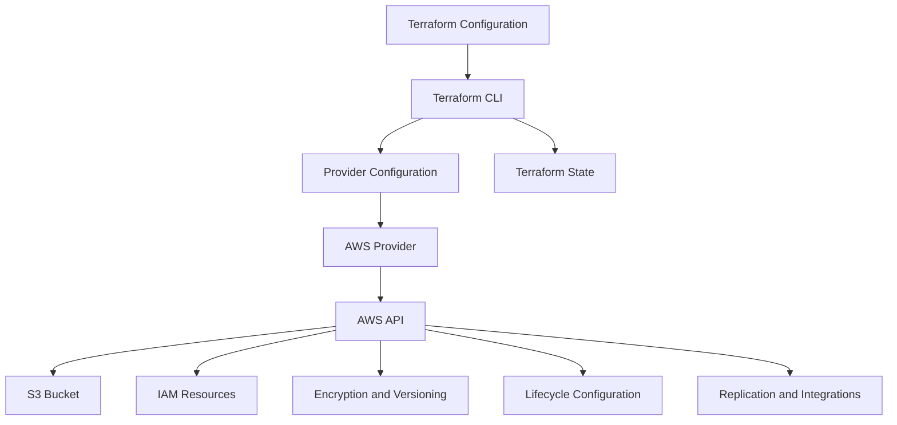
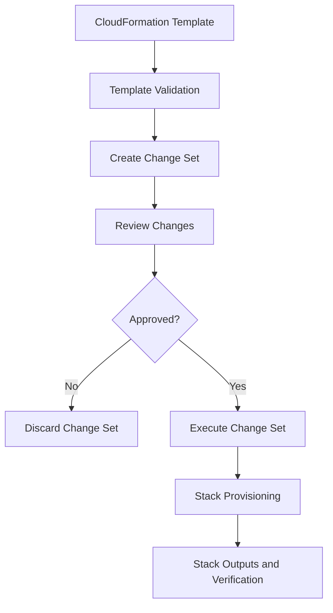
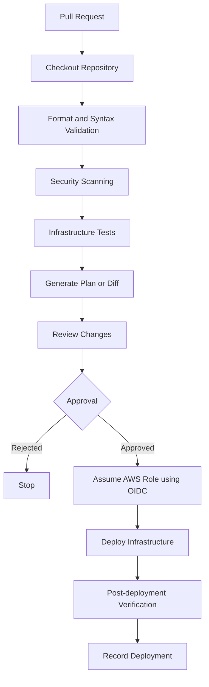
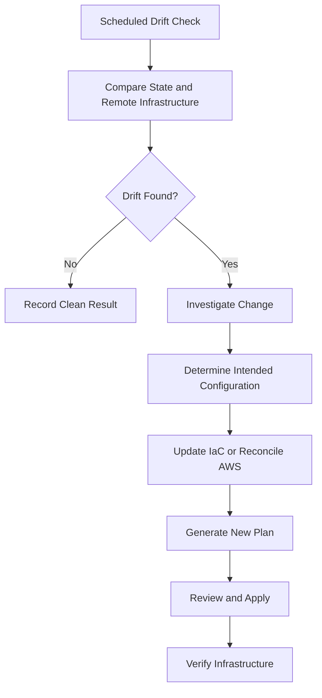

# 02- Infrastructure as Code for S3

## Overview

Infrastructure as Code (IaC) is the practice of defining, provisioning, and managing cloud infrastructure through version-controlled configuration files rather than relying on manual console operations.

For Amazon S3, IaC makes it possible to manage buckets, encryption, versioning, lifecycle policies, IAM permissions, replication, event notifications, and integrations through repeatable deployment workflows.

A production S3 environment usually contains more than a bucket. It may include:

- S3 buckets and ownership controls.
- Public access restrictions.
- Versioning and encryption configuration.
- Lifecycle and replication rules.
- IAM roles and policies.
- Bucket policies.
- CloudFront distributions and origin access controls.
- Lambda functions and event notifications.
- Glue databases and Athena workgroups.
- Logging, monitoring, and audit resources.

Managing these resources manually introduces configuration drift, inconsistent environments, and deployment errors. IaC provides a controlled mechanism for creating and modifying them.

This document focuses on the practical use of Terraform, AWS CloudFormation, and AWS CDK for S3 infrastructure.

## Why Infrastructure as Code Matters for S3

S3 stores persistent data. Infrastructure changes can therefore affect application availability, data retention, access permissions, and recovery capabilities.

Consider a backend application that stores customer documents.

A manual deployment might involve creating a bucket, enabling encryption, configuring versioning, adding IAM permissions, and connecting the application. Repeating these steps in staging and production creates opportunities for configuration differences.

With IaC, the infrastructure is defined once and deployed with environment-specific configuration.

### Benefits

| Benefit | Engineering impact |
|---|---|
| Reproducibility | Recreate infrastructure consistently |
| Version control | Review infrastructure changes through Git |
| Environment isolation | Maintain independent development, staging, and production environments |
| Change visibility | Inspect planned modifications before deployment |
| Security consistency | Apply standard security controls across environments |
| Automation | Integrate infrastructure deployment into CI/CD |
| Recovery | Reconstruct infrastructure from reviewed configuration |
| Auditability | Associate infrastructure changes with source revisions and deployment identities |

### Limitations

IaC does not eliminate operational risk.

- Incorrect configuration can be deployed consistently across every environment.
- Terraform state requires protection and coordination.
- Some AWS resources have asynchronous creation or update behavior.
- Infrastructure changes may affect existing application data.
- Manual modifications can introduce drift.
- IaC cannot automatically determine whether a destructive change is safe for business data.

IaC must be combined with validation, security review, deployment approval, monitoring, and recovery procedures.

## IaC Tools for S3

Three common tools can manage S3 infrastructure.

### Terraform

Terraform uses HashiCorp Configuration Language (HCL) to describe infrastructure resources.

It maintains state to track the relationship between configuration and deployed resources.

Example:

```hcl
resource "aws_s3_bucket" "application_files" {
  bucket = var.bucket_name

  tags = {
    Environment = var.environment
    ManagedBy   = "Terraform"
  }
}
```

Terraform is useful when:

- Infrastructure is managed across multiple providers.
- Teams prefer explicit plan and apply workflows.
- Reusable infrastructure modules are required.
- Infrastructure changes need independent review.

### AWS CloudFormation

CloudFormation provisions AWS resources using YAML or JSON templates.

It manages resources as stacks and handles dependencies between resources.

Example:

```yaml
AWSTemplateFormatVersion: "2010-09-09"

Description: Private S3 bucket for application files

Parameters:
  BucketName:
    Type: String
    Description: Globally unique S3 bucket name

Resources:
  ApplicationBucket:
    Type: AWS::S3::Bucket
    Properties:
      BucketName: !Ref BucketName
      PublicAccessBlockConfiguration:
        BlockPublicAcls: true
        BlockPublicPolicy: true
        IgnorePublicAcls: true
        RestrictPublicBuckets: true
      OwnershipControls:
        Rules:
          - ObjectOwnership: BucketOwnerEnforced
      VersioningConfiguration:
        Status: Enabled
      BucketEncryption:
        ServerSideEncryptionConfiguration:
          - ServerSideEncryptionByDefault:
              SSEAlgorithm: AES256

Outputs:
  BucketName:
    Description: Application bucket name
    Value: !Ref ApplicationBucket
```

CloudFormation is useful when:

- The infrastructure is AWS-specific.
- Native AWS stack management is preferred.
- Stack-level deployment and rollback behavior are important.
- Teams want infrastructure templates integrated directly with AWS services.

### AWS CDK

AWS Cloud Development Kit (CDK) allows developers to define infrastructure using programming languages such as Python, TypeScript, and Java.

CDK synthesizes infrastructure definitions into CloudFormation templates.

Example using Python:

```python
from aws_cdk import (
    Stack,
    aws_s3 as s3,
)
from constructs import Construct


class ApplicationStorageStack(Stack):
    def __init__(
        self,
        scope: Construct,
        construct_id: str,
        **kwargs,
    ) -> None:
        super().__init__(scope, construct_id, **kwargs)

        self.bucket = s3.Bucket(
            self,
            "ApplicationBucket",
            versioned=True,
            encryption=s3.BucketEncryption.S3_MANAGED,
            block_public_access=s3.BlockPublicAccess.BLOCK_ALL,
            enforce_ssl=True,
            object_ownership=s3.ObjectOwnership.BUCKET_OWNER_ENFORCED,
        )
```

CDK is useful when:

- Infrastructure benefits from programming-language abstractions.
- Reusable constructs are required.
- Developers want to compose infrastructure using familiar programming patterns.
- Infrastructure needs automated assertions and unit tests.

### Tool Comparison

| Capability | Terraform | CloudFormation | AWS CDK |
|---|---|---|---|
| Configuration | HCL | YAML or JSON | Programming language |
| State management | Terraform state | AWS-managed stack state | CloudFormation stack state |
| AWS integration | AWS provider | Native | Native through CloudFormation |
| Multi-cloud support | Yes | No | No |
| Reusable abstractions | Modules | Nested stacks and modules | Constructs |
| Planning | `terraform plan` | Change sets | `cdk diff` |
| Deployment | `terraform apply` | Stack deployment | `cdk deploy` |
| Testing | Validation and external tests | Template validation and policy tests | Assertions and unit tests |

Choose one authoritative IaC tool for each resource. Avoid managing the same S3 bucket independently through Terraform and CloudFormation.

## Terraform for S3

Terraform is a practical choice for managing S3 infrastructure because it provides explicit planning, state management, reusable modules, and broad ecosystem support.

### Terraform Deployment Architecture



Terraform reads configuration, compares the desired state with its recorded state and remote infrastructure, and determines which operations are necessary.

The AWS provider communicates with AWS APIs to create, update, read, or delete resources.

### Prerequisites

Install and configure:

- Terraform CLI.
- AWS CLI.
- AWS credentials or an assumed deployment role.
- An AWS account.
- An appropriate deployment Region.

Verify the tools:

```bash
terraform version
aws --version
```

Verify the active AWS identity:

```bash
aws sts get-caller-identity
```

Never assume the active credentials belong to the intended deployment account.

## Terraform Project Structure

A maintainable S3 infrastructure project should separate configuration by responsibility.

```text
infrastructure/
└── terraform/
    ├── versions.tf
    ├── providers.tf
    ├── variables.tf
    ├── outputs.tf
    ├── storage_buckets.tf
    ├── ownership.tf
    ├── public_access.tf
    ├── versioning.tf
    ├── encryption.tf
    ├── lifecycle.tf
    ├── iam.tf
    ├── bucket_policies.tf
    ├── replication.tf
    ├── logging.tf
    ├── environments/
    │   ├── dev.tfvars
    │   ├── staging.tfvars
    │   └── prod.tfvars
    └── modules/
        └── s3_bucket/
            ├── main.tf
            ├── variables.tf
            └── outputs.tf
```

This structure separates reusable configuration, environment-specific values, and individual resource responsibilities.

The exact file structure can be simplified for smaller projects.

## Terraform Configuration

### Provider and Version Constraints

Use explicit Terraform and provider constraints.

`versions.tf`:

```hcl
terraform {
  required_version = ">= 1.5.0"

  required_providers {
    aws = {
      source  = "hashicorp/aws"
      version = ">= 5.0, < 7.0"
    }
  }
}
```

The provider constraint prevents Terraform from selecting an incompatible major provider version.

For reproducibility:

- Commit `.terraform.lock.hcl`.
- Review provider upgrades.
- Test upgrades outside production.
- Avoid unbounded provider constraints.
- Pin versions appropriately in CI/CD environments.

### Provider Configuration

`providers.tf`:

```hcl
provider "aws" {
  region = var.aws_region

  default_tags {
    tags = {
      Project     = "s3-infrastructure"
      Environment = var.environment
      ManagedBy   = "Terraform"
    }
  }
}
```

Use the AWS credential provider chain rather than embedding credentials in provider configuration.

For multiple accounts, use explicit provider aliases and role assumption where required.

### Variables

`variables.tf`:

```hcl
variable "aws_region" {
  description = "AWS Region for S3 infrastructure."
  type        = string
  default     = "ap-south-1"
}

variable "bucket_name" {
  description = "Globally unique S3 bucket name."
  type        = string

  validation {
    condition = (
      length(var.bucket_name) >= 3 &&
      length(var.bucket_name) <= 63 &&
      can(regex("^[a-z0-9][a-z0-9.-]*[a-z0-9]$", var.bucket_name)) &&
      !strcontains(var.bucket_name, "..") &&
      !can(regex("^[0-9]+\\.[0-9]+\\.[0-9]+\\.[0-9]+$", var.bucket_name))
    )

    error_message = "Bucket name must follow S3 bucket naming constraints."
  }
}

variable "environment" {
  description = "Deployment environment."
  type        = string

  validation {
    condition     = contains(["dev", "staging", "prod"], var.environment)
    error_message = "Environment must be dev, staging, or prod."
  }
}
```

Variables allow the same infrastructure definition to be deployed into multiple environments.

Do not use Terraform variables as a substitute for secure secret management.

### S3 Bucket Resource

`storage_buckets.tf`:

```hcl
resource "aws_s3_bucket" "application_files" {
  bucket = var.bucket_name

  tags = {
    Name        = var.bucket_name
    Purpose     = "Application File Storage"
    Environment = var.environment
  }

  lifecycle {
    prevent_destroy = true
  }
}
```

The `aws_s3_bucket` resource creates the bucket.

The `prevent_destroy` lifecycle rule protects the bucket from accidental destruction through Terraform while the rule remains in the configuration.

It does not prevent deletion through the AWS console, CLI, or another principal.

### Object Ownership

`ownership.tf`:

```hcl
resource "aws_s3_bucket_ownership_controls" "application_files" {
  bucket = aws_s3_bucket.application_files.id

  rule {
    object_ownership = "BucketOwnerEnforced"
  }
}
```

BucketOwnerEnforced disables ACL-based access control and makes the bucket owner own uploaded objects.

It is generally appropriate for modern application storage architectures that use IAM and bucket policies.

### Public Access Block

`public_access.tf`:

```hcl
resource "aws_s3_bucket_public_access_block" "application_files" {
  bucket = aws_s3_bucket.application_files.id

  block_public_acls       = true
  block_public_policy     = true
  ignore_public_acls      = true
  restrict_public_buckets = true
}
```

Block Public Access helps prevent accidental public exposure.

For private application storage, enabling all four controls is a strong default.

### Versioning

`versioning.tf`:

```hcl
resource "aws_s3_bucket_versioning" "application_files" {
  bucket = aws_s3_bucket.application_files.id

  versioning_configuration {
    status = "Enabled"
  }
}
```

Versioning preserves object versions when objects are overwritten or deleted.

Use it when recovery from accidental modification or deletion is required.

Versioning increases storage consumption unless old versions are managed through retention and lifecycle policies.

### Encryption

`encryption.tf`:

```hcl
resource "aws_s3_bucket_server_side_encryption_configuration" "application_files" {
  bucket = aws_s3_bucket.application_files.id

  rule {
    apply_server_side_encryption_by_default {
      sse_algorithm = "AES256"
    }
  }
}
```

This configures default SSE-S3 encryption.

For workloads requiring customer-managed encryption keys, use SSE-KMS and configure the required KMS key policies and permissions.

S3 encryption configuration does not automatically grant an application permission to access encrypted objects.

### Lifecycle Configuration

`lifecycle.tf`:

```hcl
resource "aws_s3_bucket_lifecycle_configuration" "application_files" {
  bucket = aws_s3_bucket.application_files.id

  depends_on = [
    aws_s3_bucket_versioning.application_files
  ]

  rule {
    id     = "application-file-retention"
    status = "Enabled"

    filter {
      prefix = "uploads/"
    }

    transition {
      days          = 30
      storage_class = "STANDARD_IA"
    }

    expiration {
      days = 365
    }

    noncurrent_version_expiration {
      noncurrent_days = 90
    }
  }

  rule {
    id     = "abort-incomplete-multipart-uploads"
    status = "Enabled"

    filter {}

    abort_incomplete_multipart_upload {
      days_after_initiation = 7
    }
  }
}
```

This configuration:

- Transitions matching current objects to STANDARD_IA after 30 days.
- Expires current objects after 365 days.
- Expires noncurrent versions after 90 days.
- Aborts incomplete multipart uploads after 7 days.

Lifecycle processing is asynchronous. Configuration does not mean that every eligible object is transitioned or deleted immediately.

Consider minimum storage-duration charges, retrieval charges, object size, and retention requirements before selecting a lifecycle policy.

### Outputs

`outputs.tf`:

```hcl
output "bucket_name" {
  description = "S3 bucket name."
  value       = aws_s3_bucket.application_files.id
}

output "bucket_arn" {
  description = "S3 bucket ARN."
  value       = aws_s3_bucket.application_files.arn
}

output "bucket_region" {
  description = "S3 bucket Region."
  value       = aws_s3_bucket.application_files.region
}

output "bucket_domain_name" {
  description = "Regional S3 bucket domain name."
  value       = aws_s3_bucket.application_files.bucket_regional_domain_name
}
```

Outputs expose useful infrastructure values to operators and dependent deployment workflows.

Avoid exposing sensitive values through outputs.

## Environment Management

Production infrastructure should not share the same state or deployment configuration as development infrastructure.

### Environment Configuration

Example `environments/dev.tfvars`:

```hcl
aws_region  = "ap-south-1"
bucket_name = "company-files-dev-example"
environment = "dev"
```

Example `environments/staging.tfvars`:

```hcl
aws_region  = "ap-south-1"
bucket_name = "company-files-staging-example"
environment = "staging"
```

Example `environments/prod.tfvars`:

```hcl
aws_region  = "ap-south-1"
bucket_name = "company-files-prod-example"
environment = "prod"
```

Replace these example names with globally unique bucket names.

### Deployment Commands

Development:

```bash
terraform plan \
  -var-file="environments/dev.tfvars"
```

Staging:

```bash
terraform plan \
  -var-file="environments/staging.tfvars"
```

Production:

```bash
terraform plan \
  -var-file="environments/prod.tfvars"
```

For production, use a separate state location and an approved deployment identity.

### Environment Isolation

| Area | Development | Staging | Production |
|---|---|---|---|
| AWS account | Development account where available | Staging account where available | Production account |
| Bucket | Development bucket | Staging bucket | Production bucket |
| Terraform state | Independent | Independent | Independent |
| IAM role | Development deployment role | Staging deployment role | Restricted production role |
| Approval | Automated or lightweight review | Controlled review | Explicit approval |
| Data | Synthetic or test data | Representative test data | Production data |

Separate AWS accounts provide stronger isolation than relying only on naming conventions.

## Terraform State Management

Terraform state records the relationship between declared resources and actual AWS resources.

It enables Terraform to determine what needs to be created, modified, or removed.

### Local State

By default, Terraform stores state in:

```text
terraform.tfstate
```

Local state is suitable for isolated experimentation.

It is not recommended as the default for shared production infrastructure because it introduces:

- State loss risk.
- Concurrent execution conflicts.
- Limited collaboration.
- Inconsistent recovery.
- Potential exposure of sensitive values.

### Remote State with S3

For shared infrastructure, use a secured remote backend.

Example:

```hcl
terraform {
  backend "s3" {
    bucket       = "company-terraform-state-example"
    key          = "s3-infrastructure/dev/terraform.tfstate"
    region       = "ap-south-1"
    encrypt      = true
    use_lockfile = true
  }
}
```

The backend bucket must already exist before Terraform initializes this configuration.

The `use_lockfile` option provides native S3 state locking in supported Terraform versions.

Use a dedicated state bucket rather than storing Terraform state in the application data bucket.

Recommended state-bucket controls include:

- Versioning.
- Encryption.
- Restricted IAM access.
- Public access blocking.
- Audit logging.
- Controlled state recovery.

### State Isolation

Use independent state keys:

```text
s3-infrastructure/
├── dev/
│   └── terraform.tfstate
├── staging/
│   └── terraform.tfstate
└── prod/
    └── terraform.tfstate
```

Each environment should have independent resource mappings and deployment controls.

### State Security

Terraform state can contain sensitive values, even when variables are marked sensitive.

Protect it with:

- Restricted IAM permissions.
- Encryption at rest.
- TLS in transit.
- Versioning and controlled recovery.
- Separate state locations.
- Audit logging.
- Trusted deployment identities.

Never commit Terraform state files to Git.

## Terraform Workflow

Terraform provides commands for initializing, validating, planning, applying, importing, and destroying infrastructure.

### Initialize

```bash
terraform init
```

Initialization downloads providers, configures the backend, and prepares the working directory.

For automated environments:

```bash
terraform init -input=false
```

### Format

```bash
terraform fmt -recursive
```

Check formatting without modifying files:

```bash
terraform fmt -check -recursive
```

### Validate

```bash
terraform validate
```

This checks Terraform configuration syntax and internal consistency.

It does not verify AWS permissions or guarantee successful provisioning.

### Plan

```bash
terraform plan \
  -var-file="environments/dev.tfvars" \
  -out="deployment.tfplan"
```

Inspect the plan:

```bash
terraform show deployment.tfplan
```

Review all resource additions, updates, replacements, and deletions.

### Apply

```bash
terraform apply deployment.tfplan
```

Applying a reviewed saved plan executes the proposed changes.

A production deployment should use an approved plan rather than an unreviewed automatic apply.

### Import

Use import when an existing AWS resource must become managed by Terraform.

Example:

```bash
terraform import \
  aws_s3_bucket.application_files \
  existing-bucket-name
```

Importing records the resource in Terraform state. It does not automatically generate a complete matching configuration.

Review the resource configuration and state after importing.

### Destroy

Generate a destruction plan:

```bash
terraform plan -destroy \
  -var-file="environments/dev.tfvars" \
  -out="destroy.tfplan"
```

Inspect it:

```bash
terraform show destroy.tfplan
```

Execute only after review and approval:

```bash
terraform apply destroy.tfplan
```

A resource protected by `prevent_destroy` cannot be destroyed through Terraform while the protection remains in its configuration.

## Reusable Terraform Modules

Terraform modules allow teams to package reusable infrastructure definitions.

For example, an organization may require every application bucket to have:

- Public access blocked.
- BucketOwnerEnforced ownership.
- Default encryption.
- Versioning.
- Standard tagging.
- Optional lifecycle policies.

Instead of duplicating these settings in every project, create a reusable module.

### Module Structure

```text
modules/
└── s3_bucket/
    ├── main.tf
    ├── variables.tf
    └── outputs.tf
```

### Module Implementation

`modules/s3_bucket/main.tf`:

```hcl
resource "aws_s3_bucket" "this" {
  bucket = var.bucket_name

  tags = var.tags
}

resource "aws_s3_bucket_ownership_controls" "this" {
  bucket = aws_s3_bucket.this.id

  rule {
    object_ownership = "BucketOwnerEnforced"
  }
}

resource "aws_s3_bucket_public_access_block" "this" {
  bucket = aws_s3_bucket.this.id

  block_public_acls       = true
  block_public_policy     = true
  ignore_public_acls      = true
  restrict_public_buckets = true
}

resource "aws_s3_bucket_versioning" "this" {
  bucket = aws_s3_bucket.this.id

  versioning_configuration {
    status = var.versioning_enabled ? "Enabled" : "Suspended"
  }
}

resource "aws_s3_bucket_server_side_encryption_configuration" "this" {
  bucket = aws_s3_bucket.this.id

  rule {
    apply_server_side_encryption_by_default {
      sse_algorithm = "AES256"
    }
  }
}
```

`modules/s3_bucket/variables.tf`:

```hcl
variable "bucket_name" {
  description = "Globally unique S3 bucket name."
  type        = string
}

variable "versioning_enabled" {
  description = "Whether bucket versioning is enabled."
  type        = bool
  default     = true
}

variable "tags" {
  description = "Tags applied to the bucket."
  type        = map(string)
  default     = {}
}
```

`modules/s3_bucket/outputs.tf`:

```hcl
output "bucket_id" {
  description = "S3 bucket name."
  value       = aws_s3_bucket.this.id
}

output "bucket_arn" {
  description = "S3 bucket ARN."
  value       = aws_s3_bucket.this.arn
}

output "bucket_region" {
  description = "S3 bucket Region."
  value       = aws_s3_bucket.this.region
}
```

### Module Usage

Root `main.tf`:

```hcl
module "application_storage" {
  source = "./modules/s3_bucket"

  bucket_name       = var.bucket_name
  versioning_enabled = true

  tags = {
    Environment = var.environment
    Project     = "application-storage"
    ManagedBy   = "Terraform"
  }
}
```

A reusable module should expose meaningful configuration options without allowing arbitrary unsafe combinations.

For example, a production storage module may enforce public access blocking rather than exposing it as an unrestricted boolean.

## CloudFormation for S3

CloudFormation manages AWS infrastructure through templates and stacks.

A template describes the resources, properties, parameters, outputs, and dependencies.

### CloudFormation Lifecycle



### Template Structure

A CloudFormation template commonly contains:

| Section | Purpose |
|---|---|
| AWSTemplateFormatVersion | Template format version |
| Description | Template description |
| Parameters | Deployment-time inputs |
| Mappings | Static lookup values |
| Conditions | Conditional resource creation |
| Resources | AWS resource definitions |
| Outputs | Values exposed after deployment |

### S3 Bucket Template

```yaml
AWSTemplateFormatVersion: "2010-09-09"

Description: Production-oriented private S3 bucket

Parameters:
  BucketName:
    Type: String
    Description: Globally unique S3 bucket name

  EnableVersioning:
    Type: String
    AllowedValues:
      - Enabled
      - Suspended
    Default: Enabled

Resources:
  ApplicationBucket:
    Type: AWS::S3::Bucket
    DeletionPolicy: Retain
    UpdateReplacePolicy: Retain
    Properties:
      BucketName: !Ref BucketName

      PublicAccessBlockConfiguration:
        BlockPublicAcls: true
        BlockPublicPolicy: true
        IgnorePublicAcls: true
        RestrictPublicBuckets: true

      OwnershipControls:
        Rules:
          - ObjectOwnership: BucketOwnerEnforced

      VersioningConfiguration:
        Status: !Ref EnableVersioning

      BucketEncryption:
        ServerSideEncryptionConfiguration:
          - ServerSideEncryptionByDefault:
              SSEAlgorithm: AES256

Outputs:
  BucketName:
    Description: Created bucket name
    Value: !Ref ApplicationBucket

  BucketArn:
    Description: Created bucket ARN
    Value: !GetAtt ApplicationBucket.Arn
```

`DeletionPolicy: Retain` preserves the bucket when its stack is deleted.

`UpdateReplacePolicy: Retain` preserves the old physical resource when an update requires replacement.

These policies do not prevent manual deletion or guarantee data recovery. They must be combined with appropriate access controls and backup procedures.

### Validate a Template

```bash
aws cloudformation validate-template \
  --template-body file://s3-bucket.yaml
```

### Create a Change Set

```bash
aws cloudformation create-change-set \
  --stack-name application-storage \
  --change-set-name update-storage \
  --template-body file://s3-bucket.yaml \
  --parameters \
    ParameterKey=BucketName,ParameterValue=company-storage-example
```

Inspect the change set:

```bash
aws cloudformation describe-change-set \
  --stack-name application-storage \
  --change-set-name update-storage
```

Execute the approved change set:

```bash
aws cloudformation execute-change-set \
  --stack-name application-storage \
  --change-set-name update-storage
```

Change sets allow teams to inspect proposed resource modifications before execution.

### Stack Status Inspection

```bash
aws cloudformation describe-stacks \
  --stack-name application-storage
```

Inspect events:

```bash
aws cloudformation describe-stack-events \
  --stack-name application-storage
```

Stack events help identify which resource failed and why.

### Drift Detection

CloudFormation can detect differences between supported resource properties in the deployed stack and the expected template configuration.

Start drift detection:

```bash
aws cloudformation detect-stack-drift \
  --stack-name application-storage
```

Retrieve the detection status using the returned detection ID:

```bash
aws cloudformation describe-stack-drift-detection-status \
  --stack-drift-detection-id DETECTION_ID
```

Inspect drifted resources:

```bash
aws cloudformation describe-stack-resource-drifts \
  --stack-name application-storage
```

Drift detection is not a complete audit of every possible AWS configuration or external dependency.

## AWS CDK for S3

AWS CDK allows infrastructure to be defined through reusable programming constructs.

It synthesizes the application into a CloudFormation template.

### CDK Project Structure

A Python CDK project can use:

```text
s3-cdk/
├── app.py
├── requirements.txt
├── cdk.json
├── stacks/
│   └── storage_stack.py
└── tests/
    └── test_storage_stack.py
```

### Dependencies

Example `requirements.txt`:

```text
aws-cdk-lib>=2.0,<3.0
constructs>=10.0,<11.0
```

Pin and lock tested dependency versions for reproducible builds.

### Stack Implementation

`stacks/storage_stack.py`:

```python
from aws_cdk import (
    Stack,
    RemovalPolicy,
    aws_s3 as s3,
)
from constructs import Construct


class StorageStack(Stack):
    def __init__(
        self,
        scope: Construct,
        construct_id: str,
        bucket_name: str,
        **kwargs,
    ) -> None:
        super().__init__(scope, construct_id, **kwargs)

        self.bucket = s3.Bucket(
            self,
            "ApplicationBucket",
            bucket_name=bucket_name,
            versioned=True,
            encryption=s3.BucketEncryption.S3_MANAGED,
            block_public_access=s3.BlockPublicAccess.BLOCK_ALL,
            object_ownership=s3.ObjectOwnership.BUCKET_OWNER_ENFORCED,
            enforce_ssl=True,
            removal_policy=RemovalPolicy.RETAIN,
        )
```

The bucket is configured with versioning, SSE-S3, public access blocking, enforced object ownership, and SSL enforcement.

`RemovalPolicy.RETAIN` prevents normal stack deletion from automatically deleting the bucket.

### CDK Application

`app.py`:

```python
import aws_cdk as cdk

from stacks.storage_stack import StorageStack


app = cdk.App()

StorageStack(
    app,
    "ApplicationStorageStack",
    bucket_name="company-storage-cdk-example",
    env=cdk.Environment(
        account=app.account,
        region="ap-south-1",
    ),
)

app.synth()
```

Replace the example bucket name with a globally unique name.

### CDK Commands

Install dependencies:

```bash
python -m pip install -r requirements.txt
```

Synthesize the template:

```bash
cdk synth
```

Review proposed changes:

```bash
cdk diff
```

Deploy:

```bash
cdk deploy
```

Destroy:

```bash
cdk destroy
```

A retained bucket may remain after stack destruction. Verify and manage retained resources separately.

### CDK Testing

CDK assertions can verify synthesized infrastructure without deploying it.

Example:

```python
import aws_cdk as cdk
from aws_cdk.assertions import Template
from stacks.storage_stack import StorageStack


def test_bucket_security_configuration():
    app = cdk.App()

    stack = StorageStack(
        app,
        "TestStorageStack",
        bucket_name="test-storage-bucket-example",
        env=cdk.Environment(
            account="123456789012",
            region="ap-south-1",
        ),
    )

    template = Template.from_stack(stack)

    template.has_resource_properties(
        "AWS::S3::Bucket",
        {
            "VersioningConfiguration": {
                "Status": "Enabled"
            },
            "BucketEncryption": {
                "ServerSideEncryptionConfiguration": [
                    {
                        "ServerSideEncryptionByDefault": {
                            "SSEAlgorithm": "AES256"
                        }
                    }
                ]
            },
            "PublicAccessBlockConfiguration": {
                "BlockPublicAcls": True,
                "BlockPublicPolicy": True,
                "IgnorePublicAcls": True,
                "RestrictPublicBuckets": True,
            },
        },
    )
```

This tests the synthesized template. It does not verify deployed AWS behavior.

## Managing S3 Dependencies with IaC

S3 infrastructure frequently depends on other AWS services.

IaC should explicitly manage these dependencies where they belong to the same deployment boundary.

### IAM Roles and Policies

An application role may require access to a specific bucket and prefix.

A simplified Terraform policy:

```hcl
data "aws_iam_policy_document" "application_storage" {
  statement {
    sid    = "ListApplicationPrefix"
    effect = "Allow"

    actions = [
      "s3:ListBucket"
    ]

    resources = [
      aws_s3_bucket.application_files.arn
    ]

    condition {
      test     = "StringLike"
      variable = "s3:prefix"

      values = [
        "uploads/*"
      ]
    }
  }

  statement {
    sid    = "ManageApplicationObjects"
    effect = "Allow"

    actions = [
      "s3:GetObject",
      "s3:PutObject",
      "s3:DeleteObject"
    ]

    resources = [
      "${aws_s3_bucket.application_files.arn}/uploads/*"
    ]
  }
}
```

Bucket-level and object-level permissions require different resource ARNs.

The actual policy must match the application's operations. Multipart upload, tagging, version access, and SSE-KMS can require additional permissions.

### S3 Event Notifications

A deployment may configure S3 notifications to invoke Lambda or send messages to SQS or SNS.

The destination must be configured with the required permissions before S3 can successfully validate the notification configuration.

A typical dependency order is:

1. Create the destination.
2. Configure destination permissions.
3. Configure the bucket notification.
4. Verify event delivery.
5. Test processing and retry behavior.

For Lambda, the function's resource-based policy must allow invocation by the intended bucket.

### CloudFront Integration

For static website delivery, use a private S3 origin with CloudFront Origin Access Control (OAC).

The deployment should coordinate:

- S3 bucket.
- CloudFront distribution.
- Origin Access Control.
- Bucket policy allowing the intended CloudFront distribution.
- TLS certificate.
- Cache policies.
- DNS configuration where required.

Do not make the S3 bucket public merely to allow CloudFront to retrieve objects.

## Infrastructure Testing and Validation

Infrastructure tests should verify both configuration structure and deployment behavior.

### Static Validation

For Terraform:

```bash
terraform fmt -check -recursive
terraform init -backend=false
terraform validate
```

For CloudFormation:

```bash
aws cloudformation validate-template \
  --template-body file://s3-bucket.yaml
```

For CDK:

```bash
cdk synth
```

### Policy and Security Validation

Check:

- Public access block configuration.
- Object ownership.
- Encryption defaults.
- IAM policy scope.
- Bucket policy conditions.
- Versioning.
- Lifecycle retention.
- Replication permissions.
- Logging and monitoring settings.

Use policy-as-code and infrastructure security scanning tools where appropriate.

### Integration Testing

After deployment, test actual AWS behavior:

```bash
aws s3api head-bucket \
  --bucket your-bucket-name
```

Inspect versioning:

```bash
aws s3api get-bucket-versioning \
  --bucket your-bucket-name
```

Inspect encryption:

```bash
aws s3api get-bucket-encryption \
  --bucket your-bucket-name
```

Inspect public access restrictions:

```bash
aws s3api get-public-access-block \
  --bucket your-bucket-name
```

Test object operations using the intended application role rather than an administrator identity.

A successful administrator upload does not prove that the application role has correct permissions.

## CI/CD Integration

IaC should be integrated into CI/CD so infrastructure changes are validated and reviewed before deployment.

### Recommended Pipeline



### GitHub Actions Example

The following workflow validates Terraform configuration and generates a plan for a development environment.

```yaml
name: S3 Infrastructure Validation

on:
  pull_request:
    paths:
      - "infrastructure/terraform/**"

permissions:
  contents: read

jobs:
  validate:
    runs-on: ubuntu-latest

    defaults:
      run:
        working-directory: infrastructure/terraform

    steps:
      - name: Checkout repository
        uses: actions/checkout@v4

      - name: Setup Terraform
        uses: hashicorp/setup-terraform@v3
        with:
          terraform_version: "1.9.8"

      - name: Terraform Format Check
        run: terraform fmt -check -recursive

      - name: Terraform Initialize
        run: terraform init -backend=false

      - name: Terraform Validate
        run: terraform validate
```

This workflow performs validation only. It does not authenticate to AWS or deploy infrastructure.

For deployment workflows:

- Configure OIDC federation.
- Restrict the trusted GitHub repository and branch or environment.
- Use short-lived AWS credentials.
- Generate and review infrastructure plans.
- Require production approval.
- Protect plan artifacts.
- Record deployment outcomes.

Never hardcode AWS access keys in GitHub Actions.

## Infrastructure Drift Management

Drift occurs when deployed AWS infrastructure differs from the intended IaC configuration.

Common causes include:

- Manual console changes.
- CLI-based changes.
- Changes from another automation system.
- Unmanaged resource dependencies.
- Configuration changes outside the authoritative IaC workflow.

### Terraform Drift Detection

```bash
terraform plan -refresh-only
```

Review the detected differences.

Decide whether to:

- Update Terraform configuration to represent the intended change.
- Reconcile AWS infrastructure with the approved configuration.
- Import an existing resource into Terraform state.
- Investigate an unauthorized or unexpected change.

### Drift Management Workflow



Do not automatically apply configuration changes simply because drift was detected. Understand the origin and operational impact first.

## Resource Protection and Safe Deletion

S3 infrastructure requires special attention because deleting a bucket can affect persistent application data.

### Terraform Protection

```hcl
resource "aws_s3_bucket" "application_files" {
  bucket = var.bucket_name

  lifecycle {
    prevent_destroy = true
  }
}
```

This prevents Terraform from planning destruction while the protection remains configured.

### CloudFormation Retention

```yaml
Resources:
  ApplicationBucket:
    Type: AWS::S3::Bucket
    DeletionPolicy: Retain
    UpdateReplacePolicy: Retain
    Properties:
      BucketName: !Ref BucketName
```

This preserves the bucket when the stack is deleted or the resource is replaced.

### CDK Retention

```python
removal_policy=RemovalPolicy.RETAIN
```

These controls protect infrastructure resources from some IaC-driven deletion operations. They do not replace backup, recovery, retention, or access-control policies.

### Safe Decommissioning

Before destroying S3 infrastructure:

1. Confirm that applications no longer depend on the bucket.
2. Stop new writes.
3. Review retention and compliance requirements.
4. Back up data that must be retained.
5. Inspect current versions and delete markers.
6. Review incomplete multipart uploads.
7. Identify dependent services and resources.
8. Generate and inspect the IaC destruction plan.
9. Obtain explicit approval.
10. Remove only approved resources.
11. Verify the final state.

Versioned buckets may contain noncurrent versions and delete markers that must be considered separately from ordinary object deletion.

## Cost Considerations

IaC itself does not make S3 infrastructure free.

The deployed resources may generate charges through:

- Object storage.
- PUT, GET, LIST, and other requests.
- Storage-class transitions.
- Retrieval operations.
- Data transfer.
- Replication.
- CloudFront requests and transfer.
- CloudWatch metrics and logs.
- KMS requests.
- Glue and Athena operations.

### Cost Controls in IaC

Use infrastructure configuration to establish:

- Appropriate lifecycle rules.
- Incomplete multipart upload cleanup.
- Storage-class policies.
- Resource tagging.
- Environment-specific resource sizes and configurations.
- Monitoring and budget alerts.
- Controlled retention periods.

Do not apply aggressive expiration policies without confirming business and compliance requirements.

## Common IaC Mistakes

| Mistake | Why it causes problems | Recommended approach |
|---|---|---|
| Managing the same resource through multiple tools | Creates conflicting ownership and drift | Use one authoritative IaC tool |
| Committing Terraform state | Exposes sensitive infrastructure information | Use a secured remote backend |
| Using one state for all environments | Creates deployment and coordination risks | Isolate environment state |
| Skipping plan review | Can cause unexpected deletion or replacement | Review saved plans |
| Hardcoding credentials | Increases credential exposure | Use IAM roles and federation |
| Using broad IAM policies | Increases the impact of compromised identities | Apply least privilege |
| Omitting resource protection | Makes accidental bucket destruction easier | Use appropriate retention controls |
| Treating validation as integration testing | Valid configuration may still fail against AWS | Perform post-deployment tests |
| Ignoring provider upgrades | Can introduce unexpected resource changes | Test and review provider updates |
| Ignoring drift | Makes infrastructure state unreliable | Run periodic drift detection |
| Destroying retained resources without review | Can cause data loss | Follow controlled decommissioning |

## Production Readiness Checklist

### Infrastructure Design

- [ ] Select one authoritative IaC tool.
- [ ] Define reusable infrastructure components.
- [ ] Define environment-specific configuration.
- [ ] Document resource dependencies.
- [ ] Review account and Region selection.

### Security

- [ ] Block unintended public access.
- [ ] Configure Object Ownership.
- [ ] Configure encryption.
- [ ] Apply least-privilege IAM permissions.
- [ ] Use secure credential providers.
- [ ] Protect Terraform state.
- [ ] Review resource policies.

### Reliability

- [ ] Configure versioning where required.
- [ ] Define lifecycle and retention policies.
- [ ] Configure replication when required.
- [ ] Define backup and recovery procedures.
- [ ] Protect critical resources from accidental destruction.

### Deployment

- [ ] Run formatting and validation.
- [ ] Run infrastructure security checks.
- [ ] Generate and review deployment plans.
- [ ] Use OIDC or another short-lived credential mechanism.
- [ ] Require production approval.
- [ ] Verify deployed configuration.

### Operations

- [ ] Monitor deployment failures.
- [ ] Schedule drift detection.
- [ ] Review infrastructure costs.
- [ ] Maintain deployment audit records.
- [ ] Test recovery and teardown procedures.

## Key Takeaways

- IaC makes S3 infrastructure reproducible, reviewable, and manageable across environments.
- Terraform, CloudFormation, and CDK provide different deployment models; choose one authoritative tool for each resource.
- Terraform state, environment isolation, resource dependencies, and saved-plan review are essential production controls.
- Infrastructure validation must be followed by actual AWS configuration checks and application-level integration tests.
- Protect persistent S3 resources with retention controls, least-privilege permissions, monitoring, and deliberate teardown procedures.