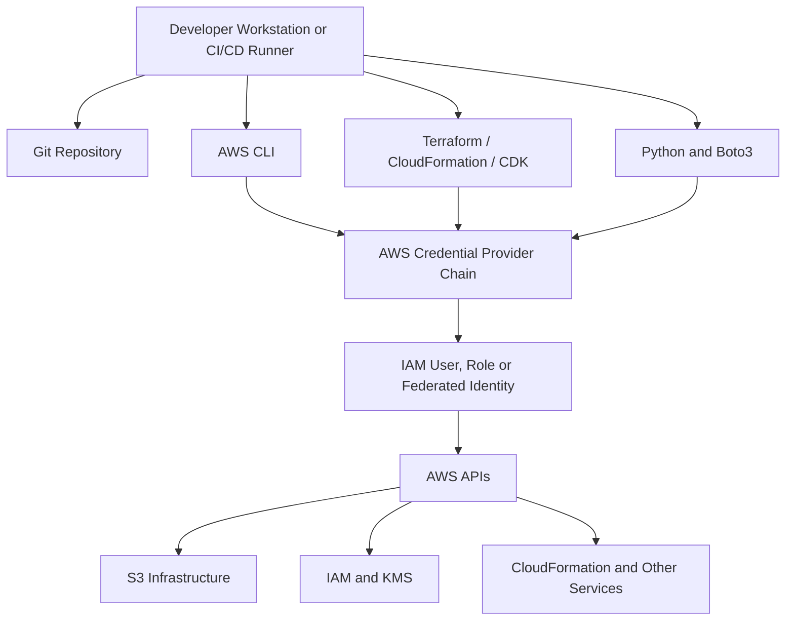
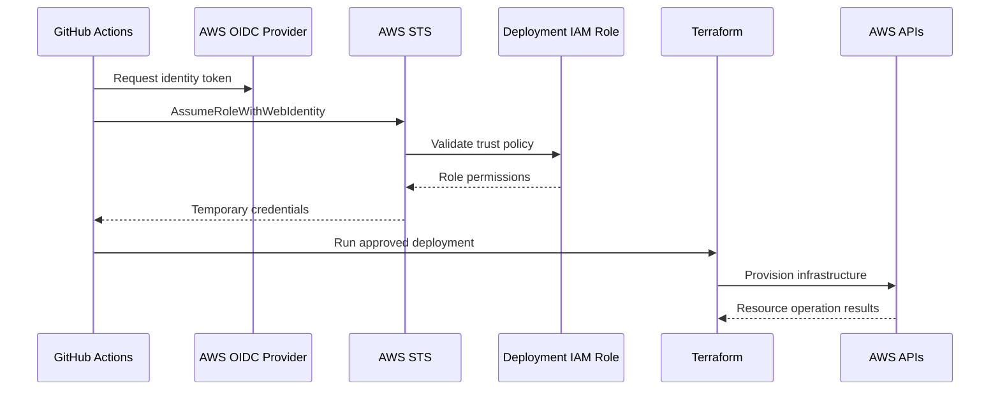

# 03- Deployment Prerequisites and Toolchain

## Overview

Deploying Amazon S3 infrastructure requires more than an AWS account and a bucket name. A reliable deployment environment needs a correctly configured identity, compatible infrastructure tooling, environment-specific configuration, network connectivity, and permission to create and manage the required AWS resources.

For backend engineering teams, deployment prerequisites should be standardized across local development machines, CI/CD runners, and production deployment environments.

A typical S3 deployment toolchain includes:

- AWS account and Region configuration.
- AWS CLI for resource inspection and operational commands.
- Terraform, CloudFormation, or AWS CDK for infrastructure provisioning.
- Python and Boto3 for application-level integration and automation.
- Git for infrastructure version control.
- CI/CD tooling for automated validation and deployment.
- Security and policy validation tools.
- Logging and monitoring capabilities.

This document establishes the prerequisites and toolchain required before deploying S3 infrastructure.

## Deployment Environment Architecture

A deployment environment connects the engineer or CI/CD runner to AWS through an authenticated identity and a set of deployment tools.



The tools do not independently bypass AWS authorization. Every AWS operation is performed using the permissions associated with the active identity.

A developer may have permission to inspect a bucket but not modify its lifecycle configuration. Similarly, a CI/CD deployment role may create infrastructure but should not automatically receive unrestricted access to application data.

## AWS Account Prerequisites

### AWS Account

An AWS account provides the administrative and resource boundary for S3 deployments.

Before deployment, identify:

- AWS account ID.
- Account alias, where configured.
- Target AWS Region.
- Deployment identity.
- Environment ownership.
- Required service availability.
- Organization-level restrictions, if applicable.

Use separate AWS accounts for development, staging, and production where the organization's isolation requirements justify it.

### Verify the Active AWS Account

Use AWS STS to inspect the current identity:

```bash
aws sts get-caller-identity
```

Example response:

```json
{
  "UserId": "AIDXXXXXXXXXXXXXXX",
  "Account": "123456789012",
  "Arn": "arn:aws:iam::123456789012:user/deployment-user"
}
```

Validate the `Account` and `Arn` values before performing infrastructure operations.

This check is particularly important when a workstation has multiple AWS profiles or when CI/CD jobs assume different roles.

### Account-Level Considerations

| Requirement | Why it matters |
|---|---|
| Correct account | Prevents deployment into the wrong environment |
| Deployment identity | Determines which AWS operations are permitted |
| Organization policies | May restrict Regions, services, or resource configurations |
| Service quotas | May limit the number of resources or operations |
| Billing access | Helps identify deployment and operational costs |
| Auditability | Associates changes with an authenticated principal |

## AWS Region Configuration

An S3 bucket is created in a specific AWS Region.

Select the Region based on:

- Application and user locations.
- Data residency requirements.
- Latency requirements.
- Availability of dependent AWS services.
- Cross-Region data transfer costs.
- Replication and disaster recovery architecture.

For example, an application operating primarily in India may use:

```text
ap-south-1
```

The deployment Region must be consistent across Terraform providers, AWS CLI commands, Boto3 clients, and dependent regional services where applicable.

### Configure the Default Region

```bash
aws configure set region ap-south-1
```

Inspect the configured Region:

```bash
aws configure get region
```

You can also specify the Region explicitly:

```bash
aws s3api list-buckets \
  --region ap-south-1
```

For AWS CLI operations, distinguish the Region of the API endpoint from the Region in which a particular resource resides. S3 bucket operations may require the bucket's actual Region.

### Region Configuration in Terraform

```hcl
provider "aws" {
  region = var.aws_region
}
```

Example variable:

```hcl
variable "aws_region" {
  description = "AWS Region for S3 infrastructure."
  type        = string
  default     = "ap-south-1"
}
```

### Region Configuration in Boto3

```python
import boto3

s3_client = boto3.client(
    "s3",
    region_name="ap-south-1",
)
```

Avoid maintaining different hardcoded Region values across deployment scripts and application code. Prefer environment-specific configuration.

## AWS Identity and Credentials

AWS tools authenticate through a credential provider chain.

The provider chain determines which credentials are used when a tool communicates with AWS.

### Common Authentication Methods

| Authentication method | Typical usage | Production suitability |
|---|---|---|
| IAM user access keys | Local development or legacy automation | Avoid for new production workloads |
| IAM role | EC2, ECS, Lambda and other AWS workloads | Recommended |
| IAM Identity Center | Human developer access | Recommended |
| AssumeRole | Cross-account or delegated access | Recommended |
| OIDC federation | GitHub Actions and external CI/CD systems | Recommended |
| Environment credentials | Temporary automation environments | Suitable when securely managed |

Prefer temporary credentials and role-based access over long-lived access keys.

### AWS CLI Profiles

Named profiles allow developers to work with multiple AWS accounts and identities.

Configure a profile:

```bash
aws configure --profile s3-dev
```

Select it for a command:

```bash
aws sts get-caller-identity \
  --profile s3-dev
```

Set it for the current shell session:

Linux or macOS:

```bash
export AWS_PROFILE=s3-dev
```

PowerShell:

```powershell
$env:AWS_PROFILE = "s3-dev"
```

Verify the identity after changing profiles:

```bash
aws sts get-caller-identity
```

A profile name is a local credential selection mechanism. It does not itself grant permissions.

### IAM Identity Center

For organizations using AWS IAM Identity Center, developers can authenticate through a configured SSO profile.

Example profile configuration:

```ini
[profile s3-dev]
sso_session = company
sso_account_id = 123456789012
sso_role_name = DeveloperAccess
region = ap-south-1
output = json

[sso-session company]
sso_start_url = https://example.awsapps.com/start
sso_region = ap-south-1
sso_registration_scopes = sso:account:access
```

Authenticate:

```bash
aws sso login --profile s3-dev
```

Verify:

```bash
aws sts get-caller-identity \
  --profile s3-dev
```

The actual start URL, account ID, role name, and SSO Region must come from the organization.

### Environment Credentials

AWS tools can also read credentials from environment variables.

```bash
export AWS_ACCESS_KEY_ID="example-access-key"
export AWS_SECRET_ACCESS_KEY="example-secret-key"
export AWS_SESSION_TOKEN="example-session-token"
```

PowerShell:

```powershell
$env:AWS_ACCESS_KEY_ID = "example-access-key"
$env:AWS_SECRET_ACCESS_KEY = "example-secret-key"
$env:AWS_SESSION_TOKEN = "example-session-token"
```

Use temporary credentials when this mechanism is required.

Never commit credentials to source control, Docker images, `.env` files, or CI/CD workflow definitions.

### Credential Precedence

AWS SDKs and tools support several credential providers. The exact provider chain depends on the tool and its configuration.

Common sources include:

- Explicit credentials passed to the client.
- Environment variables.
- Shared credentials and configuration files.
- IAM Identity Center credentials.
- Web identity tokens.
- Container credentials.
- EC2 instance profile credentials.

Avoid configuring multiple competing credential sources without understanding which one takes precedence.

A frequent deployment problem occurs when an engineer believes a named profile is active but environment variables override the expected identity.

Always verify the resulting principal with STS.

## Required IAM Permissions

The deployment identity needs permission to create and manage the infrastructure defined by the deployment configuration.

The exact permissions depend on the resources being provisioned.

### S3 Permissions

Common S3 deployment and inspection permissions include:

| Operation | Example IAM actions |
|---|---|
| Create bucket | `s3:CreateBucket` |
| Inspect bucket | `s3:ListBucket` |
| Configure versioning | `s3:PutBucketVersioning`, `s3:GetBucketVersioning` |
| Configure encryption | `s3:PutEncryptionConfiguration`, `s3:GetEncryptionConfiguration` |
| Configure public access block | `s3:PutBucketPublicAccessBlock`, `s3:GetBucketPublicAccessBlock` |
| Configure ownership | `s3:PutBucketOwnershipControls`, `s3:GetBucketOwnershipControls` |
| Configure lifecycle | `s3:PutLifecycleConfiguration`, `s3:GetLifecycleConfiguration` |
| Configure bucket policy | `s3:PutBucketPolicy`, `s3:GetBucketPolicy` |
| Configure notifications | `s3:PutBucketNotification` |

The exact action names and required permissions should be checked against the AWS service authorization reference for the operations being deployed.

### Supporting Service Permissions

An S3 deployment may also require permissions for:

| Service | Example operations |
|---|---|
| IAM | Create roles, attach policies, inspect role configuration |
| KMS | Create or inspect keys and key policies |
| Lambda | Create functions and configure permissions |
| SQS | Create queues and configure policies |
| SNS | Create topics and configure subscriptions |
| CloudFront | Create distributions and origin access controls |
| CloudWatch | Create log groups and alarms |
| Glue | Create databases, tables, and crawlers |
| Athena | Create workgroups and named queries |
| CloudFormation | Create and update stacks |

A Terraform deployment role may also require permission to pass an IAM role to an AWS service through `iam:PassRole`.

### Deployment Role Design

Separate deployment permissions from application runtime permissions.

For example:

```text
Infrastructure Deployment Role
    |
    +-- Create and configure S3 resources
    +-- Manage approved IAM resources
    +-- Configure dependent AWS services
    +-- Read deployment state

Application Runtime Role
    |
    +-- List approved S3 prefixes
    +-- Read permitted objects
    +-- Upload permitted objects
```

The application should not use the infrastructure deployment role.

Use separate roles with distinct trust policies and permission boundaries where required.

## Local Development Toolchain

### AWS CLI

The AWS CLI provides command-line access to AWS services.

Install the AWS CLI v2 and verify:

```bash
aws --version
```

Example output:

```text
aws-cli/2.x.x Python/3.x.x Windows/10 exe/AMD64
```

Verify authentication:

```bash
aws sts get-caller-identity
```

Verify S3 access:

```bash
aws s3api list-buckets
```

The ability to list all buckets depends on the active principal's permissions. A failure does not necessarily mean authentication is invalid.

### Terraform

Install Terraform CLI.

Verify:

```bash
terraform version
```

Terraform is used to define, validate, plan, and provision S3 infrastructure.

Required operations include:

```bash
terraform init
terraform fmt
terraform validate
terraform plan
terraform apply
terraform import
terraform destroy
```

The deployment workflow and operational implications of these commands are covered in the Terraform deployment documentation.

### Python

Python is commonly used for S3 application integration and automation.

Check the installed version:

```bash
python --version
```

Use a supported Python version compatible with the selected Boto3 and application dependencies.

Create a virtual environment:

```bash
python -m venv .venv
```

Activate on Windows PowerShell:

```powershell
.\.venv\Scripts\Activate.ps1
```

Activate on Linux or macOS:

```bash
source .venv/bin/activate
```

### Boto3

Boto3 is the AWS SDK for Python.

Install:

```bash
python -m pip install boto3
```

Verify:

```bash
python -c "import boto3; print(boto3.__version__)"
```

Boto3 is used by backend applications, data ingestion scripts, and deployment verification utilities.

### Git

Use Git to version-control infrastructure configuration and deployment scripts.

Verify:

```bash
git --version
```

Keep infrastructure source code in a repository with:

- Protected branches.
- Pull-request reviews.
- CI validation.
- Controlled production deployment permissions.
- Auditable release history.

Do not commit:

- AWS credentials.
- Terraform state.
- Local Terraform cache directories.
- Secret environment files.
- Temporary deployment artifacts containing sensitive data.

## Optional Tooling

The following tools are useful for larger S3 infrastructure projects.

| Tool | Purpose | When to use |
|---|---|---|
| Docker | Standardize local application environments | Backend and integration projects |
| Docker Compose | Run multiple local services | API, database, and worker workflows |
| AWS SAM CLI | Develop and test serverless applications | Lambda-based S3 processing |
| AWS CDK CLI | Synthesize and deploy CDK infrastructure | CDK-based deployments |
| Checkov | Scan IaC for security and compliance issues | Infrastructure validation |
| TFLint | Identify Terraform configuration issues | Terraform quality checks |
| tfsec | Terraform security scanning | Security-focused Terraform pipelines |
| LocalStack | Local AWS service emulation | Local integration testing |
| pre-commit | Automate formatting and validation hooks | Shared repository quality controls |

Tool selection should be driven by project requirements rather than adding dependencies without a clear operational benefit.

## Network and Connectivity Requirements

AWS deployment tools must communicate with the relevant AWS service endpoints.

A deployment environment may need access to:

- AWS STS.
- Amazon S3.
- IAM.
- KMS.
- CloudFormation.
- Lambda.
- CloudFront.
- Other dependent AWS service APIs.
- Terraform provider distribution endpoints.
- Python package indexes.

### Local Workstation Connectivity

A developer workstation generally uses outbound HTTPS connectivity to AWS service endpoints.

Corporate environments may require:

- Proxy configuration.
- Approved endpoint allowlists.
- TLS inspection exceptions.
- Corporate certificate authorities.
- Controlled package repositories.

An authentication failure and a network connectivity failure are different problems.

Useful diagnostic commands include:

```bash
aws sts get-caller-identity
```

```bash
aws s3api list-buckets
```

```bash
terraform init
```

If STS succeeds but S3 operations fail, investigate service-specific permissions, bucket policies, Region configuration, and endpoint connectivity.

### Private AWS Environments

Workloads deployed inside private subnets may use:

- S3 gateway VPC endpoints.
- Interface VPC endpoints for supported AWS services.
- NAT gateways or controlled egress.
- Private DNS for interface endpoints.

S3 gateway endpoints allow supported S3 traffic to reach S3 without requiring a public internet route through a NAT gateway.

Endpoint policies and bucket policies can further restrict access.

## Environment Configuration

A deployment project should keep environment-specific settings separate from application logic and infrastructure resource definitions.

### Recommended Configuration Structure

```text
s3-deployment/
├── infrastructure/
│   └── terraform/
│       ├── versions.tf
│       ├── providers.tf
│       ├── variables.tf
│       ├── outputs.tf
│       └── environments/
│           ├── dev.tfvars
│           ├── staging.tfvars
│           └── prod.tfvars
├── scripts/
├── src/
├── tests/
├── .env.example
├── .gitignore
└── README.md
```

### Terraform Environment Configuration

Example `dev.tfvars`:

```hcl
aws_region  = "ap-south-1"
bucket_name = "company-s3-dev-example"
environment = "dev"
```

Example `prod.tfvars`:

```hcl
aws_region  = "ap-south-1"
bucket_name = "company-s3-prod-example"
environment = "prod"
```

Use globally unique bucket names.

### Application Environment Configuration

Example `.env.example`:

```dotenv
AWS_REGION=ap-south-1
S3_BUCKET_NAME=company-s3-dev-example
AWS_PROFILE=s3-dev
```

This file documents expected configuration values. It must not contain real access keys or secret tokens.

For production workloads, use the runtime's IAM role or federated identity rather than depending on a developer profile.

### Git Ignore Rules

A suitable `.gitignore` should include:

```gitignore
# Environment configuration
.env
.env.*
!.env.example

# Terraform
.terraform/
*.tfstate
*.tfstate.*
*.tfplan
crash.log
override.tf
override.tf.json
*_override.tf
*_override.tf.json

# Python
.venv/
venv/
__pycache__/
*.py[cod]
.pytest_cache/

# Temporary files
*.log
.tmp/
```

Commit `.terraform.lock.hcl` for reproducible provider selection.

Do not commit generated state files or credentials.

## Docker-Based Development

Docker can standardize the local environment for Python applications that interact with S3.

Example Dockerfile:

```dockerfile
FROM python:3.12-slim

ENV PYTHONDONTWRITEBYTECODE=1
ENV PYTHONUNBUFFERED=1

WORKDIR /app

COPY requirements.txt .

RUN pip install --no-cache-dir -r requirements.txt

COPY . .

CMD ["python", "app.py"]
```

Example dependencies:

```text
boto3
```

For local development, AWS credentials can be supplied through a supported profile or an appropriate temporary credential mechanism.

Avoid copying AWS credentials into the Docker image.

A container running on an AWS service should use its assigned IAM role rather than depending on credentials baked into the image.

## CI/CD Toolchain Prerequisites

A CI/CD runner requires a controlled environment for infrastructure validation and deployment.

Typical requirements include:

- Git checkout access.
- Terraform or CDK CLI.
- AWS authentication through OIDC or an approved role assumption mechanism.
- Permission to access remote Terraform state.
- Infrastructure validation tools.
- Secure plan artifact handling.
- Production approval controls.

### CI/CD Authentication Flow



The IAM role trust policy should restrict access to the expected repository and branch or deployment environment.

The role's permissions should be limited to the resources and actions needed by the deployment workflow.

### Validation Before Deployment

A CI pipeline should perform:

1. Terraform formatting.
2. Terraform initialization.
3. Terraform validation.
4. Infrastructure security scanning.
5. Unit or policy tests.
6. Terraform plan generation.
7. Plan review and approval.
8. Deployment using short-lived credentials.
9. Post-deployment verification.

Pull-request validation should not automatically receive unrestricted production deployment permissions.

## Pre-deployment Readiness Checks

Before running an infrastructure deployment, validate the environment systematically.

### Account and Identity

```bash
aws sts get-caller-identity
```

Confirm:

- Correct AWS account.
- Correct principal.
- Expected role or profile.
- Valid temporary credentials.

### Region

```bash
aws configure get region
```

Confirm that the Region matches the deployment configuration.

### Toolchain

```bash
aws --version
terraform version
python --version
git --version
```

Confirm that required tools are installed and compatible with the project.

### Terraform Configuration

From the Terraform project directory:

```bash
terraform fmt -check -recursive
```

```bash
terraform init
```

```bash
terraform validate
```

Generate a plan:

```bash
terraform plan \
  -var-file="environments/dev.tfvars"
```

Do not apply the plan until resource changes and deployment permissions have been reviewed.

### Deployment Readiness Matrix

| Area | Verification | Required result |
|---|---|---|
| AWS account | `aws sts get-caller-identity` | Intended account and identity |
| Region | AWS CLI and Terraform configuration | Intended deployment Region |
| Credentials | STS identity check | Valid credentials |
| IAM | Permission review | Required actions permitted |
| AWS CLI | `aws --version` | Compatible CLI installed |
| Terraform | `terraform version` | Compatible version installed |
| Python | `python --version` | Compatible runtime installed |
| Git | `git --version` | Repository operations available |
| Network | AWS API connectivity | Required endpoints reachable |
| Configuration | Variable and environment review | Correct environment values |
| Terraform | `terraform validate` | Configuration valid |
| Plan | `terraform plan` | Changes reviewed and understood |

## Common Prerequisite and Toolchain Problems

| Symptom | Likely cause | Diagnostic approach |
|---|---|---|
| `Unable to locate credentials` | No usable credential provider | Inspect profile, environment, and role configuration |
| `ExpiredToken` | Temporary credentials expired | Refresh SSO or assume-role credentials |
| `AccessDenied` | Missing IAM or resource-policy permission | Inspect active principal and required action |
| Wrong AWS account | Incorrect profile or environment credentials | Run STS identity check |
| Wrong Region | Conflicting CLI, provider, or application settings | Compare all Region configurations |
| `terraform init` failure | Provider download, backend, or network issue | Inspect initialization output |
| Terraform state lock | Concurrent infrastructure operation | Identify the active operation |
| Bucket name conflict | Globally allocated bucket name | Select a different name |
| Boto3 import failure | Dependency missing from active Python environment | Verify interpreter and installed packages |
| AWS endpoint connection failure | Network, proxy, DNS, or endpoint issue | Test connectivity and inspect endpoint configuration |
| CI deployment denied | OIDC trust or role permissions incorrect | Inspect token claims and IAM trust policy |

### Distinguish Authentication from Authorization

Authentication establishes which AWS principal is making the request.

Authorization determines whether that principal can perform the requested action.

For example:

- `Unable to locate credentials` indicates that a usable credential source was not found.
- `ExpiredToken` indicates that temporary credentials are no longer valid.
- `AccessDenied` generally indicates that the request was authenticated but not authorized, although some services deliberately return access-denied responses for resources the caller cannot discover.

Start diagnosis with:

```bash
aws sts get-caller-identity
```

Then inspect the required IAM permissions, bucket policy, VPC endpoint policy, organization controls, and KMS permissions where relevant.

## Production Toolchain Recommendations

A production deployment environment should be standardized rather than assembled independently by each engineer.

Recommended practices:

- Maintain documented Terraform and provider versions.
- Commit provider lock files.
- Use separate AWS accounts or isolated roles for environments.
- Prefer IAM Identity Center for human access.
- Prefer OIDC or role assumption for CI/CD.
- Keep application and infrastructure permissions separate.
- Store Terraform state remotely with locking and restricted access.
- Run infrastructure validation before deployment.
- Review saved plans before production changes.
- Use consistent Region and naming conventions.
- Monitor deployment failures and infrastructure drift.
- Keep deployment logs and audit records.
- Test recovery and teardown procedures before production use.

## Key Takeaways

- A reliable S3 deployment requires a verified AWS account, Region, identity, permissions, network path, and compatible toolchain.
- Prefer temporary role-based credentials, IAM Identity Center, and OIDC federation over long-lived access keys.
- Standardize AWS CLI, Terraform, Python, Boto3, Git, and CI/CD configuration across development and deployment environments.
- Separate environment configuration, infrastructure state, deployment identities, and application runtime permissions.
- Validate the account, Region, credentials, configuration, and infrastructure plan before provisioning or modifying S3 resources.