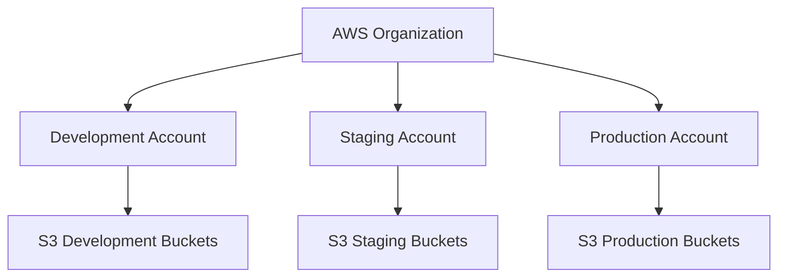
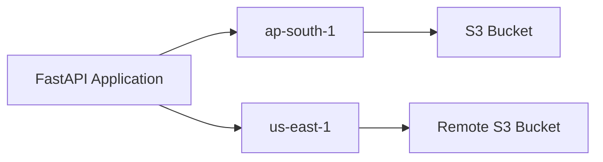
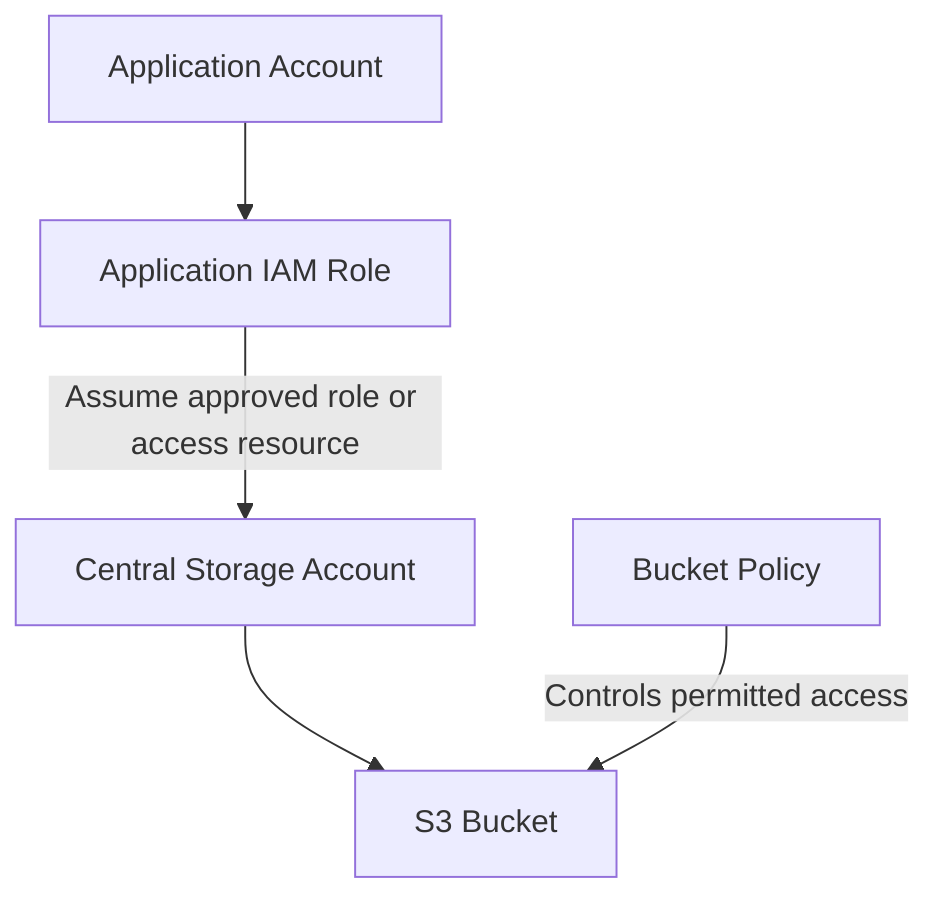

# 04- AWS Account and Region Configuration

## Overview

AWS account and Region configuration establishes the deployment boundary for Amazon S3 infrastructure. Before creating buckets or configuring dependent services, engineers must ensure that AWS requests target the intended account, use the correct Region, and execute under an identity with appropriate permissions.

Incorrect account or Region configuration can result in:

- Infrastructure being deployed into the wrong AWS account.
- Resources being created in an unintended Region.
- Application services connecting to the wrong S3 bucket.
- Unexpected cross-Region data transfer costs.
- Failed deployments caused by missing permissions or unavailable regional services.
- Security and compliance violations caused by incorrect resource placement.

For production systems, account and Region configuration should be explicit, centrally managed, and independently verified by deployment pipelines and application workloads.

## AWS Account Fundamentals

An AWS account is a fundamental resource and security boundary within AWS.

Each account has:

- A unique 12-digit account ID.
- Its own IAM identities and policies.
- Account-level service quotas.
- Billing and cost-management boundaries.
- Resource ownership.
- Optional organization-level governance through AWS Organizations.

S3 buckets belong to an AWS account. Bucket names in the general-purpose bucket namespace are globally unique within an AWS partition, not merely within an individual account.

### Identify the AWS Account

Use AWS Security Token Service (STS) to identify the principal currently making requests.

```bash
aws sts get-caller-identity
```

Example response:

```json
{
  "UserId": "AIDXXXXXXXXXXXXXXX",
  "Account": "123456789012",
  "Arn": "arn:aws:iam::123456789012:user/deployment-user"
}
```

The response contains:

| Field | Description |
|---|---|
| `UserId` | Unique identifier of the authenticated principal or session |
| `Account` | AWS account ID associated with the principal |
| `Arn` | ARN identifying the caller |

For an assumed role, the ARN typically identifies an STS assumed-role session rather than an IAM user.

Example:

```text
arn:aws:sts::123456789012:assumed-role/S3DeploymentRole/deployment-session
```

This distinction matters when diagnosing permissions because the effective permissions belong to the assumed role session and its applicable policies.

### Account Identification in Deployment Pipelines

A deployment pipeline should validate the expected account before executing infrastructure changes.

Example Bash check:

```bash
#!/usr/bin/env bash

set -Eeuo pipefail

EXPECTED_ACCOUNT_ID="123456789012"

ACTUAL_ACCOUNT_ID="$(
    aws sts get-caller-identity \
        --query Account \
        --output text
)"

if [[ "$ACTUAL_ACCOUNT_ID" != "$EXPECTED_ACCOUNT_ID" ]]; then
    echo "ERROR: Unexpected AWS account."
    echo "Expected: $EXPECTED_ACCOUNT_ID"
    echo "Actual:   $ACTUAL_ACCOUNT_ID"
    exit 1
fi

echo "AWS account validation passed."
```

For multi-environment deployments, obtain the expected account ID from protected environment configuration rather than embedding production account identifiers throughout scripts.

## AWS Accounts and Environment Isolation

Development, staging, and production environments should have clearly defined resource and permission boundaries.

### Account-per-environment Model

A common production architecture uses separate AWS accounts:



| Environment | Purpose | Access characteristics |
|---|---|---|
| Development | Feature development and experimentation | Controlled developer access |
| Staging | Pre-production validation | Restricted deployment and test access |
| Production | Live application workloads | Strictly controlled access and approvals |

### Advantages

- Stronger isolation between environments.
- Independent IAM and resource policies.
- Separate billing visibility.
- Reduced risk of accidental production modification.
- Easier application of organization-level controls.
- Independent service quotas and resource ownership.

### Limitations

- More accounts to administer.
- Cross-account access requires additional configuration.
- Centralized logging and monitoring require deliberate design.
- Infrastructure deployment must handle account-specific configuration.

A separate account is generally a stronger isolation boundary than relying only on bucket naming conventions or Terraform workspaces.

### Alternative: Multiple Environments in One Account

Smaller development environments may use one account with separate buckets and IAM roles.

For example:

```text
company-s3-dev-assets
company-s3-staging-assets
company-s3-prod-assets
```

This approach reduces account-management overhead but does not provide the same isolation as separate accounts.

Use explicit environment-specific permissions and avoid broad policies that grant access to every environment.

## AWS Region Fundamentals

An AWS Region is a separate geographical area containing multiple Availability Zones.

Resources created in a Region are generally managed through regional AWS service endpoints.

S3 general-purpose buckets are associated with a specific AWS Region at creation time. Their Region is an important part of the resource's operational configuration.

Examples of AWS Regions:

| Region code | Region |
|---|---|
| `ap-south-1` | Asia Pacific (Mumbai) |
| `ap-south-2` | Asia Pacific (Hyderabad) |
| `ap-southeast-1` | Asia Pacific (Singapore) |
| `us-east-1` | US East (N. Virginia) |
| `us-west-2` | US West (Oregon) |
| `eu-west-1` | Europe (Ireland) |

Region availability and service feature availability should be checked before deployment.

### Selecting an S3 Region

Choose a Region based on:

- Application user locations.
- Data residency and regulatory requirements.
- Latency requirements.
- Availability of dependent AWS services.
- Cross-Region data transfer costs.
- Disaster recovery requirements.
- Replication architecture.
- Operational and support requirements.

For an application primarily serving users in India, `ap-south-1` may be a suitable starting point. The final choice should account for the location of the application compute resources and data consumers, not only the location of end users.

### Region Selection Trade-offs

| Consideration | Engineering impact |
|---|---|
| Latency | Distance between application compute and S3 affects request latency |
| Data residency | Determines where stored data is physically maintained |
| Service availability | Some AWS features may not be available in every Region |
| Cost | Storage, requests, retrieval, and transfer pricing vary |
| Disaster recovery | Determines replication and recovery architecture |
| Compliance | May impose restrictions on storage location |

### Region and Availability Zones

S3 is a regional service. It is not provisioned into an individual Availability Zone in the same way as an EC2 instance or EBS volume.

S3 Standard is designed to provide high availability and durability by redundantly storing data across multiple Availability Zones within an AWS Region.

Do not treat a regional S3 bucket as an Availability Zone-specific resource.

## Configure the AWS CLI

The AWS CLI supports global configuration for credentials, Region, and output format.

### Inspect Existing Configuration

```bash
aws configure list
```

Example output:

```text
      Name                    Value             Type    Location
      ----                    -----             ----    --------
   profile                <not set>             None    None
access_key     ****************ABCD shared-credentials-file
secret_key     ****************WXYZ shared-credentials-file
    region                ap-south-1      config-file    ~/.aws/config
```

The actual output depends on the credential provider and configuration source.

Inspect the configured Region:

```bash
aws configure get region
```

Inspect the output format:

```bash
aws configure get output
```

### Set the Default Region

```bash
aws configure set region ap-south-1
```

Set the default output format:

```bash
aws configure set output json
```

The default configuration is typically stored in:

```text
~/.aws/config
```

On Windows, the corresponding directory is usually:

```text
%UserProfile%\.aws\
```

### Use an Explicit Region

For deployment scripts, explicitly specifying the Region reduces ambiguity.

```bash
aws s3api list-buckets \
    --region ap-south-1
```

The `--region` option selects the AWS service endpoint used by the CLI. It does not change the Region of an existing bucket.

## AWS CLI Profiles

Profiles allow engineers to configure multiple AWS identities and environments on one workstation.

### Configure a Named Profile

```bash
aws configure --profile s3-dev
```

The CLI prompts for:

- Access key ID.
- Secret access key.
- Default Region.
- Output format.

For temporary credentials, configure the appropriate session token or use a supported temporary credential provider.

### Configure Multiple Profiles

Example `~/.aws/config`:

```ini
[default]
region = ap-south-1
output = json

[profile s3-dev]
region = ap-south-1
output = json

[profile s3-staging]
region = ap-south-1
output = json

[profile s3-prod]
region = ap-south-1
output = json
```

Example `~/.aws/credentials` for local development identities:

```ini
[s3-dev]
aws_access_key_id = EXAMPLE_ACCESS_KEY
aws_secret_access_key = EXAMPLE_SECRET_KEY
```

The example values are placeholders, not usable credentials.

Avoid maintaining long-lived production access keys in local credentials files. Prefer IAM Identity Center or approved role-assumption workflows.

### Execute Commands Using a Profile

```bash
aws sts get-caller-identity \
    --profile s3-dev
```

```bash
aws s3api list-buckets \
    --profile s3-staging \
    --region ap-south-1
```

### Select a Profile for the Current Session

Linux or macOS:

```bash
export AWS_PROFILE=s3-dev
```

Windows PowerShell:

```powershell
$env:AWS_PROFILE = "s3-dev"
```

Verify the selected identity:

```bash
aws sts get-caller-identity
```

Do not assume that setting `AWS_PROFILE` guarantees the expected identity. Explicit credentials in environment variables or other higher-priority credential providers may affect credential selection.

## IAM Identity Center Configuration

AWS IAM Identity Center provides centralized access to AWS accounts and roles.

It is commonly used for human access in organizations that manage multiple AWS accounts.

### Configure an SSO Profile

A typical configuration in `~/.aws/config` looks like:

```ini
[profile s3-dev]
sso_session = company
sso_account_id = 123456789012
sso_role_name = DeveloperAccess
region = ap-south-1
output = json

[sso-session company]
sso_start_url = https://example.awsapps.com/start
sso_region = ap-south-1
sso_registration_scopes = sso:account:access
```

Replace the example values with those provided by the organization's AWS administrator.

### Authenticate

```bash
aws sso login --profile s3-dev
```

### Verify the Identity

```bash
aws sts get-caller-identity \
    --profile s3-dev
```

### Operational Considerations

- SSO sessions expire and may need to be refreshed.
- Access depends on the assigned account and permission set.
- A successful SSO login does not guarantee permission to create S3 resources.
- CI/CD workloads should generally use workload federation or role assumption rather than interactive human SSO sessions.

## AWS Credential Resolution

AWS CLI and SDKs use credential provider chains to locate credentials.

Common credential sources include:

| Credential source | Typical use |
|---|---|
| Explicit client credentials | Specialized applications and tests |
| Environment variables | Temporary automation environments |
| Shared credentials file | Local development |
| IAM Identity Center | Human developer access |
| AssumeRole | Cross-account and delegated access |
| Web identity token | OIDC-based CI/CD and workload federation |
| Container credentials | ECS and supported container environments |
| Instance profile | EC2 workloads |

The exact provider chain and precedence can vary by SDK and configuration.

### Environment Variables

Temporary credentials can be supplied through environment variables.

Linux or macOS:

```bash
export AWS_ACCESS_KEY_ID="EXAMPLE_ACCESS_KEY"
export AWS_SECRET_ACCESS_KEY="EXAMPLE_SECRET_KEY"
export AWS_SESSION_TOKEN="EXAMPLE_SESSION_TOKEN"
```

PowerShell:

```powershell
$env:AWS_ACCESS_KEY_ID = "EXAMPLE_ACCESS_KEY"
$env:AWS_SECRET_ACCESS_KEY = "EXAMPLE_SECRET_KEY"
$env:AWS_SESSION_TOKEN = "EXAMPLE_SESSION_TOKEN"
```

Use these variables only with credentials obtained through an approved process. Never commit them to source control.

### Diagnose Credential Selection

Inspect the CLI configuration:

```bash
aws configure list
```

Inspect the effective identity:

```bash
aws sts get-caller-identity
```

When a command uses an unexpected account, check:

1. Whether `AWS_PROFILE` is set.
2. Whether environment credentials are present.
3. Whether the intended profile exists.
4. Whether SSO credentials have expired.
5. Whether a role-assumption configuration is active.
6. Whether the application or CI runner uses a different credential provider.

The effective identity is more reliable than assumptions based on local profile names.

## Configure AWS Region in Terraform

Terraform's AWS provider determines which Region is used for regional AWS API operations.

### Provider Configuration

```hcl
terraform {
  required_version = ">= 1.5.0"

  required_providers {
    aws = {
      source  = "hashicorp/aws"
      version = ">= 5.0, < 7.0"
    }
  }
}

provider "aws" {
  region = var.aws_region
}
```

### Region Variable

```hcl
variable "aws_region" {
  description = "AWS Region for the S3 infrastructure."
  type        = string
  default     = "ap-south-1"
}
```

### Environment-Specific Configuration

Development:

```hcl
aws_region  = "ap-south-1"
environment = "dev"
```

Production:

```hcl
aws_region  = "ap-south-1"
environment = "prod"
```

Pass the appropriate variable file:

```bash
terraform plan \
    -var-file="environments/dev.tfvars"
```

```bash
terraform apply \
    -var-file="environments/dev.tfvars"
```

Keep environment-specific configuration separate from shared infrastructure definitions.

### Use Explicit Profiles with Terraform

Terraform's AWS provider supports the standard AWS credential mechanisms.

For local development, an explicit profile can be configured:

```hcl
provider "aws" {
  region  = var.aws_region
  profile = "s3-dev"
}
```

For CI/CD and production workloads, prefer temporary credentials provided through role assumption or OIDC federation.

Avoid hardcoding access keys in Terraform provider configuration.

## Configure Region in Python and Boto3

Backend applications and automation scripts should use a consistent Region configuration.

### Boto3 Client

```python
import boto3

s3_client = boto3.client(
    "s3",
    region_name="ap-south-1",
)
```

### Environment-Based Configuration

```python
import os

import boto3

AWS_REGION = os.getenv("AWS_REGION", "ap-south-1")

s3_client = boto3.client(
    "s3",
    region_name=AWS_REGION,
)
```

Boto3 can use the standard AWS credential provider chain. Avoid passing access keys directly into application source code.

### Reusable S3 Client Factory

A small factory centralizes Region and client configuration.

```python
import os

import boto3
from botocore.config import Config


def create_s3_client():
    region = os.getenv("AWS_REGION", "ap-south-1")

    config = Config(
        retries={
            "mode": "standard",
            "max_attempts": 5,
        },
        connect_timeout=5,
        read_timeout=30,
    )

    return boto3.client(
        "s3",
        region_name=region,
        config=config,
    )
```

The client can be initialized by the application's service layer and reused rather than recreated for every API request.

For Django, FastAPI, or Flask, keep AWS client initialization separate from request-handling logic.

## S3 Bucket Region and Endpoint Configuration

An S3 bucket's Region determines the regional endpoint used for requests.

### Inspect Bucket Location

```bash
aws s3api get-bucket-location \
    --bucket company-s3-dev-example
```

Example response:

```json
{
  "LocationConstraint": "ap-south-1"
}
```

A bucket in `us-east-1` may return a null `LocationConstraint` because of historical S3 API behavior.

Do not interpret a null location response as proof that the bucket does not exist.

### Inspect Bucket Region Using HeadBucket

```bash
aws s3api head-bucket \
    --bucket company-s3-dev-example
```

When supported and authorized, the response headers can expose the bucket's Region.

For diagnostic purposes, AWS SDK and CLI responses may provide additional Region information when a request is sent to the wrong regional endpoint.

### Regional S3 Endpoints

A common regional endpoint format is:

```text
https://s3.<region>.amazonaws.com
```

For example:

```text
https://s3.ap-south-1.amazonaws.com
```

Virtual-hosted-style bucket addressing commonly follows:

```text
https://<bucket-name>.s3.<region>.amazonaws.com/<object-key>
```

Use AWS SDKs for normal application requests. They handle endpoint selection, request signing, and other protocol details.

### Cross-Region Requests

When an application accesses a bucket in another Region, the request may involve additional network latency and transfer costs.

A common backend architecture is:



Prefer placing application compute close to the primary S3 bucket unless there is a deliberate multi-Region requirement.

Do not assume that selecting a Region in the SDK moves an existing bucket or changes its storage location.

## AWS Partition Considerations

AWS accounts belong to an AWS partition.

Common partitions include:

| Partition | Identifier prefix | Typical use |
|---|---|---|
| AWS commercial | `aws` | Standard AWS Regions |
| AWS GovCloud (US) | `aws-us-gov` | US government workloads |
| AWS China | `aws-cn` | China Regions |

An ARN includes the partition:

```text
arn:aws:s3:::company-s3-example
```

For a China partition, the ARN uses:

```text
arn:aws-cn:s3:::company-s3-example
```

Do not hardcode `arn:aws` into reusable infrastructure modules if they are intended to operate across partitions. Use partition-aware values such as Terraform's `aws_partition` data source when appropriate.

## Cross-Account S3 Deployment

Some architectures use a central storage account while applications run in separate workload accounts.

For example:



Cross-account access requires deliberate authorization.

Depending on the architecture, this may involve:

- A resource-based S3 bucket policy.
- An identity-based IAM policy.
- A trusted role and `sts:AssumeRole`.
- KMS key policies and grants when SSE-KMS is used.
- Organization-level controls and service control policies.

A successful role assumption does not automatically grant S3 access. The resulting principal must also have the required permissions, and the bucket's resource policies must permit the request.

Detailed cross-account authorization and policy evaluation belong in the S3 security documentation.

## Environment and Naming Configuration

Consistent naming and environment configuration make infrastructure easier to identify, operate, and audit.

### Bucket Naming Strategy

General-purpose S3 bucket names must satisfy S3 naming requirements and be globally unique within the applicable partition.

Example:

```text
company-dev-assets-ap-south-1
company-staging-assets-ap-south-1
company-prod-assets-ap-south-1
```

A naming convention can encode:

- Organization or application.
- Environment.
- Purpose.
- Region, where useful.

Avoid including sensitive information in bucket names.

Bucket names are visible in resource identifiers and may appear in logs, policies, and URLs.

### Environment Configuration Example

A deployment repository can use:

```text
infrastructure/
└── terraform/
    ├── versions.tf
    ├── providers.tf
    ├── variables.tf
    ├── outputs.tf
    └── environments/
        ├── dev.tfvars
        ├── staging.tfvars
        └── prod.tfvars
```

Example `dev.tfvars`:

```hcl
aws_region  = "ap-south-1"
environment = "dev"
bucket_name = "company-dev-assets-ap-south-1"
```

Example `prod.tfvars`:

```hcl
aws_region  = "ap-south-1"
environment = "prod"
bucket_name = "company-prod-assets-ap-south-1"
```

Use separate state boundaries for independent environments. Do not assume that different variable files alone provide infrastructure isolation.

## Validate Account and Region Before Deployment

A reliable deployment workflow should verify the active account and intended Region before creating or modifying resources.

### AWS CLI Validation

```bash
aws sts get-caller-identity
```

```bash
aws configure get region
```

```bash
aws s3api list-buckets
```

The ability to list buckets is permission-dependent and should not be treated as a universal authentication test.

### Terraform Validation

```bash
terraform init
```

```bash
terraform validate
```

```bash
terraform plan \
    -var-file="environments/dev.tfvars"
```

Review the plan to confirm:

- The intended AWS account is targeted.
- The provider Region is correct.
- Bucket names match the environment.
- No unintended production resources are being modified.
- No unexpected resource replacement or deletion is planned.

### Deployment Preflight Script

The following script validates the AWS account and Region before deployment.

```bash
#!/usr/bin/env bash

set -Eeuo pipefail

EXPECTED_ACCOUNT_ID="${EXPECTED_ACCOUNT_ID:?Set EXPECTED_ACCOUNT_ID}"
EXPECTED_REGION="${EXPECTED_REGION:-ap-south-1}"

ACTUAL_ACCOUNT_ID="$(
    aws sts get-caller-identity \
        --query Account \
        --output text
)"

ACTUAL_REGION="$(
    aws configure get region || true
)"

if [[ "$ACTUAL_ACCOUNT_ID" != "$EXPECTED_ACCOUNT_ID" ]]; then
    echo "ERROR: AWS account mismatch."
    echo "Expected: $EXPECTED_ACCOUNT_ID"
    echo "Actual:   $ACTUAL_ACCOUNT_ID"
    exit 1
fi

if [[ "$ACTUAL_REGION" != "$EXPECTED_REGION" ]]; then
    echo "ERROR: AWS Region mismatch."
    echo "Expected: $EXPECTED_REGION"
    echo "Actual:   ${ACTUAL_REGION:-not configured}"
    exit 1
fi

echo "AWS account and Region validation passed."
```

If the deployment relies on an explicit CLI `--region` option or a Terraform provider variable rather than the CLI default, validate those effective values separately. The script above checks the CLI's configured default Region, not every tool's configuration.

## Common Account and Region Configuration Problems

| Symptom | Possible cause | Verification |
|---|---|---|
| Resources created in the wrong account | Incorrect profile or credentials | `aws sts get-caller-identity` |
| S3 bucket not found | Incorrect bucket name or account assumptions | Verify bucket name and account access |
| `PermanentRedirect` | Request sent to an incorrect S3 endpoint | Inspect bucket Region |
| `AuthorizationHeaderMalformed` | Incorrect signing Region or endpoint | Check SDK and endpoint configuration |
| `AccessDenied` | Missing identity or resource permissions | Inspect principal and applicable policies |
| `ExpiredToken` | Temporary credentials expired | Refresh SSO or role credentials |
| Terraform targets unexpected Region | Provider or variable configuration mismatch | Inspect provider and plan |
| Boto3 accesses unexpected account | Different credential provider selected | Inspect credential configuration and STS identity |
| Cross-account access fails | Trust or resource policy is incomplete | Inspect role trust and bucket policy |
| Deployment works locally but fails in CI | Different identity or Region configuration | Compare CI and local STS identity and effective configuration |

### Wrong Account

Symptoms:

- Unexpected resource changes.
- Existing bucket cannot be found.
- Terraform plans resources in an unfamiliar account.

Diagnostic sequence:

```bash
aws configure list
```

```bash
aws sts get-caller-identity
```

Then inspect the selected profile, environment variables, and role-assumption configuration.

### Wrong Region

Symptoms:

- S3 endpoint redirects.
- Signature or authorization errors.
- Application cannot access a bucket using its configured endpoint.

Diagnostic sequence:

```bash
aws s3api get-bucket-location \
    --bucket company-s3-dev-example
```

Compare the result with:

- AWS CLI Region.
- Terraform provider Region.
- Boto3 client Region.
- Application environment configuration.

Correct the mismatched configuration rather than attempting to recreate the bucket.

### Authentication Versus Authorization

Authentication identifies the caller. Authorization determines whether the caller can execute an action.

Start with:

```bash
aws sts get-caller-identity
```

If STS succeeds but an S3 operation fails, investigate:

- IAM identity policies.
- S3 bucket policies.
- VPC endpoint policies.
- Service control policies.
- KMS permissions for SSE-KMS objects.
- Explicit denies and applicable permission boundaries.

Do not treat every `AccessDenied` response as an invalid credential problem.

## Production Best Practices

### Account Management

- Use separate accounts for production and non-production workloads when practical.
- Restrict production access through dedicated IAM roles.
- Use centralized account governance where appropriate.
- Validate account IDs before infrastructure changes.
- Maintain auditability of deployment identities.
- Avoid sharing administrator credentials between engineers and automation.

### Region Management

- Choose the primary Region based on application architecture and compliance requirements.
- Keep compute and frequently accessed S3 data close together.
- Use explicit Region configuration in infrastructure code.
- Validate bucket Region before integrating a new bucket.
- Evaluate cross-Region transfer and replication costs.
- Verify dependent service and feature availability.

### Credential Management

- Prefer IAM Identity Center for human access.
- Prefer workload roles for AWS-hosted applications.
- Use OIDC federation for supported CI/CD systems.
- Use short-lived credentials.
- Avoid long-lived access keys in production.
- Never commit credentials to source control.

### Deployment Safety

- Validate the active AWS account before deployment.
- Review Terraform plans before applying changes.
- Use environment-specific configuration and state.
- Require approval for production changes.
- Monitor infrastructure changes through audit logs.
- Test deployment and recovery procedures.

## Key Takeaways

- AWS account configuration determines resource ownership and the security boundary; always verify the active principal and account with STS before deployment.
- S3 buckets are associated with a specific Region, so CLI, Terraform, Boto3, and application configuration must target the intended Region.
- Use separate AWS accounts for stronger environment isolation and separate IAM roles for deployment and application runtime operations.
- Prefer IAM Identity Center, workload roles, and OIDC federation over long-lived access keys.
- Validate account, Region, credentials, and infrastructure plans before provisioning or modifying production S3 resources.