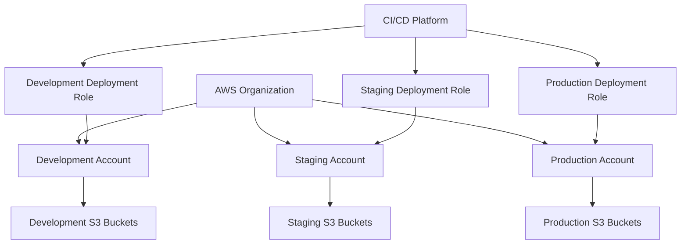
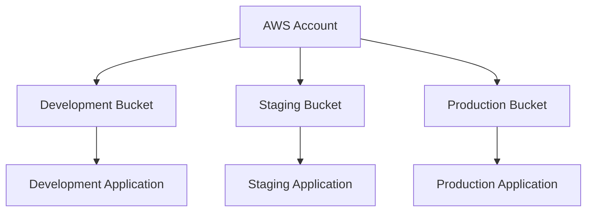
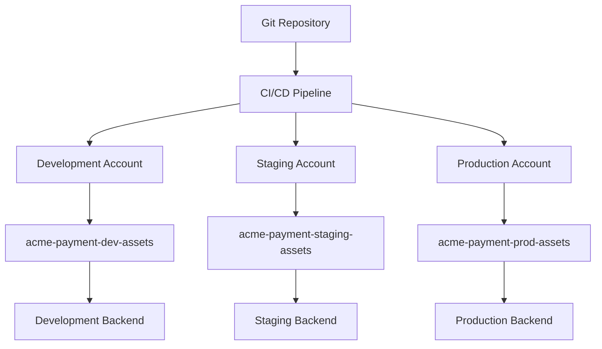
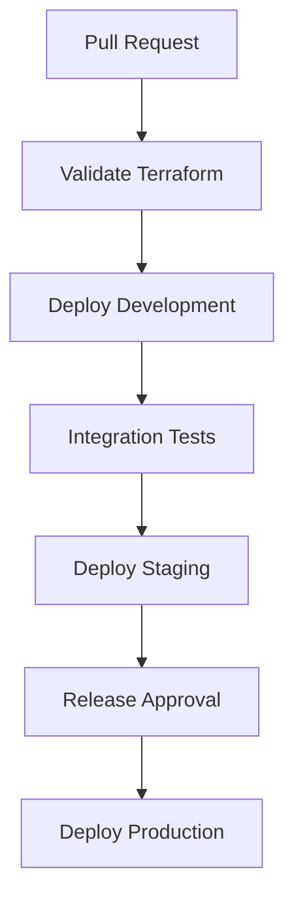

# 05- Environment Separation and Resource Naming

## Overview

Environment separation and resource naming are essential for managing Amazon S3 infrastructure safely across development, testing, staging, and production.

A production backend system typically uses multiple environments to support feature development, integration testing, release validation, and live workloads. Each environment must have clearly defined infrastructure boundaries, access permissions, configuration, and deployment procedures.

Without deliberate separation, teams risk:

- Development workloads modifying production objects.
- Staging applications accessing production datasets.
- Accidental deletion of production buckets.
- Conflicting infrastructure deployments.
- Incorrect IAM permissions.
- Uncontrolled resource creation and unexpected costs.
- Difficult resource ownership and auditing.

Environment separation defines where resources belong and who can access them. Resource naming provides a consistent identification scheme for those resources.

Both should be designed together rather than treated as independent configuration concerns.

## Environment Separation Fundamentals

An environment represents an isolated deployment context for an application or workload.

Common environments include:

| Environment | Purpose | Typical characteristics |
|---|---|---|
| Development | Feature development and experimentation | Frequent changes, test data, flexible access |
| Testing | Automated and integration testing | Repeatable test datasets and controlled execution |
| Staging | Pre-production validation | Production-like configuration and restricted access |
| Production | Live application workloads | Strict access, change control, monitoring, and recovery |

The required environments depend on the application's delivery process. A small project may use development and production, while a large organization may maintain several testing and staging environments.

### Why Environment Separation Matters

Environment separation provides several engineering benefits.

**Isolation**

Changes in one environment should not unintentionally affect another environment.

**Security**

Applications and deployment identities receive access only to the resources required by their environment.

**Release validation**

Changes can be tested in staging before being applied to production.

**Operational safety**

Destructive operations can be restricted to approved identities and deployment workflows.

**Cost visibility**

Resource tags, account boundaries, and naming conventions help associate costs with applications and environments.

**Auditability**

Infrastructure changes can be associated with a specific environment, deployment pipeline, and responsible identity.

## Environment Isolation Strategies

AWS supports several approaches to separating environments. The correct strategy depends on security requirements, organizational scale, cost, and operational complexity.

### Separate AWS Accounts

Using separate AWS accounts provides the strongest commonly used environment boundary.



Each account maintains its own:

- IAM identities and policies.
- S3 buckets and resource policies.
- Service quotas.
- Billing and cost allocation boundaries.
- CloudTrail configuration and account-level controls.
- Infrastructure deployment roles.

Example account layout:

| Environment | Account ID | Region |
|---|---|---|
| Development | `111111111111` | `ap-south-1` |
| Staging | `222222222222` | `ap-south-1` |
| Production | `333333333333` | `ap-south-1` |

The account IDs are illustrative.

**Advantages**

- Strong isolation between environments.
- Independent IAM and resource policies.
- Reduced blast radius from deployment mistakes.
- Clearer billing and cost allocation.
- Easier application of account-level governance.

**Limitations**

- More account administration.
- Cross-account access requires additional configuration.
- Centralized logging and monitoring need deliberate design.
- Deployment pipelines must support multiple accounts.

Use separate accounts when production isolation, regulatory requirements, or organizational governance justify the additional complexity.

### Separate Buckets Within One AWS Account

A simpler architecture uses separate buckets for each environment.

```text
acme-payment-dev-assets
acme-payment-staging-assets
acme-payment-prod-assets
```

Architecture:



**Advantages**

- Easier initial setup.
- Lower account-management overhead.
- Clear resource identification.
- Independent bucket configuration and policies.

**Limitations**

- All environments share the same AWS account boundary.
- Account-level permissions and quotas are shared.
- Incorrect IAM policies can expose resources across environments.
- Account-level incidents can affect every environment.

This model can be suitable for smaller projects, but it does not provide the same isolation as separate AWS accounts.

### Prefix-Based Separation

Another option is to use separate prefixes within one bucket.

```text
company-shared-storage/
├── dev/
│   ├── uploads/
│   └── reports/
├── staging/
│   ├── uploads/
│   └── reports/
└── prod/
    ├── uploads/
    └── reports/
```

Example object keys:

```text
dev/uploads/user-1001/profile.png
staging/uploads/user-1001/profile.png
prod/uploads/user-1001/profile.png
```

**Advantages**

- Fewer buckets to manage.
- Shared bucket-level configuration.
- Convenient for controlled shared-storage workloads.

**Limitations**

- Environments share bucket-level configuration.
- Access isolation depends heavily on IAM and bucket policies.
- Lifecycle and retention requirements may differ between environments.
- A bucket-level policy or configuration mistake can affect multiple environments.
- Separate billing attribution is less direct.

Prefix separation is a storage organization technique, not an equivalent replacement for account isolation.

### Isolation Strategy Comparison

| Strategy | Isolation strength | Operational complexity | Suitable use |
|---|---|---|---|
| Separate AWS accounts | High | Higher | Production and regulated workloads |
| Separate buckets | Moderate | Moderate | Small and medium deployments |
| Separate prefixes | Lower | Lower | Shared storage with controlled access |
| Separate accounts and buckets | High | Higher | Enterprise production architectures |

A common production design combines separate AWS accounts with separate buckets. Prefixes then organize datasets and application objects within each bucket.

## Recommended Environment Architecture

For a production backend application, a practical architecture is:



Each environment has its own:

- S3 bucket.
- Application configuration.
- IAM runtime role.
- Deployment role.
- Terraform state.
- Monitoring configuration.
- Data retention requirements.

The application code can remain identical across environments. Environment-specific behavior should be controlled through configuration and infrastructure rather than separate code branches.

## S3 Resource Naming Fundamentals

S3 resource naming should make resources identifiable, predictable, and easy to manage.

A naming convention should communicate the resource's purpose without exposing sensitive information.

A useful naming structure is:

```text
<organization>-<application>-<environment>-<purpose>-<region>
```

Example:

```text
acme-payment-prod-documents-ap-south-1
```

| Component | Example | Meaning |
|---|---|---|
| Organization | `acme` | Organization or business identifier |
| Application | `payment` | Application or system |
| Environment | `prod` | Deployment environment |
| Purpose | `documents` | Storage responsibility |
| Region | `ap-south-1` | Intended AWS Region |

This convention provides predictable resource identification across environments.

### Naming Convention Requirements

A good naming convention should be:

- Consistent across environments.
- Readable by engineers and operators.
- Compatible with AWS resource naming rules.
- Stable over the resource's lifetime.
- Suitable for automation.
- Free from sensitive information.
- Easy to search in logs and infrastructure inventories.

Avoid unnecessary naming complexity. A resource name should communicate its identity without becoming a duplicate of every configuration attribute.

## S3 Bucket Naming Rules

S3 general-purpose bucket names have specific naming constraints.

Important rules include:

- Bucket names must contain between 3 and 63 characters.
- Names must use lowercase letters, numbers, periods, and hyphens.
- Names must begin and end with a letter or number.
- Adjacent periods are not allowed.
- Names must not be formatted as an IPv4 address.
- Bucket names must be unique within the applicable AWS partition's general-purpose bucket namespace.

Some names are reserved or subject to additional restrictions. Always validate a proposed name against the current S3 bucket naming requirements.

### Valid Examples

```text
acme-payment-dev-documents-ap-south-1
acme-payment-staging-assets-ap-south-1
acme-payment-prod-reports-ap-south-1
```

### Invalid or Poor Examples

| Name | Problem |
|---|---|
| `Acme-Payment-Prod` | Uppercase letters |
| `acme_payment_prod` | Underscores |
| `acme..payment.prod` | Adjacent periods |
| `192.168.1.10` | IPv4 address format |
| `prod` | Too short and not descriptive |

### Global Uniqueness

For general-purpose buckets, names are not scoped to an AWS account.

Two different accounts cannot independently create general-purpose buckets with the same name in the same partition's shared namespace.

This has important implications for environment design.

For example, the following names are distinct:

```text
acme-payment-dev-documents-ap-south-1
acme-payment-prod-documents-ap-south-1
```

However, another account may already own either name.

Do not assume that a bucket name is available simply because it does not exist in your current account.

## Naming S3 Objects and Prefixes

Bucket naming and object-key naming solve different problems.

A bucket identifies the storage resource. An object key identifies an object inside that bucket.

For example:

```text
Bucket:
acme-payment-prod-documents-ap-south-1

Object key:
invoices/2026/10/invoice-10001.pdf
```

The complete object location is identified by the bucket and key together.

### Recommended Prefix Structure

For a document-storage application:

```text
documents/
├── invoices/
│   ├── 2026/
│   │   ├── 10/
│   │   └── 11/
│   └── 2027/
├── contracts/
└── reports/
```

For a data-ingestion workload:

```text
data-lake/
├── raw/
│   ├── customers/
│   │   └── ingestion_date=2026-10-31/
│   └── transactions/
│       └── ingestion_date=2026-10-31/
├── processed/
└── curated/
```

S3 prefixes are logical key-name groupings, not physical directories.

### Object Key Design Considerations

A production object-key design should account for:

- Application ownership.
- Tenant boundaries.
- Data type.
- Processing stage.
- Date or time partitioning.
- Object lifecycle requirements.
- Retention requirements.
- Retrieval patterns.

Avoid putting untrusted user input directly into object keys. Generate keys on the backend and validate any components derived from client input.

### Multi-Tenant Object Keys

A multi-tenant application might use:

```text
tenants/<tenant-id>/documents/<document-id>.pdf
```

Example:

```text
tenants/tenant-1001/documents/doc-8f1a2c.pdf
```

The backend should derive the tenant identifier from the authenticated identity and authorization context, not trust a tenant identifier supplied by the client.

A tenant-specific prefix does not automatically provide tenant isolation. IAM, application authorization, and resource policies must enforce the intended access boundaries.

## Resource Naming Across AWS Services

A consistent naming convention should extend beyond S3 buckets.

Example:

| Resource | Example name |
|---|---|
| S3 bucket | `acme-payment-prod-documents-ap-south-1` |
| IAM role | `acme-payment-prod-s3-runtime-role` |
| Lambda function | `acme-payment-prod-image-processor` |
| SQS queue | `acme-payment-prod-document-events` |
| SNS topic | `acme-payment-prod-upload-notifications` |
| CloudWatch log group | `/aws/lambda/acme-payment-prod-image-processor` |
| Terraform state key | `payment/prod/ap-south-1/terraform.tfstate` |

Resource naming rules differ across AWS services. Some resource names are globally unique, some are account-scoped, and others are Region-scoped.

Validate each service's naming requirements independently.

## Resource Tags

Tags provide metadata for resource ownership, cost allocation, governance, and automation.

Unlike resource names, tags can be updated without changing the resource identifier.

### Recommended Tag Set

| Tag | Example value | Purpose |
|---|---|---|
| `Application` | `payment` | Application ownership |
| `Environment` | `prod` | Deployment environment |
| `Owner` | `backend-platform` | Responsible team |
| `ManagedBy` | `Terraform` | Infrastructure management |
| `CostCenter` | `CC-1001` | Cost allocation |
| `DataClassification` | `confidential` | Data governance |
| `Project` | `document-storage` | Project association |

Tags should follow an organization-wide standard.

Do not put credentials, personal information, or confidential business data into resource tags.

### Terraform Tag Configuration

```hcl
variable "environment" {
  description = "Deployment environment."
  type        = string

  validation {
    condition = contains(
      ["dev", "staging", "prod"],
      var.environment
    )

    error_message = "Environment must be dev, staging, or prod."
  }
}

variable "application_name" {
  description = "Application identifier."
  type        = string
  default     = "payment"
}

variable "owner" {
  description = "Owning engineering team."
  type        = string
  default     = "backend-platform"
}

variable "cost_center" {
  description = "Cost allocation identifier."
  type        = string
  default     = "CC-1001"
}
```

Configure provider-level default tags:

```hcl
provider "aws" {
  region = var.aws_region

  default_tags {
    tags = {
      Application = var.application_name
      Environment = var.environment
      Owner       = var.owner
      CostCenter  = var.cost_center
      ManagedBy   = "Terraform"
    }
  }
}
```

Resource-specific tags can supplement provider-level tags.

For S3, distinguish bucket tags from object tags. Bucket tags are resource-level metadata; object tags apply to individual objects and can support object-specific workflows and lifecycle filtering.

Do not assume that bucket tags are automatically inherited by objects.

## Environment-Specific Terraform Configuration

Terraform should use shared infrastructure definitions with environment-specific input values.

This reduces code duplication and helps ensure consistent resource configuration.

### Suggested Directory Structure

```text
infrastructure/
└── terraform/
    ├── modules/
    │   └── s3-bucket/
    │       ├── main.tf
    │       ├── variables.tf
    │       └── outputs.tf
    └── environments/
        ├── dev/
        │   ├── main.tf
        │   └── terraform.tfvars
        ├── staging/
        │   ├── main.tf
        │   └── terraform.tfvars
        └── prod/
            ├── main.tf
            └── terraform.tfvars
```

The reusable module defines the common bucket configuration. Each environment provides its own values and state boundary.

### Environment Configuration

Development:

```hcl
application_name = "payment"
environment      = "dev"
aws_region       = "ap-south-1"
bucket_name      = "acme-payment-dev-documents-ap-south-1"
```

Staging:

```hcl
application_name = "payment"
environment      = "staging"
aws_region       = "ap-south-1"
bucket_name      = "acme-payment-staging-documents-ap-south-1"
```

Production:

```hcl
application_name = "payment"
environment      = "prod"
aws_region       = "ap-south-1"
bucket_name      = "acme-payment-prod-documents-ap-south-1"
```

### Reusable S3 Module

Example `main.tf`:

```hcl
resource "aws_s3_bucket" "this" {
  bucket = var.bucket_name

  tags = {
    Application = var.application_name
    Environment = var.environment
    ManagedBy   = "Terraform"
  }

  lifecycle {
    prevent_destroy = true
  }
}

resource "aws_s3_bucket_versioning" "this" {
  bucket = aws_s3_bucket.this.id

  versioning_configuration {
    status = "Enabled"
  }
}

resource "aws_s3_bucket_public_access_block" "this" {
  bucket = aws_s3_bucket.this.id

  block_public_acls       = true
  block_public_policy     = true
  ignore_public_acls      = true
  restrict_public_buckets = true
}
```

Example `variables.tf`:

```hcl
variable "bucket_name" {
  description = "Globally unique S3 bucket name."
  type        = string
}

variable "application_name" {
  description = "Application identifier."
  type        = string
}

variable "environment" {
  description = "Deployment environment."
  type        = string

  validation {
    condition = contains(
      ["dev", "staging", "prod"],
      var.environment
    )

    error_message = "Unsupported environment."
  }
}
```

Example `outputs.tf`:

```hcl
output "bucket_name" {
  description = "Created S3 bucket name."
  value       = aws_s3_bucket.this.id
}

output "bucket_arn" {
  description = "Created S3 bucket ARN."
  value       = aws_s3_bucket.this.arn
}
```

The module can be called independently by each environment's root configuration.

### Production Protection

The following lifecycle rule prevents Terraform from destroying the bucket while the protection remains configured:

```hcl
lifecycle {
  prevent_destroy = true
}
```

This is a Terraform lifecycle safeguard, not an AWS-level deletion lock.

It does not prevent deletion through the AWS CLI, console, or another infrastructure-management system. Combine it with IAM restrictions, organizational controls, change approvals, and recovery mechanisms.

It also means that intentional bucket removal requires a controlled change to the Terraform configuration.

## Terraform State Separation

Environment-specific infrastructure should have separate state boundaries.

A common remote-state layout is:

```text
s3-infrastructure/
├── dev/
│   └── terraform.tfstate
├── staging/
│   └── terraform.tfstate
└── prod/
    └── terraform.tfstate
```

For remote state, use a supported backend with access controls, encryption, and locking.

For example, separate S3 backend keys can identify each environment:

```text
payment/dev/terraform.tfstate
payment/staging/terraform.tfstate
payment/prod/terraform.tfstate
```

The backend bucket should be managed and protected independently from the application buckets.

Avoid using one shared state file for unrelated environments. A state mistake or destructive operation could otherwise affect multiple deployment environments.

Detailed remote-state configuration, locking, and recovery are covered in the Terraform deployment documentation.

## Environment-Specific IAM Access

Resource naming alone does not enforce environment isolation.

IAM permissions must restrict which resources an identity can access.

For example, a development application role should not receive unrestricted access to production buckets.

A simplified policy for a development application might be:

```json
{
  "Version": "2012-10-17",
  "Statement": [
    {
      "Sid": "ListDevelopmentBucket",
      "Effect": "Allow",
      "Action": [
        "s3:ListBucket"
      ],
      "Resource": "arn:aws:s3:::acme-payment-dev-documents-ap-south-1"
    },
    {
      "Sid": "AccessDevelopmentObjects",
      "Effect": "Allow",
      "Action": [
        "s3:GetObject",
        "s3:PutObject"
      ],
      "Resource": "arn:aws:s3:::acme-payment-dev-documents-ap-south-1/*"
    }
  ]
}
```

This example illustrates resource scoping. Production policies should include only the actions required by the application and account for other applicable policy layers.

A development role should not receive permissions for staging or production buckets unless a specific, approved workflow requires them.

## Environment Configuration in Backend Applications

Application code should remain independent of environment-specific bucket names.

Use configuration variables to select the appropriate resources.

### Environment Variables

Development:

```dotenv
APP_ENV=dev
AWS_REGION=ap-south-1
S3_BUCKET_NAME=acme-payment-dev-documents-ap-south-1
```

Production:

```dotenv
APP_ENV=prod
AWS_REGION=ap-south-1
S3_BUCKET_NAME=acme-payment-prod-documents-ap-south-1
```

Do not commit real secrets into environment files.

### Python Configuration

```python
import os
from dataclasses import dataclass


@dataclass(frozen=True)
class StorageSettings:
    environment: str
    aws_region: str
    bucket_name: str


def load_storage_settings() -> StorageSettings:
    environment = os.environ["APP_ENV"]

    if environment not in {"dev", "staging", "prod"}:
        raise ValueError("Unsupported application environment")

    return StorageSettings(
        environment=environment,
        aws_region=os.environ["AWS_REGION"],
        bucket_name=os.environ["S3_BUCKET_NAME"],
    )
```

The application can then initialize its S3 service using the validated settings.

### Runtime Configuration Validation

Validate configuration during application startup.

Useful checks include:

- Environment value belongs to the approved set.
- Bucket name is configured.
- Region is configured.
- Runtime identity is available.
- The application has the required bucket permissions.

Avoid making every application request perform an unnecessary bucket-discovery operation. Use startup validation and appropriate health checks.

## CI/CD Environment Separation

A deployment pipeline should explicitly identify the target environment and AWS account.

Example workflow:



Each deployment stage should use its own identity and configuration.

| Stage | AWS identity | Configuration |
|---|---|---|
| Development | Development deployment role | `dev.tfvars` |
| Staging | Staging deployment role | `staging.tfvars` |
| Production | Production deployment role | `prod.tfvars` |

### CI/CD Best Practices

- Use OIDC federation where supported.
- Assign separate deployment roles to each environment.
- Restrict production deployments to approved branches and environments.
- Require production approval for sensitive infrastructure changes.
- Validate Terraform before deployment.
- Review plans before applying.
- Avoid sharing production credentials with development workflows.
- Keep deployment logs and audit trails.

The pipeline should not infer its target environment solely from an arbitrary branch name. Use protected environment configuration and explicit deployment controls.

## Environment and Naming Strategy for Multi-Tenant Applications

Multi-tenant applications require additional separation considerations.

A typical object-key structure is:

```text
tenants/<tenant-id>/<resource-type>/<object-id>
```

Example:

```text
tenants/tenant-1001/documents/doc-8f1a2c.pdf
tenants/tenant-1002/documents/doc-3b7d9e.pdf
```

This structure makes tenant ownership and resource grouping explicit.

### Important Design Considerations

- Derive tenant identity from authenticated application context.
- Never trust arbitrary client-supplied object keys.
- Enforce authorization before generating presigned URLs.
- Prevent one tenant from accessing another tenant's objects.
- Avoid exposing internal storage paths unnecessarily.
- Consider separate buckets or accounts when stronger isolation is required.

A prefix-based layout simplifies organization, but it does not independently guarantee data isolation.

## Common Environment and Naming Mistakes

| Mistake | Why it is problematic | Recommended approach |
|---|---|---|
| Using one production bucket for every environment | Test operations can affect live data | Separate environments with explicit resource boundaries |
| Relying only on prefixes for isolation | Prefixes do not enforce authorization | Apply IAM and resource policies |
| Reusing bucket names across accounts | General-purpose bucket names are globally unique within a partition | Use environment-specific unique names |
| Hardcoding bucket names in application code | Makes deployments difficult to reproduce | Use environment configuration |
| Giving developers production administrator access | Increases accidental and malicious change risk | Use dedicated roles and approval controls |
| Sharing Terraform state across environments | Increases blast radius | Maintain separate state boundaries |
| Using inconsistent tags | Makes cost and ownership reporting unreliable | Enforce a standard tag set |
| Putting sensitive information in names or tags | Resource identifiers and metadata may be exposed | Use non-sensitive identifiers |
| Assuming `prevent_destroy` is a complete deletion control | It only affects Terraform behavior | Add IAM and organizational safeguards |
| Using different application code per environment | Creates configuration drift | Promote the same application artifact through environments |

## Production Readiness Checklist

Before deploying an S3-based application, verify the following.

### Environment Isolation

- [ ] Development, staging, and production boundaries are defined.
- [ ] Production resources are isolated appropriately.
- [ ] Each environment has the intended AWS account and Region.
- [ ] Application runtime identities are environment-specific.
- [ ] Cross-environment access is explicitly justified and controlled.

### Resource Naming

- [ ] Bucket names follow the organization's naming convention.
- [ ] Bucket names satisfy S3 naming requirements.
- [ ] Bucket names are globally available within the applicable partition.
- [ ] Object keys follow a documented naming structure.
- [ ] Resource names do not contain sensitive information.
- [ ] Resource tags identify application, environment, owner, and cost center.

### Infrastructure and State

- [ ] Terraform configuration is shared through reusable modules where appropriate.
- [ ] Environment variables are defined separately.
- [ ] Terraform state is separated by environment.
- [ ] Production resource protection is configured.
- [ ] Destructive changes require appropriate approval.

### Security and Operations

- [ ] IAM policies restrict access to the intended environment.
- [ ] Production deployment permissions are restricted.
- [ ] CI/CD uses short-lived credentials where supported.
- [ ] Bucket configuration is validated after deployment.
- [ ] Cost allocation and monitoring are configured.
- [ ] Recovery and cleanup procedures are documented.

## Key Takeaways

- Separate development, staging, and production resources to reduce accidental changes, security exposure, and operational blast radius.
- Separate AWS accounts provide stronger environment isolation than separate buckets or prefixes within one account.
- Use consistent, globally unique S3 bucket names that identify the application, environment, purpose, and optionally Region.
- Treat object-key prefixes and resource tags as organization and metadata mechanisms, not substitutes for IAM authorization.
- Maintain environment-specific IAM roles, Terraform state, application configuration, and CI/CD deployment controls.