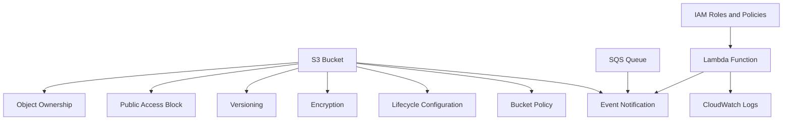
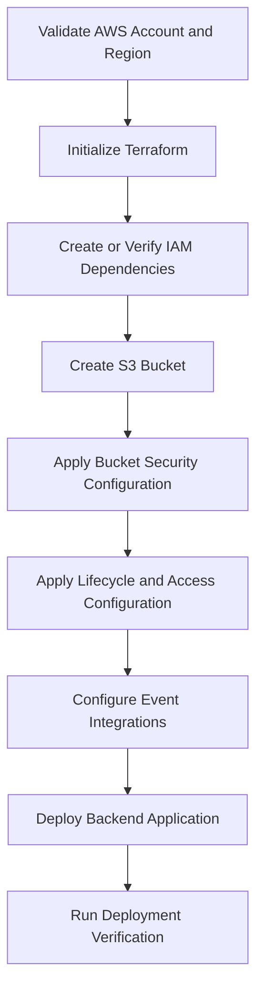
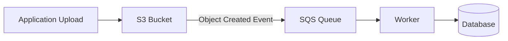
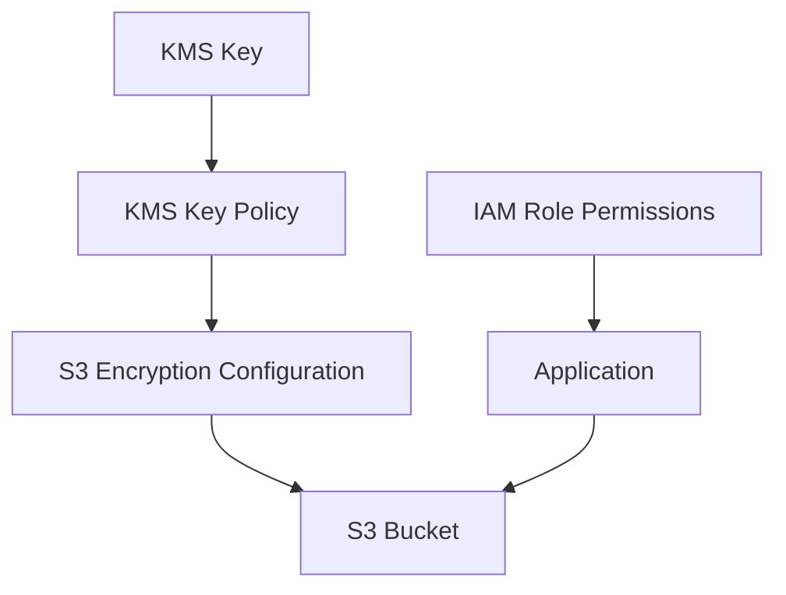
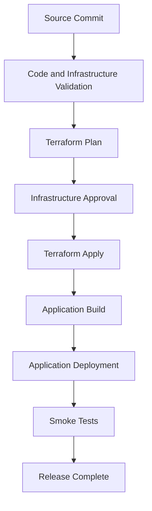

# 06- Deployment Dependency Management

## Overview

Amazon S3 infrastructure rarely operates as an isolated resource. A production deployment typically includes dependencies such as IAM roles, bucket policies, encryption configuration, networking components, event notifications, Lambda functions, monitoring resources, and application services.

Deployment dependency management defines how these resources are created, configured, updated, and removed in a controlled order.

Incorrect dependency handling can cause:

- Infrastructure deployment failures.
- Missing IAM permissions during resource creation.
- S3 event notifications referencing unavailable destinations.
- Applications starting before required storage resources are ready.
- Failed Terraform or CloudFormation deployments.
- Inconsistent infrastructure after partial failures.
- Destructive operations affecting resources still in use.

A reliable deployment process must account for both explicit infrastructure dependencies and implicit runtime dependencies.

This document focuses on identifying and managing those dependencies across S3 infrastructure, backend applications, and deployment pipelines.

## Types of Deployment Dependencies

Deployment dependencies can be classified into several categories.

| Dependency type | Description | Example |
|---|---|---|
| Resource dependency | One AWS resource requires another resource to exist | S3 bucket policy references a bucket |
| Permission dependency | A service needs permissions before performing an operation | Lambda execution role needs S3 access |
| Configuration dependency | A resource requires configuration from another resource | Application needs the bucket name |
| Service integration dependency | Two AWS services must be configured together | S3 event notification and SQS queue |
| Network dependency | A workload requires network connectivity to a service | Private workload accessing S3 through a VPC endpoint |
| Application dependency | Application startup depends on infrastructure | FastAPI requires an existing storage bucket |
| Deployment pipeline dependency | A deployment stage must complete before another starts | Infrastructure deployment before application release |
| Operational dependency | A resource must remain available while another resource uses it | Logging bucket retained while source resources are active |

Understanding these categories helps identify dependencies that infrastructure tools may not automatically detect.

## S3 Infrastructure Dependency Relationships

A typical S3 deployment includes several interconnected resources.



The diagram represents logical relationships, not a universal creation sequence. Actual ordering depends on the service APIs and the infrastructure definitions.

For example:

- A bucket must exist before its versioning configuration can be applied.
- A bucket must exist before its lifecycle configuration can be attached.
- A Lambda execution role must exist before it can be assigned to a Lambda function.
- A destination queue must have an appropriate resource policy before S3 can deliver notifications to it.
- An application must know the bucket name and Region before using the storage service.

Some dependencies are automatically inferred by Terraform through resource references. Others require explicit configuration or ordering.

## Dependency Management with Terraform

Terraform builds a dependency graph from references between resources and data sources.

It uses this graph to determine which operations can run in parallel and which must wait for other operations.

### Implicit Dependencies

An implicit dependency exists when one resource references an attribute of another resource.

Example:

```hcl
resource "aws_s3_bucket" "documents" {
  bucket = var.bucket_name
}

resource "aws_s3_bucket_versioning" "documents" {
  bucket = aws_s3_bucket.documents.id

  versioning_configuration {
    status = "Enabled"
  }
}

resource "aws_s3_bucket_public_access_block" "documents" {
  bucket = aws_s3_bucket.documents.id

  block_public_acls       = true
  block_public_policy     = true
  ignore_public_acls      = true
  restrict_public_buckets = true
}
```

The reference:

```hcl
bucket = aws_s3_bucket.documents.id
```

creates an implicit dependency on the bucket.

Terraform understands that the bucket must exist before the versioning and public-access resources can be configured.

When destroying the infrastructure, Terraform reverses the dependency order.

### Explicit Dependencies

Sometimes Terraform cannot infer a required ordering from resource references.

Use `depends_on` when a genuine dependency exists but is not represented through an attribute reference.

Example:

```hcl
resource "aws_s3_bucket_lifecycle_configuration" "documents" {
  bucket = aws_s3_bucket.documents.id

  depends_on = [
    aws_s3_bucket_versioning.documents
  ]

  rule {
    id     = "document-expiration"
    status = "Enabled"

    filter {
      prefix = "documents/"
    }

    expiration {
      days = 365
    }
  }
}
```

The bucket reference already establishes a dependency on the bucket. The explicit dependency adds ordering relative to versioning.

Use explicit dependencies only when necessary. Excessive `depends_on` declarations can make Terraform's graph less precise and reduce opportunities for parallel execution.

### Dependency Graph Inspection

Terraform can generate a visual representation of its dependency graph.

```bash
terraform graph -type=plan > dependency-graph.dot
```

Render the graph using Graphviz:

```bash
dot -Tsvg dependency-graph.dot -o dependency-graph.svg
```

This is useful when:

- A deployment fails because of resource ordering.
- Infrastructure has many interconnected resources.
- A module introduces unexpected dependencies.
- A resource replacement causes downstream changes.
- Engineers need to understand destruction order.

The graph describes Terraform's planned dependency relationships. It does not guarantee that every external service integration or runtime dependency has been modeled.

## S3 Resource Creation Order

A typical S3 bucket deployment can be organized into logical stages.

| Stage | Resources | Dependency |
|---|---|---|
| Foundation | Provider, account, Region, remote state | Deployment environment |
| Identity | IAM roles and policies | Account and trust configuration |
| Storage | S3 bucket | Bucket name availability |
| Bucket controls | Ownership, public-access block, versioning | Bucket |
| Encryption | Default encryption configuration | Bucket and KMS permissions when applicable |
| Data management | Lifecycle configuration | Bucket and versioning where required |
| Access | Bucket policies and access points | Bucket and relevant identities |
| Integration | Event notifications and destinations | Bucket, destination, and permissions |
| Application | Backend services and configuration | Storage and access configuration |
| Verification | Smoke tests and operational checks | Deployed resources |

This is a planning model, not a mandatory sequence for every deployment. Terraform and AWS APIs determine the exact dependencies for each resource.

### Recommended Deployment Sequence



The sequence should be adapted when a service requires a different ordering. For example, an S3 notification destination policy may need to exist before the notification configuration is applied.

## IAM and Permission Dependencies

IAM dependencies are particularly important because an AWS resource can exist while the service using it remains unable to perform its required operations.

Consider an S3-triggered Lambda function.

The deployment requires:

- A Lambda execution role.
- A trust policy allowing Lambda to assume the role.
- Permissions for the function to read the source object.
- Permissions to write processed objects.
- CloudWatch Logs permissions.
- An S3 notification configuration.
- A Lambda resource policy allowing S3 to invoke the function.

The execution role and Lambda resource policy solve different authorization problems.

The execution role controls what the Lambda function can access. The Lambda resource policy controls which external principals can invoke the function.

### Lambda Execution Role

```hcl
resource "aws_iam_role" "image_processor" {
  name = "${var.application_name}-${var.environment}-image-processor"

  assume_role_policy = jsonencode({
    Version = "2012-10-17"
    Statement = [
      {
        Effect = "Allow"
        Principal = {
          Service = "lambda.amazonaws.com"
        }
        Action = "sts:AssumeRole"
      }
    ]
  })
}
```

### S3 Access Policy

```hcl
resource "aws_iam_role_policy" "image_processor_s3" {
  name = "image-processor-s3-access"
  role = aws_iam_role.image_processor.id

  policy = jsonencode({
    Version = "2012-10-17"
    Statement = [
      {
        Sid    = "ReadSourceObjects"
        Effect = "Allow"
        Action = [
          "s3:GetObject"
        ]
        Resource = "${aws_s3_bucket.documents.arn}/incoming/*"
      },
      {
        Sid    = "WriteProcessedObjects"
        Effect = "Allow"
        Action = [
          "s3:PutObject"
        ]
        Resource = "${aws_s3_bucket.documents.arn}/processed/*"
      }
    ]
  })
}
```

The policy scopes object access to the required prefixes.

Additional permissions may be required depending on the implementation, encryption configuration, multipart upload behavior, and object metadata operations.

### Lambda Invocation Permission

```hcl
resource "aws_lambda_permission" "allow_s3" {
  statement_id  = "AllowS3Invoke"
  action        = "lambda:InvokeFunction"
  function_name = aws_lambda_function.image_processor.function_name
  principal     = "s3.amazonaws.com"
  source_arn    = aws_s3_bucket.documents.arn
  source_account = data.aws_caller_identity.current.account_id
}
```

This permission allows the specified S3 bucket to invoke the function.

Do not confuse it with the execution role's S3 permissions.

## S3 Event Notification Dependencies

S3 event notifications introduce dependencies between the bucket and destination services.

Supported destinations include Lambda, SQS, and SNS, subject to their respective configuration requirements.

A typical S3-to-SQS workflow requires:

1. An S3 bucket.
2. An SQS queue.
3. An SQS queue policy allowing S3 to send messages.
4. An S3 notification configuration referencing the queue.

### Architecture



### SQS Queue Policy

```hcl
data "aws_iam_policy_document" "allow_s3" {
  statement {
    sid    = "AllowS3SendMessage"
    effect = "Allow"

    principals {
      type        = "Service"
      identifiers = ["s3.amazonaws.com"]
    }

    actions = [
      "sqs:SendMessage"
    ]

    resources = [
      aws_sqs_queue.document_events.arn
    ]

    condition {
      test     = "ArnEquals"
      variable = "aws:SourceArn"

      values = [
        aws_s3_bucket.documents.arn
      ]
    }

    condition {
      test     = "StringEquals"
      variable = "aws:SourceAccount"

      values = [
        data.aws_caller_identity.current.account_id
      ]
    }
  }
}

resource "aws_sqs_queue_policy" "document_events" {
  queue_url = aws_sqs_queue.document_events.id
  policy    = data.aws_iam_policy_document.allow_s3.json
}
```

### Notification Configuration

```hcl
resource "aws_s3_bucket_notification" "documents" {
  bucket = aws_s3_bucket.documents.id

  queue {
    queue_arn     = aws_sqs_queue.document_events.arn
    events        = ["s3:ObjectCreated:*"]
    filter_prefix = "incoming/"
  }

  depends_on = [
    aws_sqs_queue_policy.document_events
  ]
}
```

The explicit dependency ensures the destination policy is configured before Terraform applies the notification configuration.

S3 validates destination permissions when configuring notifications. Missing permissions can cause notification deployment to fail.

### Notification Configuration Considerations

- A bucket notification configuration is a single bucket-level configuration document.
- Multiple notification destinations should be managed together in a coordinated Terraform resource.
- Independent Terraform resources or states must not compete to manage the same notification configuration.
- Prefix and suffix filters should be designed to avoid processing loops.
- Event delivery should be treated as asynchronous and potentially duplicated.
- Consumers must implement idempotent processing.

For example, writing processed objects under `processed/` while listening only to `incoming/` prevents the function from repeatedly triggering itself on its own output.

## KMS and Encryption Dependencies

When using SSE-KMS, deployment dependencies extend beyond S3.

The architecture may require:

- A KMS key.
- A key policy.
- IAM permissions for the application or service role.
- S3 bucket encryption configuration.
- Cross-account permissions where applicable.



The application may require appropriate KMS permissions in addition to S3 permissions.

For example, an application reading an SSE-KMS encrypted object generally needs `s3:GetObject` and the applicable `kms:Decrypt` authorization.

A deployment that creates the bucket successfully does not prove that the runtime identity can read or write encrypted objects.

For detailed KMS key policies, grants, encryption behavior, and troubleshooting, use the dedicated S3 security documentation.

## Cross-Module Dependencies

Terraform modules help separate infrastructure responsibilities.

A common S3 deployment may contain:

```text
modules/
├── s3-bucket/
├── iam-role/
├── kms-key/
├── event-notifications/
└── monitoring/
```

A root module composes these modules.

Example:

```hcl
module "documents_bucket" {
  source = "../../modules/s3-bucket"

  bucket_name = var.bucket_name
  environment = var.environment
}

module "application_role" {
  source = "../../modules/iam-role"

  role_name = "${var.application_name}-${var.environment}-runtime"
  bucket_arn = module.documents_bucket.bucket_arn
}
```

The bucket ARN output creates a dependency between the modules.

### Module Interface Design

A reusable module should expose only the values required by its consumers.

Typical S3 module outputs include:

- Bucket name.
- Bucket ARN.
- Bucket Region.
- Bucket domain name.
- Relevant access-point or endpoint identifiers, when applicable.

Avoid exposing internal resource details unnecessarily.

### Avoid Circular Dependencies

A circular dependency occurs when two resources or modules depend on each other.

Example:

```text
Module A requires output from Module B
Module B requires output from Module A
```

Terraform cannot produce a valid dependency order for a cycle.

Common causes include:

- IAM policies referencing resources that also depend on those policies.
- Notification modules owning bucket resources while bucket modules require notification outputs.
- Modules managing the same resource from different directions.

Resolve cycles by separating responsibilities, passing stable identifiers as inputs, or moving shared resources into a higher-level composition module.

## Application Deployment Dependencies

Infrastructure deployment is only one part of the release process.

A backend application may depend on:

- S3 bucket creation.
- Bucket permissions.
- Runtime IAM role assignment.
- Environment variables.
- Network connectivity.
- Database configuration.
- Secret configuration.
- Event-processing infrastructure.

A FastAPI service might require the following environment variables:

```dotenv
APP_ENV=staging
AWS_REGION=ap-south-1
S3_BUCKET_NAME=acme-payment-staging-documents-ap-south-1
```

The application should fail clearly when required configuration is missing.

### Startup Validation

```python
import os

import boto3
from botocore.exceptions import BotoCoreError, ClientError


def validate_storage_configuration() -> None:
    bucket = os.environ.get("S3_BUCKET_NAME")
    region = os.environ.get("AWS_REGION")

    if not bucket:
        raise RuntimeError("S3_BUCKET_NAME is not configured")

    if not region:
        raise RuntimeError("AWS_REGION is not configured")

    s3 = boto3.client("s3", region_name=region)

    try:
        s3.head_bucket(Bucket=bucket)
    except (BotoCoreError, ClientError) as exc:
        raise RuntimeError(
            f"S3 bucket validation failed for {bucket}"
        ) from exc
```

This example verifies that the bucket can be reached using the configured credentials. It does not prove that every required object operation is authorized.

For production applications:

- Use IAM roles or other supported temporary credential mechanisms.
- Avoid embedding static AWS credentials in application images.
- Validate only the dependencies necessary for startup.
- Distinguish authorization failures from missing resources.
- Avoid making the application unavailable because of a nonessential dependency check.
- Use health checks that reflect the service's actual readiness requirements.

For containerized workloads, ensure the runtime identity and network configuration are available before application startup.

## Deployment Dependencies in CI/CD

A reliable pipeline separates infrastructure deployment, application deployment, and verification.



### Pipeline Stage Responsibilities

| Stage | Responsibility | Failure behavior |
|---|---|---|
| Validation | Syntax, tests, security checks | Stop deployment |
| Plan | Calculate infrastructure changes | Require review |
| Approval | Authorize sensitive changes | Block until approved |
| Infrastructure apply | Create or update AWS resources | Stop dependent stages |
| Application build | Produce deployable artifact | Preserve existing deployment |
| Application deploy | Release application version | Use rollback strategy |
| Smoke tests | Verify critical runtime behavior | Mark release unsuccessful |

The pipeline must use environment-specific AWS roles and configuration.

Production deployments should have stronger approval and access controls than development deployments.

### Example Terraform Commands

```bash
terraform fmt -check -recursive

terraform init

terraform validate

terraform plan \
  -var-file="environments/staging/terraform.tfvars" \
  -out=staging.tfplan

terraform apply staging.tfplan
```

The working directory and backend configuration must be appropriate for the target environment.

Do not reuse a saved plan after its underlying configuration or state assumptions have changed.

## External Dependencies and Data Sources

Not every deployment dependency is managed as a resource in the same Terraform configuration.

Terraform data sources can retrieve information about existing AWS resources.

Example:

```hcl
data "aws_caller_identity" "current" {}

data "aws_region" "current" {}
```

These data sources expose the current account and Region.

They are useful for:

- Constructing IAM policies.
- Validating deployment context.
- Building account-specific resource ARNs.
- Referencing centrally managed resources.
- Supporting cross-account infrastructure configuration.

A data source reads an existing resource or external value. It does not create or manage that resource.

Document ownership and lifecycle boundaries when infrastructure references resources managed by another team or Terraform state.

## Handling Partial Deployment Failures

AWS infrastructure deployment is not a single atomic transaction.

A deployment may create some resources successfully and fail while configuring others.

For example:

```text
S3 bucket creation                  SUCCESS
Versioning configuration            SUCCESS
Encryption configuration            SUCCESS
Lifecycle configuration             SUCCESS
SQS queue policy                    SUCCESS
S3 notification configuration       FAILED
```

The bucket and other successfully created resources may remain available.

### Recovery Procedure

1. Identify the failed Terraform resource and inspect the error.
2. Determine which resources were created successfully.
3. Check the actual AWS configuration rather than assuming the failed deployment rolled everything back.
4. Correct the dependency, permission, or configuration problem.
5. Run Terraform plan again.
6. Review the proposed changes.
7. Apply the corrected plan.
8. Verify the final AWS configuration and runtime behavior.

Useful commands:

```bash
terraform state list
```

```bash
terraform plan
```

```bash
aws s3api get-bucket-notification-configuration \
  --bucket "$BUCKET_NAME"
```

```bash
aws s3api get-bucket-versioning \
  --bucket "$BUCKET_NAME"
```

Do not manually delete partially created resources simply because a deployment failed. First determine whether Terraform manages them and whether other workloads depend on them.

## Dependency Management Across Environments

Environment-specific deployments should maintain independent dependencies.

For example:

```text
Development
├── S3 bucket
├── IAM runtime role
├── Event queue
└── Backend application

Staging
├── S3 bucket
├── IAM runtime role
├── Event queue
└── Backend application

Production
├── S3 bucket
├── IAM runtime role
├── Event queue
└── Backend application
```

Each environment should use its own:

- Resource identifiers.
- IAM roles and policies.
- Configuration values.
- Deployment state.
- Runtime secrets.
- Monitoring and alerting configuration.

Shared infrastructure should be explicit. For example, a centralized logging account or shared KMS key may be intentionally consumed by multiple environments, but the cross-account trust and lifecycle responsibilities must be documented.

Avoid accidental dependencies on development resources from production workloads.

## Dependency Version Management

Infrastructure dependencies also include tool and provider versions.

Terraform deployments should declare compatible version constraints.

Example:

```hcl
terraform {
  required_version = ">= 1.5.0"

  required_providers {
    aws = {
      source  = "hashicorp/aws"
      version = ">= 5.0, < 7.0"
    }
  }
}
```

For repeatable deployments:

- Commit `.terraform.lock.hcl`.
- Review provider upgrades deliberately.
- Pin module versions or Git references to known releases.
- Test upgrades in development before production.
- Avoid unconstrained dependencies in automated pipelines.
- Use consistent tool versions across local development and CI/CD.

Example module reference:

```hcl
module "s3_bucket" {
  source  = "terraform-aws-modules/s3-bucket/aws"
  version = "4.0.0"

  bucket = var.bucket_name
}
```

The example illustrates version-pinned module usage. Validate module compatibility and its input interface before adopting a version in production.

## Dependency Validation and Testing

Infrastructure validation should verify more than successful resource creation.

### Terraform Validation

```bash
terraform fmt -check -recursive
terraform init -backend=false
terraform validate
terraform plan
```

Use the appropriate backend initialization and plan configuration for the actual deployment environment.

### S3 Configuration Verification

Check bucket existence and accessibility:

```bash
aws s3api head-bucket \
  --bucket "$BUCKET_NAME"
```

Check versioning:

```bash
aws s3api get-bucket-versioning \
  --bucket "$BUCKET_NAME"
```

Check encryption:

```bash
aws s3api get-bucket-encryption \
  --bucket "$BUCKET_NAME"
```

Check public-access configuration:

```bash
aws s3api get-public-access-block \
  --bucket "$BUCKET_NAME"
```

Check lifecycle configuration:

```bash
aws s3api get-bucket-lifecycle-configuration \
  --bucket "$BUCKET_NAME"
```

Check notification configuration:

```bash
aws s3api get-bucket-notification-configuration \
  --bucket "$BUCKET_NAME"
```

These commands verify specific configuration surfaces. They do not prove that the complete application workflow works.

### Runtime Integration Testing

A useful integration test should exercise the actual data path.

For an upload-processing workflow:

1. Upload a test object to the expected input prefix.
2. Confirm that the configured event destination receives an event.
3. Confirm that the consumer processes the event.
4. Verify that the output object is created.
5. Confirm the expected metadata and encryption configuration.
6. Confirm that retries do not create incorrect duplicate results.
7. Inspect logs and failure metrics.

Do not treat successful Terraform deployment as proof of end-to-end integration correctness.

## Monitoring and Operational Dependencies

Some resources depend on supporting monitoring infrastructure.

Examples include:

- Lambda functions depending on CloudWatch log groups and permissions.
- S3 storage metrics being consumed by monitoring systems.
- Event-processing workflows requiring alarms and failure queues.
- Deployment pipelines publishing notifications to operational channels.

Monitoring resources should be deployed with the workloads they observe or managed through a shared observability platform.

A production dependency design should identify:

- Which components are required for application availability.
- Which components are required only for monitoring.
- What happens when a monitoring destination is unavailable.
- Whether alerts can be delivered independently of the affected workload.
- Who owns the recovery of shared observability infrastructure.

Monitoring failures should not unnecessarily prevent core application operations.

## Destruction and Cleanup Dependencies

Infrastructure destruction must follow dependency order.

For example, an S3 bucket with active notification configuration may be referenced by Lambda permissions and other resources.

A controlled cleanup process should consider:

1. Stop or disable workloads that write new objects.
2. Remove event producers or disable event notifications.
3. Drain or process pending messages where required.
4. Remove application dependencies.
5. Remove destination policies and integration resources when no longer needed.
6. Remove bucket configurations.
7. Empty the bucket only when deletion is explicitly authorized.
8. Remove the bucket.
9. Remove remaining IAM and supporting infrastructure.

The actual order depends on the architecture and resource ownership.

### Terraform Destruction Behavior

Terraform normally destroys dependent resources before the resources they depend on.

However, S3 buckets containing objects cannot be deleted until their contents are removed. Versioned buckets also require consideration of object versions and delete markers.

A bucket protected by:

```hcl
lifecycle {
  prevent_destroy = true
}
```

will block Terraform destruction while that protection remains configured.

Do not remove this protection as a routine cleanup shortcut. Require an explicit review and approval for production data deletion.

## Common Dependency Management Mistakes

| Mistake | Why it happens | Recommended approach |
|---|---|---|
| Missing explicit dependency | Terraform cannot infer an external ordering requirement | Use `depends_on` for genuine hidden dependencies |
| Excessive `depends_on` usage | Engineers attempt to force a fixed deployment sequence | Prefer resource references and precise dependencies |
| Missing SQS queue policy | Notification configuration is applied before destination permissions exist | Create the destination policy before configuring notifications |
| Confusing IAM execution role and resource policy | Both contain permissions but control different operations | Model service access and service invocation separately |
| Multiple states managing one notification configuration | Infrastructure ownership is not clearly defined | Assign one authoritative owner to the bucket notification configuration |
| Circular module references | Modules depend on each other's outputs | Refactor shared resources and module interfaces |
| Assuming deployment is atomic | AWS resources are created through separate API operations | Design recovery for partially completed deployments |
| Deploying applications before infrastructure | Pipeline stages are not dependency-aware | Make infrastructure readiness an explicit prerequisite |
| Assuming bucket creation proves access | Resource existence and authorization are different | Run runtime permission checks |
| Deleting resources in arbitrary order | Dependencies are not documented | Use Terraform's dependency graph and controlled cleanup procedures |
| Ignoring provider and module versions | Local and CI environments may resolve different versions | Commit lock files and pin module versions |
| Testing only infrastructure creation | Runtime integrations may still be misconfigured | Perform end-to-end integration verification |

## Production Readiness Checklist

### Infrastructure Dependencies

- [ ] Resource dependencies are represented through Terraform references.
- [ ] Explicit dependencies are used only where required.
- [ ] IAM roles and policies exist before dependent integrations are configured.
- [ ] S3 event destinations have the required resource policies.
- [ ] KMS dependencies and permissions are configured where applicable.
- [ ] Terraform modules have clear ownership and interfaces.
- [ ] Circular dependencies have been eliminated.

### Application Dependencies

- [ ] Applications receive the correct bucket name and Region.
- [ ] Runtime identities have the required permissions.
- [ ] Startup validation checks essential configuration.
- [ ] Applications handle unavailable or unauthorized S3 resources correctly.
- [ ] Event consumers implement idempotency and retry handling.
- [ ] Local and integration testing cover critical workflows.

### Deployment Pipeline

- [ ] Infrastructure validation runs before deployment.
- [ ] Terraform plans are reviewed before sensitive changes.
- [ ] Infrastructure deployment precedes dependent application releases.
- [ ] Environment-specific roles and configurations are used.
- [ ] Production approval controls are enforced.
- [ ] Partial deployment recovery is documented.
- [ ] Destructive operations have explicit safeguards.

### Operations and Cleanup

- [ ] Dependency ownership is documented.
- [ ] Monitoring and alerting dependencies are deployed.
- [ ] Failed event processing can be investigated and recovered.
- [ ] Cleanup order is documented.
- [ ] Versioned object deletion is handled deliberately.
- [ ] Production bucket protection is retained unless removal is approved.

## Key Takeaways

- Model S3 deployment dependencies explicitly across storage, IAM, encryption, event destinations, applications, and CI/CD.
- Prefer Terraform resource references for implicit dependencies and use `depends_on` only for genuine ordering requirements that Terraform cannot infer.
- Distinguish IAM execution permissions from resource policies that authorize service invocation or cross-service access.
- Treat infrastructure deployment as a potentially partial operation and verify actual AWS state before recovery or cleanup.
- Validate end-to-end application and event-processing behavior; successful infrastructure provisioning alone does not prove runtime correctness.