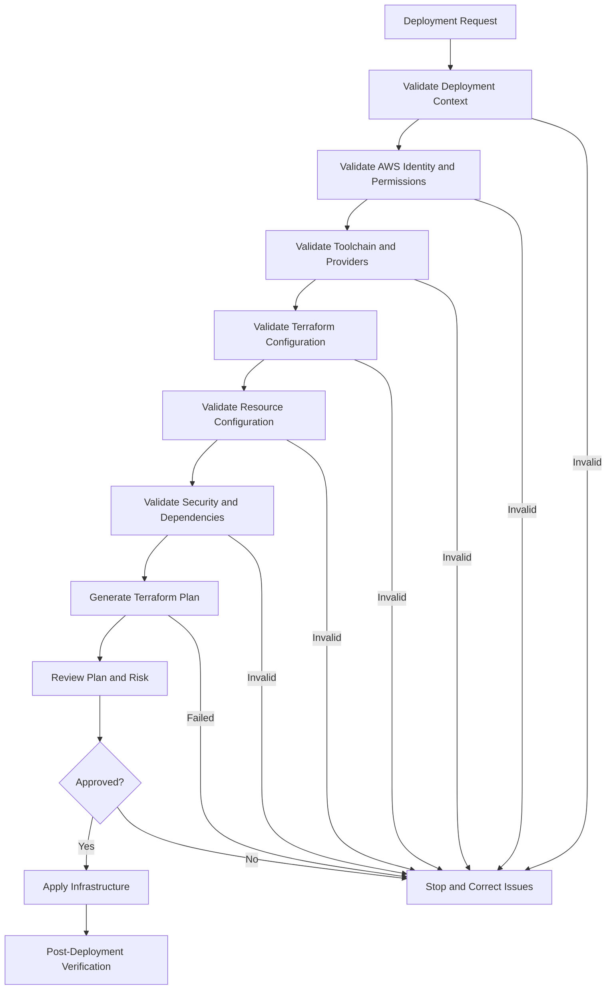
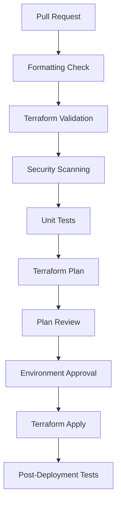

# 07- Pre-Deployment Validation

## Overview

Pre-deployment validation is the process of verifying infrastructure definitions, deployment configuration, permissions, dependencies, and operational readiness before applying changes to AWS.

For Amazon S3 deployments, validation is particularly important because infrastructure changes can affect persistent data, access permissions, encryption, lifecycle behavior, event processing, and application availability.

A successful Terraform plan does not guarantee that an S3 deployment is safe or operationally correct. Some failures only become visible when AWS evaluates permissions, applies service-specific configuration, or processes actual requests.

A production-oriented validation process should verify:

- AWS account and Region selection.
- Deployment identity and permissions.
- Terraform configuration and provider compatibility.
- Resource naming and environment isolation.
- S3 bucket configuration requirements.
- IAM and KMS authorization dependencies.
- Event notification destinations and service permissions.
- Infrastructure changes and destructive operations.
- Application configuration and runtime connectivity.
- Security, cost, monitoring, and recovery readiness.

The objective is to detect preventable failures before they affect production resources.

## Pre-Deployment Validation Workflow

A consistent validation workflow should run before every infrastructure deployment.



Each stage should produce evidence that can be reviewed by the deployment engineer or CI/CD pipeline.

## Validate the Deployment Context

Before running Terraform, verify that the deployment targets the intended AWS account, Region, and environment.

A valid Terraform configuration can still deploy resources into the wrong account if the active AWS credentials or provider configuration are incorrect.

### Validate AWS CLI Configuration

```bash
aws configure list
```

Inspect the active identity:

```bash
aws sts get-caller-identity
```

Example response:

```json
{
  "UserId": "AIDAIEXAMPLE",
  "Account": "111111111111",
  "Arn": "arn:aws:iam::111111111111:user/deployment-user"
}
```

The account ID and ARN must match the expected deployment context.

For role-based deployments, the ARN should identify the intended assumed role.

### Validate the AWS Region

```bash
aws configure get region
```

For a specific deployment, prefer explicitly configuring the Region rather than relying on an implicit CLI default.

```bash
export AWS_REGION=ap-south-1
```

Validate the Region:

```bash
aws ec2 describe-regions \
  --region ap-south-1 \
  --query 'Regions[].RegionName' \
  --output text
```

This command verifies that the Region is recognized by the EC2 API. It does not establish that every S3-related feature or integration is available there.

### Validate Environment Configuration

A deployment should explicitly identify its environment.

Example:

```bash
export APP_ENV=staging
export AWS_REGION=ap-south-1
export TF_VAR_environment=staging
```

For Terraform, verify that the intended variable file is selected:

```bash
terraform plan \
  -var-file="environments/staging/terraform.tfvars"
```

Do not use a production variable file for a staging deployment simply because the configuration is otherwise identical.

### Deployment Context Checklist

- [ ] AWS account ID matches the intended environment.
- [ ] Active AWS identity is expected.
- [ ] AWS Region is explicitly configured.
- [ ] Terraform workspace or root configuration is correct.
- [ ] Environment-specific variable file is selected.
- [ ] Remote-state backend points to the correct environment.
- [ ] Deployment is running from the intended repository revision.

## Validate AWS Identity and Permissions

Infrastructure deployment requires permissions to create, modify, inspect, and sometimes delete AWS resources.

A deployment identity may have sufficient permissions to create an S3 bucket but insufficient permissions to configure versioning, encryption, lifecycle rules, or bucket policies.

### Inspect the Active Identity

```bash
aws sts get-caller-identity
```

For automated deployments, prefer IAM roles and short-lived credentials.

Common deployment identities include:

- IAM Identity Center sessions.
- Assumed IAM roles.
- GitHub Actions OIDC roles.
- CI/CD platform deployment roles.
- Controlled administrative roles for exceptional operations.

Avoid long-lived access keys in scripts, repositories, container images, and CI/CD configuration.

### Validate Required Permissions

The deployment role should have only the permissions required by the infrastructure it manages.

Typical S3 deployment permissions may include:

| Operation | Relevant permission |
|---|---|
| Create bucket | `s3:CreateBucket` |
| Inspect bucket | `s3:ListBucket` |
| Configure versioning | `s3:PutBucketVersioning` |
| Configure encryption | `s3:PutEncryptionConfiguration` |
| Configure lifecycle | `s3:PutLifecycleConfiguration` |
| Configure public-access block | `s3:PutBucketPublicAccessBlock` |
| Configure ownership controls | `s3:PutBucketOwnershipControls` |
| Configure bucket policy | `s3:PutBucketPolicy` |
| Configure notifications | `s3:PutBucketNotification` |
| Delete bucket | `s3:DeleteBucket` |

The exact permissions depend on the resources, provider operations, and deployment workflow.

Terraform may also need permissions to inspect existing resources and read their configuration during planning.

### IAM Policy Simulation

The IAM policy simulator can help evaluate whether an identity-based policy allows a particular action.

```bash
aws iam simulate-principal-policy \
  --policy-source-arn arn:aws:iam::111111111111:role/s3-deployment-role \
  --action-names \
    s3:CreateBucket \
    s3:PutBucketVersioning \
    s3:PutEncryptionConfiguration
```

The simulator does not prove that the actual operation will succeed. It does not fully replace testing against real resource policies, permissions boundaries, session policies, service control policies, VPC endpoint policies, and KMS key policies.

### KMS Permission Validation

When the deployment creates or configures SSE-KMS encryption, validate the relevant KMS permissions and key policies.

Common permissions include:

- `kms:DescribeKey`
- `kms:CreateKey`
- `kms:PutKeyPolicy`
- `kms:EnableKeyRotation`
- `kms:Encrypt`
- `kms:Decrypt`
- `kms:GenerateDataKey`

The exact permissions depend on whether the deployment identity creates the key, manages its policy, or merely configures S3 to use an existing key.

Do not assume that permission to configure S3 encryption automatically grants access to the KMS key.

## Validate the Deployment Toolchain

Infrastructure deployments depend on compatible and reproducible tool versions.

Before deployment, verify the installed tools and dependency versions.

### Required Toolchain

| Tool | Purpose | Validation |
|---|---|---|
| AWS CLI | AWS identity and resource inspection | `aws --version` |
| Terraform | Infrastructure provisioning | `terraform version` |
| Git | Source and revision management | `git --version` |
| Python | Validation scripts and automation | `python --version` |
| Docker | Containerized validation and applications | `docker --version` |
| Graphviz | Optional Terraform dependency graph rendering | `dot -V` |

Not every project requires every tool.

### Terraform Version

```bash
terraform version
```

Use version constraints in the Terraform configuration:

```hcl
terraform {
  required_version = ">= 1.5.0"

  required_providers {
    aws = {
      source  = "hashicorp/aws"
      version = ">= 5.0, < 7.0"
    }
  }
}
```

Commit `.terraform.lock.hcl` so automated deployments use the selected provider versions.

Initialize the working directory:

```bash
terraform init
```

For a validation-only initialization without configuring the backend:

```bash
terraform init -backend=false
```

Use the appropriate initialization mode for the actual validation workflow. Backend-disabled initialization does not validate the configured remote-state backend.

### Validate Provider Selection

```bash
terraform providers
```

Inspect the provider versions selected by Terraform and verify that they are compatible with the project's constraints.

Provider upgrades should be reviewed and tested separately from unrelated infrastructure changes.

## Validate Terraform Configuration

Terraform configuration should pass formatting, initialization, and validation checks before planning.

### Formatting

```bash
terraform fmt -check -recursive
```

To apply formatting:

```bash
terraform fmt -recursive
```

Formatting should be performed before committing infrastructure changes.

### Initialization

```bash
terraform init
```

This initializes providers, modules, and the configured backend.

For CI/CD pipelines, initialization should use a controlled dependency and provider configuration.

### Syntax and Configuration Validation

```bash
terraform validate
```

This checks whether the Terraform configuration is syntactically valid and internally consistent.

It does not prove that:

- AWS permissions are sufficient.
- Bucket names are available.
- A resource can be created in the selected account.
- A service integration will work at runtime.
- The planned changes are safe for production data.

### Static Analysis

Additional tools can detect configuration problems before deployment.

Examples:

```bash
tflint
```

```bash
checkov -d .
```

```bash
tfsec .
```

Use tools that are approved and maintained within the engineering environment. Configure security checks to match organizational policy and review exceptions rather than suppressing findings indiscriminately.

## Validate S3 Resource Configuration

S3 configuration should be reviewed before applying infrastructure changes.

Important validation areas include:

- Bucket naming.
- Bucket Region.
- Versioning.
- Encryption.
- Public-access block.
- Object Ownership.
- Lifecycle configuration.
- Bucket policy.
- Event notifications.
- Replication configuration, where applicable.

### Bucket Name Validation

General-purpose S3 bucket names must follow S3 naming requirements and be unique within the applicable AWS partition's shared namespace.

Validate naming conventions before deployment.

Example:

```text
acme-payment-staging-documents-ap-south-1
```

Check whether the bucket is accessible:

```bash
aws s3api head-bucket \
  --bucket acme-payment-staging-documents-ap-south-1
```

A successful response indicates that the bucket is accessible to the current identity.

A failed request does not necessarily prove that the name is available. It may indicate that the bucket exists but is inaccessible, or that the caller lacks the required permissions.

### Validate Versioning Requirements

For workloads requiring object recovery or replication, versioning may be mandatory.

Terraform example:

```hcl
resource "aws_s3_bucket_versioning" "documents" {
  bucket = aws_s3_bucket.documents.id

  versioning_configuration {
    status = "Enabled"
  }
}
```

Inspect an existing bucket:

```bash
aws s3api get-bucket-versioning \
  --bucket "$BUCKET_NAME"
```

Check that the returned status matches the intended configuration.

### Validate Default Encryption

Example SSE-S3 configuration:

```hcl
resource "aws_s3_bucket_server_side_encryption_configuration" "documents" {
  bucket = aws_s3_bucket.documents.id

  rule {
    apply_server_side_encryption_by_default {
      sse_algorithm = "AES256"
    }
  }
}
```

Inspect the configuration:

```bash
aws s3api get-bucket-encryption \
  --bucket "$BUCKET_NAME"
```

If SSE-KMS is required, validate the KMS key identifier, Region compatibility, key policy, and applicable IAM permissions.

### Validate Public-Access Block

For private application storage:

```hcl
resource "aws_s3_bucket_public_access_block" "documents" {
  bucket = aws_s3_bucket.documents.id

  block_public_acls       = true
  block_public_policy     = true
  ignore_public_acls      = true
  restrict_public_buckets = true
}
```

Inspect the effective bucket-level configuration:

```bash
aws s3api get-public-access-block \
  --bucket "$BUCKET_NAME"
```

Account-level public-access controls may also apply. Bucket-level validation alone does not establish the complete effective public-access posture.

### Validate Object Ownership

For modern private application storage, Bucket owner enforced ownership is commonly appropriate.

```hcl
resource "aws_s3_bucket_ownership_controls" "documents" {
  bucket = aws_s3_bucket.documents.id

  rule {
    object_ownership = "BucketOwnerEnforced"
  }
}
```

This disables ACL-based access control for the bucket.

Review application and integration dependencies before changing ownership controls on an existing bucket.

### Validate Lifecycle Configuration

Lifecycle policies can affect retention, storage class, and deletion behavior.

Before deployment, verify:

- Prefix filters.
- Tag filters.
- Transition timing.
- Current-version expiration.
- Noncurrent-version expiration.
- Incomplete multipart upload cleanup.
- Retention and compliance requirements.

Inspect the current configuration:

```bash
aws s3api get-bucket-lifecycle-configuration \
  --bucket "$BUCKET_NAME"
```

Do not treat successful lifecycle configuration deployment as proof that objects have already transitioned or expired. Lifecycle processing is asynchronous.

## Validate Infrastructure Dependencies

Infrastructure resources often depend on other AWS resources and permissions.

For S3 deployments, common dependencies include:

| Resource | Dependency to validate |
|---|---|
| S3 bucket | Account, Region, and globally available name |
| Versioning | Existing bucket |
| Lifecycle configuration | Existing bucket and applicable versioning design |
| Bucket policy | Existing bucket and valid policy principals |
| SSE-KMS configuration | Valid KMS key and authorization |
| Lambda notification | Existing Lambda function and invocation permission |
| SQS notification | Existing queue and queue resource policy |
| SNS notification | Existing topic and topic policy |
| Replication | Versioned buckets, replication role, and destination permissions |
| CloudFront origin | S3 origin, origin access configuration, and bucket policy |

### Validate Terraform Dependencies

Inspect the dependency graph:

```bash
terraform graph -type=plan > dependency-graph.dot
```

Render it:

```bash
dot -Tsvg dependency-graph.dot -o dependency-graph.svg
```

Review:

- Unexpected resource dependencies.
- Circular dependencies.
- Resources managed by separate states.
- Destruction ordering.
- Dependencies not represented in Terraform.

Use `depends_on` only when a real dependency cannot be inferred from resource references.

### Validate S3 Event Destinations

For S3 event notifications, verify:

- Destination resource exists.
- Destination policy permits S3 delivery.
- Source bucket and account restrictions are correct.
- Lambda invocation permission exists when using Lambda.
- Notification filters match the intended object prefixes.
- Output prefixes do not recursively trigger the same processing workflow.

Inspect an existing configuration:

```bash
aws s3api get-bucket-notification-configuration \
  --bucket "$BUCKET_NAME"
```

For a new deployment, validate the destination policy and notification configuration in the Terraform plan and verify the integration after deployment.

## Validate Security Configuration

Security validation should identify accidental public exposure, excessive permissions, incorrect encryption settings, and unsafe deployment identities.

### IAM Validation

Review:

- Runtime role permissions.
- Deployment role permissions.
- Bucket policies.
- Resource-based access.
- Cross-account trust.
- Permissions boundaries.
- Service control policies.
- VPC endpoint policies, where applicable.

The deployment role should not automatically become the application's runtime role.

Use separate identities for infrastructure administration and application access.

### Bucket Policy Review

Before applying a bucket policy, verify:

- The intended principals.
- The actions granted.
- The resource ARNs.
- Prefix-level restrictions.
- Explicit deny statements.
- Cross-account access requirements.
- TLS enforcement requirements.

A bucket policy can affect every application that accesses the bucket. Treat policy changes as potentially high-impact production changes.

### Encryption Validation

Confirm that the selected encryption approach matches the workload's requirements.

| Configuration | Validation |
|---|---|
| SSE-S3 | Expected default encryption algorithm |
| SSE-KMS | Correct key ARN, key policy, and IAM authorization |
| SSE-C | Client key-handling requirements and request configuration |
| Client-side encryption | Key management, encryption workflow, and recovery procedures |

Do not assume that successful bucket encryption configuration proves that an application can read and write objects.

### Public Exposure Validation

Inspect bucket-level public-access controls:

```bash
aws s3api get-public-access-block \
  --bucket "$BUCKET_NAME"
```

Inspect the bucket policy:

```bash
aws s3api get-bucket-policy \
  --bucket "$BUCKET_NAME"
```

A missing bucket policy is not itself a security failure. Access may be controlled through identity-based policies and other mechanisms.

For detailed authorization and encryption review, use the dedicated S3 security documentation.

## Validate Cost and Operational Impact

Infrastructure changes can create recurring costs even when no application traffic exists.

Review potential charges before deploying production resources.

### Cost Areas

| Resource or operation | Potential cost |
|---|---|
| S3 storage | Stored object volume and storage class |
| API requests | PUT, GET, LIST, and other request types |
| Data transfer | Applicable transfer and delivery charges |
| Lifecycle transitions | Transition request charges where applicable |
| Replication | Destination storage, requests, and transfer |
| KMS | Key usage and applicable request charges |
| Lambda | Invocations and execution duration |
| SQS | Requests and applicable data transfer |
| CloudWatch | Logs ingestion, storage, metrics, and alarms |
| CloudFront | Requests, data transfer, and invalidations under applicable pricing |

A deployment should not introduce expensive services or retention settings without a clear operational requirement.

### Validate Lifecycle Cost Implications

Before applying lifecycle rules, check:

- Minimum storage duration charges.
- Minimum billable object sizes and transition eligibility.
- Retrieval costs.
- Expected object access frequency.
- Version retention.
- Delete-marker behavior.
- Replication-related storage costs.

Lifecycle configuration should be based on actual access and retention requirements rather than arbitrary transition schedules.

### Validate Resource Protection

Production buckets should have appropriate safeguards.

Example:

```hcl
resource "aws_s3_bucket" "documents" {
  bucket = var.bucket_name

  lifecycle {
    prevent_destroy = true
  }
}
```

`prevent_destroy` protects the resource from Terraform destruction while the rule remains configured.

It does not prevent deletion through other identities or tools. Use IAM controls, organizational safeguards, and recovery mechanisms as additional protections.

## Validate Terraform Plan Changes

Terraform plan review is one of the most important pre-deployment controls.

Generate a plan:

```bash
terraform plan \
  -var-file="environments/staging/terraform.tfvars" \
  -out=staging.tfplan
```

Review the plan:

```bash
terraform show staging.tfplan
```

For machine-readable analysis:

```bash
terraform show -json staging.tfplan > staging-plan.json
```

Treat the JSON plan as potentially sensitive. It can contain sensitive configuration values and resource attributes.

### Understand Terraform Change Indicators

| Indicator | Meaning | Review requirement |
|---|---|---|
| `+` | Resource creation | Verify intended configuration |
| `~` | In-place update | Review changed attributes |
| `-` | Resource destruction | Confirm removal is intended |
| `-/+` | Resource replacement | Review downtime and data-loss risk |
| No change | No detected difference | Does not prove runtime correctness |

### S3 Changes Requiring Additional Review

Pay particular attention to:

- Bucket replacement.
- Bucket deletion.
- Versioning changes.
- Encryption key changes.
- Bucket policy modifications.
- Public-access block changes.
- Lifecycle expiration changes.
- Replication configuration changes.
- Event notification replacement.
- IAM policy changes.
- Changes to Terraform state or backend configuration.

S3 bucket replacement can be especially risky because bucket names and object contents have independent operational significance.

A plan showing replacement must be investigated before approval. Do not assume that Terraform will safely migrate existing objects.

### Detect Destructive Changes

Use:

```bash
terraform plan \
  -var-file="environments/prod/terraform.tfvars"
```

Review all planned deletions and replacements.

For production, require explicit approval for changes that can affect persistent data, access boundaries, or service availability.

### Saved Plan Discipline

When using a saved plan:

```bash
terraform apply staging.tfplan
```

Apply the reviewed plan rather than generating a different plan at execution time.

If configuration, state, or relevant deployment assumptions change, generate and review a new plan.

## Validate Existing AWS Resources

Before creating resources, check whether they already exist and whether they are managed by the expected infrastructure state.

This is important when:

- Adopting an existing S3 bucket into Terraform.
- Migrating from manual infrastructure.
- Sharing resources across teams.
- Recovering from partial deployment failures.
- Recreating a deployment in another account.

Useful commands:

```bash
aws s3api head-bucket \
  --bucket "$BUCKET_NAME"
```

```bash
aws s3api get-bucket-location \
  --bucket "$BUCKET_NAME"
```

```bash
aws s3api get-bucket-versioning \
  --bucket "$BUCKET_NAME"
```

```bash
aws s3api get-bucket-encryption \
  --bucket "$BUCKET_NAME"
```

```bash
aws s3api get-bucket-policy-status \
  --bucket "$BUCKET_NAME"
```

The last command reports whether the bucket policy indicates public access. It is not a complete assessment of every possible access path.

### Avoid Resource Ownership Conflicts

Do not allow multiple Terraform states or deployment systems to manage the same S3 bucket configuration independently.

For example, if one Terraform state manages the bucket policy while another state continuously replaces it, deployments may overwrite each other's changes.

Define clear resource ownership before deployment.

## Validate Application Readiness

Infrastructure can be deployed successfully while the application remains unable to use it.

Validate application configuration before releasing the application.

### Required Configuration

Example:

```dotenv
APP_ENV=staging
AWS_REGION=ap-south-1
S3_BUCKET_NAME=acme-payment-staging-documents-ap-south-1
```

Do not place AWS access keys in committed `.env` files.

### Python Configuration Validation

```python
import os
from dataclasses import dataclass


@dataclass(frozen=True)
class StorageConfig:
    environment: str
    region: str
    bucket_name: str


def load_storage_config() -> StorageConfig:
    environment = os.environ.get("APP_ENV")
    region = os.environ.get("AWS_REGION")
    bucket_name = os.environ.get("S3_BUCKET_NAME")

    if environment not in {"dev", "staging", "prod"}:
        raise ValueError("Invalid APP_ENV")

    if not region:
        raise ValueError("AWS_REGION is required")

    if not bucket_name:
        raise ValueError("S3_BUCKET_NAME is required")

    return StorageConfig(
        environment=environment,
        region=region,
        bucket_name=bucket_name,
    )
```

This validates application configuration, not AWS connectivity or authorization.

### Runtime Access Test

A deployment verification test should exercise the required S3 operations using the same runtime identity as the application.

For example:

- Upload a uniquely named test object.
- Read its metadata.
- Download it if the application requires download access.
- Delete it if the application requires deletion.
- Verify the expected encryption behavior.

Use a dedicated test prefix and ensure that the test identity cannot overwrite production business data.

Avoid testing production permissions using arbitrary real customer objects.

## Validate CI/CD Configuration

The deployment pipeline should enforce validation automatically.

A typical pipeline contains:



### Example GitHub Actions Validation Workflow

```yaml
name: S3 Infrastructure Validation

on:
  pull_request:
    paths:
      - "infrastructure/terraform/**"
      - ".github/workflows/s3-validation.yml"

permissions:
  contents: read

jobs:
  validate:
    runs-on: ubuntu-latest

    defaults:
      run:
        working-directory: infrastructure/terraform

    steps:
      - name: Checkout repository
        uses: actions/checkout@v4

      - name: Setup Terraform
        uses: hashicorp/setup-terraform@v3
        with:
          terraform_version: "1.9.0"

      - name: Check formatting
        run: terraform fmt -check -recursive

      - name: Initialize Terraform
        run: terraform init -backend=false

      - name: Validate configuration
        run: terraform validate
```

This workflow performs configuration validation without AWS credentials.

A separate authenticated workflow should perform account-specific planning and deployment using short-lived credentials, such as AWS IAM OIDC federation.

Pin GitHub Actions to reviewed versions or immutable commit SHAs according to organizational supply-chain policy.

### CI/CD Security Requirements

- Use `permissions: contents: read` unless additional permissions are required.
- Grant `id-token: write` only to jobs that need OIDC federation.
- Restrict production deployment roles to approved repositories and environments.
- Avoid storing long-lived AWS credentials as repository secrets.
- Separate pull-request validation from privileged deployment jobs.
- Require production approval where appropriate.
- Protect plan artifacts because they may contain sensitive values.

## Pre-Deployment Validation Script

A small validation script can automate checks that are common to every deployment.

The following script validates required environment variables, AWS identity, and basic Terraform configuration.

It does not perform a complete security audit or prove that the deployment will succeed.

```bash
#!/usr/bin/env bash

set -Eeuo pipefail

PROJECT_DIR="${PROJECT_DIR:-infrastructure/terraform}"

: "${EXPECTED_ACCOUNT_ID:?EXPECTED_ACCOUNT_ID is required}"
: "${AWS_REGION:?AWS_REGION is required}"
: "${APP_ENV:?APP_ENV is required}"

case "$APP_ENV" in
  dev|staging|prod)
    ;;
  *)
    echo "Unsupported environment: $APP_ENV" >&2
    exit 1
    ;;
esac

for command in aws terraform; do
  if ! command -v "$command" >/dev/null 2>&1; then
    echo "Required command not found: $command" >&2
    exit 1
  fi
done

echo "Checking AWS identity..."

ACCOUNT_ID="$(
  aws sts get-caller-identity \
    --query Account \
    --output text
)"

if [[ "$ACCOUNT_ID" != "$EXPECTED_ACCOUNT_ID" ]]; then
  echo "Unexpected AWS account: $ACCOUNT_ID" >&2
  exit 1
fi

echo "AWS account validation passed."

echo "Checking Terraform configuration..."

terraform -chdir="$PROJECT_DIR" fmt -check -recursive
terraform -chdir="$PROJECT_DIR" init -backend=false
terraform -chdir="$PROJECT_DIR" validate

echo "Pre-deployment validation passed."
```

Example usage:

```bash
export EXPECTED_ACCOUNT_ID=111111111111
export AWS_REGION=ap-south-1
export APP_ENV=staging

./scripts/pre_deployment_validation.sh
```

For production deployments, extend the script or pipeline with:

- Environment-specific account-role verification.
- Resource naming validation.
- Security policy checks.
- Terraform plan review.
- Deployment approval.
- Application integration tests.

Do not treat a successful script exit as authorization to apply a production plan without the required review process.

## Pre-Deployment Validation Checklist

Use this checklist before applying infrastructure changes.

### Deployment Context

- [ ] Correct AWS account selected.
- [ ] Correct AWS Region selected.
- [ ] Expected deployment identity verified.
- [ ] Correct environment selected.
- [ ] Correct Terraform working directory selected.
- [ ] Correct backend and state key selected.
- [ ] Intended source revision checked out.

### Toolchain and Configuration

- [ ] AWS CLI installed and available.
- [ ] Terraform version satisfies constraints.
- [ ] Provider lock file committed and reviewed.
- [ ] Terraform modules resolve successfully.
- [ ] `terraform fmt -check -recursive` passes.
- [ ] `terraform validate` passes.
- [ ] Static analysis findings reviewed.
- [ ] Required environment variables are configured.

### S3 Infrastructure

- [ ] Bucket name follows S3 naming requirements.
- [ ] Bucket name availability or existing ownership checked.
- [ ] Bucket Region is correct.
- [ ] Versioning configuration matches requirements.
- [ ] Default encryption configuration is correct.
- [ ] Public-access block is configured appropriately.
- [ ] Object Ownership settings are correct.
- [ ] Lifecycle rules match retention requirements.
- [ ] Bucket policies have been reviewed.
- [ ] Event destinations and permissions are configured.
- [ ] Existing resource ownership conflicts are resolved.

### Security and Permissions

- [ ] Deployment role has required permissions.
- [ ] Application runtime role is separate from deployment identity.
- [ ] IAM policies follow least privilege.
- [ ] KMS key and key policy are valid where applicable.
- [ ] Cross-account access is explicitly authorized.
- [ ] No long-lived AWS credentials are embedded in code.
- [ ] Public exposure risks have been reviewed.

### Plan and Operational Readiness

- [ ] Terraform plan generated successfully.
- [ ] Resource creation and modification reviewed.
- [ ] Destructive changes investigated.
- [ ] Bucket replacement risks reviewed.
- [ ] Cost implications assessed.
- [ ] Monitoring and logging dependencies are ready.
- [ ] Recovery and rollback procedures are documented.
- [ ] Required production approvals obtained.

## Common Pre-Deployment Validation Mistakes

| Mistake | Impact | Prevention |
|---|---|---|
| Skipping account verification | Infrastructure may be deployed into the wrong account | Verify `aws sts get-caller-identity` |
| Relying on CLI default Region | Resources may be deployed in an unintended Region | Configure Region explicitly |
| Treating `terraform validate` as deployment verification | AWS permissions and service constraints remain untested | Run authenticated planning and deployment checks |
| Ignoring Terraform plan replacements | Persistent resources may be destroyed or recreated | Review every replacement and deletion |
| Checking only bucket existence | Encryption, access, and lifecycle settings may be incorrect | Inspect individual configuration APIs |
| Testing only deployment permissions | Application runtime access may still fail | Test with the actual runtime identity |
| Ignoring KMS policies | Encrypted object access may fail | Validate both S3 and KMS authorization |
| Deploying event notifications before destination policies | S3 may reject the notification configuration | Validate destination permissions and dependency order |
| Ignoring existing resources | Resource conflicts or state inconsistencies may occur | Inspect ownership and Terraform state |
| Assuming lifecycle rules execute immediately | Operational expectations may be incorrect | Treat lifecycle execution as asynchronous |
| Exposing Terraform plan artifacts | Sensitive infrastructure values may leak | Restrict plan artifact access |
| Applying an unreviewed production plan | Destructive or unintended changes may reach production | Require plan review and approval |

## Key Takeaways

- Validate the AWS account, Region, identity, and Terraform state target before making infrastructure changes.
- Run formatting, initialization, configuration validation, security scanning, and authenticated planning as separate validation stages.
- Review S3 security, encryption, lifecycle, IAM, and event destination dependencies rather than relying only on successful Terraform validation.
- Treat Terraform deletions and replacements as high-risk changes, especially when persistent S3 data or production access policies are involved.
- Verify application runtime access and end-to-end integrations; infrastructure provisioning success alone does not establish production readiness.