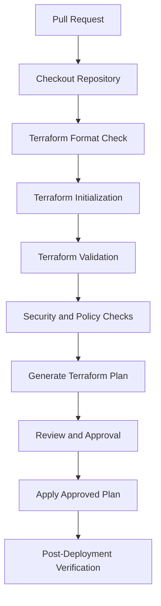

# 01- Terraform Project Structure for S3

## Overview

A well-structured Terraform project makes Amazon S3 infrastructure reproducible, maintainable, testable, and safe to operate across multiple environments.

A production S3 deployment rarely consists of a single bucket resource. It may include versioning, encryption, public-access controls, Object Ownership, lifecycle policies, replication, IAM policies, event notifications, logging, and integrations with other AWS services.

Managing these resources in a single Terraform file becomes difficult as the infrastructure grows. A structured project separates resource definitions, provider configuration, variables, outputs, environment settings, and reusable modules.

This document establishes a practical Terraform project structure for S3 infrastructure, including resource organization, module boundaries, environment configuration, state management, validation, and deployment workflows.

## Terraform Project Design Principles

A good Terraform project should satisfy the following principles.

| Principle | Engineering objective |
|---|---|
| Separation of concerns | Keep provider configuration, variables, resources, and outputs logically separated |
| Reusability | Encapsulate common S3 configurations in reusable modules |
| Environment isolation | Prevent development, staging, and production configuration from becoming coupled |
| Explicit configuration | Expose important settings through variables instead of hardcoding them |
| Secure defaults | Enable private access, encryption, and appropriate ownership controls |
| Predictable changes | Make infrastructure plans understandable and reviewable |
| State isolation | Prevent multiple environments from unintentionally sharing state |
| Testability | Support formatting, validation, policy checks, and automated tests |
| Maintainability | Keep resource definitions focused and avoid unnecessary abstraction |

Terraform does not require a particular file layout. All `.tf` files in one directory are loaded together as a single root module. File separation is therefore primarily an organizational practice.

## Recommended Project Structure

The following structure is suitable for an S3 infrastructure project that manages bucket configuration, security controls, lifecycle policies, and supporting IAM resources.

```text
s3-infrastructure/
│
├── environments/
│   ├── dev/
│   │   ├── backend.hcl
│   │   └── terraform.tfvars
│   │
│   ├── staging/
│   │   ├── backend.hcl
│   │   └── terraform.tfvars
│   │
│   └── prod/
│       ├── backend.hcl
│       └── terraform.tfvars
│
├── modules/
│   └── s3-bucket/
│       ├── main.tf
│       ├── variables.tf
│       ├── outputs.tf
│       └── README.md
│
├── main.tf
├── providers.tf
├── versions.tf
├── variables.tf
├── outputs.tf
├── storage.tf
├── versioning.tf
├── encryption.tf
├── security.tf
├── lifecycle.tf
├── replication.tf
├── iam.tf
├── logging.tf
│
├── .gitignore
└── README.md
```

The structure separates the root deployment configuration from reusable infrastructure modules and environment-specific configuration.

Not every project needs every resource file. Add files when the corresponding infrastructure is actually required.

### Root Module

The root module is the entry point for a Terraform deployment.

It is responsible for:

- Selecting and configuring the AWS provider.
- Defining Terraform and provider version constraints.
- Declaring deployment variables.
- Composing reusable modules.
- Managing environment-specific resource configuration.
- Exposing deployment outputs.

The root module should describe the infrastructure being deployed without duplicating reusable resource logic unnecessarily.

### Environment Configuration

The `environments/` directory stores configuration specific to each deployment environment.

For example:

```text
environments/
├── dev/
│   ├── backend.hcl
│   └── terraform.tfvars
├── staging/
│   ├── backend.hcl
│   └── terraform.tfvars
└── prod/
    ├── backend.hcl
    └── terraform.tfvars
```

A development configuration might contain:

```hcl
aws_region  = "ap-south-1"
environment = "dev"
bucket_name = "company-app-dev-assets"
```

Production configuration:

```hcl
aws_region  = "ap-south-1"
environment = "prod"
bucket_name = "company-app-prod-assets"
```

Use separate AWS accounts for production and non-production environments where practical. Separate variable files alone do not provide security isolation.

### Reusable Modules

The `modules/` directory contains reusable Terraform components.

For example, an S3 bucket module can encapsulate:

- Bucket creation.
- Versioning.
- Encryption.
- Public-access blocking.
- Object Ownership.
- Lifecycle configuration.

A module should expose a clear interface through input variables and outputs.

Avoid creating a module for every individual Terraform resource. Modules should represent meaningful infrastructure boundaries.

## Terraform File Responsibilities

The root module can separate resources into focused files.

| File | Responsibility |
|---|---|
| `versions.tf` | Terraform and provider version constraints |
| `providers.tf` | AWS provider configuration |
| `main.tf` | Root module composition |
| `variables.tf` | Input variable declarations |
| `outputs.tf` | Deployment outputs |
| `storage.tf` | S3 bucket resources |
| `versioning.tf` | Bucket versioning |
| `encryption.tf` | Default server-side encryption |
| `security.tf` | Public-access block and Object Ownership |
| `lifecycle.tf` | Lifecycle configuration |
| `replication.tf` | Replication configuration |
| `iam.tf` | IAM roles and policies |
| `logging.tf` | Logging and monitoring resources |

This separation improves navigation and code review. It does not create separate Terraform modules or independent deployment units.

## Terraform Configuration Files

### versions.tf

Declare the supported Terraform version and provider constraints.

```hcl
terraform {
  required_version = ">= 1.5.0"

  required_providers {
    aws = {
      source  = "hashicorp/aws"
      version = ">= 5.0, < 7.0"
    }
  }
}
```

For production deployments, use a tested provider version range and commit `.terraform.lock.hcl` to version control.

The lock file records the selected provider versions and checksums. It should be reviewed when intentionally upgrading dependencies.

### providers.tf

Configure the AWS provider.

```hcl
provider "aws" {
  region = var.aws_region

  default_tags {
    tags = {
      Project     = "s3-infrastructure"
      Environment = var.environment
      ManagedBy   = "Terraform"
    }
  }
}
```

Do not hardcode AWS access keys in provider configuration.

Use the standard AWS credential chain, IAM roles, IAM Identity Center, or short-lived credentials supplied by the deployment environment.

### variables.tf

Declare configurable deployment inputs.

```hcl
variable "aws_region" {
  description = "AWS Region for the S3 infrastructure."
  type        = string
  default     = "ap-south-1"
}

variable "bucket_name" {
  description = "Globally unique S3 bucket name."
  type        = string

  validation {
    condition = (
      length(var.bucket_name) >= 3 &&
      length(var.bucket_name) <= 63 &&
      can(regex("^[a-z0-9][a-z0-9.-]*[a-z0-9]$", var.bucket_name)) &&
      !strcontains(var.bucket_name, "..") &&
      !can(regex("^[0-9]+\\.[0-9]+\\.[0-9]+\\.[0-9]+$", var.bucket_name))
    )

    error_message = "Provide a valid S3 general-purpose bucket name."
  }
}

variable "environment" {
  description = "Deployment environment."
  type        = string

  validation {
    condition     = contains(["dev", "staging", "prod"], var.environment)
    error_message = "Environment must be dev, staging, or prod."
  }
}

variable "enable_versioning" {
  description = "Whether bucket versioning should be enabled."
  type        = bool
  default     = true
}
```

Input validation catches configuration mistakes before Terraform attempts to create resources.

S3 bucket naming rules can change or include additional restrictions depending on the bucket type. Validate names against the applicable AWS requirements rather than relying exclusively on a regular expression.

### storage.tf

Define the S3 bucket.

```hcl
resource "aws_s3_bucket" "application" {
  bucket = var.bucket_name

  tags = {
    Name    = var.bucket_name
    Purpose = "Application Storage"
  }

  lifecycle {
    prevent_destroy = true
  }
}
```

The `prevent_destroy` lifecycle rule blocks Terraform plans that would destroy the bucket while the rule remains configured.

It is an additional safeguard, not a replacement for backups, versioning, access controls, or a controlled deletion process.

### versioning.tf

Manage versioning independently from the bucket resource.

```hcl
resource "aws_s3_bucket_versioning" "application" {
  bucket = aws_s3_bucket.application.id

  versioning_configuration {
    status = var.enable_versioning ? "Enabled" : "Suspended"
  }
}
```

Versioning protects against some accidental overwrites and deletions by preserving object versions.

Important considerations:

- Versioning must be enabled before configuring many version-dependent workflows.
- Suspending versioning does not remove existing versions.
- Versioned buckets require deliberate cleanup procedures.
- Lifecycle configuration should account for noncurrent versions.

### encryption.tf

Configure default server-side encryption using SSE-S3.

```hcl
resource "aws_s3_bucket_server_side_encryption_configuration" "application" {
  bucket = aws_s3_bucket.application.id

  rule {
    apply_server_side_encryption_by_default {
      sse_algorithm = "AES256"
    }
  }
}
```

For workloads requiring customer-managed encryption keys, use SSE-KMS and configure the corresponding KMS key and permissions separately.

Encryption configuration and authorization are distinct concerns. A principal may have S3 permissions but still lack the KMS permissions required to use an SSE-KMS key.

### security.tf

Configure Object Ownership and Block Public Access.

```hcl
resource "aws_s3_bucket_ownership_controls" "application" {
  bucket = aws_s3_bucket.application.id

  rule {
    object_ownership = "BucketOwnerEnforced"
  }
}

resource "aws_s3_bucket_public_access_block" "application" {
  bucket = aws_s3_bucket.application.id

  block_public_acls       = true
  block_public_policy     = true
  ignore_public_acls      = true
  restrict_public_buckets = true
}
```

These resources establish secure defaults for a private application bucket.

If an application requires public content delivery, prefer a private S3 origin accessed through CloudFront Origin Access Control rather than making the bucket publicly accessible.

### lifecycle.tf

Manage object lifecycle policies separately.

```hcl
resource "aws_s3_bucket_lifecycle_configuration" "application" {
  bucket = aws_s3_bucket.application.id

  depends_on = [
    aws_s3_bucket_versioning.application
  ]

  rule {
    id     = "application-object-retention"
    status = "Enabled"

    filter {
      prefix = "uploads/"
    }

    expiration {
      days = 365
    }

    noncurrent_version_expiration {
      noncurrent_days = 90
    }

    abort_incomplete_multipart_upload {
      days_after_initiation = 7
    }
  }
}
```

Lifecycle policies should reflect actual retention and recovery requirements.

Lifecycle processing is asynchronous. Creating a lifecycle configuration does not mean that all matching objects are immediately transitioned or deleted.

### outputs.tf

Expose useful resource information.

```hcl
output "bucket_name" {
  description = "Name of the application S3 bucket."
  value       = aws_s3_bucket.application.id
}

output "bucket_arn" {
  description = "ARN of the application S3 bucket."
  value       = aws_s3_bucket.application.arn
}

output "bucket_region" {
  description = "Region hosting the application bucket."
  value       = aws_s3_bucket.application.region
}
```

Outputs can be consumed by other Terraform modules or deployment automation.

Avoid exposing credentials, secrets, or sensitive infrastructure data through outputs.

## Reusable S3 Module Structure

A reusable S3 module allows multiple applications or environments to provision buckets using a consistent interface.

Example module layout:

```text
modules/
└── s3-bucket/
    ├── main.tf
    ├── variables.tf
    ├── outputs.tf
    └── README.md
```

### Module Implementation

`modules/s3-bucket/main.tf`:

```hcl
resource "aws_s3_bucket" "this" {
  bucket = var.bucket_name

  tags = var.tags

  lifecycle {
    prevent_destroy = var.prevent_destroy
  }
}

resource "aws_s3_bucket_ownership_controls" "this" {
  bucket = aws_s3_bucket.this.id

  rule {
    object_ownership = "BucketOwnerEnforced"
  }
}

resource "aws_s3_bucket_public_access_block" "this" {
  bucket = aws_s3_bucket.this.id

  block_public_acls       = true
  block_public_policy     = true
  ignore_public_acls      = true
  restrict_public_buckets = true
}

resource "aws_s3_bucket_versioning" "this" {
  bucket = aws_s3_bucket.this.id

  versioning_configuration {
    status = var.versioning_enabled ? "Enabled" : "Suspended"
  }
}

resource "aws_s3_bucket_server_side_encryption_configuration" "this" {
  bucket = aws_s3_bucket.this.id

  rule {
    apply_server_side_encryption_by_default {
      sse_algorithm = "AES256"
    }
  }
}
```

`modules/s3-bucket/variables.tf`:

```hcl
variable "bucket_name" {
  description = "Globally unique S3 bucket name."
  type        = string
}

variable "versioning_enabled" {
  description = "Whether bucket versioning is enabled."
  type        = bool
  default     = true
}

variable "prevent_destroy" {
  description = "Whether Terraform should prevent bucket destruction."
  type        = bool
  default     = true
}

variable "tags" {
  description = "Tags applied to the bucket."
  type        = map(string)
  default     = {}
}
```

`modules/s3-bucket/outputs.tf`:

```hcl
output "bucket_id" {
  description = "S3 bucket name."
  value       = aws_s3_bucket.this.id
}

output "bucket_arn" {
  description = "S3 bucket ARN."
  value       = aws_s3_bucket.this.arn
}

output "bucket_region" {
  description = "S3 bucket Region."
  value       = aws_s3_bucket.this.region
}
```

This module deliberately provides a focused baseline. Lifecycle, replication, KMS, and logging configuration can be added through explicit module inputs or separate modules when the requirements justify them.

### Calling the Module

The root module can instantiate the reusable component.

```hcl
module "application_bucket" {
  source = "./modules/s3-bucket"

  bucket_name       = var.bucket_name
  versioning_enabled = true
  prevent_destroy   = true

  tags = {
    Environment = var.environment
    Application = "backend-api"
  }
}
```

A module should have a stable interface. Changing input variable names or output contracts can affect every environment or application consuming it.

## Environment-Specific Deployment

Environment-specific variable files allow the same Terraform configuration to deploy different infrastructure configurations.

Example development variables:

`environments/dev/terraform.tfvars`:

```hcl
aws_region         = "ap-south-1"
environment        = "dev"
bucket_name        = "company-backend-dev-assets"
enable_versioning  = true
```

Example production variables:

`environments/prod/terraform.tfvars`:

```hcl
aws_region         = "ap-south-1"
environment        = "prod"
bucket_name        = "company-backend-prod-assets"
enable_versioning  = true
```

Deploy using the corresponding variable file:

```bash
terraform plan \
  -var-file="environments/dev/terraform.tfvars"
```

```bash
terraform plan \
  -var-file="environments/prod/terraform.tfvars"
```

Variable files do not isolate Terraform state. Use separate state configurations and preferably separate AWS accounts for environments with different security and operational boundaries.

## Terraform State and Backend Organization

Terraform state maps configuration resources to real infrastructure.

For production S3 deployments, state should be stored remotely rather than relying on a developer's local machine.

A common architecture uses:

- An S3 bucket for remote state storage.
- A dedicated state key for each environment.
- Versioning for state recovery.
- Appropriate encryption and access controls.
- State locking through a supported locking mechanism.

Example backend configuration:

```hcl
terraform {
  backend "s3" {}
}
```

Development backend settings:

`environments/dev/backend.hcl`:

```hcl
bucket       = "company-terraform-state"
key          = "s3/dev/terraform.tfstate"
region       = "ap-south-1"
encrypt      = true
use_lockfile = true
```

Initialize using the environment-specific backend configuration:

```bash
terraform init \
  -backend-config="environments/dev/backend.hcl"
```

The state bucket must exist before this backend can be initialized. Its provisioning should be handled through a separate bootstrap process.

Do not assume that separate `.tfvars` files create separate states.

## Terraform Deployment Commands

Use a consistent workflow for infrastructure changes.

| Command | Purpose |
|---|---|
| `terraform init` | Initialize the working directory and providers |
| `terraform fmt` | Format Terraform configuration |
| `terraform validate` | Validate configuration syntax and internal consistency |
| `terraform plan` | Preview proposed infrastructure changes |
| `terraform apply` | Apply infrastructure changes |
| `terraform output` | Display declared outputs |
| `terraform state list` | List resources tracked in state |
| `terraform import` | Associate an existing resource with Terraform state |
| `terraform destroy` | Destroy resources managed by the current configuration and state |

Example validation:

```bash
terraform fmt -check -recursive

terraform init

terraform validate
```

Generate a saved plan:

```bash
terraform plan \
  -var-file="environments/dev/terraform.tfvars" \
  -out=dev.tfplan
```

Apply the reviewed plan:

```bash
terraform apply dev.tfplan
```

A saved plan should be protected because it can contain sensitive configuration values.

### Importing Existing S3 Resources

If a bucket already exists outside Terraform, importing it can bring it under state management.

For example:

```bash
terraform import \
  aws_s3_bucket.application \
  company-backend-dev-assets
```

Importing a bucket does not automatically create all associated configuration resources in state. Versioning, encryption, lifecycle, ownership, and public-access configuration may require separate imports and configuration reconciliation.

Before importing:

1. Inspect the existing bucket configuration.
2. Write matching Terraform resource definitions.
3. Back up the current state.
4. Import the resource.
5. Run `terraform plan`.
6. Reconcile unexpected changes before applying.

Never assume that import is equivalent to a complete infrastructure migration.

## Infrastructure Validation and Testing

Terraform validation should be part of the development and CI/CD workflow.

### Static Validation

```bash
terraform fmt -check -recursive
terraform init -backend=false
terraform validate
```

Using `-backend=false` allows configuration validation without initializing the configured remote backend.

### Security and Policy Validation

Consider integrating tools such as:

- TFLint for Terraform-specific linting.
- Checkov for infrastructure security checks.
- Trivy for infrastructure configuration scanning.
- Terraform test for module and configuration tests.
- OPA or Sentinel for policy enforcement where appropriate.

### Deployment Verification

After applying infrastructure changes, inspect the actual AWS resource configuration.

```bash
aws s3api head-bucket \
  --bucket company-backend-dev-assets
```

Check versioning:

```bash
aws s3api get-bucket-versioning \
  --bucket company-backend-dev-assets
```

Check encryption:

```bash
aws s3api get-bucket-encryption \
  --bucket company-backend-dev-assets
```

Check public-access configuration:

```bash
aws s3api get-public-access-block \
  --bucket company-backend-dev-assets
```

Check lifecycle configuration:

```bash
aws s3api get-bucket-lifecycle-configuration \
  --bucket company-backend-dev-assets
```

Successful Terraform execution does not replace verification against AWS. Verify the configuration required by the application and its operational requirements.

## CI/CD Integration

A Terraform project should support automated validation before deployment.

A typical pipeline separates validation, planning, approval, and application.



Recommended pipeline controls:

- Use AWS IAM OIDC federation where supported.
- Avoid long-lived access keys in CI/CD secrets.
- Restrict deployment permissions.
- Separate plan and apply permissions where practical.
- Require production approval.
- Protect production branches and deployment environments.
- Preserve plan and deployment logs securely.
- Run post-deployment checks.
- Prevent concurrent deployments against the same state.

A CI/CD pipeline should not automatically approve destructive changes simply because Terraform validation succeeded.

## Git Configuration

Terraform projects should exclude generated files and local sensitive configuration from version control.

Example `.gitignore`:

```gitignore
# Terraform working directory
.terraform/

# Terraform state
*.tfstate
*.tfstate.*
crash.log

# Terraform plan files
*.tfplan
*.plan

# Local variable files
*.auto.tfvars
*.auto.tfvars.json
terraform.tfvars
terraform.tfvars.json

# Local override files
override.tf
override.tf.json
*_override.tf
*_override.tf.json

# CLI configuration
.terraformrc
terraform.rc
```

Important distinctions:

- Commit `.terraform.lock.hcl` to preserve provider selections.
- Do not commit Terraform state files.
- Do not commit credentials or secrets.
- Environment-specific non-secret `.tfvars` files may be committed when appropriate.
- Keep example configuration in a separate file such as `terraform.tfvars.example`.

## Common Project Structure Mistakes

| Mistake | Why it causes problems | Recommended approach |
|---|---|---|
| Putting every resource in one large file | Makes infrastructure difficult to navigate and review | Separate resources by responsibility |
| Creating excessive modules | Adds unnecessary abstraction and complexity | Create modules around meaningful infrastructure boundaries |
| Using one state for every environment | Increases the risk of cross-environment changes | Isolate state by environment and deployment boundary |
| Hardcoding credentials | Creates security and rotation risks | Use temporary AWS credentials and IAM roles |
| Ignoring provider constraints | Can introduce unexpected provider behavior | Define version constraints and commit the lock file |
| Using generic bucket names | Creates naming conflicts and unclear ownership | Apply consistent application and environment naming |
| Omitting outputs | Makes resource integration and verification harder | Expose useful resource identifiers and ARNs |
| Treating validation as deployment verification | Syntax correctness does not prove runtime access | Inspect deployed resources and test application access |
| Sharing state across independent teams | Creates coordination and ownership problems | Define explicit resource ownership and state boundaries |
| Destroying production buckets casually | Can permanently remove data and disrupt applications | Use resource protection and controlled recovery procedures |

## Production Design Considerations

### Module Versioning

Reusable modules should have a controlled release process.

For modules shared across repositories:

- Use versioned releases.
- Document required inputs and outputs.
- Test module changes before publishing.
- Avoid unreviewed breaking interface changes.
- Pin production deployments to reviewed module versions.

For modules in the same repository, use local paths where appropriate.

### Resource Ownership

Define which Terraform state owns each resource.

A resource should not be independently managed by multiple Terraform states. Multiple configurations attempting to control the same bucket settings can create drift, conflicting updates, and unexpected plans.

### Resource Protection

S3 buckets can contain business-critical data. Protect them against accidental deletion.

Use:

- Terraform `prevent_destroy`.
- IAM restrictions on destructive operations.
- Versioning where appropriate.
- Backup and replication strategies based on recovery requirements.
- Controlled production approval.
- Documented data-retention and deletion procedures.

`prevent_destroy` does not protect a resource if its configuration is removed from Terraform entirely. Resource protection must therefore include state ownership, access controls, and change-management procedures.

### Drift Detection

Drift occurs when actual AWS infrastructure differs from the Terraform configuration or state.

Common causes include:

- Manual console changes.
- AWS CLI modifications.
- Changes made by another automation system.
- Incomplete recovery from a failed deployment.

Detect drift using:

```bash
terraform plan \
  -var-file="environments/prod/terraform.tfvars"
```

Investigate unexpected differences before applying changes.

Do not automatically overwrite manual changes without understanding why they occurred. Reconcile the configuration and state with the intended infrastructure ownership model.

## Key Takeaways

- Organize Terraform projects around clear responsibilities: providers, variables, outputs, resources, environments, and reusable modules.
- Keep root modules focused on deployment composition and use reusable modules for meaningful infrastructure boundaries.
- Separate environment configuration and Terraform state; variable files alone do not provide environment isolation.
- Treat remote state, provider versioning, validation, CI/CD approvals, and resource protection as essential production concerns.
- Verify deployed S3 configuration and application access independently of Terraform's successful execution.