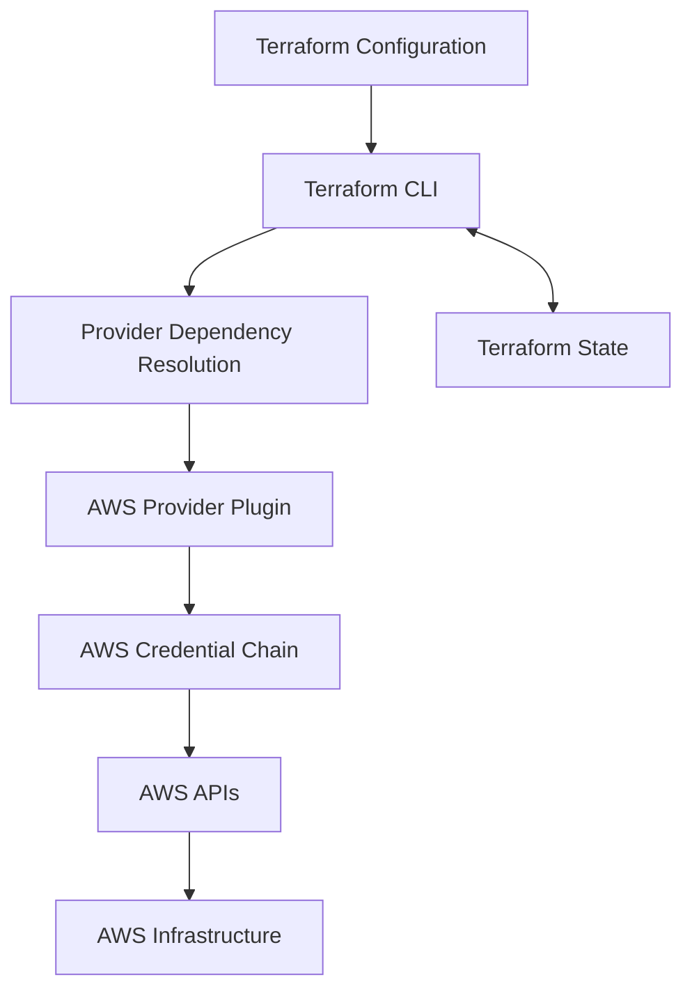
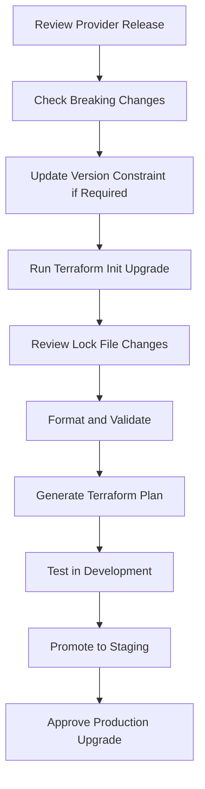

# 02- AWS Provider and Version Constraints

## Overview

Terraform uses providers to interact with external platforms and services. The AWS provider exposes AWS resources and data sources that allow Terraform to manage Amazon S3 infrastructure through declarative configuration.

Provider and version constraints are important because Terraform configurations depend on specific provider behavior, resource schemas, attributes, and API implementations.

For production S3 deployments, provider versions should be controlled and tested. An uncontrolled provider upgrade can introduce resource behavior changes, deprecated arguments, schema incompatibilities, or unexpected infrastructure modifications.

This document explains Terraform and AWS provider configuration, version constraints, dependency locking, upgrade strategies, and production deployment practices.

## Terraform and Provider Architecture

Terraform consists of several components that work together:

- Terraform CLI: Reads configuration, builds execution plans, and manages state.
- AWS provider: Implements AWS-specific resources and data sources.
- AWS APIs: Receive requests from the provider to create, inspect, update, or delete infrastructure.
- Terraform state: Tracks the relationship between Terraform configuration and actual AWS resources.

The AWS provider is distributed independently from Terraform itself.



Terraform communicates with the provider through its plugin protocol. The provider translates Terraform resource operations into AWS API requests.

For example, when Terraform manages an `aws_s3_bucket` resource, the AWS provider uses AWS APIs to create or inspect the bucket and returns resource attributes to Terraform.

## Terraform Version Constraints

Terraform version constraints define which Terraform CLI versions are supported by a configuration.

They are declared inside the `terraform` block using `required_version`.

Example:

```hcl
terraform {
  required_version = ">= 1.5.0"
}
```

This configuration allows Terraform CLI versions greater than or equal to `1.5.0`.

A production project should define a deliberate supported version range.

Example:

```hcl
terraform {
  required_version = ">= 1.5.0, < 2.0.0"
}
```

The upper bound prevents an unreviewed major-version upgrade from being accepted automatically.

### Common Terraform Version Constraints

| Constraint | Meaning |
|---|---|
| `= 1.8.5` | Only version `1.8.5` |
| `>= 1.5.0` | Version `1.5.0` or newer |
| `> 1.5.0` | Newer than `1.5.0` |
| `< 2.0.0` | Older than `2.0.0` |
| `~> 1.8` | Version `1.8.x`, but below `2.0.0` |
| `~> 1.8.5` | Version `1.8.5` or later within the `1.8.x` series |

The pessimistic constraint operator (`~>`) restricts the allowed upgrade range based on the number of specified version components.

For example:

```hcl
terraform {
  required_version = "~> 1.8.0"
}
```

This permits compatible versions starting at `1.8.0` but below `1.9.0`.

### Choosing a Terraform Version Constraint

The constraint should reflect the Terraform features used by the project and the versions tested by the engineering team.

Recommended practices:

- Set a minimum version that supports the configuration features being used.
- Set an upper bound to avoid uncontrolled major-version changes.
- Standardize the Terraform CLI version across developer machines and CI/CD.
- Test Terraform upgrades in non-production environments.
- Document the supported version range.

Do not set an unnecessarily broad constraint merely to support every available Terraform version.

## AWS Provider Configuration

The AWS provider allows Terraform to communicate with AWS services.

It is configured using the `provider` block.

Example:

```hcl
provider "aws" {
  region = "ap-south-1"
}
```

The Region determines where regional AWS resources are created.

For S3, the selected Region is particularly important because buckets are created in a specific AWS Region and many related resources must use compatible regional configuration.

### Recommended Provider Configuration

Use variables instead of hardcoding environment-specific values.

```hcl
provider "aws" {
  region = var.aws_region

  default_tags {
    tags = {
      Project     = "s3-infrastructure"
      Environment = var.environment
      ManagedBy   = "Terraform"
    }
  }
}
```

Corresponding variables:

```hcl
variable "aws_region" {
  description = "AWS Region for the deployment."
  type        = string
  default     = "ap-south-1"
}

variable "environment" {
  description = "Deployment environment."
  type        = string

  validation {
    condition     = contains(["dev", "staging", "prod"], var.environment)
    error_message = "Environment must be dev, staging, or prod."
  }
}
```

Provider-level `default_tags` apply common tags to supported AWS resources managed through that provider configuration.

Resource-specific tags can still be defined when additional metadata is required.

## AWS Provider Version Constraints

Provider requirements are declared inside the Terraform block.

Example:

```hcl
terraform {
  required_version = ">= 1.5.0, < 2.0.0"

  required_providers {
    aws = {
      source  = "hashicorp/aws"
      version = ">= 5.0, < 7.0"
    }
  }
}
```

The `required_providers` block identifies:

- Provider local name: `aws`.
- Provider source: `hashicorp/aws`.
- Accepted provider versions: `>= 5.0, < 7.0`.

The source identifies the provider distribution. The version constraint defines the versions Terraform may select during dependency resolution.

### Why Provider Constraints Matter

The AWS provider evolves independently of the Terraform CLI.

Provider upgrades can introduce:

- New resource types.
- New resource arguments.
- Deprecated attributes.
- Changed defaults.
- Improved AWS API support.
- Bug fixes.
- Changes to resource lifecycle behavior.
- State migration requirements.

A provider upgrade should therefore be treated as an infrastructure dependency change, not as an automatic maintenance operation.

### Version Constraint Strategies

| Strategy | Example | Appropriate use |
|---|---|---|
| Exact version | `= 6.10.0` | Highly controlled environments |
| Minimum version | `>= 5.0` | Flexible development environments |
| Major-version range | `>= 5.0, < 7.0` | Projects allowing tested minor and patch upgrades |
| Minor-version range | `~> 6.10.0` | Projects restricting upgrades to the selected minor series |

For production, use a deliberate version range and commit the dependency lock file.

The constraint alone does not guarantee that every deployment uses the same provider version. The lock file provides that additional consistency.

## Complete Terraform Version Configuration

A practical `versions.tf` file:

```hcl
terraform {
  required_version = ">= 1.5.0, < 2.0.0"

  required_providers {
    aws = {
      source  = "hashicorp/aws"
      version = ">= 5.0, < 7.0"
    }
  }
}
```

This establishes the supported Terraform CLI and AWS provider version ranges.

The selected provider version is recorded in `.terraform.lock.hcl` after initialization.

## Provider Dependency Lock File

Terraform generates `.terraform.lock.hcl` to record the selected provider versions and package checksums.

Example:

```hcl
provider "registry.terraform.io/hashicorp/aws" {
  version     = "6.10.0"
  constraints = ">= 5.0.0, < 7.0.0"

  hashes = [
    "h1:example-checksum-value"
  ]
}
```

This is an illustrative structure. The actual lock file contains generated checksums and should not be manually constructed.

### Why the Lock File Matters

Without a committed lock file, different environments may resolve different provider versions within the allowed constraint range.

For example:

```text
Developer machine:
AWS provider 6.10.0

CI/CD environment:
AWS provider 6.20.0
```

Even if both versions satisfy the configured constraint, their behavior may differ.

Committing `.terraform.lock.hcl` helps ensure that developers and CI/CD use the same selected provider version.

### Should `.terraform.lock.hcl` Be Committed?

Yes.

For application and infrastructure repositories, commit the provider dependency lock file.

| File | Commit to Git? | Reason |
|---|---|---|
| `versions.tf` | Yes | Defines supported dependencies |
| `.terraform.lock.hcl` | Yes | Records selected provider versions and checksums |
| `.terraform/` | No | Contains downloaded providers and local working data |
| `terraform.tfstate` | No | Contains infrastructure state and potentially sensitive values |
| `*.tfplan` | Generally no | Saved plans may contain sensitive information |
| `terraform.tfvars` | Depends | Commit only when it contains non-sensitive configuration and repository policy permits it |

## Provider Installation and Initialization

Run the following command to initialize the Terraform working directory:

```bash
terraform init
```

Terraform performs several operations:

1. Reads Terraform configuration.
2. Identifies required providers.
3. Resolves provider versions using constraints and the lock file.
4. Downloads the required provider plugins.
5. Initializes the configured backend.
6. Prepares the working directory for Terraform operations.

For a project using the AWS provider, initialization downloads the selected AWS provider package.

### Verify Provider Versions

Display the installed provider versions:

```bash
terraform version
```

Inspect provider requirements:

```bash
terraform providers
```

Inspect the dependency lock file:

```bash
cat .terraform.lock.hcl
```

On Windows PowerShell:

```powershell
Get-Content .terraform.lock.hcl
```

## Provider Upgrade Strategy

Provider upgrades should follow a controlled process.

Use the following workflow:



### Upgrade Command

Use:

```bash
terraform init -upgrade
```

This instructs Terraform to reconsider provider selections within the configured constraints and update the dependency lock file when appropriate.

Review the lock file changes:

```bash
git diff -- .terraform.lock.hcl
```

Then validate the configuration:

```bash
terraform fmt -check -recursive

terraform validate
```

Generate and review a plan:

```bash
terraform plan \
  -var-file="environments/dev/terraform.tfvars"
```

Do not apply a provider upgrade directly to production without testing the resulting infrastructure plan and behavior.

### Upgrade Considerations

Before upgrading:

- Review AWS provider release notes.
- Check deprecated resources and arguments.
- Review changed defaults and resource behavior.
- Check whether state migrations are required.
- Run module and infrastructure tests.
- Inspect planned resource replacements and deletions.
- Test representative deployments in non-production.
- Preserve a recovery strategy.

A provider upgrade does not automatically imply that all managed resources need replacement. However, provider schema or lifecycle changes can affect plans and state handling.

## AWS Credentials and Provider Authentication

The AWS provider requires credentials to authenticate API requests.

Avoid embedding credentials in Terraform configuration.

Do not use:

```hcl
provider "aws" {
  region     = "ap-south-1"
  access_key = "AKIAEXAMPLE"
  secret_key = "example-secret-key"
}
```

Instead, use supported AWS authentication mechanisms.

Common approaches include:

| Authentication method | Typical usage |
|---|---|
| Environment credentials | Local development and controlled automation |
| AWS CLI profile | Developer workstation |
| IAM Identity Center | Centralized workforce access |
| IAM role | EC2, ECS, and other AWS workloads |
| Web identity federation | GitHub Actions OIDC and other federated CI/CD systems |
| Container credentials | ECS task roles and supported container environments |

Example using a named AWS CLI profile:

```hcl
provider "aws" {
  region  = var.aws_region
  profile = "development"
}
```

Example:

```bash
AWS_PROFILE=development terraform plan
```

For production CI/CD, prefer short-lived credentials obtained through IAM roles or OIDC federation.

### Verify the Active AWS Identity

Before deployment:

```bash
aws sts get-caller-identity
```

This returns the active AWS account and identity information.

The Terraform provider and AWS CLI should use the intended credentials. Do not assume that a successful AWS CLI command proves that Terraform is using the same authentication context.

## Multiple AWS Provider Configurations

Some S3 architectures require resources in multiple AWS accounts or Regions.

Terraform supports multiple provider configurations using aliases.

Example:

```hcl
provider "aws" {
  region = var.source_region
}

provider "aws" {
  alias  = "destination"
  region = var.destination_region
}
```

A resource can explicitly use an aliased provider:

```hcl
resource "aws_s3_bucket" "source" {
  bucket = var.source_bucket_name
}

resource "aws_s3_bucket" "destination" {
  provider = aws.destination
  bucket   = var.destination_bucket_name
}
```

This is useful for:

- Cross-Region replication.
- Multi-Region infrastructure.
- Cross-account storage architectures.
- Centralized logging destinations.

For cross-account access, configure the appropriate credentials or role assumption for each provider. A provider alias alone does not grant cross-account permissions.

### Passing Providers to Modules

A child module can receive an aliased provider configuration from its caller.

Root configuration:

```hcl
module "destination_bucket" {
  source = "./modules/s3-bucket"

  providers = {
    aws = aws.destination
  }

  bucket_name = var.destination_bucket_name
}
```

The child module should declare the required provider source and compatible version requirements. It should generally not define its own provider configuration when the root module is responsible for provider selection.

## Provider Configuration and S3 Deployment

The AWS provider configuration influences how S3 resources are managed.

Consider the following deployment:

```hcl
terraform {
  required_version = ">= 1.5.0, < 2.0.0"

  required_providers {
    aws = {
      source  = "hashicorp/aws"
      version = ">= 5.0, < 7.0"
    }
  }
}

provider "aws" {
  region = var.aws_region

  default_tags {
    tags = {
      Project     = "s3-infrastructure"
      Environment = var.environment
      ManagedBy   = "Terraform"
    }
  }
}

resource "aws_s3_bucket" "application" {
  bucket = var.bucket_name
}
```

The deployment process is:

1. Terraform checks the CLI version.
2. Terraform resolves the AWS provider version.
3. Terraform loads the AWS provider configuration.
4. The provider obtains credentials through the configured authentication chain.
5. Terraform plans the S3 bucket operation.
6. The provider calls AWS APIs.
7. Terraform records the resulting resource information in state.

This separation is important: Terraform version compatibility, provider version compatibility, AWS authentication, and AWS authorization are different concerns.

## Version Management Across Reusable Modules

Reusable modules should declare their own provider requirements.

Example child module:

```hcl
terraform {
  required_providers {
    aws = {
      source  = "hashicorp/aws"
      version = ">= 5.0, < 7.0"
    }
  }
}
```

The root module is responsible for selecting the actual provider version through dependency resolution and its lock file.

A child module should avoid imposing unnecessarily narrow constraints that prevent its consumers from using compatible provider versions.

For shared modules:

- Declare the provider source explicitly.
- Define the minimum provider version required by the module.
- Test against supported provider versions.
- Avoid embedding provider credentials.
- Document provider aliases and requirements.
- Treat module upgrades as controlled dependency changes.

## CI/CD Version Consistency

Developer machines and CI/CD runners should use a consistent Terraform CLI and provider dependency set.

A simple GitHub Actions validation workflow:

```yaml
name: Terraform Validation

on:
  pull_request:
    paths:
      - "**/*.tf"
      - ".terraform.lock.hcl"
      - ".github/workflows/terraform-validation.yml"

  push:
    branches:
      - main

jobs:
  validate:
    runs-on: ubuntu-latest

    steps:
      - name: Checkout repository
        uses: actions/checkout@v4

      - name: Setup Terraform
        uses: hashicorp/setup-terraform@v3
        with:
          terraform_version: "1.8.5"

      - name: Terraform Format
        run: terraform fmt -check -recursive

      - name: Terraform Init
        run: terraform init -backend=false

      - name: Terraform Validate
        run: terraform validate
```

The example pins the Terraform CLI version used by the workflow. The AWS provider selection is controlled by the configuration and committed lock file.

For production deployments, use a reviewed workflow that also handles backend initialization, AWS authentication, planning, approval, and applying the approved plan.

Do not use a validation-only workflow as a substitute for a deployment pipeline.

## Common Mistakes and Production Pitfalls

| Mistake | Why it is problematic | Recommended approach |
|---|---|---|
| Not defining `required_version` | Developers may use incompatible Terraform CLI versions | Declare a supported CLI range |
| Not defining AWS provider constraints | Provider selection becomes insufficiently controlled | Declare an explicit version constraint |
| Not committing `.terraform.lock.hcl` | Different environments may select different provider versions | Commit the lock file |
| Running `terraform init -upgrade` in every pipeline | Provider versions may change without deliberate review | Upgrade dependencies through controlled changes |
| Hardcoding AWS credentials | Exposes sensitive credentials and complicates rotation | Use IAM roles and temporary credentials |
| Using an outdated provider without review | May miss fixes and supported resource behavior | Review releases and test upgrades |
| Upgrading directly in production | Can introduce unexpected infrastructure changes | Test in development and staging first |
| Confusing provider and CLI versions | They are independent dependencies | Manage both explicitly |
| Assuming provider aliases grant permissions | Aliases only select provider configurations | Configure credentials and IAM permissions separately |
| Ignoring provider changes in Terraform plans | Can overlook resource replacements or configuration changes | Review every plan after an upgrade |

## Recommended Production Configuration

A practical baseline for an S3 Terraform project:

`versions.tf`:

```hcl
terraform {
  required_version = ">= 1.5.0, < 2.0.0"

  required_providers {
    aws = {
      source  = "hashicorp/aws"
      version = ">= 5.0, < 7.0"
    }
  }
}
```

`providers.tf`:

```hcl
provider "aws" {
  region = var.aws_region

  default_tags {
    tags = {
      Project     = "s3-infrastructure"
      Environment = var.environment
      ManagedBy   = "Terraform"
    }
  }
}
```

`variables.tf`:

```hcl
variable "aws_region" {
  description = "AWS Region used for S3 infrastructure."
  type        = string
  default     = "ap-south-1"
}

variable "environment" {
  description = "Deployment environment."
  type        = string

  validation {
    condition     = contains(["dev", "staging", "prod"], var.environment)
    error_message = "Environment must be dev, staging, or prod."
  }
}
```

Initialize and validate:

```bash
terraform init

terraform fmt -check -recursive

terraform validate

terraform providers

terraform version
```

Commit the generated `.terraform.lock.hcl` after reviewing it.

The provider range shown is an example compatible with the project structure described in this playbook. Before adopting it, verify the selected provider version against the Terraform CLI version, resource schemas, and features used by the actual project.

## Key Takeaways

- Terraform CLI and AWS provider versions are independent dependencies and should have explicit compatibility constraints.
- Use `required_providers` to declare the AWS provider source and accepted version range.
- Commit `.terraform.lock.hcl` to keep provider selections consistent across developer machines and CI/CD.
- Treat provider upgrades as controlled infrastructure changes: review release notes, validate configuration, inspect plans, and test before production.
- Use IAM roles, temporary credentials, and provider aliases deliberately; provider configuration does not replace AWS authorization.