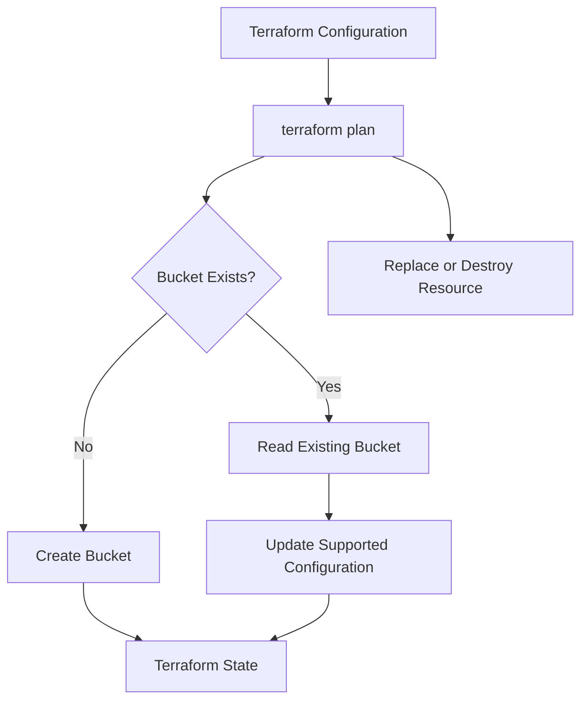
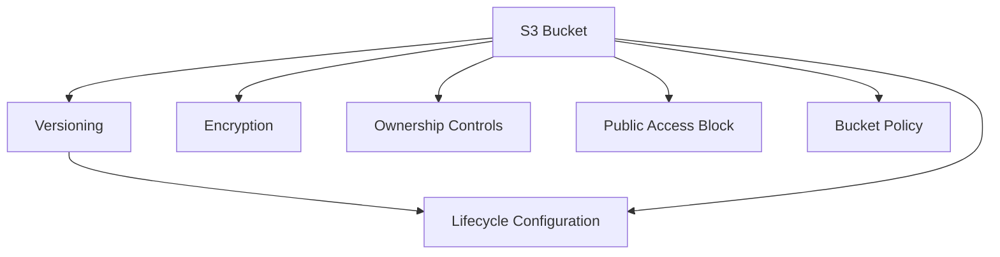
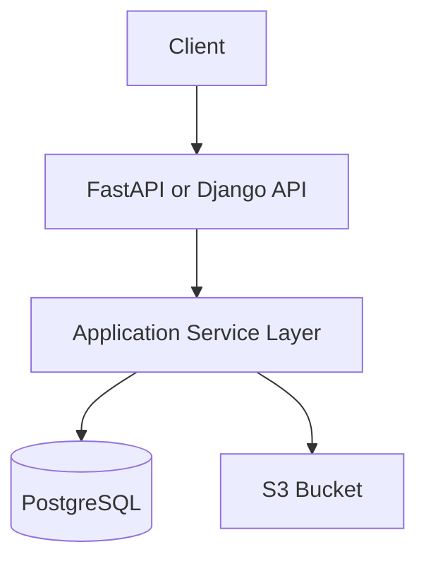

# 03- S3 Bucket Resource Configuration

## Overview

The Terraform `aws_s3_bucket` resource manages the lifecycle and core configuration of an Amazon S3 bucket.

An S3 bucket is a foundational resource for storing application files, documents, images, backups, logs, and data lake objects. In production infrastructure, bucket creation is only one part of the configuration. Versioning, encryption, access controls, lifecycle policies, replication, and logging are managed through additional Terraform resources.

A well-designed Terraform configuration separates bucket creation from its supporting configurations. This provides clearer ownership, predictable resource dependencies, and safer infrastructure changes.

This document focuses on the S3 bucket resource, its arguments, attributes, lifecycle behavior, resource dependencies, and practical Terraform implementation.

## Understanding the S3 Bucket Resource

Terraform uses the `aws_s3_bucket` resource to manage an S3 general-purpose bucket.

Basic declaration:

```hcl
resource "aws_s3_bucket" "application" {
  bucket = "company-backend-assets"
}
```

The resource contains two important identifiers:

| Component | Example | Meaning |
|---|---|---|
| Resource type | `aws_s3_bucket` | AWS provider resource responsible for bucket management |
| Local resource name | `application` | Terraform identifier within the current module |
| Bucket name | `company-backend-assets` | Actual globally unique S3 bucket name |

The Terraform reference:

```hcl
aws_s3_bucket.application
```

identifies the resource inside the current Terraform module.

The actual bucket name is configured through the `bucket` argument.

### Resource Lifecycle

Terraform manages the bucket through its resource lifecycle:



Terraform compares the declared configuration with its state and the infrastructure information returned by the AWS provider.

Depending on the change, Terraform may:

- Create a bucket.
- Update supported attributes.
- Detect configuration drift.
- Replace the bucket when an immutable attribute changes.
- Destroy the bucket when removal is requested and permitted.

Bucket replacement is particularly sensitive because an S3 bucket may contain production data.

## Basic Bucket Configuration

A practical configuration should use variables rather than hardcoded resource identifiers.

`storage.tf`:

```hcl
resource "aws_s3_bucket" "application" {
  bucket = var.bucket_name

  tags = {
    Name        = var.bucket_name
    Environment = var.environment
    Application = "backend-api"
    ManagedBy   = "Terraform"
  }
}
```

`variables.tf`:

```hcl
variable "bucket_name" {
  description = "Globally unique S3 bucket name."
  type        = string
}

variable "environment" {
  description = "Deployment environment."
  type        = string

  validation {
    condition     = contains(["dev", "staging", "prod"], var.environment)
    error_message = "Environment must be dev, staging, or prod."
  }
}
```

`terraform.tfvars`:

```hcl
bucket_name = "company-backend-dev-assets"
environment = "dev"
```

The bucket name must be globally unique within the applicable S3 bucket namespace.

## Important Resource Arguments

The `aws_s3_bucket` resource supports arguments for configuring the bucket itself.

The exact available arguments depend on the AWS provider version. Consult the documentation for the provider version selected by the project.

### bucket

Specifies the bucket name.

```hcl
resource "aws_s3_bucket" "application" {
  bucket = var.bucket_name
}
```

Important considerations:

- Bucket names must satisfy S3 naming requirements.
- General-purpose bucket names must be globally unique within the applicable namespace.
- The bucket name is not an arbitrary Terraform identifier.
- Changing the bucket name generally requires bucket replacement.
- Production bucket renaming should be treated as a data migration.

### force_destroy

Controls whether Terraform should delete all objects and versions when destroying a bucket.

```hcl
resource "aws_s3_bucket" "application" {
  bucket        = var.bucket_name
  force_destroy = false
}
```

When `force_destroy` is `false`, Terraform does not automatically remove objects to empty the bucket before deletion.

When enabled, Terraform can remove objects and object versions as part of bucket destruction.

| Setting | Behavior |
|---|---|
| `false` | Existing objects can prevent bucket deletion |
| `true` | Terraform can empty the bucket before deleting it |

For production buckets, keep `force_destroy = false` unless a carefully controlled deletion workflow explicitly requires otherwise.

Important limitations:

- It does not provide a backup.
- It does not replace retention policies.
- It does not protect against all forms of data loss.
- Deleting a versioned bucket requires handling object versions and delete markers.
- A bucket may have additional deletion constraints imposed by AWS services or policies.

### object_lock_enabled

Enables S3 Object Lock functionality when creating a bucket.

```hcl
resource "aws_s3_bucket" "compliance" {
  bucket              = var.bucket_name
  object_lock_enabled = true
}
```

Object Lock supports retention controls designed to protect objects from deletion or modification for specified periods.

Use it for workloads with compliance, audit, or immutable-storage requirements.

Important considerations:

- Object Lock must be configured deliberately.
- Retention modes and legal holds have separate behavior.
- Object Lock does not replace IAM authorization.
- Versioning is required for Object Lock.
- Retention configuration and governance should be designed before storing protected data.

Detailed Object Lock configuration belongs in the S3 advanced features and security documentation.

### tags

Tags provide metadata for resource organization, ownership, automation, and cost allocation.

```hcl
resource "aws_s3_bucket" "application" {
  bucket = var.bucket_name

  tags = {
    Environment = var.environment
    Application = "backend-api"
    Owner       = "platform-team"
    ManagedBy   = "Terraform"
  }
}
```

Recommended tags:

| Tag | Purpose |
|---|---|
| `Environment` | Identifies development, staging, or production |
| `Application` | Identifies the owning application |
| `Owner` | Identifies the responsible team |
| `Project` | Groups related infrastructure |
| `ManagedBy` | Identifies Terraform or another management system |

Tags improve resource management but should not be treated as an authorization boundary.

## S3 Bucket Naming

Bucket naming is an important infrastructure design decision because bucket names are part of the resource's external identity.

A practical naming convention:

```text
<organization>-<application>-<environment>-<purpose>
```

Examples:

```text
company-payments-prod-documents
company-payments-dev-uploads
company-analytics-prod-data
company-platform-staging-assets
```

Naming recommendations:

- Use lowercase letters and numbers.
- Use hyphens as separators.
- Avoid embedding sensitive information.
- Include application and environment identifiers.
- Avoid names that could be confused with unrelated resources.
- Account for global uniqueness.
- Consider the naming constraints of the bucket type being created.

A bucket name should remain stable for the lifetime of the application unless a planned migration requires a change.

## Bucket Attributes

Terraform exposes computed attributes after a bucket is created.

These attributes can be consumed by other resources, modules, and outputs.

Common attributes include:

| Attribute | Description |
|---|---|
| `id` | Bucket identifier, generally its name |
| `arn` | Amazon Resource Name |
| `bucket` | Bucket name |
| `region` | Bucket Region |
| `bucket_domain_name` | Bucket domain name |
| `bucket_regional_domain_name` | Regional bucket domain name |
| `hosted_zone_id` | Route 53 hosted zone identifier associated with the bucket endpoint |

Example:

```hcl
output "bucket_name" {
  description = "Application S3 bucket name."
  value       = aws_s3_bucket.application.id
}

output "bucket_arn" {
  description = "Application S3 bucket ARN."
  value       = aws_s3_bucket.application.arn
}

output "bucket_region" {
  description = "Application S3 bucket Region."
  value       = aws_s3_bucket.application.region
}
```

### Using Bucket Attributes in Other Resources

Prefer resource references over hardcoded names.

Example bucket policy:

```hcl
resource "aws_s3_bucket_policy" "application" {
  bucket = aws_s3_bucket.application.id

  policy = jsonencode({
    Version = "2012-10-17"

    Statement = [
      {
        Sid    = "AllowApplicationRoleRead"
        Effect = "Allow"

        Principal = {
          AWS = var.application_role_arn
        }

        Action = [
          "s3:GetObject"
        ]

        Resource = "${aws_s3_bucket.application.arn}/uploads/*"
      }
    ]
  })
}
```

The resource reference creates an implicit Terraform dependency between the bucket and its policy.

The policy is illustrative. The application role must also have compatible identity-based permissions, and any explicit denies or encryption-key requirements must be considered.

## Separate S3 Configuration Resources

Modern AWS provider configurations manage many bucket settings through dedicated resources instead of placing all settings inside `aws_s3_bucket`.

This separation makes infrastructure ownership clearer and reduces configuration ambiguity.

| Configuration | Terraform resource |
|---|---|
| Bucket creation | `aws_s3_bucket` |
| Versioning | `aws_s3_bucket_versioning` |
| Server-side encryption | `aws_s3_bucket_server_side_encryption_configuration` |
| Public-access block | `aws_s3_bucket_public_access_block` |
| Object Ownership | `aws_s3_bucket_ownership_controls` |
| Lifecycle configuration | `aws_s3_bucket_lifecycle_configuration` |
| Bucket policy | `aws_s3_bucket_policy` |
| Logging | `aws_s3_bucket_logging` |
| Replication | `aws_s3_bucket_replication_configuration` |
| CORS | `aws_s3_bucket_cors_configuration` |
| Website configuration | `aws_s3_bucket_website_configuration` |

Avoid managing the same bucket setting through multiple Terraform resources or conflicting configuration mechanisms.

### Complete Baseline Bucket Configuration

The following example combines bucket creation with essential supporting configurations.

`storage.tf`:

```hcl
resource "aws_s3_bucket" "application" {
  bucket        = var.bucket_name
  force_destroy = false

  tags = {
    Name        = var.bucket_name
    Environment = var.environment
    Application = "backend-api"
    ManagedBy   = "Terraform"
  }

  lifecycle {
    prevent_destroy = true
  }
}
```

`versioning.tf`:

```hcl
resource "aws_s3_bucket_versioning" "application" {
  bucket = aws_s3_bucket.application.id

  versioning_configuration {
    status = "Enabled"
  }
}
```

`encryption.tf`:

```hcl
resource "aws_s3_bucket_server_side_encryption_configuration" "application" {
  bucket = aws_s3_bucket.application.id

  rule {
    apply_server_side_encryption_by_default {
      sse_algorithm = "AES256"
    }
  }
}
```

`security.tf`:

```hcl
resource "aws_s3_bucket_ownership_controls" "application" {
  bucket = aws_s3_bucket.application.id

  rule {
    object_ownership = "BucketOwnerEnforced"
  }
}

resource "aws_s3_bucket_public_access_block" "application" {
  bucket = aws_s3_bucket.application.id

  block_public_acls       = true
  block_public_policy     = true
  ignore_public_acls      = true
  restrict_public_buckets = true
}
```

These resources establish a private, versioned bucket with default SSE-S3 encryption and bucket-owner-enforced object ownership.

They do not constitute a complete production security architecture. IAM permissions, bucket policies, KMS configuration where applicable, monitoring, and retention requirements must be addressed separately.

## Resource Dependencies

Terraform builds a dependency graph from references between resources.

For example:

```hcl
resource "aws_s3_bucket_versioning" "application" {
  bucket = aws_s3_bucket.application.id
}
```

Terraform understands that the bucket must exist before its versioning configuration can be applied.

The dependency graph can be visualized as:



The graph represents logical dependencies, not necessarily a strict ordering between every supporting configuration.

### Explicit depends_on

Use `depends_on` when Terraform cannot infer a required ordering from resource references.

Example:

```hcl
resource "aws_s3_bucket_lifecycle_configuration" "application" {
  bucket = aws_s3_bucket.application.id

  depends_on = [
    aws_s3_bucket_versioning.application
  ]

  rule {
    id     = "uploads-retention"
    status = "Enabled"

    filter {
      prefix = "uploads/"
    }

    expiration {
      days = 365
    }
  }
}
```

This ensures that the versioning configuration is applied before the lifecycle configuration.

Avoid adding `depends_on` everywhere. Excessive explicit dependencies can make Terraform execution unnecessarily restrictive.

## Resource Lifecycle and Destruction Protection

S3 buckets often contain persistent application data. Terraform lifecycle controls should reflect the consequences of resource replacement or deletion.

### prevent_destroy

Use `prevent_destroy` for buckets that must not be accidentally deleted through routine Terraform operations.

```hcl
resource "aws_s3_bucket" "production" {
  bucket = var.bucket_name

  lifecycle {
    prevent_destroy = true
  }
}
```

Terraform rejects plans that would destroy the protected resource while the lifecycle rule remains in the configuration.

This is useful for:

- Production document storage.
- Customer-uploaded files.
- Application backups.
- Data lake storage.
- Audit and compliance data.

Important limitation: removing the resource configuration also removes its lifecycle protection from the configuration. `prevent_destroy` is not a permanent AWS-side deletion lock.

### create_before_destroy

Terraform supports `create_before_destroy` for resources where replacement can safely create the new resource before deleting the old one.

For an S3 bucket, replacement is not automatically safe.

```hcl
resource "aws_s3_bucket" "application" {
  bucket = var.bucket_name

  lifecycle {
    create_before_destroy = true
  }
}
```

This setting does not solve bucket-name uniqueness or data migration requirements.

If a replacement uses the same globally unique bucket name, the new bucket cannot be created while the existing bucket still owns that name.

For S3, a bucket migration generally requires a separate destination bucket, data transfer, application cutover, and controlled retirement of the source bucket.

### ignore_changes

`ignore_changes` tells Terraform to ignore selected attribute differences during planning.

Example:

```hcl
resource "aws_s3_bucket" "application" {
  bucket = var.bucket_name

  lifecycle {
    prevent_destroy = true

    ignore_changes = [
      tags["OperationalOwner"]
    ]
  }
}
```

Use this only when another system is intentionally responsible for managing the ignored attribute.

Overusing `ignore_changes` hides drift and weakens Terraform's ability to enforce the declared infrastructure configuration.

## Importing an Existing S3 Bucket

Existing buckets may need to be brought under Terraform management.

First, inspect the bucket:

```bash
aws s3api head-bucket \
  --bucket company-backend-prod-assets
```

Define the resource:

```hcl
resource "aws_s3_bucket" "application" {
  bucket = "company-backend-prod-assets"

  lifecycle {
    prevent_destroy = true
  }
}
```

Import the bucket:

```bash
terraform import \
  aws_s3_bucket.application \
  company-backend-prod-assets
```

Inspect the resulting state:

```bash
terraform state show aws_s3_bucket.application
```

Then run:

```bash
terraform plan
```

Importing the bucket does not automatically import every related configuration resource.

Versioning, encryption, lifecycle configuration, ownership controls, public-access blocks, and other independently managed settings may require their own resource definitions and imports.

Do not apply the first post-import plan until all proposed changes have been reviewed.

## Working with Multiple S3 Buckets

A backend application may require separate buckets for different storage responsibilities.

For example:

- User uploads.
- Static assets.
- Generated reports.
- Application backups.
- Processed media.

There are two common Terraform approaches.

### Separate Resource Declarations

Use separate resource blocks when buckets have substantially different configuration or ownership.

```hcl
resource "aws_s3_bucket" "uploads" {
  bucket = var.uploads_bucket_name

  tags = {
    Purpose = "User Uploads"
  }
}

resource "aws_s3_bucket" "reports" {
  bucket = var.reports_bucket_name

  tags = {
    Purpose = "Generated Reports"
  }
}
```

This is explicit and easy to review.

### for_each

Use `for_each` when multiple buckets share a consistent configuration model.

```hcl
variable "buckets" {
  description = "S3 buckets managed by this deployment."
  type        = map(object({
    purpose = string
  }))
}

resource "aws_s3_bucket" "application" {
  for_each = var.buckets

  bucket = each.key

  tags = {
    Purpose = each.value.purpose
  }
}
```

Example variable values:

```hcl
buckets = {
  "company-api-dev-uploads" = {
    purpose = "User Uploads"
  }

  "company-api-dev-reports" = {
    purpose = "Generated Reports"
  }
}
```

`for_each` creates a separately addressable Terraform resource instance for each map entry.

For example:

```hcl
aws_s3_bucket.application["company-api-dev-uploads"]
```

Use stable map keys. Changing a key changes the Terraform resource address and can cause Terraform to propose destroying and recreating the corresponding instance unless the state is migrated appropriately.

For buckets with significantly different security, retention, replication, or ownership requirements, separate resource declarations or dedicated modules are often easier to maintain.

## Bucket Configuration and Backend Integration

A typical backend architecture uses S3 to store files while PostgreSQL stores application metadata.



The bucket is provisioned through Terraform, while the application accesses it using its runtime IAM role.

The application should not depend on Terraform resource names. It should receive the bucket name through environment-specific application configuration.

Example:

```python
import os

import boto3

s3_client = boto3.client(
    "s3",
    region_name=os.environ["AWS_REGION"],
)

bucket_name = os.environ["S3_BUCKET_NAME"]
```

In production, use the standard AWS credential chain rather than embedding access keys.

Keep infrastructure provisioning separate from application runtime operations. The application should not need broad infrastructure-management permissions merely to upload and download objects.

## Bucket Resource Verification

After applying the Terraform configuration, verify the actual AWS resource.

### Check Bucket Existence

```bash
aws s3api head-bucket \
  --bucket company-backend-dev-assets
```

A successful request indicates that the caller can access the bucket through this operation. A failure does not always mean the bucket is absent; authorization and ownership can also affect the result.

### Inspect Bucket Location

```bash
aws s3api get-bucket-location \
  --bucket company-backend-dev-assets
```

### Inspect Bucket Versioning

```bash
aws s3api get-bucket-versioning \
  --bucket company-backend-dev-assets
```

### Inspect Encryption

```bash
aws s3api get-bucket-encryption \
  --bucket company-backend-dev-assets
```

### Inspect Public-Access Block

```bash
aws s3api get-public-access-block \
  --bucket company-backend-dev-assets
```

### Inspect Terraform Outputs

```bash
terraform output
```

For automated verification, compare the expected bucket configuration with the values returned by AWS APIs. A successful `terraform apply` alone does not prove that the application can access the bucket or that every operational requirement has been satisfied.

## Common Mistakes and Pitfalls

| Mistake | Impact | Recommended approach |
|---|---|---|
| Hardcoding bucket names across files | Makes environment changes difficult | Use input variables and consistent naming |
| Changing a production bucket name | Can require resource replacement and data migration | Treat renaming as a migration |
| Setting `force_destroy = true` by default | Can remove stored objects during destruction | Keep it disabled for persistent storage |
| Assuming `prevent_destroy` is permanent protection | Removing the resource configuration can remove the safeguard | Combine Terraform protection with AWS-side controls |
| Managing bucket settings through conflicting resources | Can create drift and configuration conflicts | Assign one Terraform resource to each setting |
| Ignoring versioning during deletion planning | Can leave object versions and delete markers | Design a version-aware cleanup process |
| Using `create_before_destroy` without considering bucket uniqueness | Replacement may fail because the bucket name is already in use | Use a separate destination bucket for migration |
| Overusing `ignore_changes` | Hides configuration drift | Ignore only deliberately externally managed attributes |
| Using unstable `for_each` keys | Can change resource addresses and trigger destructive plans | Use stable resource keys |
| Treating tags as security controls | Tags alone do not restrict access | Enforce access through IAM and resource policies |

## Production Readiness Checklist

Before deploying an S3 bucket through Terraform, verify:

- [ ] Bucket name follows the organization's naming convention.
- [ ] Bucket name is valid and available.
- [ ] AWS account and Region are correct.
- [ ] Bucket ownership is clearly defined.
- [ ] `force_destroy` is disabled for persistent production storage.
- [ ] Versioning requirements are understood.
- [ ] Default encryption is configured.
- [ ] Public-access blocking is configured appropriately.
- [ ] Object Ownership is configured deliberately.
- [ ] Lifecycle and retention requirements are documented.
- [ ] IAM permissions follow least privilege.
- [ ] Resource dependencies are correct.
- [ ] Terraform state is stored and protected appropriately.
- [ ] Destruction and migration procedures are documented.
- [ ] Deployment verification commands are available.
- [ ] Application runtime access has been tested.

## Key Takeaways

- `aws_s3_bucket` manages the core bucket resource, while versioning, encryption, access controls, lifecycle, and other settings are generally managed through dedicated Terraform resources.
- Use variables, stable naming conventions, and resource references to make bucket infrastructure reusable and environment-independent.
- Treat `force_destroy`, `prevent_destroy`, and resource replacement as high-impact lifecycle decisions for buckets containing persistent data.
- Import existing buckets carefully and reconcile every independently managed bucket configuration before applying changes.
- Verify actual AWS configuration and application access after deployment rather than relying only on Terraform's successful execution.