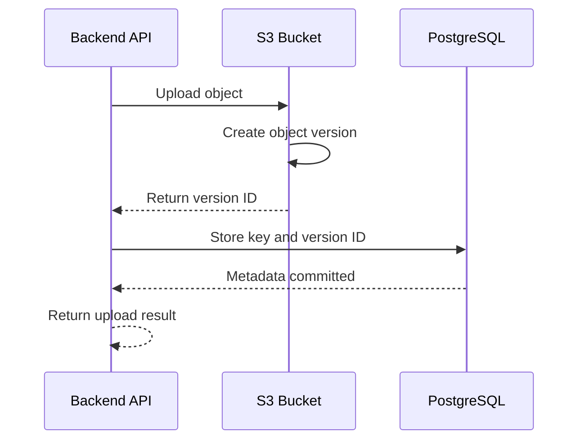
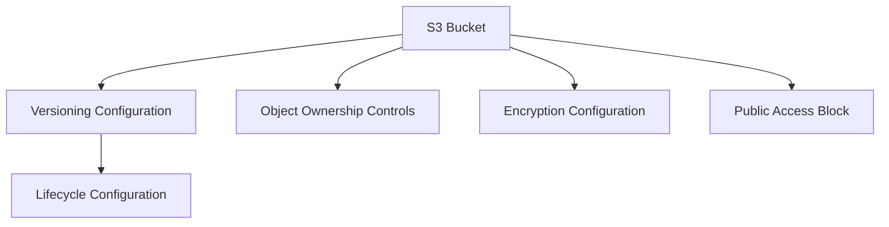

# 04- Versioning and Object Ownership Deployment

## Overview

Amazon S3 versioning and Object Ownership are important bucket-level configurations that influence data recovery, object ownership, and access-control behavior.

Versioning preserves multiple versions of an object under the same key. It protects against accidental overwrites and deletions and provides a foundation for recovery and replication workflows.

Object Ownership determines how ownership of uploaded objects is managed and whether access control lists (ACLs) are enabled. For most modern application architectures, `BucketOwnerEnforced` is the recommended configuration because it disables ACLs and makes the bucket owner own all objects.

Terraform manages these configurations through dedicated resources:

- `aws_s3_bucket_versioning`
- `aws_s3_bucket_ownership_controls`

This document covers their Terraform implementation, resource dependencies, deployment workflows, migration considerations, and operational verification.

## S3 Versioning

### What Versioning Does

Without versioning, uploading an object to an existing key replaces its current contents.

When versioning is enabled, S3 retains multiple versions of the object. Each version receives a unique version ID.

For example, consider:

```text
s3://company-backend-prod-assets/reports/monthly-report.pdf
```

After several uploads, the object can have multiple versions:

| Version | Content | Status |
|---|---|---|
| `version-id-1` | Initial report | Noncurrent |
| `version-id-2` | Updated report | Noncurrent |
| `version-id-3` | Latest report | Current |

The object key remains unchanged, but S3 stores separate versions.

### Versioning States

S3 versioning supports three states:

| State | Description |
|---|---|
| Unversioned | Versioning has never been enabled |
| Enabled | S3 assigns unique version IDs to new object versions |
| Suspended | New writes use the null version behavior; previously created versioned objects remain retained |

Once versioning has been enabled for a bucket, it cannot return to its original unversioned state. It can only be suspended.

Suspending versioning does not delete existing object versions.

### Versioning Request Flow



Applications that require precise recovery should persist the returned version ID alongside the object key.

Example application metadata:

```text
file_id
bucket_name
object_key
version_id
original_filename
content_type
uploaded_by
created_at
```

This allows an application to retrieve a specific version rather than always retrieving the current object.

## Deploying Versioning with Terraform

### Basic Configuration

Use the dedicated `aws_s3_bucket_versioning` resource.

`versioning.tf`:

```hcl
resource "aws_s3_bucket_versioning" "application" {
bucket = aws_s3_bucket.application.id

versioning_configuration {
status = "Enabled"
}
}
```

The `bucket` argument references the bucket resource. Terraform automatically establishes the dependency.

The bucket must exist before Terraform can configure its versioning state.

### Environment-Specific Versioning

Use a variable when versioning needs to be configurable across environments.

`variables.tf`:

```hcl
variable "enable_versioning" {
description = "Whether S3 bucket versioning should be enabled."
type = bool
default = true
}
```

`versioning.tf`:

```hcl
resource "aws_s3_bucket_versioning" "application" {
bucket = aws_s3_bucket.application.id

versioning_configuration {
status = var.enable_versioning ? "Enabled" : "Suspended"
}
}
```

Example environment configuration:

`dev.tfvars`:

```hcl
enable_versioning = true
```

`prod.tfvars`:

```hcl
enable_versioning = true
```

For important application data, enabling versioning in development as well as production helps expose version-related behavior during testing.

Suspending versioning should be an explicit operational decision, not a routine cost optimization.

### MFA Delete

S3 supports MFA Delete for certain versioning-related operations.

It can require multi-factor authentication for operations such as permanently deleting an object version or changing the versioning state.

Important considerations:

- Versioning must be enabled.
- Configuration requires the root account's MFA credentials.
- It has additional operational requirements for deletion and recovery.
- It is not a routine Terraform-managed setting like ordinary versioning.

Do not assume that enabling versioning automatically enables MFA Delete.

Evaluate MFA Delete separately when its operational model is suitable for the organization's security and recovery requirements.

## Versioning Behavior During Object Operations

### Uploading an Existing Object

When versioning is enabled, uploading an object with an existing key creates a new version.

```bash
aws s3api put-object \
--bucket company-backend-prod-assets \
--key reports/monthly-report.txt \
--body monthly-report.txt
```

Uploading the same key again creates another version rather than permanently replacing the earlier version.

### Listing Object Versions

```bash
aws s3api list-object-versions \
--bucket company-backend-prod-assets \
--prefix reports/monthly-report.txt
```

The response includes object versions and delete markers.

### Retrieving a Specific Version

```bash
aws s3api get-object \
--bucket company-backend-prod-assets \
--key reports/monthly-report.txt \
--version-id VERSION_ID \
restored-report.txt
```

This is useful when an application needs to recover a previous version.

### Deleting an Object

A normal delete request against a versioning-enabled bucket generally creates a delete marker.

```bash
aws s3api delete-object \
--bucket company-backend-prod-assets \
--key reports/monthly-report.txt
```

The current object appears deleted to ordinary reads, but previous versions remain stored.

To permanently delete a specific version, specify its version ID:

```bash
aws s3api delete-object \
--bucket company-backend-prod-assets \
--key reports/monthly-report.txt \
--version-id VERSION_ID
```

Permanent version deletion should be restricted, reviewed, and audited.

## Versioning and Lifecycle Management

Versioning increases storage consumption because previous versions remain stored until they are explicitly removed or expired through lifecycle policies.

For frequently updated objects, retained versions can consume significant storage.

A production lifecycle strategy should consider:

- Current-version retention.
- Noncurrent-version retention.
- Expired delete-marker cleanup.
- Incomplete multipart upload cleanup.
- Regulatory and business retention requirements.

Example lifecycle configuration:

```hcl
resource "aws_s3_bucket_lifecycle_configuration" "application" {
bucket = aws_s3_bucket.application.id

depends_on = [
aws_s3_bucket_versioning.application
]

rule {
id = "noncurrent-version-retention"
status = "Enabled"

filter {
prefix = "uploads/"
}

noncurrent_version_expiration {
noncurrent_days = 90
}
}

rule {
id = "expired-delete-marker-cleanup"
status = "Enabled"

filter {}

expiration {
expired_object_delete_marker = true
}
}
}
```

This example expires noncurrent versions under `uploads/` after 90 days and removes eligible expired delete markers.

Lifecycle processing is asynchronous. Applying the configuration does not mean that all eligible objects have already been deleted.

Detailed lifecycle design belongs in the dedicated S3 lifecycle documentation.

## Object Ownership

### What Object Ownership Controls

S3 Object Ownership determines who owns uploaded objects and whether ACLs are used to manage access.

Historically, objects uploaded by another AWS account could be owned by the uploading account. This complicated cross-account access and ownership management.

Object Ownership provides a consistent model for managing object ownership.

### Object Ownership Modes

S3 supports three Object Ownership modes:

| Mode | Object ownership | ACL behavior |
|---|---|---|
| `BucketOwnerEnforced` | Bucket owner owns all objects | ACLs disabled |
| `BucketOwnerPreferred` | Bucket owner can own objects uploaded with the `bucket-owner-full-control` ACL | ACLs enabled |
| `ObjectWriter` | Uploading account owns the objects it uploads | ACLs enabled |

### BucketOwnerEnforced

`BucketOwnerEnforced` is the recommended choice for most modern application architectures.

Its behavior:

- The bucket owner owns all objects.
- ACLs are disabled.
- Access is managed through IAM and bucket policies.
- Upload requests must not specify unsupported ACLs.

This simplifies cross-account ownership and reduces reliance on ACL-based authorization.

### Deploying Object Ownership with Terraform

`ownership.tf`:

```hcl
resource "aws_s3_bucket_ownership_controls" "application" {
bucket = aws_s3_bucket.application.id

rule {
object_ownership = "BucketOwnerEnforced"
}
}
```

For a modern private application bucket, this is generally preferable to managing object permissions through ACLs.

### Legacy Ownership Modes

Some legacy integrations still depend on ACLs.

For those cases, `BucketOwnerPreferred` or `ObjectWriter` may be required.

Example:

```hcl
resource "aws_s3_bucket_ownership_controls" "legacy" {
bucket = aws_s3_bucket.legacy.id

rule {
object_ownership = "BucketOwnerPreferred"
}
}
```

When using a legacy mode, review:

- Cross-account upload behavior.
- Required ACL headers.
- Bucket policy permissions.
- Object ownership after upload.
- Compatibility with existing application clients.

Do not select an ACL-enabled mode simply because an older integration used ACLs. First determine whether it can be migrated to policy-based authorization.

## Object Ownership and ACL Compatibility

When `BucketOwnerEnforced` is active, ACLs are disabled.

Applications that send unsupported ACL headers can receive errors.

For example, older Boto3 code might contain:

```python
s3_client.put_object(
Bucket=bucket_name,
Key=object_key,
Body=file_content,
ACL="public-read",
)
```

This is incompatible with the intended ACL-disabled architecture.

Use a policy-based access model instead:

```python
s3_client.put_object(
Bucket=bucket_name,
Key=object_key,
Body=file_content,
ContentType="application/pdf",
)
```

Grant the application role only the required S3 permissions through IAM.

For example, an application that uploads objects under `uploads/` may need `s3:PutObject` on:

```text
arn:aws:s3:::company-backend-prod-assets/uploads/*
```

The bucket policy and identity policy must be evaluated together. Encryption-related permissions may also be required when using SSE-KMS.

## Deploying Versioning and Object Ownership Together

A typical application bucket should enable versioning and enforce bucket ownership.

`storage.tf`:

```hcl
resource "aws_s3_bucket" "application" {
bucket = var.bucket_name
force_destroy = false

lifecycle {
prevent_destroy = true
}

tags = {
Environment = var.environment
Application = "backend-api"
ManagedBy = "Terraform"
}
}
```

`versioning.tf`:

```hcl
resource "aws_s3_bucket_versioning" "application" {
bucket = aws_s3_bucket.application.id

versioning_configuration {
status = "Enabled"
}
}
```

`ownership.tf`:

```hcl
resource "aws_s3_bucket_ownership_controls" "application" {
bucket = aws_s3_bucket.application.id

rule {
object_ownership = "BucketOwnerEnforced"
}
}
```

The resulting resource relationships are:



The bucket must exist before its supporting configurations can be applied. Lifecycle configuration can also depend on versioning when rules manage noncurrent versions.

## Terraform Deployment Workflow

### Initialize Terraform

```bash
terraform init
```

This initializes the working directory and downloads the required provider plugins.

### Format Configuration

```bash
terraform fmt -recursive
```

### Validate Configuration

```bash
terraform validate
```

This checks Terraform syntax and internal consistency. It does not prove that AWS will accept every requested configuration.

### Review the Deployment Plan

```bash
terraform plan \
-var-file="dev.tfvars" \
-out=tfplan
```

Review the plan for:

- Bucket creation or replacement.
- Versioning state changes.
- Object Ownership changes.
- ACL-related configuration changes.
- Unexpected resource deletion.
- Environment and Region mismatches.

### Apply the Reviewed Plan

```bash
terraform apply tfplan
```

Use the reviewed plan artifact rather than generating a different plan between review and application.

## Deploying to an Existing Bucket

When adopting versioning and Object Ownership for an existing bucket, inspect its current configuration first.

### Inspect Versioning

```bash
aws s3api get-bucket-versioning \
--bucket company-backend-prod-assets
```

### Inspect Object Ownership

```bash
aws s3api get-bucket-ownership-controls \
--bucket company-backend-prod-assets
```

### Inspect ACL Configuration

```bash
aws s3api get-bucket-acl \
--bucket company-backend-prod-assets
```

Review existing applications and integrations before changing ownership controls.

Changing to `BucketOwnerEnforced` disables ACLs. Existing ACL-dependent workflows may stop working even though the objects remain stored in the bucket.

A safe migration should:

1. Identify applications that send ACL headers.
2. Inspect cross-account upload workflows.
3. Replace ACL-dependent access with IAM and bucket policies.
4. Update SDK and application code.
5. Test uploads and downloads.
6. Apply the Object Ownership change.
7. Verify application behavior after deployment.

### Import Existing Configuration

If the bucket already exists but is not managed by Terraform, import the bucket first:

```bash
terraform import \
aws_s3_bucket.application \
company-backend-prod-assets
```

Supporting configurations may need to be imported separately.

Import versioning:

```bash
terraform import \
aws_s3_bucket_versioning.application \
company-backend-prod-assets
```

Import Object Ownership controls:

```bash
terraform import \
aws_s3_bucket_ownership_controls.application \
company-backend-prod-assets
```

After importing, run:

```bash
terraform plan
```

Reconcile the Terraform configuration with the actual AWS configuration before applying changes.

## Verification After Deployment

A successful Terraform apply should be followed by AWS-side verification.

### Verify Versioning

```bash
aws s3api get-bucket-versioning \
--bucket company-backend-prod-assets
```

Expected response when enabled:

```json
{
"Status": "Enabled"
}
```

### Verify Object Ownership

```bash
aws s3api get-bucket-ownership-controls \
--bucket company-backend-prod-assets
```

Expected response:

```json
{
"OwnershipControls": {
"Rules": [
{
"ObjectOwnership": "BucketOwnerEnforced"
}
]
}
}
```

### Verify Object Versions

Upload an object twice using the same key, then inspect its versions:

```bash
aws s3api list-object-versions \
--bucket company-backend-prod-assets \
--prefix verification/sample.txt
```

Confirm that multiple versions are present.

### Verify Delete Marker Behavior

```bash
aws s3api delete-object \
--bucket company-backend-prod-assets \
--key verification/sample.txt
```

Then inspect the key:

```bash
aws s3api list-object-versions \
--bucket company-backend-prod-assets \
--prefix verification/sample.txt
```

The response should show a delete marker when versioning is enabled.

Use a dedicated test prefix and clean up test versions deliberately.

## Production Considerations

### Versioning and Storage Costs

Versioning increases storage usage because old versions remain stored until removed or expired.

For applications that frequently replace large files, the storage impact can be significant.

Monitor:

- Current object storage.
- Noncurrent version storage.
- Number of retained versions.
- Lifecycle expiration behavior.
- Incomplete multipart uploads.

### Recovery and Data Protection

Versioning is a recovery mechanism, not a complete backup strategy.

It does not independently protect against:

- Accidental deletion of every retained version.
- Malicious deletion by an authorized principal.
- Incorrect lifecycle expiration.
- Loss of access to required encryption keys.
- Regional outages without a suitable recovery architecture.

Combine versioning with appropriate access controls, retention policies, replication, and backup procedures based on recovery objectives.

### Object Ownership and Application Compatibility

Enforcing bucket ownership simplifies access management, but applications must stop relying on ACLs.

Review all upload paths, including:

- Django and FastAPI services.
- Celery workers.
- Batch ingestion jobs.
- Cross-account integrations.
- Third-party upload clients.
- Data transfer tools.

An application that continues to send `public-read` or another unsupported ACL may fail after the ownership change.

### Cross-Account Uploads

For cross-account integrations, `BucketOwnerEnforced` avoids the legacy problem of uploaded objects being owned by the external uploading account.

Access should be designed through:

- IAM identity policies.
- S3 bucket policies.
- Appropriate cross-account role assumptions.
- KMS key policies and permissions when SSE-KMS is used.

Ownership and authorization are separate concerns. Bucket ownership does not automatically grant every principal access to objects.

## Common Mistakes and Pitfalls

| Mistake | Impact | Prevention |
|---|---|---|
| Assuming versioning can be disabled permanently | Existing versions remain and the bucket cannot return to its original unversioned state | Suspend versioning only when justified |
| Treating suspension as deletion of old versions | Previous versions continue consuming storage | Manage noncurrent versions explicitly |
| Assuming a normal delete permanently removes an object | A delete marker may hide the current object while older versions remain | Use version-aware recovery and deletion procedures |
| Enabling versioning without retention management | Storage consumption can grow indefinitely | Configure and monitor noncurrent-version lifecycle policies |
| Sending ACL headers with `BucketOwnerEnforced` | Upload requests may fail | Remove ACL headers from application code |
| Assuming bucket ownership grants object access | IAM or bucket policy authorization may still deny requests | Configure least-privilege policies |
| Switching ownership modes without compatibility testing | Legacy upload clients may stop working | Inventory and test ACL-dependent integrations |
| Assuming Terraform imports all bucket settings | Supporting configurations may remain unmanaged | Import each dedicated configuration resource |
| Treating versioning as a complete backup | Retained versions may still be deleted or become inaccessible | Add appropriate recovery and retention controls |

## Production Deployment Checklist

- [ ] Confirm the target AWS account and Region.
- [ ] Confirm the bucket name and environment.
- [ ] Inspect existing versioning configuration.
- [ ] Identify applications that depend on object version IDs.
- [ ] Enable versioning where required.
- [ ] Define noncurrent-version retention requirements.
- [ ] Confirm expired delete-marker handling.
- [ ] Inspect existing Object Ownership configuration.
- [ ] Identify integrations that send ACL headers.
- [ ] Replace ACL-dependent authorization with IAM and bucket policies.
- [ ] Configure `BucketOwnerEnforced` where compatible.
- [ ] Review cross-account upload workflows.
- [ ] Review KMS permissions when applicable.
- [ ] Import existing resources before managing them through Terraform.
- [ ] Review the Terraform plan for unexpected changes.
- [ ] Verify configuration using AWS CLI.
- [ ] Test object uploads, version retrieval, and deletion behavior.
- [ ] Document recovery and permanent-deletion procedures.

## Key Takeaways

- S3 versioning retains multiple object versions and supports recovery from accidental overwrites and deletions, but requires deliberate storage-retention management.
- `aws_s3_bucket_versioning` manages versioning independently of the core bucket resource; enabling versioning is a one-way transition from the original unversioned state.
- `BucketOwnerEnforced` makes the bucket owner own all objects and disables ACLs, making IAM and bucket policies the preferred access-control mechanisms.
- Existing ACL-dependent applications and cross-account upload workflows must be reviewed before changing Object Ownership.
- Terraform deployment must be followed by AWS-side verification of versioning, ownership, and real object-operation behavior.