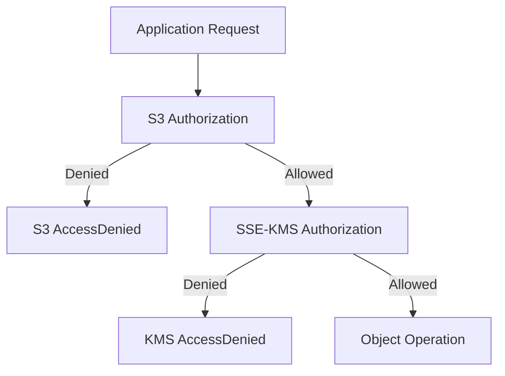

# 05- Encryption and KMS Configuration

## Overview

Amazon S3 supports server-side encryption to protect object data at rest. Terraform can configure the encryption behavior of an S3 bucket and provision the AWS Key Management Service (AWS KMS) resources required for customer-managed encryption keys.

For production infrastructure, encryption configuration should be managed as code rather than applied manually. This makes encryption settings reviewable, repeatable, version-controlled, and consistent across environments.

This document covers:

- S3 server-side encryption options.
- Terraform encryption configuration.
- AWS KMS key provisioning and management.
- KMS key policies and IAM permissions.
- S3 Bucket Keys.
- Encryption enforcement through bucket policies.
- Key rotation, deletion protection, and operational verification.

Detailed access-control design and broader S3 security architecture belong in the dedicated security documentation.

## S3 Server-Side Encryption Options

S3 server-side encryption protects object data after it reaches Amazon S3. S3 handles the encryption and decryption operations transparently when authorized clients upload and retrieve objects.

| Encryption type | Algorithm / mechanism | Key management | Typical use |
|---|---|---|---|
| SSE-S3 | AES-256 | Managed by S3 | Standard object encryption |
| SSE-KMS | AWS KMS | AWS-managed or customer-managed KMS key | Centralized key management and auditing |
| SSE-C | Customer-provided encryption key | Managed by the customer | Workloads requiring customer-supplied keys |

### SSE-S3

SSE-S3 uses encryption keys managed by Amazon S3.

Terraform configuration:

```hcl
resource "aws_s3_bucket_server_side_encryption_configuration" "application" {
  bucket = aws_s3_bucket.application.id

  rule {
    apply_server_side_encryption_by_default {
      sse_algorithm = "AES256"
    }
  }
}
```

Advantages:

- No separate KMS key management.
- No additional KMS request charges.
- Straightforward configuration.
- Suitable for general-purpose object storage.

Limitations:

- Does not provide customer-managed KMS key policies.
- Does not provide the same KMS key-level audit and permission controls as SSE-KMS.

Use SSE-S3 when standard encryption at rest satisfies the application's security and compliance requirements.

### SSE-KMS

SSE-KMS integrates S3 with AWS KMS. S3 uses a KMS key to protect object encryption keys.

Terraform configuration:

```hcl
resource "aws_s3_bucket_server_side_encryption_configuration" "application" {
  bucket = aws_s3_bucket.application.id

  rule {
    apply_server_side_encryption_by_default {
      sse_algorithm     = "aws:kms"
      kms_master_key_id = aws_kms_key.application.arn
    }

    bucket_key_enabled = true
  }
}
```

Advantages:

- Customer-managed key policies.
- Centralized key lifecycle management.
- KMS audit events.
- Integration with IAM and KMS grants.
- Support for key rotation.

Limitations:

- Additional KMS permissions are required.
- KMS API requests can introduce additional cost.
- Key availability and lifecycle become dependencies for accessing encrypted objects.
- Cross-account and cross-Region designs require additional planning.

Use SSE-KMS when applications need customer-managed encryption keys, centralized control, or KMS-based auditing.

### SSE-C

SSE-C allows a client to provide an encryption key with each object request. S3 uses the supplied key for encryption but does not retain it.

Terraform does not provision or manage the customer-provided encryption keys.

Important considerations:

- The application must securely store and manage encryption keys.
- The key must be supplied again when retrieving the object.
- Losing the key makes the encrypted object inaccessible.
- TLS is required for requests using SSE-C.

SSE-C is appropriate only when the application has a clear requirement for customer-supplied keys and can reliably manage their lifecycle.

## Terraform Encryption Resources

Terraform uses dedicated resources to manage S3 encryption and KMS configuration.

| Resource | Responsibility |
|---|---|
| `aws_s3_bucket` | Creates the S3 bucket |
| `aws_s3_bucket_server_side_encryption_configuration` | Configures default bucket encryption |
| `aws_kms_key` | Creates a KMS customer-managed key |
| `aws_kms_alias` | Creates a human-readable key alias |
| `aws_kms_key_policy` | Defines the KMS key resource policy |
| `aws_iam_policy` | Creates IAM permissions |
| `aws_iam_role_policy_attachment` | Attaches an IAM policy to a role |

Encryption configuration should remain separate from the bucket resource. This follows the modern AWS provider resource model and keeps infrastructure responsibilities explicit.

## SSE-S3 Configuration with Terraform

For workloads that do not require customer-managed KMS keys, SSE-S3 is a practical default.

```hcl
resource "aws_s3_bucket_server_side_encryption_configuration" "application" {
  bucket = aws_s3_bucket.application.id

  rule {
    apply_server_side_encryption_by_default {
      sse_algorithm = "AES256"
    }
  }
}
```

The configuration applies to new objects written to the bucket. Existing objects are not automatically re-encrypted merely because the bucket's default encryption configuration changes.

### Verify SSE-S3 Configuration

```bash
aws s3api get-bucket-encryption \
  --bucket my-application-bucket
```

Expected configuration includes:

```json
{
  "ServerSideEncryptionConfiguration": {
    "Rules": [
      {
        "ApplyServerSideEncryptionByDefault": {
          "SSEAlgorithm": "AES256"
        }
      }
    ]
  }
}
```

Verify an individual object:

```bash
aws s3api head-object \
  --bucket my-application-bucket \
  --key documents/report.pdf
```

Check the `ServerSideEncryption` field in the response.

## Provisioning a KMS Key with Terraform

A customer-managed KMS key provides control over key policies, rotation, and lifecycle.

### Create the KMS Key

```hcl
resource "aws_kms_key" "application" {
  description             = "KMS key for application S3 encryption"
  enable_key_rotation     = true
  deletion_window_in_days = 30

  tags = {
    Name        = "application-s3-key"
    Environment = var.environment
    ManagedBy   = "Terraform"
  }

  lifecycle {
    prevent_destroy = true
  }
}
```

Important arguments:

| Argument | Purpose |
|---|---|
| `description` | Documents the key's intended use |
| `enable_key_rotation` | Enables automatic rotation where supported |
| `deletion_window_in_days` | Defines the waiting period before scheduled deletion |
| `tags` | Adds resource metadata |

`prevent_destroy` protects the resource from Terraform destroy or replacement operations while the lifecycle rule remains in the configuration. It is not an AWS-side deletion lock.

### Create a KMS Alias

Aliases provide readable names for KMS keys.

```hcl
resource "aws_kms_alias" "application" {
  name          = "alias/application-s3"
  target_key_id = aws_kms_key.application.key_id
}
```

Reference the key ARN in S3 encryption configuration when an explicit customer-managed key is required.

## KMS Key Policies

A KMS key policy is the primary resource-based policy controlling access to a KMS key.

KMS permissions are evaluated separately from S3 permissions. Having permission to access an S3 object does not automatically grant permission to use the KMS key protecting that object.

### Key Policy Example

```hcl
data "aws_caller_identity" "current" {}

data "aws_iam_policy_document" "application_kms" {
  statement {
    sid    = "EnableAccountIAMPermissions"
    effect = "Allow"

    principals {
      type        = "AWS"
      identifiers = ["arn:aws:iam::${data.aws_caller_identity.current.account_id}:root"]
    }

    actions   = ["kms:*"]
    resources = ["*"]
  }

  statement {
    sid    = "AllowApplicationRole"
    effect = "Allow"

    principals {
      type        = "AWS"
      identifiers = [aws_iam_role.application.arn]
    }

    actions = [
      "kms:Decrypt",
      "kms:DescribeKey",
      "kms:GenerateDataKey"
    ]

    resources = ["*"]
  }
}

resource "aws_kms_key_policy" "application" {
  key_id = aws_kms_key.application.id
  policy = data.aws_iam_policy_document.application_kms.json
}
```

The account-root statement enables the account to delegate permissions through IAM policies. It does not mean every IAM principal automatically receives unrestricted access.

The application statement grants the specified role the operations commonly needed for S3 SSE-KMS access:

- `kms:GenerateDataKey` for generating data keys used during encryption.
- `kms:Decrypt` for decrypting data keys during object retrieval and applicable multipart or copy operations.
- `kms:DescribeKey` for key metadata access where required by the application.

Grant only the operations required by the actual workload. Do not grant `kms:*` to application roles.

### Important Key Policy Considerations

- Preserve administrative access to the key.
- Avoid replacing an existing key policy without reviewing its current statements.
- Restrict application permissions to the intended roles.
- Consider service-mediated access and KMS grants where applicable.
- Cross-account access requires compatible key-policy and IAM permissions.
- Deleting or disabling a key can make dependent objects inaccessible.

## IAM Permissions for S3 and KMS

Applications using SSE-KMS need permissions at both the S3 and KMS layers.

A typical application role needs:

- S3 permissions for the required bucket and objects.
- KMS permissions for the encryption key.
- Any additional permissions required by the application's upload or download workflow.

### Example Application IAM Policy

```hcl
data "aws_iam_policy_document" "application_s3" {
  statement {
    sid    = "ListApplicationBucket"
    effect = "Allow"

    actions = [
      "s3:ListBucket"
    ]

    resources = [
      aws_s3_bucket.application.arn
    ]
  }

  statement {
    sid    = "AccessApplicationObjects"
    effect = "Allow"

    actions = [
      "s3:GetObject",
      "s3:PutObject",
      "s3:DeleteObject"
    ]

    resources = [
      "${aws_s3_bucket.application.arn}/*"
    ]
  }
}

resource "aws_iam_policy" "application_s3" {
  name   = "application-s3-access"
  policy = data.aws_iam_policy_document.application_s3.json
}

resource "aws_iam_role_policy_attachment" "application_s3" {
  role       = aws_iam_role.application.name
  policy_arn = aws_iam_policy.application_s3.arn
}
```

The corresponding KMS permissions can be provided through a separate IAM policy when the key policy delegates authorization to IAM.

```hcl
data "aws_iam_policy_document" "application_kms" {
  statement {
    sid    = "UseApplicationKMSKey"
    effect = "Allow"

    actions = [
      "kms:GenerateDataKey",
      "kms:Decrypt",
      "kms:DescribeKey"
    ]

    resources = [
      aws_kms_key.application.arn
    ]
  }
}

resource "aws_iam_policy" "application_kms" {
  name   = "application-kms-access"
  policy = data.aws_iam_policy_document.application_kms.json
}

resource "aws_iam_role_policy_attachment" "application_kms" {
  role       = aws_iam_role.application.name
  policy_arn = aws_iam_policy.application_kms.arn
}
```

The exact permissions depend on the workload. For example, multipart uploads, copies, and other workflows can require additional permissions or different KMS operations.

## S3 Bucket Keys

S3 Bucket Keys reduce the number of requests made to AWS KMS for SSE-KMS objects.

Without Bucket Keys, S3 can make KMS requests for individual object encryption operations. With Bucket Keys enabled, S3 can use a bucket-level key to reduce KMS request frequency.

Terraform configuration:

```hcl
resource "aws_s3_bucket_server_side_encryption_configuration" "application" {
  bucket = aws_s3_bucket.application.id

  rule {
    apply_server_side_encryption_by_default {
      sse_algorithm     = "aws:kms"
      kms_master_key_id = aws_kms_key.application.arn
    }

    bucket_key_enabled = true
  }
}
```

### Benefits

- Reduces KMS request volume.
- Can reduce SSE-KMS request costs.
- Improves efficiency for workloads with high object request volumes.

### Considerations

- Bucket Keys are supported for SSE-KMS, not SSE-S3.
- They change the KMS request pattern and associated encryption context behavior.
- Evaluate existing KMS policies and audit requirements before enabling them.
- Bucket Key behavior should be tested with cross-account access and applications that depend on encryption context conditions.

For high-volume object storage workloads, Bucket Keys are generally worth evaluating.

## Enforcing Encryption Through Bucket Policies

Default bucket encryption ensures new objects receive encryption at rest even when the client does not explicitly specify encryption headers.

A bucket policy can additionally reject requests that do not meet an explicit encryption-header requirement.

This is a separate control from default encryption.

### Require SSE-KMS Headers

```hcl
data "aws_iam_policy_document" "require_sse_kms" {
  statement {
    sid    = "DenyIncorrectEncryptionAlgorithm"
    effect = "Deny"

    principals {
      type        = "*"
      identifiers = ["*"]
    }

    actions = [
      "s3:PutObject"
    ]

    resources = [
      "${aws_s3_bucket.application.arn}/*"
    ]

    condition {
      test     = "StringNotEquals"
      variable = "s3:x-amz-server-side-encryption"

      values = [
        "aws:kms"
      ]
    }
  }

  statement {
    sid    = "DenyIncorrectKMSKey"
    effect = "Deny"

    principals {
      type        = "*"
      identifiers = ["*"]
    }

    actions = [
      "s3:PutObject"
    ]

    resources = [
      "${aws_s3_bucket.application.arn}/*"
    ]

    condition {
      test     = "StringNotEquals"
      variable = "s3:x-amz-server-side-encryption-aws-kms-key-id"

      values = [
        aws_kms_key.application.arn
      ]
    }
  }
}

resource "aws_s3_bucket_policy" "application" {
  bucket = aws_s3_bucket.application.id
  policy = data.aws_iam_policy_document.require_sse_kms.json
}
```

This example explicitly requires clients to send the expected encryption algorithm and KMS key identifier.

**Important:** Requests that omit these headers are also denied by the `StringNotEquals` conditions. S3 default encryption alone does not require clients to send encryption headers. If clients are expected to rely on bucket default encryption, do not apply this policy without adapting the enforcement logic to the intended behavior.

Before enforcing encryption headers, test all upload paths, including:

- Backend SDK uploads.
- Presigned URL uploads.
- Multipart uploads.
- Cross-account integrations.
- Third-party upload clients.

## Complete Terraform Encryption Configuration

The following example combines a bucket, KMS key, alias, and SSE-KMS encryption configuration.

```hcl
resource "aws_s3_bucket" "application" {
  bucket = var.bucket_name

  tags = {
    Name        = var.bucket_name
    Environment = var.environment
    ManagedBy   = "Terraform"
  }

  lifecycle {
    prevent_destroy = true
  }
}

resource "aws_kms_key" "application" {
  description             = "Application S3 encryption key"
  enable_key_rotation     = true
  deletion_window_in_days = 30

  tags = {
    Name        = "${var.environment}-application-s3-key"
    Environment = var.environment
    ManagedBy   = "Terraform"
  }

  lifecycle {
    prevent_destroy = true
  }
}

resource "aws_kms_alias" "application" {
  name          = "alias/${var.environment}-application-s3"
  target_key_id = aws_kms_key.application.key_id
}

resource "aws_s3_bucket_server_side_encryption_configuration" "application" {
  bucket = aws_s3_bucket.application.id

  rule {
    apply_server_side_encryption_by_default {
      sse_algorithm     = "aws:kms"
      kms_master_key_id = aws_kms_key.application.arn
    }

    bucket_key_enabled = true
  }
}
```

This is the encryption-focused portion of the infrastructure. A production bucket should also have its access controls, public-access block, ownership controls, versioning, and other required configuration managed through their dedicated resources.

## Key Rotation and Lifecycle Management

KMS key rotation changes the backing key material while preserving the logical KMS key.

When automatic rotation is enabled for a supported customer-managed key, AWS manages the rotation process.

```hcl
resource "aws_kms_key" "application" {
  description         = "Application S3 encryption key"
  enable_key_rotation = true
}
```

Important considerations:

- Automatic rotation does not change the KMS key ARN.
- Existing encrypted objects remain accessible through the logical key.
- Rotation does not automatically re-encrypt all existing S3 objects.
- Key deletion can permanently prevent decryption.
- Disabling a key can interrupt access to encrypted objects.
- Rotation support depends on the KMS key type and configuration.

### Protect Against Accidental Key Deletion

Use Terraform lifecycle protection for critical keys:

```hcl
lifecycle {
  prevent_destroy = true
}
```

Also configure an appropriate deletion waiting period:

```hcl
deletion_window_in_days = 30
```

Before scheduling deletion, identify every resource and object that depends on the key. A KMS key should not be deleted merely because an application or Terraform resource no longer references it.

## Terraform Deployment Workflow

### Validate Configuration

```bash
terraform fmt -recursive
terraform init
terraform validate
```

### Review the Plan

```bash
terraform plan -out=tfplan
```

Review the plan for:

- Unexpected KMS key replacement.
- Changes to the key policy.
- Encryption algorithm changes.
- KMS key ARN changes.
- Removal of encryption configuration.
- Destruction of resources protected by lifecycle rules.

### Apply the Configuration

```bash
terraform apply tfplan
```

Use environment-specific state and controlled approval for production deployments.

## Verification

### Inspect Bucket Encryption

```bash
aws s3api get-bucket-encryption \
  --bucket my-application-bucket
```

### Inspect KMS Key Metadata

```bash
aws kms describe-key \
  --key-id alias/application-s3
```

### Inspect Key Rotation

```bash
aws kms get-key-rotation-status \
  --key-id alias/application-s3
```

### Inspect an Encrypted Object

```bash
aws s3api head-object \
  --bucket my-application-bucket \
  --key documents/report.pdf
```

For SSE-KMS objects, inspect:

- `ServerSideEncryption`
- `SSEKMSKeyId`
- `BucketKeyEnabled`, where returned

### Test an Upload

```bash
aws s3api put-object \
  --bucket my-application-bucket \
  --key verification/encryption-test.txt \
  --body ./encryption-test.txt \
  --server-side-encryption aws:kms \
  --ssekms-key-id alias/application-s3
```

Then verify:

```bash
aws s3api head-object \
  --bucket my-application-bucket \
  --key verification/encryption-test.txt
```

Use a test object and an authorized identity. Do not use production data for initial permission testing.

## Troubleshooting

| Symptom | Likely cause | Investigation |
|---|---|---|
| `AccessDenied` during upload | Missing S3 permission | Inspect IAM and bucket policies |
| KMS access denied | Missing KMS permission or key-policy authorization | Inspect IAM policy, key policy, and grants |
| Upload rejected by bucket policy | Encryption headers do not satisfy policy conditions | Inspect request headers and policy conditions |
| Object cannot be decrypted | Key disabled, deleted, or inaccessible | Inspect KMS key state and permissions |
| Terraform cannot update key policy | Existing policy or administrator permissions are insufficient | Review the current key policy before applying |
| Unexpected KMS charges | High KMS request volume | Evaluate S3 Bucket Keys and request patterns |

### Distinguish S3 and KMS Authorization Failures

An encrypted object request can require authorization at two separate layers:



When diagnosing failures:

1. Confirm the caller's AWS identity.
2. Verify the required S3 action is allowed.
3. Inspect bucket policies and explicit denies.
4. Verify the KMS key is enabled and available.
5. Inspect the key policy and applicable grants.
6. Verify the caller has the required KMS permissions.
7. Review CloudTrail events for the denied operation.

Do not resolve a KMS authorization failure by granting broad S3 permissions. Fix the missing permission at the layer where authorization failed.

## Production Best Practices

- Use SSE-S3 for workloads that need standard encryption at rest without customer-managed key requirements.
- Use SSE-KMS when centralized key control, key policies, or KMS auditing are required.
- Prefer customer-managed KMS keys when the application requires explicit key lifecycle and access control.
- Keep KMS keys in the same AWS Region as the S3 bucket.
- Enable automatic key rotation where supported and appropriate.
- Protect critical keys against accidental Terraform destruction.
- Preserve administrative access when modifying KMS key policies.
- Scope IAM permissions to specific buckets, prefixes, and KMS keys.
- Evaluate S3 Bucket Keys for high-volume SSE-KMS workloads.
- Test encryption enforcement against every upload mechanism before production rollout.
- Monitor KMS usage and unexpected authorization failures.
- Document key ownership, recovery responsibilities, and deletion procedures.
- Never delete a KMS key until dependent data and recovery requirements have been reviewed.

## Key Takeaways

- S3 supports SSE-S3, SSE-KMS, and SSE-C; choose based on key-management and security requirements.
- Terraform manages bucket encryption separately from the S3 bucket resource.
- SSE-KMS requires compatible S3 permissions and KMS authorization.
- S3 Bucket Keys can reduce KMS request volume and associated costs.
- Protect KMS keys from accidental deletion because encrypted objects depend on their continued availability.