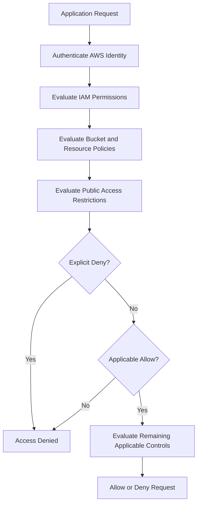
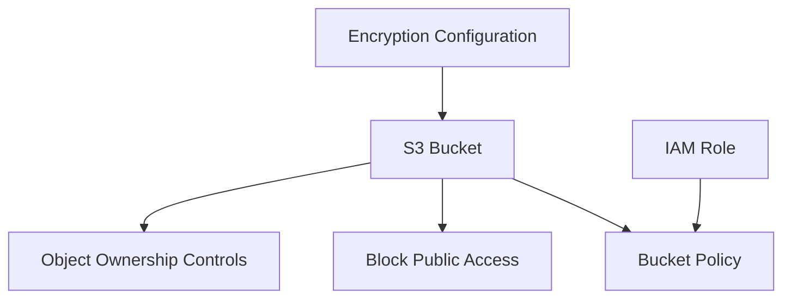

# 06- Bucket Policies and Public Access Controls

## Overview

Amazon S3 uses multiple authorization and access-control mechanisms to determine who can access buckets and objects. Terraform allows these controls to be defined, reviewed, deployed, and maintained as infrastructure code.

The primary controls are:

- IAM identity-based policies.
- S3 bucket policies.
- S3 Access Control Lists (ACLs).
- S3 Block Public Access settings.
- S3 Object Ownership.
- Access points and access point policies.

These mechanisms operate together. A secure S3 deployment must account for identity permissions, resource policies, public-access restrictions, and ownership behavior.

This document focuses on Terraform configuration for bucket policies and public-access controls. Detailed IAM policy evaluation and broader security architecture belong in the dedicated S3 security documentation.

## S3 Access-Control Model

S3 supports identity-based and resource-based authorization.

| Mechanism | Policy attached to | Primary responsibility |
|---|---|---|
| IAM policy | IAM user, group, or role | Defines permissions for an identity |
| Bucket policy | S3 bucket | Defines access to bucket and object resources |
| ACL | Bucket or object | Legacy resource-level access control |
| Access point policy | S3 access point | Defines access through a specific access point |
| Block Public Access | Account, bucket, or access point | Restricts public access configurations and policies |
| Object Ownership | S3 bucket | Controls ownership and ACL behavior |

A request can be affected by multiple policies. An explicit deny overrides an applicable allow.

### Request Authorization Flow



This is a conceptual diagnostic flow, not a complete representation of every AWS policy-evaluation rule. Cross-account access, permissions boundaries, service control policies, session policies, access points, and other controls can affect the final decision.

## Terraform Resources for S3 Access Controls

Use dedicated Terraform resources for bucket policies, public-access blocks, and ownership controls.

| Terraform resource | Purpose |
|---|---|
| `aws_s3_bucket_policy` | Attaches a resource-based policy to a bucket |
| `aws_s3_bucket_public_access_block` | Configures public-access restrictions |
| `aws_s3_bucket_ownership_controls` | Configures Object Ownership |
| `aws_s3_bucket` | Creates the bucket |
| `aws_iam_policy` | Defines identity-based permissions |
| `aws_iam_role_policy_attachment` | Attaches an IAM policy to a role |

Keeping these resources separate makes access-control changes easier to review and reduces configuration coupling.

## S3 Bucket Policies

A bucket policy is a resource-based IAM policy attached directly to an S3 bucket.

It defines which principals can perform which actions against the bucket and its objects.

### When to Use Bucket Policies

Bucket policies are useful for:

- Granting access to specific IAM roles.
- Enforcing restrictions on object access.
- Supporting cross-account access.
- Restricting access to particular network paths.
- Requiring specific request conditions.
- Enforcing organization-specific security requirements.

Avoid using bucket policies as a substitute for every IAM permission. Identity-based policies remain useful for defining application permissions across multiple resources.

### Basic Bucket Policy Structure

A bucket policy contains statements with elements such as:

| Element | Purpose |
|---|---|
| `Sid` | Optional statement identifier |
| `Effect` | `Allow` or `Deny` |
| `Principal` | Identity to which the statement applies |
| `Action` | S3 operations |
| `Resource` | Bucket or object ARN |
| `Condition` | Optional request restrictions |

The resource ARN depends on the operation:

- Bucket-level operations generally use the bucket ARN.
- Object-level operations generally use the object ARN pattern.

For example:

```text
arn:aws:s3:::application-bucket
arn:aws:s3:::application-bucket/*
```

Using the bucket ARN for an object-level operation such as `s3:GetObject` is a common configuration mistake.

## Creating a Bucket Policy with Terraform

Terraform's `aws_iam_policy_document` data source provides a structured way to construct JSON policies.

### Allow an Application Role to Access Objects

Assume an application IAM role already exists.

```hcl
data "aws_iam_policy_document" "application_bucket" {
  statement {
    sid    = "AllowApplicationObjectAccess"
    effect = "Allow"

    principals {
      type        = "AWS"
      identifiers = [aws_iam_role.application.arn]
    }

    actions = [
      "s3:GetObject",
      "s3:PutObject",
      "s3:DeleteObject"
    ]

    resources = [
      "${aws_s3_bucket.application.arn}/*"
    ]
  }

  statement {
    sid    = "AllowApplicationBucketListing"
    effect = "Allow"

    principals {
      type        = "AWS"
      identifiers = [aws_iam_role.application.arn]
    }

    actions = [
      "s3:ListBucket"
    ]

    resources = [
      aws_s3_bucket.application.arn
    ]
  }
}

resource "aws_s3_bucket_policy" "application" {
  bucket = aws_s3_bucket.application.id
  policy = data.aws_iam_policy_document.application_bucket.json
}
```

The two statements use different resource ARNs because listing a bucket and accessing objects are separate S3 operations.

### Restrict Access to a Specific Prefix

Applications often need access only to a particular prefix.

For example, a document-processing service may need access to:

```text
documents/processed/*
```

A bucket policy can restrict object operations to that prefix.

```hcl
data "aws_iam_policy_document" "processed_documents" {
  statement {
    sid    = "AllowProcessedDocumentAccess"
    effect = "Allow"

    principals {
      type        = "AWS"
      identifiers = [aws_iam_role.document_processor.arn]
    }

    actions = [
      "s3:GetObject",
      "s3:PutObject"
    ]

    resources = [
      "${aws_s3_bucket.application.arn}/documents/processed/*"
    ]
  }

  statement {
    sid    = "AllowListingProcessedDocuments"
    effect = "Allow"

    principals {
      type        = "AWS"
      identifiers = [aws_iam_role.document_processor.arn]
    }

    actions = [
      "s3:ListBucket"
    ]

    resources = [
      aws_s3_bucket.application.arn
    ]

    condition {
      test     = "StringLike"
      variable = "s3:prefix"

      values = [
        "documents/processed",
        "documents/processed/*"
      ]
    }
  }
}

resource "aws_s3_bucket_policy" "processed_documents" {
  bucket = aws_s3_bucket.application.id
  policy = data.aws_iam_policy_document.processed_documents.json
}
```

The `s3:prefix` condition restricts bucket listing requests. The object ARN restriction independently limits object operations.

For multi-tenant applications, do not assume a prefix alone provides complete tenant isolation. Ensure that the application cannot obtain credentials or presigned URLs for another tenant's objects.

## Explicit Deny Statements

An explicit deny overrides an applicable allow.

This makes deny statements useful for enforcing security boundaries.

### Deny Insecure Transport

S3 bucket policies can deny requests that do not use TLS.

```hcl
data "aws_iam_policy_document" "deny_insecure_transport" {
  statement {
    sid    = "DenyInsecureTransport"
    effect = "Deny"

    principals {
      type        = "*"
      identifiers = ["*"]
    }

    actions = [
      "s3:*"
    ]

    resources = [
      aws_s3_bucket.application.arn,
      "${aws_s3_bucket.application.arn}/*"
    ]

    condition {
      test     = "Bool"
      variable = "aws:SecureTransport"
      values   = ["false"]
    }
  }
}

resource "aws_s3_bucket_policy" "transport_security" {
  bucket = aws_s3_bucket.application.id
  policy = data.aws_iam_policy_document.deny_insecure_transport.json
}
```

This policy protects both bucket-level and object-level operations.

When combining this statement with other bucket-policy requirements, manage the complete policy in one Terraform resource or compose its statements into a single policy document. Multiple independent `aws_s3_bucket_policy` resources targeting the same bucket can overwrite one another.

## Block Public Access

S3 Block Public Access provides guardrails against public bucket and object exposure.

It can be configured at:

- AWS account level.
- S3 bucket level.
- S3 access point level.

For production application buckets, enable all four bucket-level settings unless a documented requirement justifies a different configuration.

### Four Block Public Access Settings

| Setting | Behavior |
|---|---|
| `block_public_acls` | Blocks public ACLs and prevents new public ACL configurations |
| `ignore_public_acls` | Ignores public ACLs when evaluating access |
| `block_public_policy` | Blocks bucket policies that grant public access |
| `restrict_public_buckets` | Restricts access to buckets with public policies |

These controls address different access paths. Enabling all four provides defense in depth.

### Terraform Configuration

```hcl
resource "aws_s3_bucket_public_access_block" "application" {
  bucket = aws_s3_bucket.application.id

  block_public_acls       = true
  ignore_public_acls      = true
  block_public_policy     = true
  restrict_public_buckets = true
}
```

### Why Enable All Four?

Consider a bucket that previously had a public ACL or policy.

- `block_public_acls` prevents new public ACL configurations.
- `ignore_public_acls` prevents existing public ACLs from granting access.
- `block_public_policy` prevents public bucket policies from being applied.
- `restrict_public_buckets` restricts access to buckets with public policies.

Block Public Access settings are independent of application IAM permissions. They do not replace least-privilege IAM or bucket policies.

### Account-Level Public Access Protection

For stronger protection, configure Block Public Access at the AWS account level as well.

```hcl
resource "aws_s3_account_public_access_block" "organization" {
  block_public_acls       = true
  ignore_public_acls      = true
  block_public_policy     = true
  restrict_public_buckets = true
}
```

Account-level settings apply broadly to S3 buckets in the account. They can prevent a bucket-level configuration from enabling public access.

Before deploying account-level restrictions, evaluate legitimate public website or data-distribution requirements across the account.

## Object Ownership

S3 Object Ownership determines who owns uploaded objects and whether ACLs are used.

For most modern applications, `BucketOwnerEnforced` is the recommended configuration.

### Ownership Modes

| Ownership mode | Object ownership | ACL behavior |
|---|---|---|
| `BucketOwnerEnforced` | Bucket owner owns all objects | ACLs disabled |
| `BucketOwnerPreferred` | Bucket owner ownership depends on upload ACL behavior | ACLs enabled |
| `ObjectWriter` | Uploading account owns the object | ACLs enabled |

### BucketOwnerEnforced

This mode disables ACLs and makes the bucket owner own objects uploaded to the bucket.

Terraform configuration:

```hcl
resource "aws_s3_bucket_ownership_controls" "application" {
  bucket = aws_s3_bucket.application.id

  rule {
    object_ownership = "BucketOwnerEnforced"
  }
}
```

Advantages:

- Simplifies access management.
- Avoids many cross-account ownership problems.
- Encourages policy-based access control.
- Removes the need to manage object ACLs.

### Application Compatibility

When ACLs are disabled, upload clients must not send unsupported ACL headers.

For example, an application using Boto3 should avoid:

```python
s3_client.put_object(
    Bucket=bucket_name,
    Key=object_key,
    Body=file_data,
    ACL="public-read",
)
```

A compatible upload request is:

```python
s3_client.put_object(
    Bucket=bucket_name,
    Key=object_key,
    Body=file_data,
    ContentType="application/pdf",
)
```

This is especially important when migrating older applications that depend on object ACLs.

## Resource Dependencies and Deployment Ordering

Access-control resources depend on the bucket existing.

A typical deployment dependency graph is:



Terraform automatically infers dependencies when resources reference one another.

For access controls that depend on other bucket configuration, explicit dependencies may be appropriate when the ordering requirement is not expressed through a direct reference.

Example:

```hcl
resource "aws_s3_bucket_policy" "application" {
  bucket = aws_s3_bucket.application.id
  policy = data.aws_iam_policy_document.application_bucket.json

  depends_on = [
    aws_s3_bucket_public_access_block.application,
    aws_s3_bucket_ownership_controls.application
  ]
}
```

Do not add `depends_on` indiscriminately. Prefer references where possible and use explicit dependencies only when they represent a real ordering requirement.

## Complete Secure Bucket Access Configuration

The following example combines a private bucket, ownership controls, Block Public Access, and a bucket policy requiring TLS.

```hcl
resource "aws_s3_bucket" "application" {
  bucket = var.bucket_name

  tags = {
    Name        = var.bucket_name
    Environment = var.environment
    ManagedBy   = "Terraform"
  }

  lifecycle {
    prevent_destroy = true
  }
}

resource "aws_s3_bucket_ownership_controls" "application" {
  bucket = aws_s3_bucket.application.id

  rule {
    object_ownership = "BucketOwnerEnforced"
  }
}

resource "aws_s3_bucket_public_access_block" "application" {
  bucket = aws_s3_bucket.application.id

  block_public_acls       = true
  ignore_public_acls      = true
  block_public_policy     = true
  restrict_public_buckets = true
}

data "aws_iam_policy_document" "application_bucket" {
  statement {
    sid    = "DenyInsecureTransport"
    effect = "Deny"

    principals {
      type        = "*"
      identifiers = ["*"]
    }

    actions = [
      "s3:*"
    ]

    resources = [
      aws_s3_bucket.application.arn,
      "${aws_s3_bucket.application.arn}/*"
    ]

    condition {
      test     = "Bool"
      variable = "aws:SecureTransport"
      values   = ["false"]
    }
  }
}

resource "aws_s3_bucket_policy" "application" {
  bucket = aws_s3_bucket.application.id
  policy = data.aws_iam_policy_document.application_bucket.json

  depends_on = [
    aws_s3_bucket_public_access_block.application,
    aws_s3_bucket_ownership_controls.application
  ]
}
```

This configuration establishes a private, policy-based access model. Application roles still need appropriate IAM permissions to perform their intended operations.

## Cross-Account Bucket Access

Cross-account access is commonly required when an application in one AWS account needs access to an S3 bucket owned by another account.

A typical design includes:

1. An IAM role in the application account.
2. A bucket policy in the storage account.
3. Compatible IAM permissions on the application role.
4. KMS permissions if the objects use SSE-KMS.

### Cross-Account Bucket Policy Example

Assume the application role belongs to account `111122223333`, while the bucket belongs to another account.

```hcl
variable "application_role_arn" {
  description = "IAM role ARN from the application AWS account"
  type        = string
}

data "aws_iam_policy_document" "cross_account_access" {
  statement {
    sid    = "AllowExternalApplicationRole"
    effect = "Allow"

    principals {
      type        = "AWS"
      identifiers = [var.application_role_arn]
    }

    actions = [
      "s3:GetObject",
      "s3:PutObject"
    ]

    resources = [
      "${aws_s3_bucket.application.arn}/shared/*"
    ]
  }

  statement {
    sid    = "AllowExternalApplicationListing"
    effect = "Allow"

    principals {
      type        = "AWS"
      identifiers = [var.application_role_arn]
    }

    actions = [
      "s3:ListBucket"
    ]

    resources = [
      aws_s3_bucket.application.arn
    ]

    condition {
      test     = "StringLike"
      variable = "s3:prefix"

      values = [
        "shared",
        "shared/*"
      ]
    }
  }
}

resource "aws_s3_bucket_policy" "cross_account" {
  bucket = aws_s3_bucket.application.id
  policy = data.aws_iam_policy_document.cross_account_access.json
}
```

The external role must also have identity-based permissions allowing the required S3 operations. For SSE-KMS objects, the KMS key policy and the external role's KMS permissions must also permit the required operations.

Do not use wildcard principals for cross-account access when a specific role ARN can be identified.

## Access Points

S3 Access Points provide named network and policy entry points to a bucket.

They are useful when multiple applications or teams need different access policies against the same underlying bucket.

A typical design might use:

- An ingestion access point.
- An analytics access point.
- A reporting access point.

Each access point can have its own policy and network-origin restrictions.

### Terraform Access Point Example

```hcl
resource "aws_s3_access_point" "application" {
  bucket = aws_s3_bucket.application.id
  name   = "application-ingestion"

  public_access_block_configuration {
    block_public_acls       = true
    ignore_public_acls      = true
    block_public_policy     = true
    restrict_public_buckets = true
  }
}
```

An access point policy can define permissions for a particular workload.

```hcl
data "aws_iam_policy_document" "access_point" {
  statement {
    sid    = "AllowIngestionRole"
    effect = "Allow"

    principals {
      type        = "AWS"
      identifiers = [aws_iam_role.ingestion.arn]
    }

    actions = [
      "s3:GetObject",
      "s3:PutObject"
    ]

    resources = [
      "${aws_s3_access_point.application.arn}/object/*"
    ]
  }
}

resource "aws_s3control_access_point_policy" "application" {
  access_point_arn = aws_s3_access_point.application.arn
  policy           = data.aws_iam_policy_document.access_point.json
}
```

Access points do not eliminate the need to configure bucket-level authorization correctly. The bucket policy and access point policy must support the intended access path.

## Terraform Deployment Workflow

### Validate the Configuration

```bash
terraform fmt -recursive
terraform init
terraform validate
```

### Review the Plan

```bash
terraform plan -out=tfplan
```

Review the plan for:

- Unexpected bucket policy replacement.
- Public-access block changes.
- Ownership-control changes.
- Broad wildcard principals.
- Unexpected `Allow` statements.
- Explicit `Deny` statements that may block application access.
- Account-level changes affecting other buckets.

### Apply the Configuration

```bash
terraform apply tfplan
```

For production, use a controlled deployment pipeline with review and approval.

## Verification with AWS CLI

Terraform deployment success does not prove that the resulting access behavior is correct. Verify the effective configuration and test using representative identities.

### Inspect Bucket Policy

```bash
aws s3api get-bucket-policy \
  --bucket my-application-bucket
```

### Inspect Block Public Access

```bash
aws s3api get-public-access-block \
  --bucket my-application-bucket
```

### Inspect Object Ownership

```bash
aws s3api get-bucket-ownership-controls \
  --bucket my-application-bucket
```

### Inspect Account-Level Public Access

```bash
aws s3control get-public-access-block \
  --account-id 123456789012
```

### Test an Authorized Identity

```bash
aws sts get-caller-identity

aws s3api list-objects-v2 \
  --bucket my-application-bucket \
  --prefix documents/processed/
```

### Test an Unauthorized Identity

Use a separate test role that should not have access.

```bash
aws s3api get-object \
  --bucket my-application-bucket \
  --key restricted/confidential.pdf \
  ./confidential.pdf
```

A correctly restricted request should fail with an authorization error.

Use controlled test identities and test objects. Do not validate deny behavior by experimenting with production user credentials.

## Common Mistakes and Production Pitfalls

| Mistake | Why it causes problems | Recommended approach |
|---|---|---|
| Using the bucket ARN for `GetObject` | Object operations require object ARNs | Use `bucket_arn/*` or a restricted prefix ARN |
| Using object ARN for `ListBucket` | Listing is a bucket-level operation | Use the bucket ARN |
| Disabling Block Public Access without a requirement | Increases exposure risk | Keep all four settings enabled by default |
| Relying only on IAM policies | Resource-level restrictions may be missing | Combine identity and resource policies appropriately |
| Using wildcard principals | Can expose resources to unintended identities | Specify exact role or account principals |
| Keeping ACLs enabled unnecessarily | Adds another access-control mechanism to maintain | Prefer `BucketOwnerEnforced` |
| Sending `public-read` ACL headers | Fails when ACLs are disabled | Remove ACL headers from upload clients |
| Creating multiple bucket-policy resources for one bucket | One resource can overwrite another policy | Compose statements into one policy document |
| Applying explicit denies without testing | Can block legitimate application workflows | Test representative requests before rollout |
| Assuming account-level restrictions are bucket-specific | They affect other buckets in the account | Evaluate account-wide impact before deployment |
| Treating `prevent_destroy` as an AWS security control | It protects Terraform operations only while configured | Combine it with access governance and operational controls |

## Production Checklist

### Bucket Access

- [ ] Bucket policies use explicit principals.
- [ ] Bucket-level and object-level ARNs are correct.
- [ ] Application permissions are restricted to required actions.
- [ ] Prefix restrictions are applied where appropriate.
- [ ] Cross-account access has been reviewed.

### Public Access

- [ ] All four Block Public Access settings are enabled.
- [ ] Account-level restrictions have been evaluated.
- [ ] Public access is not granted through unintended policies or ACLs.
- [ ] Any public distribution requirement uses an explicitly reviewed architecture.

### Ownership

- [ ] `BucketOwnerEnforced` is enabled unless ACL compatibility requires otherwise.
- [ ] Applications do not send incompatible ACL headers.
- [ ] Cross-account upload behavior has been tested.

### Terraform

- [ ] Bucket policies are managed through one authoritative resource.
- [ ] Policy changes are reviewed through Terraform plans.
- [ ] Resource dependencies are explicit where necessary.
- [ ] Production changes use controlled approvals.
- [ ] Access behavior is verified using representative identities.

## Key Takeaways

- Bucket policies are resource-based controls; IAM policies define permissions for identities.
- S3 Block Public Access provides independent guardrails against unintended public exposure.
- `BucketOwnerEnforced` disables ACLs and simplifies ownership and access management.
- Cross-account access requires compatible permissions on both sides of the authorization relationship.
- Manage bucket policies as a single Terraform resource and verify actual access behavior after deployment.