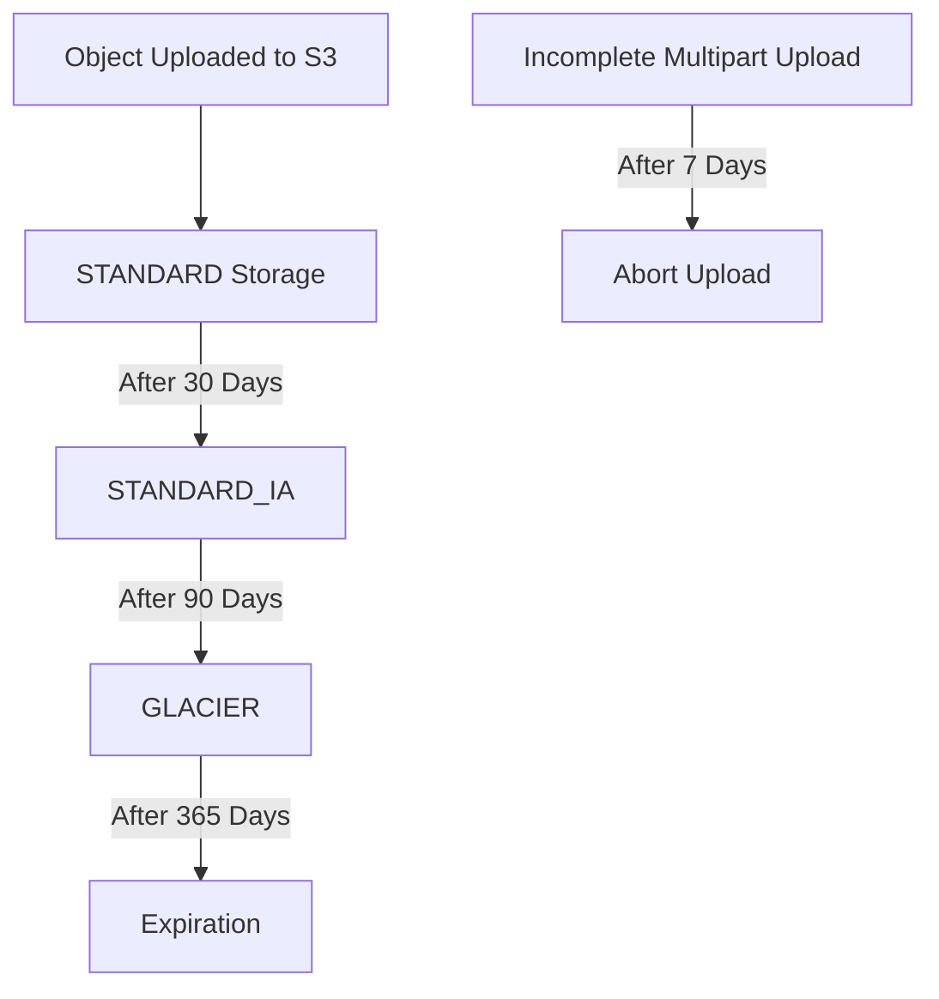
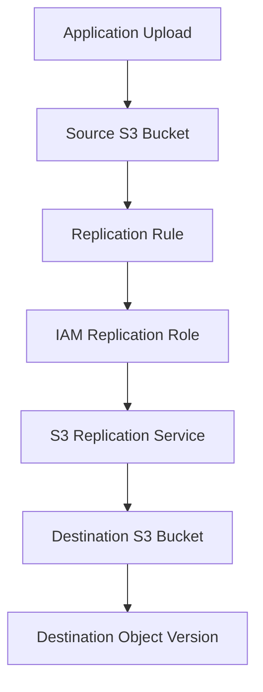
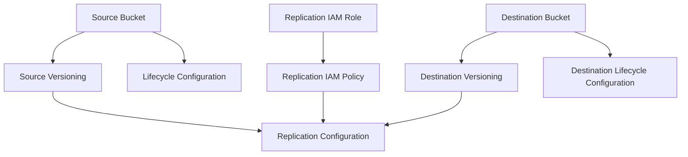

# 07- Lifecycle and Replication Deployment

## Overview

Amazon S3 lifecycle management and replication are two important capabilities for controlling storage costs, managing object retention, improving data availability, and supporting disaster recovery.

Terraform provides dedicated resources to configure these capabilities declaratively.

This document covers:

- S3 lifecycle configuration using Terraform.
- Storage-class transitions and object expiration.
- Version-aware lifecycle rules.
- Incomplete multipart upload cleanup.
- Same-Region Replication (SRR).
- Cross-Region Replication (CRR).
- Replication IAM roles and permissions.
- KMS-encrypted object replication.
- Replication metrics and operational verification.
- Deployment dependencies, failure handling, and safe teardown.

Lifecycle policies and replication rules should be designed around data retention requirements, recovery objectives, workload behavior, and cost constraints.

## S3 Lifecycle Configuration

S3 Lifecycle automatically transitions or expires objects based on configured rules.

A lifecycle rule can target:

- All objects in a bucket.
- Objects under a specific prefix.
- Objects with specific object tags.
- Objects matching combinations of supported filters.

Terraform manages lifecycle configuration through `aws_s3_bucket_lifecycle_configuration`.

### Lifecycle Actions

| Action | Purpose |
|---|---|
| `transition` | Moves current objects to another storage class |
| `expiration` | Expires current objects |
| `noncurrent_version_transition` | Transitions noncurrent object versions |
| `noncurrent_version_expiration` | Expires noncurrent object versions |
| `abort_incomplete_multipart_upload` | Removes incomplete multipart uploads |

Lifecycle processing is asynchronous. Applying a Terraform configuration does not mean every matching object is transitioned or deleted immediately.

### Typical Lifecycle Architecture



This is an illustrative policy. Actual transitions and expiration behavior depend on the configured lifecycle rules and object eligibility.

## Terraform Lifecycle Resource

The Terraform resource for managing lifecycle rules is:

```hcl
resource "aws_s3_bucket_lifecycle_configuration" "application" {
  bucket = aws_s3_bucket.application.id

  rule {
    id     = "application-object-lifecycle"
    status = "Enabled"

    filter {
      prefix = "application/"
    }

    transition {
      days          = 30
      storage_class = "STANDARD_IA"
    }

    expiration {
      days = 365
    }
  }
}
```

Important configuration fields:

| Field | Purpose |
|---|---|
| `bucket` | Bucket receiving the lifecycle configuration |
| `rule.id` | Unique identifier for the rule within the configuration |
| `rule.status` | Enables or disables the rule |
| `filter` | Defines which objects are eligible |
| `transition` | Defines storage-class transition behavior |
| `expiration` | Defines current-object expiration |

A lifecycle configuration is a bucket-level configuration containing multiple rules. Maintain one authoritative Terraform lifecycle resource per bucket to avoid configuration conflicts.

## Storage-Class Transitions

Storage classes provide different cost, availability, retrieval, and minimum-storage-duration characteristics.

Lifecycle transitions can move objects to lower-cost storage classes as their access frequency decreases.

### Common Storage Classes

| Storage class | Typical workload |
|---|---|
| STANDARD | Frequently accessed objects |
| STANDARD_IA | Infrequently accessed data requiring millisecond retrieval |
| ONEZONE_IA | Infrequently accessed, reproducible data stored in one Availability Zone |
| INTELLIGENT_TIERING | Data with changing or unpredictable access patterns |
| GLACIER_IR | Archive data requiring millisecond retrieval |
| GLACIER | Archive data with flexible retrieval times |
| DEEP_ARCHIVE | Long-term archival with infrequent retrieval |

Choose storage classes based on actual access patterns and recovery requirements, not storage price alone.

### Example: Transition to STANDARD_IA

```hcl
resource "aws_s3_bucket_lifecycle_configuration" "application" {
  bucket = aws_s3_bucket.application.id

  rule {
    id     = "transition-to-infrequent-access"
    status = "Enabled"

    filter {
      prefix = "documents/"
    }

    transition {
      days          = 30
      storage_class = "STANDARD_IA"
    }
  }
}
```

This rule targets objects under `documents/` and makes them eligible for transition after the configured age.

### Example: Multiple Transitions

```hcl
resource "aws_s3_bucket_lifecycle_configuration" "archive" {
  bucket = aws_s3_bucket.application.id

  rule {
    id     = "document-archive"
    status = "Enabled"

    filter {
      prefix = "archive/"
    }

    transition {
      days          = 30
      storage_class = "STANDARD_IA"
    }

    transition {
      days          = 90
      storage_class = "GLACIER"
    }

    expiration {
      days = 730
    }
  }
}
```

The transition schedule should be checked against applicable storage-class transition restrictions and minimum object-size behavior.

For example, archive classes can introduce retrieval costs and delays. STANDARD_IA and other classes can impose minimum storage-duration charges.

## Object Expiration

Expiration removes objects according to their age and lifecycle eligibility.

For an unversioned bucket, expiration removes the object.

For a versioned bucket, expiration of the current version generally creates a delete marker. The previous object version remains stored as a noncurrent version.

### Example

```hcl
resource "aws_s3_bucket_lifecycle_configuration" "temporary_files" {
  bucket = aws_s3_bucket.application.id

  rule {
    id     = "temporary-file-cleanup"
    status = "Enabled"

    filter {
      prefix = "temporary/"
    }

    expiration {
      days = 30
    }
  }
}
```

Use expiration carefully for:

- Temporary exports.
- Generated reports.
- Short-lived application artifacts.
- Intermediate processing files.
- Data governed by explicit retention policies.

Do not use expiration as a substitute for a verified backup or data-recovery strategy.

## Version-Aware Lifecycle Rules

Versioned buckets require separate lifecycle management for current and noncurrent versions.

A normal expiration rule does not necessarily remove historical versions.

### Noncurrent Version Expiration

```hcl
resource "aws_s3_bucket_lifecycle_configuration" "versioned" {
  bucket = aws_s3_bucket.application.id

  rule {
    id     = "noncurrent-version-cleanup"
    status = "Enabled"

    filter {
      prefix = "documents/"
    }

    noncurrent_version_expiration {
      noncurrent_days = 90
    }
  }
}
```

This rule makes noncurrent versions eligible for expiration after the specified period.

### Noncurrent Version Transition

```hcl
resource "aws_s3_bucket_lifecycle_configuration" "versioned_archive" {
  bucket = aws_s3_bucket.application.id

  rule {
    id     = "archive-noncurrent-versions"
    status = "Enabled"

    filter {
      prefix = "documents/"
    }

    noncurrent_version_transition {
      noncurrent_days = 30
      storage_class   = "STANDARD_IA"
    }

    noncurrent_version_expiration {
      noncurrent_days = 180
    }
  }
}
```

For more advanced retention requirements, consider:

- Number of newer noncurrent versions to retain.
- Noncurrent version age.
- Object tags.
- Legal holds and retention requirements.
- Delete-marker cleanup.

Lifecycle expiration must be designed with application recovery and compliance requirements in mind.

## Incomplete Multipart Upload Cleanup

Multipart uploads can leave incomplete parts in S3 when an upload fails or is abandoned.

These incomplete parts can continue to incur storage charges.

Terraform can configure automatic cleanup:

```hcl
resource "aws_s3_bucket_lifecycle_configuration" "multipart_cleanup" {
  bucket = aws_s3_bucket.application.id

  rule {
    id     = "abort-incomplete-uploads"
    status = "Enabled"

    filter {
      prefix = ""
    }

    abort_incomplete_multipart_upload {
      days_after_initiation = 7
    }
  }
}
```

This rule aborts incomplete multipart uploads after the configured number of days.

It does not delete completed objects.

## Combining Lifecycle Rules

A production bucket often needs multiple lifecycle behaviors.

The following example combines current-object transition, expiration, noncurrent-version cleanup, and incomplete multipart upload cleanup.

```hcl
resource "aws_s3_bucket_lifecycle_configuration" "application" {
  bucket = aws_s3_bucket.application.id

  rule {
    id     = "document-retention"
    status = "Enabled"

    filter {
      prefix = "documents/"
    }

    transition {
      days          = 30
      storage_class = "STANDARD_IA"
    }

    expiration {
      days = 365
    }

    noncurrent_version_expiration {
      noncurrent_days = 90
    }
  }

  rule {
    id     = "temporary-data-cleanup"
    status = "Enabled"

    filter {
      prefix = "temporary/"
    }

    expiration {
      days = 30
    }
  }

  rule {
    id     = "multipart-cleanup"
    status = "Enabled"

    filter {
      prefix = ""
    }

    abort_incomplete_multipart_upload {
      days_after_initiation = 7
    }
  }
}
```

The example assumes the bucket has versioning enabled where noncurrent-version behavior is required.

Before deployment, verify that all lifecycle actions and transitions are compatible with the bucket's versioning configuration and the selected storage classes.

## Lifecycle Deployment Considerations

### Lifecycle Rules Are Asynchronous

Terraform configures the lifecycle policy. S3 performs lifecycle processing asynchronously.

Do not use the Terraform apply result as proof that objects have transitioned or expired.

### Object Age and Eligibility

Lifecycle actions use S3 object age and rule eligibility. They do not guarantee execution at an exact wall-clock time.

### Minimum Storage Duration

Some storage classes impose minimum storage-duration charges. Transitioning or expiring an object before the minimum duration can still result in charges.

### Small Object Considerations

Storage-class transition eligibility and default minimum-object-size behavior can affect small objects. Evaluate the applicable S3 lifecycle configuration behavior before assuming every object will transition.

### Versioning Interaction

In versioned buckets:

- Current-version expiration can create a delete marker.
- Noncurrent versions require their own lifecycle management.
- Delete markers can remain after object expiration.
- Version cleanup must be designed separately from current-object retention.

## S3 Replication

S3 Replication automatically copies eligible objects from a source bucket to a destination bucket.

It is commonly used for:

- Disaster recovery.
- Cross-Region data availability.
- Centralized data collection.
- Compliance and retention architectures.
- Data distribution across AWS accounts.

S3 replication requires versioning to be enabled on both source and destination buckets.

### Replication Types

| Replication type | Description | Typical use |
|---|---|---|
| Same-Region Replication (SRR) | Replicates objects to another bucket in the same Region | Separate workloads, accounts, or retention boundaries |
| Cross-Region Replication (CRR) | Replicates objects to a bucket in another Region | Regional disaster recovery and geographic distribution |

### Replication Architecture



The replication role authorizes S3 to read eligible source objects and replicate them to the destination.

## Replication Prerequisites

Before configuring replication:

- Enable versioning on the source bucket.
- Enable versioning on the destination bucket.
- Create an IAM role trusted by S3.
- Grant the role the required source and destination permissions.
- Configure compatible encryption behavior.
- Verify destination bucket ownership and access requirements.
- Ensure the source and destination configuration supports the selected replication scenario.

Replication configuration should be deployed only after these dependencies are ready.

## Enable Versioning on Both Buckets

```hcl
resource "aws_s3_bucket_versioning" "source" {
  bucket = aws_s3_bucket.source.id

  versioning_configuration {
    status = "Enabled"
  }
}

resource "aws_s3_bucket_versioning" "destination" {
  bucket = aws_s3_bucket.destination.id

  versioning_configuration {
    status = "Enabled"
  }
}
```

Versioning is a prerequisite for S3 replication.

Do not suspend versioning on either bucket while replication is expected to operate normally.

## Create the Replication IAM Role

S3 assumes an IAM role to perform replication operations.

### Trust Policy

```hcl
data "aws_iam_policy_document" "replication_assume_role" {
  statement {
    effect = "Allow"

    principals {
      type        = "Service"
      identifiers = ["s3.amazonaws.com"]
    }

    actions = [
      "sts:AssumeRole"
    ]
  }
}

resource "aws_iam_role" "replication" {
  name               = "s3-replication-role"
  assume_role_policy = data.aws_iam_policy_document.replication_assume_role.json
}
```

### Replication Permissions

The role needs permissions to inspect and read eligible source object versions and replicate them to the destination.

```hcl
data "aws_iam_policy_document" "replication" {
  statement {
    sid    = "ReadSourceBucketConfiguration"
    effect = "Allow"

    actions = [
      "s3:GetReplicationConfiguration",
      "s3:ListBucket"
    ]

    resources = [
      aws_s3_bucket.source.arn
    ]
  }

  statement {
    sid    = "ReadSourceObjectVersions"
    effect = "Allow"

    actions = [
      "s3:GetObjectVersionForReplication",
      "s3:GetObjectVersionAcl",
      "s3:GetObjectVersionTagging"
    ]

    resources = [
      "${aws_s3_bucket.source.arn}/*"
    ]
  }

  statement {
    sid    = "ReplicateToDestination"
    effect = "Allow"

    actions = [
      "s3:ReplicateObject",
      "s3:ReplicateDelete",
      "s3:ReplicateTags"
    ]

    resources = [
      "${aws_s3_bucket.destination.arn}/*"
    ]
  }
}

resource "aws_iam_policy" "replication" {
  name   = "s3-replication-policy"
  policy = data.aws_iam_policy_document.replication.json
}

resource "aws_iam_role_policy_attachment" "replication" {
  role       = aws_iam_role.replication.name
  policy_arn = aws_iam_policy.replication.arn
}
```

The exact permission set depends on the replication features enabled and the bucket configuration.

Cross-account replication can require additional destination-side permissions and ownership configuration.

## Same-Region Replication with Terraform

Same-Region Replication copies objects between buckets in the same AWS Region.

A common design uses separate buckets for production data and analytics or compliance workloads.

### Replication Configuration

```hcl
resource "aws_s3_bucket_replication_configuration" "source" {
  bucket = aws_s3_bucket.source.id
  role   = aws_iam_role.replication.arn

  rule {
    id     = "srr-all-objects"
    status = "Enabled"

    filter {}

    delete_marker_replication {
      status = "Disabled"
    }

    destination {
      bucket = aws_s3_bucket.destination.arn
    }
  }

  depends_on = [
    aws_s3_bucket_versioning.source,
    aws_s3_bucket_versioning.destination,
    aws_iam_role_policy_attachment.replication
  ]
}
```

This rule enables replication for objects matching the empty filter, effectively targeting the entire bucket.

Delete-marker replication is explicitly disabled in this example. Configure it according to the required deletion and recovery behavior.

### SRR Use Cases

- Separating application and analytics storage.
- Replicating data into another account.
- Maintaining a secondary copy for operational isolation.
- Centralizing data from multiple application buckets.

SRR does not provide independent regional disaster recovery because both buckets are in the same Region.

## Cross-Region Replication with Terraform

CRR copies eligible objects into a destination bucket in another AWS Region.

For example:

- Source: `ap-south-1`
- Destination: `ap-southeast-1`

The destination bucket must be provisioned in the target Region.

### Provider Configuration

Use an aliased provider for the destination Region.

```hcl
provider "aws" {
  region = var.source_region
}

provider "aws" {
  alias  = "destination"
  region = var.destination_region
}
```

### Source and Destination Buckets

```hcl
resource "aws_s3_bucket" "source" {
  bucket = var.source_bucket_name
}

resource "aws_s3_bucket" "destination" {
  provider = aws.destination
  bucket   = var.destination_bucket_name
}
```

### Enable Versioning

```hcl
resource "aws_s3_bucket_versioning" "source" {
  bucket = aws_s3_bucket.source.id

  versioning_configuration {
    status = "Enabled"
  }
}

resource "aws_s3_bucket_versioning" "destination" {
  provider = aws.destination
  bucket   = aws_s3_bucket.destination.id

  versioning_configuration {
    status = "Enabled"
  }
}
```

### CRR Replication Configuration

```hcl
resource "aws_s3_bucket_replication_configuration" "source" {
  bucket = aws_s3_bucket.source.id
  role   = aws_iam_role.replication.arn

  rule {
    id     = "cross-region-replication"
    status = "Enabled"

    filter {}

    delete_marker_replication {
      status = "Disabled"
    }

    destination {
      bucket = aws_s3_bucket.destination.arn

      storage_class = "STANDARD_IA"
    }
  }

  depends_on = [
    aws_s3_bucket_versioning.source,
    aws_s3_bucket_versioning.destination,
    aws_iam_role_policy_attachment.replication
  ]
}
```

The destination storage class can be selected independently of the source storage class, subject to supported replication behavior.

Review retrieval costs and minimum storage-duration charges before selecting an archival destination class.

## Replication with SSE-KMS Encryption

Replicating SSE-KMS-encrypted objects requires additional configuration and permissions.

The replication role must be authorized to decrypt source objects and use the destination KMS key for encryption.

### Additional IAM Permissions

A conceptual policy extension is:

```hcl
data "aws_iam_policy_document" "replication_kms" {
  statement {
    sid    = "DecryptSourceObjects"
    effect = "Allow"

    actions = [
      "kms:Decrypt"
    ]

    resources = [
      aws_kms_key.source.arn
    ]
  }

  statement {
    sid    = "EncryptDestinationObjects"
    effect = "Allow"

    actions = [
      "kms:Encrypt",
      "kms:GenerateDataKey"
    ]

    resources = [
      aws_kms_key.destination.arn
    ]
  }
}
```

The source and destination KMS key policies must also authorize the replication role.

### Destination Encryption Configuration

```hcl
resource "aws_s3_bucket_server_side_encryption_configuration" "destination" {
  provider = aws.destination
  bucket   = aws_s3_bucket.destination.id

  rule {
    apply_server_side_encryption_by_default {
      sse_algorithm     = "aws:kms"
      kms_master_key_id = aws_kms_key.destination.arn
    }

    bucket_key_enabled = true
  }
}
```

### Replication Encryption Configuration

The replication destination must explicitly identify the destination KMS key when replicating eligible SSE-KMS objects.

```hcl
resource "aws_s3_bucket_replication_configuration" "source" {
  bucket = aws_s3_bucket.source.id
  role   = aws_iam_role.replication.arn

  rule {
    id     = "encrypted-object-replication"
    status = "Enabled"

    filter {}

    source_selection_criteria {
      sse_kms_encrypted_objects {
        status = "Enabled"
      }
    }

    destination {
      bucket = aws_s3_bucket.destination.arn

      encryption_configuration {
        replica_kms_key_id = aws_kms_key.destination.arn
      }
    }
  }

  depends_on = [
    aws_s3_bucket_versioning.source,
    aws_s3_bucket_versioning.destination,
    aws_iam_role_policy_attachment.replication
  ]
}
```

The example demonstrates the encryption-related configuration. It must be integrated with the complete replication role, source and destination key policies, bucket resources, and provider configuration.

Do not assume that enabling SSE-KMS on the destination bucket automatically makes every encrypted source object eligible for replication.

## Replication Filters

Replication rules can target selected objects using prefixes and tags.

For example, replicate only objects under `critical/`.

```hcl
rule {
  id     = "replicate-critical-data"
  status = "Enabled"

  filter {
    prefix = "critical/"
  }

  destination {
    bucket = aws_s3_bucket.destination.arn
  }
}
```

A tag-based filter can target objects marked for replication.

```hcl
rule {
  id     = "replicate-compliance-data"
  status = "Enabled"

  filter {
    tag {
      key   = "replication"
      value = "enabled"
    }
  }

  destination {
    bucket = aws_s3_bucket.destination.arn
  }
}
```

Filters are useful when a bucket contains multiple data categories with different replication requirements.

When combining multiple filters, use the provider's supported filter structure and verify the generated replication configuration.

## Existing Objects and Batch Replication

A standard live replication rule applies to eligible new objects and subsequent changes. It does not automatically replicate every object that existed before the rule was configured.

For existing objects, consider S3 Batch Replication.

Batch Replication is useful when:

- Enabling replication for a bucket that already contains data.
- Reprocessing objects that previously failed replication.
- Replicating a selected historical dataset.
- Backfilling a destination bucket.

Treat initial replication and ongoing replication as separate operational activities.

## Replication Metrics and Replication Time Control

S3 Replication Time Control (RTC) is an optional feature designed for workloads requiring predictable replication timing.

Replication metrics provide visibility into replication progress and failures.

These features are useful when replication is part of a formal recovery or compliance requirement.

### Terraform Metrics Configuration

```hcl
resource "aws_s3_bucket_replication_configuration" "source" {
  bucket = aws_s3_bucket.source.id
  role   = aws_iam_role.replication.arn

  rule {
    id     = "monitored-replication"
    status = "Enabled"

    filter {}

    destination {
      bucket = aws_s3_bucket.destination.arn

      metrics {
        status = "Enabled"

        event_threshold {
          minutes = 15
        }
      }

      replication_time {
        status = "Enabled"

        time {
          minutes = 15
        }
      }
    }
  }

  depends_on = [
    aws_s3_bucket_versioning.source,
    aws_s3_bucket_versioning.destination,
    aws_iam_role_policy_attachment.replication
  ]
}
```

Replication Time Control has additional requirements and charges. Confirm current feature availability, supported configurations, and pricing before enabling it.

Do not treat the configured threshold as a guarantee that all objects will be replicated within that period under every condition.

## Replication Status Verification

S3 exposes replication status for objects.

Common statuses include:

| Status | Meaning |
|---|---|
| `PENDING` | Replication is not yet complete |
| `COMPLETED` | Replication completed successfully |
| `FAILED` | Replication failed |
| `REPLICA` | Object is a replica |

### Inspect Source Object Replication Status

```bash
aws s3api head-object \
  --bucket source-bucket \
  --key documents/report.pdf
```

Inspect the `ReplicationStatus` field where returned.

### Inspect Destination Object

```bash
aws s3api head-object \
  --bucket destination-bucket \
  --key documents/report.pdf
```

For a replicated object, the destination object can report `REPLICA`.

### Inspect Replication Configuration

```bash
aws s3api get-bucket-replication \
  --bucket source-bucket
```

### Inspect Versioning

```bash
aws s3api get-bucket-versioning \
  --bucket source-bucket

aws s3api get-bucket-versioning \
  --bucket destination-bucket
```

Use these commands as part of deployment verification and operational diagnosis.

## Replication Failure Scenarios

| Failure | Likely cause | Investigation |
|---|---|---|
| No objects replicate | Versioning disabled | Inspect versioning on both buckets |
| Replication role cannot be assumed | Incorrect trust policy | Inspect role trust relationship |
| Replication fails with access denied | Missing S3 permissions | Inspect replication IAM policy and bucket policies |
| Encrypted objects do not replicate | Missing KMS permissions or encryption configuration | Inspect key policies, grants, and replication settings |
| Destination objects are missing | Rule filter excludes objects | Inspect replication rule filters |
| Existing objects are not replicated | Standard replication does not backfill historical objects | Evaluate Batch Replication |
| Delete behavior differs | Delete-marker replication configuration | Inspect delete-marker settings |
| Replication is delayed | Processing backlog or service conditions | Inspect replication metrics and object status |

A successful Terraform apply confirms that the configuration was accepted. It does not prove that replication is functioning end to end.

## Lifecycle and Replication Interaction

Lifecycle rules and replication rules operate independently but can affect the same objects.

A production design must account for:

- Source lifecycle expiration.
- Destination lifecycle expiration.
- Noncurrent version retention.
- Replication timing.
- Delete-marker behavior.
- Storage-class transitions.
- Recovery requirements.

For example, if the source bucket expires an object before replication completes, the resulting recovery expectations may not match the intended design.

Likewise, a destination lifecycle policy that expires replicas too early can undermine disaster recovery.

Design source and destination retention policies together.

## Terraform Deployment Workflow

### Validate the Configuration

```bash
terraform fmt -recursive
terraform init
terraform validate
```

### Review the Plan

```bash
terraform plan -out=tfplan
```

Review:

- Bucket Region and provider assignment.
- Versioning configuration.
- Lifecycle filters and transition schedules.
- Noncurrent version retention.
- Replication role trust policy.
- Source and destination permissions.
- KMS key policies.
- Replication filters.
- Delete-marker behavior.
- Destination storage class.
- Replication metrics and RTC settings.
- Resource replacement or destruction.

### Apply the Configuration

```bash
terraform apply tfplan
```

For production, deploy source and destination infrastructure through controlled environment-specific pipelines.

## Resource Dependency Management

Lifecycle and replication configurations depend on the S3 buckets they manage.

Replication also depends on versioning and IAM permissions.



Terraform references should express most dependencies naturally.

Use `depends_on` when a dependency is operationally required but not represented through a direct resource attribute reference.

## Safe Teardown and Resource Protection

Lifecycle and replication configurations can have destructive consequences if removed or changed incorrectly.

Before destroying infrastructure:

1. Identify source and destination buckets.
2. Inspect replication rules.
3. Review lifecycle expiration settings.
4. Check whether destination objects are required for recovery.
5. Confirm retention and backup requirements.
6. Review Terraform plans for destructive changes.
7. Preserve required object versions before deleting buckets.

Important considerations:

- Removing a replication rule stops future replication through that rule.
- Removing lifecycle rules stops future processing under those rules but does not restore already expired data.
- Destination replicas are separate stored objects and have their own lifecycle behavior.
- Versioned buckets can contain many object versions and delete markers.
- Terraform `prevent_destroy` protects resources only while the lifecycle rule remains in the configuration.
- Bucket deletion may require deleting all object versions and delete markers first.

Do not combine routine infrastructure deployment with irreversible data cleanup.

## Production Best Practices

### Lifecycle

- Define retention requirements before creating expiration rules.
- Separate temporary, operational, and archival prefixes.
- Use version-aware lifecycle rules for versioned buckets.
- Clean up incomplete multipart uploads.
- Evaluate storage-class retrieval costs and minimum storage-duration charges.
- Monitor lifecycle configuration changes.
- Test policies against representative object prefixes and tags.
- Coordinate lifecycle rules with backup and recovery requirements.

### Replication

- Enable versioning on both buckets.
- Use a dedicated replication IAM role.
- Grant only the required source and destination permissions.
- Configure KMS permissions explicitly for encrypted objects.
- Separate source and destination retention policies.
- Monitor replication status and failures.
- Use Batch Replication for eligible historical objects.
- Evaluate RTC for workloads with strict replication-time requirements.
- Test recovery procedures rather than assuming replication alone provides disaster recovery.

### Terraform

- Keep lifecycle configuration in one authoritative resource per bucket.
- Keep replication configuration in one authoritative resource per source bucket.
- Use provider aliases for multi-Region infrastructure.
- Review plans for changes to destructive lifecycle actions.
- Protect critical buckets and keys from accidental destruction.
- Use separate state and configuration for independent environments.
- Avoid unreviewed manual changes to lifecycle and replication settings.

## Key Takeaways

- Terraform manages S3 lifecycle behavior through `aws_s3_bucket_lifecycle_configuration`.
- Versioned buckets require explicit noncurrent-version retention and cleanup policies.
- S3 replication requires versioning on both source and destination buckets.
- Replication requires a dedicated IAM role and additional KMS permissions when encrypted objects are involved.
- Lifecycle and replication must be designed together around retention, cost, and recovery requirements.