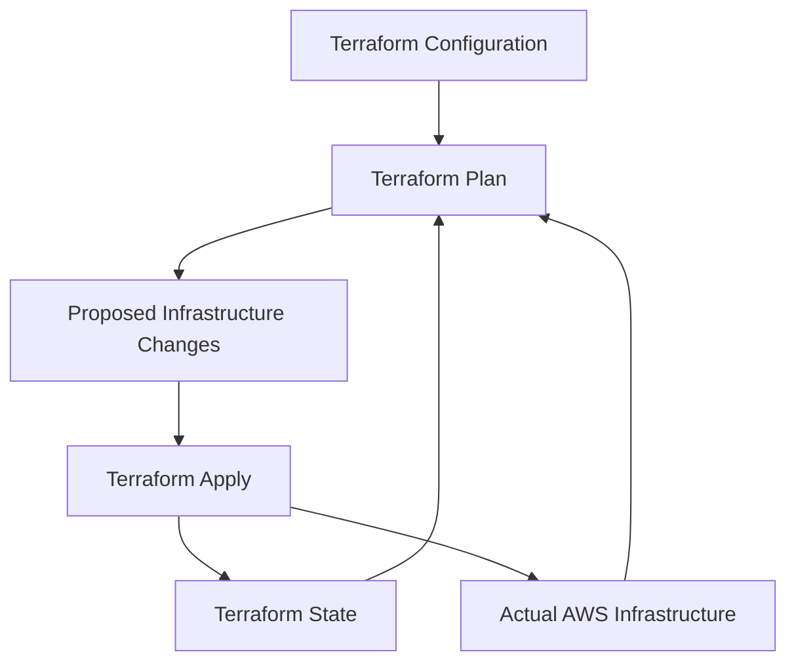
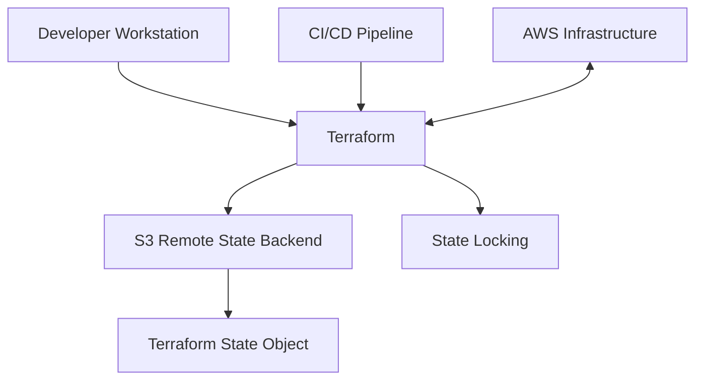
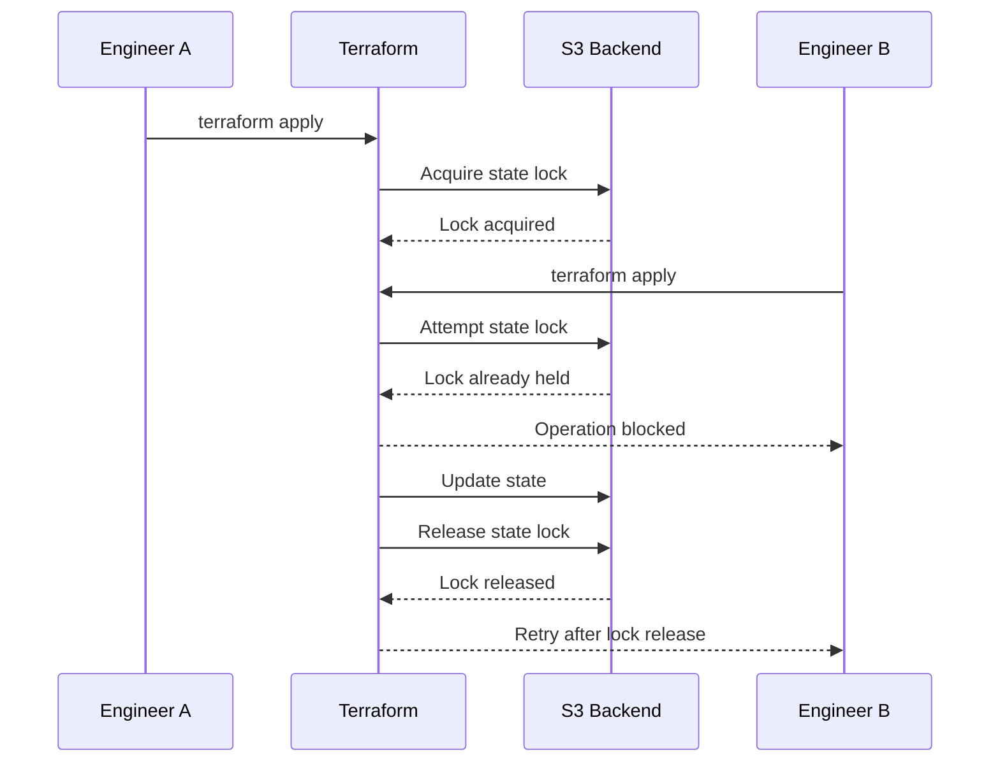

# 08- Remote State and State Locking

## Overview

Terraform state is the source of truth Terraform uses to map configuration resources to real infrastructure. It records resource identifiers, attributes, dependencies, and metadata required to calculate and apply infrastructure changes.

For Amazon S3 infrastructure, state can contain references to:

- S3 buckets and objects.
- Versioning, encryption, and lifecycle configurations.
- Bucket policies and public-access controls.
- IAM roles and policies.
- KMS keys.
- Replication configurations.
- CloudWatch and other supporting resources.

A local Terraform state file is sufficient for isolated development, but it becomes risky when multiple engineers or CI/CD pipelines manage the same infrastructure.

A production Terraform deployment should use remote state with controlled access, encryption, versioning, and state locking.

This document covers Terraform remote state using Amazon S3, state locking, backend configuration, environment isolation, migration, recovery, and operational practices.

## Understanding Terraform State

Terraform maintains a state file, typically named:

```text
terraform.tfstate
```

The state file maps Terraform resource addresses to real infrastructure objects.

For example:

```hcl
resource "aws_s3_bucket" "application" {
  bucket = "company-application-storage"
}
```

Terraform records information about the bucket in its state.

A simplified state representation looks like:

```json
{
  "version": 4,
  "terraform_version": "1.x",
  "resources": [
    {
      "mode": "managed",
      "type": "aws_s3_bucket",
      "name": "application",
      "instances": [
        {
          "attributes": {
            "id": "company-application-storage",
            "arn": "arn:aws:s3:::company-application-storage"
          }
        }
      ]
    }
  ]
}
```

This is illustrative rather than a complete Terraform state schema.

### Why State Is Required

Terraform uses state to:

- Track resources created through Terraform.
- Associate configuration blocks with real AWS resources.
- Detect infrastructure changes.
- Calculate execution plans.
- Track resource dependencies.
- Store resource attributes needed by other resources.
- Determine which resources need creation, update, replacement, or deletion.

Without a usable state file, Terraform cannot reliably manage previously created resources.

### State and Infrastructure Relationship



Terraform compares configuration, state, and refreshed infrastructure information to determine the required changes.

## Local State vs Remote State

### Local State

By default, Terraform stores state in the working directory.

```text
terraform-project/
├── main.tf
├── variables.tf
├── outputs.tf
├── terraform.tfstate
└── terraform.tfstate.backup
```

Advantages:

- Simple initial setup.
- No remote backend infrastructure required.
- Useful for isolated experiments.

Limitations:

- Difficult to share safely across a team.
- Concurrent deployments can conflict.
- State can be lost with a workstation or CI runner.
- Local files can accidentally be committed to Git.
- Access control and centralized auditing are harder to enforce.

Local state should not be used as the shared source of truth for production infrastructure.

### Remote State

A remote backend stores Terraform state in a shared storage system.

For AWS environments, Amazon S3 is commonly used.



Advantages:

- Shared state across authorized engineers and pipelines.
- Centralized storage.
- Easier access governance.
- Versioned state recovery when bucket versioning is enabled.
- Support for controlled concurrent execution.
- Integration with CI/CD workflows.

Remote state does not automatically make deployments safe. Access permissions, locking, backup, and operational controls are still required.

## Amazon S3 as a Terraform Backend

Terraform's S3 backend stores state in an S3 bucket.

The backend is configured in the Terraform root module.

### Backend Configuration

```hcl
terraform {
  backend "s3" {
    bucket       = "company-terraform-state"
    key          = "s3/dev/terraform.tfstate"
    region       = "ap-south-1"
    encrypt      = true
    use_lockfile = true
  }
}
```

Important arguments:

| Argument | Purpose |
|---|---|
| `bucket` | S3 bucket storing the state |
| `key` | Object key used for the state file |
| `region` | AWS Region containing the backend bucket |
| `encrypt` | Enables server-side encryption for the state object |
| `use_lockfile` | Enables S3-native state locking |

The S3 bucket must exist before Terraform initializes this backend. Backend configuration cannot depend on resources managed by the same Terraform configuration.

### Backend Bucket Design

Use a dedicated S3 bucket for Terraform state rather than storing state inside an application-data bucket.

Example:

```text
company-terraform-state/
├── s3/
│   ├── dev/
│   │   └── terraform.tfstate
│   ├── staging/
│   │   └── terraform.tfstate
│   └── prod/
│       └── terraform.tfstate
├── networking/
│   ├── dev/
│   └── prod/
└── iam/
    ├── dev/
    └── prod/
```

This structure provides logical separation through object keys.

For stronger isolation, use separate backend buckets or AWS accounts for critical environments.

## Provisioning the State Bucket

The backend bucket should be provisioned independently from the infrastructure whose state it stores.

A bootstrap Terraform configuration can create it.

### State Bucket

```hcl
resource "aws_s3_bucket" "terraform_state" {
  bucket = var.state_bucket_name

  lifecycle {
    prevent_destroy = true
  }

  tags = {
    Name      = var.state_bucket_name
    Purpose   = "Terraform remote state"
    ManagedBy = "Terraform"
  }
}
```

### Enable Versioning

```hcl
resource "aws_s3_bucket_versioning" "terraform_state" {
  bucket = aws_s3_bucket.terraform_state.id

  versioning_configuration {
    status = "Enabled"
  }
}
```

Versioning provides recoverable historical versions of the state object.

This is particularly useful when an incorrect deployment or state operation modifies the current state.

### Enable Encryption

```hcl
resource "aws_s3_bucket_server_side_encryption_configuration" "terraform_state" {
  bucket = aws_s3_bucket.terraform_state.id

  rule {
    apply_server_side_encryption_by_default {
      sse_algorithm = "AES256"
    }
  }
}
```

SSE-S3 provides server-side encryption for stored state objects.

SSE-KMS can be used when the organization requires customer-managed keys and additional key-access governance. Ensure that the Terraform execution identity has the necessary KMS permissions.

### Enable Block Public Access

```hcl
resource "aws_s3_bucket_public_access_block" "terraform_state" {
  bucket = aws_s3_bucket.terraform_state.id

  block_public_acls       = true
  ignore_public_acls      = true
  block_public_policy     = true
  restrict_public_buckets = true
}
```

Terraform state must never be publicly accessible.

### Enable Object Ownership Controls

```hcl
resource "aws_s3_bucket_ownership_controls" "terraform_state" {
  bucket = aws_s3_bucket.terraform_state.id

  rule {
    object_ownership = "BucketOwnerEnforced"
  }
}
```

This disables ACLs and simplifies ownership management.

## State Locking

State locking prevents multiple Terraform operations from modifying the same state simultaneously.

Consider two engineers applying changes to the same S3 infrastructure.

Without locking:

1. Engineer A reads the current state.
2. Engineer B reads the same state.
3. Engineer A applies changes.
4. Engineer B applies changes using an outdated state snapshot.
5. Concurrent state updates can conflict or produce unsafe results.

Locking serializes operations that require exclusive access to the state.

### Locking Workflow



State locking reduces the risk of concurrent state modifications.

It does not prevent all possible infrastructure conflicts, and it does not coordinate unrelated Terraform states that manage overlapping resources.

## S3-Native State Locking

Modern Terraform S3 backend configurations support native state locking using an S3 lock file.

Enable it with:

```hcl
terraform {
  backend "s3" {
    bucket       = "company-terraform-state"
    key          = "s3/dev/terraform.tfstate"
    region       = "ap-south-1"
    encrypt      = true
    use_lockfile = true
  }
}
```

Terraform uses a lock object associated with the state key.

For the state key:

```text
s3/dev/terraform.tfstate
```

The lock object uses:

```text
s3/dev/terraform.tfstate.tflock
```

The backend uses S3 conditional writes to coordinate lock acquisition.

### Locking Permissions

The Terraform execution identity needs appropriate permissions to access the state object and lock object.

A typical permission scope includes:

| S3 action | Purpose |
|---|---|
| `s3:ListBucket` | List objects in the relevant state prefix when required |
| `s3:GetObject` | Read the state |
| `s3:PutObject` | Write the state and acquire/update the lock |
| `s3:DeleteObject` | Delete the lock object when releasing the lock |

For the state object itself, avoid granting unnecessary deletion permissions.

Scope permissions to the required bucket and state-key prefixes.

### Example IAM Policy

```hcl
data "aws_iam_policy_document" "terraform_backend" {
  statement {
    sid    = "ListTerraformState"
    effect = "Allow"

    actions = [
      "s3:ListBucket"
    ]

    resources = [
      "arn:aws:s3:::company-terraform-state"
    ]

    condition {
      test     = "StringLike"
      variable = "s3:prefix"

      values = [
        "s3/dev/*"
      ]
    }
  }

  statement {
    sid    = "AccessTerraformState"
    effect = "Allow"

    actions = [
      "s3:GetObject",
      "s3:PutObject"
    ]

    resources = [
      "arn:aws:s3:::company-terraform-state/s3/dev/terraform.tfstate"
    ]
  }

  statement {
    sid    = "ManageTerraformLock"
    effect = "Allow"

    actions = [
      "s3:GetObject",
      "s3:PutObject",
      "s3:DeleteObject"
    ]

    resources = [
      "arn:aws:s3:::company-terraform-state/s3/dev/terraform.tfstate.tflock"
    ]
  }
}
```

This is an illustrative least-privilege policy for one state key. Adjust the prefix, resources, and permissions for the actual backend layout and Terraform operations.

When using SSE-KMS for the backend, add the necessary KMS permissions and key-policy authorization.

## DynamoDB Locking and Migration Considerations

Older Terraform S3 backend configurations commonly used DynamoDB tables for state locking.

Example of the legacy configuration:

```hcl
terraform {
  backend "s3" {
    bucket         = "company-terraform-state"
    key            = "s3/dev/terraform.tfstate"
    region         = "ap-south-1"
    dynamodb_table = "terraform-state-locks"
    encrypt        = true
  }
}
```

The S3 backend's DynamoDB locking mechanism is deprecated in favor of S3-native lock files in current Terraform documentation.

For new configurations, prefer:

```hcl
use_lockfile = true
```

When migrating an existing backend:

- Confirm the Terraform version supports S3 lock files.
- Coordinate the migration so no Terraform operation is running.
- Follow the supported backend migration procedure.
- Keep the existing state and lock mechanism available until migration is complete.
- Verify locking behavior before removing legacy infrastructure.

Do not independently delete a DynamoDB lock table while existing Terraform workflows still depend on it.

## Environment Separation

Each environment should have an independent state key.

Example:

```text
s3/dev/terraform.tfstate
s3/staging/terraform.tfstate
s3/prod/terraform.tfstate
```

### Backend Configuration per Environment

A common approach is to keep backend configuration in separate files.

`backend-dev.hcl`:

```hcl
bucket       = "company-terraform-state"
key          = "s3/dev/terraform.tfstate"
region       = "ap-south-1"
encrypt      = true
use_lockfile = true
```

`backend-prod.hcl`:

```hcl
bucket       = "company-terraform-state"
key          = "s3/prod/terraform.tfstate"
region       = "ap-south-1"
encrypt      = true
use_lockfile = true
```

Initialize the development backend:

```bash
terraform init -backend-config=backend-dev.hcl
```

Initialize the production backend:

```bash
terraform init -backend-config=backend-prod.hcl
```

The backend configuration files should not contain credentials.

Use the AWS credential chain, IAM roles, or short-lived credentials supplied by the CI/CD environment.

### Why Separate State?

| Concern | Benefit |
|---|---|
| Environment isolation | Development changes do not directly modify production state |
| Access control | Production state can have stricter IAM permissions |
| Deployment safety | Changes can be planned and applied independently |
| Recovery | State recovery can be performed per environment |
| Team ownership | Different teams can manage separate infrastructure domains |

Separate state files do not automatically isolate AWS resources. IAM permissions and infrastructure boundaries must also be designed appropriately.

## Terraform Backend Initialization

Terraform initializes the backend through `terraform init`.

For an S3 backend:

```bash
terraform init
```

Terraform:

1. Loads the backend configuration.
2. Authenticates using the AWS credential chain.
3. Connects to the configured S3 bucket.
4. Initializes the remote state backend.
5. Configures state locking when enabled.
6. Downloads existing state when available.

### Reconfigure Backend

When backend settings change:

```bash
terraform init -reconfigure
```

This tells Terraform to initialize using the new backend configuration without attempting to migrate the existing state automatically.

Use it only when the intended backend location is already correct or the state migration is being handled separately.

### Migrate Existing Local State

When moving an existing local state file to S3:

```bash
terraform init -migrate-state
```

Terraform prompts for confirmation when migrating state.

Before migration:

- Back up the local state file.
- Confirm the destination bucket exists.
- Confirm versioning and encryption are configured.
- Confirm backend permissions.
- Ensure no other Terraform operation is running.
- Verify the destination state after migration.

Do not manually copy a state file into the backend while Terraform is managing the same state.

## State Recovery and Versioning

S3 versioning provides a recovery mechanism for previous state-object versions.

If the current state becomes corrupted or an incorrect update is committed, an earlier version may be recoverable.

### Inspect State Object Versions

```bash
aws s3api list-object-versions \
  --bucket company-terraform-state \
  --prefix s3/prod/terraform.tfstate
```

Review the returned versions and identify the intended recovery point.

### Download a Previous Version

```bash
aws s3api get-object \
  --bucket company-terraform-state \
  --key s3/prod/terraform.tfstate \
  --version-id VERSION_ID \
  recovered-terraform.tfstate
```

This downloads a historical state version for inspection.

Do not immediately overwrite the active remote state.

### Recovery Procedure

1. Stop all Terraform deployments using the affected state.
2. Identify the latest known-good state version.
3. Download it to a secure working location.
4. Inspect the state and compare it with the current infrastructure.
5. Confirm that the recovered state corresponds to the actual AWS resources.
6. Preserve the current state version for investigation.
7. Follow a controlled state recovery procedure.
8. Run `terraform plan` and review the proposed changes before applying anything.

State recovery is not the same as infrastructure rollback. Restoring an older state file does not reverse changes already applied to AWS resources.

A state file must accurately describe the current infrastructure before Terraform is allowed to modify it.

## State Lock Troubleshooting

A state lock may remain when a Terraform process crashes or loses connectivity before releasing it.

Terraform may report that the state is already locked.

### Inspect the Lock Error

The error typically includes:

- Lock ID.
- Operation type.
- Locking identity.
- Lock creation time.
- Terraform version.
- State path.

Confirm whether another Terraform operation is still active before attempting recovery.

### Force Unlock

Terraform provides:

```bash
terraform force-unlock LOCK_ID
```

This should only be used when the lock is known to be stale and no operation is actively modifying the state.

A force unlock does not repair a corrupted state file. It only removes the lock.

### Safe Recovery Checklist

- [ ] Check active CI/CD pipeline runs.
- [ ] Check whether another engineer is applying changes.
- [ ] Verify that the lock belongs to an abandoned operation.
- [ ] Confirm the state object is accessible.
- [ ] Preserve state versions before recovery.
- [ ] Use the exact lock ID reported by Terraform.
- [ ] Run a fresh plan after unlocking.

Never delete a `.tflock` object manually as the first troubleshooting step. Use Terraform's locking and recovery mechanisms.

## Terraform State Security

Terraform state can contain sensitive information.

Depending on the provider and resources, state may include:

- Resource identifiers.
- Configuration attributes.
- Database credentials.
- Secret values.
- Connection information.
- Sensitive outputs.
- KMS and IAM resource metadata.

Marking a Terraform variable or output as `sensitive` controls how Terraform displays it in normal CLI output. It does not guarantee that the underlying value is absent from state.

### Security Controls

| Control | Purpose |
|---|---|
| S3 Block Public Access | Prevents unintended public access |
| Server-side encryption | Protects state objects at rest |
| S3 versioning | Supports recovery of previous state versions |
| IAM least privilege | Restricts access to authorized deployment identities |
| TLS | Protects data in transit |
| CloudTrail | Supports auditing of relevant AWS API activity |
| Separate production state | Limits access and deployment scope |

Use a dedicated state bucket with tightly controlled IAM access.

Avoid downloading production state to unmanaged workstations.

### CI/CD Authentication

CI/CD pipelines should use short-lived AWS credentials.

For GitHub Actions, use IAM OIDC federation rather than long-lived AWS access keys stored in workflow files.

The deployment role should have only the permissions needed to:

- Access the relevant state key.
- Acquire and release the state lock.
- Manage the intended infrastructure resources.
- Access required KMS keys when applicable.

Backend permissions and infrastructure-management permissions should be considered separately.

## Remote State Outputs and Cross-Stack Dependencies

Terraform can expose outputs from one configuration and consume them from another.

For example, a networking stack may expose a VPC ID, while an application stack consumes it.

For S3 infrastructure, a foundational stack might expose:

- Bucket name.
- Bucket ARN.
- KMS key ARN.
- IAM role ARN.
- Replication destination ARN.

A separate stack can consume these values using `terraform_remote_state`.

Example:

```hcl
data "terraform_remote_state" "storage" {
  backend = "s3"

  config = {
    bucket = "company-terraform-state"
    key    = "s3/dev/terraform.tfstate"
    region = "ap-south-1"
  }
}

locals {
  application_bucket_arn = data.terraform_remote_state.storage.outputs.bucket_arn
}
```

The source configuration must export the output:

```hcl
output "bucket_arn" {
  description = "Application S3 bucket ARN"
  value       = aws_s3_bucket.application.arn
}
```

### Important Security Consideration

Access to remote state can expose more than the specific output being consumed. The caller generally needs access to the underlying state object.

Treat remote state access as sensitive infrastructure access.

For cross-stack integrations, consider publishing only required values through controlled mechanisms such as:

- AWS Systems Manager Parameter Store.
- AWS Secrets Manager for secrets.
- Explicit configuration inputs.
- Carefully scoped outputs.

Do not use remote state as a general-purpose configuration database.

## Drift Detection and State Reconciliation

Infrastructure drift occurs when actual AWS infrastructure differs from the Terraform configuration or recorded state.

Examples:

- An engineer changes an S3 bucket policy manually.
- Someone disables bucket versioning.
- A lifecycle rule is modified through the AWS Console.
- A KMS key configuration changes outside Terraform.

Terraform can detect many configuration differences during planning.

### Refresh and Plan

```bash
terraform plan
```

Terraform refreshes resource information through provider operations and calculates proposed changes.

### Refresh-Only Plan

```bash
terraform plan -refresh-only
```

This shows changes required to update Terraform state to reflect remote infrastructure.

Apply only after reviewing the differences:

```bash
terraform apply -refresh-only
```

A refresh-only apply updates state to reflect the actual infrastructure. It does not restore the intended configuration.

### Reconcile Configuration Drift

If an S3 bucket policy was changed manually:

1. Inspect the current bucket policy.
2. Compare it with the Terraform configuration.
3. Determine whether the manual change was intentional.
4. Update Terraform configuration if the change should remain.
5. Otherwise, plan and apply the intended configuration.
6. Verify the final AWS configuration.

Terraform should remain the authoritative source for infrastructure managed through Terraform.

## Common Mistakes and Production Pitfalls

| Mistake | Why it is dangerous | Recommended approach |
|---|---|---|
| Committing `terraform.tfstate` to Git | State may contain sensitive values | Keep state files out of source control |
| Sharing one local state file manually | Concurrent operations can corrupt state | Use a remote backend |
| Running concurrent applies without locking | State updates can conflict | Enable S3 lock files |
| Storing state in an application bucket | Couples unrelated security and lifecycle policies | Use a dedicated backend bucket |
| Disabling state bucket versioning | Reduces recovery options | Keep versioning enabled |
| Granting broad S3 permissions | Exposes all state environments | Scope IAM to required state prefixes |
| Using long-lived CI credentials | Increases credential exposure risk | Use short-lived role credentials |
| Deleting a lock file manually | Can interfere with an active operation | Verify the lock and use `force-unlock` only when safe |
| Restoring an old state without inspection | State may no longer represent real infrastructure | Reconcile state with actual resources |
| Treating state rollback as infrastructure rollback | AWS resources are not reverted by state restoration | Plan infrastructure recovery separately |
| Using remote state for secrets | Grants access to the complete state object | Use Secrets Manager or another dedicated secret store |
| Destroying the backend bucket | Can permanently remove critical state history | Protect the backend and control deletion separately |

## Production Readiness Checklist

### Backend Infrastructure

- [ ] A dedicated S3 state bucket exists.
- [ ] Bucket versioning is enabled.
- [ ] Server-side encryption is configured.
- [ ] Block Public Access is enabled.
- [ ] Object Ownership is `BucketOwnerEnforced`.
- [ ] Bucket deletion is protected.
- [ ] State retention and recovery procedures are documented.

### Backend Configuration

- [ ] The S3 backend is configured in the Terraform root module.
- [ ] State keys are separated by environment and infrastructure domain.
- [ ] S3-native locking is enabled with `use_lockfile = true`.
- [ ] Backend configuration contains no credentials.
- [ ] Terraform version compatibility is verified.

### IAM and Security

- [ ] Backend permissions follow least privilege.
- [ ] State and lock-object permissions are scoped correctly.
- [ ] KMS permissions are configured if SSE-KMS is used.
- [ ] CI/CD uses short-lived credentials.
- [ ] Production state access is restricted.
- [ ] State files are excluded from source control.

### Operations and Recovery

- [ ] State migration procedures are documented.
- [ ] State recovery procedures are tested.
- [ ] Lock troubleshooting procedures are documented.
- [ ] Drift detection is part of infrastructure operations.
- [ ] State backups and version history are retained appropriately.
- [ ] Terraform plans are reviewed before production changes.

## Key Takeaways

- Terraform state maps configuration resources to real AWS infrastructure and is essential for safe infrastructure management.
- An S3 remote backend provides centralized state storage, while S3 versioning supports recovery of historical state objects.
- Enable `use_lockfile = true` to prevent concurrent Terraform operations from modifying the same state simultaneously.
- Restrict backend access through least-privilege IAM, encryption, and environment-specific state keys.
- Restoring state does not roll back AWS infrastructure; always reconcile recovered state with actual resources before applying changes.
You said:
Pasted text(20261031-173757).txt
Document
ChatGPT said:
Code
# 08- Remote State and State Locking

## Overview

Terraform state is the source of truth Terraform uses to map configuration resources to real infrastructure. It records resource identifiers, attributes, dependencies, and metadata required to calculate and apply infrastructure changes.

For Amazon S3 infrastructure, state can contain references to:

- S3 buckets and objects.
- Versioning, encryption, and lifecycle configurations.
- Bucket policies and public-access controls.
- IAM roles and policies.
- KMS keys.
- Replication configurations.
- CloudWatch and other supporting resources.

A local Terraform state file is sufficient for isolated development, but it becomes risky when multiple engineers or CI/CD pipelines manage the same infrastructure.

A production Terraform deployment should use remote state with controlled access, encryption, versioning, and state locking.

This document covers Terraform remote state using Amazon S3, state locking, backend configuration, environment isolation, migration, recovery, and operational practices.

## Understanding Terraform State

Terraform maintains a state file, typically named:

```text
terraform.tfstate
```

The state file maps Terraform resource addresses to real infrastructure objects.

For example:

```hcl
resource "aws_s3_bucket" "application" {
  bucket = "company-application-storage"
}
```

Terraform records information about the bucket in its state.

A simplified state representation looks like:

```json
{
  "version": 4,
  "terraform_version": "1.x",
  "resources": [
    {
      "mode": "managed",
      "type": "aws_s3_bucket",
      "name": "application",
      "instances": [
        {
          "attributes": {
            "id": "company-application-storage",
            "arn": "arn:aws:s3:::company-application-storage"
          }
        }
      ]
    }
  ]
}
```

This is illustrative rather than a complete Terraform state schema.

### Why State Is Required

Terraform uses state to:

- Track resources created through Terraform.
- Associate configuration blocks with real AWS resources.
- Detect infrastructure changes.
- Calculate execution plans.
- Track resource dependencies.
- Store resource attributes needed by other resources.
- Determine which resources need creation, update, replacement, or deletion.

Without a usable state file, Terraform cannot reliably manage previously created resources.

### State and Infrastructure Relationship


Terraform compares configuration, state, and refreshed infrastructure information to determine the required changes.

## Local State vs Remote State

### Local State

By default, Terraform stores state in the working directory.

```text
terraform-project/
├── main.tf
├── variables.tf
├── outputs.tf
├── terraform.tfstate
└── terraform.tfstate.backup
```

Advantages:

- Simple initial setup.
- No remote backend infrastructure required.
- Useful for isolated experiments.

Limitations:

- Difficult to share safely across a team.
- Concurrent deployments can conflict.
- State can be lost with a workstation or CI runner.
- Local files can accidentally be committed to Git.
- Access control and centralized auditing are harder to enforce.

Local state should not be used as the shared source of truth for production infrastructure.

### Remote State

A remote backend stores Terraform state in a shared storage system.

For AWS environments, Amazon S3 is commonly used.


Advantages:

- Shared state across authorized engineers and pipelines.
- Centralized storage.
- Easier access governance.
- Versioned state recovery when bucket versioning is enabled.
- Support for controlled concurrent execution.
- Integration with CI/CD workflows.

Remote state does not automatically make deployments safe. Access permissions, locking, backup, and operational controls are still required.

## Amazon S3 as a Terraform Backend

Terraform's S3 backend stores state in an S3 bucket.

The backend is configured in the Terraform root module.

### Backend Configuration

```hcl
terraform {
  backend "s3" {
    bucket       = "company-terraform-state"
    key          = "s3/dev/terraform.tfstate"
    region       = "ap-south-1"
    encrypt      = true
    use_lockfile = true
  }
}
```

Important arguments:

| Argument | Purpose |
|---|---|
| `bucket` | S3 bucket storing the state |
| `key` | Object key used for the state file |
| `region` | AWS Region containing the backend bucket |
| `encrypt` | Enables server-side encryption for the state object |
| `use_lockfile` | Enables S3-native state locking |

The S3 bucket must exist before Terraform initializes this backend. Backend configuration cannot depend on resources managed by the same Terraform configuration.

### Backend Bucket Design

Use a dedicated S3 bucket for Terraform state rather than storing state inside an application-data bucket.

Example:

```text
company-terraform-state/
├── s3/
│   ├── dev/
│   │   └── terraform.tfstate
│   ├── staging/
│   │   └── terraform.tfstate
│   └── prod/
│       └── terraform.tfstate
├── networking/
│   ├── dev/
│   └── prod/
└── iam/
    ├── dev/
    └── prod/
```

This structure provides logical separation through object keys.

For stronger isolation, use separate backend buckets or AWS accounts for critical environments.

## Provisioning the State Bucket

The backend bucket should be provisioned independently from the infrastructure whose state it stores.

A bootstrap Terraform configuration can create it.

### State Bucket

```hcl
resource "aws_s3_bucket" "terraform_state" {
  bucket = var.state_bucket_name

  lifecycle {
    prevent_destroy = true
  }

  tags = {
    Name      = var.state_bucket_name
    Purpose   = "Terraform remote state"
    ManagedBy = "Terraform"
  }
}
```

### Enable Versioning

```hcl
resource "aws_s3_bucket_versioning" "terraform_state" {
  bucket = aws_s3_bucket.terraform_state.id

  versioning_configuration {
    status = "Enabled"
  }
}
```

Versioning provides recoverable historical versions of the state object.

This is particularly useful when an incorrect deployment or state operation modifies the current state.

### Enable Encryption

```hcl
resource "aws_s3_bucket_server_side_encryption_configuration" "terraform_state" {
  bucket = aws_s3_bucket.terraform_state.id

  rule {
    apply_server_side_encryption_by_default {
      sse_algorithm = "AES256"
    }
  }
}
```

SSE-S3 provides server-side encryption for stored state objects.

SSE-KMS can be used when the organization requires customer-managed keys and additional key-access governance. Ensure that the Terraform execution identity has the necessary KMS permissions.

### Enable Block Public Access

```hcl
resource "aws_s3_bucket_public_access_block" "terraform_state" {
  bucket = aws_s3_bucket.terraform_state.id

  block_public_acls       = true
  ignore_public_acls      = true
  block_public_policy     = true
  restrict_public_buckets = true
}
```

Terraform state must never be publicly accessible.

### Enable Object Ownership Controls

```hcl
resource "aws_s3_bucket_ownership_controls" "terraform_state" {
  bucket = aws_s3_bucket.terraform_state.id

  rule {
    object_ownership = "BucketOwnerEnforced"
  }
}
```

This disables ACLs and simplifies ownership management.

## State Locking

State locking prevents multiple Terraform operations from modifying the same state simultaneously.

Consider two engineers applying changes to the same S3 infrastructure.

Without locking:

1. Engineer A reads the current state.
2. Engineer B reads the same state.
3. Engineer A applies changes.
4. Engineer B applies changes using an outdated state snapshot.
5. Concurrent state updates can conflict or produce unsafe results.

Locking serializes operations that require exclusive access to the state.

### Locking Workflow


State locking reduces the risk of concurrent state modifications.

It does not prevent all possible infrastructure conflicts, and it does not coordinate unrelated Terraform states that manage overlapping resources.

## S3-Native State Locking

Modern Terraform S3 backend configurations support native state locking using an S3 lock file.

Enable it with:

```hcl
terraform {
  backend "s3" {
    bucket       = "company-terraform-state"
    key          = "s3/dev/terraform.tfstate"
    region       = "ap-south-1"
    encrypt      = true
    use_lockfile = true
  }
}
```

Terraform uses a lock object associated with the state key.

For the state key:

```text
s3/dev/terraform.tfstate
```

The lock object uses:

```text
s3/dev/terraform.tfstate.tflock
```

The backend uses S3 conditional writes to coordinate lock acquisition.

### Locking Permissions

The Terraform execution identity needs appropriate permissions to access the state object and lock object.

A typical permission scope includes:

| S3 action | Purpose |
|---|---|
| `s3:ListBucket` | List objects in the relevant state prefix when required |
| `s3:GetObject` | Read the state |
| `s3:PutObject` | Write the state and acquire/update the lock |
| `s3:DeleteObject` | Delete the lock object when releasing the lock |

For the state object itself, avoid granting unnecessary deletion permissions.

Scope permissions to the required bucket and state-key prefixes.

### Example IAM Policy

```hcl
data "aws_iam_policy_document" "terraform_backend" {
  statement {
    sid    = "ListTerraformState"
    effect = "Allow"

    actions = [
      "s3:ListBucket"
    ]

    resources = [
      "arn:aws:s3:::company-terraform-state"
    ]

    condition {
      test     = "StringLike"
      variable = "s3:prefix"

      values = [
        "s3/dev/*"
      ]
    }
  }

  statement {
    sid    = "AccessTerraformState"
    effect = "Allow"

    actions = [
      "s3:GetObject",
      "s3:PutObject"
    ]

    resources = [
      "arn:aws:s3:::company-terraform-state/s3/dev/terraform.tfstate"
    ]
  }

  statement {
    sid    = "ManageTerraformLock"
    effect = "Allow"

    actions = [
      "s3:GetObject",
      "s3:PutObject",
      "s3:DeleteObject"
    ]

    resources = [
      "arn:aws:s3:::company-terraform-state/s3/dev/terraform.tfstate.tflock"
    ]
  }
}
```

This is an illustrative least-privilege policy for one state key. Adjust the prefix, resources, and permissions for the actual backend layout and Terraform operations.

When using SSE-KMS for the backend, add the necessary KMS permissions and key-policy authorization.

## DynamoDB Locking and Migration Considerations

Older Terraform S3 backend configurations commonly used DynamoDB tables for state locking.

Example of the legacy configuration:

```hcl
terraform {
  backend "s3" {
    bucket         = "company-terraform-state"
    key            = "s3/dev/terraform.tfstate"
    region          = "ap-south-1"
    dynamodb_table = "terraform-state-locks"
    encrypt        = true
  }
}
```

The S3 backend's DynamoDB locking mechanism is deprecated in favor of S3-native lock files in current Terraform documentation.

For new configurations, prefer:

```hcl
use_lockfile = true
```

When migrating an existing backend:

- Confirm the Terraform version supports S3 lock files.
- Coordinate the migration so no Terraform operation is running.
- Follow the supported backend migration procedure.
- Keep the existing state and lock mechanism available until migration is complete.
- Verify locking behavior before removing legacy infrastructure.

Do not independently delete a DynamoDB lock table while existing Terraform workflows still depend on it.

## Environment Separation

Each environment should have an independent state key.

Example:

```text
s3/dev/terraform.tfstate
s3/staging/terraform.tfstate
s3/prod/terraform.tfstate
```

### Backend Configuration per Environment

A common approach is to keep backend configuration in separate files.

`backend-dev.hcl`:

```hcl
bucket       = "company-terraform-state"
key          = "s3/dev/terraform.tfstate"
region       = "ap-south-1"
encrypt      = true
use_lockfile = true
```

`backend-prod.hcl`:

```hcl
bucket       = "company-terraform-state"
key          = "s3/prod/terraform.tfstate"
region       = "ap-south-1"
encrypt      = true
use_lockfile = true
```

Initialize the development backend:

```bash
terraform init -backend-config=backend-dev.hcl
```

Initialize the production backend:

```bash
terraform init -backend-config=backend-prod.hcl
```

The backend configuration files should not contain credentials.

Use the AWS credential chain, IAM roles, or short-lived credentials supplied by the CI/CD environment.

### Why Separate State?

| Concern | Benefit |
|---|---|
| Environment isolation | Development changes do not directly modify production state |
| Access control | Production state can have stricter IAM permissions |
| Deployment safety | Changes can be planned and applied independently |
| Recovery | State recovery can be performed per environment |
| Team ownership | Different teams can manage separate infrastructure domains |

Separate state files do not automatically isolate AWS resources. IAM permissions and infrastructure boundaries must also be designed appropriately.

## Terraform Backend Initialization

Terraform initializes the backend through `terraform init`.

For an S3 backend:

```bash
terraform init
```

Terraform:

1. Loads the backend configuration.
2. Authenticates using the AWS credential chain.
3. Connects to the configured S3 bucket.
4. Initializes the remote state backend.
5. Configures state locking when enabled.
6. Downloads existing state when available.

### Reconfigure Backend

When backend settings change:

```bash
terraform init -reconfigure
```

This tells Terraform to initialize using the new backend configuration without attempting to migrate the existing state automatically.

Use it only when the intended backend location is already correct or the state migration is being handled separately.

### Migrate Existing Local State

When moving an existing local state file to S3:

```bash
terraform init -migrate-state
```

Terraform prompts for confirmation when migrating state.

Before migration:

- Back up the local state file.
- Confirm the destination bucket exists.
- Confirm versioning and encryption are configured.
- Confirm backend permissions.
- Ensure no other Terraform operation is running.
- Verify the destination state after migration.

Do not manually copy a state file into the backend while Terraform is managing the same state.

## State Recovery and Versioning

S3 versioning provides a recovery mechanism for previous state-object versions.

If the current state becomes corrupted or an incorrect update is committed, an earlier version may be recoverable.

### Inspect State Object Versions

```bash
aws s3api list-object-versions \
  --bucket company-terraform-state \
  --prefix s3/prod/terraform.tfstate
```

Review the returned versions and identify the intended recovery point.

### Download a Previous Version

```bash
aws s3api get-object \
  --bucket company-terraform-state \
  --key s3/prod/terraform.tfstate \
  --version-id VERSION_ID \
  recovered-terraform.tfstate
```

This downloads a historical state version for inspection.

Do not immediately overwrite the active remote state.

### Recovery Procedure

1. Stop all Terraform deployments using the affected state.
2. Identify the latest known-good state version.
3. Download it to a secure working location.
4. Inspect the state and compare it with the current infrastructure.
5. Confirm that the recovered state corresponds to the actual AWS resources.
6. Preserve the current state version for investigation.
7. Follow a controlled state recovery procedure.
8. Run `terraform plan` and review the proposed changes before applying anything.

State recovery is not the same as infrastructure rollback. Restoring an older state file does not reverse changes already applied to AWS resources.

A state file must accurately describe the current infrastructure before Terraform is allowed to modify it.

## State Lock Troubleshooting

A state lock may remain when a Terraform process crashes or loses connectivity before releasing the lock.

Terraform may report that the state is already locked.

### Inspect the Lock Error

The error typically includes:

- Lock ID.
- Operation type.
- Locking identity.
- Lock creation time.
- Terraform version.
- State path.

Confirm whether another Terraform operation is still active before attempting recovery.

### Force Unlock

Terraform provides:

```bash
terraform force-unlock LOCK_ID
```

This should only be used when the lock is known to be stale and no operation is actively modifying the state.

A force unlock does not repair a corrupted state file. It only removes the lock.

### Safe Recovery Checklist

- [ ] Check active CI/CD pipeline runs.
- [ ] Check whether another engineer is applying changes.
- [ ] Verify that the lock belongs to an abandoned operation.
- [ ] Confirm the state object is accessible.
- [ ] Preserve state versions before recovery.
- [ ] Use the exact lock ID reported by Terraform.
- [ ] Run a fresh plan after unlocking.

Never delete a `.tflock` object manually as the first troubleshooting step. Use Terraform's locking and recovery mechanisms.

## Terraform State Security

Terraform state can contain sensitive information.

Depending on the provider and resources, state may include:

- Resource identifiers.
- Configuration attributes.
- Database credentials.
- Secret values.
- Connection information.
- Sensitive outputs.
- KMS and IAM resource metadata.

Marking a Terraform variable or output as `sensitive` controls how Terraform displays it in normal CLI output. It does not guarantee that the underlying value is absent from state.

### Security Controls

| Control | Purpose |
|---|---|
| S3 Block Public Access | Prevents unintended public access |
| Server-side encryption | Protects state objects at rest |
| S3 versioning | Supports recovery of previous state versions |
| IAM least privilege | Restricts access to authorized deployment identities |
| TLS | Protects data in transit |
| CloudTrail | Supports auditing of relevant AWS API activity |
| Separate production state | Limits access and deployment scope |

Use a dedicated state bucket with tightly controlled IAM access.

Avoid downloading production state to unmanaged workstations.

### CI/CD Authentication

CI/CD pipelines should use short-lived AWS credentials.

For GitHub Actions, use IAM OIDC federation rather than long-lived AWS access keys stored in workflow files.

The deployment role should have only the permissions needed to:

- Access the relevant state key.
- Acquire and release the state lock.
- Manage the intended infrastructure resources.
- Access required KMS keys when applicable.

Backend permissions and infrastructure-management permissions should be considered separately.

## Remote State Outputs and Cross-Stack Dependencies

Terraform can expose outputs from one configuration and consume them from another.

For example, a networking stack may expose a VPC ID, while an application stack consumes it.

For S3 infrastructure, a foundational stack might expose:

- Bucket name.
- Bucket ARN.
- KMS key ARN.
- IAM role ARN.
- Replication destination ARN.

A separate stack can consume these values using `terraform_remote_state`.

Example:

```hcl
data "terraform_remote_state" "storage" {
  backend = "s3"

  config = {
    bucket = "company-terraform-state"
    key    = "s3/dev/terraform.tfstate"
    region = "ap-south-1"
  }
}

locals {
  application_bucket_arn = data.terraform_remote_state.storage.outputs.bucket_arn
}
```

The source configuration must export the output:

```hcl
output "bucket_arn" {
  description = "Application S3 bucket ARN"
  value       = aws_s3_bucket.application.arn
}
```

### Important Security Consideration

Access to remote state can expose more than the specific output being consumed. The caller generally needs access to the underlying state object.

Treat remote state access as sensitive infrastructure access.

For cross-stack integrations, consider publishing only required values through controlled mechanisms such as:

- AWS Systems Manager Parameter Store.
- AWS Secrets Manager for secrets.
- Explicit configuration inputs.
- Carefully scoped outputs.

Do not use remote state as a general-purpose configuration database.

## Drift Detection and State Reconciliation

Infrastructure drift occurs when actual AWS infrastructure differs from the Terraform configuration or recorded state.

Examples:

- An engineer changes an S3 bucket policy manually.
- Someone disables bucket versioning.
- A lifecycle rule is modified through the AWS Console.
- A KMS key configuration changes outside Terraform.

Terraform can detect many configuration differences during planning.

### Refresh and Plan

```bash
terraform plan
```

Terraform refreshes resource information through provider operations and calculates proposed changes.

### Refresh-Only Plan

```bash
terraform plan -refresh-only
```

This shows changes required to update Terraform state to reflect remote infrastructure.

Apply only after reviewing the differences:

```bash
terraform apply -refresh-only
```

A refresh-only apply updates state to reflect the actual infrastructure. It does not restore the intended configuration.

### Reconcile Configuration Drift

If an S3 bucket policy was changed manually:

1. Inspect the current bucket policy.
2. Compare it with the Terraform configuration.
3. Determine whether the manual change was intentional.
4. Update Terraform configuration if the change should remain.
5. Otherwise, plan and apply the intended configuration.
6. Verify the final AWS configuration.

Terraform should remain the authoritative source for infrastructure managed through Terraform.

## Common Mistakes and Production Pitfalls

| Mistake | Why it is dangerous | Recommended approach |
|---|---|---|
| Committing `terraform.tfstate` to Git | State may contain sensitive values | Keep state files out of source control |
| Sharing one local state file manually | Concurrent operations can corrupt state | Use a remote backend |
| Running concurrent applies without locking | State updates can conflict | Enable S3 lock files |
| Storing state in an application bucket | Couples unrelated security and lifecycle policies | Use a dedicated backend bucket |
| Disabling state bucket versioning | Reduces recovery options | Keep versioning enabled |
| Granting broad S3 permissions | Exposes all state environments | Scope IAM to required state prefixes |
| Using long-lived CI credentials | Increases credential exposure risk | Use short-lived role credentials |
| Deleting a lock file manually | Can interfere with an active operation | Verify the lock and use `force-unlock` only when safe |
| Restoring an old state without inspection | State may no longer represent real infrastructure | Reconcile state with actual resources |
| Treating state rollback as infrastructure rollback | AWS resources are not reverted by state restoration | Plan infrastructure recovery separately |
| Using remote state for secrets | Grants access to the complete state object | Use Secrets Manager or another dedicated secret store |
| Destroying the backend bucket | Can permanently remove critical state history | Protect the backend and control deletion separately |

## Production Readiness Checklist

### Backend Infrastructure

- [ ] A dedicated S3 state bucket exists.
- [ ] Bucket versioning is enabled.
- [ ] Server-side encryption is configured.
- [ ] Block Public Access is enabled.
- [ ] Object Ownership is `BucketOwnerEnforced`.
- [ ] Bucket deletion is protected.
- [ ] State retention and recovery procedures are documented.

### Backend Configuration

- [ ] The S3 backend is configured in the Terraform root module.
- [ ] State keys are separated by environment and infrastructure domain.
- [ ] S3-native locking is enabled with `use_lockfile = true`.
- [ ] Backend configuration contains no credentials.
- [ ] Terraform version compatibility is verified.

### IAM and Security

- [ ] Backend permissions follow least privilege.
- [ ] State and lock-object permissions are scoped correctly.
- [ ] KMS permissions are configured if SSE-KMS is used.
- [ ] CI/CD uses short-lived credentials.
- [ ] Production state access is restricted.
- [ ] State files are excluded from source control.

### Operations and Recovery

- [ ] State migration procedures are documented.
- [ ] State recovery procedures are tested.
- [ ] Lock troubleshooting procedures are documented.
- [ ] Drift detection is part of infrastructure operations.
- [ ] State backups and version history are retained appropriately.
- [ ] Terraform plans are reviewed before production changes.

## Key Takeaways

- Terraform state maps configuration resources to real AWS infrastructure and is essential for safe infrastructure management.
- An S3 remote backend provides centralized state storage, while S3 versioning supports recovery of historical state objects.
- Enable `use_lockfile = true` to prevent concurrent Terraform operations from modifying the same state simultaneously.
- Restrict backend access through least-privilege IAM, encryption, and environment-specific state keys.
- Restoring state does not roll back AWS infrastructure; always reconcile recovered state with actual resources before applying changes.