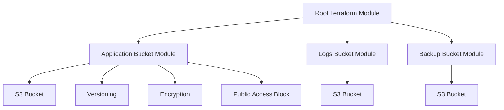
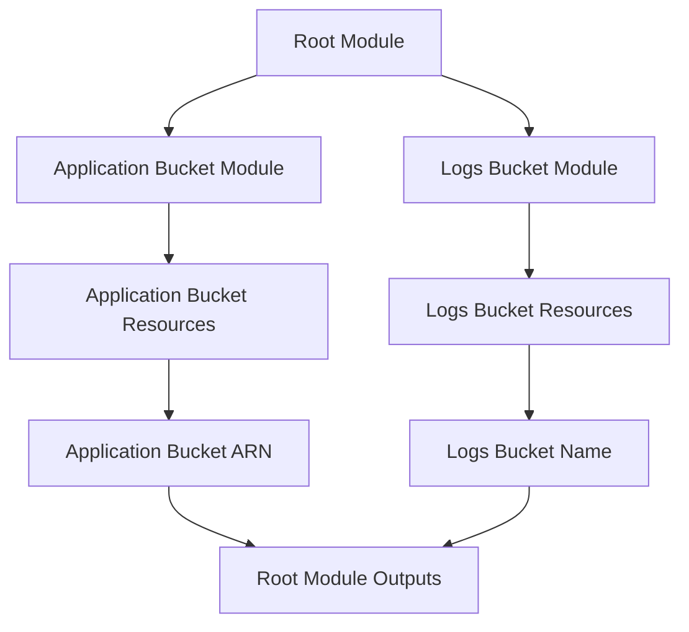
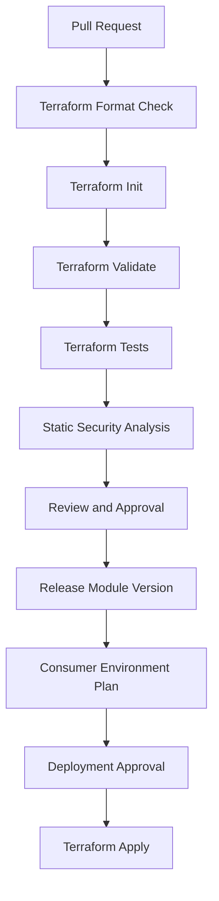

# 09- Modules and Reusable S3 Components

## Overview

Terraform modules provide a reusable way to define and manage infrastructure components. Instead of repeating S3 bucket, encryption, versioning, access-control, and lifecycle resources across multiple projects, teams can encapsulate common configurations into reusable modules.

For production S3 infrastructure, modules help standardize:

- Bucket creation and naming.
- Versioning and object ownership.
- Encryption and KMS integration.
- Block Public Access.
- Bucket policies.
- Lifecycle management.
- Replication configuration.
- Logging and monitoring.
- Resource protection.

A well-designed module provides a stable interface while keeping implementation details internal.

For example, multiple backend services may require different S3 buckets but share the same security baseline. A reusable module can enforce that baseline while allowing controlled configuration differences.

This document covers Terraform module design, reusable S3 components, module interfaces, composition, versioning, testing, deployment, and production considerations.

## Understanding Terraform Modules

A Terraform module is a collection of Terraform configuration files stored in a directory.

Every Terraform working directory is a module. The directory where Terraform commands are executed is the root module.

A module called by another module is a child module.

### Root Module

The root module contains the configuration used to deploy an environment.

Example:

```text
s3-infrastructure/
├── main.tf
├── providers.tf
├── variables.tf
├── outputs.tf
├── versions.tf
└── modules/
    └── s3-bucket/
```

### Child Module

The child module encapsulates reusable infrastructure.

Example:

```text
modules/s3-bucket/
├── main.tf
├── variables.tf
├── outputs.tf
└── versions.tf
```

The root module passes input variables to the child module and consumes its outputs.



The same reusable implementation can provision multiple independent buckets with different configuration values.

## Why Use Reusable S3 Modules?

Without modules, infrastructure configuration often becomes duplicated.

For example, three application buckets may each require:

- S3 bucket resource.
- Versioning configuration.
- Encryption configuration.
- Public-access block.
- Ownership controls.
- Tags.
- Resource protection.

Maintaining these resources independently increases the risk of configuration drift.

A reusable module centralizes common behavior.

### Benefits

| Benefit | Engineering impact |
|---|---|
| Standardization | Consistent security and infrastructure defaults |
| Reusability | One implementation supports multiple buckets |
| Maintainability | Shared changes are made in one module |
| Environment consistency | Development, staging, and production use the same component |
| Reduced duplication | Less repeated Terraform configuration |
| Testability | Modules can be validated independently |
| Governance | Organizations can enforce approved infrastructure patterns |

### When to Use Modules

Use a module when:

- The same infrastructure pattern appears in multiple environments.
- Several teams provision similar S3 buckets.
- Security defaults must be consistent.
- Infrastructure has multiple related resources.
- A component needs a stable and documented interface.
- Infrastructure configuration needs independent testing and versioning.

Avoid creating a module for every individual resource. A module should represent a meaningful infrastructure component or capability.

## Recommended S3 Module Architecture

A practical S3 module should separate the reusable bucket implementation from environment-specific configuration.

Example:

```text
s3-infrastructure/
├── environments/
│   ├── dev/
│   │   ├── main.tf
│   │   ├── terraform.tfvars
│   │   └── backend.hcl
│   ├── staging/
│   │   ├── main.tf
│   │   ├── terraform.tfvars
│   │   └── backend.hcl
│   └── prod/
│       ├── main.tf
│       ├── terraform.tfvars
│       └── backend.hcl
│
├── modules/
│   ├── s3-bucket/
│   │   ├── main.tf
│   │   ├── variables.tf
│   │   ├── outputs.tf
│   │   └── versions.tf
│   │
│   ├── s3-lifecycle/
│   │   ├── main.tf
│   │   ├── variables.tf
│   │   └── outputs.tf
│   │
│   └── s3-replication/
│       ├── main.tf
│       ├── variables.tf
│       └── outputs.tf
│
├── versions.tf
├── providers.tf
└── README.md
```

### Module Responsibilities

| Module | Responsibility |
|---|---|
| `s3-bucket` | Bucket creation, versioning, encryption, ownership, and public-access controls |
| `s3-lifecycle` | Storage transitions, expiration, and incomplete multipart upload cleanup |
| `s3-replication` | Replication configuration and associated dependencies |
| Environment root module | Environment-specific values and module composition |

This structure separates reusable infrastructure capabilities from deployment configuration.

Do not split resources into separate modules merely because they are different Terraform resource types. Keep tightly coupled resources together when they form one logical component.

## Designing an S3 Bucket Module

A reusable S3 bucket module should provide secure defaults and expose only configuration that consumers genuinely need.

The module should not require every caller to understand all underlying AWS resource details.

### Module Interface

A practical bucket module can expose:

| Input | Type | Purpose |
|---|---|---|
| `bucket_name` | `string` | Bucket name |
| `environment` | `string` | Deployment environment |
| `versioning_enabled` | `bool` | Controls versioning |
| `force_destroy` | `bool` | Controls deletion of non-empty buckets during Terraform destruction |
| `kms_key_arn` | `string` | Optional customer-managed KMS key |
| `additional_tags` | `map(string)` | Additional resource tags |
| `enable_bucket_key` | `bool` | Enables S3 Bucket Keys when using SSE-KMS |

Security controls such as Block Public Access and ACL ownership should generally remain enforced by the module rather than exposed as unrestricted options.

### Module Version Constraints

`modules/s3-bucket/versions.tf`:

```hcl
terraform {
  required_version = ">= 1.5.0, < 2.0.0"

  required_providers {
    aws = {
      source  = "hashicorp/aws"
      version = ">= 5.0, < 7.0"
    }
  }
}
```

The child module declares provider requirements but should not configure its own default AWS provider.

Provider configuration belongs in the root module.

Version constraints should be tested against the actual Terraform and AWS provider versions used by the organization.

## Implementing the Reusable Bucket Module

The following implementation creates a private S3 bucket with versioning, encryption, ownership controls, and public-access protection.

### Variables

`modules/s3-bucket/variables.tf`:

```hcl
variable "bucket_name" {
  description = "Globally unique S3 bucket name."
  type        = string

  validation {
    condition = (
      length(var.bucket_name) >= 3 &&
      length(var.bucket_name) <= 63 &&
      can(regex("^[a-z0-9][a-z0-9.-]*[a-z0-9]$", var.bucket_name))
    )

    error_message = "The bucket name must contain 3-63 lowercase letters, numbers, dots, or hyphens and start and end with a letter or number."
  }
}

variable "environment" {
  description = "Deployment environment."
  type        = string

  validation {
    condition = contains(
      ["dev", "staging", "prod"],
      var.environment
    )

    error_message = "Environment must be dev, staging, or prod."
  }
}

variable "versioning_enabled" {
  description = "Whether bucket versioning should be enabled."
  type        = bool
  default     = true
}

variable "force_destroy" {
  description = "Whether Terraform may delete a non-empty bucket."
  type        = bool
  default     = false
}

variable "kms_key_arn" {
  description = "Optional customer-managed KMS key ARN."
  type        = string
  default     = null
  nullable    = true
}

variable "enable_bucket_key" {
  description = "Whether to enable S3 Bucket Keys for SSE-KMS."
  type        = bool
  default     = true
}

variable "additional_tags" {
  description = "Additional tags applied to the bucket."
  type        = map(string)
  default     = {}
}
```

### Main Configuration

`modules/s3-bucket/main.tf`:

```hcl
resource "aws_s3_bucket" "this" {
  bucket        = var.bucket_name
  force_destroy = var.force_destroy

  tags = merge(
    {
      Name        = var.bucket_name
      Environment = var.environment
      ManagedBy   = "Terraform"
    },
    var.additional_tags
  )

  lifecycle {
    prevent_destroy = true
  }
}

resource "aws_s3_bucket_ownership_controls" "this" {
  bucket = aws_s3_bucket.this.id

  rule {
    object_ownership = "BucketOwnerEnforced"
  }
}

resource "aws_s3_bucket_public_access_block" "this" {
  bucket = aws_s3_bucket.this.id

  block_public_acls       = true
  ignore_public_acls      = true
  block_public_policy     = true
  restrict_public_buckets = true
}

resource "aws_s3_bucket_versioning" "this" {
  bucket = aws_s3_bucket.this.id

  versioning_configuration {
    status = var.versioning_enabled ? "Enabled" : "Suspended"
  }
}

resource "aws_s3_bucket_server_side_encryption_configuration" "this" {
  bucket = aws_s3_bucket.this.id

  rule {
    apply_server_side_encryption_by_default {
      sse_algorithm = var.kms_key_arn == null ? "AES256" : "aws:kms"
      kms_master_key_id = var.kms_key_arn
    }

    bucket_key_enabled = (
      var.kms_key_arn == null ? null : var.enable_bucket_key
    )
  }
}
```

This module uses:

- SSE-S3 when no KMS key is provided.
- SSE-KMS when a KMS key ARN is provided.
- Bucket-owner-enforced object ownership.
- Block Public Access.
- Versioning enabled by default.
- Terraform resource deletion protection.

The module's `prevent_destroy` lifecycle rule is intentionally restrictive. It must be deliberately reviewed and changed through a controlled process when a bucket needs to be permanently removed.

`force_destroy` does not override `prevent_destroy`. Setting `force_destroy = true` alone does not make Terraform bypass the lifecycle protection.

### Outputs

`modules/s3-bucket/outputs.tf`:

```hcl
output "bucket_id" {
  description = "S3 bucket name."
  value       = aws_s3_bucket.this.id
}

output "bucket_arn" {
  description = "S3 bucket ARN."
  value       = aws_s3_bucket.this.arn
}

output "bucket_region" {
  description = "S3 bucket Region."
  value       = aws_s3_bucket.this.region
}

output "bucket_domain_name" {
  description = "S3 bucket regional domain name."
  value       = aws_s3_bucket.this.bucket_regional_domain_name
}
```

Outputs expose useful information to the root module without requiring callers to reference internal child-module resources.

## Consuming the Bucket Module

The root module calls the reusable component.

`main.tf`:

```hcl
module "application_bucket" {
  source = "./modules/s3-bucket"

  bucket_name         = "company-application-files-dev"
  environment         = "dev"
  versioning_enabled  = true
  force_destroy       = false
  additional_tags = {
    Service = "application-api"
    Purpose = "file-storage"
  }
}

module "logs_bucket" {
  source = "./modules/s3-bucket"

  bucket_name         = "company-application-logs-dev"
  environment         = "dev"
  versioning_enabled  = true
  force_destroy       = false
  additional_tags = {
    Service = "application-api"
    Purpose = "access-logs"
  }
}
```

The two module instances use the same implementation but create independent buckets.

### Accessing Module Outputs

```hcl
output "application_bucket_arn" {
  description = "Application storage bucket ARN."
  value       = module.application_bucket.bucket_arn
}

output "logs_bucket_name" {
  description = "Application logs bucket name."
  value       = module.logs_bucket.bucket_id
}
```

### Data Flow



## Environment-Specific Module Configuration

The same module should be reusable across development, staging, and production.

Environment-specific values belong in the root module or environment variable files.

Example:

`environments/dev/terraform.tfvars`:

```hcl
environment = "dev"

application_bucket_name = "company-application-files-dev"
logs_bucket_name        = "company-application-logs-dev"
```

`environments/prod/terraform.tfvars`:

```hcl
environment = "prod"

application_bucket_name = "company-application-files-prod"
logs_bucket_name        = "company-application-logs-prod"
```

Root variables:

```hcl
variable "environment" {
  description = "Deployment environment."
  type        = string
}

variable "application_bucket_name" {
  description = "Application bucket name."
  type        = string
}

variable "logs_bucket_name" {
  description = "Logs bucket name."
  type        = string
}
```

Root module calls:

```hcl
module "application_bucket" {
  source = "../../modules/s3-bucket"

  bucket_name = var.application_bucket_name
  environment = var.environment

  versioning_enabled = true
  force_destroy      = false

  additional_tags = {
    Service = "application-api"
    Purpose = "application-files"
  }
}

module "logs_bucket" {
  source = "../../modules/s3-bucket"

  bucket_name = var.logs_bucket_name
  environment = var.environment

  versioning_enabled = true
  force_destroy      = false

  additional_tags = {
    Service = "application-api"
    Purpose = "logs"
  }
}
```

Initialize and deploy the desired environment from its root directory:

```bash
cd environments/dev

terraform init -backend-config=backend.hcl
terraform fmt -check -recursive
terraform validate
terraform plan -var-file=terraform.tfvars
terraform apply -var-file=terraform.tfvars
```

Each environment should use an independent backend state key. Do not switch environments by changing variables while accidentally reusing the same state.

## Module Composition

A reusable S3 bucket module should focus on the core bucket baseline. Optional capabilities can be implemented as separate modules when they have independent configuration and lifecycle requirements.

For example:

```text
modules/
├── s3-bucket/
├── s3-lifecycle/
├── s3-replication/
└── s3-notifications/
```

The root module composes these components.

```hcl
module "application_bucket" {
  source = "./modules/s3-bucket"

  bucket_name = "company-application-files-prod"
  environment = "prod"
}

module "application_lifecycle" {
  source = "./modules/s3-lifecycle"

  bucket_id = module.application_bucket.bucket_id

  expiration_days = 365
}

module "application_replication" {
  source = "./modules/s3-replication"

  source_bucket_arn = module.application_bucket.bucket_arn
}
```

These calls illustrate module composition. The lifecycle and replication modules require their own complete variable, resource, IAM, and output implementations before this configuration can be deployed.

### Module Dependency Design

Terraform automatically builds a dependency graph when a resource or module input references another resource's output.

For example:

```hcl
bucket_id = module.application_bucket.bucket_id
```

This establishes a dependency on the bucket module.

Prefer explicit data dependencies over broad `depends_on` declarations.

Use `depends_on` only when a dependency exists but cannot be represented through normal references.

## Designing Module Interfaces

A module interface is the contract between the module implementation and its consumers.

A good interface should be:

- Small enough to understand.
- Explicit about required and optional values.
- Secure by default.
- Stable across releases.
- Validated where possible.
- Documented with meaningful descriptions.
- Independent of unnecessary implementation details.

### Required vs Optional Variables

Use required variables for values that cannot be safely inferred.

```hcl
variable "bucket_name" {
  description = "Globally unique S3 bucket name."
  type        = string
}
```

Use defaults for safe, widely applicable behavior.

```hcl
variable "versioning_enabled" {
  description = "Whether bucket versioning is enabled."
  type        = bool
  default     = true
}
```

Avoid exposing every AWS resource argument as a module input. Doing so creates a thin wrapper around the AWS provider rather than a useful reusable component.

### Input Validation

Validate values at the module boundary.

```hcl
variable "environment" {
  type = string

  validation {
    condition = contains(
      ["dev", "staging", "prod"],
      var.environment
    )

    error_message = "Use dev, staging, or prod."
  }
}
```

Validation catches invalid configuration before infrastructure changes are applied.

For complex configuration, consider object variables with explicit attribute types.

```hcl
variable "bucket_configuration" {
  description = "Core S3 bucket configuration."

  type = object({
    name               = string
    versioning_enabled = bool
    kms_key_arn        = optional(string)
  })
}
```

Object variables are useful when several related settings belong to one logical configuration.

## Reusable Lifecycle Components

Lifecycle configuration can be implemented as a separate module when multiple buckets share the same retention policy.

Example interface:

```hcl
variable "bucket_id" {
  description = "S3 bucket ID."
  type        = string
}

variable "expiration_days" {
  description = "Number of days before current objects expire."
  type        = number

  validation {
    condition     = var.expiration_days > 0
    error_message = "Expiration days must be greater than zero."
  }
}
```

Example implementation:

```hcl
resource "aws_s3_bucket_lifecycle_configuration" "this" {
  bucket = var.bucket_id

  rule {
    id     = "expire-current-objects"
    status = "Enabled"

    filter {}

    expiration {
      days = var.expiration_days
    }

    abort_incomplete_multipart_upload {
      days_after_initiation = 7
    }
  }
}
```

The empty filter applies the rule to all objects in the bucket.

Production lifecycle modules should expose appropriate filtering and version-retention settings rather than assuming every bucket needs identical expiration behavior.

Lifecycle behavior, versioned-bucket expiration, and storage-class transitions should be designed according to the data-retention requirements of each workload.

## Reusable Replication Components

Replication is more complex than basic bucket configuration because it involves multiple resources and permission boundaries.

A replication module may manage:

- Replication IAM role.
- IAM policy.
- Source bucket replication configuration.
- Destination bucket relationship.
- KMS permissions where required.
- Replication metrics and optional Replication Time Control.

A useful module interface might include:

```hcl
variable "source_bucket_arn" {
  description = "ARN of the source bucket."
  type        = string
}

variable "destination_bucket_arn" {
  description = "ARN of the destination bucket."
  type        = string
}

variable "replication_role_arn" {
  description = "IAM role ARN assumed by S3 replication."
  type        = string
}
```

A replication module should not silently create broad IAM permissions. Its role and policy should be scoped to the source and destination resources.

The destination bucket's versioning and access configuration must be compatible with the replication design.

For cross-account or SSE-KMS replication, destination bucket policies and KMS key policies must also be configured correctly.

Keep the complete replication implementation in the dedicated replication documentation and module rather than duplicating it in the core bucket module.

## Provider Configuration and Module Design

Provider configuration belongs in the root module.

Root `providers.tf`:

```hcl
provider "aws" {
  region = var.aws_region

  default_tags {
    tags = {
      Project     = "s3-infrastructure"
      Environment = var.environment
      ManagedBy   = "Terraform"
    }
  }
}
```

A child module inherits the default provider configuration unless the root module explicitly passes a provider configuration.

For multi-Region deployments, define provider aliases in the root module.

```hcl
provider "aws" {
  region = "ap-south-1"
}

provider "aws" {
  alias  = "destination"
  region = "ap-southeast-1"
}
```

Pass the destination provider to a child module when required:

```hcl
module "replication_destination" {
  source = "./modules/replication-destination"

  providers = {
    aws = aws.destination
  }

  bucket_name = "company-replica-storage"
}
```

The child module should declare its provider source and version requirements, but should not declare its own provider configuration.

Avoid embedding credentials or fixed environment-specific Regions inside reusable modules.

## Module Sources and Versioning

Terraform supports multiple module sources.

| Source | Example | Typical use |
|---|---|---|
| Local path | `./modules/s3-bucket` | Modules maintained in the same repository |
| Git repository | Git URL | Shared internal infrastructure modules |
| Terraform Registry | Registry module address | Published reusable modules |
| Private registry | Organization registry | Centrally governed infrastructure components |

### Local Module

```hcl
module "application_bucket" {
  source = "./modules/s3-bucket"

  bucket_name = "company-application-files-dev"
  environment = "dev"
}
```

Local modules are convenient during active development.

### Git-Based Module

```hcl
module "application_bucket" {
  source = "git::https://github.com/company/terraform-modules.git//modules/s3-bucket?ref=v1.2.0"

  bucket_name = "company-application-files-prod"
  environment = "prod"
}
```

Pin reusable modules to a release tag or immutable commit reference for production deployments.

Avoid using a moving branch such as `main` as a production module source because the implementation can change without an explicit version update.

### Module Versioning Strategy

Use semantic versioning for independently released modules.

| Version change | Expected compatibility |
|---|---|
| Patch | Bug fixes without intentional interface changes |
| Minor | Backward-compatible functionality |
| Major | Breaking interface or behavior changes |

Examples:

- `v1.0.0`: Initial stable module.
- `v1.1.0`: Adds an optional lifecycle-related input.
- `v2.0.0`: Changes required module inputs or resource behavior.

A module release should include documented changes, compatibility information, and validation results.

## Testing Reusable Modules

Reusable infrastructure should be validated before it is consumed by production environments.

Testing should cover syntax, input validation, security defaults, expected resource configuration, and deployment behavior.

### Terraform Formatting

```bash
terraform fmt -check -recursive
```

### Terraform Validation

Run validation from the module's working directory:

```bash
cd modules/s3-bucket

terraform init -backend=false
terraform validate
```

### Plan-Based Validation

Create a test root module that consumes the reusable module.

```bash
terraform init -backend=false
terraform plan -var-file=tests/dev.tfvars
```

Review the plan to confirm:

- Expected bucket name.
- Versioning configuration.
- Encryption algorithm.
- Public-access block settings.
- Object ownership configuration.
- Resource tags.
- Lifecycle protection.

A successful plan does not prove that AWS will accept every operation or that runtime behavior is correct.

### Automated Module Testing

Terraform supports native test files.

Example `tests/s3_bucket.tftest.hcl`:

```hcl
run "secure_bucket_defaults" {
  command = plan

  variables {
    bucket_name = "company-test-bucket-dev"
    environment = "dev"
  }

  assert {
    condition     = aws_s3_bucket.this.bucket == "company-test-bucket-dev"
    error_message = "Unexpected S3 bucket name."
  }

  assert {
    condition     = aws_s3_bucket_public_access_block.this.block_public_acls
    error_message = "Public ACL blocking must be enabled."
  }

  assert {
    condition     = aws_s3_bucket_public_access_block.this.block_public_policy
    error_message = "Public policy blocking must be enabled."
  }

  assert {
    condition     = aws_s3_bucket_ownership_controls.this.rule[0].object_ownership == "BucketOwnerEnforced"
    error_message = "Bucket ownership must be enforced."
  }
}
```

Run:

```bash
terraform test
```

The test file must be executed from a root configuration that includes the module and provides its required variables.

For broader validation, use:

- Terraform native tests.
- Static analysis.
- Policy-as-code.
- Integration tests in a dedicated AWS test account.
- Post-deployment AWS API checks.

Do not treat a successful `terraform validate` as proof of security or runtime correctness.

## CI/CD for Reusable Modules

A module repository should validate changes before publishing a release.

A typical pipeline:



A simple GitHub Actions validation workflow:

```yaml
name: Terraform Module Validation

on:
  pull_request:
    paths:
      - "modules/**"
      - ".github/workflows/terraform-module-validation.yml"

permissions:
  contents: read

jobs:
  validate:
    runs-on: ubuntu-latest

    steps:
      - name: Checkout repository
        uses: actions/checkout@v4

      - name: Setup Terraform
        uses: hashicorp/setup-terraform@v3

      - name: Check formatting
        run: terraform fmt -check -recursive

      - name: Initialize module
        working-directory: modules/s3-bucket
        run: terraform init -backend=false

      - name: Validate module
        working-directory: modules/s3-bucket
        run: terraform validate

      - name: Run module tests
        working-directory: modules/s3-bucket
        run: terraform test
```

Pin third-party GitHub Actions to reviewed commit SHAs in security-sensitive production workflows.

This validation workflow does not deploy infrastructure. Deployment should occur through a separate environment-controlled pipeline using short-lived AWS credentials.

## Module Deployment and Upgrade Strategy

Module upgrades can change the infrastructure plan even when the root module configuration remains unchanged.

Before upgrading a module:

1. Review the release notes.
2. Inspect the module interface changes.
3. Update the pinned module version.
4. Run formatting and validation.
5. Initialize the updated module source.
6. Generate a Terraform plan.
7. Review replacements, deletions, and permission changes.
8. Apply through the appropriate environment approval process.

Example:

```hcl
module "application_bucket" {
  source = "git::https://github.com/company/terraform-modules.git//modules/s3-bucket?ref=v1.3.0"

  bucket_name = "company-application-files-prod"
  environment = "prod"
}
```

Initialize the updated source:

```bash
terraform init -upgrade
```

Review the plan:

```bash
terraform plan -out=tfplan
terraform show tfplan
```

Apply the reviewed plan through the approved deployment workflow:

```bash
terraform apply tfplan
```

Do not routinely run `terraform init -upgrade` in production without reviewing provider and module version changes.

## Module State and Resource Refactoring

Changing a resource from the root module into a child module changes its Terraform address.

Before:

```text
aws_s3_bucket.application
```

After:

```text
module.application_bucket.aws_s3_bucket.this
```

Terraform may interpret the new address as a new resource and the old address as a resource to destroy.

That can lead to unnecessary replacement or attempted deletion of an existing bucket.

### Use a Moved Block

Terraform supports `moved` blocks for many resource refactoring operations.

```hcl
moved {
  from = aws_s3_bucket.application
  to   = module.application_bucket.aws_s3_bucket.this
}
```

This tells Terraform that the resource has moved to a new configuration address.

Run a plan and confirm that Terraform recognizes the address change without proposing unintended bucket replacement.

For more complex state refactoring, `terraform state mv` is available:

```bash
terraform state mv \
  aws_s3_bucket.application \
  module.application_bucket.aws_s3_bucket.this
```

Use state operations only with a verified backup, the correct workspace/backend, and no concurrent Terraform operation.

Do not combine a large module refactor with unrelated production infrastructure changes unless the resulting plan is straightforward to review.

## Common Module Design Mistakes

| Mistake | Impact | Recommended approach |
|---|---|---|
| Creating modules for every individual resource | Excessive abstraction and dependency complexity | Group resources by logical capability |
| Exposing every AWS argument | Unstable and difficult-to-use interfaces | Expose meaningful business and operational settings |
| Using insecure defaults | Repeated misconfiguration across environments | Enforce private access and secure ownership defaults |
| Hardcoding AWS Regions | Limits reuse and complicates multi-Region deployments | Configure providers in root modules |
| Hardcoding credentials | Exposes secrets and reduces portability | Use IAM roles and the AWS credential chain |
| Using moving Git branches | Uncontrolled module changes | Pin immutable versions |
| Duplicating lifecycle and replication logic | Configuration drift | Use focused reusable components |
| Adding unnecessary `depends_on` | Overly restrictive dependency graph | Use resource references |
| Ignoring module state addresses | Unexpected resource replacement | Use moved blocks or controlled state migration |
| Treating validation as deployment verification | Runtime and permission failures remain undetected | Combine static checks, plans, tests, and integration verification |
| Making every setting optional | Weakens security and module consistency | Keep critical security controls mandatory |
| Using one module for unrelated responsibilities | Difficult upgrades and ownership boundaries | Separate independently managed capabilities |

## Production Best Practices

### Module Design

- Design modules around logical infrastructure components.
- Keep interfaces small and explicit.
- Use secure defaults.
- Validate input values.
- Document required permissions and dependencies.
- Avoid embedding environment-specific configuration.
- Expose only useful outputs.
- Keep module responsibilities clearly separated.

### Security

- Enforce Block Public Access.
- Use `BucketOwnerEnforced` unless a documented integration requires another ownership model.
- Enable versioning where recovery requirements justify it.
- Configure server-side encryption.
- Use least-privilege IAM policies.
- Avoid unrestricted bucket-policy inputs when a controlled interface is possible.
- Keep credentials outside module source code.
- Protect production buckets against accidental deletion.

### Reliability and Operations

- Pin module versions.
- Review plans before applying upgrades.
- Use remote state and state locking.
- Test modules independently.
- Run integration tests in a dedicated AWS account.
- Monitor infrastructure drift.
- Document module changes and migration procedures.
- Keep production and non-production deployment permissions separate.

### Cost Management

- Avoid enabling expensive capabilities by default.
- Make replication, logging, and advanced monitoring deliberate choices.
- Evaluate KMS request costs and S3 Bucket Key behavior.
- Consider lifecycle and retention requirements before enabling broad transitions or expiration.
- Include expected operational costs in module documentation.

## Production Readiness Checklist

### Module Interface

- [ ] Module has a clear single responsibility.
- [ ] Required and optional inputs are documented.
- [ ] Input validation is implemented.
- [ ] Security defaults cannot be bypassed accidentally.
- [ ] Outputs expose only necessary information.
- [ ] Provider configuration remains in the root module.

### Infrastructure

- [ ] Bucket ownership is configured.
- [ ] Block Public Access is enabled.
- [ ] Encryption is configured.
- [ ] Versioning is configured according to recovery requirements.
- [ ] Lifecycle and replication are implemented only when required.
- [ ] Destructive operations are protected.
- [ ] Dependencies are explicit and correct.

### Testing and Release

- [ ] Formatting and validation pass.
- [ ] Module tests cover important configuration.
- [ ] Security checks are part of CI.
- [ ] Module versions are pinned.
- [ ] Breaking changes are documented.
- [ ] Consumer plans are reviewed before upgrades.
- [ ] Resource-address changes are handled safely.

### Production Operations

- [ ] Remote state is configured.
- [ ] State locking is enabled.
- [ ] Environment access is isolated.
- [ ] Deployment uses short-lived credentials.
- [ ] Drift detection is established.
- [ ] Recovery and rollback procedures are documented.

## Key Takeaways

- Terraform modules encapsulate related S3 resources into reusable infrastructure components with consistent configuration and security defaults.
- Keep the core bucket module focused on bucket creation, ownership, versioning, encryption, and public-access protection.
- Separate independently managed capabilities such as lifecycle and replication when doing so creates a clear, reusable interface.
- Pin module versions, validate changes through CI, and review plans before upgrading production infrastructure.
- Use moved blocks or controlled state migration when refactoring existing resources into modules to avoid unintended replacement or deletion.