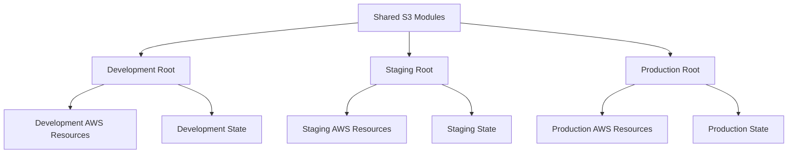
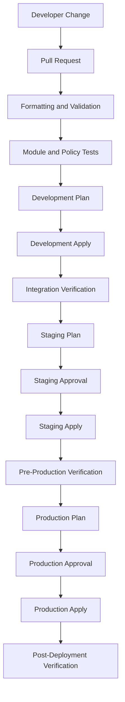

# 10- Development Staging and Production Environments

## Overview

A production-grade Terraform deployment should use separate, controlled environments for development, staging, and production.

Each environment represents a different deployment boundary with its own configuration, infrastructure state, access permissions, and operational requirements.

For Amazon S3 infrastructure, environment separation is particularly important because bucket configuration can affect data retention, encryption, public access, replication, and application availability.

A configuration suitable for development may be unsafe for production. For example:

- Development may use shorter retention periods and disposable test data.
- Staging should closely resemble production to validate infrastructure changes.
- Production requires stronger access controls, resource protection, monitoring, and recovery procedures.

Terraform modules allow the same infrastructure implementation to be reused while environment-specific configuration controls the deployed behavior.

This document explains environment architecture, Terraform configuration, state isolation, deployment promotion, CI/CD, security boundaries, testing, and production change management.

## Environment Architecture

A typical S3 deployment uses three environments.

| Environment | Primary purpose | Infrastructure characteristics |
|---|---|---|
| Development | Feature development and experimentation | Flexible configuration, test data, lower operational overhead |
| Staging | Pre-production validation | Production-like configuration and representative workloads |
| Production | Live application workloads | Strict access control, resource protection, monitoring, and recovery |

### Development

Development is used to validate application and infrastructure changes early.

Typical characteristics:

- Separate S3 buckets.
- Test or synthetic data.
- Versioning enabled when required by the application.
- Private bucket configuration.
- Shorter lifecycle retention where appropriate.
- Developer access through controlled IAM roles.
- Automated deployment from feature branches or development branches.

Development should not use production credentials or unrestricted access to production data.

### Staging

Staging validates changes before production deployment.

It should resemble production in important technical characteristics:

- Bucket configuration.
- Encryption strategy.
- IAM permission boundaries.
- Lifecycle policies.
- Replication configuration where relevant.
- Application integration.
- Monitoring and logging.
- Deployment procedures.

Staging is particularly useful for validating Terraform changes that could replace or modify production resources.

It should use representative data without unnecessarily copying sensitive production data.

### Production

Production stores live application data and supports real workloads.

Typical requirements include:

- Strict IAM access.
- Encryption at rest and in transit.
- Block Public Access.
- Versioning where recovery requirements justify it.
- Lifecycle policies aligned with retention requirements.
- Resource deletion protection.
- Controlled replication and recovery procedures.
- Monitoring and audit trails.
- Reviewed Terraform plans.
- Approval-gated deployment.

Production changes should be predictable, reviewed, and traceable.

## Environment Isolation Strategies

Terraform supports several ways to separate environments.

The most important decision is how to isolate configuration, state, credentials, and AWS accounts.

### Separate Root Modules

A recommended approach is to maintain separate root configurations for each environment while sharing reusable modules.

```text
s3-infrastructure/
├── environments/
│   ├── dev/
│   │   ├── main.tf
│   │   ├── variables.tf
│   │   ├── outputs.tf
│   │   ├── terraform.tfvars
│   │   └── backend.hcl
│   │
│   ├── staging/
│   │   ├── main.tf
│   │   ├── variables.tf
│   │   ├── outputs.tf
│   │   ├── terraform.tfvars
│   │   └── backend.hcl
│   │
│   └── prod/
│       ├── main.tf
│       ├── variables.tf
│       ├── outputs.tf
│       ├── terraform.tfvars
│       └── backend.hcl
│
├── modules/
│   └── s3-bucket/
│       ├── main.tf
│       ├── variables.tf
│       ├── outputs.tf
│       └── versions.tf
│
└── README.md
```

Each environment has its own root module and state configuration.

The shared module contains reusable S3 infrastructure logic.



Advantages:

- Independent Terraform state.
- Clear environment-specific configuration.
- Easier access-control boundaries.
- Lower risk of accidental cross-environment changes.
- Independent deployment and approval workflows.

The trade-off is some repetition in root module configuration. Keep shared infrastructure behavior in child modules rather than duplicating resource definitions.

### Separate AWS Accounts

For stronger isolation, use separate AWS accounts for development, staging, and production.

Example:

| Environment | AWS account | Access model |
|---|---|---|
| Development | Development account | Developer and CI roles |
| Staging | Staging account | Restricted engineering and CI roles |
| Production | Production account | Limited deployment and operational roles |

Benefits include:

- Stronger IAM and resource boundaries.
- Independent service quotas and account-level configuration.
- Reduced risk of accidental production changes.
- Better separation of billing and cost allocation.
- Easier governance through AWS Organizations and service control policies.

Separate AWS accounts are generally preferable for important production workloads.

Separate state files within one AWS account provide logical separation, not equivalent account-level isolation.

### Terraform Workspaces

Terraform workspaces maintain multiple state instances for the same root configuration.

For example:

```bash
terraform workspace new dev
terraform workspace new staging
terraform workspace new prod
```

Switching environments:

```bash
terraform workspace select dev
terraform workspace select staging
terraform workspace select prod
```

Workspaces can be useful for multiple instances of the same configuration.

However, they are not a substitute for strong production isolation.

Limitations:

- The same root configuration is shared.
- Workspace selection becomes an operational risk.
- Environment-specific provider and permission boundaries can be harder to enforce.
- Different environments may need substantially different infrastructure.

For important S3 production infrastructure, separate root modules and state keys are usually easier to govern.

## Environment-Specific Configuration

Environment-specific values should be supplied through variables rather than hardcoded throughout Terraform resources.

Common environment-specific settings include:

- Bucket names.
- AWS account and Region.
- Environment tags.
- Lifecycle retention.
- KMS key ARN.
- Replication destination.
- Logging configuration.
- Resource protection.
- Application-specific prefixes.

### Shared Variables

`variables.tf`:

```hcl
variable "environment" {
  description = "Deployment environment."
  type        = string

  validation {
    condition = contains(
      ["dev", "staging", "prod"],
      var.environment
    )

    error_message = "Environment must be dev, staging, or prod."
  }
}

variable "aws_region" {
  description = "AWS Region for the environment."
  type        = string
  default     = "ap-south-1"
}

variable "bucket_name" {
  description = "Globally unique S3 bucket name."
  type        = string
}

variable "versioning_enabled" {
  description = "Whether bucket versioning is enabled."
  type        = bool
  default     = true
}

variable "force_destroy" {
  description = "Whether Terraform can delete a non-empty bucket."
  type        = bool
  default     = false
}
```

### Development Configuration

`environments/dev/terraform.tfvars`:

```hcl
environment = "dev"
aws_region  = "ap-south-1"

bucket_name = "company-application-files-dev"

versioning_enabled = true
force_destroy      = false
```

### Staging Configuration

`environments/staging/terraform.tfvars`:

```hcl
environment = "staging"
aws_region  = "ap-south-1"

bucket_name = "company-application-files-staging"

versioning_enabled = true
force_destroy      = false
```

### Production Configuration

`environments/prod/terraform.tfvars`:

```hcl
environment = "prod"
aws_region  = "ap-south-1"

bucket_name = "company-application-files-prod"

versioning_enabled = true
force_destroy      = false
```

The examples use illustrative bucket names. S3 bucket names must be globally unique within the applicable S3 namespace and satisfy AWS naming requirements.

Do not use the same bucket for development and production merely to reduce infrastructure cost.

## Reusing Terraform Modules Across Environments

Environment root modules should call shared S3 modules.

Example:

`environments/dev/main.tf`:

```hcl
module "application_bucket" {
  source = "../../modules/s3-bucket"

  bucket_name = var.bucket_name
  environment = var.environment

  versioning_enabled = var.versioning_enabled
  force_destroy      = var.force_destroy

  additional_tags = {
    Service = "application-api"
    Purpose = "file-storage"
  }
}
```

The staging and production root modules can use the same module implementation with different inputs.

This creates a consistent infrastructure baseline while allowing environment-specific behavior.

### Environment-Specific Differences

Not every environment must have identical infrastructure.

However, differences should be deliberate and documented.

| Configuration | Development | Staging | Production |
|---|---|---|---|
| Bucket privacy | Private | Private | Private |
| Block Public Access | Enabled | Enabled | Enabled |
| Encryption | Required | Required | Required |
| Versioning | Usually enabled | Enabled | Enabled where recovery requires it |
| Lifecycle retention | Shorter where appropriate | Representative | Business and compliance driven |
| Replication | Optional | Optional or representative | Based on recovery requirements |
| Monitoring | Basic | Production-like | Full operational coverage |
| Terraform approval | Automated or developer-reviewed | Reviewed | Approval-gated |
| Resource deletion | Controlled | Restricted | Strongly protected |

Do not weaken essential security controls in development simply because the environment is non-production.

## Environment-Specific Backend State

Each environment should have an independent Terraform state key.

Example:

```text
company-terraform-state/
└── s3/
    ├── dev/
    │   └── terraform.tfstate
    ├── staging/
    │   └── terraform.tfstate
    └── prod/
        └── terraform.tfstate
```

### Development Backend

`environments/dev/backend.hcl`:

```hcl
bucket       = "company-terraform-state"
key          = "s3/dev/terraform.tfstate"
region       = "ap-south-1"
encrypt      = true
use_lockfile = true
```

### Staging Backend

`environments/staging/backend.hcl`:

```hcl
bucket       = "company-terraform-state"
key          = "s3/staging/terraform.tfstate"
region       = "ap-south-1"
encrypt      = true
use_lockfile = true
```

### Production Backend

`environments/prod/backend.hcl`:

```hcl
bucket       = "company-terraform-state"
key          = "s3/prod/terraform.tfstate"
region       = "ap-south-1"
encrypt      = true
use_lockfile = true
```

Initialize each environment independently:

```bash
cd environments/dev
terraform init -backend-config=backend.hcl
```

For staging:

```bash
cd environments/staging
terraform init -backend-config=backend.hcl
```

For production:

```bash
cd environments/prod
terraform init -backend-config=backend.hcl
```

The backend bucket must be provisioned independently before these configurations can initialize successfully.

Enable S3 versioning and appropriate access controls on the backend bucket. State locking, recovery, and backend permissions are covered in the dedicated remote-state documentation.

## AWS Provider and Account Configuration

Environment separation should include AWS identity and account validation.

Avoid relying only on the Region or environment variable to determine the deployment target.

Use the AWS credential chain, IAM roles, and short-lived credentials.

### Provider Configuration

```hcl
provider "aws" {
  region = var.aws_region

  default_tags {
    tags = {
      Project     = "s3-infrastructure"
      Environment = var.environment
      ManagedBy   = "Terraform"
    }
  }
}
```

The AWS provider obtains credentials through the configured AWS authentication chain.

For CI/CD, use an environment-appropriate IAM role rather than storing long-lived access keys in Terraform files.

### Account Validation

A deployment should verify its target AWS account before planning or applying infrastructure.

Use the AWS caller identity:

```bash
aws sts get-caller-identity
```

The response includes:

- AWS account ID.
- Caller ARN.
- User or role identity.

A root module can also validate the expected account.

```hcl
variable "expected_account_id" {
  description = "AWS account ID expected for this environment."
  type        = string
}

data "aws_caller_identity" "current" {}

resource "terraform_data" "account_guard" {
  input = data.aws_caller_identity.current.account_id

  lifecycle {
    precondition {
      condition = (
        data.aws_caller_identity.current.account_id ==
        var.expected_account_id
      )

      error_message = "The active AWS account does not match the expected environment account."
    }
  }
}
```

This guard creates a dependency target that can be referenced by other resources or modules when necessary. Do not assume an unused validation resource automatically creates a dependency for every resource in the configuration.

For stronger enforcement, combine account validation with separate AWS accounts and IAM role trust policies.

## Development-to-Production Deployment Workflow

Infrastructure changes should move through controlled stages.



### Development Deployment

Development is the first environment for infrastructure validation.

Typical workflow:

```bash
cd environments/dev

terraform fmt -check -recursive
terraform init -backend-config=backend.hcl
terraform validate
terraform plan -var-file=terraform.tfvars
terraform apply -var-file=terraform.tfvars
```

Validate:

- Bucket creation.
- Versioning.
- Encryption.
- Object ownership.
- Block Public Access.
- IAM permissions.
- Application upload and download behavior.

### Staging Deployment

After development validation, promote the same module or infrastructure change to staging.

```bash
cd environments/staging

terraform init -backend-config=backend.hcl
terraform fmt -check -recursive
terraform validate
terraform plan -var-file=terraform.tfvars
```

Review the plan before applying.

Staging should validate production-relevant behavior, including:

- Application compatibility.
- Lifecycle configuration.
- Replication behavior where applicable.
- Encryption and KMS permissions.
- Event notification dependencies.
- Monitoring and alerting.
- Deployment and recovery procedures.

### Production Deployment

Production deployment requires a reviewed plan and explicit approval.

```bash
cd environments/prod

terraform init -backend-config=backend.hcl
terraform validate
terraform plan -var-file=terraform.tfvars -out=tfplan
terraform show tfplan
```

After approval:

```bash
terraform apply tfplan
```

Applying a saved plan ensures Terraform applies the reviewed plan rather than generating a different plan at apply time.

Protect the plan artifact and its associated state context. Do not treat a saved plan as a long-lived deployment artifact; infrastructure and state may change after it is generated.

## CI/CD Environment Promotion

A CI/CD pipeline should validate infrastructure changes before allowing them to reach production.

A practical pipeline separates validation, planning, and deployment.

| Stage | Trigger | Required controls |
|---|---|---|
| Validation | Pull request | Formatting, validation, tests, security checks |
| Development | Merge to development branch | Development role and automated deployment |
| Staging | Approved promotion | Staging role, plan review, integration tests |
| Production | Release or approved promotion | Production role, approval gate, reviewed plan |

### GitHub Actions Environment Configuration

GitHub Actions environments can provide deployment protection rules and environment-specific secrets or variables.

Example workflow structure:

```yaml
name: S3 Infrastructure Deployment

on:
  push:
    branches:
      - main

permissions:
  contents: read
  id-token: write

jobs:
  deploy-dev:
    runs-on: ubuntu-latest
    environment: dev

    steps:
      - name: Checkout
        uses: actions/checkout@v4

      - name: Configure AWS credentials
        uses: aws-actions/configure-aws-credentials@v4
        with:
          role-to-assume: ${{ vars.AWS_ROLE_ARN }}
          aws-region: ap-south-1

      - name: Setup Terraform
        uses: hashicorp/setup-terraform@v3

      - name: Initialize
        working-directory: environments/dev
        run: terraform init -backend-config=backend.hcl

      - name: Validate
        working-directory: environments/dev
        run: terraform validate

      - name: Plan
        working-directory: environments/dev
        run: terraform plan -var-file=terraform.tfvars

      - name: Apply
        working-directory: environments/dev
        run: terraform apply -auto-approve -var-file=terraform.tfvars
```

This is a development deployment example, not a complete multi-environment promotion workflow.

A production workflow should use a separate job and protected GitHub environment, with a production-specific role and an approval gate.

For production, generate and preserve a reviewed plan artifact, then apply that exact plan after approval.

### OIDC Authentication

Use GitHub Actions OIDC federation to obtain temporary AWS credentials.

The workflow requires:

```yaml
permissions:
  id-token: write
  contents: read
```

The AWS IAM role trust policy should restrict:

- The GitHub organization.
- The repository.
- The permitted branch or GitHub environment.
- The intended deployment identity.

Do not allow every repository or branch to assume the production role.

### Production Approval

A production deployment should require:

- Successful validation.
- Successful staging verification.
- Reviewed Terraform plan.
- Authorized approval.
- Correct AWS account and Region.
- Confirmed change window where required.

Do not use `-auto-approve` as a substitute for production change approval.

## Configuration Drift Across Environments

Configuration drift occurs when environments no longer reflect their intended configuration.

Examples:

- Development has a newer module version than staging.
- Staging has a manually modified bucket policy.
- Production uses an older encryption configuration.
- Lifecycle rules differ unexpectedly.
- One environment has an untracked resource.

### Drift Detection

Run a Terraform plan regularly:

```bash
terraform plan -var-file=terraform.tfvars
```

For state reconciliation:

```bash
terraform plan -refresh-only
```

A refresh-only plan shows differences between the recorded state and observed infrastructure. It does not automatically restore the intended configuration.

Review changes before applying.

### Drift Management Strategy

| Drift type | Recommended action |
|---|---|
| Manual AWS configuration change | Determine whether it was intentional, then update code or restore the desired configuration |
| Outdated module version | Upgrade through the normal validation and promotion process |
| Missing resource | Verify ownership and state before importing or recreating |
| Unexpected resource replacement | Stop deployment and investigate the plan |
| Environment configuration mismatch | Reconcile variables and module versions |

Avoid manually modifying Terraform-managed resources through the AWS Console except during controlled incident response.

## Environment-Specific S3 Security

Security requirements should remain consistent across environments, while access permissions and operational controls can differ.

### Bucket Security Baseline

The following controls should generally be enabled in all environments:

```hcl
resource "aws_s3_bucket_public_access_block" "application" {
  bucket = aws_s3_bucket.application.id

  block_public_acls       = true
  ignore_public_acls      = true
  block_public_policy     = true
  restrict_public_buckets = true
}

resource "aws_s3_bucket_ownership_controls" "application" {
  bucket = aws_s3_bucket.application.id

  rule {
    object_ownership = "BucketOwnerEnforced"
  }
}
```

Configure encryption and versioning according to the workload's requirements.

Do not expose production data to development roles simply because both environments use the same Terraform module.

### IAM Separation

Use separate deployment roles for each environment.

Example:

| Role | Allowed scope |
|---|---|
| `TerraformDevRole` | Development infrastructure and state |
| `TerraformStagingRole` | Staging infrastructure and state |
| `TerraformProdRole` | Production infrastructure and state |

The production role should not be assumable by ordinary development workflows.

Use separate state access permissions and infrastructure permissions where practical.

## Testing Across Environments

Infrastructure testing should progress from inexpensive static checks to real AWS integration verification.

| Test type | Development | Staging | Production |
|---|---|---|---|
| Formatting | Required | Required | Required |
| Terraform validation | Required | Required | Required |
| Module tests | Required | Required | Required before promotion |
| Security policy checks | Required | Required | Required |
| Terraform plan review | Recommended | Required | Required |
| AWS integration tests | Required where applicable | Required | Controlled smoke tests |
| Destructive tests | Isolated test resources | Carefully controlled | Avoid against live data |

### S3 Verification Commands

Check bucket versioning:

```bash
aws s3api get-bucket-versioning \
  --bucket company-application-files-dev
```

Check encryption:

```bash
aws s3api get-bucket-encryption \
  --bucket company-application-files-dev
```

Check public-access configuration:

```bash
aws s3api get-public-access-block \
  --bucket company-application-files-dev
```

Check ownership controls:

```bash
aws s3api get-bucket-ownership-controls \
  --bucket company-application-files-dev
```

Check lifecycle configuration:

```bash
aws s3api get-bucket-lifecycle-configuration \
  --bucket company-application-files-dev
```

Check replication configuration:

```bash
aws s3api get-bucket-replication \
  --bucket company-application-files-prod
```

A command can return an error when an optional configuration is not present. Treat that as an expected condition only when the environment's design explicitly permits the configuration to be absent.

## Production Change Management

S3 infrastructure changes can affect existing objects and application behavior even when Terraform reports a successful deployment.

Examples include:

- Changing bucket policies can interrupt application access.
- Changing ownership controls can break clients that send ACL headers.
- Changing KMS keys can make existing encrypted objects inaccessible if key permissions or key lifecycle are mishandled.
- Changing lifecycle rules can affect retained data.
- Changing replication configuration can affect recovery objectives.
- Replacing a bucket can cause data loss or application downtime.

### Change Classification

| Change | Risk | Recommended control |
|---|---|---|
| Adding a tag | Low | Standard plan review |
| Adding a new bucket | Medium | Validate naming, permissions, and dependencies |
| Enabling versioning | Medium | Validate application and retention behavior |
| Changing encryption | High | Validate key permissions and existing-object access |
| Modifying bucket policy | High | Test authorization paths |
| Changing lifecycle expiration | High | Review retention and deletion impact |
| Changing replication | High | Validate source, destination, permissions, and recovery behavior |
| Replacing a production bucket | Critical | Dedicated migration and cutover plan |

### Production Deployment Procedure

1. Create the infrastructure change in a feature branch.
2. Run formatting, validation, tests, and security checks.
3. Deploy to development.
4. Verify S3 configuration and application behavior.
5. Promote the same change to staging.
6. Run integration and recovery-related tests where applicable.
7. Generate a production Terraform plan.
8. Review all resource changes, especially replacement and deletion actions.
9. Obtain production approval.
10. Apply the reviewed plan.
11. Verify AWS configuration and application health.
12. Record deployment evidence and any required follow-up actions.

## Rollback and Recovery Considerations

Terraform does not provide a general infrastructure rollback mechanism.

If a deployment introduces a problem, recovery depends on the resource and the nature of the change.

| Failure | Recovery approach |
|---|---|
| Incorrect bucket policy | Restore the reviewed policy configuration |
| Incorrect encryption settings | Correct encryption configuration and validate KMS access |
| Incorrect lifecycle rule | Restore the intended lifecycle configuration and assess affected objects |
| Application deployment failure | Roll back application code independently |
| Accidental object deletion | Recover an appropriate object version or backup where available |
| Bucket replacement | Use a planned data migration or recovery process; do not assume Terraform can restore deleted data |
| Replication failure | Investigate replication status, permissions, and destination configuration |

For production S3 buckets:

- Enable versioning when recovery requirements justify it.
- Maintain independent backups for critical data.
- Use replication where regional or account-level recovery requires it.
- Protect state and infrastructure resources from accidental deletion.
- Document recovery time and recovery point objectives.
- Test recovery procedures rather than assuming they work.

Replication is not automatically a backup. Depending on configuration, deletions and unwanted changes can propagate to the destination.

## Common Environment Management Mistakes

| Mistake | Impact | Prevention |
|---|---|---|
| Sharing one state file across environments | Cross-environment state conflicts | Use independent state keys |
| Using one AWS account for every environment without boundaries | Larger production blast radius | Prefer separate accounts for important environments |
| Using different Terraform implementations per environment | Configuration drift | Reuse shared modules |
| Promoting untested changes directly to production | Increased deployment risk | Validate in development and staging |
| Using production data in development | Data exposure | Use synthetic or appropriately sanitized data |
| Allowing developers to assume production roles | Excessive production access | Restrict role trust and permissions |
| Applying an unreviewed production plan | Unexpected resource changes | Review and approve saved plans |
| Using workspaces as the only production boundary | Incorrect workspace selection can affect production | Use separate root modules and state boundaries |
| Treating staging as optional | Production-only failures remain undiscovered | Maintain representative staging validation |
| Ignoring manual changes | Terraform drift accumulates | Run regular drift checks |
| Assuming Terraform rollback reverses data changes | Data loss may remain permanent | Maintain explicit backup and recovery procedures |

## Production Readiness Checklist

### Environment Architecture

- [ ] Development, staging, and production have independent configurations.
- [ ] Shared infrastructure is implemented through reusable modules.
- [ ] Environment-specific values are supplied through variables.
- [ ] Each environment has a separate Terraform state key.
- [ ] Production uses an appropriately isolated AWS account.
- [ ] AWS account and Region are validated before deployment.

### Security

- [ ] Deployment roles are separated by environment.
- [ ] Production role assumption is restricted.
- [ ] Short-lived credentials are used in CI/CD.
- [ ] S3 buckets remain private unless public access is explicitly required.
- [ ] Block Public Access is enabled.
- [ ] Encryption and ownership controls are configured.
- [ ] Production data is not unnecessarily copied into lower environments.
- [ ] State and backend access are restricted.

### Deployment

- [ ] Terraform formatting and validation run in CI.
- [ ] Module and security tests pass.
- [ ] Development deployment is verified.
- [ ] Staging deployment is representative of production.
- [ ] Production plans are reviewed and approved.
- [ ] Saved plans are used for controlled production applies.
- [ ] Deployment identity and target account are verified.
- [ ] Deployment evidence is retained.

### Operations and Recovery

- [ ] Drift detection is established.
- [ ] Lifecycle and replication behavior is validated where applicable.
- [ ] Monitoring and audit requirements are implemented.
- [ ] Resource deletion protection is enabled where appropriate.
- [ ] Backup and recovery procedures are documented.
- [ ] Production recovery procedures are tested.
- [ ] Changes have a clear rollback or remediation strategy.

## Key Takeaways

- Separate development, staging, and production through independent root configurations, state keys, and environment-specific deployment identities.
- Reuse Terraform modules to maintain consistent S3 security and infrastructure behavior without duplicating resource definitions.
- Use staging to validate production-relevant configuration, application compatibility, permissions, and recovery behavior before promotion.
- Protect production through isolated AWS accounts, short-lived credentials, reviewed Terraform plans, and approval-gated deployment.
- Terraform state rollback is not infrastructure or data rollback; production recovery requires explicit backup, versioning, replication, and tested recovery procedures.