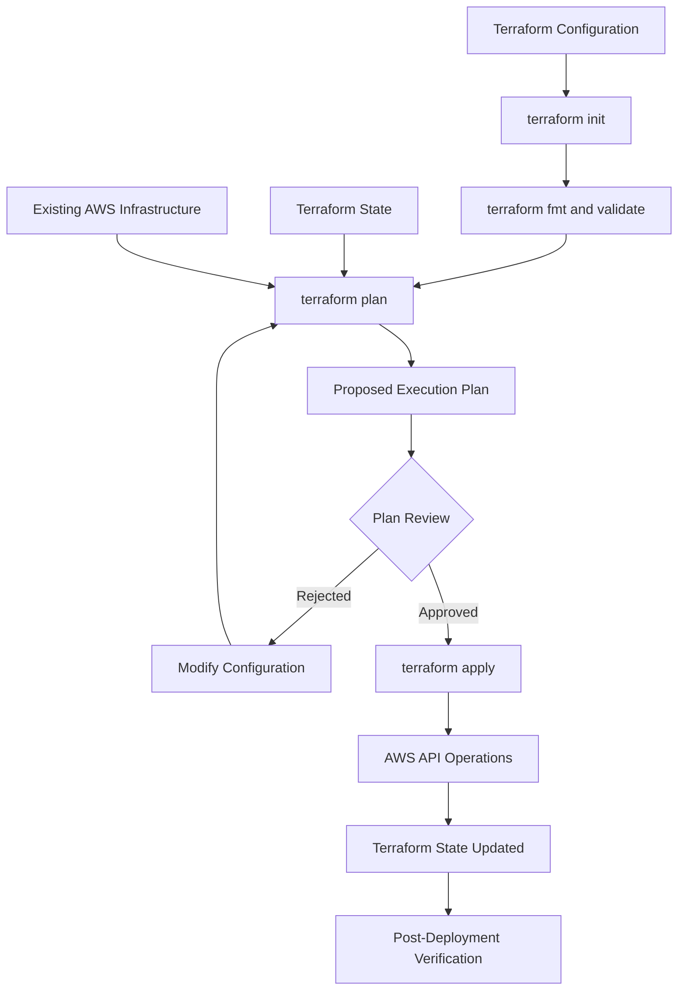
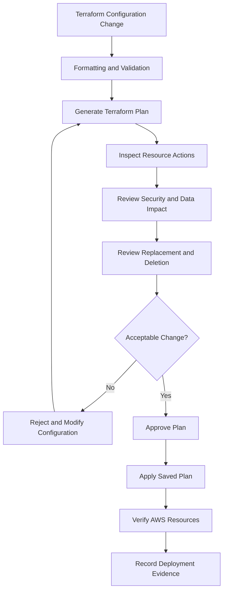
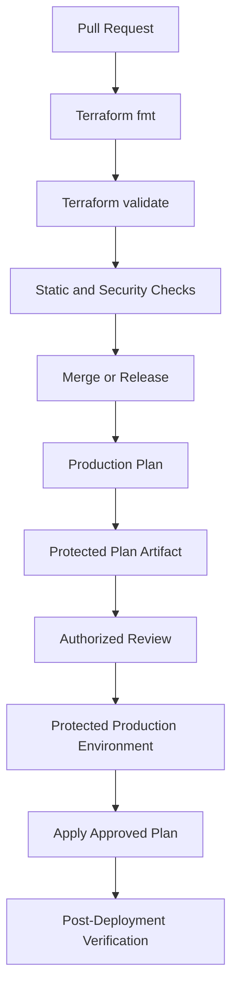

# 11- Terraform Plan Review and Apply

## Overview

Terraform separates infrastructure planning from infrastructure execution. The `terraform plan` command evaluates the desired configuration against Terraform state and the observed infrastructure, then produces a proposed set of changes. The `terraform apply` command executes those changes through the configured provider.

For Amazon S3 infrastructure, this separation is particularly important. A seemingly small Terraform change can affect existing objects, bucket policies, encryption settings, lifecycle rules, replication, and application availability.

A successful Terraform plan does not guarantee that an apply will succeed. Likewise, a successful apply does not guarantee that the resulting S3 configuration is operationally correct.

A reliable deployment process must include:

- Configuration validation.
- Infrastructure change inspection.
- Resource replacement and deletion analysis.
- Security and data-retention impact assessment.
- Plan approval.
- Controlled execution.
- Post-deployment verification.
- Failure and recovery procedures.

This document explains how to review Terraform plans, identify risky changes, execute approved plans, and manage production S3 deployments safely.

## Terraform Plan and Apply Lifecycle

Terraform uses configuration, state, provider APIs, and remote infrastructure observations to determine the changes required.



### Terraform Plan

`terraform plan` calculates the difference between the desired configuration and the infrastructure represented by Terraform state and provider observations.

```bash
terraform plan
```

It identifies actions such as:

- Creating resources.
- Updating resources in place.
- Replacing resources.
- Destroying resources.
- Making no changes.

A plan is useful for understanding the impact of a configuration change before modifying AWS.

However, it is not a guarantee that the infrastructure will remain unchanged until apply. Other operators, automation, or AWS services can modify resources after the plan is generated.

### Terraform Apply

`terraform apply` executes planned infrastructure changes.

Interactive execution:

```bash
terraform apply
```

Terraform generates a plan, displays the proposed actions, and requests confirmation.

For automated workflows:

```bash
terraform apply -auto-approve
```

Use automatic approval only when an appropriate approval process exists outside Terraform, such as a protected CI/CD deployment environment.

For production, prefer generating a saved plan, reviewing it, and applying that exact plan.

## Understanding Terraform Plan Output

Terraform represents resource actions using symbols.

| Symbol | Meaning | Example |
|---|---|---|
| `+` | Create | Add an S3 bucket |
| `~` | Update in place | Change bucket tags |
| `-` | Destroy | Delete an S3 bucket |
| `-/+` | Destroy and recreate | Replace a resource |
| `+/-` | Create before destroying | Replacement with create-before-destroy |
| `<=` | Read during apply | Data source deferred until apply |

The exact action sequence depends on the resource dependency graph and lifecycle configuration.

### Create

```text
# aws_s3_bucket.application will be created
+ resource "aws_s3_bucket" "application" {
    + bucket = "company-application-files-dev"
    + id     = (known after apply)
  }
```

Terraform will create the bucket.

Review:

- Bucket name.
- AWS account.
- Region.
- Dependencies.
- Security configuration.
- Whether the bucket name is already available globally.

### Update In Place

```text
# aws_s3_bucket.application will be updated in-place
~ resource "aws_s3_bucket" "application" {
    ~ tags = {
        ~ Environment = "dev" -> "staging"
      }
  }
```

Terraform intends to modify the existing resource without replacing it.

An in-place update is generally less disruptive than replacement, but it can still affect application behavior. For example, changing a bucket policy in place can immediately remove application access.

### Destroy

```text
# aws_s3_bucket.application will be destroyed
- resource "aws_s3_bucket" "application" {
    - bucket = "company-application-files-dev"
  }
```

Terraform intends to delete the bucket resource.

Before approving, determine:

- Whether the bucket contains objects.
- Whether object versions or delete markers exist.
- Whether another service depends on the bucket.
- Whether the resource is protected by `prevent_destroy`.
- Whether deletion is intentional.

Do not assume that a bucket deletion is safe simply because the plan contains only one resource deletion.

### Replacement

```text
# aws_s3_bucket.application must be replaced
-/+ resource "aws_s3_bucket" "application" {
    ~ bucket = "company-application-files-dev"
      -> "company-application-files-prod" # forces replacement
  }
```

Replacement means Terraform must destroy and recreate a resource.

For an S3 bucket, replacement can be particularly dangerous because the bucket may contain application data.

Inspect the plan's replacement reasons and provider behavior before proceeding.

A replacement may require:

1. Creating a destination bucket.
2. Configuring its security and operational settings.
3. Migrating existing objects and metadata.
4. Validating object counts and integrity.
5. Updating application configuration.
6. Performing a controlled cutover.
7. Retaining the old bucket until recovery requirements are satisfied.

Terraform alone does not perform this complete migration.

## Understanding Important Plan Details

A plan contains more information than the action symbols.

Important details include:

- Resource address.
- Resource type.
- Planned action.
- Changed arguments.
- Computed attributes.
- Dependency ordering.
- Replacement reasons.
- Lifecycle behavior.
- Sensitive-value indicators.

### Resource Address

Example:

```text
module.application_bucket.aws_s3_bucket.this
```

This identifies a resource inside a Terraform module.

The address helps determine whether the resource belongs to:

- The root module.
- A shared child module.
- A particular environment.
- A specific instance created through `for_each` or `count`.

### Known After Apply

Example:

```text
arn    = (known after apply)
id     = (known after apply)
region = (known after apply)
```

Terraform cannot determine these values during planning. They become available after the relevant resource operation completes.

This is normal for newly created resources and certain computed attributes. However, a large number of unknown values can make downstream changes difficult to assess.

### Sensitive Values

Terraform can mark variables and outputs as sensitive.

```hcl
variable "kms_key_arn" {
  description = "KMS key ARN."
  type        = string
  sensitive   = true
}
```

Sensitive marking controls how Terraform displays values in many CLI outputs. It does not encrypt the value in Terraform state or automatically prevent it from appearing in every diagnostic or external system.

Treat state files, saved plans, and plan JSON as sensitive deployment data.

## Reviewing an S3 Terraform Plan

S3 changes should be reviewed according to their effect on data, access, encryption, retention, and application behavior.

### Bucket Creation

```hcl
resource "aws_s3_bucket" "application" {
  bucket        = var.bucket_name
  force_destroy = false

  lifecycle {
    prevent_destroy = true
  }

  tags = {
    Environment = var.environment
    ManagedBy   = "Terraform"
  }
}
```

Review the plan for:

- Correct bucket name.
- Correct environment.
- Expected Region.
- `force_destroy` configuration.
- Resource protection.
- Required tags.
- Unexpected bucket replacement.

A bucket name is globally unique within the applicable S3 namespace. A name already owned by another account cannot be used for a new bucket.

### Versioning Changes

```hcl
resource "aws_s3_bucket_versioning" "application" {
  bucket = aws_s3_bucket.application.id

  versioning_configuration {
    status = "Enabled"
  }
}
```

Review:

- Whether versioning is being enabled, suspended, or changed.
- Whether existing application behavior depends on version IDs.
- Whether lifecycle rules handle noncurrent versions.
- Whether recovery requirements are satisfied.

Enabling versioning changes object deletion and overwrite behavior. Suspending versioning does not remove versions that already exist.

### Encryption Changes

```hcl
resource "aws_s3_bucket_server_side_encryption_configuration" "application" {
  bucket = aws_s3_bucket.application.id

  rule {
    apply_server_side_encryption_by_default {
      sse_algorithm     = "aws:kms"
      kms_master_key_id = var.kms_key_arn
    }

    bucket_key_enabled = true
  }
}
```

Review:

- Encryption algorithm.
- KMS key ARN.
- KMS key Region.
- Key policy and IAM permissions.
- Application access to existing encrypted objects.
- Whether the change affects uploads, downloads, or replication.

A Terraform plan changing the default encryption configuration does not automatically re-encrypt existing objects. Existing objects retain their existing encryption until an operation or migration changes it.

### Bucket Policy Changes

```hcl
resource "aws_s3_bucket_policy" "application" {
  bucket = aws_s3_bucket.application.id
  policy = data.aws_iam_policy_document.application.json
}
```

A bucket policy update may affect:

- Application upload permissions.
- Application download permissions.
- Cross-account access.
- CloudFront origin access.
- Presigned URL requests.
- Replication.
- AWS service integrations.

Review explicit `Deny` statements carefully. An explicit deny overrides an applicable allow.

### Lifecycle Changes

```hcl
resource "aws_s3_bucket_lifecycle_configuration" "application" {
  bucket = aws_s3_bucket.application.id

  rule {
    id     = "archive-old-objects"
    status = "Enabled"

    filter {
      prefix = "uploads/"
    }

    transition {
      days          = 30
      storage_class = "STANDARD_IA"
    }

    expiration {
      days = 365
    }
  }
}
```

Review:

- Prefix and tag filters.
- Transition timing.
- Expiration timing.
- Current and noncurrent version behavior.
- Incomplete multipart upload cleanup.
- Minimum storage-duration charges.
- Retention and compliance requirements.

Lifecycle configuration changes are not necessarily immediate data operations. S3 processes lifecycle actions asynchronously.

In versioned buckets, expiration of current objects generally creates delete markers rather than permanently removing all historical versions.

### Replication Changes

Review replication configuration for:

- Source bucket versioning.
- Destination bucket versioning.
- Replication IAM role.
- Destination bucket policy.
- KMS permissions when applicable.
- Object filters.
- Existing-object replication requirements.
- Replication metrics and failure handling.

A Terraform apply that successfully creates a replication rule does not prove that objects are being replicated successfully. Verify replication using object replication status and the relevant monitoring mechanisms.

## High-Risk Plan Changes

Some Terraform changes deserve additional review even when the plan appears small.

| Change | Risk | Review requirement |
|---|---|---|
| Bucket replacement | Critical | Data migration and cutover plan |
| Bucket deletion | Critical | Object and version inventory, recovery plan |
| Bucket policy modification | High | Validate all application and service access paths |
| KMS key change | High | Validate key access and existing-object compatibility |
| Lifecycle expiration change | High | Validate retention and deletion impact |
| Versioning suspension | High | Validate recovery and application requirements |
| Replication role modification | High | Validate permissions and destination behavior |
| Public access configuration change | Critical | Security review and explicit business justification |
| Tag modification | Usually low | Confirm cost allocation and governance requirements |

### Unexpected Resource Replacement

A replacement can occur because a resource argument is immutable or because a resource's identity has changed.

Generate and inspect a detailed plan:

```bash
terraform plan
```

Inspect the replacement reason in the output.

Do not approve a production replacement merely because Terraform generated it automatically.

For S3 buckets, a replacement may require a separate migration and cutover process. Terraform resource replacement is not a substitute for a data migration strategy.

## Plan Review Workflow

A consistent review process reduces deployment risk.



### Review Checklist

**Environment and identity**

- Correct AWS account.
- Correct AWS Region.
- Correct Terraform workspace, if workspaces are used.
- Correct backend and state key.
- Correct environment variables.
- Correct deployment role.

**Resource changes**

- Every created resource is expected.
- Every modified resource has an understood impact.
- Every deleted resource is intentionally removed.
- Every replacement has a migration or recovery strategy.
- No unrelated environment resources are affected.

**S3 data safety**

- No unintended bucket deletion.
- No unintended bucket replacement.
- No unsafe lifecycle expiration.
- No unexpected versioning suspension.
- No loss of access to existing objects.
- No unplanned replication disruption.

**Security**

- No accidental public access.
- No weakened bucket policy.
- No unintended IAM permission expansion.
- No KMS key access regression.
- No exposure of sensitive values in artifacts or logs.

**Operational readiness**

- Dependencies are available.
- Resource ordering is understood.
- Monitoring and verification are planned.
- Rollback or remediation steps are documented.
- The plan is approved by the appropriate owner.

## Generating a Saved Terraform Plan

A saved plan is useful when the plan must be reviewed separately from the apply operation.

Generate a plan:

```bash
terraform plan -out=tfplan
```

Inspect it:

```bash
terraform show tfplan
```

For a machine-readable representation:

```bash
terraform show -json tfplan > tfplan.json
```

The JSON representation can support automated policy checks, but it may contain sensitive information.

Do not commit `tfplan` or `tfplan.json` to source control.

Add them to `.gitignore`:

```gitignore
*.tfplan
tfplan
tfplan.json
```

### Applying a Saved Plan

After approval:

```bash
terraform apply tfplan
```

Terraform executes the operations represented by the saved plan. It does not request a second interactive approval because the saved plan already represents the approved actions.

### Saved Plan Limitations

A saved plan is not a permanent deployment instruction.

It is associated with the configuration, state, provider context, and planning conditions from which it was generated.

Important considerations:

- The plan may become stale if state changes.
- Another deployment may modify the same infrastructure.
- Provider or configuration changes can invalidate the plan.
- Saved plans may contain sensitive values.
- A plan artifact must be protected from unauthorized modification or access.

If Terraform reports that the plan is stale, generate a new plan and repeat the review process.

Do not bypass stale-plan protection by applying an unrelated or regenerated plan without approval.

A saved plan should be short-lived and tied to the exact commit, environment, provider lockfile, and approval that produced it. Avoid retaining it as a reusable release artifact for an extended period.

## Terraform Apply Strategies

There are several ways to execute Terraform changes.

### Interactive Apply

```bash
terraform apply
```

Terraform generates a plan and requests confirmation.

Suitable for:

- Development environments.
- Local infrastructure experiments.
- Controlled manual deployments.

The operator should still inspect the proposed changes before confirming.

### Automatic Apply

```bash
terraform apply -auto-approve
```

Terraform applies the generated plan without interactive confirmation.

Suitable for:

- Disposable development infrastructure.
- Controlled automation with external approval gates.
- CI/CD pipelines with appropriate deployment protections.

Avoid using this command in production without an independent approval mechanism.

### Saved Plan Apply

```bash
terraform plan -out=tfplan
terraform show tfplan
terraform apply tfplan
```

This is the preferred approach for controlled production deployments. It separates plan generation, review, approval, and execution.

### Targeted Apply

Terraform supports targeting specific resources:

```bash
terraform apply -target=aws_s3_bucket.application
```

Targeting is primarily intended for exceptional recovery and troubleshooting scenarios.

It is not a recommended normal deployment strategy because it can leave related infrastructure changes unapplied.

For example, targeting a bucket may not apply the associated versioning, encryption, ownership, or public-access resources.

Prefer applying the complete configuration.

## Production Deployment Workflow

A production deployment should use a repeatable process.

### Prepare the Environment

Verify the active AWS identity:

```bash
aws sts get-caller-identity
```

Verify the configured Region:

```bash
aws configure get region
```

Inspect the Terraform configuration:

```bash
terraform version
terraform providers
terraform workspace show
```

Initialize the correct backend:

```bash
terraform init -backend-config=backend.hcl
```

Confirm that the backend configuration points to the intended environment state. Separate state keys provide state isolation, but separate AWS accounts provide a stronger security and operational boundary.

### Validate the Configuration

Format Terraform files:

```bash
terraform fmt -check -recursive
```

Validate configuration:

```bash
terraform validate
```

Run module and policy tests where available.

Examples include:

- Terraform native tests.
- Static analysis.
- IAM policy validation.
- Security scanning.
- Organization-specific policy checks.

### Generate the Production Plan

```bash
terraform plan \
  -var-file=terraform.tfvars \
  -out=production.tfplan
```

Inspect the saved plan:

```bash
terraform show production.tfplan
```

Review the plan with the infrastructure owner or authorized reviewer.

### Apply the Approved Plan

```bash
terraform apply production.tfplan
```

Do not modify the configuration or state between approval and execution without generating and reviewing a new plan.

### Verify Deployment

After apply, inspect the actual AWS configuration.

Check bucket versioning:

```bash
aws s3api get-bucket-versioning \
  --bucket company-application-files-prod
```

Check encryption:

```bash
aws s3api get-bucket-encryption \
  --bucket company-application-files-prod
```

Check Block Public Access:

```bash
aws s3api get-public-access-block \
  --bucket company-application-files-prod
```

Check ownership controls:

```bash
aws s3api get-bucket-ownership-controls \
  --bucket company-application-files-prod
```

Check lifecycle configuration:

```bash
aws s3api get-bucket-lifecycle-configuration \
  --bucket company-application-files-prod
```

Check replication configuration when enabled:

```bash
aws s3api get-bucket-replication \
  --bucket company-application-files-prod
```

Also verify application-level behavior:

- Upload a test object using the expected application identity.
- Retrieve the object.
- Confirm metadata and content type.
- Confirm expected encryption behavior.
- Verify access restrictions.
- Check application and infrastructure logs.

Do not use real customer data for deployment smoke tests unless the test process is explicitly designed and authorized for it.

## CI/CD Plan and Apply Separation

A production CI/CD pipeline should separate validation, planning, approval, and application.



### Pull Request Validation

Run non-destructive checks during pull requests:

```bash
terraform fmt -check -recursive
terraform init -backend=false
terraform validate
```

Additional checks can include:

- Terraform tests.
- `tflint`.
- Checkov or equivalent security scanning.
- IAM policy validation.
- Custom policy-as-code rules.

Do not give untrusted pull-request code production credentials.

### Plan Job

A plan job should:

1. Authenticate using the environment's deployment identity.
2. Initialize the correct backend.
3. Generate a plan.
4. Store the plan securely.
5. Publish a reviewable summary.
6. Avoid applying infrastructure.

The plan artifact should be protected and associated with the exact commit and environment.

### Apply Job

The apply job should:

1. Require an authorized production approval.
2. Download the corresponding protected plan artifact.
3. Verify that it belongs to the expected commit and environment.
4. Use the production deployment role.
5. Apply the saved plan.
6. Execute post-deployment verification.

Use GitHub Actions protected environments or equivalent CI/CD controls to enforce approval.

### OIDC Authentication

Use workload identity federation rather than static AWS access keys.

A GitHub Actions workflow can use:

```yaml
permissions:
  contents: read
  id-token: write
```

The AWS role trust policy should restrict the permitted repository and branch or environment.

Production and development should use different deployment roles.

Do not expose production role credentials to pull-request workflows from untrusted branches.

For production workflows, pin third-party GitHub Actions to verified full commit SHAs rather than relying only on mutable major-version tags.

### Plan Artifact Security

Terraform plan files and JSON representations can contain sensitive information.

Protect them through:

- Restricted artifact access.
- Short retention periods.
- Encryption at rest.
- Access auditing.
- Commit and environment association.
- Integrity verification where required.

Do not upload plan files to publicly accessible storage or commit them to Git.

## Terraform Plan JSON and Automated Policy Checks

Terraform can export a plan as JSON:

```bash
terraform show -json tfplan > tfplan.json
```

This allows policy engines and custom scripts to inspect planned changes.

Typical policy checks include:

- Rejecting public S3 bucket configurations.
- Rejecting unencrypted buckets.
- Rejecting unexpected bucket replacement.
- Rejecting production deletion.
- Requiring versioning for designated workloads.
- Requiring approved encryption settings.
- Requiring mandatory resource tags.

A simplified Python example can inspect planned resource actions.

```python
import json
import sys
from pathlib import Path

plan_path = Path("tfplan.json")

with plan_path.open(encoding="utf-8") as file:
    plan = json.load(file)

violations = []

for resource in plan.get("resource_changes", []):
    address = resource.get("address", "unknown")
    actions = resource.get("change", {}).get("actions", [])

    if "delete" in actions:
        violations.append(
            f"Resource deletion detected: {address}"
        )

if violations:
    for violation in violations:
        print(f"POLICY VIOLATION: {violation}")

    sys.exit(1)

print("No resource deletions detected.")
```

This example is a basic deletion check, not a complete production policy engine. It also rejects intentional replacements because their action sequence includes deletion.

A production implementation should:

- Inspect resource types and addresses.
- Distinguish intentional replacements from standalone deletions.
- Evaluate planned values and unknown values.
- Inspect module resource changes.
- Handle sensitive fields.
- Apply environment-specific exceptions.
- Fail closed when required policy inputs cannot be evaluated.

A plan JSON file should be treated as sensitive deployment data.

## Handling Failed Terraform Apply Operations

An apply can fail because of AWS API errors, permission problems, resource conflicts, quotas, dependency failures, or concurrent changes.

| Failure | Likely cause | Response |
|---|---|---|
| `AccessDenied` | Missing IAM or resource-policy permission | Inspect caller identity and authorization |
| `BucketAlreadyExists` | Globally unavailable bucket name | Choose a valid unique name |
| `BucketAlreadyOwnedByYou` | Existing bucket owned by the same account | Import or reconcile the existing resource |
| `OperationAborted` | Conflicting S3 operations | Inspect concurrent changes and retry carefully |
| KMS access denied | Missing KMS key permissions or policy | Inspect KMS authorization separately |
| Resource already exists | Resource exists outside Terraform state | Verify ownership and import if appropriate |
| State lock error | Another operation or stale lock | Confirm no active operation before recovery |
| Stale plan | State changed after plan creation | Generate a new plan and review it |

### Partial Apply Failure

Terraform can successfully create or modify some resources before another operation fails.

Example:

```text
aws_s3_bucket.application: Creation complete
aws_s3_bucket_versioning.application: Creation complete
aws_s3_bucket_server_side_encryption_configuration.application: Error
```

In this situation, the bucket and versioning resource may already exist.

Do not assume the entire deployment was rolled back.

Recommended recovery process:

1. Read the complete Terraform error.
2. Identify which resource operations succeeded.
3. Inspect the current AWS resources.
4. Inspect Terraform state.
5. Correct the underlying issue.
6. Generate a fresh plan.
7. Review the remaining changes.
8. Apply the corrected plan.

Useful commands:

```bash
terraform state list
terraform plan
```

Inspect an individual resource:

```bash
terraform state show aws_s3_bucket.application
```

Do not manually delete successfully created resources simply to make the next plan appear clean.

## Safe Apply and Destruction Controls

S3 infrastructure requires special protection because deleting a bucket or changing retention rules can have permanent consequences.

### Prevent Destroy

```hcl
resource "aws_s3_bucket" "application" {
  bucket = var.bucket_name

  lifecycle {
    prevent_destroy = true
  }
}
```

Terraform rejects a plan that destroys this resource while the lifecycle rule remains in the configuration.

Important limitations:

- It is a Terraform configuration guard, not an AWS-side deletion lock.
- Removing the resource or its `prevent_destroy` rule can remove this protection.
- It does not prevent deletion through the AWS Console or another API client.
- It does not protect objects from lifecycle expiration or application deletion.

### Force Destroy

```hcl
resource "aws_s3_bucket" "development" {
  bucket        = var.bucket_name
  force_destroy = false
}
```

`force_destroy` controls whether Terraform attempts to delete objects when destroying a non-empty bucket.

Keep it disabled for persistent production buckets.

Enabling it can result in destructive deletion of objects and versions.

### Destruction Review

Before destroying an S3 bucket:

- Confirm the target AWS account and Region.
- Confirm the bucket is no longer used.
- Inventory current objects and versions.
- Check delete markers.
- Check incomplete multipart uploads.
- Check replication and lifecycle dependencies.
- Confirm backup and recovery requirements.
- Confirm the resource is managed by the intended Terraform state.
- Obtain explicit approval.

A Terraform destroy operation should never be treated as a routine cleanup command for production data.

## Drift Detection and Reconciliation

Infrastructure drift occurs when the actual AWS configuration differs from the configuration represented by Terraform.

Common causes include:

- Manual changes through the AWS Console.
- AWS CLI operations.
- Changes made by another automation system.
- Changes made by another Terraform state.
- Service-side updates to computed or default attributes.

A normal plan refreshes resource observations and compares the result with configuration:

```bash
terraform plan
```

Terraform may propose changes to bring the infrastructure back to the declared configuration.

For state-only reconciliation:

```bash
terraform plan -refresh-only
```

A refresh-only plan shows changes needed to update Terraform state to match observed remote objects. Applying a refresh-only plan updates state; it does not change the remote infrastructure to match configuration.

Use a normal plan when the objective is to identify and reconcile configuration drift.

Do not automatically apply drift remediation in production without reviewing its impact. A manual change may have been an emergency mitigation or an intentional operational decision that needs to be incorporated into configuration first.

## Monitoring and Deployment Evidence

A successful apply should be accompanied by deployment verification and traceable evidence.

Record:

- Repository and commit identifier.
- Terraform CLI version.
- AWS provider version.
- Environment and AWS account.
- Terraform plan artifact identifier.
- Reviewer and approval information.
- Apply execution result.
- Resources created, updated, replaced, or deleted.
- Post-deployment verification results.
- Relevant AWS and CI/CD logs.

Useful Terraform commands:

```bash
terraform version
terraform providers
terraform state list
terraform plan
terraform output
```

Use AWS CloudTrail and relevant service logs to investigate infrastructure API activity.

For S3-specific operational monitoring, use appropriate CloudWatch metrics, CloudTrail data events, S3 Inventory, and replication metrics according to workload requirements.

Do not rely exclusively on Terraform's successful exit status as proof that the application is functioning correctly.

## Common Plan and Apply Mistakes

| Mistake | Impact | Prevention |
|---|---|---|
| Applying without reviewing the plan | Unexpected infrastructure changes | Inspect and approve plans |
| Ignoring replacement symbols | Potential data loss or downtime | Review replacement reasons |
| Using `-auto-approve` in production without external approval | Uncontrolled changes | Use protected CI/CD approval |
| Applying a stale plan | Plan no longer matches current state | Generate a fresh plan |
| Sharing saved plans publicly | Exposure of sensitive infrastructure data | Restrict plan artifact access |
| Using targeted apply routinely | Incomplete infrastructure changes | Apply the complete configuration |
| Assuming apply failure means rollback | Partially created resources may remain | Inspect state and AWS resources |
| Ignoring bucket policy changes | Application access can break | Test authorization paths |
| Assuming encryption changes re-encrypt existing objects | Existing objects may retain old encryption | Plan a separate migration where required |
| Assuming lifecycle changes execute immediately | Retention verification may be misleading | Account for asynchronous lifecycle processing |
| Destroying a bucket without inventory | Permanent object and version deletion | Perform an explicit deletion review |
| Ignoring the deployment identity | Wrong AWS account may be modified | Verify caller identity and expected account |

## Production Readiness Checklist

### Before Planning

- [ ] Correct AWS account and Region verified.
- [ ] Correct Terraform backend and state key selected.
- [ ] Terraform and provider versions are controlled.
- [ ] Configuration formatting passes.
- [ ] Terraform validation passes.
- [ ] Required variables and environment files are correct.
- [ ] CI/CD uses the intended deployment identity.

### During Plan Review

- [ ] All resource creations are expected.
- [ ] All in-place updates are understood.
- [ ] All deletions are intentional.
- [ ] All replacements have an approved migration strategy.
- [ ] S3 bucket names and resource identities are correct.
- [ ] Bucket policies and IAM permissions are reviewed.
- [ ] Encryption and KMS changes are reviewed.
- [ ] Versioning and lifecycle changes are reviewed.
- [ ] Replication changes are reviewed.
- [ ] Sensitive plan artifacts are protected.

### Before Apply

- [ ] The plan has been reviewed.
- [ ] Required approval has been obtained.
- [ ] The saved plan belongs to the intended commit and environment.
- [ ] No unexpected state changes occurred after planning.
- [ ] Deployment credentials have the required permissions.
- [ ] Recovery and remediation procedures are available.

### After Apply

- [ ] Terraform apply completed successfully.
- [ ] Terraform state reflects the deployed resources.
- [ ] S3 bucket configuration has been verified.
- [ ] Application upload and download behavior has been tested.
- [ ] Access controls have been checked.
- [ ] Encryption configuration has been verified.
- [ ] Lifecycle and replication configuration has been checked where applicable.
- [ ] Deployment evidence has been recorded.
- [ ] Monitoring and alerting are operational.

## Key Takeaways

- `terraform plan` is the primary mechanism for understanding infrastructure changes before execution; review resource actions, replacement reasons, and data impact rather than relying only on a successful plan.
- Use saved plans for controlled production deployments so the approved plan is the one actually applied.
- Treat S3 bucket replacement, deletion, lifecycle expiration, encryption, and bucket-policy changes as high-risk operations.
- A failed Terraform apply can leave partially created or modified resources; inspect AWS infrastructure and Terraform state before attempting recovery.
- Terraform success confirms that planned provider operations completed, not that application behavior, data recovery, or end-to-end S3 functionality has been verified.