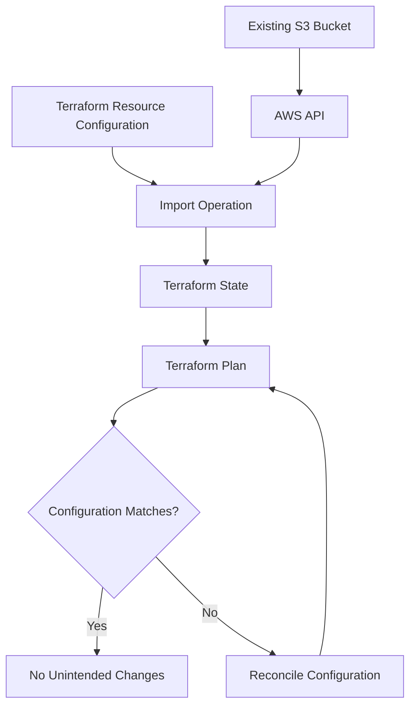
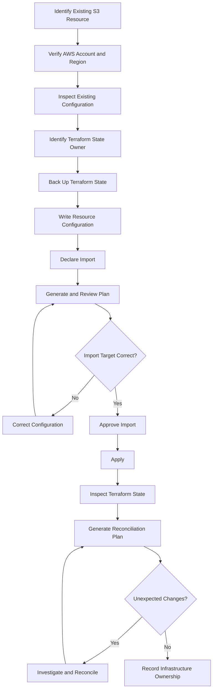

# 12- Importing Existing S3 Resources

## Overview

Importing existing Amazon S3 resources into Terraform allows infrastructure that was created manually, through scripts, or by another deployment system to become managed through Infrastructure as Code (IaC).

This is common in established AWS environments where buckets already contain application data, logs, backups, or business documents. Recreating these buckets through Terraform is usually unnecessary and potentially dangerous. Instead, import the existing resources into Terraform state and define configuration that accurately represents their current settings.

Terraform import connects an existing AWS resource to a resource address in Terraform state. It does not automatically make the resource compliant with the desired configuration, and it does not normally modify the AWS resource during the import operation.

A safe import process must establish three things:

- The correct AWS resource exists and belongs to the intended account and Region.
- The Terraform configuration accurately represents the resource.
- Terraform state associates the remote resource with exactly one Terraform resource address.

This document covers importing S3 buckets and their associated configuration, adopting resources into reusable modules, reconciling configuration drift, and safely managing imported infrastructure in production.

## Understanding Terraform Import

Terraform normally manages resources created through its configuration.

For example:

```hcl
resource "aws_s3_bucket" "application" {
  bucket = "company-application-files-prod"
}
```

When Terraform creates this resource, it records the resource identity and relevant attributes in its state.

However, an existing bucket may have been created outside Terraform:

```bash
aws s3api create-bucket \
  --bucket company-application-files-prod \
  --region ap-south-1 \
  --create-bucket-configuration LocationConstraint=ap-south-1
```

Terraform does not automatically know that this bucket exists.

Import establishes the association between the existing AWS resource and the Terraform resource address.



### What Import Changes

Import primarily changes Terraform state.

It allows Terraform to identify an existing resource as managed by a particular resource address.

It does not automatically:

- Create a new S3 bucket.
- Delete the existing bucket.
- Migrate objects.
- Re-encrypt existing objects.
- Enable versioning.
- Configure lifecycle policies.
- Change bucket policies.
- Enable Block Public Access.
- Correct existing security misconfigurations.

These changes must be handled through normal Terraform configuration and apply operations.

### Why Import Is Important

Import is useful when:

- An S3 bucket was created manually.
- Infrastructure predates Terraform adoption.
- An organization is migrating from manual operations to IaC.
- Existing resources need standardized configuration management.
- A resource was created by another automation system.
- Terraform state was lost but the infrastructure still exists.
- Resources need to be moved into reusable Terraform modules.

Import avoids unnecessary resource recreation and helps establish a single infrastructure management workflow.

## Terraform Import Mechanisms

Terraform supports two primary import approaches.

| Mechanism | Description | Typical use |
|---|---|---|
| CLI import | Imports a resource directly into Terraform state | Manual adoption and recovery |
| Import block | Declares an import operation in Terraform configuration | Reviewed and repeatable infrastructure adoption |

### CLI Import

The traditional command is:

```bash
terraform import RESOURCE_ADDRESS RESOURCE_ID
```

Example:

```bash
terraform import \
  aws_s3_bucket.application \
  company-application-files-prod
```

This associates the existing bucket with:

```hcl
resource "aws_s3_bucket" "application" {
  bucket = "company-application-files-prod"
}
```

CLI import updates Terraform state, but does not generate the complete resource configuration.

You must write and maintain the corresponding `.tf` configuration yourself.

### Declarative Import Blocks

Terraform introduced import blocks in Terraform 1.5.

An import block declares the resource address and the existing resource identifier.

```hcl
import {
  to = aws_s3_bucket.application
  id = "company-application-files-prod"
}
```

The resource configuration must also exist:

```hcl
resource "aws_s3_bucket" "application" {
  bucket = "company-application-files-prod"
}
```

Run:

```bash
terraform plan
```

Terraform displays the proposed import operation.

After reviewing the plan:

```bash
terraform apply
```

The import is performed as part of the apply operation.

Import blocks are particularly useful for code-reviewed adoption because the import declaration can be committed alongside the resource configuration.

### CLI Import vs Import Blocks

| Feature | CLI import | Import block |
|---|---|---|
| Introduced | Earlier Terraform versions | Terraform 1.5 |
| Declared in configuration | No | Yes |
| Updates Terraform state | Yes | Yes, through apply |
| Supports plan review | Not as a separate import plan | Yes |
| Suitable for CI/CD | Possible, but requires careful state handling | Well suited |
| Import declaration remains in code | No | Yes, until removed |
| Generates complete resource configuration automatically | No | Not by default |
| Supports reviewed import workflows | Limited | Yes |

For new infrastructure adoption workflows, import blocks are generally preferable because the operation can be reviewed through a normal Terraform plan.

## Prerequisites Before Importing S3 Resources

Importing an existing bucket into Terraform should begin with an inventory and ownership review.

### Verify the AWS Account

Confirm the active AWS identity:

```bash
aws sts get-caller-identity
```

Example output:

```json
{
  "UserId": "AIDAEXAMPLE",
  "Account": "123456789012",
  "Arn": "arn:aws:iam::123456789012:user/infrastructure-admin"
}
```

Verify that the account is the intended owner of the bucket.

For automated deployments, prefer an assumed IAM role or OIDC-based workload identity rather than long-lived IAM user credentials.

### Verify the AWS Region

```bash
aws configure get region
```

Inspect the bucket's actual Region:

```bash
aws s3api get-bucket-location \
  --bucket company-application-files-prod
```

The `LocationConstraint` may be `null` for the `us-east-1` Region.

Do not infer the bucket Region from the CLI's configured default Region.

### Inspect the Existing Bucket

Verify that the bucket exists and is accessible:

```bash
aws s3api head-bucket \
  --bucket company-application-files-prod
```

Inspect its configuration:

```bash
aws s3api get-bucket-versioning \
  --bucket company-application-files-prod

aws s3api get-bucket-encryption \
  --bucket company-application-files-prod

aws s3api get-public-access-block \
  --bucket company-application-files-prod

aws s3api get-bucket-ownership-controls \
  --bucket company-application-files-prod
```

Inspect lifecycle configuration:

```bash
aws s3api get-bucket-lifecycle-configuration \
  --bucket company-application-files-prod
```

Inspect the bucket policy:

```bash
aws s3api get-bucket-policy \
  --bucket company-application-files-prod
```

Some inspection commands return an error when an optional configuration is not present. Distinguish an absent configuration from an authorization failure.

### Build an Import Inventory

Before importing, document the resources that need Terraform management.

| Resource | Existing configuration to inspect | Typical import identifier |
|---|---|---|
| S3 bucket | Bucket identity and Region | Bucket name |
| Versioning | Versioning status | Bucket name |
| Encryption | Default encryption rules | Bucket name |
| Public access block | Four public-access settings | Bucket name |
| Ownership controls | Object ownership mode | Bucket name |
| Lifecycle configuration | Lifecycle rules | Bucket name |
| Bucket policy | Resource policy | Bucket name |
| Logging configuration | Destination bucket and prefix | Bucket name |
| Replication configuration | Replication role and rules | Bucket name |
| S3 object | Bucket, key, and version | Provider-specific object identifier |

The exact import identifier is resource-specific. Confirm the import format for the AWS provider version being used before importing associated resources.

## Importing an Existing S3 Bucket

Consider an existing bucket:

```text
company-application-files-prod
```

It was created manually and currently stores application documents.

The objective is to manage it through Terraform without deleting or recreating the bucket.

### Define the Resource Configuration

Create a Terraform resource:

```hcl
resource "aws_s3_bucket" "application" {
  bucket        = "company-application-files-prod"
  force_destroy = false

  tags = {
    Environment = "production"
    ManagedBy   = "Terraform"
    Application = "document-service"
  }

  lifecycle {
    prevent_destroy = true
  }
}
```

This configuration expresses the intended Terraform management settings.

It is important to distinguish the desired configuration from the existing AWS configuration. If the bucket has different tags or other settings, the next plan may propose updates.

### Import Using the CLI

Initialize Terraform:

```bash
terraform init
```

Import the bucket:

```bash
terraform import \
  aws_s3_bucket.application \
  company-application-files-prod
```

Inspect the imported state:

```bash
terraform state show aws_s3_bucket.application
```

Terraform now associates the existing bucket with the resource address.

### Verify the Import

List managed resources:

```bash
terraform state list
```

Expected resource address:

```text
aws_s3_bucket.application
```

Generate a plan:

```bash
terraform plan
```

Review all proposed changes.

The ideal result is no unexpected changes. If Terraform proposes updates, investigate whether the configuration differs from the existing resource or whether provider defaults and computed attributes explain the difference.

## Importing with Declarative Import Blocks

Import blocks provide a configuration-driven approach.

### Define the Resource

```hcl
resource "aws_s3_bucket" "application" {
  bucket        = "company-application-files-prod"
  force_destroy = false

  tags = {
    Environment = "production"
    ManagedBy   = "Terraform"
    Application = "document-service"
  }

  lifecycle {
    prevent_destroy = true
  }
}
```

### Add the Import Block

```hcl
import {
  to = aws_s3_bucket.application
  id = "company-application-files-prod"
}
```

The import block tells Terraform which existing resource should be associated with the configured address.

### Generate and Review the Plan

```bash
terraform init
terraform plan
```

Terraform should identify the resource as an import operation.

Review:

- Target resource address.
- Existing bucket identity.
- AWS account and Region.
- Proposed configuration changes.
- Unexpected replacement or deletion actions.

### Apply the Import

```bash
terraform apply
```

Terraform imports the bucket into state and performs any other planned actions.

This distinction is important: an import block can be part of a plan that also proposes normal infrastructure changes. Do not assume that applying an import plan performs only a state association.

### Remove the Import Block

After a successful import, the import block can be removed if it is no longer needed.

Keep the resource configuration:

```hcl
resource "aws_s3_bucket" "application" {
  bucket        = "company-application-files-prod"
  force_destroy = false

  lifecycle {
    prevent_destroy = true
  }
}
```

Removing the import block does not remove the imported resource from Terraform state.

Import blocks can also be retained as part of a documented migration history, but they should not be treated as permanent resource configuration.

## Importing Associated S3 Configuration Resources

An S3 bucket and its supporting configuration are separate Terraform resources.

Importing `aws_s3_bucket` does not automatically import versioning, encryption, lifecycle configuration, ownership controls, or bucket policies.

Each independently managed resource must be imported into its corresponding Terraform address.

### Importing Versioning

Existing configuration:

```hcl
resource "aws_s3_bucket_versioning" "application" {
  bucket = aws_s3_bucket.application.id

  versioning_configuration {
    status = "Enabled"
  }
}
```

CLI import:

```bash
terraform import \
  aws_s3_bucket_versioning.application \
  company-application-files-prod
```

Verify:

```bash
aws s3api get-bucket-versioning \
  --bucket company-application-files-prod
```

Do not assume versioning is enabled simply because the bucket has been imported.

### Importing Encryption Configuration

Example resource:

```hcl
resource "aws_s3_bucket_server_side_encryption_configuration" "application" {
  bucket = aws_s3_bucket.application.id

  rule {
    apply_server_side_encryption_by_default {
      sse_algorithm = "AES256"
    }
  }
}
```

CLI import:

```bash
terraform import \
  aws_s3_bucket_server_side_encryption_configuration.application \
  company-application-files-prod
```

Inspect the existing configuration before writing the resource block:

```bash
aws s3api get-bucket-encryption \
  --bucket company-application-files-prod
```

If the bucket uses SSE-KMS, the Terraform configuration must represent the correct key and relevant encryption settings.

Importing encryption configuration does not re-encrypt existing objects.

### Importing Block Public Access

Example:

```hcl
resource "aws_s3_bucket_public_access_block" "application" {
  bucket = aws_s3_bucket.application.id

  block_public_acls       = true
  ignore_public_acls      = true
  block_public_policy     = true
  restrict_public_buckets = true
}
```

CLI import:

```bash
terraform import \
  aws_s3_bucket_public_access_block.application \
  company-application-files-prod
```

Verify:

```bash
aws s3api get-public-access-block \
  --bucket company-application-files-prod
```

Bucket-level settings do not replace account-level Block Public Access controls. Inspect both scopes when evaluating effective public-access behavior.

### Importing Object Ownership Controls

Example:

```hcl
resource "aws_s3_bucket_ownership_controls" "application" {
  bucket = aws_s3_bucket.application.id

  rule {
    object_ownership = "BucketOwnerEnforced"
  }
}
```

CLI import:

```bash
terraform import \
  aws_s3_bucket_ownership_controls.application \
  company-application-files-prod
```

Verify:

```bash
aws s3api get-bucket-ownership-controls \
  --bucket company-application-files-prod
```

If the existing bucket uses `BucketOwnerEnforced`, ACLs are disabled. Do not introduce ACL-dependent configuration without understanding the ownership implications.

### Importing Lifecycle Configuration

Example:

```hcl
resource "aws_s3_bucket_lifecycle_configuration" "application" {
  bucket = aws_s3_bucket.application.id

  rule {
    id     = "archive-application-files"
    status = "Enabled"

    filter {
      prefix = "archive/"
    }

    transition {
      days          = 30
      storage_class = "STANDARD_IA"
    }

    expiration {
      days = 365
    }
  }
}
```

CLI import:

```bash
terraform import \
  aws_s3_bucket_lifecycle_configuration.application \
  company-application-files-prod
```

Inspect existing lifecycle rules:

```bash
aws s3api get-bucket-lifecycle-configuration \
  --bucket company-application-files-prod
```

Lifecycle rules can cause asynchronous transitions and expiration. Replacing an existing lifecycle configuration with an incomplete Terraform definition may affect a large number of objects.

Reproduce the complete intended rule set before applying changes.

### Importing Bucket Policy

Example:

```hcl
resource "aws_s3_bucket_policy" "application" {
  bucket = aws_s3_bucket.application.id

  policy = data.aws_iam_policy_document.application.json
}
```

CLI import:

```bash
terraform import \
  aws_s3_bucket_policy.application \
  company-application-files-prod
```

Inspect the current policy:

```bash
aws s3api get-bucket-policy \
  --bucket company-application-files-prod \
  --query Policy \
  --output text
```

Represent the existing policy accurately before applying a new one.

A bucket should normally have one authoritative Terraform resource managing its bucket policy. Multiple `aws_s3_bucket_policy` resources targeting the same bucket can overwrite one another.

### Importing Logging Configuration

Example:

```hcl
resource "aws_s3_bucket_logging" "application" {
  bucket = aws_s3_bucket.application.id

  target_bucket = "company-central-access-logs"
  target_prefix = "application/"
}
```

CLI import:

```bash
terraform import \
  aws_s3_bucket_logging.application \
  company-application-files-prod
```

Inspect the current configuration:

```bash
aws s3api get-bucket-logging \
  --bucket company-application-files-prod
```

Verify that the destination bucket exists and that its policy and logging configuration support the intended delivery model.

### Importing Replication Configuration

Example:

```hcl
resource "aws_s3_bucket_replication_configuration" "application" {
  bucket = aws_s3_bucket.application.id
  role   = aws_iam_role.replication.arn

  rule {
    id     = "replicate-application-data"
    status = "Enabled"

    filter {}

    destination {
      bucket = "arn:aws:s3:::company-application-files-replica"
    }
  }

  depends_on = [
    aws_s3_bucket_versioning.application
  ]
}
```

CLI import:

```bash
terraform import \
  aws_s3_bucket_replication_configuration.application \
  company-application-files-prod
```

Inspect existing replication:

```bash
aws s3api get-bucket-replication \
  --bucket company-application-files-prod
```

Replication configuration depends on additional resources and permissions.

Before importing and managing it, verify:

- Source bucket versioning.
- Destination bucket versioning.
- Replication IAM role.
- Destination bucket policy.
- KMS permissions, if applicable.
- Existing replication rules and filters.
- Ownership and delete-marker behavior.

Importing a replication configuration does not prove that replication is functioning or that historical objects have been replicated.

## Importing Multiple S3 Resources

An existing production bucket commonly has several associated Terraform resources.

A declarative import configuration can manage them together.

```hcl
resource "aws_s3_bucket" "application" {
  bucket        = "company-application-files-prod"
  force_destroy = false

  lifecycle {
    prevent_destroy = true
  }
}

resource "aws_s3_bucket_versioning" "application" {
  bucket = aws_s3_bucket.application.id

  versioning_configuration {
    status = "Enabled"
  }
}

resource "aws_s3_bucket_server_side_encryption_configuration" "application" {
  bucket = aws_s3_bucket.application.id

  rule {
    apply_server_side_encryption_by_default {
      sse_algorithm = "AES256"
    }
  }
}

resource "aws_s3_bucket_public_access_block" "application" {
  bucket = aws_s3_bucket.application.id

  block_public_acls       = true
  ignore_public_acls      = true
  block_public_policy     = true
  restrict_public_buckets = true
}

resource "aws_s3_bucket_ownership_controls" "application" {
  bucket = aws_s3_bucket.application.id

  rule {
    object_ownership = "BucketOwnerEnforced"
  }
}

import {
  to = aws_s3_bucket.application
  id = "company-application-files-prod"
}

import {
  to = aws_s3_bucket_versioning.application
  id = "company-application-files-prod"
}

import {
  to = aws_s3_bucket_server_side_encryption_configuration.application
  id = "company-application-files-prod"
}

import {
  to = aws_s3_bucket_public_access_block.application
  id = "company-application-files-prod"
}

import {
  to = aws_s3_bucket_ownership_controls.application
  id = "company-application-files-prod"
}
```

This example assumes that the existing bucket already has the represented configuration.

If its actual configuration differs, adjust the resource definitions before applying.

Do not use this example as a reason to enable versioning, change ownership, or modify encryption during an import without reviewing the operational impact.

## Importing S3 Resources into Terraform Modules

Production infrastructure commonly uses reusable Terraform modules.

An existing bucket can be imported directly into a module resource address.

Consider this module structure:

```text
s3-infrastructure/
├── main.tf
├── providers.tf
├── variables.tf
├── outputs.tf
├── versions.tf
└── modules/
    └── s3-bucket/
        ├── main.tf
        ├── variables.tf
        └── outputs.tf
```

The child module contains:

```hcl
resource "aws_s3_bucket" "this" {
  bucket        = var.bucket_name
  force_destroy = false

  tags = var.tags

  lifecycle {
    prevent_destroy = true
  }
}
```

The root module calls it:

```hcl
module "application_bucket" {
  source = "./modules/s3-bucket"

  bucket_name = "company-application-files-prod"

  tags = {
    Environment = "production"
    ManagedBy   = "Terraform"
  }
}
```

The resource address is:

```text
module.application_bucket.aws_s3_bucket.this
```

### Import Using the CLI

```bash
terraform import \
  module.application_bucket.aws_s3_bucket.this \
  company-application-files-prod
```

### Import Using a Block

```hcl
import {
  to = module.application_bucket.aws_s3_bucket.this
  id = "company-application-files-prod"
}
```

Run:

```bash
terraform plan
terraform apply
```

The import target must match the actual resource address in the module.

### Importing Resources Created with for_each

Suppose buckets are managed using:

```hcl
module "s3_buckets" {
  for_each = var.buckets

  source = "./modules/s3-bucket"

  bucket_name = each.value.bucket_name
  tags        = each.value.tags
}
```

The address for the production bucket might be:

```text
module.s3_buckets["production"].aws_s3_bucket.this
```

CLI import:

```bash
terraform import \
  'module.s3_buckets["production"].aws_s3_bucket.this' \
  company-application-files-prod
```

Import block:

```hcl
import {
  to = module.s3_buckets["production"].aws_s3_bucket.this
  id = "company-application-files-prod"
}
```

Use the exact instance key and resource address from the configuration.

Incorrect quoting or an incorrect instance key can cause Terraform to target a different address or reject the import.

## Generating Configuration for Existing Resources

Terraform can generate an initial resource configuration from an import block.

This is useful when adopting infrastructure whose existing configuration is not fully documented.

Create an import block:

```hcl
import {
  to = aws_s3_bucket.application
  id = "company-application-files-prod"
}
```

Generate configuration:

```bash
terraform plan \
  -generate-config-out=generated.tf
```

Terraform attempts to generate configuration for resources being imported when their resource configuration is not already defined.

Review the generated file before using it.

Generated configuration may include:

- Provider-computed attributes.
- Defaults.
- Values that are not appropriate as long-term configuration.
- Arguments that should be represented as variables.
- Settings that need to be separated into dedicated Terraform resources.

For S3, configuration is often distributed across multiple resources. A generated bucket resource does not necessarily reconstruct every associated configuration resource.

A production adoption workflow should:

1. Generate the initial configuration.
2. Inspect the existing AWS resource.
3. Remove unnecessary computed or redundant attributes.
4. Introduce meaningful variables and tags.
5. Separate supporting S3 configuration resources.
6. Review security and retention settings.
7. Generate a fresh plan.
8. Apply only after the proposed changes are understood.

Do not treat generated configuration as automatically production-ready.

## Importing Existing S3 Objects

An S3 bucket contains objects that can also be managed through Terraform using `aws_s3_object`.

Example:

```hcl
resource "aws_s3_object" "application_document" {
  bucket = aws_s3_bucket.application.id
  key    = "documents/example.pdf"

  source = "${path.module}/files/example.pdf"

  etag = filemd5("${path.module}/files/example.pdf")
}
```

An object import requires the provider-specific object import identifier. For the AWS provider, the common form is:

```text
bucket-name/object-key
```

Example:

```bash
terraform import \
  aws_s3_object.application_document \
  company-application-files-prod/documents/example.pdf
```

Confirm the exact import format for the installed AWS provider version, especially when object keys contain special characters.

### Important Object Management Considerations

Managing individual S3 objects through Terraform is different from managing bucket infrastructure.

Consider the following:

- Terraform must be able to identify the object.
- The configured object key must match the existing key.
- Object metadata and content properties must be represented appropriately.
- A local `source` file must exist if Terraform is expected to manage object content from that file.
- Changing content can result in an object upload.
- Removing the resource from configuration can result in object deletion unless the resource is retained in state or deliberately removed from management.

For large application datasets, backups, user uploads, and frequently changing objects, Terraform is usually not the right object lifecycle manager.

Use Terraform for infrastructure configuration and application code or dedicated data pipelines for object operations.

## Importing Resources into an Existing Terraform State

Before importing, understand which state will receive the resource.

Terraform state is associated with a backend and a workspace. Importing into the wrong state can create conflicting ownership.

Inspect the active workspace:

```bash
terraform workspace show
```

List existing resources:

```bash
terraform state list
```

Inspect the backend configuration and environment-specific state key.

For example:

```hcl
terraform {
  backend "s3" {
    bucket       = "company-terraform-state"
    key          = "s3/production/terraform.tfstate"
    region       = "ap-south-1"
    encrypt      = true
    use_lockfile = true
  }
}
```

Initialize the intended backend:

```bash
terraform init
```

Then import the resource into the correct state.

### State Backup

Before importing production resources, create a protected state backup:

```bash
terraform state pull > state-backup-before-import.json
```

Store the backup in an approved secure location.

Terraform state can contain sensitive information. Do not commit state backups to Git or expose them in CI/CD logs.

A state backup is a recovery aid, not a substitute for S3 data backups or versioning.

## Importing a Resource Already Managed by Another State

An existing S3 bucket may already be managed by another Terraform configuration.

Do not import it into a second state without first resolving ownership.

Two Terraform states managing the same remote resource can cause:

- Conflicting updates.
- Unexpected deletion.
- State inconsistency.
- Unpredictable deployment behavior.
- Loss of ownership boundaries.

If the resource needs to move between Terraform states, use a deliberate state migration process.

A high-level migration should:

1. Identify the current state owner.
2. Back up both source and destination states.
3. Freeze deployments that could modify the resource.
4. Remove the resource from the old state without deleting it.
5. Import it into the destination state.
6. Confirm the new configuration matches the resource.
7. Generate plans from both configurations.
8. Verify that the old state no longer manages it.

A possible source-state operation is:

```bash
terraform state rm aws_s3_bucket.application
```

This removes the state association without deleting the AWS bucket.

Then import into the destination configuration:

```bash
terraform import \
  aws_s3_bucket.application \
  company-application-files-prod
```

This is a sensitive migration procedure. Use a maintenance window or deployment freeze where necessary, and verify state backups before proceeding.

## Reconciling Imported Resources

Importing a resource is only the first step.

After import, Terraform configuration and AWS infrastructure must be reconciled.

Generate a plan:

```bash
terraform plan
```

Terraform may propose changes because:

- The resource configuration does not match AWS.
- Tags differ.
- Optional settings are missing.
- Provider defaults differ.
- Computed attributes have changed.
- A supporting configuration resource has not been imported.

### Desired Outcome: No Unintended Changes

For a stable production adoption, the preferred outcome is a plan that contains no unexpected modifications.

If Terraform proposes a change, classify it before applying.

| Plan result | Interpretation | Recommended action |
|---|---|---|
| No changes | Configuration and managed state are aligned | Record successful adoption |
| In-place update | Configuration differs from current infrastructure | Review the exact setting and operational impact |
| Resource replacement | Terraform considers the existing resource incompatible with the configuration | Stop and investigate |
| Resource deletion | Configuration no longer represents a managed resource | Verify ownership and state before proceeding |
| Import plus updates | Import and normal infrastructure changes are planned together | Separate adoption from remediation where possible |

### Separate Import from Remediation

A safer production workflow is to import existing resources without making unrelated configuration changes.

For example:

1. Import the bucket.
2. Import versioning and encryption resources.
3. Import ownership controls and public-access settings.
4. Reconcile the configuration.
5. Confirm a stable plan.
6. Introduce security improvements in a separate reviewed change.

This reduces the risk of accidentally combining resource adoption with destructive infrastructure modifications.

## Importing Resources with Terraform State Commands

Terraform provides state commands for inspecting and managing resource associations.

### List Resources

```bash
terraform state list
```

### Inspect a Resource

```bash
terraform state show aws_s3_bucket.application
```

### Remove a Resource from State

```bash
terraform state rm aws_s3_bucket.application
```

This removes the resource from Terraform state without deleting the remote S3 bucket.

It is useful when:

- Moving a resource between states.
- Correcting an incorrect resource association.
- Removing Terraform management while retaining the AWS resource.

It is not equivalent to importing or deleting the resource.

### Move a Resource Address

If a resource is renamed or moved into a module, use a `moved` block where appropriate.

Example:

```hcl
moved {
  from = aws_s3_bucket.application
  to   = module.application_bucket.aws_s3_bucket.this
}
```

Terraform can then update the resource address in state during normal planning and application.

For a one-time state operation, the equivalent command is:

```bash
terraform state mv \
  aws_s3_bucket.application \
  module.application_bucket.aws_s3_bucket.this
```

Use state moves when the same remote resource is changing its Terraform address. Do not use import as a substitute for a normal resource-address migration when the resource is already correctly tracked.

## Production Import Workflow

Importing production S3 infrastructure should be controlled and auditable.



### Recommended Adoption Procedure

**Preparation**

- Verify the bucket's AWS account and Region.
- Inspect the bucket and all relevant configuration.
- Identify the current Terraform state owner.
- Confirm the resource is not already managed by another state.
- Back up the destination state.
- Freeze competing infrastructure changes during the migration.

**Import**

- Define the correct Terraform resource addresses.
- Use import blocks where possible.
- Import the bucket and associated configuration resources separately.
- Review the plan before applying.
- Verify the resulting state associations.

**Reconciliation**

- Run a fresh Terraform plan.
- Investigate every proposed update, deletion, or replacement.
- Separate desired security improvements from the adoption operation.
- Apply only approved changes.
- Verify the resulting AWS configuration.

**Ownership and operations**

- Document the Terraform state responsible for the bucket.
- Remove obsolete manual deployment procedures.
- Restrict changes to the approved infrastructure workflow.
- Monitor drift.
- Keep state backups and recovery procedures available.

## Import Permissions and Security

The identity performing an import needs permissions to read the relevant AWS resources and access the Terraform backend.

### AWS Permissions

The required permissions depend on which resources are being imported.

Examples include:

| Resource | Relevant read permissions |
|---|---|
| Bucket | `s3:ListBucket`, `s3:GetBucketLocation` and relevant bucket configuration reads |
| Versioning | `s3:GetBucketVersioning` |
| Encryption | `s3:GetEncryptionConfiguration` |
| Public access block | `s3:GetBucketPublicAccessBlock` |
| Ownership controls | `s3:GetBucketOwnershipControls` |
| Lifecycle | `s3:GetLifecycleConfiguration` |
| Bucket policy | `s3:GetBucketPolicy` |
| Logging | `s3:GetBucketLogging` |
| Replication | `s3:GetReplicationConfiguration` |
| Objects | `s3:GetObject`, and version-related permissions where required |

The AWS provider may perform additional reads depending on the resource type and provider version.

Import itself does not require permission to create or modify every configuration being read. However, subsequent Terraform plans and applies require the permissions associated with the planned changes.

### Terraform Backend Permissions

When using an S3 backend, the import operation also needs access to the state bucket and lock file.

Depending on the backend configuration, this includes:

- Reading and writing the Terraform state object.
- Reading and writing the lock file.
- Deleting the lock file after the operation.
- Listing the required state prefix where necessary.

Keep state access separate from application access to the S3 bucket being imported.

### Protect Imported State

Terraform state can contain sensitive resource attributes.

Apply the same controls used for normal Terraform state:

- Encryption at rest.
- Restricted IAM access.
- TLS for transport.
- State versioning and recovery.
- Access auditing.
- No public access.
- No credentials committed to source control.

Importing a resource does not make its state data safe automatically.

## Testing and Verification

A successful import command confirms that Terraform accepted the resource association. It does not prove that the complete infrastructure configuration is correct.

Use multiple verification layers.

### Terraform State Verification

```bash
terraform state list
```

Inspect the bucket:

```bash
terraform state show aws_s3_bucket.application
```

Inspect supporting resources:

```bash
terraform state show aws_s3_bucket_versioning.application

terraform state show \
  aws_s3_bucket_server_side_encryption_configuration.application

terraform state show \
  aws_s3_bucket_public_access_block.application
```

### AWS Configuration Verification

```bash
aws s3api get-bucket-versioning \
  --bucket company-application-files-prod

aws s3api get-bucket-encryption \
  --bucket company-application-files-prod

aws s3api get-public-access-block \
  --bucket company-application-files-prod

aws s3api get-bucket-ownership-controls \
  --bucket company-application-files-prod
```

### Plan Verification

```bash
terraform plan
```

For a fully reconciled configuration, the desired outcome is:

```text
No changes. Your infrastructure matches the configuration.
```

A no-change plan is strong evidence that the managed configuration and observed infrastructure are aligned for the resources Terraform tracks. It does not verify every object, application permission, lifecycle execution, or end-to-end workflow.

### Application-Level Verification

For application buckets, test representative operations using the application's actual IAM identity:

- Upload a test object.
- Read the object.
- Inspect its metadata.
- Verify expected encryption.
- Verify denied access for unauthorized identities.
- Confirm that existing application workflows remain functional.

Do not overwrite or delete real production objects as part of an import verification exercise.

## Common Import Mistakes

| Mistake | Impact | Prevention |
|---|---|---|
| Importing into the wrong AWS account | Incorrect resource ownership | Verify `aws sts get-caller-identity` |
| Using the wrong Region | Failed inspection or incorrect provider context | Verify the bucket's actual Region |
| Importing into the wrong state | Conflicting resource management | Inspect backend and workspace first |
| Importing a bucket but not its supporting resources | Incomplete infrastructure management | Inventory and import each resource separately |
| Assuming import generates complete configuration | Missing lifecycle, encryption, and access settings | Write and review the resource configuration |
| Applying immediately after import | Unexpected infrastructure changes | Review the plan before apply |
| Importing a resource already managed elsewhere | Duplicate state ownership | Identify the existing state owner |
| Recreating a bucket instead of importing it | Data loss or service disruption | Import existing production resources |
| Ignoring existing lifecycle rules | Unexpected retention or deletion behavior | Inspect the complete lifecycle configuration |
| Replacing an existing bucket during reconciliation | Potential data loss and downtime | Stop and design a separate migration |
| Managing application objects through Terraform unnecessarily | State growth and deployment overhead | Manage bucket infrastructure separately from application data |
| Sharing state backups or plan files | Sensitive information exposure | Store artifacts securely |

## Production Readiness Checklist

### Before Import

- [ ] AWS account and Region verified.
- [ ] Existing bucket ownership confirmed.
- [ ] Bucket configuration inventoried.
- [ ] Existing Terraform state ownership checked.
- [ ] Correct backend and workspace selected.
- [ ] Terraform state backup created securely.
- [ ] Required AWS and backend permissions verified.
- [ ] Competing infrastructure changes controlled.

### During Import

- [ ] Resource addresses match the Terraform configuration.
- [ ] Import identifiers match the provider's documented format.
- [ ] Bucket and supporting configuration resources are imported separately.
- [ ] Import plan reviewed before apply.
- [ ] No unintended resource creation or replacement.
- [ ] State associations verified after import.

### After Import

- [ ] Terraform configuration reflects existing AWS settings.
- [ ] Versioning and encryption verified.
- [ ] Block Public Access and ownership controls verified.
- [ ] Lifecycle and replication configurations reviewed.
- [ ] Bucket policy and logging configurations reviewed.
- [ ] Fresh Terraform plan reviewed.
- [ ] Application-level access tested.
- [ ] Infrastructure ownership documented.
- [ ] Drift detection and state recovery procedures available.

## Key Takeaways

- Terraform import adopts existing AWS resources into Terraform state; it does not automatically create complete configuration or reconcile the resource with desired settings.
- S3 buckets and their supporting configuration resources must be imported separately using the correct resource addresses and provider-specific identifiers.
- Import blocks provide a reviewable, configuration-driven workflow, while CLI import remains useful for controlled manual adoption and recovery.
- Never import a resource into a second Terraform state without resolving existing ownership; duplicate state management can cause conflicting updates and destructive operations.
- Always back up state, inspect the existing S3 configuration, review the post-import plan, and verify application behavior before treating production infrastructure as successfully adopted.