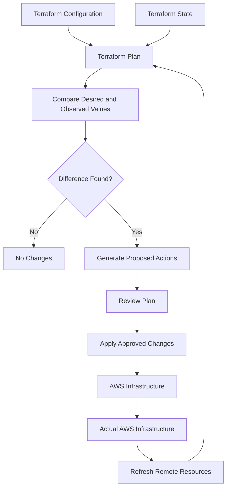
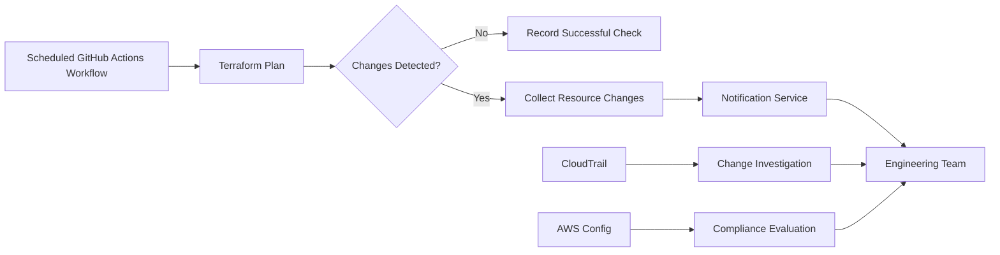

# 13- State Drift Detection and Reconciliation

## Overview

Terraform state drift occurs when the actual infrastructure in AWS differs from the configuration or state Terraform uses to manage it.

For Amazon S3, drift can occur when someone changes bucket settings through the AWS Console, AWS CLI, SDKs, CloudFormation, or another automation system without updating the Terraform configuration.

Examples include:

- Disabling bucket versioning.
- Changing default encryption from SSE-KMS to SSE-S3.
- Modifying Block Public Access settings.
- Updating bucket policies outside Terraform.
- Changing lifecycle rules.
- Modifying replication configuration.
- Changing bucket tags.
- Removing logging configuration.
- Modifying ownership controls.

Drift detection is important because Terraform-managed infrastructure should have a predictable configuration and ownership model. Uncontrolled changes can introduce security vulnerabilities, disrupt application behavior, and create operational inconsistencies.

Terraform provides planning and refresh mechanisms to detect differences between configuration, state, and remote infrastructure.

The objective is not simply to eliminate every difference. It is to identify whether a difference is intentional, unauthorized, temporary, or evidence of a configuration problem, then reconcile it safely.

## Understanding Terraform State Drift

Terraform uses three important representations of infrastructure:

| Component | Responsibility |
|---|---|
| Terraform configuration | Defines the desired infrastructure |
| Terraform state | Records Terraform's understanding of managed resources |
| Actual infrastructure | Represents the resources currently configured in AWS |

Drift can occur when these representations become inconsistent.

### Configuration Drift

Configuration drift occurs when the actual AWS resource differs from the desired Terraform configuration.

Example:

Terraform configuration:

```hcl
resource "aws_s3_bucket_versioning" "application" {
  bucket = aws_s3_bucket.application.id

  versioning_configuration {
    status = "Enabled"
  }
}
```

An administrator disables versioning through the AWS CLI:

```bash
aws s3api put-bucket-versioning \
  --bucket company-application-files-prod \
  --versioning-configuration Status=Suspended
```

The actual AWS configuration now differs from Terraform configuration.

A normal Terraform plan refreshes remote resource information and can identify the discrepancy.

### State Drift

State drift occurs when Terraform's stored state no longer accurately represents the remote resource.

For example:

1. Terraform state records a bucket with versioning enabled.
2. An administrator changes the AWS configuration.
3. Terraform state still contains the previous observed configuration.
4. The next refresh-capable operation reads the updated AWS resource.
5. Terraform identifies the difference.

State is not a continuously synchronized representation of AWS. Terraform normally refreshes managed resources during operations such as planning.

### Configuration Changes vs Infrastructure Drift

Not every Terraform plan difference is infrastructure drift.

Consider these situations:

| Situation | Description |
|---|---|
| Configuration change | A developer modifies a `.tf` file |
| Infrastructure drift | Someone changes an AWS resource outside Terraform |
| State inconsistency | Terraform state no longer accurately represents the remote resource |
| Provider behavior change | A provider upgrade changes how attributes are represented or managed |
| Computed attribute change | AWS returns a value that Terraform calculates or observes rather than directly configuring |

These differences require different remediation strategies.

## How Terraform Detects Drift

Terraform compares the desired configuration with refreshed information about remote resources.



During planning, Terraform generally:

1. Reads the current state.
2. Refreshes managed resources from provider APIs unless refresh is disabled.
3. Evaluates the configuration.
4. Compares desired and observed attributes.
5. Generates proposed actions.
6. Displays the plan for review.

The exact refresh and comparison behavior depends on the resource provider implementation and the command options used.

### Normal Terraform Plan

```bash
terraform plan
```

This is the standard command for detecting infrastructure drift and evaluating configuration changes.

Terraform refreshes managed resources and calculates the actions required to make the infrastructure match the configuration.

Example output:

```text
# aws_s3_bucket_versioning.application will be updated in-place
~ resource "aws_s3_bucket_versioning" "application" {
    versioning_configuration {
      ~ status = "Suspended" -> "Enabled"
    }
  }

Plan: 0 to add, 1 to change, 0 to destroy.
```

This indicates that the actual versioning status differs from the desired configuration.

Review the complete plan before applying it.

### Refreshing State During Planning

Terraform's normal planning behavior includes refreshing remote resources.

The following command explicitly enables refresh:

```bash
terraform plan -refresh=true
```

This is the default behavior for a normal plan.

Avoid disabling refresh during routine drift detection:

```bash
terraform plan -refresh=false
```

With refresh disabled, Terraform uses the existing state snapshot instead of reading current remote resource values.

This can hide infrastructure drift and produce a plan based on stale information.

`-refresh=false` is not a suitable replacement for normal production drift detection.

## S3 Resources Commonly Affected by Drift

S3 configuration is distributed across multiple resource types. Drift detection should cover all resources that Terraform is expected to manage.

| S3 configuration | Terraform resource | Example drift |
|---|---|---|
| Bucket | `aws_s3_bucket` | Tags or bucket attributes changed |
| Versioning | `aws_s3_bucket_versioning` | Versioning suspended |
| Encryption | `aws_s3_bucket_server_side_encryption_configuration` | Default encryption changed |
| Public access block | `aws_s3_bucket_public_access_block` | Public-access protection disabled |
| Ownership controls | `aws_s3_bucket_ownership_controls` | Ownership mode changed |
| Lifecycle | `aws_s3_bucket_lifecycle_configuration` | Rules removed or modified |
| Bucket policy | `aws_s3_bucket_policy` | Policy changed outside Terraform |
| Logging | `aws_s3_bucket_logging` | Logging destination changed |
| Replication | `aws_s3_bucket_replication_configuration` | Replication rule modified |
| Notification | `aws_s3_bucket_notification` | Event destination changed |

A bucket resource being present in Terraform state does not mean every configuration associated with that bucket is managed.

For example, importing `aws_s3_bucket.application` does not automatically manage versioning, encryption, lifecycle, or bucket policy configuration.

Drift detection is only meaningful for resources and attributes that Terraform actually manages and can observe.

## Detecting S3 Configuration Drift with AWS CLI

AWS CLI inspection is useful for confirming the actual configuration independently of Terraform.

Consider the bucket:

```text
company-application-files-prod
```

### Verify Versioning

```bash
aws s3api get-bucket-versioning \
  --bucket company-application-files-prod
```

Expected configuration:

```json
{
  "Status": "Enabled"
}
```

If Terraform expects `Enabled` but AWS returns `Suspended`, investigate the change before applying a correction.

### Verify Encryption

```bash
aws s3api get-bucket-encryption \
  --bucket company-application-files-prod
```

Inspect:

- Encryption algorithm.
- KMS key identifier, if applicable.
- Bucket Key configuration.
- Number and structure of encryption rules.

### Verify Public Access Block

```bash
aws s3api get-public-access-block \
  --bucket company-application-files-prod
```

Expected production settings commonly include:

```json
{
  "PublicAccessBlockConfiguration": {
    "BlockPublicAcls": true,
    "IgnorePublicAcls": true,
    "BlockPublicPolicy": true,
    "RestrictPublicBuckets": true
  }
}
```

Account-level Block Public Access settings should also be considered.

### Verify Ownership Controls

```bash
aws s3api get-bucket-ownership-controls \
  --bucket company-application-files-prod
```

Inspect the ownership mode and compare it with the Terraform configuration.

### Verify Lifecycle Configuration

```bash
aws s3api get-bucket-lifecycle-configuration \
  --bucket company-application-files-prod
```

Compare the complete rule set:

- Rule IDs.
- Enabled or disabled status.
- Prefix or filter conditions.
- Current-version transitions.
- Expiration settings.
- Noncurrent-version transitions and expiration.
- Incomplete multipart upload cleanup.

Lifecycle configuration changes can affect large numbers of objects and should be reviewed carefully.

### Verify Bucket Policy

```bash
aws s3api get-bucket-policy \
  --bucket company-application-files-prod \
  --query Policy \
  --output text
```

Compare the policy with the Terraform-managed policy document.

Pay particular attention to:

- Principal changes.
- New wildcard permissions.
- Removed explicit denies.
- Changed resource ARNs.
- Conditions involving encryption, TLS, or network restrictions.
- Cross-account access.

### Verify Replication

```bash
aws s3api get-bucket-replication \
  --bucket company-application-files-prod
```

Compare the replication role, destination, filters, and rule status.

The command returns an error if replication configuration is absent. Determine whether that absence is expected before treating it as drift.

## Reconciliation Strategies

Detecting drift does not automatically mean that Terraform should overwrite the actual AWS configuration.

The correct response depends on why the change occurred and which system should own the resource configuration.

There are three common reconciliation strategies.

### Reconcile AWS to Terraform

Use this when the Terraform configuration represents the approved desired state and the AWS change was unauthorized or accidental.

Example:

- Terraform expects versioning enabled.
- An administrator accidentally suspends versioning.
- The security requirement still requires versioning.
- Terraform should restore the approved configuration.

Run:

```bash
terraform plan
```

Review the proposed change:

```text
versioning_configuration {
  status = "Suspended" -> "Enabled"
}
```

Apply only after confirming that the proposed action is correct:

```bash
terraform apply
```

Terraform updates AWS to match the configuration.

### Reconcile Terraform to AWS

Use this when the AWS change is intentional and approved.

Example:

- The organization approves a new lifecycle policy.
- An authorized team updates the bucket configuration through a controlled AWS process.
- Terraform should become the authoritative representation of that approved setting.

Update the Terraform configuration to match the intended AWS configuration.

Then run:

```bash
terraform plan
```

The goal is to produce a plan without unintended changes.

This strategy is appropriate when the actual infrastructure change is the new desired state.

### Reconcile State Without Changing AWS

Sometimes Terraform state needs to be updated to reflect an existing remote configuration without changing the infrastructure.

Terraform provides refresh-only planning for this purpose.

```bash
terraform plan -refresh-only
```

Review the proposed state changes:

```bash
terraform apply -refresh-only
```

This updates Terraform state to reflect the observed remote infrastructure.

It does not change AWS infrastructure to match the Terraform configuration.

This distinction is critical:

| Command | Purpose |
|---|---|
| `terraform plan` | Detect differences and propose infrastructure changes |
| `terraform apply` | Apply approved infrastructure changes |
| `terraform plan -refresh-only` | Preview state updates based on remote observations |
| `terraform apply -refresh-only` | Update state to reflect remote observations |

Refresh-only operations should be used when accepting the observed infrastructure as the new state representation is intentional.

They do not automatically update the `.tf` configuration. If configuration still differs, a subsequent normal plan may continue to propose changes.

## Refresh-Only Reconciliation Example

Assume Terraform state records:

```hcl
resource "aws_s3_bucket_versioning" "application" {
  bucket = aws_s3_bucket.application.id

  versioning_configuration {
    status = "Enabled"
  }
}
```

An approved external operation changes versioning to suspended.

The actual AWS configuration becomes:

```json
{
  "Status": "Suspended"
}
```

If the suspension is intentional and should become the new desired state, update the Terraform configuration:

```hcl
resource "aws_s3_bucket_versioning" "application" {
  bucket = aws_s3_bucket.application.id

  versioning_configuration {
    status = "Suspended"
  }
}
```

Then run:

```bash
terraform plan
```

If the remote configuration and the updated configuration agree, Terraform should not propose an unnecessary versioning change.

A refresh-only operation may also be useful to update the state snapshot before or during this reconciliation, but it does not replace updating the configuration.

## Detecting Drift in Terraform CI/CD

Drift detection should be integrated into infrastructure management workflows.

A CI/CD pipeline can periodically run Terraform plans against production infrastructure and report unexpected changes without automatically applying them.

### Basic Drift Detection Commands

```bash
terraform init -input=false

terraform validate

terraform plan \
  -input=false \
  -detailed-exitcode \
  -out=drift.tfplan
```

The `-detailed-exitcode` option provides useful exit codes:

| Exit code | Meaning |
|---|---|
| `0` | No changes detected |
| `1` | Error |
| `2` | Changes detected |

A plan with changes is not automatically proof of out-of-band drift. It may also contain expected configuration changes from the current Git revision.

A scheduled drift workflow should normally run against the approved production branch and configuration revision.

### GitHub Actions Example

```yaml
name: Terraform Drift Detection

on:
  schedule:
    - cron: "0 2 * * *"
  workflow_dispatch:

permissions:
  contents: read
  id-token: write

jobs:
  drift-detection:
    runs-on: ubuntu-latest

    defaults:
      run:
        working-directory: 06-Deployment/05-Amazon-S3/02-Terraform

    steps:
      - name: Checkout repository
        uses: actions/checkout@v4

      - name: Configure AWS credentials
        uses: aws-actions/configure-aws-credentials@v4
        with:
          role-to-assume: ${{ vars.AWS_TERRAFORM_ROLE_ARN }}
          aws-region: ap-south-1

      - name: Set up Terraform
        uses: hashicorp/setup-terraform@v3
        with:
          terraform_version: "1.10.0"

      - name: Initialize Terraform
        run: terraform init -input=false

      - name: Validate configuration
        run: terraform validate

      - name: Detect drift
        id: drift
        continue-on-error: true
        run: |
          terraform plan \
            -input=false \
            -detailed-exitcode \
            -out=drift.tfplan
          echo "exit_code=$?" >> "$GITHUB_OUTPUT"

      - name: Report drift
        if: always()
        run: |
          echo "Terraform drift check exit code: ${{ steps.drift.outputs.exit_code }}"

      - name: Fail on drift or plan error
        if: steps.drift.outputs.exit_code != '0'
        run: |
          echo "Terraform changes detected or plan failed."
          exit 1
```

This is an illustrative workflow. A production implementation should distinguish plan errors from detected changes and send the appropriate notification.

The `continue-on-error` setting allows the workflow to capture the plan exit code, but the reporting step must not treat an error as ordinary drift.

### Production CI/CD Considerations

- Pin third-party GitHub Actions to verified full commit SHAs.
- Use OIDC federation and short-lived AWS credentials.
- Restrict the Terraform role to the required resources and operations.
- Run drift detection against a stable production configuration revision.
- Protect Terraform state with encryption, access controls, and locking.
- Avoid concurrent apply and drift workflows.
- Do not automatically apply every detected change.
- Store plan artifacts securely and retain them only as long as necessary.
- Treat plan files and state files as sensitive artifacts.
- Send notifications containing the affected resource addresses and relevant change summaries.
- Require human review for security-sensitive or destructive changes.

A scheduled drift check should generally detect and report differences. Remediation should follow the organization's infrastructure change process.

## Automating Drift Detection with Terraform Plan JSON

Terraform can produce machine-readable plan output.

Generate a plan:

```bash
terraform plan -out=drift.tfplan
```

Convert it to JSON:

```bash
terraform show -json drift.tfplan > drift.json
```

A plan JSON file contains resource changes and their proposed actions.

For example, a resource change may contain:

```json
{
  "address": "aws_s3_bucket_versioning.application",
  "mode": "managed",
  "type": "aws_s3_bucket_versioning",
  "name": "application",
  "change": {
    "actions": [
      "update"
    ]
  }
}
```

A Python script can inspect the plan and identify changes affecting S3 resources.

```python
import json
import sys
from pathlib import Path


def inspect_plan(plan_path: Path) -> list[dict]:
    with plan_path.open(encoding="utf-8") as file:
        plan = json.load(file)

    changes = []

    for resource in plan.get("resource_changes", []):
        resource_type = resource.get("type", "")
        actions = resource.get("change", {}).get("actions", [])

        if not resource_type.startswith("aws_s3_"):
            continue

        if actions == ["no-op"]:
            continue

        changes.append(
            {
                "address": resource.get("address"),
                "type": resource_type,
                "actions": actions,
            }
        )

    return changes


def main() -> int:
    plan_path = Path(sys.argv[1]) if len(sys.argv) > 1 else Path("drift.json")

    if not plan_path.is_file():
        print(f"Plan file not found: {plan_path}")
        return 2

    try:
        changes = inspect_plan(plan_path)
    except (json.JSONDecodeError, OSError) as exc:
        print(f"Unable to read Terraform plan: {exc}")
        return 2

    if not changes:
        print("No S3 resource changes found.")
        return 0

    print("S3 resource changes detected:")

    for change in changes:
        print(f"- {change['address']}")
        print(f"  Type: {change['type']}")
        print(f"  Actions: {', '.join(change['actions'])}")

    return 1


if __name__ == "__main__":
    raise SystemExit(main())
```

Run:

```bash
python inspect_s3_drift.py drift.json
```

This script identifies planned changes to managed S3 resources. It does not independently prove that every change is out-of-band drift.

For example, a developer may have intentionally changed the Terraform configuration in the current commit.

A more advanced policy engine can compare the plan against an approved baseline, classify actions, and enforce rules for security-sensitive resources.

### Important Plan JSON Considerations

Terraform plan JSON can contain sensitive values, even when normal CLI output marks them as sensitive.

Treat it as confidential infrastructure data.

Also consider:

- Resource changes may contain nested module addresses.
- Replacement actions can contain both delete and create.
- Some attributes are unknown until apply.
- Data sources and provider-computed values need careful interpretation.
- Resource type filtering should include all relevant S3 provider resources.
- A plan may contain changes unrelated to drift.

Do not use a simple resource-change count as the sole basis for automatic production remediation.

## S3 Drift Monitoring Outside Terraform

Terraform detects drift during its own planning and refresh operations. It is not a continuous monitoring service.

AWS-native auditing and configuration tools can provide additional visibility into changes made outside Terraform.

### AWS CloudTrail

CloudTrail records supported AWS API activity.

It can help identify who changed an S3 configuration and when the change occurred.

Examples of relevant API operations include:

- `PutBucketVersioning`
- `PutBucketEncryption`
- `PutPublicAccessBlock`
- `PutBucketPolicy`
- `PutBucketLifecycleConfiguration`
- `PutBucketReplication`
- `PutBucketOwnershipControls`

CloudTrail event history can be inspected through the AWS CLI:

```bash
aws cloudtrail lookup-events \
  --lookup-attributes \
  AttributeKey=EventName,AttributeValue=PutBucketVersioning
```

For longer-term investigation, configure an appropriate trail and centralize its logs.

CloudTrail provides change evidence, but it does not itself reconcile Terraform configuration.

### AWS Config

AWS Config can record resource configuration changes and evaluate compliance against supported rules.

For S3, it can help monitor security and configuration requirements such as:

- Bucket public-access configuration.
- Bucket encryption.
- Versioning.
- Logging.
- Bucket policy compliance.

AWS Config and Terraform serve different purposes:

| Capability | Terraform | AWS Config |
|---|---|---|
| Desired infrastructure definition | Yes | No |
| Infrastructure deployment | Yes | No |
| State management | Yes | No |
| Drift detection | During refresh-capable operations | Configuration recording and evaluation |
| Compliance evaluation | Through plans and external policy tools | Managed and custom rules |
| Remediation | Apply approved configuration | Supported remediation actions or automation |
| Change attribution | Not its primary purpose | Can be correlated with recorded configuration and CloudTrail |

Use both when the environment requires infrastructure lifecycle management and independent compliance monitoring.

### CloudWatch and Notifications

Drift detection results can be published to an operational notification workflow.

A typical architecture is:



Possible notification destinations include:

- Amazon SNS.
- Slack through an approved integration.
- Email.
- Incident management platforms.
- Centralized security monitoring systems.

Notifications should identify the affected resource and provide enough information to begin investigation without exposing sensitive state or plan data.

## Handling Common S3 Drift Scenarios

### Versioning Suspended Outside Terraform

**Expected configuration:**

```hcl
versioning_configuration {
  status = "Enabled"
}
```

**Observed configuration:**

```json
{
  "Status": "Suspended"
}
```

**Investigation:**

```bash
aws s3api get-bucket-versioning \
  --bucket company-application-files-prod
```

Check CloudTrail for the API operation and identify the change source.

**Reconciliation:**

If versioning must remain enabled, restore the approved Terraform configuration:

```bash
terraform plan
terraform apply
```

Remember that versioning cannot be returned to the original unversioned state after being enabled. Suspending versioning does not remove existing object versions.

### Encryption Configuration Changed

**Expected configuration:**

```hcl
sse_algorithm = "aws:kms"
```

**Observed configuration:**

```json
{
  "ServerSideEncryptionConfiguration": {
    "Rules": [
      {
        "ApplyServerSideEncryptionByDefault": {
          "SSEAlgorithm": "AES256"
        }
      }
    ]
  }
}
```

**Investigation:**

```bash
aws s3api get-bucket-encryption \
  --bucket company-application-files-prod
```

Determine whether the change was intentional and whether the application depends on a specific KMS key.

**Reconciliation:**

If SSE-KMS remains the approved requirement, restore the correct Terraform encryption configuration and verify KMS permissions.

Changing default bucket encryption does not automatically re-encrypt existing objects.

### Block Public Access Disabled

**Observed configuration:**

```json
{
  "PublicAccessBlockConfiguration": {
    "BlockPublicAcls": false,
    "IgnorePublicAcls": false,
    "BlockPublicPolicy": false,
    "RestrictPublicBuckets": false
  }
}
```

**Investigation:**

```bash
aws s3api get-public-access-block \
  --bucket company-application-files-prod
```

Also inspect account-level Block Public Access settings and the bucket policy.

**Reconciliation:**

If the bucket must remain private, restore the approved controls through Terraform.

Treat unexpected weakening of public-access protections as a security incident or policy violation where appropriate. Do not wait for the next routine drift cycle if exposure is suspected.

### Bucket Policy Modified

**Investigation:**

```bash
aws s3api get-bucket-policy \
  --bucket company-application-files-prod \
  --query Policy \
  --output text
```

Review CloudTrail events and compare the policy with the approved Terraform configuration.

**Reconciliation:**

Restore the complete approved policy document rather than adding a second Terraform policy resource.

Check that the resulting policy preserves legitimate application access, cross-account access, and required service integrations.

### Lifecycle Rules Removed

**Investigation:**

```bash
aws s3api get-bucket-lifecycle-configuration \
  --bucket company-application-files-prod
```

Compare all rules with the Terraform configuration.

**Reconciliation:**

Restore the approved lifecycle rules if their removal was accidental.

Before applying, verify expiration and transition filters. Incorrect lifecycle configuration can cause data retention violations or unexpected storage costs.

Lifecycle processing is asynchronous, so configuration restoration does not guarantee immediate reversal of an already processed transition or expiration.

## Handling Drift in Production

Production drift requires a controlled response.

Not every difference should trigger an immediate apply.

### Classify the Drift

| Category | Example | Response |
|---|---|---|
| Unauthorized security change | Public access block disabled | Investigate and restore protection promptly |
| Accidental configuration change | Versioning suspended | Restore approved configuration |
| Approved operational change | Lifecycle rule updated through a change request | Update Terraform configuration |
| Provider representation change | Attribute changes after provider upgrade | Validate provider behavior and state |
| Temporary operational difference | A supported service operation changes an observed attribute | Confirm expected behavior before remediation |
| Unknown change | Unexpected bucket policy modification | Investigate before applying |

### Recommended Production Procedure

1. Detect the difference through a normal Terraform plan or monitoring alert.
2. Identify the affected resource and attributes.
3. Inspect the current AWS configuration independently.
4. Review CloudTrail and relevant change records.
5. Determine whether the change was authorized.
6. Evaluate security, application, retention, and availability impact.
7. Decide whether AWS or Terraform configuration should be updated.
8. Prepare a focused reconciliation change.
9. Review the Terraform plan.
10. Apply through the approved deployment workflow.
11. Verify the resulting AWS configuration.
12. Record the incident or change and update operational documentation.

### Avoid Automatic Remediation Without Classification

Automatically applying every drift plan can be dangerous.

For example:

- A manually introduced security correction might be overwritten.
- A legitimate emergency change might be reverted.
- An incomplete Terraform configuration might remove required policy statements.
- A lifecycle change might cause unintended object expiration.
- A replacement action might destroy or disrupt a production resource.

Automation should detect and classify changes. Destructive or security-sensitive remediation should require explicit approval and an appropriate recovery plan.

## Preventing Terraform Drift

The best drift management strategy is to reduce uncontrolled changes.

### Establish Terraform as the Authoritative Management System

Define Terraform as the approved management path for infrastructure configuration.

Avoid routine manual changes through the AWS Console or CLI.

When emergency changes are necessary:

1. Record the reason.
2. Capture the current configuration.
3. Update Terraform configuration.
4. Run a reconciliation plan.
5. Complete the normal review process.

### Restrict Direct AWS Permissions

Use IAM policies and permission boundaries to restrict who can modify production S3 configuration.

Separate:

- Read-only inspection permissions.
- Application data access.
- Infrastructure deployment permissions.
- Security administration permissions.

Application roles should not receive bucket configuration permissions unless the application genuinely requires them.

### Use CI/CD for Infrastructure Changes

Use GitHub Actions or another approved pipeline to deploy Terraform changes.

Recommended controls:

- Pull-request review.
- Terraform formatting and validation.
- Plan generation.
- Security and policy checks.
- Protected production environments.
- Short-lived AWS credentials through OIDC.
- Restricted deployment roles.
- Auditable apply operations.

### Enable Independent Change Auditing

Use CloudTrail to record relevant management events.

Use AWS Config where configuration recording and compliance evaluation are required.

This provides visibility into changes that may happen between Terraform runs.

### Schedule Drift Detection

Run periodic plans against stable infrastructure configuration.

The frequency depends on the environment's risk profile and change rate.

For critical production buckets, daily checks may be a reasonable baseline. Security-sensitive environments may require more frequent or event-driven checks.

## Operational Risks and Common Mistakes

| Mistake | Why it is problematic | Better approach |
|---|---|---|
| Treating every plan difference as drift | Configuration changes also produce plan differences | Compare against an approved configuration revision |
| Running plans with refresh disabled | Remote changes may remain undetected | Use normal refresh-capable plans |
| Automatically applying all drift | Can overwrite approved emergency changes | Classify and review before remediation |
| Using refresh-only apply to fix AWS | Refresh-only updates state, not infrastructure | Use a normal plan and apply to change AWS |
| Updating state without updating configuration | Subsequent plans may continue proposing changes | Reconcile both state and configuration |
| Ignoring CloudTrail | Change source and authorization remain unclear | Correlate drift with API activity |
| Monitoring only the bucket resource | Supporting S3 configuration may remain unmanaged | Manage and monitor separate configuration resources |
| Sharing plan JSON publicly | Plan output may expose sensitive values | Protect plan artifacts |
| Running concurrent applies and drift checks | Can produce inconsistent or misleading observations | Coordinate workflows and use backend locking |
| Applying incomplete bucket policies | May break application or service access | Review the full policy and dependencies |
| Treating no-change plans as full security validation | Terraform only evaluates managed resources and supported attributes | Combine Terraform with AWS Config and security testing |

## Production Readiness Checklist

### Detection

- [ ] Normal Terraform plans refresh remote infrastructure.
- [ ] All relevant S3 configuration resources are managed.
- [ ] Scheduled drift checks use the approved production configuration.
- [ ] Plan exit codes are handled correctly.
- [ ] Plan errors are distinguished from detected changes.
- [ ] CloudTrail records relevant configuration changes.
- [ ] AWS Config is enabled where compliance monitoring is required.

### Investigation

- [ ] Affected bucket and resource address identified.
- [ ] Actual AWS configuration inspected.
- [ ] Change source investigated.
- [ ] Change authorization verified.
- [ ] Security and application impact evaluated.
- [ ] Retention and lifecycle implications reviewed.

### Reconciliation

- [ ] Correct reconciliation strategy selected.
- [ ] Terraform configuration updated when the approved desired state changes.
- [ ] Refresh-only operations used only for intentional state reconciliation.
- [ ] Proposed infrastructure changes reviewed.
- [ ] Destructive changes require explicit approval.
- [ ] State backups and recovery procedures are available.

### Prevention

- [ ] Production infrastructure changes use an approved CI/CD workflow.
- [ ] Direct modification permissions are restricted.
- [ ] OIDC and short-lived deployment credentials are used.
- [ ] State storage is encrypted and access-controlled.
- [ ] Concurrent infrastructure operations are controlled.
- [ ] Drift notifications reach the responsible engineering team.
- [ ] Emergency changes are documented and reconciled into Terraform.

## Key Takeaways

- Terraform drift occurs when actual AWS infrastructure differs from the desired configuration or Terraform's recorded state; normal refresh-capable plans help detect these differences.
- A normal `terraform plan` proposes infrastructure changes, while `terraform plan -refresh-only` previews state updates without changing AWS resources.
- Reconciliation must establish whether Terraform or the observed AWS configuration represents the approved desired state before any changes are applied.
- Combine Terraform drift detection with CloudTrail auditing and AWS Config compliance monitoring for stronger operational visibility.
- Prevent recurring drift through controlled CI/CD deployments, restricted direct modification permissions, scheduled checks, and reviewed remediation.