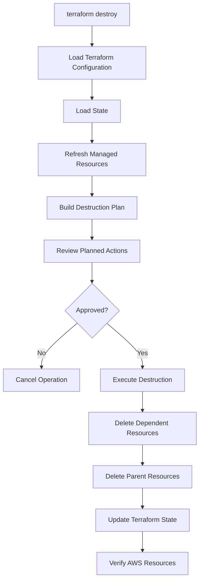
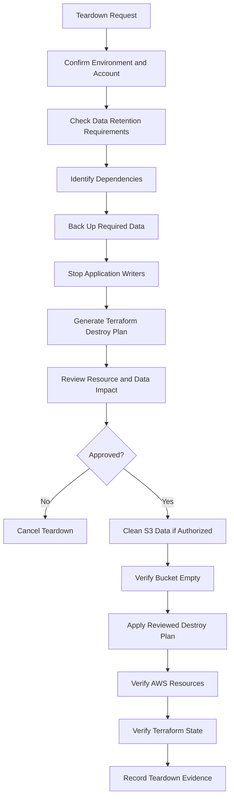

# 14- Terraform Destroy and Resource Protection

## Overview

Terraform destroy removes infrastructure resources managed by the current Terraform state. For Amazon S3, this operation requires particular care because buckets can contain application files, backups, database exports, audit records, and other business-critical data.

Deleting an S3 bucket can involve more than deleting a single infrastructure resource. A versioned bucket may contain current objects, historical versions, and delete markers. Incomplete multipart uploads may remain. Replication, lifecycle configuration, bucket policies, logging, and other dependent resources can also affect teardown.

A successful Terraform destroy does not necessarily mean that every related AWS resource or piece of data has been removed. Conversely, a failed destroy does not guarantee that infrastructure remains unchanged: Terraform may have deleted some resources before encountering an error.

Production infrastructure therefore needs explicit resource protection, controlled teardown procedures, state verification, and recovery planning.

This document covers Terraform destruction, S3-specific deletion behavior, resource protection mechanisms, safe cleanup workflows, and production teardown procedures.

## Understanding Terraform Destroy

Terraform destroy removes resources managed by the current Terraform state.

```bash
terraform destroy
```

Terraform evaluates the dependency graph and determines which resources must be destroyed.

For example, an S3 infrastructure deployment might contain:

```text
aws_s3_bucket
    |
    +-- aws_s3_bucket_versioning
    |
    +-- aws_s3_bucket_server_side_encryption_configuration
    |
    +-- aws_s3_bucket_public_access_block
    |
    +-- aws_s3_bucket_ownership_controls
    |
    +-- aws_s3_bucket_lifecycle_configuration
    |
    +-- aws_s3_bucket_policy
```

Terraform uses dependencies and resource relationships to determine the destruction order. Resources that depend on another resource are generally destroyed before the resource they depend on.

### Destroy Lifecycle



The exact operations depend on the resource graph, provider behavior, and current infrastructure state.

### Destroy-Related Commands

| Command | Behavior | Recommended usage |
|---|---|---|
| `terraform destroy` | Plans and applies destruction of managed resources | Interactive environment teardown |
| `terraform plan -destroy` | Generates a destruction plan without applying it | Review before teardown |
| `terraform apply -destroy` | Plans and applies destruction | Controlled destruction |
| `terraform destroy -target=...` | Targets selected resources and their dependencies | Exceptional recovery or carefully scoped operations |
| `terraform state rm` | Removes a resource from Terraform state without deleting AWS infrastructure | Intentional transfer of ownership or state correction |

Prefer a complete, reviewed destruction plan over targeted destruction.

Targeting changes Terraform's normal planning scope and can leave infrastructure partially managed. It should not be used as a routine deployment or cleanup strategy.

## Why S3 Destruction Requires Special Care

S3 buckets can contain data that is not represented as ordinary Terraform-managed infrastructure resources.

For example:

```text
company-application-files-prod/
├── uploads/
│   ├── customer-101/
│   └── customer-102/
├── reports/
├── backups/
└── exports/
```

Terraform may manage the bucket configuration, but objects may be uploaded independently by:

- Django or FastAPI applications.
- Background workers such as Celery.
- Lambda functions.
- Data ingestion pipelines.
- AWS CLI operations.
- Other AWS accounts or services.

Destroying the bucket requires understanding who owns the data and whether it can safely be removed.

### Empty and Non-Empty Buckets

An ordinary S3 bucket must be empty before it can be deleted.

For a bucket without versioning, removing all current objects may be sufficient.

For a versioned bucket, deleting an object normally creates a delete marker rather than permanently removing its previous versions. A bucket can therefore appear empty through an ordinary object listing while still containing historical versions and delete markers.

### S3 Deletion Considerations

| Configuration or data | Destruction consideration |
|---|---|
| Current objects | Must be removed before bucket deletion |
| Historical object versions | Must be permanently deleted |
| Delete markers | Must be removed |
| Incomplete multipart uploads | Should be aborted and verified |
| Versioning | Does not automatically remove historical versions |
| Lifecycle configuration | Does not guarantee immediate cleanup |
| Replication | Destination data may remain after source teardown |
| Object Lock | Retention or legal holds may prevent deletion |
| Bucket policy | May prevent cleanup operations |
| MFA Delete | Can require additional authorization for permanent version deletion |

Never assume that removing the bucket resource from Terraform automatically removes all associated data.

## Terraform Resource Protection

Terraform provides mechanisms to reduce the risk of accidental infrastructure destruction.

The most important protection mechanisms include:

- `prevent_destroy`
- Resource dependencies
- Terraform state protection
- IAM permissions
- AWS-side retention and governance controls

These mechanisms serve different purposes and should be used together where appropriate.

## Using prevent_destroy

The `prevent_destroy` lifecycle argument instructs Terraform to reject a plan that would destroy the resource while the protection remains in its configuration.

Example:

```hcl
resource "aws_s3_bucket" "application" {
  bucket = var.bucket_name

  lifecycle {
    prevent_destroy = true
  }

  tags = {
    Environment = var.environment
    ManagedBy   = "Terraform"
  }
}
```

If someone runs:

```bash
terraform destroy
```

Terraform rejects the destruction because the resource has `prevent_destroy = true`.

Typical error:

```text
Error: Instance cannot be destroyed

Resource aws_s3_bucket.application has lifecycle.prevent_destroy
set, but the plan calls for this resource to be destroyed.
```

### Advantages

- Prevents accidental Terraform-driven destruction.
- Protects critical resources during routine infrastructure changes.
- Makes destructive changes require an explicit configuration decision.
- Provides an additional safeguard during production operations.

### Limitations

`prevent_destroy` is a Terraform configuration-level guard, not an AWS-side deletion lock.

It does not protect a resource when its configuration block is removed from the Terraform configuration. Terraform may then plan destruction because the protection rule is no longer present in the configuration.

It also does not prevent deletion through:

- AWS Console.
- AWS CLI.
- AWS SDKs.
- Another infrastructure management system.
- An AWS principal with sufficient permissions.

### Production Recommendation

Use `prevent_destroy` on persistent production buckets and other resources whose accidental removal would cause significant impact.

For example:

```hcl
resource "aws_s3_bucket" "application_files" {
  bucket = var.application_bucket_name

  lifecycle {
    prevent_destroy = true
  }
}

resource "aws_s3_bucket" "temporary_processing" {
  bucket = var.temporary_bucket_name

  lifecycle {
    prevent_destroy = false
  }
}
```

Protection should reflect the business purpose and retention requirements of each bucket.

A temporary processing bucket and a long-term document archive should not necessarily have identical destruction policies.

## Using force_destroy

The AWS provider's `aws_s3_bucket` resource supports the `force_destroy` argument.

It controls whether Terraform's provider should remove objects when deleting the bucket.

Example:

```hcl
resource "aws_s3_bucket" "temporary" {
  bucket        = var.bucket_name
  force_destroy = true

  tags = {
    Environment = "development"
    ManagedBy   = "Terraform"
  }
}
```

When `force_destroy` is enabled, the provider can remove objects before deleting the bucket.

This is useful for temporary development or test environments.

### Default Behavior

Prefer:

```hcl
force_destroy = false
```

This requires the bucket to be empty before Terraform can delete it and reduces the risk of accidentally deleting application data.

### When to Use force_destroy

Appropriate use cases include:

- Disposable integration-test buckets.
- Temporary development environments.
- Short-lived processing buckets.
- Automated test infrastructure with explicitly disposable data.

Avoid enabling it by default for:

- Production document storage.
- Backup buckets.
- Audit-log storage.
- Long-term archives.
- Data lakes.
- Buckets with retention or legal requirements.

### Important Limitations

`force_destroy` is not a general data-retention or recovery mechanism.

It can permanently delete objects and versions as part of bucket destruction. It does not replace a backup strategy or a reviewed data-deletion procedure.

Object Lock, MFA Delete, permissions, and other S3 constraints can also affect whether deletion succeeds.

## Combining prevent_destroy and force_destroy

These arguments address different concerns.

| Argument | Responsibility |
|---|---|
| `prevent_destroy` | Blocks Terraform plans that destroy a protected resource |
| `force_destroy` | Allows the provider to remove bucket contents as part of bucket deletion |

Consider:

```hcl
resource "aws_s3_bucket" "application" {
  bucket        = var.bucket_name
  force_destroy = true

  lifecycle {
    prevent_destroy = true
  }
}
```

Even though `force_destroy` is enabled, Terraform refuses to destroy the bucket while `prevent_destroy` remains active in the configuration.

The protection must be deliberately changed before a Terraform-managed destruction can proceed.

For persistent production buckets, prefer `prevent_destroy = true` and `force_destroy = false`.

## Protecting S3 Resources Beyond Terraform

Terraform lifecycle settings are only one layer of protection. Production S3 resources should also use appropriate AWS-side security and governance controls.

### IAM Permissions

Restrict who can perform destructive operations.

Examples of sensitive permissions include:

- `s3:DeleteBucket`
- `s3:DeleteObject`
- `s3:DeleteObjectVersion`
- `s3:PutBucketVersioning`
- `s3:PutBucketLifecycleConfiguration`
- `s3:PutBucketPolicy`
- `s3:PutBucketReplication`

The exact permissions required depend on the cleanup workflow and resource configuration.

Separate infrastructure deployment permissions from application data-access permissions. An application role that only uploads and downloads files should not receive bucket deletion permissions.

### Bucket Versioning

Enable versioning for important data.

```hcl
resource "aws_s3_bucket_versioning" "application" {
  bucket = aws_s3_bucket.application.id

  versioning_configuration {
    status = "Enabled"
  }
}
```

Versioning can help recover from accidental overwrites and deletions.

However, versioning is not a deletion lock. A principal with sufficient permissions can permanently delete object versions.

### Object Lock

S3 Object Lock provides retention controls for supported objects. It can help protect data from deletion or modification during a defined retention period or under legal hold.

Object Lock is useful for:

- Compliance archives.
- Audit records.
- Financial records.
- Immutable backups.
- Records subject to retention policies.

Object Lock has configuration and operational constraints. Retention modes, legal holds, bucket configuration, and permissions must be designed before deployment.

Do not assume that enabling Object Lock makes every bucket operation impossible. The actual protection depends on the retention mode, object retention settings, legal holds, and applicable permissions.

### AWS Organizations and Service Control Policies

Organizations can apply service control policies (SCPs) to restrict destructive actions across accounts.

For example, a policy can deny bucket deletion for selected production resources or accounts.

SCPs establish permission boundaries for affected member accounts. They do not grant permissions and do not replace IAM policies.

### Backup and Replication

Versioning, replication, and backup address different recovery requirements.

| Mechanism | Primary purpose | Limitation |
|---|---|---|
| Versioning | Recover previous object versions | Does not prevent permanent version deletion |
| Cross-Region Replication | Maintain replicated objects in another Region | Deletions and replication behavior require careful design |
| S3 Object Lock | Enforce object retention | Requires deliberate retention configuration |
| Backup workflow | Maintain recoverable copies | Requires independent recovery validation |

A replicated bucket is not automatically an independent backup. Replication may propagate unwanted changes or deletions depending on its configuration.

## Designing a Safe Terraform S3 Bucket

A production-oriented bucket resource should use conservative deletion defaults.

```hcl
variable "bucket_name" {
  description = "Globally unique S3 bucket name."
  type        = string
}

variable "environment" {
  description = "Deployment environment."
  type        = string

  validation {
    condition = contains(
      ["dev", "staging", "prod"],
      var.environment
    )

    error_message = "Environment must be dev, staging, or prod."
  }
}

resource "aws_s3_bucket" "application" {
  bucket        = var.bucket_name
  force_destroy = false

  lifecycle {
    prevent_destroy = true
  }

  tags = {
    Environment = var.environment
    ManagedBy   = "Terraform"
    Application = "file-storage"
  }
}

resource "aws_s3_bucket_versioning" "application" {
  bucket = aws_s3_bucket.application.id

  versioning_configuration {
    status = "Enabled"
  }
}

resource "aws_s3_bucket_public_access_block" "application" {
  bucket = aws_s3_bucket.application.id

  block_public_acls       = true
  ignore_public_acls      = true
  block_public_policy     = true
  restrict_public_buckets = true
}

resource "aws_s3_bucket_ownership_controls" "application" {
  bucket = aws_s3_bucket.application.id

  rule {
    object_ownership = "BucketOwnerEnforced"
  }
}

resource "aws_s3_bucket_server_side_encryption_configuration" "application" {
  bucket = aws_s3_bucket.application.id

  rule {
    apply_server_side_encryption_by_default {
      sse_algorithm = "AES256"
    }
  }
}
```

This configuration establishes:

- A bucket that cannot be deleted through a normal Terraform destroy while protected.
- No automatic deletion of bucket contents.
- Versioning enabled.
- Public access protections enabled.
- Bucket-owner-enforced object ownership.
- Default SSE-S3 encryption.

Additional resources such as lifecycle rules, replication, logging, and bucket policies should be managed separately when required.

## Reviewing a Destruction Plan

Never run a production destroy operation without reviewing the plan.

### Generate a Destroy Plan

```bash
terraform plan -destroy -out=destroy.tfplan
```

This generates a saved plan without applying it.

### Inspect the Plan

```bash
terraform show destroy.tfplan
```

Review:

- Resources scheduled for deletion.
- Resource dependencies.
- Bucket names and account ownership.
- Production versus non-production resources.
- Replication and logging dependencies.
- KMS keys and policies.
- Resources shared by other applications.
- Potential data loss.

### Inspect Plan JSON

```bash
terraform show -json destroy.tfplan > destroy.json
```

The JSON representation can support automated policy checks.

For example, identify S3 resources scheduled for deletion:

```python
import json
import sys
from pathlib import Path


def find_s3_deletions(plan_path: Path) -> list[str]:
    with plan_path.open(encoding="utf-8") as file:
        plan = json.load(file)

    deletions = []

    for resource in plan.get("resource_changes", []):
        resource_type = resource.get("type", "")
        actions = resource.get("change", {}).get("actions", [])

        if resource_type.startswith("aws_s3_") and "delete" in actions:
            deletions.append(resource.get("address", "unknown"))

    return deletions


def main() -> int:
    path = Path(sys.argv[1]) if len(sys.argv) > 1 else Path("destroy.json")

    if not path.is_file():
        print(f"Plan file not found: {path}")
        return 2

    try:
        deletions = find_s3_deletions(path)
    except (OSError, json.JSONDecodeError) as exc:
        print(f"Unable to inspect plan: {exc}")
        return 2

    if deletions:
        print("S3 resources scheduled for deletion:")
        for address in deletions:
            print(f"- {address}")
        return 1

    print("No S3 resource deletions detected.")
    return 0


if __name__ == "__main__":
    raise SystemExit(main())
```

Run:

```bash
python check_destroy_plan.py destroy.json
```

This is a basic policy check. Production policy enforcement should also inspect replacements, resource addresses, module paths, environment identity, and sensitive resource attributes.

Plan JSON can contain sensitive values. Protect it as confidential infrastructure data.

### Apply a Reviewed Destroy Plan

After approval:

```bash
terraform apply destroy.tfplan
```

Applying a saved plan executes the actions contained in that plan without generating a new interactive approval prompt.

Treat saved plans as short-lived artifacts. They may become stale if state or infrastructure changes after plan generation.

Do not reuse an old production destruction plan after unrelated infrastructure changes.

## Safe S3 Bucket Cleanup

S3 bucket deletion requires a data-aware cleanup procedure.

For an unversioned bucket, current objects must be removed.

For a versioned bucket, current versions, historical versions, and delete markers must be removed before the bucket can be deleted.

### Inspect the Bucket Before Cleanup

Confirm the AWS account:

```bash
aws sts get-caller-identity
```

Confirm the bucket Region:

```bash
aws s3api get-bucket-location \
  --bucket company-application-files-dev
```

Inspect versioning:

```bash
aws s3api get-bucket-versioning \
  --bucket company-application-files-dev
```

Inspect Object Lock configuration where applicable:

```bash
aws s3api get-object-lock-configuration \
  --bucket company-application-files-dev
```

Inspect current objects:

```bash
aws s3api list-objects-v2 \
  --bucket company-application-files-dev
```

Inspect versions and delete markers:

```bash
aws s3api list-object-versions \
  --bucket company-application-files-dev
```

Inspect incomplete multipart uploads:

```bash
aws s3api list-multipart-uploads \
  --bucket company-application-files-dev
```

These commands provide an initial inspection. Large buckets require pagination-aware cleanup.

### Delete Objects from an Unversioned Bucket

For a disposable bucket where deleting all current objects is explicitly approved:

```bash
aws s3 rm s3://company-application-files-dev \
  --recursive
```

This is destructive.

Verify the bucket contents before executing it. Do not use this command against a production bucket merely because Terraform destroy failed.

### Delete All Versions and Delete Markers

For a versioned bucket, ordinary object deletion does not permanently remove historical versions.

A cleanup process must enumerate and delete both:

- Object versions.
- Delete markers.

The S3 `DeleteObjects` API accepts up to 1,000 object identifiers per request.

A safe implementation must handle:

- Pagination using `KeyMarker` and `VersionIdMarker`.
- Batches of at most 1,000 entries.
- Both versions and delete markers.
- Partial failures returned by the delete API.
- URL encoding and arbitrary object keys.
- Object Lock retention and legal holds.
- MFA Delete requirements.
- Retryable errors and throttling.

A destructive cleanup tool should not silently ignore partial deletion failures.

### Pagination-Aware Version Deletion Example

The following Python example uses Boto3 to delete object versions and delete markers in batches.

It intentionally requires an explicit confirmation flag and should only be used after the bucket's retention and recovery requirements have been reviewed.

```python
import argparse
import sys

import boto3
from botocore.exceptions import BotoCoreError, ClientError


def delete_versions(bucket: str, region: str, confirmed: bool) -> None:
    if not confirmed:
        raise ValueError("Explicit confirmation is required.")

    s3 = boto3.client("s3", region_name=region)
    paginator = s3.get_paginator("list_object_versions")

    deleted_count = 0

    for page in paginator.paginate(Bucket=bucket):
        identifiers = []

        for version in page.get("Versions", []):
            identifiers.append(
                {
                    "Key": version["Key"],
                    "VersionId": version["VersionId"],
                }
            )

        for marker in page.get("DeleteMarkers", []):
            identifiers.append(
                {
                    "Key": marker["Key"],
                    "VersionId": marker["VersionId"],
                }
            )

        for offset in range(0, len(identifiers), 1000):
            batch = identifiers[offset:offset + 1000]

            if not batch:
                continue

            response = s3.delete_objects(
                Bucket=bucket,
                Delete={
                    "Objects": batch,
                    "Quiet": False,
                },
            )

            errors = response.get("Errors", [])

            if errors:
                for error in errors:
                    print(
                        "Deletion failed:",
                        error.get("Key"),
                        error.get("VersionId"),
                        error.get("Code"),
                    )

                raise RuntimeError(
                    "One or more object versions could not be deleted."
                )

            deleted_count += len(response.get("Deleted", []))

    print(f"Deleted {deleted_count} object versions and delete markers.")


def main() -> int:
    parser = argparse.ArgumentParser()
    parser.add_argument("--bucket", required=True)
    parser.add_argument("--region", required=True)
    parser.add_argument(
        "--confirm-delete-all-versions",
        action="store_true",
    )

    args = parser.parse_args()

    try:
        delete_versions(
            bucket=args.bucket,
            region=args.region,
            confirmed=args.confirm_delete_all_versions,
        )
    except (ValueError, RuntimeError, BotoCoreError, ClientError) as exc:
        print(f"Cleanup failed: {exc}", file=sys.stderr)
        return 1

    return 0


if __name__ == "__main__":
    raise SystemExit(main())
```

Example:

```bash
python delete_versions.py \
  --bucket company-application-files-dev \
  --region ap-south-1 \
  --confirm-delete-all-versions
```

This example is intended for a controlled cleanup operation, not an unattended production job.

It does not implement MFA Delete handling, Object Lock bypass, or automatic retry of partial failures. It also assumes the bucket is not being concurrently modified. Stop writers and other cleanup processes before running it.

For very large buckets, consider S3 Batch Operations or a dedicated cleanup workflow rather than a long-running client-side process.

### Abort Incomplete Multipart Uploads

Incomplete multipart uploads consume storage until they are completed or aborted.

Inspect them:

```bash
aws s3api list-multipart-uploads \
  --bucket company-application-files-dev
```

Abort a specific upload:

```bash
aws s3api abort-multipart-upload \
  --bucket company-application-files-dev \
  --key uploads/report.zip \
  --upload-id "UPLOAD_ID"
```

A cleanup implementation must paginate multipart-upload listings and abort each upload individually.

An S3 lifecycle rule using `AbortIncompleteMultipartUpload` can also help control abandoned multipart uploads.

### Verify the Bucket Is Empty

After cleanup, verify current objects:

```bash
aws s3api list-objects-v2 \
  --bucket company-application-files-dev \
  --max-keys 1
```

Verify versions and delete markers:

```bash
aws s3api list-object-versions \
  --bucket company-application-files-dev \
  --max-keys 1
```

Verify incomplete multipart uploads:

```bash
aws s3api list-multipart-uploads \
  --bucket company-application-files-dev \
  --max-uploads 1
```

A bucket should not be considered ready for deletion until all relevant data and upload state have been checked.

## Handling Terraform Destroy Failures

A failed destroy operation can leave infrastructure partially deleted.

Do not immediately rerun destruction without inspecting the current state.

### Common Failure Categories

| Failure | Possible cause | Investigation |
|---|---|---|
| Resource protected | `prevent_destroy` enabled | Inspect lifecycle configuration |
| Bucket not empty | Current objects or versions remain | Inspect object and version listings |
| Access denied | Insufficient IAM permissions or explicit deny | Inspect IAM, bucket policy, SCP, and KMS where relevant |
| Object retention prevents deletion | Object Lock retention or legal hold | Inspect retention and legal hold |
| Dependency failure | A dependent resource cannot be removed | Inspect the Terraform graph and AWS resource configuration |
| Resource not found | Resource deleted outside Terraform | Refresh and inspect state |
| State lock error | Another Terraform operation is active or lock is stale | Verify active operations before unlocking |
| Replication cleanup issue | Related destination or role dependencies remain | Inspect source and destination configuration |
| KMS dependency issue | Key policy, grants, or key lifecycle constraints | Inspect key usage and dependent resources |

### Inspect the Current Terraform State

```bash
terraform state list
```

Inspect a specific resource:

```bash
terraform state show aws_s3_bucket.application
```

Refresh and review:

```bash
terraform plan
```

Do not assume a failed destroy left the state unchanged.

### Resource Already Deleted Outside Terraform

If a bucket was manually deleted outside Terraform, Terraform state may still contain its resource address.

Run:

```bash
terraform plan
```

Terraform may detect that the remote resource no longer exists and propose recreating it if it remains in configuration.

If the intended outcome is to keep the resource deleted, update the configuration and review the plan.

Do not use `terraform state rm` merely to hide an error. It removes Terraform's management record without deleting the AWS resource.

### State Lock Problems

Inspect the backend and identify whether another Terraform operation is active.

Only use force-unlock after verifying that the lock is stale and no active operation is using the state.

```bash
terraform force-unlock LOCK_ID
```

Force-unlocking an active operation can cause state corruption or concurrent infrastructure changes.

## Protecting Terraform State and Backend Resources

The Terraform state backend is infrastructure too, and it should not be destroyed as part of ordinary application teardown.

For an S3 backend, protect:

- The state bucket.
- State object prefixes.
- Lock files.
- Version history.
- KMS keys used for state encryption.
- IAM roles required for backend access.

Example backend configuration:

```hcl
terraform {
  backend "s3" {
    bucket       = "company-terraform-state-prod"
    key          = "s3/application/terraform.tfstate"
    region       = "ap-south-1"
    encrypt      = true
    use_lockfile = true
  }
}
```

The backend bucket should be managed through a separate bootstrap process or dedicated Terraform state.

Avoid placing the state bucket and the application infrastructure it manages in the same state when destroying the application environment could also destroy its own backend.

### State Protection Recommendations

- Enable bucket versioning for the state bucket.
- Restrict access to Terraform deployment roles.
- Enable encryption.
- Use a separate state key for each environment.
- Use S3 lock files where supported by the Terraform version.
- Restrict state bucket deletion permissions.
- Back up state and test recovery procedures.
- Do not manually delete lock files during normal operations.

Destroying an application environment should not remove the backend required to manage or recover that environment.

## Safe Environment Teardown Workflow

A production-grade teardown should be a controlled process with explicit ownership, approval, and verification.



### Pre-Destruction Checklist

Before destroying an environment:

- [ ] Confirm the AWS account and Region.
- [ ] Confirm the Terraform workspace or environment directory.
- [ ] Confirm the backend state key.
- [ ] Confirm the target bucket names.
- [ ] Identify application and service dependencies.
- [ ] Confirm data ownership and retention requirements.
- [ ] Identify Object Lock and legal hold constraints.
- [ ] Check replication destinations.
- [ ] Confirm backups or approved data exports.
- [ ] Stop application writers and background workers.
- [ ] Review the complete destruction plan.
- [ ] Obtain the required approval.

### Destruction

Generate the plan:

```bash
terraform plan -destroy -out=destroy.tfplan
```

Review it:

```bash
terraform show destroy.tfplan
```

Apply only after approval:

```bash
terraform apply destroy.tfplan
```

### Post-Destruction Verification

Confirm Terraform resources:

```bash
terraform state list
```

Confirm bucket existence:

```bash
aws s3api head-bucket \
  --bucket company-application-files-dev
```

A successful `head-bucket` request indicates the bucket is accessible. A failure does not always distinguish a missing bucket from an authorization problem.

Use the expected account, Region, and appropriate permissions when verifying deletion.

Also verify:

- Replication destination resources.
- IAM roles and policies.
- KMS keys and grants.
- CloudWatch log groups.
- Event notification destinations.
- CloudFront origins and distributions.
- Application configuration and deployment references.
- External monitoring and alerting resources.

Record the final state and any resources intentionally retained.

## Controlled Terraform Destroy in CI/CD

Production destruction should not be available through an unrestricted workflow.

A controlled GitHub Actions workflow can require manual dispatch, a protected environment, and an explicit confirmation input.

The following example separates plan generation from the approval-gated apply job. The plan artifact must be protected, short-lived, and tied to the same commit and Terraform configuration used during review.

```yaml
name: Terraform Environment Destroy

on:
  workflow_dispatch:
    inputs:
      environment:
        description: Environment to destroy
        required: true
        type: choice
        options:
          - dev
          - staging
      confirm_destroy:
        description: Type DESTROY to confirm
        required: true
        type: string

permissions:
  contents: read
  id-token: write

jobs:
  plan:
    if: inputs.confirm_destroy == 'DESTROY'
    runs-on: ubuntu-latest

    environment: ${{ inputs.environment }}-destroy-plan

    defaults:
      run:
        working-directory: environments/${{ inputs.environment }}

    steps:
      - name: Checkout repository
        uses: actions/checkout@v4

      - name: Configure AWS credentials
        uses: aws-actions/configure-aws-credentials@v4
        with:
          role-to-assume: ${{ vars.AWS_TERRAFORM_ROLE_ARN }}
          aws-region: ap-south-1

      - name: Set up Terraform
        uses: hashicorp/setup-terraform@v3
        with:
          terraform_version: "1.10.0"

      - name: Initialize Terraform
        run: terraform init -input=false

      - name: Generate destruction plan
        run: terraform plan -destroy -input=false -out=destroy.tfplan

      - name: Export readable plan
        run: terraform show destroy.tfplan > destroy-plan.txt

      - name: Upload protected plan artifact
        uses: actions/upload-artifact@v4
        with:
          name: destroy-plan-${{ inputs.environment }}
          path: |
            environments/${{ inputs.environment }}/destroy.tfplan
            environments/${{ inputs.environment }}/destroy-plan.txt
          retention-days: 1

  apply:
    needs: plan
    if: inputs.confirm_destroy == 'DESTROY'
    runs-on: ubuntu-latest

    environment: ${{ inputs.environment }}-destroy-approval

    defaults:
      run:
        working-directory: environments/${{ inputs.environment }}

    steps:
      - name: Checkout repository
        uses: actions/checkout@v4

      - name: Configure AWS credentials
        uses: aws-actions/configure-aws-credentials@v4
        with:
          role-to-assume: ${{ vars.AWS_TERRAFORM_ROLE_ARN }}
          aws-region: ap-south-1

      - name: Set up Terraform
        uses: hashicorp/setup-terraform@v3
        with:
          terraform_version: "1.10.0"

      - name: Initialize Terraform
        run: terraform init -input=false

      - name: Download reviewed plan
        uses: actions/download-artifact@v4
        with:
          name: destroy-plan-${{ inputs.environment }}
          path: environments/${{ inputs.environment }}

      - name: Apply reviewed destruction plan
        run: terraform apply -input=false destroy.tfplan
```

This is a workflow pattern, not a complete production approval implementation.

Important controls:

- The example deliberately excludes production from its environment choices.
- Configure protected GitHub environments with required reviewers.
- Use separate environment-specific AWS roles restricted to the intended account and resources.
- Pin third-party actions to verified full commit SHAs.
- Ensure the apply job uses the exact reviewed plan and the same commit.
- Protect plan artifacts because they can contain sensitive infrastructure data.
- Prevent concurrent deployment and destruction operations.
- Ensure the plan has not become stale before applying it.
- Do not bypass `prevent_destroy` or automatically empty protected buckets.

For production, use a separately approved workflow with stricter authorization, explicit data-cleanup approval, and an independently verified recovery plan.

## Recovering from Accidental Destruction

Recovery depends on which resources and data were deleted.

### Recovering Object Data

Potential recovery sources include:

- Previous S3 object versions.
- Replicated objects.
- S3 backups.
- AWS Backup recovery points, where configured and supported.
- Independent data exports.
- Application-level backups.

Versioning cannot recover data after all relevant versions have been permanently deleted.

A deleted bucket cannot simply be restored by re-enabling its previous configuration. It may be possible to recreate a bucket with the same name if the name is available, but this does not restore its contents or configuration automatically.

### Recovering Terraform State

If the state object was accidentally overwritten or deleted, S3 versioning may provide a previous state object version.

Inspect versions:

```bash
aws s3api list-object-versions \
  --bucket company-terraform-state-prod \
  --prefix s3/application/terraform.tfstate
```

Restore the appropriate state version through a controlled recovery procedure.

Before restoring:

- Confirm the selected state version.
- Back up the current state.
- Confirm whether infrastructure changed after that version.
- Prevent concurrent Terraform operations.
- Validate the restored state against actual AWS resources.

Restoring Terraform state does not restore deleted AWS infrastructure.

### Reconcile After Recovery

After restoring infrastructure or state:

```bash
terraform init
terraform plan
```

Review all proposed changes.

Do not immediately run `terraform apply` until the state and actual infrastructure have been reconciled.

## Production Best Practices

### Resource Protection

- Use `prevent_destroy = true` for critical persistent resources.
- Keep `force_destroy = false` by default.
- Apply stricter deletion permissions to production accounts.
- Protect Terraform backend resources independently.
- Use Object Lock where retention requirements justify it.
- Maintain versioning and tested backup procedures.

### Data Protection

- Identify data owners before cleanup.
- Confirm retention and legal requirements.
- Stop application writers before destructive operations.
- Inspect versions, delete markers, and multipart uploads.
- Verify replication and backup dependencies.
- Treat bulk deletion as a separately approved operation.

### Deployment Controls

- Require a destruction plan review.
- Use protected CI/CD environments.
- Use short-lived credentials through OIDC.
- Restrict production destroy permissions.
- Serialize infrastructure operations.
- Preserve plan and approval audit records securely.
- Never automate production deletion based only on a bucket name or environment label.

### Operational Verification

- Verify the AWS account and Region before destructive commands.
- Confirm the intended Terraform backend and state key.
- Inspect the complete plan.
- Verify the bucket is empty before deletion.
- Check for retained or replicated data.
- Verify Terraform state after the operation.
- Record intentionally retained resources and cleanup failures.

## Common Mistakes and Pitfalls

| Mistake | Risk | Correct approach |
|---|---|---|
| Enabling `force_destroy` on every bucket | Accidental permanent data deletion | Enable only for explicitly disposable resources |
| Assuming `prevent_destroy` is an AWS deletion lock | Direct AWS deletion remains possible | Combine Terraform protection with IAM and governance controls |
| Removing a resource block to bypass `prevent_destroy` | Terraform may plan resource deletion | Use an approved migration or state-management procedure |
| Running destroy without reviewing the plan | Unintended resource and data loss | Generate and inspect a saved destroy plan |
| Deleting only current objects | Historical versions and delete markers remain | Inspect and remove all required versions |
| Ignoring incomplete multipart uploads | Residual storage and failed cleanup | Abort and verify multipart uploads |
| Destroying the state bucket with application infrastructure | Loss of infrastructure management state | Manage backend resources independently |
| Using `terraform state rm` to fix deletion errors | Infrastructure becomes unmanaged | Use state removal only for intentional ownership changes |
| Assuming replication is a backup | Deletion or unwanted changes may propagate | Design and test independent recovery controls |
| Running concurrent teardown and deployment workflows | State and infrastructure inconsistency | Serialize operations and use backend locking |
| Treating a failed destroy as an unchanged environment | Partial deletion may already have occurred | Inspect AWS and Terraform state before retrying |

## Key Takeaways

- Terraform destroy removes managed infrastructure, but S3 bucket deletion requires explicit handling of current objects, historical versions, delete markers, and incomplete multipart uploads.
- Use `prevent_destroy` to guard critical Terraform-managed resources and keep `force_destroy = false` for persistent production buckets.
- Terraform lifecycle protection is not an AWS-side deletion lock; combine it with least-privilege IAM, account governance, versioning, and appropriate retention controls.
- Generate and review a saved destruction plan, verify the account and state backend, and require approval before production teardown.
- Protect Terraform state independently, verify partial failures, and test data and infrastructure recovery procedures before relying on them.