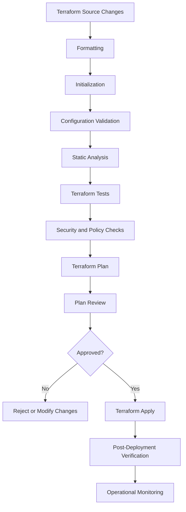
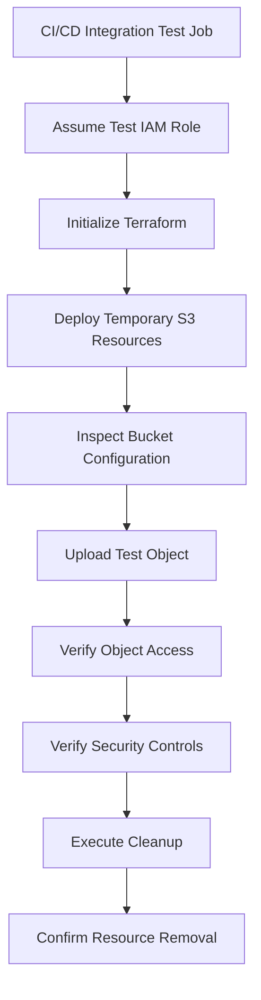
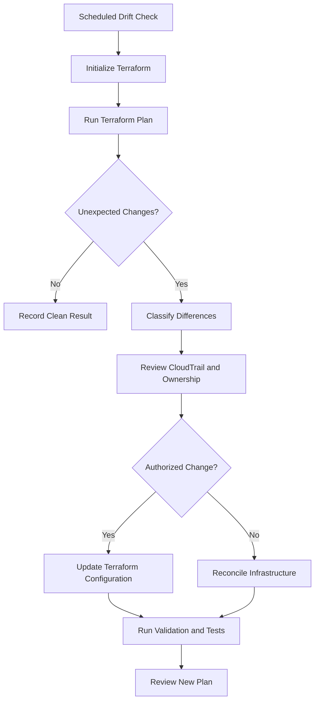

# 15- Terraform Testing and Validation

## Overview

Terraform testing and validation are essential parts of reliable infrastructure delivery. A Terraform configuration can be syntactically valid and still create insecure, incomplete, or operationally unsafe AWS resources.

For Amazon S3, infrastructure validation must go beyond checking whether Terraform can initialize and produce a plan. It should verify that:

- Buckets have the intended security configuration.
- Versioning, encryption, and ownership controls are configured correctly.
- Public access is restricted unless explicitly required.
- IAM policies grant only necessary permissions.
- Lifecycle and replication configurations match application requirements.
- Infrastructure changes do not introduce unexpected resource replacement or deletion.
- Deployment behavior remains predictable across development, staging, and production.

Terraform provides several validation mechanisms, including formatting, configuration validation, planning, automated tests, and state inspection. Additional tools can perform static security analysis, policy enforcement, and post-deployment verification.

A production validation strategy combines these mechanisms rather than relying on a single successful `terraform apply`.

## Terraform Validation Lifecycle

Infrastructure validation should happen at multiple stages of the delivery process.



| Validation stage | Purpose | Typical tool |
|---|---|---|
| Formatting | Enforce consistent Terraform formatting | `terraform fmt` |
| Initialization | Download providers and configure backend | `terraform init` |
| Configuration validation | Check configuration structure and arguments | `terraform validate` |
| Static analysis | Identify suspicious or incorrect configuration patterns | TFLint |
| Security scanning | Detect insecure infrastructure definitions | Checkov, tfsec |
| Unit-style testing | Validate Terraform behavior and expected resources | `terraform test` |
| Policy validation | Enforce organizational infrastructure requirements | OPA, Sentinel |
| Plan review | Inspect intended infrastructure changes | `terraform plan` |
| Deployment verification | Confirm actual AWS resource configuration | AWS CLI, Boto3 |
| Runtime monitoring | Detect configuration changes and operational failures | AWS Config, CloudTrail, CloudWatch |

## Terraform Formatting

Formatting makes Terraform configuration consistent and easier to review.

Use:

```bash
terraform fmt
```

This modifies Terraform files to follow canonical formatting.

To check formatting without modifying files:

```bash
terraform fmt -check
```

For recursive validation:

```bash
terraform fmt -check -recursive
```

The recursive option is useful when a repository contains multiple environment directories and reusable modules.

### Example

Before formatting:

```hcl
resource "aws_s3_bucket" "application" {
bucket=var.bucket_name
force_destroy=false
}
```

After formatting:

```hcl
resource "aws_s3_bucket" "application" {
  bucket        = var.bucket_name
  force_destroy = false
}
```

### Production Recommendation

Run formatting checks in pull requests. Formatting should be automatic and should not depend on an engineer remembering to execute it manually.

## Terraform Initialization

Terraform initialization prepares the working directory for validation and execution.

```bash
terraform init
```

It performs tasks such as:

- Installing required providers.
- Initializing the configured backend.
- Downloading referenced modules.
- Preparing the dependency lock file.

For an S3 project, initialization may configure the remote state backend and download the AWS provider.

### Initialize Without Backend Access

For some isolated configuration checks, backend initialization can be skipped:

```bash
terraform init -backend=false
```

This is useful for validating configurations that do not require access to a remote state backend.

However, provider and module initialization may still require network access.

### Production Considerations

- Commit `.terraform.lock.hcl`.
- Pin provider versions using `required_providers`.
- Use consistent Terraform CLI versions across local development and CI/CD.
- Avoid routinely running `terraform init -upgrade` in production pipelines.
- Keep backend configuration separate from environment-specific resource configuration.

## Terraform Configuration Validation

`terraform validate` checks whether Terraform configuration is syntactically valid and internally consistent.

```bash
terraform validate
```

It can identify:

- Invalid HCL syntax.
- Unsupported arguments.
- Missing required arguments.
- Invalid references.
- Incorrect resource configuration structures.
- Some type and expression errors.

It does not verify that the AWS infrastructure can actually be created.

For example, Terraform may accept a bucket configuration even if the selected AWS account lacks the permissions required to create it.

### Example S3 Configuration

```hcl
variable "bucket_name" {
  description = "Globally unique S3 bucket name."
  type        = string
}

resource "aws_s3_bucket" "application" {
  bucket        = var.bucket_name
  force_destroy = false

  lifecycle {
    prevent_destroy = true
  }

  tags = {
    ManagedBy = "Terraform"
    Service   = "application-storage"
  }
}
```

Validate:

```bash
terraform init
terraform validate
```

Expected result:

```text
Success! The configuration is valid.
```

### What terraform validate Does Not Check

| Validation concern | Covered by `terraform validate`? |
|---|---|
| HCL syntax | Yes |
| Resource argument structure | Yes |
| Provider schema compatibility | Yes, after initialization |
| Bucket name availability | No |
| AWS account permissions | No |
| KMS key accessibility | No |
| Bucket policy effectiveness | No |
| Existing resource conflicts | No |
| Actual resource creation | No |
| Runtime application access | No |

Use `terraform plan` and deployment verification for concerns outside configuration validation.

## Terraform Plan Validation

Terraform plan evaluates the proposed infrastructure changes before applying them.

```bash
terraform plan
```

For automated environments:

```bash
terraform plan -input=false
```

A plan helps identify:

- New resources.
- Modified resources.
- Resources scheduled for deletion.
- Resource replacements.
- Configuration drift.
- Dependency-related changes.
- Unexpected infrastructure modifications.

### Save a Plan

```bash
terraform plan -out=tfplan
```

Inspect it:

```bash
terraform show tfplan
```

Apply the reviewed plan:

```bash
terraform apply tfplan
```

This ensures that the apply operation uses the saved plan rather than generating a new interactive plan.

Saved plans should be protected because they can contain sensitive infrastructure values. Keep them short-lived and associate them with the exact commit, environment, provider lock file, and review process that produced them.

### S3 Plan Review

For an S3 deployment, review the following changes carefully:

| Resource | Important review points |
|---|---|
| `aws_s3_bucket` | Bucket name, replacement, deletion, and `force_destroy` |
| `aws_s3_bucket_versioning` | Versioning status |
| `aws_s3_bucket_server_side_encryption_configuration` | Encryption algorithm and KMS key |
| `aws_s3_bucket_public_access_block` | All public-access block settings |
| `aws_s3_bucket_ownership_controls` | Object ownership mode |
| `aws_s3_bucket_policy` | Principals, actions, resources, and conditions |
| `aws_s3_bucket_lifecycle_configuration` | Expiration and transition rules |
| `aws_s3_bucket_replication_configuration` | Source, destination, role, and filters |
| `aws_iam_role` | Trust relationships and permissions |
| `aws_kms_key` | Key policy, deletion window, and dependencies |

A plan that unexpectedly replaces a production bucket should be treated as a high-risk change.

### Detect Resource Replacement

Terraform plan output can show replacement actions.

Example:

```text
-/+ resource "aws_s3_bucket" "application" {
      bucket = "company-files-prod"
    }
```

The `-/+` marker indicates replacement.

A replacement of a production bucket requires careful investigation. S3 bucket names are globally unique within the applicable AWS partition, and bucket deletion does not automatically preserve the original bucket's data or configuration.

Do not approve replacement simply because the plan is technically valid.

## Terraform Testing

Terraform includes a native testing framework that supports infrastructure configuration tests.

Terraform test files use the `.tftest.hcl` extension.

Tests can define variables, execute runs, assert expected values, and optionally create real infrastructure.

Testing is useful for reusable S3 modules because module behavior can be checked independently of a complete production deployment.

### Types of Terraform Tests

| Test type | Purpose | AWS resources created? |
|---|---|---|
| Static validation | Validate configuration structure | No |
| Mock-based tests | Validate configuration and expected behavior using mocks | No, when fully mocked |
| Plan tests | Inspect planned resource values and outputs | Not when using a plan-only test with suitable mocks |
| Integration tests | Validate actual AWS behavior | Yes |
| Post-deployment tests | Verify deployed resources | Uses existing AWS resources |

The exact testing capabilities depend on the Terraform CLI version. Mock providers and related testing features require a compatible Terraform version.

## Creating an S3 Module for Testing

Consider a reusable module:

```text
modules/
└── s3-bucket/
    ├── main.tf
    ├── variables.tf
    ├── outputs.tf
    └── tests/
        └── bucket.tftest.hcl
```

### main.tf

```hcl
resource "aws_s3_bucket" "this" {
  bucket        = var.bucket_name
  force_destroy = false

  lifecycle {
    prevent_destroy = true
  }

  tags = var.tags
}

resource "aws_s3_bucket_versioning" "this" {
  bucket = aws_s3_bucket.this.id

  versioning_configuration {
    status = var.versioning_enabled ? "Enabled" : "Suspended"
  }
}

resource "aws_s3_bucket_public_access_block" "this" {
  bucket = aws_s3_bucket.this.id

  block_public_acls       = true
  ignore_public_acls      = true
  block_public_policy     = true
  restrict_public_buckets = true
}

resource "aws_s3_bucket_ownership_controls" "this" {
  bucket = aws_s3_bucket.this.id

  rule {
    object_ownership = "BucketOwnerEnforced"
  }
}

resource "aws_s3_bucket_server_side_encryption_configuration" "this" {
  bucket = aws_s3_bucket.this.id

  rule {
    apply_server_side_encryption_by_default {
      sse_algorithm = "AES256"
    }
  }
}
```

### variables.tf

```hcl
variable "bucket_name" {
  description = "Globally unique S3 bucket name."
  type        = string

  validation {
    condition = (
      length(var.bucket_name) >= 3 &&
      length(var.bucket_name) <= 63 &&
      can(regex("^[a-z0-9][a-z0-9.-]*[a-z0-9]$", var.bucket_name))
    )

    error_message = "Bucket name must be 3-63 characters and use lowercase letters, numbers, periods, or hyphens."
  }
}

variable "versioning_enabled" {
  description = "Whether S3 bucket versioning is enabled."
  type        = bool
  default     = true
}

variable "tags" {
  description = "Tags applied to the S3 bucket."
  type        = map(string)
  default     = {}
}
```

This is a basic naming validation example. It does not implement every S3 bucket naming restriction. AWS remains authoritative when creating a bucket.

### outputs.tf

```hcl
output "bucket_name" {
  description = "Created bucket name."
  value       = aws_s3_bucket.this.bucket
}

output "bucket_arn" {
  description = "Created bucket ARN."
  value       = aws_s3_bucket.this.arn
}

output "versioning_status" {
  description = "Configured bucket versioning status."
  value       = var.versioning_enabled ? "Enabled" : "Suspended"
}
```

## Writing Terraform Tests

Create:

`tests/bucket.tftest.hcl`

```hcl
mock_provider "aws" {}

run "bucket_configuration" {
  command = plan

  variables {
    bucket_name        = "test-application-files"
    versioning_enabled = true

    tags = {
      Environment = "test"
      ManagedBy   = "Terraform"
    }
  }

  assert {
    condition     = aws_s3_bucket.this.bucket == "test-application-files"
    error_message = "Unexpected S3 bucket name."
  }

  assert {
    condition     = aws_s3_bucket.this.force_destroy == false
    error_message = "S3 force_destroy must remain disabled."
  }

  assert {
    condition     = aws_s3_bucket_versioning.this.versioning_configuration[0].status == "Enabled"
    error_message = "S3 versioning must be enabled."
  }

  assert {
    condition     = aws_s3_bucket_public_access_block.this.block_public_acls
    error_message = "Public ACL blocking must be enabled."
  }

  assert {
    condition     = aws_s3_bucket_public_access_block.this.ignore_public_acls
    error_message = "Ignoring public ACLs must be enabled."
  }

  assert {
    condition     = aws_s3_bucket_public_access_block.this.block_public_policy
    error_message = "Public policy blocking must be enabled."
  }

  assert {
    condition     = aws_s3_bucket_public_access_block.this.restrict_public_buckets
    error_message = "Public bucket restrictions must be enabled."
  }

  assert {
    condition     = aws_s3_bucket_ownership_controls.this.rule[0].object_ownership == "BucketOwnerEnforced"
    error_message = "Bucket ownership must be BucketOwnerEnforced."
  }
}
```

Run:

```bash
terraform test
```

The test uses a mocked AWS provider and a plan-only run. It validates the expected configuration without creating an actual S3 bucket.

### Test Additional Configurations

Test the module with different inputs.

For example:

```hcl
run "versioning_disabled" {
  command = plan

  variables {
    bucket_name        = "test-application-archive"
    versioning_enabled = false
  }

  assert {
    condition     = aws_s3_bucket_versioning.this.versioning_configuration[0].status == "Suspended"
    error_message = "Expected versioning to be suspended."
  }
}
```

This test demonstrates a configurable module behavior. For production buckets, versioning should normally remain enabled unless the workload has a documented reason to use a different setting.

### Important Testing Considerations

- Test security-sensitive defaults explicitly.
- Test optional configuration branches.
- Test validation failures.
- Test resource dependencies.
- Test module outputs.
- Avoid relying only on resource existence assertions.
- Keep tests aligned with the provider version used by the module.
- Use real AWS integration tests for behavior that cannot be proven through mocks.

A mock provider validates Terraform's planned configuration, not AWS service behavior.

## Testing Input Validation

Terraform variable validation prevents invalid inputs from reaching resource creation.

For example:

```hcl
variable "environment" {
  description = "Deployment environment."
  type        = string

  validation {
    condition = contains(
      ["dev", "staging", "prod"],
      var.environment
    )

    error_message = "Environment must be dev, staging, or prod."
  }
}
```

A variable validation failure should stop the plan before infrastructure changes are applied.

### Cross-Variable Validation

Terraform also supports validation of related configuration values using mechanisms such as variable validation and resource preconditions.

For example, production environments can require versioning:

```hcl
resource "aws_s3_bucket" "application" {
  bucket = var.bucket_name

  lifecycle {
    prevent_destroy = true

    precondition {
      condition = (
        var.environment != "prod" ||
        var.versioning_enabled
      )

      error_message = "Production buckets must have versioning enabled."
    }
  }
}
```

This makes the requirement part of the infrastructure configuration rather than relying exclusively on code review.

## Testing Resource Preconditions and Postconditions

Terraform supports lifecycle conditions that validate resource assumptions.

### Preconditions

A precondition checks whether a required condition is satisfied before a resource operation proceeds.

Example:

```hcl
resource "aws_s3_bucket" "application" {
  bucket = var.bucket_name

  lifecycle {
    precondition {
      condition     = length(var.bucket_name) <= 63
      error_message = "S3 bucket name must not exceed 63 characters."
    }
  }
}
```

### Postconditions

A postcondition checks a condition associated with a resource after Terraform evaluates the resource operation.

For example:

```hcl
resource "aws_s3_bucket_versioning" "application" {
  bucket = aws_s3_bucket.application.id

  versioning_configuration {
    status = "Enabled"
  }

  lifecycle {
    postcondition {
      condition     = self.versioning_configuration[0].status == "Enabled"
      error_message = "S3 versioning must be enabled."
    }
  }
}
```

Use these conditions for meaningful infrastructure invariants.

Do not duplicate every variable validation as a precondition or postcondition. Each mechanism should protect a distinct requirement.

## Static Analysis and Security Scanning

Terraform validation does not identify every insecure configuration.

Static analysis tools inspect Terraform source and identify potentially dangerous patterns.

Common tools include:

| Tool | Purpose |
|---|---|
| TFLint | Terraform and provider-specific linting |
| Checkov | Infrastructure security and compliance scanning |
| tfsec | Terraform security analysis |
| Trivy | Infrastructure and configuration security scanning |
| OPA | Policy evaluation |
| HashiCorp Sentinel | Policy enforcement in supported Terraform workflows |

Tool selection should reflect repository standards, CI/CD architecture, licensing, and the organization's security requirements.

### TFLint

TFLint helps detect configuration problems and provider-specific issues.

Install and initialize it according to the project's supported version.

Example:

```bash
tflint --init
tflint
```

Example configuration:

```hcl
plugin "terraform" {
  enabled = true

  preset = "recommended"
}

plugin "aws" {
  enabled = true
  version = "0.40.0"
  source  = "github.com/terraform-linters/tflint-ruleset-aws"
}
```

Keep plugin versions aligned with the versions approved for the repository.

### Checkov

Checkov can scan Terraform files for common infrastructure security issues.

Run:

```bash
checkov -d .
```

Scan only Terraform files:

```bash
checkov -d . --framework terraform
```

A scan can identify issues such as:

- Publicly accessible S3 buckets.
- Missing encryption configuration.
- Missing versioning.
- Insecure bucket policies.
- Excessively permissive IAM policies.
- Missing logging or monitoring controls.

A scanner finding is an indication that requires engineering review. Some rules may not understand the complete application architecture or intentional exceptions.

### tfsec

Example:

```bash
tfsec .
```

For new implementations, check the current maintenance and integration guidance for the selected security scanner. Trivy also supports Terraform infrastructure scanning and can be used as part of a consolidated security workflow.

### Managing Security Exceptions

Do not suppress findings merely to make CI/CD pass.

For every accepted exception, document:

- The affected resource.
- The violated rule.
- The business reason.
- The compensating control.
- The owner.
- The expiration or review date.

Security exceptions should be narrow and auditable.

## Policy-as-Code Validation

Static analysis detects known configuration patterns. Policy-as-code allows organizations to enforce their own infrastructure requirements.

For example, an S3 policy might require:

- Production buckets to enable versioning.
- Public access block settings to be enabled.
- Encryption to use an approved algorithm.
- `force_destroy` to remain disabled.
- `prevent_destroy` to be configured for critical buckets.
- IAM policies to avoid unrestricted administrative permissions.

### Example Policy Requirements

| Requirement | Enforcement mechanism |
|---|---|
| Production versioning enabled | Terraform tests or policy |
| Public access blocked | Terraform tests and security scanner |
| Encryption configured | Terraform tests and policy |
| Destruction protection enabled | Terraform tests and plan policy |
| No unrestricted IAM permissions | IAM policy analysis |
| Approved AWS Regions only | Policy-as-code |
| Mandatory resource tags | Variable validation or policy |

### Example OPA Rego Policy

The following example illustrates a policy against enabling `force_destroy` on S3 buckets in a Terraform plan represented as JSON.

```rego
package terraform.s3

deny contains message if {
    resource := input.resource_changes[_]
    resource.type == "aws_s3_bucket"

    after := resource.change.after
    after.force_destroy == true

    message := sprintf(
        "S3 bucket %s must not enable force_destroy",
        [resource.address]
    )
}
```

This policy is illustrative. A production policy runner must load the Terraform plan JSON into the expected input structure and handle unknown or null values deliberately.

Run a JSON plan inspection:

```bash
terraform plan -out=tfplan
terraform show -json tfplan > tfplan.json
```

Evaluate it using the organization's configured OPA workflow.

Policy checks should consider the target environment and documented exceptions rather than applying identical rules to every bucket.

## Validating S3 IAM Policies

IAM policies are a frequent source of infrastructure security failures.

A Terraform configuration can be valid while granting excessive permissions.

Example of an overly broad policy:

```hcl
data "aws_iam_policy_document" "unsafe" {
  statement {
    effect = "Allow"

    actions = [
      "s3:*"
    ]

    resources = [
      "*"
    ]
  }
}
```

Avoid broad S3 permissions unless a specific administrative use case requires them.

A more constrained example:

```hcl
data "aws_iam_policy_document" "application_read" {
  statement {
    sid    = "ListApplicationBucket"
    effect = "Allow"

    actions = [
      "s3:ListBucket"
    ]

    resources = [
      aws_s3_bucket.application.arn
    ]
  }

  statement {
    sid    = "ReadApplicationObjects"
    effect = "Allow"

    actions = [
      "s3:GetObject"
    ]

    resources = [
      "${aws_s3_bucket.application.arn}/application/*"
    ]
  }
}
```

The policy separates bucket-level and object-level permissions.

For a real application, include only the operations it needs. If the application uploads objects, add narrowly scoped `s3:PutObject` permissions. If it uses SSE-KMS, validate the corresponding KMS permissions separately.

### IAM Validation Checklist

- [ ] Bucket-level and object-level actions use appropriate resource ARNs.
- [ ] No unnecessary wildcard permissions exist.
- [ ] Application roles cannot delete buckets.
- [ ] Application roles cannot delete object versions unless required.
- [ ] KMS permissions are scoped to approved keys.
- [ ] Cross-account access is explicitly designed.
- [ ] Trust policies restrict the intended principals.
- [ ] Explicit denies and organizational controls are considered.

## Integration Testing Against AWS

Mock-based tests cannot prove that AWS accepts and enforces the complete configuration.

Integration testing uses a dedicated AWS test account or isolated test environment.

It validates real behavior such as:

- Bucket creation.
- Versioning configuration.
- Encryption configuration.
- Public access block settings.
- Object ownership.
- IAM permissions.
- Object upload and retrieval.
- Presigned URL behavior.
- Lifecycle and replication configuration.

Integration tests may create billable resources and should have an explicit cleanup process.

### Recommended Integration Test Architecture



Use unique test bucket names to avoid global naming conflicts.

For example:

```text
company-s3-test-<account-id>-<run-id>
```

Keep the bucket name within S3 naming constraints and ensure the chosen naming pattern does not expose sensitive information.

### Verify Versioning

```bash
aws s3api get-bucket-versioning \
  --bucket "$TEST_BUCKET"
```

Expected configuration:

```json
{
  "Status": "Enabled"
}
```

### Verify Encryption

```bash
aws s3api get-bucket-encryption \
  --bucket "$TEST_BUCKET"
```

For SSE-S3, inspect the returned default encryption configuration for `AES256`.

### Verify Public Access Block

```bash
aws s3api get-public-access-block \
  --bucket "$TEST_BUCKET"
```

Expected configuration:

```json
{
  "PublicAccessBlockConfiguration": {
    "BlockPublicAcls": true,
    "IgnorePublicAcls": true,
    "BlockPublicPolicy": true,
    "RestrictPublicBuckets": true
  }
}
```

### Verify Object Ownership

```bash
aws s3api get-bucket-ownership-controls \
  --bucket "$TEST_BUCKET"
```

Expected ownership mode:

```json
{
  "OwnershipControls": {
    "Rules": [
      {
        "ObjectOwnership": "BucketOwnerEnforced"
      }
    ]
  }
}
```

These checks verify actual AWS configuration rather than merely Terraform source declarations.

## Post-Deployment Validation with Python and Boto3

Backend services can also verify S3 configuration using Boto3.

This is useful for deployment smoke tests and operational validation scripts.

Install:

```bash
pip install boto3
```

Example:

```python
import sys

import boto3
from botocore.exceptions import BotoCoreError, ClientError


def validate_bucket(bucket_name: str, region: str) -> list[str]:
    s3 = boto3.client("s3", region_name=region)
    failures = []

    try:
        versioning = s3.get_bucket_versioning(Bucket=bucket_name)

        if versioning.get("Status") != "Enabled":
            failures.append("Bucket versioning is not enabled.")

        encryption = s3.get_bucket_encryption(Bucket=bucket_name)

        rules = encryption.get("ServerSideEncryptionConfiguration", {}).get(
            "Rules",
            [],
        )

        algorithms = [
            rule.get("ApplyServerSideEncryptionByDefault", {}).get(
                "SSEAlgorithm"
            )
            for rule in rules
        ]

        if not algorithms:
            failures.append("Default bucket encryption is not configured.")

        public_access = s3.get_public_access_block(Bucket=bucket_name)

        configuration = public_access.get(
            "PublicAccessBlockConfiguration",
            {},
        )

        required_settings = [
            "BlockPublicAcls",
            "IgnorePublicAcls",
            "BlockPublicPolicy",
            "RestrictPublicBuckets",
        ]

        for setting in required_settings:
            if configuration.get(setting) is not True:
                failures.append(
                    f"Public access setting is not enabled: {setting}"
                )

        ownership = s3.get_bucket_ownership_controls(
            Bucket=bucket_name
        )

        ownership_rules = ownership.get(
            "OwnershipControls",
            {},
        ).get("Rules", [])

        if not any(
            rule.get("ObjectOwnership") == "BucketOwnerEnforced"
            for rule in ownership_rules
        ):
            failures.append("Bucket ownership is not BucketOwnerEnforced.")

    except (BotoCoreError, ClientError) as exc:
        failures.append(f"AWS validation request failed: {exc}")

    return failures


def main() -> int:
    if len(sys.argv) != 3:
        print("Usage: python validate_s3_bucket.py BUCKET_NAME REGION")
        return 2

    bucket_name, region = sys.argv[1:]

    failures = validate_bucket(bucket_name, region)

    if failures:
        for failure in failures:
            print(f"FAILED: {failure}")

        return 1

    print("S3 bucket configuration validation passed.")
    return 0


if __name__ == "__main__":
    raise SystemExit(main())
```

Run:

```bash
python validate_s3_bucket.py company-application-files-dev ap-south-1
```

This example verifies several baseline settings. Extend it to validate the exact requirements of the workload, including lifecycle configuration, bucket policies, replication, logging, and KMS configuration.

It requires AWS credentials with permission to inspect the relevant bucket settings.

## Testing Object Operations

Configuration verification alone does not prove that application workloads can use the bucket.

An integration test should verify the expected object operations.

For example:

```python
import uuid

import boto3
from botocore.exceptions import ClientError


def test_s3_object_upload_and_download(bucket_name: str, region: str) -> None:
    s3 = boto3.client("s3", region_name=region)
    key = f"integration-tests/{uuid.uuid4()}.txt"
    payload = b"terraform integration test"

    try:
        s3.put_object(
            Bucket=bucket_name,
            Key=key,
            Body=payload,
            ContentType="text/plain",
        )

        response = s3.get_object(
            Bucket=bucket_name,
            Key=key,
        )

        downloaded = response["Body"].read()

        assert downloaded == payload
        assert response["ContentType"] == "text/plain"

    finally:
        try:
            s3.delete_object(
                Bucket=bucket_name,
                Key=key,
            )
        except ClientError:
            raise
```

This test validates basic object upload and retrieval.

For a versioned bucket, the cleanup operation above creates a delete marker rather than permanently deleting the uploaded version. A dedicated test environment should use a version-aware cleanup procedure when permanent cleanup is required.

Production integration tests should also cover:

- Application role permissions.
- Cross-account access where applicable.
- KMS-encrypted object operations.
- Multipart uploads.
- Presigned URL uploads and downloads.
- Metadata and tagging.
- Expected authorization failures.
- Retry behavior for transient failures.

Do not use production data or production buckets for destructive integration tests.

## Testing Lifecycle and Replication Configuration

Lifecycle and replication require additional validation because successful Terraform deployment does not necessarily prove the intended data-management behavior.

### Lifecycle Validation

Inspect lifecycle configuration:

```bash
aws s3api get-bucket-lifecycle-configuration \
  --bucket "$TEST_BUCKET"
```

Verify:

- Rule identifiers.
- Rule status.
- Prefix or filter conditions.
- Transition storage classes.
- Current object expiration.
- Noncurrent version expiration.
- Incomplete multipart upload cleanup.

Lifecycle processing is asynchronous. Do not assume an object will transition or expire immediately after a rule is created.

Use configuration inspection and controlled test objects to validate the expected behavior over the relevant time period.

### Replication Validation

Inspect replication configuration:

```bash
aws s3api get-bucket-replication \
  --bucket "$SOURCE_BUCKET"
```

Verify:

- Replication role ARN.
- Destination bucket ARN.
- Rule status.
- Filters.
- Destination storage class, if configured.
- Encryption requirements.
- Metrics and Replication Time Control configuration, if used.

Upload a test object and inspect its replication status:

```bash
aws s3api head-object \
  --bucket "$SOURCE_BUCKET" \
  --key "integration-tests/replication-test.txt"
```

Inspect the `ReplicationStatus` response field when available.

A source object may report a pending or failed replication state. Destination verification should also confirm that the expected object is present.

Replication tests should use dedicated source and destination buckets and should not assume that replication automatically covers existing objects.

## Testing Terraform Modules with Real AWS Resources

Mock tests are fast and useful for routine validation. They cannot replace integration tests for AWS behavior.

A practical test strategy uses multiple layers.

| Layer | What to test | Execution frequency |
|---|---|---|
| Formatting | HCL formatting | Every pull request |
| Validation | Configuration and provider schema | Every pull request |
| Static analysis | Suspicious or invalid patterns | Every pull request |
| Security scanning | Public access, IAM, encryption, and related controls | Every pull request |
| Terraform tests | Module inputs, outputs, and resource configuration | Every pull request |
| Plan review | Intended infrastructure changes | Every pull request |
| AWS integration tests | Actual AWS resource behavior | Dedicated test pipeline |
| Post-deployment checks | Deployed infrastructure configuration | Every deployment |
| Runtime monitoring | Drift and operational changes | Continuous |

Use isolated test accounts where possible. This reduces the risk of test code affecting production resources and allows tighter permissions for test roles.

## CI/CD Validation with GitHub Actions

A Terraform validation pipeline should execute consistent checks before deployment.

The following example demonstrates a validation workflow for an S3 Terraform project.

```yaml
name: Terraform S3 Validation

on:
  pull_request:
    paths:
      - "06- Deployment/05- Amazon S3/02- Terraform/**"
      - ".github/workflows/terraform-s3-validation.yml"
  push:
    branches:
      - main
    paths:
      - "06- Deployment/05- Amazon S3/02- Terraform/**"

permissions:
  contents: read

jobs:
  validate:
    runs-on: ubuntu-latest

    defaults:
      run:
        working-directory: 06- Deployment/05- Amazon S3/02- Terraform

    steps:
      - name: Checkout repository
        uses: actions/checkout@v4

      - name: Set up Terraform
        uses: hashicorp/setup-terraform@v3
        with:
          terraform_version: "1.10.0"

      - name: Check formatting
        run: terraform fmt -check -recursive

      - name: Initialize Terraform
        run: terraform init -backend=false -input=false

      - name: Validate configuration
        run: terraform validate

      - name: Run Terraform tests
        run: terraform test

      - name: Run TFLint
        uses: terraform-linters/setup-tflint@v4
        with:
          tflint_version: v0.55.0

      - name: Initialize TFLint
        run: tflint --init

      - name: Execute TFLint
        run: tflint --recursive

      - name: Run Checkov
        uses: bridgecrewio/checkov-action@v12
        with:
          directory: .
          framework: terraform
```

This example assumes the working directory contains a valid Terraform root module and test configuration. Adapt the path and module discovery strategy to the actual repository structure.

The versions shown are example pins. Review and update tool versions through a controlled dependency-update process.

### CI/CD Security Considerations

- Pin third-party actions to verified full commit SHAs in production.
- Use a controlled Terraform CLI version.
- Commit the provider lock file.
- Avoid exposing AWS credentials to pull requests from untrusted forks.
- Do not use production credentials for validation-only jobs.
- Keep backend initialization separate from static validation where practical.
- Store plan artifacts securely.
- Use short-lived AWS credentials through OIDC for jobs that require AWS access.
- Add protected environment approvals for production apply operations.

A validation job should not need broad AWS permissions merely to run formatting, static analysis, or mock-based tests.

## Plan Validation in CI/CD

A deployment pipeline should also inspect Terraform plan results.

Example:

```yaml
  plan:
    needs: validate
    runs-on: ubuntu-latest

    permissions:
      contents: read
      id-token: write

    environment: staging

    defaults:
      run:
        working-directory: environments/staging

    steps:
      - name: Checkout repository
        uses: actions/checkout@v4

      - name: Set up Terraform
        uses: hashicorp/setup-terraform@v3
        with:
          terraform_version: "1.10.0"

      - name: Configure AWS credentials
        uses: aws-actions/configure-aws-credentials@v4
        with:
          role-to-assume: ${{ vars.AWS_TERRAFORM_ROLE_ARN }}
          aws-region: ap-south-1

      - name: Initialize Terraform
        run: terraform init -input=false

      - name: Generate plan
        run: terraform plan -input=false -out=tfplan

      - name: Export plan for review
        run: terraform show -no-color tfplan > tfplan.txt

      - name: Upload plan artifact
        uses: actions/upload-artifact@v4
        with:
          name: terraform-staging-plan
          path: |
            environments/staging/tfplan
            environments/staging/tfplan.txt
          retention-days: 1
```

In a real workflow, keep the validation and plan jobs aligned with the actual module layout. The example's `working-directory` and artifact paths must match the repository structure.

For production, require review of the plan and use the exact reviewed plan for apply. A plan generated before a state change may become stale and must not be treated as permanently valid.

## Testing Multiple Environments

Development, staging, and production should share reusable infrastructure modules but use environment-specific configuration.

Example:

```text
s3-infrastructure/
├── modules/
│   └── s3-bucket/
│       ├── main.tf
│       ├── variables.tf
│       └── outputs.tf
│
└── environments/
    ├── dev/
    │   ├── main.tf
    │   ├── variables.tf
    │   └── terraform.tfvars
    │
    ├── staging/
    │   ├── main.tf
    │   ├── variables.tf
    │   └── terraform.tfvars
    │
    └── prod/
        ├── main.tf
        ├── variables.tf
        └── terraform.tfvars
```

Example development configuration:

```hcl
module "application_bucket" {
  source = "../../modules/s3-bucket"

  bucket_name        = "company-application-files-dev"
  versioning_enabled = true

  tags = {
    Environment = "dev"
    Application = "file-storage"
  }
}
```

Example production configuration:

```hcl
module "application_bucket" {
  source = "../../modules/s3-bucket"

  bucket_name        = "company-application-files-prod"
  versioning_enabled = true

  tags = {
    Environment = "prod"
    Application = "file-storage"
  }
}
```

The module should enforce shared security defaults. Environment-specific values should be explicit and reviewed.

### Environment Validation Matrix

| Validation | Development | Staging | Production |
|---|---|---|---|
| Formatting | Required | Required | Required |
| Terraform validation | Required | Required | Required |
| Module tests | Required | Required | Required |
| Security scanning | Required | Required | Required |
| AWS integration tests | Recommended | Required | Controlled |
| Plan review | Required | Required | Required |
| Approval gate | Optional | Recommended | Required |
| Post-deployment verification | Required | Required | Required |
| Destructive changes | Controlled | Restricted | Strictly approved |

## Drift Detection and Validation

Terraform validation checks the declared configuration. It does not continuously guarantee that AWS resources remain unchanged.

Drift occurs when actual infrastructure differs from Terraform configuration or state.

Examples include:

- Someone disables bucket versioning.
- A bucket policy is modified manually.
- Public access block settings are changed.
- Encryption configuration is removed or altered.
- Lifecycle rules are changed outside Terraform.
- Replication configuration is modified manually.

Run:

```bash
terraform plan
```

Terraform refreshes managed resource information during planning and compares the observed infrastructure with the desired configuration.

For a state-focused refresh operation:

```bash
terraform plan -refresh-only
```

A refresh-only plan is intended to update Terraform state to reflect remote infrastructure. It does not change AWS infrastructure to match the configuration.

### Drift Validation Workflow



A scheduled drift check should distinguish intentional configuration changes from unauthorized changes.

For detailed drift detection and reconciliation procedures, use the dedicated Terraform drift documentation.

## Testing Failure Scenarios

Production infrastructure should be tested for failure behavior, not only successful deployment.

For S3 Terraform modules, useful failure tests include:

| Scenario | Expected result |
|---|---|
| Invalid bucket name | Variable validation fails |
| Missing required environment value | Plan fails before deployment |
| Invalid provider configuration | Initialization or validation fails |
| Public access block disabled | Security test or policy rejects configuration |
| Versioning disabled for production | Test or policy rejects configuration |
| `force_destroy` enabled | Destruction policy rejects configuration |
| Missing KMS permissions | Integration test reports authorization failure |
| Invalid replication role | Deployment or replication verification fails |
| Existing bucket name conflict | AWS API returns a creation error |
| Unauthorized resource modification | IAM or policy controls reject the operation |

### Negative Testing

Negative tests verify that unsafe configurations are rejected.

For example, test that an invalid environment value cannot be accepted:

```hcl
run "invalid_environment" {
  command = plan

  variables {
    environment = "production"
  }

  expect_failures = [
    var.environment
  ]
}
```

This assumes the root module defines the `environment` variable with an appropriate validation block.

Use negative tests to verify security and configuration boundaries, not just successful deployment paths.

## Testing with Local AWS Emulators

Local AWS-compatible tools can reduce the cost and latency of development tests.

Examples include:

- LocalStack.
- MinIO.

These tools can support selected S3 API workflows and application integration tests.

However, they are not complete substitutes for AWS integration testing.

| Capability | Local emulator | Real AWS |
|---|---|---|
| Basic object operations | Often supported | Supported |
| Basic bucket configuration | Depends on implementation | Supported |
| IAM policy evaluation | May differ | AWS behavior |
| KMS integration | Implementation-dependent | AWS KMS |
| Replication | Support varies | AWS replication |
| Lifecycle behavior | Support varies | AWS lifecycle |
| AWS account-level controls | Generally incomplete | Supported |
| CloudTrail integration | Not equivalent | Supported |

Use emulators for fast local feedback. Use a dedicated AWS environment to validate service-specific behavior.

## Testing and Validation Best Practices

### Terraform Configuration

- Run `terraform fmt -check -recursive`.
- Run `terraform validate` after initialization.
- Commit `.terraform.lock.hcl`.
- Pin Terraform and provider versions.
- Use reusable modules with explicit inputs and outputs.
- Validate environment-specific configuration.

### S3 Security

- Test all four public access block settings.
- Verify BucketOwnerEnforced ownership where appropriate.
- Validate encryption configuration.
- Check bucket policy permissions and conditions.
- Validate IAM resource scoping.
- Confirm KMS access separately from S3 access.
- Prevent accidental bucket deletion.

### Testing Strategy

- Use mock providers for fast module tests.
- Use real AWS integration tests for service behavior.
- Include negative tests for unsafe configurations.
- Validate actual deployed settings with AWS CLI or Boto3.
- Test object operations using the intended application role.
- Verify lifecycle and replication through service-level checks.

### CI/CD

- Run static checks on every pull request.
- Separate validation permissions from deployment permissions.
- Use OIDC and temporary credentials.
- Require production approval.
- Protect plan artifacts.
- Preserve deployment and test evidence.
- Serialize infrastructure changes for each state.

### Cost and Reliability

- Use dedicated test buckets and accounts.
- Clean up temporary resources after integration tests.
- Avoid creating large test datasets unnecessarily.
- Monitor incomplete multipart uploads.
- Account for versioned objects during cleanup.
- Avoid running destructive tests against production infrastructure.

## Common Mistakes and Pitfalls

| Mistake | Why it happens | Better approach |
|---|---|---|
| Treating `terraform validate` as a complete deployment test | It checks configuration structure, not actual AWS behavior | Combine validation with planning and integration tests |
| Testing only successful configurations | Unsafe branches and invalid inputs remain untested | Add negative tests and security assertions |
| Assuming mock tests prove AWS behavior | Mocks do not reproduce every AWS service constraint | Run targeted integration tests in AWS |
| Ignoring resource replacement in plans | Engineers focus on whether a plan succeeds | Review replacement and deletion actions explicitly |
| Using production credentials in validation jobs | CI/CD permissions are not separated | Use unprivileged validation jobs and dedicated deployment roles |
| Ignoring provider lock files | Different environments may install different provider versions | Commit `.terraform.lock.hcl` |
| Treating scanner findings as automatically correct or incorrect | Static scanners lack complete application context | Review findings and document justified exceptions |
| Testing only Terraform source | Actual deployed configuration may differ due to external changes | Add post-deployment AWS checks |
| Ignoring versioned test data | Delete operations create markers rather than removing versions | Use version-aware cleanup |
| Running tests against production buckets | Test cleanup can affect real application data | Use isolated test resources |
| Using broad IAM permissions for test automation | It is easier than designing scoped test roles | Grant only required test permissions |
| Running Terraform tests without understanding test mode | Some tests can create real infrastructure | Use mocks for unit-style tests and isolate integration tests |

## Key Takeaways

- Terraform validation is a layered process: formatting, initialization, validation, static analysis, testing, planning, and post-deployment verification serve different purposes.
- Use `terraform test` and mock providers to validate reusable S3 module behavior, but use dedicated AWS integration tests to verify actual service behavior.
- Validate S3 security controls explicitly, including versioning, encryption, public access block, ownership controls, IAM permissions, and destruction protection.
- Treat Terraform plans as infrastructure change proposals: review replacements, deletions, sensitive values, and environment-specific impact before applying.
- Integrate automated checks into CI/CD, use least-privilege temporary credentials, and continuously verify deployed infrastructure for drift and configuration regressions.