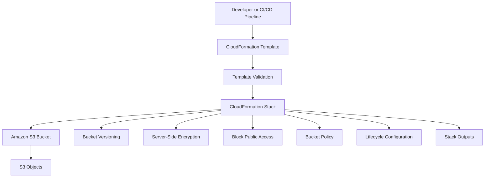
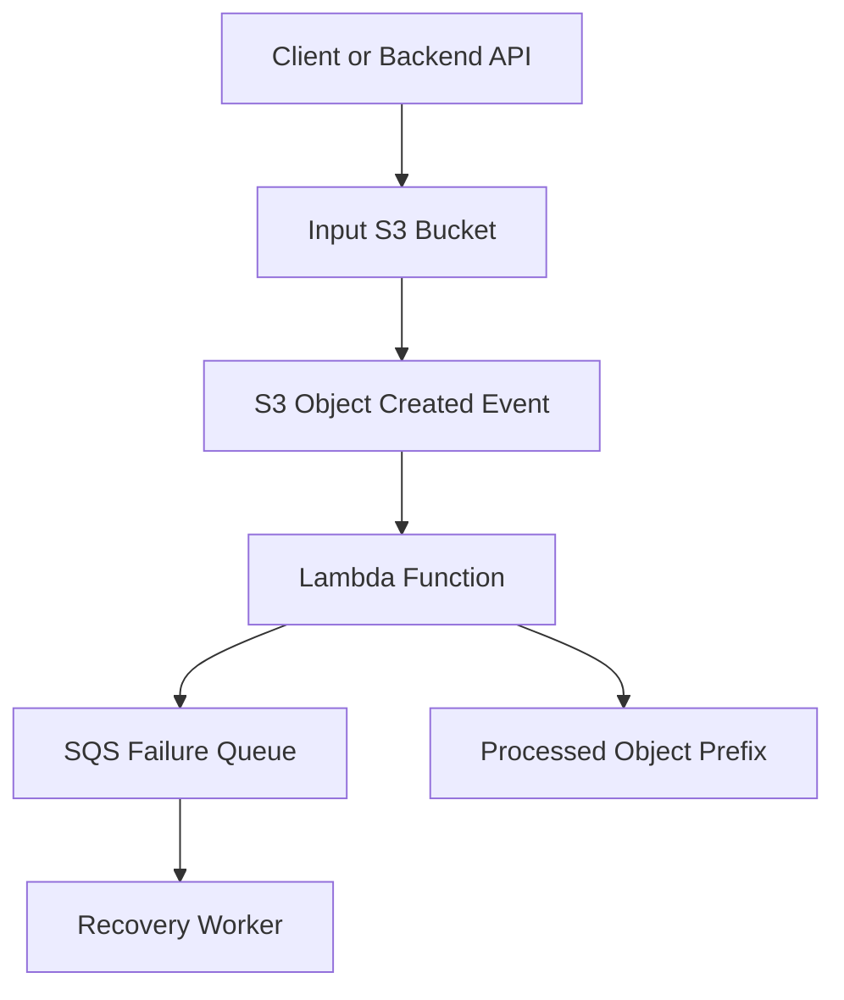
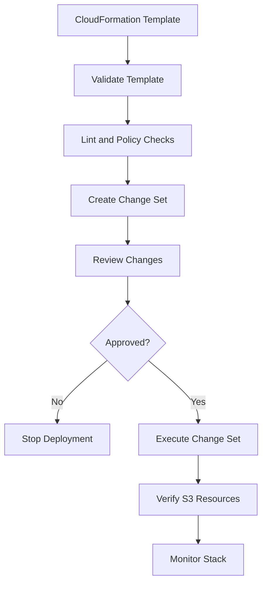
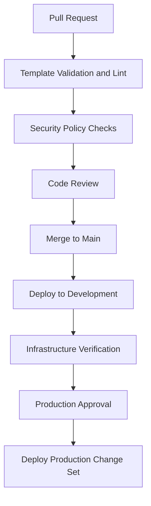

# 01- CloudFormation for S3

## Overview

AWS CloudFormation is an infrastructure-as-code (IaC) service that provisions and manages AWS resources through declarative YAML or JSON templates.

For Amazon S3, CloudFormation can define buckets, versioning, encryption, lifecycle policies, public access controls, bucket policies, replication configurations, notifications, and integrations with other AWS services.

Instead of configuring S3 resources manually through the AWS Console or CLI, infrastructure is described in a template and deployed as a CloudFormation stack.

CloudFormation is particularly useful when:

- Infrastructure must be reproducible across development, staging, and production.
- Resource dependencies must be managed consistently.
- Infrastructure changes require review and controlled deployment.
- AWS-native deployment and rollback capabilities are preferred.
- Multiple AWS resources must be provisioned as one logical unit.

A production S3 deployment should define security controls, resource dependencies, retention behavior, and deletion protection explicitly.

## CloudFormation Architecture

A CloudFormation template describes the desired infrastructure state. CloudFormation interprets the template, resolves dependencies, and provisions the resources through AWS service APIs.



### Main components

| Component | Responsibility |
|---|---|
| Template | Declares the desired AWS resources and configuration |
| Parameters | Accept environment-specific deployment values |
| Resources | Define S3 buckets and related AWS resources |
| Mappings | Provide static configuration lookup values |
| Conditions | Control conditional resource creation and configuration |
| Intrinsic functions | Reference resources, parameters, attributes, and expressions |
| Outputs | Expose useful deployment information |
| Stack | Represents the deployed collection of resources |
| Change set | Previews the impact of a proposed stack update |

## CloudFormation Template Structure

A CloudFormation template is a YAML or JSON document containing optional sections and resource declarations.

Common sections include:

| Section | Purpose |
|---|---|
| `AWSTemplateFormatVersion` | Declares the template format version |
| `Description` | Describes the template |
| `Metadata` | Provides additional template metadata |
| `Parameters` | Accepts deployment-time configuration |
| `Mappings` | Defines static lookup values |
| `Conditions` | Defines conditional deployment logic |
| `Transform` | Invokes CloudFormation transforms |
| `Resources` | Defines infrastructure resources |
| `Outputs` | Exposes deployment results |

For an S3 deployment, the most frequently used sections are `Parameters`, `Conditions`, `Resources`, and `Outputs`.

### Parameters

Parameters make templates reusable across environments.

For example, a bucket name should not be hardcoded into a reusable template.

```yaml
Parameters:
  BucketName:
    Type: String
    Description: Globally unique S3 bucket name

  Environment:
    Type: String
    Default: dev
    AllowedValues:
      - dev
      - staging
      - production
```

Deployments can supply different values without modifying the template.

```bash
aws cloudformation deploy \
  --template-file s3-bucket.yaml \
  --stack-name application-s3 \
  --parameter-overrides \
    BucketName=company-app-storage-123456 \
    Environment=production
```

Use parameter constraints such as `AllowedValues`, `MinLength`, and `MaxLength` where appropriate.

Do not treat parameter validation as a replacement for AWS service-side validation.

### Mappings

Mappings provide static key-value lookup structures.

They are useful when a deployment must select configuration based on a known environment or Region.

```yaml
Mappings:
  EnvironmentConfiguration:
    dev:
      Versioning: Suspended
    production:
      Versioning: Enabled
```

Reference mapping values using `Fn::FindInMap`:

```yaml
Resources:
  ApplicationBucket:
    Type: AWS::S3::Bucket
    Properties:
      VersioningConfiguration:
        Status:
          Fn::FindInMap:
            - EnvironmentConfiguration
            - !Ref Environment
            - Versioning
```

For production S3 infrastructure, avoid using mappings for values that should be supplied dynamically or managed through dedicated configuration.

### Conditions

Conditions control whether resources or resource properties are created based on deployment inputs.

```yaml
Conditions:
  IsProduction: !Equals
    - !Ref Environment
    - production
```

A condition can be applied to a resource:

```yaml
Resources:
  ProductionBackupBucket:
    Type: AWS::S3::Bucket
    Condition: IsProduction
```

Conditions are useful for environment-specific resources, optional features, and controlled configuration differences.

Avoid creating substantially different production architectures through excessive conditional logic. Separate templates or nested stacks may be easier to maintain when environments have different infrastructure requirements.

### Intrinsic functions

CloudFormation intrinsic functions allow templates to reference resources and construct values dynamically.

| Function | Purpose | Example |
|---|---|---|
| `Ref` | Returns a parameter value or resource-specific reference | `!Ref BucketName` |
| `Fn::GetAtt` | Retrieves a resource attribute | `!GetAtt ApplicationBucket.Arn` |
| `Fn::Sub` | Substitutes variables into strings | `!Sub '${AWS::AccountId}'` |
| `Fn::Join` | Joins values into a string | `!Join ['', [...]]` |
| `Fn::If` | Selects a value based on a condition | `!If [IsProduction, Enabled, Suspended]` |
| `Fn::Equals` | Compares two values | `!Equals [!Ref Environment, production]` |
| `Fn::FindInMap` | Retrieves a mapping value | `!FindInMap [...]` |
| `Fn::GetAZs` | Retrieves Availability Zones | `!GetAZs ''` |

For example, construct a bucket ARN using `Fn::Sub`:

```yaml
!Sub 'arn:${AWS::Partition}:s3:::${BucketName}'
```

Prefer `!Ref` and `!GetAtt` over hardcoding resource identifiers.

## Creating a Production-Oriented S3 Bucket

The following template provisions a private S3 bucket with:

- Bucket versioning.
- SSE-S3 encryption.
- Bucket-owner-enforced object ownership.
- Block Public Access.
- HTTPS-only bucket policy.
- Environment-specific configuration.
- Optional production lifecycle protection.
- Stack outputs.

The example intentionally keeps lifecycle management separate from detailed lifecycle-policy design.

### CloudFormation template

File: `s3-bucket.yaml`

```yaml
AWSTemplateFormatVersion: '2010-09-09'

Description: >
  Provisions a private Amazon S3 bucket with versioning,
  encryption, ownership controls, and public access protection.

Parameters:
  BucketName:
    Type: String
    Description: Globally unique S3 bucket name
    MinLength: 3
    MaxLength: 63

  Environment:
    Type: String
    Default: dev
    AllowedValues:
      - dev
      - staging
      - production

  EnableVersioning:
    Type: String
    Default: Enabled
    AllowedValues:
      - Enabled
      - Suspended

  DataClassification:
    Type: String
    Default: internal
    AllowedValues:
      - public
      - internal
      - confidential
      - restricted

Conditions:
  IsProduction: !Equals
    - !Ref Environment
    - production

Resources:
  ApplicationBucket:
    Type: AWS::S3::Bucket

    DeletionPolicy: Retain
    UpdateReplacePolicy: Retain

    Properties:
      BucketName: !Ref BucketName

      OwnershipControls:
        Rules:
          - ObjectOwnership: BucketOwnerEnforced

      PublicAccessBlockConfiguration:
        BlockPublicAcls: true
        BlockPublicPolicy: true
        IgnorePublicAcls: true
        RestrictPublicBuckets: true

      VersioningConfiguration:
        Status: !Ref EnableVersioning

      BucketEncryption:
        ServerSideEncryptionConfiguration:
          - ServerSideEncryptionByDefault:
              SSEAlgorithm: AES256
            BucketKeyEnabled: false

      Tags:
        - Key: Project
          Value: amazon-s3

        - Key: Environment
          Value: !Ref Environment

        - Key: DataClassification
          Value: !Ref DataClassification

        - Key: ManagedBy
          Value: CloudFormation

  ApplicationBucketPolicy:
    Type: AWS::S3::BucketPolicy

    Properties:
      Bucket: !Ref ApplicationBucket

      PolicyDocument:
        Version: '2012-10-17'

        Statement:
          - Sid: DenyInsecureTransport
            Effect: Deny

            Principal: '*'

            Action:
              - s3:*

            Resource:
              - !GetAtt ApplicationBucket.Arn
              - !Sub '${ApplicationBucket.Arn}/*'

            Condition:
              Bool:
                aws:SecureTransport: 'false'

Outputs:
  BucketName:
    Description: Created S3 bucket name
    Value: !Ref ApplicationBucket

  BucketArn:
    Description: Created S3 bucket ARN
    Value: !GetAtt ApplicationBucket.Arn

  BucketDomainName:
    Description: S3 bucket regional domain name
    Value: !GetAtt ApplicationBucket.RegionalDomainName

  Environment:
    Description: Deployment environment
    Value: !Ref Environment

  ProductionDeployment:
    Description: Whether this deployment targets production
    Value: !If
      - IsProduction
      - 'true'
      - 'false'
```

### Important resource properties

| Property | Purpose |
|---|---|
| `BucketName` | Sets the globally unique bucket name |
| `OwnershipControls` | Enforces bucket-owner ownership |
| `PublicAccessBlockConfiguration` | Prevents public access configurations |
| `VersioningConfiguration` | Enables or suspends bucket versioning |
| `BucketEncryption` | Configures default server-side encryption |
| `Tags` | Adds resource metadata |
| `DeletionPolicy` | Controls behavior when the resource is removed from the stack |
| `UpdateReplacePolicy` | Controls behavior when an update replaces the resource |

The example uses SSE-S3. For SSE-KMS, use a KMS key ARN and configure the necessary KMS key policy and IAM permissions separately.

`DeletionPolicy: Retain` protects the bucket when the stack is deleted. It does not make the bucket immutable or prevent direct deletion through other AWS identities.

`UpdateReplacePolicy: Retain` preserves the old resource if an update requires replacement. This can leave retained resources outside normal stack management, so track them operationally.

The `EnableVersioning` parameter is configurable for demonstration purposes. Production data buckets should generally keep versioning enabled.

## CloudFormation Resource Dependencies

CloudFormation automatically determines many resource dependencies from references such as `!Ref` and `!GetAtt`.

For example:

```yaml
ApplicationBucketPolicy:
  Type: AWS::S3::BucketPolicy
  Properties:
    Bucket: !Ref ApplicationBucket
```

The bucket policy references the bucket, so CloudFormation creates the bucket before attaching the policy.

Use `DependsOn` when a dependency exists but is not represented through a resource reference.

Example:

```yaml
SomeResource:
  Type: AWS::SomeService::Resource
  DependsOn:
    - ApplicationBucket
```

Do not add `DependsOn` indiscriminately. Unnecessary dependencies can serialize deployments and make templates harder to maintain.

For S3 event notifications, resource dependencies become especially important when the destination is a Lambda function or another service requiring invocation permissions.

## Adding S3 Lifecycle Configuration

Lifecycle configuration automates storage transitions and object expiration.

For example, a bucket can transition older objects to a lower-cost storage class and expire incomplete multipart uploads.

Add the following property to the bucket resource:

```yaml
LifecycleConfiguration:
  Rules:
    - Id: ArchiveOldObjects
      Status: Enabled

      Filter:
        Prefix: archive/

      Transitions:
        - TransitionInDays: 90
          StorageClass: STANDARD_IA

    - Id: AbortIncompleteMultipartUploads
      Status: Enabled

      Filter:
        Prefix: ''

      AbortIncompleteMultipartUpload:
        DaysAfterInitiation: 7
```

Production lifecycle configuration should also account for:

- Noncurrent object versions.
- Delete markers.
- Minimum storage duration.
- Retrieval charges.
- Object retention requirements.
- Versioning behavior.
- Data classification.

Do not apply expiration rules without reviewing retention and recovery requirements.

For complex lifecycle management, maintain lifecycle rules in a dedicated template or clearly separated resource configuration.

## Adding SSE-KMS Encryption

SSE-KMS is useful when encryption-key ownership, key policies, auditability, or key-specific controls are required.

Replace the SSE-S3 configuration with an SSE-KMS configuration:

```yaml
BucketEncryption:
  ServerSideEncryptionConfiguration:
    - ServerSideEncryptionByDefault:
        SSEAlgorithm: aws:kms
        KMSMasterKeyID: !Ref KmsKeyArn
      BucketKeyEnabled: true
```

Declare the key ARN as a parameter:

```yaml
Parameters:
  KmsKeyArn:
    Type: String
    Description: ARN of the KMS key used for bucket encryption
```

The KMS key must exist in the same Region as the bucket.

The deployment identity and application identities require appropriate KMS authorization. A bucket's default encryption configuration does not automatically grant users permission to use the KMS key.

For cross-account access, both S3 authorization and KMS key authorization must be evaluated.

## S3 Replication with CloudFormation

CloudFormation supports S3 replication through the `AWS::S3::Bucket` resource.

A replication configuration requires:

- Versioning enabled on the source bucket.
- Versioning enabled on the destination bucket.
- An IAM role trusted by the S3 replication service.
- Permissions to read source versions.
- Permissions to replicate objects to the destination.
- KMS permissions when SSE-KMS replication is used.

A simplified replication configuration is shown below.

```yaml
ReplicationConfiguration:
  Role: !GetAtt ReplicationRole.Arn

  Rules:
    - Id: ReplicateUploads
      Status: Enabled

      Filter:
        Prefix: uploads/

      Destination:
        Bucket: !Sub
          - 'arn:${AWS::Partition}:s3:::${DestinationBucket}'
          - DestinationBucket: !Ref DestinationBucketName
```

The complete implementation must also define:

- The destination bucket.
- Versioning on both buckets.
- The replication IAM role and trust policy.
- Source and destination IAM permissions.
- Destination bucket authorization.
- KMS key permissions where applicable.

For cross-account replication, the destination bucket policy must explicitly authorize the source replication role.

For cross-Region SSE-KMS replication, use a destination-Region KMS key and configure both key policies.

Do not deploy a replication rule without validating the role permissions and destination authorization.

The Terraform replication example in the neighboring `02- Terraform/examples/replicated-bucket` directory demonstrates the same general infrastructure domain using Terraform.

## S3 Event Notifications

CloudFormation can configure S3 event notifications to invoke Lambda functions or publish events to supported destinations.

Typical use cases include:

- Image processing.
- Document extraction.
- File validation.
- Data ingestion.
- Asynchronous backend workflows.

A common architecture uses S3, Lambda, and SQS.



For reliable event processing:

- Grant S3 permission to invoke the Lambda function.
- Configure the Lambda notification destination.
- Avoid recursive event processing by separating input and output prefixes or buckets.
- Make processing idempotent.
- Handle duplicate and out-of-order events.
- Configure retry and failure-recovery behavior.
- Monitor Lambda errors and queue depth.

S3 event notifications are delivered at least once and can be duplicated. Consumers must not assume exactly-once processing.

When using SQS as an event destination, configure the required queue policy and validate the supported S3 notification configuration.

For high-volume or more complex event routing, consider EventBridge integration.

## CloudFormation Deployment Workflow

A controlled deployment should validate the template, review the proposed changes, deploy the stack, and verify the resulting resources.



### Validate the template

```bash
aws cloudformation validate-template \
  --template-body file://s3-bucket.yaml
```

This validates template structure and returns information about the template. It does not prove that every resource property, permission, or runtime behavior will work as intended.

Use additional validation tools such as:

- `cfn-lint` for template and resource-property validation.
- CloudFormation Guard for policy-based configuration checks.
- Security scanning in CI/CD.
- Change-set review before production deployment.

Example:

```bash
cfn-lint s3-bucket.yaml
```

### Create the stack

```bash
aws cloudformation create-stack \
  --stack-name application-s3 \
  --template-body file://s3-bucket.yaml \
  --parameters \
    ParameterKey=BucketName,ParameterValue=company-app-storage-123456 \
    ParameterKey=Environment,ParameterValue=production \
    ParameterKey=EnableVersioning,ParameterValue=Enabled \
    ParameterKey=DataClassification,ParameterValue=confidential
```

If the template creates IAM resources, include the required capabilities:

```bash
--capabilities CAPABILITY_IAM
```

For named IAM resources:

```bash
--capabilities CAPABILITY_NAMED_IAM
```

The example bucket template does not create IAM resources, so these flags are not required for that template.

### Wait for deployment

```bash
aws cloudformation wait stack-create-complete \
  --stack-name application-s3
```

Inspect stack status:

```bash
aws cloudformation describe-stacks \
  --stack-name application-s3
```

Inspect individual resource statuses:

```bash
aws cloudformation describe-stack-resources \
  --stack-name application-s3
```

### Retrieve outputs

```bash
aws cloudformation describe-stacks \
  --stack-name application-s3 \
  --query "Stacks[0].Outputs"
```

Use stack outputs to retrieve bucket names and ARNs rather than duplicating resource identifiers in deployment scripts.

## Updating a Stack with Change Sets

A CloudFormation update can modify existing resources, create new resources, or replace existing resources.

A change set provides a preview of the proposed update.

Create a change set:

```bash
aws cloudformation create-change-set \
  --stack-name application-s3 \
  --change-set-name add-s3-feature \
  --template-body file://s3-bucket.yaml \
  --parameters \
    ParameterKey=BucketName,ParameterValue=company-app-storage-123456 \
    ParameterKey=Environment,ParameterValue=production \
    ParameterKey=EnableVersioning,ParameterValue=Enabled \
    ParameterKey=DataClassification,ParameterValue=confidential
```

Inspect the change set:

```bash
aws cloudformation describe-change-set \
  --stack-name application-s3 \
  --change-set-name add-s3-feature
```

Pay particular attention to:

- Resource replacement.
- Bucket-name changes.
- Encryption changes.
- Versioning changes.
- Bucket policy modifications.
- Lifecycle changes.
- Deletion or retention behavior.

Execute the reviewed change set:

```bash
aws cloudformation execute-change-set \
  --stack-name application-s3 \
  --change-set-name add-s3-feature
```

Wait for completion:

```bash
aws cloudformation wait stack-update-complete \
  --stack-name application-s3
```

A change set is a deployment preview, not a guarantee that the update will succeed.

## Stack Outputs and Cross-Stack References

Outputs expose information generated by a stack.

For example:

```yaml
Outputs:
  BucketArn:
    Description: S3 bucket ARN
    Value: !GetAtt ApplicationBucket.Arn

  BucketName:
    Description: S3 bucket name
    Value: !Ref ApplicationBucket
```

Another stack can consume an exported value using `Fn::ImportValue`.

Example export:

```yaml
Outputs:
  SharedBucketArn:
    Value: !GetAtt ApplicationBucket.Arn
    Export:
      Name: shared-s3-bucket-arn
```

Example import:

```yaml
Resources:
  ApplicationPolicy:
    Type: AWS::IAM::Policy

    Properties:
      PolicyName: application-s3-access

      Roles:
        - !Ref ApplicationRole

      PolicyDocument:
        Version: '2012-10-17'

        Statement:
          - Effect: Allow
            Action:
              - s3:GetObject

            Resource:
              - !Sub
                - '${BucketArn}/*'
                - BucketArn:
                    Fn::ImportValue: shared-s3-bucket-arn
```

Cross-stack exports create dependencies between stacks.

An exported value generally cannot be changed or removed while another stack imports it. Plan changes to shared infrastructure carefully.

For larger systems, consider nested stacks, dedicated infrastructure stacks, or explicit parameter passing.

## CloudFormation Stack Policies

Stack policies help protect critical resources against accidental updates.

They are particularly relevant for data-bearing S3 buckets.

A stack policy can deny updates to a bucket resource:

```json
{
  "Statement": [
    {
      "Effect": "Deny",
      "Action": "Update:*",
      "Principal": "*",
      "Resource": "LogicalResourceId/ApplicationBucket"
    },
    {
      "Effect": "Allow",
      "Action": "Update:*",
      "Principal": "*",
      "Resource": "*"
    }
  ]
}
```

Apply a stack policy:

```bash
aws cloudformation set-stack-policy \
  --stack-name application-s3 \
  --stack-policy-body file://stack-policy.json
```

Stack policies protect resources against selected CloudFormation update operations.

They do not replace:

- IAM authorization.
- S3 bucket policies.
- Deletion protection.
- Data retention controls.
- Backup and recovery procedures.

A stack policy also does not prevent direct resource modification through another AWS identity.

## Deletion and Retention Policies

CloudFormation provides resource lifecycle attributes that control what happens when a resource is removed from a stack or replaced.

| Attribute | Purpose |
|---|---|
| `DeletionPolicy: Delete` | Deletes the resource when removed from the stack or when the stack is deleted |
| `DeletionPolicy: Retain` | Preserves the resource when removed from the stack or when the stack is deleted |
| `DeletionPolicy: Snapshot` | Creates a snapshot for supported resource types |
| `UpdateReplacePolicy: Retain` | Retains the old resource when an update replaces it |
| `UpdateReplacePolicy: Delete` | Deletes the old resource after replacement |

For S3 buckets containing important data, use `Retain` deliberately.

Example:

```yaml
ApplicationBucket:
  Type: AWS::S3::Bucket

  DeletionPolicy: Retain
  UpdateReplacePolicy: Retain
```

Important operational behavior:

- Retained buckets can remain after stack deletion.
- Retained resources may no longer be managed by the original stack.
- Stack deletion does not automatically empty a retained bucket.
- A bucket cannot be deleted while it contains objects or object versions.
- Versioned buckets require special handling for historical versions and delete markers.

Maintain an inventory of retained resources and define an explicit ownership and cleanup process.

## Drift Detection

Drift occurs when the deployed infrastructure differs from the CloudFormation template.

For example, an engineer may manually change:

- Bucket encryption.
- Versioning.
- Public access settings.
- Bucket policy.
- Lifecycle configuration.

CloudFormation drift detection helps identify supported differences between the declared template and deployed resource configuration.

Start drift detection:

```bash
aws cloudformation detect-stack-drift \
  --stack-name application-s3
```

Retrieve the detection identifier from the command response, then inspect its status:

```bash
aws cloudformation describe-stack-drift-detection-status \
  --stack-drift-detection-id <detection-id>
```

Inspect drifted resources:

```bash
aws cloudformation describe-stack-resource-drifts \
  --stack-name application-s3
```

Drift detection has limitations:

- Not every resource property supports drift detection.
- Some changes may not be detected.
- A drift result does not automatically reconcile infrastructure.
- A manual change may be intentional and require a template update.

Use drift detection as part of infrastructure governance rather than as a substitute for controlled change management.

## Importing Existing S3 Resources

Existing S3 buckets can be brought under CloudFormation management through resource import when the resource type and import requirements are supported.

This is useful when:

- A bucket was created manually.
- Existing infrastructure must be managed through IaC.
- A deployment is migrating from another infrastructure tool.

The process generally involves:

1. Define the existing bucket in a CloudFormation template.
2. Identify the resource's import identifier.
3. Prepare a resource import template.
4. Execute the import operation.
5. Review stack drift.
6. Verify that the template accurately represents the existing configuration.

Example import operation:

```bash
aws cloudformation create-change-set \
  --stack-name existing-s3-stack \
  --change-set-name import-existing-bucket \
  --change-set-type IMPORT \
  --template-body file://import-template.yaml \
  --resources-to-import file://resources-to-import.json
```

The import identifier and supported resource properties depend on the resource type.

Do not assume that importing a bucket automatically imports every related configuration or associated resource. Review ownership controls, policies, versioning, encryption, lifecycle configuration, and notifications separately.

## Environment Management

Use separate deployment configuration for development, staging, and production.

A practical structure:

```text
cloudformation/
├── templates/
│   └── s3-bucket.yaml
├── parameters/
│   ├── dev.json
│   ├── staging.json
│   └── production.json
├── policies/
│   └── stack-policy.json
└── README.md
```

Example parameter file:

```json
[
  {
    "ParameterKey": "BucketName",
    "ParameterValue": "company-app-storage-dev-123456"
  },
  {
    "ParameterKey": "Environment",
    "ParameterValue": "dev"
  },
  {
    "ParameterKey": "EnableVersioning",
    "ParameterValue": "Enabled"
  },
  {
    "ParameterKey": "DataClassification",
    "ParameterValue": "internal"
  }
]
```

Deploy using the parameter file:

```bash
aws cloudformation create-stack \
  --stack-name application-s3-dev \
  --template-body file://templates/s3-bucket.yaml \
  --parameters file://parameters/dev.json
```

For production, use:

- A separate AWS account where appropriate.
- Restricted deployment roles.
- Reviewed change sets.
- Stack policies for critical resources.
- Explicit approval gates.
- CloudTrail auditing.
- Controlled retention and deletion procedures.

Do not use the same bucket name across environments. S3 bucket names are globally unique.

## CI/CD Integration

CloudFormation can be integrated into GitHub Actions or other CI/CD systems.

A typical deployment pipeline:



Use GitHub Actions with AWS IAM OIDC federation rather than long-lived AWS access keys.

The CI role should have only the permissions required for the target stack and its resources.

A deployment workflow should:

- Validate YAML and CloudFormation syntax.
- Run `cfn-lint`.
- Run policy and security checks.
- Create and inspect change sets.
- Require approval for production.
- Execute approved changes.
- Verify stack status and resource configuration.
- Preserve deployment logs and audit information.

Avoid granting broad administrator permissions to a general-purpose CI role.

## Post-Deployment Verification

A successful CloudFormation stack deployment does not prove that every application workflow can access the bucket correctly.

Verify the actual S3 configuration.

### Verify bucket versioning

```bash
aws s3api get-bucket-versioning \
  --bucket company-app-storage-123456
```

### Verify encryption

```bash
aws s3api get-bucket-encryption \
  --bucket company-app-storage-123456
```

### Verify ownership controls

```bash
aws s3api get-bucket-ownership-controls \
  --bucket company-app-storage-123456
```

### Verify public access controls

```bash
aws s3api get-public-access-block \
  --bucket company-app-storage-123456
```

### Verify bucket policy

```bash
aws s3api get-bucket-policy \
  --bucket company-app-storage-123456
```

### Verify CloudFormation stack status

```bash
aws cloudformation describe-stacks \
  --stack-name application-s3 \
  --query "Stacks[0].StackStatus"
```

For application-level validation, test the intended upload and download workflow using the application's IAM role.

Do not use administrator credentials as the only verification identity.

## Monitoring and Auditing

CloudFormation manages infrastructure deployment, but ongoing S3 monitoring requires additional AWS services and configuration.

| Service | Responsibility |
|---|---|
| CloudFormation | Stack deployment and infrastructure state |
| CloudTrail | Audits supported AWS API activity |
| CloudWatch | Metrics, logs, and alarms |
| S3 Storage Lens | Storage usage and activity visibility |
| S3 Inventory | Scheduled object and metadata reports |
| AWS Config | Resource configuration tracking and compliance evaluation |

Monitor:

- Stack update failures.
- Unexpected resource replacement.
- Bucket policy changes.
- Encryption configuration changes.
- Public access configuration changes.
- Versioning changes.
- Unexpected lifecycle modifications.
- Replication configuration changes.
- Access-denied events.

Use CloudTrail and AWS Config to support investigation and configuration governance.

## Troubleshooting

Follow a consistent diagnostic sequence:

1. Identify the failing stack operation.
2. Inspect stack events.
3. Identify the failed logical resource.
4. Inspect the resource-specific error.
5. Validate permissions and dependencies.
6. Correct the template or deployment configuration.
7. Retry through a reviewed deployment operation.
8. Verify the resulting infrastructure.

### Stack creation or update fails

Inspect stack events:

```bash
aws cloudformation describe-stack-events \
  --stack-name application-s3 \
  --max-items 30
```

Identify the first resource failure and its reason.

Common causes:

- Bucket name already exists.
- Invalid resource property.
- Insufficient IAM permissions.
- Unsupported configuration in the selected Region.
- Invalid KMS key ARN.
- Conflicting bucket configuration.
- Missing resource dependency.

Do not repeatedly retry without understanding the first failure.

### Bucket name already exists

S3 bucket names are globally unique.

Check whether the name is available for the intended account and whether the bucket already belongs to the deployment.

Use a different globally unique name when the name is owned by another account.

Do not attempt to take ownership of an existing bucket by changing stack parameters without first verifying its ownership and contents.

### AccessDenied

Inspect the identity used for deployment:

```bash
aws sts get-caller-identity
```

Review:

- IAM permissions of the deployment identity.
- Permission boundaries.
- Service control policies.
- Explicit denies.
- KMS key policies, when applicable.
- S3 bucket policies.

Separate CloudFormation deployment authorization from runtime S3 access authorization.

A stack can deploy successfully while the application role still lacks permission to access objects.

### Encryption configuration fails

Inspect the KMS key:

```bash
aws kms describe-key \
  --key-id <kms-key-arn>
```

Verify:

- The key exists.
- The key is in the bucket's Region.
- The key is enabled.
- The deployment identity can configure the bucket encryption.
- The application identity has the required KMS permissions.
- The key policy permits the required principals.

An S3 authorization grant does not automatically provide KMS authorization.

### Stack enters `ROLLBACK_IN_PROGRESS`

Inspect events:

```bash
aws cloudformation describe-stack-events \
  --stack-name application-s3
```

Identify the original failure rather than focusing only on the rollback events.

Possible causes include:

- Invalid resource configuration.
- Insufficient permissions.
- Resource naming conflicts.
- Unsupported updates.
- Dependency failures.

Correct the underlying issue before attempting another deployment.

### Stack enters `UPDATE_ROLLBACK_FAILED`

An update rollback can fail when CloudFormation cannot restore the previous resource state.

Inspect stack events and identify the resources that failed to roll back.

After correcting the underlying issue, use the supported CloudFormation recovery operation.

For example:

```bash
aws cloudformation continue-update-rollback \
  --stack-name application-s3
```

Use resource skipping only when the implications are understood. Skipping a resource can leave the deployed infrastructure inconsistent with the template.

After recovery:

1. Inspect stack status.
2. Inspect resource configuration.
3. Run drift detection.
4. Reconcile the template with the actual infrastructure.
5. Create a new reviewed change set.

### S3 notification configuration fails

Check:

- Lambda invocation permissions.
- Destination resource policies.
- S3 notification configuration.
- Resource creation dependencies.
- Event filter configuration.
- Existing notification configuration on the bucket.

S3 notification configuration is managed as a bucket-level configuration. Avoid competing infrastructure resources that overwrite or independently manage the same notification configuration.

### Stack deletion fails

A bucket may contain object versions, delete markers, or incomplete multipart uploads.

Inspect the bucket before retrying deletion.

For versioned buckets, ordinary recursive deletion is not sufficient to remove all historical versions.

Check `DeletionPolicy` and `UpdateReplacePolicy` before assuming that stack deletion should remove the bucket.

## Best Practices

### Infrastructure design

- Keep templates focused on one infrastructure responsibility.
- Use parameters for environment-specific configuration.
- Use outputs for resource identifiers.
- Reference resources through intrinsic functions.
- Use conditions only when they improve deployment clarity.
- Use separate stacks for independently managed infrastructure domains.
- Pin deployment tooling versions in CI/CD.

### S3 security

- Enable all four Block Public Access settings unless a reviewed exception exists.
- Enforce bucket-owner ownership.
- Configure server-side encryption.
- Deny insecure transport.
- Use least-privilege IAM policies.
- Keep sensitive values out of templates and parameter files.
- Use KMS key policies deliberately when SSE-KMS is required.

### Production protection

- Enable versioning for important data.
- Use `DeletionPolicy: Retain` for buckets containing valuable data.
- Use `UpdateReplacePolicy: Retain` where replacement must not destroy existing data.
- Apply stack policies to critical resources.
- Review change sets before production deployment.
- Monitor stack drift.
- Test recovery and cleanup procedures.

### Deployment governance

- Validate templates before deployment.
- Use CI/CD with temporary credentials through OIDC.
- Require approval for production changes.
- Preserve deployment and audit logs.
- Verify deployed resources through AWS APIs.
- Reconcile manual changes through controlled template updates.

## Common Mistakes

| Mistake | Impact | Prevention |
|---|---|---|
| Hardcoding bucket names | Reduces template reuse and can cause naming conflicts | Use parameters |
| Omitting Block Public Access | Increases public exposure risk | Enable all four settings |
| Omitting versioning | Reduces recovery options | Enable versioning for important data |
| Using `DeletionPolicy: Delete` for critical buckets | Can cause unintended data loss | Use retention and reviewed cleanup |
| Assuming `Retain` means immutable | Retained resources can still be modified or deleted by authorized identities | Use independent retention and access controls |
| Ignoring change sets | Resource replacement or deletion may go unnoticed | Review proposed changes |
| Using broad CI permissions | Increases deployment security risk | Apply least privilege |
| Ignoring stack drift | Manual changes can diverge from IaC | Schedule drift detection |
| Treating stack success as application verification | Runtime access may still fail | Test using the application identity |
| Defining conflicting notification configurations | Notifications may be overwritten | Manage bucket-level configuration consistently |
| Assuming rollback always succeeds | Failed rollback can leave stacks in an inconsistent state | Inspect events and maintain recovery procedures |
| Treating CloudFormation as a backup mechanism | Infrastructure templates do not preserve object data | Use independent data protection and recovery controls |

## Key Takeaways

- CloudFormation provides declarative, repeatable management of S3 infrastructure through templates and stacks.
- Parameters, conditions, mappings, and intrinsic functions make templates reusable across environments.
- Versioning, encryption, ownership controls, Block Public Access, and HTTPS-only policies should be explicit infrastructure requirements.
- Change sets, stack policies, retention attributes, and drift detection help control production infrastructure changes.
- Successful stack deployment is not equivalent to verified application access or data protection; validate runtime permissions, recovery behavior, and operational requirements separately.