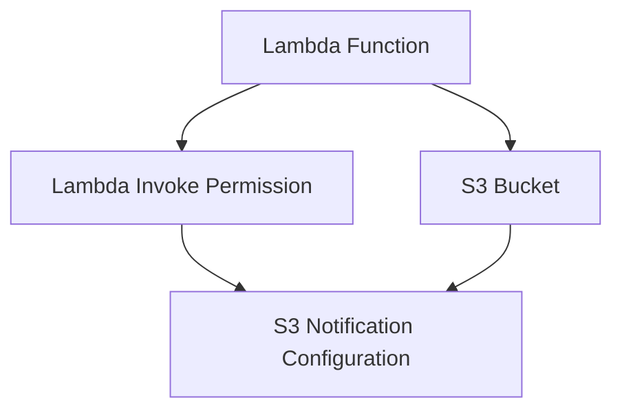

# 02- Template Structure and Parameters

## Overview

AWS CloudFormation templates define infrastructure declaratively using YAML or JSON. Their structure determines how resources are configured, how deployment-time values are supplied, how dependencies are resolved, and how infrastructure changes are managed.

For Amazon S3 deployments, a well-structured template separates reusable resource definitions from environment-specific configuration.

A production-oriented template should make the following explicit:

- Bucket naming and Region assumptions.
- Versioning and encryption configuration.
- Ownership controls and public access restrictions.
- Lifecycle and replication requirements.
- IAM and resource-policy dependencies.
- Resource retention and replacement behavior.
- Deployment outputs and cross-stack dependencies.

This document focuses on CloudFormation template structure, parameters, mappings, conditions, intrinsic functions, resource references, and reusable configuration patterns for S3 infrastructure.

## CloudFormation Template Structure

A CloudFormation template consists of several optional sections. The `Resources` section is mandatory because it defines the AWS infrastructure to provision.

```yaml
AWSTemplateFormatVersion: '2010-09-09'

Description: S3 infrastructure template

Metadata:
  TemplateVersion: '1.0'

Parameters:
  Environment:
    Type: String
    Default: dev

Mappings:
  EnvironmentConfiguration:
    dev:
      Versioning: Enabled

Conditions:
  IsProduction: !Equals
    - !Ref Environment
    - production

Resources:
  ApplicationBucket:
    Type: AWS::S3::Bucket

Outputs:
  BucketName:
    Value: !Ref ApplicationBucket
```

### Template sections

| Section | Purpose | S3 use case |
|---|---|---|
| `AWSTemplateFormatVersion` | Declares the template format version | Standard template metadata |
| `Description` | Describes the template | Documents the S3 infrastructure |
| `Metadata` | Stores additional template metadata | Organizes parameter groups and interface metadata |
| `Parameters` | Accepts deployment-time values | Bucket name, environment, encryption key ARN |
| `Mappings` | Defines static lookup values | Environment-specific configuration |
| `Conditions` | Evaluates deployment conditions | Optional replication or production resources |
| `Transform` | Invokes CloudFormation transforms | Serverless or macro-based templates |
| `Resources` | Defines AWS resources | Buckets, policies, IAM roles, notifications |
| `Outputs` | Exposes deployment results | Bucket name, ARN, and regional domain name |

Use sections according to their purpose. Avoid introducing mappings or conditions when simple parameters are sufficient.

## Parameters

Parameters allow a template to accept values at deployment time.

They separate reusable infrastructure definitions from environment-specific configuration.

For example, a development deployment and a production deployment may use the same template but different bucket names, encryption keys, and lifecycle settings.

### Basic parameter definition

```yaml
Parameters:
  BucketName:
    Type: String
    Description: Globally unique S3 bucket name

  Environment:
    Type: String
    Default: dev
    AllowedValues:
      - dev
      - staging
      - production
```

Reference parameters using `!Ref`:

```yaml
Resources:
  ApplicationBucket:
    Type: AWS::S3::Bucket
    Properties:
      BucketName: !Ref BucketName

      Tags:
        - Key: Environment
          Value: !Ref Environment
```

CloudFormation resolves the parameter values during stack creation or update.

### Parameter types

CloudFormation supports several parameter types.

| Type | Purpose | Example |
|---|---|---|
| `String` | Single string value | Bucket name |
| `Number` | Numeric value | Retention period |
| `List<String>` | Comma-delimited string values | Multiple prefixes |
| `CommaDelimitedList` | Comma-separated values | Multiple configuration entries |
| `AWS::EC2::AvailabilityZone::Name` | Valid Availability Zone | Infrastructure placement |
| `AWS::EC2::VPC::Id` | Existing VPC identifier | Network-integrated resources |
| `AWS::SSM::Parameter::Value<String>` | Resolves an SSM parameter value | Centrally managed configuration |
| `AWS::SSM::Parameter::Value<AWS::EC2::Image::Id>` | Resolves an AMI identifier | EC2 infrastructure |

For S3 templates, `String`, `Number`, `CommaDelimitedList`, and SSM parameter types are particularly useful.

### Parameter constraints

Use parameter constraints to reject invalid deployment inputs early.

```yaml
Parameters:
  BucketName:
    Type: String
    Description: S3 bucket name
    MinLength: 3
    MaxLength: 63

  Environment:
    Type: String
    Default: dev
    AllowedValues:
      - dev
      - staging
      - production

  RetentionDays:
    Type: Number
    Default: 90
    MinValue: 1
    MaxValue: 3650
```

Important parameter attributes:

| Attribute | Purpose |
|---|---|
| `Default` | Supplies a value when no override is provided |
| `AllowedValues` | Restricts accepted values |
| `AllowedPattern` | Validates a string using a regular expression |
| `MinLength` | Defines minimum string length |
| `MaxLength` | Defines maximum string length |
| `MinValue` | Defines minimum numeric value |
| `MaxValue` | Defines maximum numeric value |
| `ConstraintDescription` | Provides a meaningful constraint error |
| `NoEcho` | Masks parameter values in certain CloudFormation interfaces |

For example, validate a bucket name's basic character format:

```yaml
Parameters:
  BucketName:
    Type: String
    MinLength: 3
    MaxLength: 63
    AllowedPattern: '^[a-z0-9][a-z0-9.-]*[a-z0-9]$'
    ConstraintDescription: >
      Use lowercase letters, numbers, periods, and hyphens.
      The name must start and end with a letter or number.
```

This is only a basic format check. It does not validate every S3 bucket naming restriction or guarantee global uniqueness.

### Secure parameter handling

`NoEcho: true` masks parameter values in CloudFormation interfaces and certain outputs, but it is not a complete secret-management solution.

Do not use ordinary template parameters as a general-purpose mechanism for storing long-lived credentials.

Prefer:

- IAM roles and temporary credentials.
- AWS Secrets Manager for application secrets.
- Systems Manager Parameter Store for centrally managed configuration.
- KMS encryption where required.

KMS key ARNs, bucket names, and non-secret configuration can normally be supplied as ordinary parameters.

## Environment-Specific Configuration

A reusable S3 template should not contain hardcoded development or production values.

Keep the infrastructure definition stable and provide environment-specific values through parameter files or deployment pipelines.

### Example parameter file

File: `parameters/dev.json`

```json
[
  {
    "ParameterKey": "BucketName",
    "ParameterValue": "company-app-storage-dev-123456"
  },
  {
    "ParameterKey": "Environment",
    "ParameterValue": "dev"
  },
  {
    "ParameterKey": "EnableVersioning",
    "ParameterValue": "Enabled"
  },
  {
    "ParameterKey": "DataClassification",
    "ParameterValue": "internal"
  }
]
```

Production configuration can use a different bucket and classification:

File: `parameters/production.json`

```json
[
  {
    "ParameterKey": "BucketName",
    "ParameterValue": "company-app-storage-prod-123456"
  },
  {
    "ParameterKey": "Environment",
    "ParameterValue": "production"
  },
  {
    "ParameterKey": "EnableVersioning",
    "ParameterValue": "Enabled"
  },
  {
    "ParameterKey": "DataClassification",
    "ParameterValue": "confidential"
  }
]
```

Deploy using the appropriate parameter file:

```bash
aws cloudformation create-stack \
  --stack-name application-s3-dev \
  --template-body file://s3-bucket.yaml \
  --parameters file://parameters/dev.json
```

For production:

```bash
aws cloudformation create-stack \
  --stack-name application-s3-production \
  --template-body file://s3-bucket.yaml \
  --parameters file://parameters/production.json
```

Use separate AWS accounts for environments where isolation requirements justify it.

Do not rely on naming conventions alone to isolate production resources.

## Mappings

Mappings define static key-value relationships inside a template.

They are useful when configuration is determined by a known combination of values, such as environment and Region.

Unlike parameters, mapping values are maintained inside the template.

### Mapping definition

```yaml
Mappings:
  EnvironmentConfiguration:
    dev:
      Versioning: Suspended
      Classification: internal

    staging:
      Versioning: Enabled
      Classification: internal

    production:
      Versioning: Enabled
      Classification: confidential
```

Retrieve values using `Fn::FindInMap`.

```yaml
Resources:
  ApplicationBucket:
    Type: AWS::S3::Bucket

    Properties:
      VersioningConfiguration:
        Status: !FindInMap
          - EnvironmentConfiguration
          - !Ref Environment
          - Versioning
```

CloudFormation resolves the mapping value using the supplied environment.

### Region-specific mappings

Mappings can also represent Region-specific configuration.

```yaml
Mappings:
  RegionConfiguration:
    ap-south-1:
      StorageClass: STANDARD
    ap-southeast-1:
      StorageClass: STANDARD_IA
```

Reference a mapping value using the current stack Region:

```yaml
!FindInMap
  - RegionConfiguration
  - !Ref AWS::Region
  - StorageClass
```

Use Region mappings only when the values are genuinely static and appropriate for every deployment using the template.

### When to use mappings

Use mappings when:

- Values are static and known at template design time.
- Configuration depends on environment or Region.
- The lookup table is small and relatively stable.

Avoid mappings when:

- Values change frequently.
- Operators need to supply values at deployment time.
- Configuration is centrally managed in Parameter Store.
- The mapping becomes large or difficult to maintain.

## Conditions

Conditions allow CloudFormation to create resources or select property values based on deployment inputs.

They are useful for optional infrastructure and controlled environment differences.

### Defining a condition

```yaml
Parameters:
  Environment:
    Type: String
    Default: dev
    AllowedValues:
      - dev
      - staging
      - production

Conditions:
  IsProduction: !Equals
    - !Ref Environment
    - production
```

The condition evaluates to `true` when the environment parameter is `production`.

### Conditional resource creation

A resource can use the `Condition` attribute.

```yaml
Resources:
  ProductionArchiveBucket:
    Type: AWS::S3::Bucket
    Condition: IsProduction

    Properties:
      VersioningConfiguration:
        Status: Enabled
```

The archive bucket is created only when the condition evaluates to true.

### Conditional property values

Use `Fn::If` when a resource should exist in every environment but a property should vary.

```yaml
Resources:
  ApplicationBucket:
    Type: AWS::S3::Bucket

    Properties:
      VersioningConfiguration:
        Status: !If
          - IsProduction
          - Enabled
          - Suspended
```

This is different from conditional resource creation:

- `Condition` controls whether a resource exists.
- `Fn::If` controls which value is assigned to a property.

### Multiple conditions

Conditions can be combined using logical functions.

```yaml
Conditions:
  IsProduction: !Equals
    - !Ref Environment
    - production

  EnableReplication: !Equals
    - !Ref EnableReplicationParameter
    - 'true'

  ProductionReplicationEnabled: !And
    - !Condition IsProduction
    - !Condition EnableReplication
```

Use the combined condition:

```yaml
Resources:
  ReplicationRole:
    Type: AWS::IAM::Role
    Condition: ProductionReplicationEnabled
```

This allows replication infrastructure to be provisioned only when the deployment targets production and replication is enabled.

### Condition functions

| Function | Purpose |
|---|---|
| `Fn::Equals` | Compares two values |
| `Fn::And` | Returns true when all conditions are true |
| `Fn::Or` | Returns true when at least one condition is true |
| `Fn::Not` | Negates a condition |
| `Fn::If` | Selects one of two values based on a condition |
| `Condition` | References a condition from another condition or resource |

Conditions should represent deployment decisions, not replace sound infrastructure design.

If development and production require substantially different architectures, separate templates or nested stacks may be easier to maintain.

## Intrinsic Functions

Intrinsic functions allow CloudFormation templates to reference parameters, resources, attributes, and dynamically constructed values.

They are essential for reusable S3 templates because resource names and ARNs should generally be derived rather than duplicated.

### Ref

`!Ref` returns a parameter value or a resource-specific reference.

For an S3 bucket:

```yaml
Resources:
  ApplicationBucket:
    Type: AWS::S3::Bucket

Outputs:
  BucketName:
    Value: !Ref ApplicationBucket
```

For `AWS::S3::Bucket`, `Ref` returns the bucket name.

For a parameter:

```yaml
BucketName: !Ref BucketName
```

This returns the supplied parameter value.

### Fn::GetAtt

`Fn::GetAtt` retrieves an attribute from a resource.

For an S3 bucket:

```yaml
Outputs:
  BucketArn:
    Value: !GetAtt ApplicationBucket.Arn

  BucketDomainName:
    Value: !GetAtt ApplicationBucket.DomainName

  BucketRegionalDomainName:
    Value: !GetAtt ApplicationBucket.RegionalDomainName
```

Common S3 bucket attributes include:

| Attribute | Purpose |
|---|---|
| `Arn` | Bucket ARN |
| `DomainName` | Bucket domain name |
| `RegionalDomainName` | Region-specific bucket domain name |
| `DualStackDomainName` | Dual-stack bucket domain name |
| `WebsiteURL` | Website endpoint for a configured website bucket |

Only use attributes supported by the resource type and its CloudFormation specification.

### Fn::Sub

`Fn::Sub` substitutes variables into a string.

It is especially useful for constructing S3 ARNs and IAM resource identifiers.

```yaml
BucketArn: !Sub 'arn:${AWS::Partition}:s3:::${BucketName}'
```

Construct an object ARN:

```yaml
ObjectArn: !Sub 'arn:${AWS::Partition}:s3:::${BucketName}/*'
```

Reference a resource attribute:

```yaml
BucketArn: !Sub '${ApplicationBucket.Arn}'
```

`Fn::Sub` can reference parameters, pseudo parameters, logical resource names, and resource attributes.

### Fn::Join

`Fn::Join` concatenates strings using a delimiter.

```yaml
BucketArn: !Join
  - ''
  - - 'arn:'
    - !Ref AWS::Partition
    - ':s3:::'
    - !Ref BucketName
```

For most readable ARN construction, `Fn::Sub` is preferable.

### Fn::If

`Fn::If` selects a value based on a condition.

```yaml
VersioningConfiguration:
  Status: !If
    - IsProduction
    - Enabled
    - Suspended
```

It is useful for environment-specific properties.

For optional properties, CloudFormation also supports `AWS::NoValue`:

```yaml
BucketEncryption:
  ServerSideEncryptionConfiguration:
    - ServerSideEncryptionByDefault:
        SSEAlgorithm: aws:kms
        KMSMasterKeyID: !If
          - UseCustomKmsKey
          - !Ref KmsKeyArn
          - !Ref AWS::NoValue
```

Use this pattern only when the resulting resource property is valid for both condition branches. For optional encryption configuration, a separate conditional resource or carefully structured property block may be clearer.

### Fn::FindInMap

Retrieves a value from a mapping.

```yaml
StorageClass: !FindInMap
  - RegionConfiguration
  - !Ref AWS::Region
  - StorageClass
```

Use this when a static lookup is more appropriate than a deployment parameter.

### Fn::ImportValue

Imports an exported value from another CloudFormation stack in the same account and Region.

```yaml
BucketArn:
  Fn::ImportValue: shared-s3-bucket-arn
```

This is useful when an application stack consumes a bucket managed by a separate storage stack.

Cross-stack exports create dependencies. An exported value generally cannot be changed or removed while another stack imports it.

## S3 Resource References and Dependencies

CloudFormation automatically builds a dependency graph when resources reference one another.

Consider a bucket and bucket policy:

```yaml
Resources:
  ApplicationBucket:
    Type: AWS::S3::Bucket

  ApplicationBucketPolicy:
    Type: AWS::S3::BucketPolicy

    Properties:
      Bucket: !Ref ApplicationBucket
```

The policy references the bucket, so CloudFormation creates the bucket before attaching the policy.

This avoids manually specifying dependencies in straightforward cases.

### DependsOn

Use `DependsOn` when a resource requires another resource to be created first but the dependency is not represented by a reference.

```yaml
Resources:
  ApplicationNotification:
    Type: AWS::S3::Bucket

    DependsOn:
      - LambdaInvokePermission
```

This is relevant to S3 notification configurations.

For example, an S3 bucket configured to invoke a Lambda function requires the Lambda resource permission to exist before S3 validates the notification destination.

A simplified dependency relationship:



The exact dependency graph depends on the resources and references in the template.

Avoid circular dependencies. If a Lambda function needs the bucket name while the bucket notification references the Lambda function, separate resource definitions and explicit dependency design may be required.

## Complete S3 Template Using Parameters, Mappings, and Conditions

The following template demonstrates how these features work together.

It provisions a private bucket with:

- Environment-specific versioning.
- Parameterized bucket naming.
- Data-classification tags.
- Bucket-owner-enforced ownership.
- Block Public Access.
- SSE-S3 encryption.
- HTTPS-only bucket policy.
- Stack outputs.

File: `s3-template.yaml`

```yaml
AWSTemplateFormatVersion: '2010-09-09'

Description: >
  Environment-aware S3 bucket with security controls
  and reusable deployment parameters.

Parameters:
  BucketName:
    Type: String
    Description: Globally unique S3 bucket name
    MinLength: 3
    MaxLength: 63

  Environment:
    Type: String
    Default: dev
    AllowedValues:
      - dev
      - staging
      - production

  DataClassification:
    Type: String
    Default: internal
    AllowedValues:
      - public
      - internal
      - confidential
      - restricted

Mappings:
  EnvironmentConfiguration:
    dev:
      Versioning: Suspended

    staging:
      Versioning: Enabled

    production:
      Versioning: Enabled

Conditions:
  IsProduction: !Equals
    - !Ref Environment
    - production

Resources:
  ApplicationBucket:
    Type: AWS::S3::Bucket

    DeletionPolicy: Retain
    UpdateReplacePolicy: Retain

    Properties:
      BucketName: !Ref BucketName

      OwnershipControls:
        Rules:
          - ObjectOwnership: BucketOwnerEnforced

      PublicAccessBlockConfiguration:
        BlockPublicAcls: true
        BlockPublicPolicy: true
        IgnorePublicAcls: true
        RestrictPublicBuckets: true

      VersioningConfiguration:
        Status: !FindInMap
          - EnvironmentConfiguration
          - !Ref Environment
          - Versioning

      BucketEncryption:
        ServerSideEncryptionConfiguration:
          - ServerSideEncryptionByDefault:
              SSEAlgorithm: AES256

      Tags:
        - Key: Project
          Value: amazon-s3

        - Key: Environment
          Value: !Ref Environment

        - Key: DataClassification
          Value: !Ref DataClassification

        - Key: ManagedBy
          Value: CloudFormation

  ApplicationBucketPolicy:
    Type: AWS::S3::BucketPolicy

    Properties:
      Bucket: !Ref ApplicationBucket

      PolicyDocument:
        Version: '2012-10-17'

        Statement:
          - Sid: DenyInsecureTransport
            Effect: Deny
            Principal: '*'

            Action:
              - s3:*

            Resource:
              - !GetAtt ApplicationBucket.Arn
              - !Sub '${ApplicationBucket.Arn}/*'

            Condition:
              Bool:
                aws:SecureTransport: 'false'

Outputs:
  BucketName:
    Description: S3 bucket name
    Value: !Ref ApplicationBucket

  BucketArn:
    Description: S3 bucket ARN
    Value: !GetAtt ApplicationBucket.Arn

  BucketRegionalDomainName:
    Description: S3 regional domain name
    Value: !GetAtt ApplicationBucket.RegionalDomainName

  Environment:
    Description: Deployment environment
    Value: !Ref Environment

  IsProduction:
    Description: Whether this deployment targets production
    Value: !If
      - IsProduction
      - 'true'
      - 'false'
```

The example uses SSE-S3 and a versioning mapping for clarity. For production data buckets, consider enabling versioning in every environment where recovery is required rather than suspending it in development.

The template's `DeletionPolicy` and `UpdateReplacePolicy` retain the bucket when CloudFormation removes or replaces it. Retained buckets still require separate inventory, access governance, and cleanup procedures.

## Outputs

Outputs expose useful values after a stack deployment.

They are commonly consumed by:

- CI/CD pipelines.
- Application deployment scripts.
- Other CloudFormation stacks.
- Operational verification scripts.
- Infrastructure inventory processes.

### Defining outputs

```yaml
Outputs:
  BucketName:
    Description: S3 bucket name
    Value: !Ref ApplicationBucket

  BucketArn:
    Description: S3 bucket ARN
    Value: !GetAtt ApplicationBucket.Arn

  BucketRegionalDomainName:
    Description: S3 regional domain name
    Value: !GetAtt ApplicationBucket.RegionalDomainName
```

Retrieve outputs:

```bash
aws cloudformation describe-stacks \
  --stack-name application-s3 \
  --query "Stacks[0].Outputs"
```

### Exporting outputs

An output can be exported for use by another stack:

```yaml
Outputs:
  SharedBucketArn:
    Description: Shared storage bucket ARN
    Value: !GetAtt ApplicationBucket.Arn

    Export:
      Name: shared-application-s3-bucket-arn
```

A consuming stack can import it:

```yaml
Resources:
  ApplicationPolicy:
    Type: AWS::IAM::Policy

    Properties:
      PolicyName: application-s3-read-access

      Roles:
        - !Ref ApplicationRole

      PolicyDocument:
        Version: '2012-10-17'

        Statement:
          - Effect: Allow

            Action:
              - s3:GetObject

            Resource:
              - !Sub
                - '${BucketArn}/*'
                - BucketArn:
                    Fn::ImportValue: shared-application-s3-bucket-arn
```

Avoid creating unnecessary cross-stack exports. They introduce deployment dependencies and can complicate changes to shared infrastructure.

## Template Organization and Reusability

As S3 infrastructure grows, avoid maintaining a single template containing every bucket, policy, lifecycle rule, replication role, Lambda function, and application resource.

Organize templates around infrastructure ownership and deployment boundaries.

Example:

```text
cloudformation/
├── templates/
│   ├── s3-storage.yaml
│   ├── s3-security.yaml
│   ├── s3-replication.yaml
│   └── s3-notifications.yaml
│
├── parameters/
│   ├── dev.json
│   ├── staging.json
│   └── production.json
│
├── policies/
│   └── s3-stack-policy.json
│
└── README.md
```

This is a logical organization example. Whether these files should become separate stacks depends on resource ownership, deployment dependencies, and operational boundaries.

### Nested stacks

Nested stacks allow a parent template to deploy other CloudFormation templates.

They are useful when a group of resources is reusable and should be managed as a logical unit.

Example:

```yaml
Resources:
  StorageStack:
    Type: AWS::CloudFormation::Stack

    Properties:
      TemplateURL: https://example-bucket.s3.amazonaws.com/templates/s3-storage.yaml

      Parameters:
        BucketName: !Ref BucketName
        Environment: !Ref Environment
```

The nested template must be accessible to CloudFormation.

For production deployments, use controlled template artifact locations and avoid public template hosting.

### Reusable template design

A reusable S3 template should expose only meaningful configuration inputs.

Typical inputs include:

| Parameter | Purpose |
|---|---|
| `BucketName` | Bucket identity |
| `Environment` | Environment classification |
| `DataClassification` | Data sensitivity metadata |
| `KmsKeyArn` | Optional customer-managed encryption key |
| `EnableVersioning` | Versioning configuration |
| `LifecycleEnabled` | Optional lifecycle configuration |
| `ReplicationEnabled` | Optional replication configuration |

Do not expose every internal resource property as a parameter. Excessive configurability makes templates difficult to understand and increases the number of deployment combinations that must be tested.

## Validation and Deployment

Template structure and parameter definitions should be validated before deployment.

### Validate template syntax

```bash
aws cloudformation validate-template \
  --template-body file://s3-template.yaml
```

This checks template validity but does not replace resource-specific linting or deployment testing.

### Run cfn-lint

```bash
cfn-lint s3-template.yaml
```

`cfn-lint` checks CloudFormation templates against resource specifications and common template issues.

### Create a stack

```bash
aws cloudformation create-stack \
  --stack-name application-s3 \
  --template-body file://s3-template.yaml \
  --parameters \
    ParameterKey=BucketName,ParameterValue=company-app-storage-123456 \
    ParameterKey=Environment,ParameterValue=production \
    ParameterKey=DataClassification,ParameterValue=confidential
```

### Review stack events

```bash
aws cloudformation describe-stack-events \
  --stack-name application-s3 \
  --max-items 30
```

### Retrieve outputs

```bash
aws cloudformation describe-stacks \
  --stack-name application-s3 \
  --query "Stacks[0].Outputs"
```

### Verify S3 configuration

```bash
aws s3api get-bucket-versioning \
  --bucket company-app-storage-123456

aws s3api get-bucket-encryption \
  --bucket company-app-storage-123456

aws s3api get-public-access-block \
  --bucket company-app-storage-123456

aws s3api get-bucket-ownership-controls \
  --bucket company-app-storage-123456
```

Validate the deployed configuration rather than relying only on successful stack creation.

## Common Mistakes and Design Pitfalls

| Mistake | Impact | Recommended approach |
|---|---|---|
| Hardcoding bucket names | Reduces reuse and creates naming conflicts | Use parameters |
| Using mappings for frequently changing values | Requires template changes for configuration updates | Use parameters or managed configuration |
| Using conditions for every environment difference | Produces complex templates | Separate infrastructure when deployment requirements materially differ |
| Omitting parameter constraints | Invalid values reach deployment | Use appropriate validation attributes |
| Treating `NoEcho` as secret storage | Sensitive values may still be exposed through other mechanisms | Use Secrets Manager or Parameter Store |
| Repeating resource ARNs manually | Creates inconsistent references | Use `!Ref`, `!GetAtt`, and `!Sub` |
| Adding unnecessary `DependsOn` declarations | Reduces deployment parallelism | Use implicit dependencies where possible |
| Creating circular resource dependencies | Stack creation fails | Refactor resource boundaries and references |
| Overusing cross-stack exports | Makes shared infrastructure difficult to update | Use exports only for stable shared interfaces |
| Exposing too many parameters | Makes templates difficult to maintain | Expose only meaningful deployment choices |
| Assuming parameter validation covers AWS service constraints | Invalid configurations can still reach AWS | Combine parameter validation with linting and deployment tests |
| Using environment conditions to weaken production security | Creates inconsistent protection | Keep security baselines consistent across environments |

## Key Takeaways

- CloudFormation parameters separate reusable infrastructure definitions from environment-specific deployment values.
- Mappings are appropriate for static lookup data, while conditions control resource creation and property selection.
- Intrinsic functions such as `!Ref`, `!GetAtt`, `!Sub`, and `!If` make S3 templates reusable and reduce hardcoded resource identifiers.
- Resource references create implicit dependencies; use `DependsOn` only when a dependency is not otherwise represented.
- Production templates should expose a small, deliberate configuration interface and validate both template structure and deployed S3 behavior.