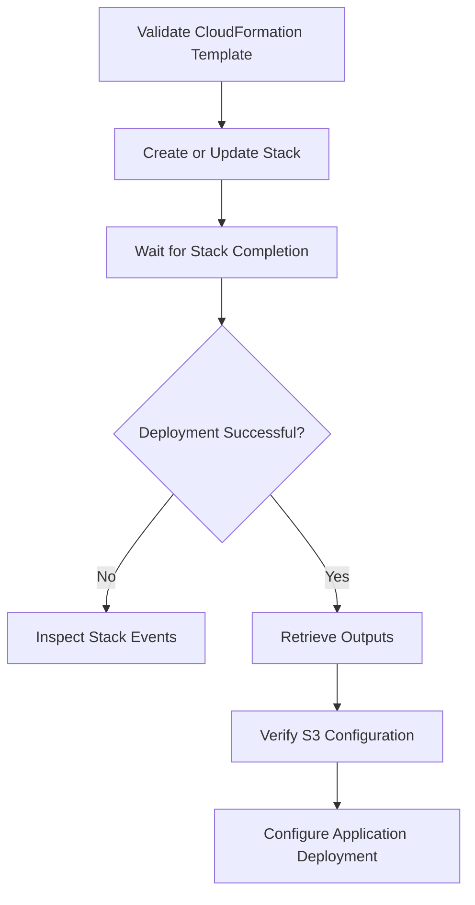

# 03- S3 Bucket and Output Definitions

## Overview

In AWS CloudFormation, S3 buckets and their associated outputs are defined inside the `Resources` and `Outputs` sections of a template.

A bucket resource describes the infrastructure configuration that CloudFormation must provision. Its properties control bucket behavior, including:

- Bucket naming and resource identity.
- Object ownership.
- Public access restrictions.
- Versioning.
- Server-side encryption.
- Lifecycle configuration.
- Logging and notifications.
- Tags and resource dependencies.

Outputs expose selected resource attributes after deployment. They allow deployment pipelines, application stacks, and operational scripts to consume infrastructure information without hardcoding resource identifiers.

A production-ready S3 template should treat bucket configuration, security controls, resource lifecycle, and outputs as an explicit infrastructure contract.

## AWS::S3::Bucket Resource

The `AWS::S3::Bucket` resource provisions an Amazon S3 general purpose bucket.

Basic declaration:

```yaml
Resources:
  ApplicationBucket:
    Type: AWS::S3::Bucket
```

`ApplicationBucket` is the CloudFormation logical ID. It identifies the resource inside the template and is used by intrinsic functions and resource dependencies.

The logical ID is not the actual S3 bucket name.

### Logical ID and physical resource name

| Concept | Example | Purpose |
|---|---|---|
| Logical ID | `ApplicationBucket` | Identifies the resource in the CloudFormation template |
| Physical name | `company-app-storage-prod-123456` | Actual S3 bucket name |
| ARN | `arn:aws:s3:::company-app-storage-prod-123456` | Resource identifier used in IAM and bucket policies |
| Object ARN | `arn:aws:s3:::company-app-storage-prod-123456/*` | Identifies objects within the bucket |

CloudFormation can generate a physical bucket name when `BucketName` is omitted.

Generated names are useful when:
- Multiple environments deploy the same template.
- Resource names should avoid collisions.
- Other infrastructure discovers the bucket through stack outputs.

Specify `BucketName` when a stable, externally referenced name is required.

Remember that S3 bucket names must satisfy S3 naming restrictions and must be unique within the applicable S3 namespace. A syntactically valid name is not necessarily available.

## Bucket Naming

S3 bucket names are part of the bucket's resource identity and addressing model.

A production naming convention should make ownership and environment clear without exposing sensitive information.

Example:

```text
company-orders-dev
company-orders-staging
company-orders-production
company-media-prod-123456
company-data-analytics-prod
```

A more structured convention is:

```text
<organization>-<application>-<purpose>-<environment>-<suffix>
```

Examples:

```text
acme-payments-documents-production-123456
acme-catalog-images-staging-123456
acme-analytics-raw-data-production-123456
```

### Naming considerations

- Use lowercase letters, numbers, and hyphens for conventional bucket names.
- Avoid embedding confidential information or customer identifiers.
- Use an organization-wide naming convention.
- Include a unique suffix where necessary.
- Keep names stable when external systems depend on them.
- Avoid renaming strategies that require bucket replacement.

Changing a bucket's physical name is not an in-place rename operation. A replacement bucket may be required, followed by data migration and application configuration changes.

### Parameterized bucket name

```yaml
Parameters:
  BucketName:
    Type: String
    Description: Globally unique S3 bucket name

Resources:
  ApplicationBucket:
    Type: AWS::S3::Bucket

    Properties:
      BucketName: !Ref BucketName
```

The deployment pipeline supplies the physical name:

```bash
aws cloudformation create-stack \
  --stack-name application-storage \
  --template-body file://s3-bucket.yaml \
  --parameters \
    ParameterKey=BucketName,ParameterValue=acme-orders-production-123456
```

For reusable templates, validate the name format with parameter constraints and perform deployment-time checks for availability and service-specific restrictions.

## Bucket Security Configuration

Bucket security should be defined explicitly in the bucket resource rather than relying on account defaults alone.

A private application bucket should normally use:

- S3 Block Public Access.
- Bucket-owner-enforced Object Ownership.
- HTTPS-only access.
- Server-side encryption.
- Least-privilege IAM permissions.

Detailed policy evaluation, IAM design, and encryption authorization belong in the dedicated S3 security documentation.

### Block Public Access

S3 Block Public Access provides controls that prevent public access through bucket policies and ACLs.

CloudFormation configuration:

```yaml
Resources:
  ApplicationBucket:
    Type: AWS::S3::Bucket

    Properties:
      PublicAccessBlockConfiguration:
        BlockPublicAcls: true
        IgnorePublicAcls: true
        BlockPublicPolicy: true
        RestrictPublicBuckets: true
```

| Property | Purpose |
|---|---|
| `BlockPublicAcls` | Prevents new public ACLs and public ACL changes |
| `IgnorePublicAcls` | Causes S3 to ignore public ACLs |
| `BlockPublicPolicy` | Prevents policies that grant public access |
| `RestrictPublicBuckets` | Restricts access when a bucket policy grants public access |

For private application storage, enable all four settings unless a documented architecture requires otherwise.

Account-level and organization-level controls should also be considered. Bucket-level configuration is not a substitute for centralized security governance.

### Object Ownership

Object Ownership determines how ownership of uploaded objects is handled.

For modern application architectures, `BucketOwnerEnforced` is generally the preferred setting.

```yaml
Resources:
  ApplicationBucket:
    Type: AWS::S3::Bucket

    Properties:
      OwnershipControls:
        Rules:
          - ObjectOwnership: BucketOwnerEnforced
```

With this configuration:

- The bucket owner owns uploaded objects.
- ACLs are disabled.
- Access is managed through IAM and bucket policies.

This avoids common cross-account object ownership problems.

Applications that still send ACL-related upload headers may need to remove them when using bucket-owner-enforced ownership.

## Versioning Configuration

S3 Versioning preserves multiple versions of an object under the same key.

It supports recovery from accidental overwrites and deletions and is commonly used with replication and backup architectures.

CloudFormation configuration:

```yaml
Resources:
  ApplicationBucket:
    Type: AWS::S3::Bucket

    Properties:
      VersioningConfiguration:
        Status: Enabled
```

### Versioning states

| State | Behavior |
|---|---|
| Enabled | New object versions are retained |
| Suspended | New writes do not create normal new versions; existing versions remain |

Versioning is a bucket-level configuration.

Once enabled, versioning cannot be returned to the never-enabled state. It can be suspended, but existing object versions remain.

### Environment-aware versioning

A parameter can control the versioning state:

```yaml
Parameters:
  EnableVersioning:
    Type: String
    Default: Enabled
    AllowedValues:
      - Enabled
      - Suspended

Resources:
  ApplicationBucket:
    Type: AWS::S3::Bucket

    Properties:
      VersioningConfiguration:
        Status: !Ref EnableVersioning
```

For production data, versioning should normally remain enabled when recovery requirements justify its storage and operational costs.

Versioning does not automatically provide a complete backup strategy. It does not protect against every form of account compromise, malicious deletion, or regional failure.

### Versioning operational considerations

- Noncurrent versions continue consuming storage.
- Lifecycle rules may be needed to manage older versions.
- Deleting an object without specifying a version ID generally creates a delete marker.
- Permanent deletion of a specific version requires explicit version identification.
- Replication configuration depends on versioning being enabled on the relevant buckets.

## Server-Side Encryption

S3 supports server-side encryption to protect stored objects.

For a standard private application bucket, SSE-S3 is a straightforward baseline.

### SSE-S3 configuration

```yaml
Resources:
  ApplicationBucket:
    Type: AWS::S3::Bucket

    Properties:
      BucketEncryption:
        ServerSideEncryptionConfiguration:
          - ServerSideEncryptionByDefault:
              SSEAlgorithm: AES256
```

This configures default server-side encryption using S3-managed keys.

### SSE-KMS configuration

Use SSE-KMS when customer-managed key control, key policies, or additional audit requirements are needed.

```yaml
Parameters:
  KmsKeyArn:
    Type: String
    Description: ARN of the customer-managed KMS key

Resources:
  ApplicationBucket:
    Type: AWS::S3::Bucket

    Properties:
      BucketEncryption:
        ServerSideEncryptionConfiguration:
          - ServerSideEncryptionByDefault:
              SSEAlgorithm: aws:kms
              KMSMasterKeyID: !Ref KmsKeyArn
```

The KMS key must be available in the bucket's Region and its key policy must permit the required use.

The relevant application and service roles also need appropriate KMS permissions.

### Encryption comparison

| Encryption | Key management | Typical use |
|---|---|---|
| SSE-S3 | S3-managed keys | Standard server-side encryption |
| SSE-KMS | AWS KMS keys | Customer-managed key control and audit requirements |
| SSE-C | Customer-provided keys | Specialized client-managed key workflows |

Do not assume that configuring SSE-KMS automatically grants application access. S3 authorization and KMS authorization are separate permission layers.

## Bucket Policy

An S3 bucket policy is a resource-based policy attached to the bucket.

It controls access to the bucket and its objects.

A common baseline is to deny requests that do not use HTTPS.

```yaml
Resources:
  ApplicationBucket:
    Type: AWS::S3::Bucket

  ApplicationBucketPolicy:
    Type: AWS::S3::BucketPolicy

    Properties:
      Bucket: !Ref ApplicationBucket

      PolicyDocument:
        Version: '2012-10-17'

        Statement:
          - Sid: DenyInsecureTransport
            Effect: Deny
            Principal: '*'

            Action:
              - s3:*

            Resource:
              - !GetAtt ApplicationBucket.Arn
              - !Sub '${ApplicationBucket.Arn}/*'

            Condition:
              Bool:
                aws:SecureTransport: 'false'
```

### Bucket and object resource ARNs

Bucket-level and object-level actions use different resource identifiers.

| Resource | ARN format | Example actions |
|---|---|---|
| Bucket | `arn:aws:s3:::bucket-name` | `s3:ListBucket`, `s3:GetBucketLocation` |
| Objects | `arn:aws:s3:::bucket-name/*` | `s3:GetObject`, `s3:PutObject`, `s3:DeleteObject` |

A policy that uses only the bucket ARN may not authorize object operations.

A policy that uses only the object ARN may not authorize bucket-level listing operations.

### Explicit deny behavior

An explicit `Deny` overrides an applicable `Allow`.

The HTTPS-only policy therefore blocks insecure requests even when another policy grants the principal S3 access.

Review all relevant policy layers when diagnosing authorization failures:

- IAM identity policies.
- Bucket policies.
- Service control policies.
- Permissions boundaries.
- Session policies.
- KMS key policies and grants where encryption is involved.

Detailed authorization analysis belongs in the dedicated S3 security documentation.

## Lifecycle Configuration

Lifecycle rules automate transitions and expiration of objects based on age, prefixes, tags, or version state.

They are useful for managing storage costs and retention requirements.

Example:

```yaml
Resources:
  ApplicationBucket:
    Type: AWS::S3::Bucket

    Properties:
      LifecycleConfiguration:
        Rules:
          - Id: ExpireTemporaryUploads

            Status: Enabled

            Prefix: temporary/

            ExpirationInDays: 30
```

This rule expires eligible objects under the `temporary/` prefix after the configured age.

### Lifecycle with versioning

For versioned buckets, lifecycle rules may also manage noncurrent versions.

```yaml
LifecycleConfiguration:
  Rules:
    - Id: ManageNoncurrentVersions

      Status: Enabled

      NoncurrentVersionExpiration:
        NoncurrentDays: 90
```

Do not confuse current-object expiration with noncurrent-version expiration.

In a versioned bucket, expiration of a current object generally creates a delete marker rather than permanently deleting all historical versions.

Lifecycle behavior, transitions, retention, and cost implications should be designed together. Refer to the dedicated lifecycle documentation for detailed configuration and operational guidance.

## Tags

Tags provide metadata for resource classification, ownership, automation, and cost allocation.

CloudFormation supports tags directly on S3 bucket resources.

```yaml
Resources:
  ApplicationBucket:
    Type: AWS::S3::Bucket

    Properties:
      Tags:
        - Key: Application
          Value: order-service

        - Key: Environment
          Value: production

        - Key: Owner
          Value: platform-engineering

        - Key: CostCenter
          Value: engineering
```

Recommended tag categories:

| Tag | Purpose |
|---|---|
| `Application` | Application ownership |
| `Environment` | Deployment environment |
| `Owner` | Responsible team |
| `CostCenter` | Cost allocation |
| `DataClassification` | Data sensitivity classification |
| `ManagedBy` | Infrastructure management system |

Bucket tags are not the same as object tags. Object-level tagging is managed separately and can be used by lifecycle rules and application workflows.

Do not place secrets, credentials, or sensitive customer information in tags.

## Complete Production-Oriented Bucket Definition

The following example combines the principal bucket properties into one reusable resource definition.

File: `s3-bucket.yaml`

```yaml
AWSTemplateFormatVersion: '2010-09-09'

Description: Private S3 bucket for backend application storage

Parameters:
  BucketName:
    Type: String
    Description: Globally unique S3 bucket name
    MinLength: 3
    MaxLength: 63

  Environment:
    Type: String
    Default: dev
    AllowedValues:
      - dev
      - staging
      - production

  DataClassification:
    Type: String
    Default: internal
    AllowedValues:
      - public
      - internal
      - confidential
      - restricted

  EnableVersioning:
    Type: String
    Default: Enabled
    AllowedValues:
      - Enabled
      - Suspended

Resources:
  ApplicationBucket:
    Type: AWS::S3::Bucket

    DeletionPolicy: Retain
    UpdateReplacePolicy: Retain

    Properties:
      BucketName: !Ref BucketName

      OwnershipControls:
        Rules:
          - ObjectOwnership: BucketOwnerEnforced

      PublicAccessBlockConfiguration:
        BlockPublicAcls: true
        IgnorePublicAcls: true
        BlockPublicPolicy: true
        RestrictPublicBuckets: true

      VersioningConfiguration:
        Status: !Ref EnableVersioning

      BucketEncryption:
        ServerSideEncryptionConfiguration:
          - ServerSideEncryptionByDefault:
              SSEAlgorithm: AES256

      LifecycleConfiguration:
        Rules:
          - Id: ExpireTemporaryUploads

            Status: Enabled

            Prefix: temporary/

            ExpirationInDays: 30

      Tags:
        - Key: Application
          Value: backend-storage

        - Key: Environment
          Value: !Ref Environment

        - Key: DataClassification
          Value: !Ref DataClassification

        - Key: ManagedBy
          Value: CloudFormation

  ApplicationBucketPolicy:
    Type: AWS::S3::BucketPolicy

    Properties:
      Bucket: !Ref ApplicationBucket

      PolicyDocument:
        Version: '2012-10-17'

        Statement:
          - Sid: DenyInsecureTransport
            Effect: Deny
            Principal: '*'

            Action:
              - s3:*

            Resource:
              - !GetAtt ApplicationBucket.Arn
              - !Sub '${ApplicationBucket.Arn}/*'

            Condition:
              Bool:
                aws:SecureTransport: 'false'

Outputs:
  BucketName:
    Description: Application S3 bucket name
    Value: !Ref ApplicationBucket

  BucketArn:
    Description: Application S3 bucket ARN
    Value: !GetAtt ApplicationBucket.Arn

  BucketRegionalDomainName:
    Description: Regional bucket domain name
    Value: !GetAtt ApplicationBucket.RegionalDomainName

  Environment:
    Description: Deployment environment
    Value: !Ref Environment
```

This template is a baseline for private application storage. It does not include application-specific IAM roles, KMS key policies, replication, event notifications, or CloudFront configuration. Those resources should be added according to the architecture and security requirements.

## CloudFormation Outputs

Outputs expose resource information after CloudFormation creates or updates a stack.

They are important because application deployments should consume infrastructure identifiers from the deployment process rather than duplicate them in source code.

### Basic output definition

```yaml
Outputs:
  BucketName:
    Description: S3 bucket name
    Value: !Ref ApplicationBucket
```

For an S3 bucket, `!Ref` returns the bucket name.

### Common S3 output attributes

| Output | Intrinsic function | Purpose |
|---|---|---|
| Bucket name | `!Ref ApplicationBucket` | Bucket identifier |
| Bucket ARN | `!GetAtt ApplicationBucket.Arn` | IAM and resource-policy references |
| Regional domain | `!GetAtt ApplicationBucket.RegionalDomainName` | Regional S3 endpoint domain |
| Domain name | `!GetAtt ApplicationBucket.DomainName` | Bucket domain name |
| Website URL | `!GetAtt ApplicationBucket.WebsiteURL` | Website endpoint when website hosting is configured |

The `WebsiteURL` attribute is relevant only when the bucket is configured for static website hosting. It should not be confused with a private S3 REST endpoint or a CloudFront distribution domain.

### Output values using Fn::Sub

`Fn::Sub` can construct values from parameters and pseudo parameters.

```yaml
Outputs:
  BucketArn:
    Description: S3 bucket ARN

    Value: !Sub 'arn:${AWS::Partition}:s3:::${BucketName}'
```

Using the resource attribute is generally preferable when the bucket resource already exists:

```yaml
Outputs:
  BucketArn:
    Value: !GetAtt ApplicationBucket.Arn
```

This avoids manually constructing an ARN that could become inconsistent with the actual resource.

### Exporting outputs

Outputs can be exported for use by other CloudFormation stacks.

```yaml
Outputs:
  SharedBucketName:
    Description: Shared storage bucket name

    Value: !Ref ApplicationBucket

    Export:
      Name: shared-application-bucket-name

  SharedBucketArn:
    Description: Shared storage bucket ARN

    Value: !GetAtt ApplicationBucket.Arn

    Export:
      Name: shared-application-bucket-arn
```

A consuming stack can import these values:

```yaml
Resources:
  ApplicationPolicy:
    Type: AWS::IAM::Policy

    Properties:
      PolicyName: application-s3-access

      Roles:
        - !Ref ApplicationRole

      PolicyDocument:
        Version: '2012-10-17'

        Statement:
          - Effect: Allow

            Action:
              - s3:GetObject

            Resource:
              - !Sub
                - '${BucketArn}/*'
                - BucketArn:
                    Fn::ImportValue: shared-application-bucket-arn
```

### Cross-stack export considerations

Exports are useful when storage infrastructure and application infrastructure have separate ownership.

However, they introduce lifecycle dependencies.

Consider these limitations:

- Export names must be unique within an account and Region.
- An exported value cannot generally be changed or removed while another stack imports it.
- Export/import dependencies can prevent independent stack deletion.
- Exports are scoped to the same AWS account and Region.

Use stable export names and avoid exporting implementation details that consuming stacks do not need.

## Outputs for Application Deployment Pipelines

A deployment pipeline can retrieve stack outputs and pass them to application configuration.

For example, a FastAPI deployment may need the bucket name.

Retrieve the value:

```bash
aws cloudformation describe-stacks \
  --stack-name application-storage \
  --query "Stacks[0].Outputs[?OutputKey=='BucketName'].OutputValue" \
  --output text
```

Use it in a deployment script:

```bash
BUCKET_NAME=$(
  aws cloudformation describe-stacks \
    --stack-name application-storage \
    --query "Stacks[0].Outputs[?OutputKey=='BucketName'].OutputValue" \
    --output text
)

if [ -z "$BUCKET_NAME" ] || [ "$BUCKET_NAME" = "None" ]; then
  echo "S3 bucket output was not found."
  exit 1
fi

export S3_BUCKET_NAME="$BUCKET_NAME"
```

Application configuration:

```python
import os

S3_BUCKET_NAME = os.environ["S3_BUCKET_NAME"]
```

In production, prefer injecting configuration through the deployment platform or application configuration system instead of relying on developers to manually export values.

Do not expose sensitive values through stack outputs. Outputs are not a secret-management mechanism.

## Output Availability and Stack Lifecycle

Outputs become available after the stack reaches a successful deployment state.

A pipeline should not assume that a stack is ready immediately after submitting a create or update request.

Recommended deployment flow:



Wait for stack creation:

```bash
aws cloudformation wait stack-create-complete \
  --stack-name application-storage
```

Wait for stack update:

```bash
aws cloudformation wait stack-update-complete \
  --stack-name application-storage
```

Retrieve outputs only after successful completion.

For update workflows, handle cases where CloudFormation reports that no update is required.

## Resource Retention and Replacement

S3 buckets often contain application data that must survive infrastructure stack changes.

CloudFormation provides resource attributes that control deletion and replacement behavior.

### DeletionPolicy

`DeletionPolicy` controls what happens when a resource is removed from a template or its stack is deleted.

```yaml
Resources:
  ApplicationBucket:
    Type: AWS::S3::Bucket

    DeletionPolicy: Retain
```

Common values:

| Value | Behavior |
|---|---|
| `Delete` | Deletes the resource when CloudFormation removes it |
| `Retain` | Keeps the resource after stack removal |
| `Snapshot` | Creates a snapshot where supported |

For S3 buckets containing persistent application data, `Retain` is often appropriate.

### UpdateReplacePolicy

`UpdateReplacePolicy` controls what happens to the old physical resource when an update requires replacement.

```yaml
Resources:
  ApplicationBucket:
    Type: AWS::S3::Bucket

    DeletionPolicy: Retain
    UpdateReplacePolicy: Retain
```

This protects the existing bucket from automatic deletion during replacement.

### Important operational implications

- Retaining a bucket does not automatically migrate its data.
- Retained buckets may remain outside the lifecycle of the original stack.
- CloudFormation may no longer manage the retained resource after stack deletion.
- Bucket cleanup must account for object versions and delete markers.
- A replacement bucket requires application configuration and data migration planning.

`Retain` is a protection mechanism, not a complete backup or disaster recovery strategy.

## Validation and Deployment Verification

Validate the template before deploying it.

### Template validation

```bash
aws cloudformation validate-template \
  --template-body file://s3-bucket.yaml
```

### Linting

```bash
cfn-lint s3-bucket.yaml
```

### Create the stack

```bash
aws cloudformation create-stack \
  --stack-name application-storage \
  --template-body file://s3-bucket.yaml \
  --parameters \
    ParameterKey=BucketName,ParameterValue=acme-orders-production-123456 \
    ParameterKey=Environment,ParameterValue=production \
    ParameterKey=DataClassification,ParameterValue=confidential \
    ParameterKey=EnableVersioning,ParameterValue=Enabled
```

### Verify the bucket

```bash
aws s3api head-bucket \
  --bucket acme-orders-production-123456
```

Inspect the bucket configuration:

```bash
aws s3api get-bucket-versioning \
  --bucket acme-orders-production-123456

aws s3api get-bucket-encryption \
  --bucket acme-orders-production-123456

aws s3api get-public-access-block \
  --bucket acme-orders-production-123456

aws s3api get-bucket-ownership-controls \
  --bucket acme-orders-production-123456

aws s3api get-bucket-lifecycle-configuration \
  --bucket acme-orders-production-123456
```

A missing lifecycle configuration may cause the corresponding API call to return an error. Verification scripts should distinguish an intentionally absent configuration from an unexpected configuration failure.

### Inspect stack outputs

```bash
aws cloudformation describe-stacks \
  --stack-name application-storage \
  --query "Stacks[0].Outputs"
```

### Inspect deployment events

```bash
aws cloudformation describe-stack-events \
  --stack-name application-storage \
  --max-items 50
```

Use stack events to identify the resource and failure reason when a deployment does not complete successfully.

## Common Mistakes and Production Pitfalls

| Mistake | Why it causes problems | Recommended approach |
|---|---|---|
| Confusing logical IDs with bucket names | References the wrong identifier in policies and application configuration | Use `!Ref` and `!GetAtt` appropriately |
| Hardcoding bucket ARNs | Creates inconsistent configuration across environments | Derive ARNs from resources |
| Omitting Block Public Access | Increases the risk of accidental public exposure | Enable all four controls for private buckets |
| Ignoring Object Ownership | Can create ACL and cross-account ownership problems | Prefer `BucketOwnerEnforced` |
| Assuming versioning is backup | Versioning does not protect against every failure or compromise | Define recovery and backup requirements separately |
| Configuring encryption without KMS permissions | Application requests may fail despite valid S3 permissions | Validate both S3 and KMS authorization |
| Using `Retain` without inventory procedures | Leaves unmanaged buckets after stack deletion | Maintain ownership and cleanup records |
| Exporting too many outputs | Creates unnecessary stack dependencies | Export only stable interfaces |
| Using bucket domain outputs as application credentials | A domain name does not grant access | Use IAM roles, SDKs, or presigned URLs |
| Assuming stack success proves application readiness | Resource creation does not verify application permissions or data flows | Run post-deployment integration checks |
| Omitting object-level ARN resources from policies | Object operations may fail with authorization errors | Define bucket and object resources separately |
| Assuming a bucket can be renamed | S3 bucket names are resource identity, not mutable display names | Plan migration to a replacement bucket |

## Key Takeaways

- `AWS::S3::Bucket` defines the physical storage resource, while its CloudFormation logical ID is used for references inside the template.
- Production bucket definitions should explicitly configure ownership controls, Block Public Access, encryption, versioning, and appropriate retention behavior.
- Bucket-level and object-level permissions require different ARN resource patterns.
- Outputs provide stable infrastructure interfaces for deployment pipelines and consuming stacks, but should never be used to expose secrets.
- `DeletionPolicy: Retain` and `UpdateReplacePolicy: Retain` protect bucket data from certain stack lifecycle operations but do not replace backup, recovery, or resource inventory procedures.