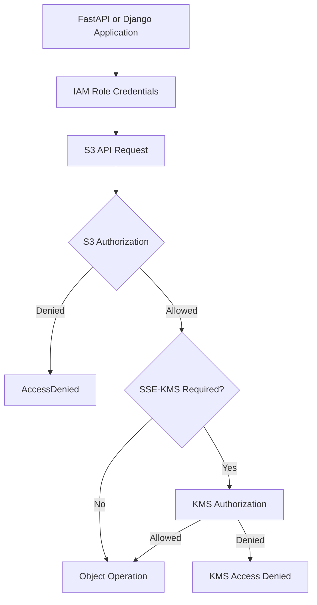
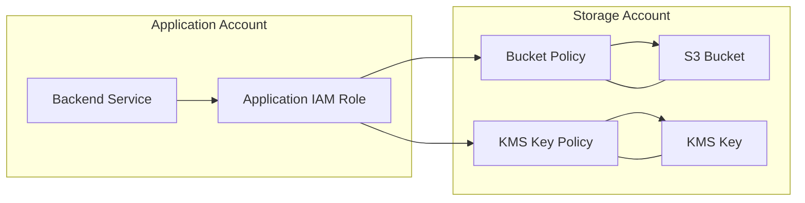
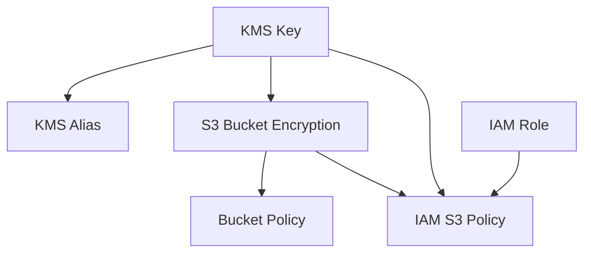

# 04- Encryption and Access Control Templates

## Overview

Encryption and access control are foundational components of a production Amazon S3 deployment. CloudFormation allows these controls to be defined alongside the bucket infrastructure, making security configuration repeatable, reviewable, and version-controlled.

A secure S3 deployment should establish explicit controls for:

- Server-side encryption and encryption key selection.
- Bucket-level and object-level authorization.
- IAM roles and least-privilege permissions.
- S3 Block Public Access.
- Object Ownership and ACL behavior.
- HTTPS-only communication.
- Cross-account access where required.
- KMS key authorization.
- Resource retention and security-policy management.

This document focuses on implementing these controls using CloudFormation YAML templates.

The objective is to create reusable security templates that can be integrated into application storage, document management, media processing, and data lake architectures.

## Encryption Architecture

Amazon S3 supports multiple encryption mechanisms. CloudFormation can configure default server-side encryption at the bucket level.

The main server-side encryption options are:

| Encryption | Key management | Typical use |
|---|---|---|
| SSE-S3 | S3-managed keys | Standard encryption at rest |
| SSE-KMS | AWS KMS keys | Customer-managed key control and audit requirements |
| SSE-C | Customer-provided keys | Specialized key-management workflows |

For most application workloads, SSE-S3 or SSE-KMS is appropriate.

Use SSE-KMS when the application requires customer-managed key policies, centralized key governance, cross-account encryption controls, or detailed KMS auditing.

Encryption configuration does not independently authorize application access. S3 permissions and KMS permissions must both be evaluated when SSE-KMS is used.

## SSE-S3 CloudFormation Template

SSE-S3 uses S3-managed encryption keys.

It is appropriate when standard server-side encryption is sufficient and the application does not require customer-managed KMS key control.

### Bucket encryption configuration

```yaml
Resources:
  ApplicationBucket:
    Type: AWS::S3::Bucket

    Properties:
      BucketEncryption:
        ServerSideEncryptionConfiguration:
          - ServerSideEncryptionByDefault:
              SSEAlgorithm: AES256
```

This configures default encryption for objects uploaded to the bucket.

### Configuration behavior

- S3 automatically encrypts supported object uploads using SSE-S3.
- Applications do not need to manage encryption keys.
- The encryption configuration applies to new objects.
- Existing objects are not automatically re-encrypted simply because the bucket configuration changes.

### When to use SSE-S3

Use SSE-S3 when:

- Standard encryption at rest satisfies the data classification requirements.
- Customer-managed key policies are unnecessary.
- Operational simplicity is preferred.
- The application does not need customer-controlled key lifecycle operations.

### Limitations

SSE-S3 does not provide the same customer-managed key controls as SSE-KMS.

If the organization requires customer-managed key policies, key rotation governance, or KMS-specific audit capabilities, use SSE-KMS.

## SSE-KMS CloudFormation Template

SSE-KMS uses AWS Key Management Service to protect S3 object encryption keys.

A customer-managed KMS key provides additional control over:

- Key policies.
- Key rotation configuration.
- Key usage permissions.
- Cross-account access.
- Key lifecycle and administrative ownership.
- KMS audit events.

### Referencing an existing KMS key

The simplest approach is to accept an existing KMS key ARN as a CloudFormation parameter.

```yaml
Parameters:
  KmsKeyArn:
    Type: String
    Description: ARN of the customer-managed KMS key

Resources:
  ApplicationBucket:
    Type: AWS::S3::Bucket

    Properties:
      BucketEncryption:
        ServerSideEncryptionConfiguration:
          - ServerSideEncryptionByDefault:
              SSEAlgorithm: aws:kms
              KMSMasterKeyID: !Ref KmsKeyArn
```

The key must be available in the bucket's Region.

The KMS key policy must also authorize the required principals and AWS services.

### Enable S3 Bucket Keys

S3 Bucket Keys can reduce the number of requests made to AWS KMS when SSE-KMS is used.

They can reduce KMS request costs for workloads with high object request volumes.

```yaml
Resources:
  ApplicationBucket:
    Type: AWS::S3::Bucket

    Properties:
      BucketEncryption:
        ServerSideEncryptionConfiguration:
          - BucketKeyEnabled: true

            ServerSideEncryptionByDefault:
              SSEAlgorithm: aws:kms
              KMSMasterKeyID: !Ref KmsKeyArn
```

Bucket Keys change how S3 uses KMS to protect object data keys. They do not remove the need for appropriate KMS permissions.

Validate application and compliance requirements before enabling them.

## Creating a Customer-Managed KMS Key

CloudFormation can provision a KMS key as part of the storage stack.

### KMS key definition

```yaml
Resources:
  ApplicationKmsKey:
    Type: AWS::KMS::Key

    Properties:
      Description: Customer-managed key for application S3 storage

      EnableKeyRotation: true

      KeyPolicy:
        Version: '2012-10-17'

        Statement:
          - Sid: EnableAccountAdministration

            Effect: Allow

            Principal:
              AWS: !Sub 'arn:${AWS::Partition}:iam::${AWS::AccountId}:root'

            Action:
              - kms:*

            Resource: '*'
```

The account principal statement enables the account to delegate key administration and usage through IAM policies, subject to the key policy and other applicable controls.

A production key policy should separate key administration from key usage wherever practical.

Avoid granting unrestricted KMS access to application roles.

### KMS key alias

An alias provides a human-readable identifier for a KMS key.

```yaml
  ApplicationKmsKeyAlias:
    Type: AWS::KMS::Alias

    Properties:
      AliasName: alias/application-s3-encryption
      TargetKeyId: !Ref ApplicationKmsKey
```

Aliases simplify operational references, but the key ARN or key ID should be used where a specific key identity is required.

### Exporting the key ARN

```yaml
Outputs:
  KmsKeyArn:
    Description: Customer-managed KMS key ARN
    Value: !GetAtt ApplicationKmsKey.Arn

  KmsKeyId:
    Description: Customer-managed KMS key identifier
    Value: !Ref ApplicationKmsKey
```

### Key lifecycle considerations

KMS keys are independent security resources.

Consider the following before deployment:

- Key deletion is asynchronous and includes a waiting period.
- Disabling a key prevents its use for cryptographic operations.
- Deleting a key can make encrypted S3 objects permanently inaccessible.
- Key rotation does not require re-encrypting every existing object.
- Key policies must be maintained independently of bucket policies.
- Cross-account access requires authorization at both the IAM and KMS layers.

For long-lived application data, avoid coupling the lifecycle of a critical KMS key to a short-lived application stack.

## SSE-KMS Bucket with a Managed Key

The following example creates a KMS key, an alias, and a bucket configured to use that key.

```yaml
AWSTemplateFormatVersion: '2010-09-09'

Description: S3 bucket encrypted with a customer-managed KMS key

Parameters:
  BucketName:
    Type: String
    Description: Globally unique S3 bucket name

Resources:
  ApplicationKmsKey:
    Type: AWS::KMS::Key

    Properties:
      Description: KMS key for application S3 objects

      EnableKeyRotation: true

      KeyPolicy:
        Version: '2012-10-17'

        Statement:
          - Sid: EnableAccountAdministration

            Effect: Allow

            Principal:
              AWS: !Sub 'arn:${AWS::Partition}:iam::${AWS::AccountId}:root'

            Action:
              - kms:*

            Resource: '*'

  ApplicationKmsKeyAlias:
    Type: AWS::KMS::Alias

    Properties:
      AliasName: alias/application-s3
      TargetKeyId: !Ref ApplicationKmsKey

  ApplicationBucket:
    Type: AWS::S3::Bucket

    Properties:
      BucketName: !Ref BucketName

      BucketEncryption:
        ServerSideEncryptionConfiguration:
          - BucketKeyEnabled: true

            ServerSideEncryptionByDefault:
              SSEAlgorithm: aws:kms
              KMSMasterKeyID: !GetAtt ApplicationKmsKey.Arn

      OwnershipControls:
        Rules:
          - ObjectOwnership: BucketOwnerEnforced

      PublicAccessBlockConfiguration:
        BlockPublicAcls: true
        IgnorePublicAcls: true
        BlockPublicPolicy: true
        RestrictPublicBuckets: true

Outputs:
  BucketName:
    Description: Application S3 bucket name
    Value: !Ref ApplicationBucket

  BucketArn:
    Description: Application S3 bucket ARN
    Value: !GetAtt ApplicationBucket.Arn

  KmsKeyArn:
    Description: Application KMS key ARN
    Value: !GetAtt ApplicationKmsKey.Arn
```

This example uses a basic account-administration key policy. Production environments should implement role-specific key administration and usage permissions rather than granting broad permissions to application principals.

## IAM Access Control Architecture

S3 authorization can involve identity-based policies, resource-based bucket policies, organization-level controls, and KMS key policies.

A typical backend architecture uses an IAM role attached to the compute environment.

Examples include:

- EC2 instance profiles.
- ECS task roles.
- EKS workload identity roles.
- Lambda execution roles.
- CI/CD deployment roles.

Applications should use temporary credentials obtained through the AWS credential provider chain.

Avoid storing long-lived access keys in application source code, Docker images, or environment files.

### Request authorization flow



S3 authorization and KMS authorization are separate checks.

A successful S3 permission evaluation does not guarantee that the KMS operation will succeed.

## IAM Role for Application Access

An application role should receive only the S3 operations it requires.

For example, a backend service that uploads and downloads documents may need:

- `s3:PutObject`
- `s3:GetObject`
- `s3:DeleteObject`, only if deletion is required.
- `s3:ListBucket`, only if listing is required.

### IAM role definition

```yaml
Resources:
  ApplicationS3Role:
    Type: AWS::IAM::Role

    Properties:
      RoleName: application-s3-access-role

      AssumeRolePolicyDocument:
        Version: '2012-10-17'

        Statement:
          - Effect: Allow

            Principal:
              Service:
                - ec2.amazonaws.com

            Action:
              - sts:AssumeRole
```

This example uses EC2 as the trusted service. For Lambda, ECS, or EKS, configure the appropriate trust relationship for that compute environment.

### IAM policy for S3 object operations

```yaml
  ApplicationS3Policy:
    Type: AWS::IAM::Policy

    Properties:
      PolicyName: application-s3-object-access

      Roles:
        - !Ref ApplicationS3Role

      PolicyDocument:
        Version: '2012-10-17'

        Statement:
          - Sid: ReadWriteApplicationObjects

            Effect: Allow

            Action:
              - s3:GetObject
              - s3:PutObject
              - s3:DeleteObject

            Resource:
              - !Sub '${ApplicationBucket.Arn}/application/*'

          - Sid: ListApplicationPrefix

            Effect: Allow

            Action:
              - s3:ListBucket

            Resource:
              - !GetAtt ApplicationBucket.Arn

            Condition:
              StringLike:
                s3:prefix:
                  - application/*
```

The role can access objects under the `application/` prefix rather than every object in the bucket.

Remove `s3:DeleteObject` if the application does not need deletion privileges.

### Why bucket and object permissions differ

S3 actions operate against different resource types.

| Action | Resource | Purpose |
|---|---|---|
| `s3:ListBucket` | Bucket ARN | Lists objects |
| `s3:GetObject` | Object ARN | Reads object data |
| `s3:PutObject` | Object ARN | Uploads or replaces object data |
| `s3:DeleteObject` | Object ARN | Deletes an object or creates a delete marker |
| `s3:GetBucketLocation` | Bucket ARN | Retrieves bucket Region |

A policy that grants `s3:GetObject` against the bucket ARN does not correctly authorize object reads.

Always distinguish bucket-level actions from object-level actions.

## IAM Permissions for SSE-KMS

When an application accesses SSE-KMS encrypted objects, it needs the relevant S3 and KMS permissions.

Typical KMS permissions include:

| KMS action | Typical operation |
|---|---|
| `kms:GenerateDataKey` | Encrypting uploaded object data |
| `kms:Decrypt` | Reading encrypted object data |
| `kms:DescribeKey` | Inspecting key metadata where required |

The exact permission requirements depend on the operation, encryption configuration, multipart workflow, and AWS service integration.

### Application KMS policy

```yaml
Resources:
  ApplicationKmsUsagePolicy:
    Type: AWS::IAM::Policy

    Properties:
      PolicyName: application-s3-kms-access

      Roles:
        - !Ref ApplicationS3Role

      PolicyDocument:
        Version: '2012-10-17'

        Statement:
          - Sid: UseApplicationKmsKey

            Effect: Allow

            Action:
              - kms:GenerateDataKey
              - kms:Decrypt
              - kms:DescribeKey

            Resource:
              - !GetAtt ApplicationKmsKey.Arn
```

This identity policy is only one part of the authorization model.

The KMS key policy must also permit the role or enable the account to delegate permissions through IAM.

Do not grant broad `kms:*` permissions to application roles.

### Restricting KMS use through encryption context

KMS policies can use conditions to restrict how a key is used.

For S3 encryption, an encryption context may include the S3 bucket ARN.

Example policy condition:

```yaml
Condition:
  StringEquals:
    kms:ViaService: !Sub 's3.${AWS::Region}.${AWS::URLSuffix}'

  StringLike:
    kms:EncryptionContext:aws:s3:arn:
      - !GetAtt ApplicationBucket.Arn
```

The exact encryption context depends on the S3 encryption configuration.

When S3 Bucket Keys are enabled, the encryption context can use the bucket ARN rather than an individual object ARN.

Design and test encryption-context restrictions against the actual S3 request flow. An incorrect condition can prevent legitimate uploads or downloads.

## Bucket Policy for HTTPS-Only Access

A bucket policy can explicitly deny insecure transport.

```yaml
Resources:
  ApplicationBucketPolicy:
    Type: AWS::S3::BucketPolicy

    Properties:
      Bucket: !Ref ApplicationBucket

      PolicyDocument:
        Version: '2012-10-17'

        Statement:
          - Sid: DenyInsecureTransport

            Effect: Deny

            Principal: '*'

            Action:
              - s3:*

            Resource:
              - !GetAtt ApplicationBucket.Arn
              - !Sub '${ApplicationBucket.Arn}/*'

            Condition:
              Bool:
                aws:SecureTransport: 'false'
```

This policy protects both bucket and object operations against requests made without secure transport.

It does not grant access. Applications still require appropriate IAM permissions.

## Restricting Access to an Application Prefix

A multi-service backend may share one bucket while separating objects by application prefix.

Example structure:

```text
application/
├── users/
├── documents/
└── exports/

analytics/
├── raw/
└── processed/

temporary/
```

An application role should receive access only to its own prefix.

### Prefix-restricted bucket policy

```yaml
Resources:
  ApplicationBucketPolicy:
    Type: AWS::S3::BucketPolicy

    Properties:
      Bucket: !Ref ApplicationBucket

      PolicyDocument:
        Version: '2012-10-17'

        Statement:
          - Sid: DenyApplicationRoleOutsidePrefix

            Effect: Deny

            Principal:
              AWS: !GetAtt ApplicationS3Role.Arn

            Action:
              - s3:GetObject
              - s3:PutObject
              - s3:DeleteObject

            NotResource:
              - !Sub '${ApplicationBucket.Arn}/application/*'
```

This is an explicit-deny guardrail for the named role.

Use it carefully:

- Ensure the role ARN is the intended principal.
- Include all required object operations in the policy design.
- Test role assumption and application workflows.
- Review interactions with other bucket-policy statements.

For most applications, a narrowly scoped identity policy is simpler. Use explicit-deny resource policies when a centralized boundary is required.

## Cross-Account S3 Access

Cross-account access is common when storage is centralized in a dedicated AWS account.

For example:

- Account A owns the S3 bucket.
- Account B runs the backend application.
- Account B assumes or uses an IAM role authorized to access the bucket.

Cross-account access requires authorization on the relevant sides.

### Architecture



### Cross-account bucket policy

In the storage account, the bucket policy can grant access to a role in the application account.

```yaml
Parameters:
  ApplicationRoleArn:
    Type: String
    Description: IAM role ARN from the application account

Resources:
  ApplicationBucketPolicy:
    Type: AWS::S3::BucketPolicy

    Properties:
      Bucket: !Ref ApplicationBucket

      PolicyDocument:
        Version: '2012-10-17'

        Statement:
          - Sid: AllowApplicationRoleObjectAccess

            Effect: Allow

            Principal:
              AWS: !Ref ApplicationRoleArn

            Action:
              - s3:GetObject
              - s3:PutObject

            Resource:
              - !Sub '${ApplicationBucket.Arn}/application/*'

          - Sid: AllowApplicationRoleListAccess

            Effect: Allow

            Principal:
              AWS: !Ref ApplicationRoleArn

            Action:
              - s3:ListBucket

            Resource:
              - !GetAtt ApplicationBucket.Arn

            Condition:
              StringLike:
                s3:prefix:
                  - application/*
```

The application role in Account B must also have an identity policy allowing the corresponding S3 operations.

If SSE-KMS is used, the KMS key policy and the application role's KMS permissions must also allow the required operations.

### Cross-account design considerations

- Use IAM roles rather than long-lived access keys.
- Restrict access to required bucket prefixes.
- Keep bucket ownership and object ownership behavior explicit.
- Review KMS key policies separately.
- Avoid granting access to the entire bucket when only one prefix is required.
- Use external IDs when appropriate for third-party role assumption.

## Restricting Encryption Algorithms

A bucket policy can deny uploads that do not use a required encryption configuration.

For example, an organization may require SSE-KMS for new object uploads.

```yaml
Resources:
  ApplicationBucketPolicy:
    Type: AWS::S3::BucketPolicy

    Properties:
      Bucket: !Ref ApplicationBucket

      PolicyDocument:
        Version: '2012-10-17'

        Statement:
          - Sid: DenyUploadsWithoutSseKms

            Effect: Deny

            Principal: '*'

            Action:
              - s3:PutObject

            Resource:
              - !Sub '${ApplicationBucket.Arn}/*'

            Condition:
              StringNotEquals:
                s3:x-amz-server-side-encryption: aws:kms
```

This condition evaluates the encryption header supplied in the request.

A production policy must account for the actual encryption request behavior and bucket defaults. Test SDK uploads, multipart uploads, replication, and service integrations before enforcing such a restriction.

For stricter enforcement, consider validating both the encryption algorithm and the required KMS key identifier.

Do not assume that bucket default encryption and explicit request-header enforcement are interchangeable.

## Complete Encryption and Access Control Template

The following template combines:

- A customer-managed KMS key.
- An encrypted private S3 bucket.
- Bucket-owner-enforced ownership.
- Block Public Access.
- Versioning.
- HTTPS-only bucket access.
- An application IAM role.
- Prefix-restricted object permissions.
- KMS usage permissions.
- Deployment outputs.

The example uses an EC2 instance role trust relationship. Adapt the trust policy when deploying to Lambda, ECS, or EKS.

File: `s3-security.yaml`

```yaml
AWSTemplateFormatVersion: '2010-09-09'

Description: Secure S3 bucket with SSE-KMS and application IAM access

Parameters:
  BucketName:
    Type: String
    Description: Globally unique S3 bucket name
    MinLength: 3
    MaxLength: 63

  ApplicationRoleName:
    Type: String
    Default: application-s3-role

Resources:
  ApplicationKmsKey:
    Type: AWS::KMS::Key

    Properties:
      Description: Customer-managed key for application S3 storage

      EnableKeyRotation: true

      KeyPolicy:
        Version: '2012-10-17'

        Statement:
          - Sid: EnableAccountAdministration

            Effect: Allow

            Principal:
              AWS: !Sub 'arn:${AWS::Partition}:iam::${AWS::AccountId}:root'

            Action:
              - kms:*

            Resource: '*'

  ApplicationKmsAlias:
    Type: AWS::KMS::Alias

    Properties:
      AliasName: alias/application-s3
      TargetKeyId: !Ref ApplicationKmsKey

  ApplicationBucket:
    Type: AWS::S3::Bucket

    DeletionPolicy: Retain
    UpdateReplacePolicy: Retain

    Properties:
      BucketName: !Ref BucketName

      OwnershipControls:
        Rules:
          - ObjectOwnership: BucketOwnerEnforced

      PublicAccessBlockConfiguration:
        BlockPublicAcls: true
        IgnorePublicAcls: true
        BlockPublicPolicy: true
        RestrictPublicBuckets: true

      VersioningConfiguration:
        Status: Enabled

      BucketEncryption:
        ServerSideEncryptionConfiguration:
          - BucketKeyEnabled: true

            ServerSideEncryptionByDefault:
              SSEAlgorithm: aws:kms
              KMSMasterKeyID: !GetAtt ApplicationKmsKey.Arn

      Tags:
        - Key: Application
          Value: backend-storage

        - Key: ManagedBy
          Value: CloudFormation

  ApplicationS3Role:
    Type: AWS::IAM::Role

    Properties:
      RoleName: !Ref ApplicationRoleName

      AssumeRolePolicyDocument:
        Version: '2012-10-17'

        Statement:
          - Effect: Allow

            Principal:
              Service:
                - ec2.amazonaws.com

            Action:
              - sts:AssumeRole

  ApplicationS3Policy:
    Type: AWS::IAM::Policy

    Properties:
      PolicyName: application-s3-object-access

      Roles:
        - !Ref ApplicationS3Role

      PolicyDocument:
        Version: '2012-10-17'

        Statement:
          - Sid: ReadWriteApplicationObjects

            Effect: Allow

            Action:
              - s3:GetObject
              - s3:PutObject
              - s3:DeleteObject

            Resource:
              - !Sub '${ApplicationBucket.Arn}/application/*'

          - Sid: ListApplicationPrefix

            Effect: Allow

            Action:
              - s3:ListBucket

            Resource:
              - !GetAtt ApplicationBucket.Arn

            Condition:
              StringLike:
                s3:prefix:
                  - application/*
                  - application

          - Sid: UseApplicationKmsKey

            Effect: Allow

            Action:
              - kms:GenerateDataKey
              - kms:Decrypt
              - kms:DescribeKey

            Resource:
              - !GetAtt ApplicationKmsKey.Arn

  ApplicationBucketPolicy:
    Type: AWS::S3::BucketPolicy

    Properties:
      Bucket: !Ref ApplicationBucket

      PolicyDocument:
        Version: '2012-10-17'

        Statement:
          - Sid: DenyInsecureTransport

            Effect: Deny

            Principal: '*'

            Action:
              - s3:*

            Resource:
              - !GetAtt ApplicationBucket.Arn
              - !Sub '${ApplicationBucket.Arn}/*'

            Condition:
              Bool:
                aws:SecureTransport: 'false'

Outputs:
  BucketName:
    Description: Application S3 bucket name
    Value: !Ref ApplicationBucket

  BucketArn:
    Description: Application S3 bucket ARN
    Value: !GetAtt ApplicationBucket.Arn

  ApplicationRoleArn:
    Description: IAM role ARN for application access
    Value: !GetAtt ApplicationS3Role.Arn

  KmsKeyArn:
    Description: Customer-managed KMS key ARN
    Value: !GetAtt ApplicationKmsKey.Arn
```

### Template limitations and production adjustments

This template is a starting point, not a universal application security policy.

Before production deployment:

- Adapt the IAM trust relationship to the actual compute platform.
- Separate KMS key administration from application key usage.
- Review the permissions required by multipart upload workflows.
- Add application-specific object prefixes and authorization boundaries.
- Consider whether deletion should be allowed.
- Define key lifecycle and recovery ownership independently of application stack lifecycle.
- Add cross-account permissions only when required.
- Validate all policies using the actual application identity.

The application role is not automatically attached to an EC2 instance by creating the role alone. An instance profile and compute configuration are required for EC2 workloads.

## CloudFormation Resource Dependencies

Encryption and access-control resources frequently depend on one another.

For example:

- The bucket references the KMS key.
- The KMS key alias references the key.
- The bucket policy references the bucket.
- The IAM policy references the bucket and KMS key.

CloudFormation builds implicit dependencies from these references.



Avoid adding `DependsOn` declarations when intrinsic references already establish the dependency.

Explicit dependencies are useful when resource ordering is required but is not represented by a direct reference.

## Deployment and Validation

Validate the template before deployment.

### Validate CloudFormation syntax

```bash
aws cloudformation validate-template \
  --template-body file://s3-security.yaml
```

### Run cfn-lint

```bash
cfn-lint s3-security.yaml
```

### Create the stack

```bash
aws cloudformation create-stack \
  --stack-name secure-application-storage \
  --template-body file://s3-security.yaml \
  --parameters \
    ParameterKey=BucketName,ParameterValue=acme-secure-storage-production-123456 \
    ParameterKey=ApplicationRoleName,ParameterValue=application-s3-role \
  --capabilities CAPABILITY_NAMED_IAM
```

`CAPABILITY_NAMED_IAM` is required because the template creates a named IAM role.

### Wait for completion

```bash
aws cloudformation wait stack-create-complete \
  --stack-name secure-application-storage
```

### Retrieve outputs

```bash
aws cloudformation describe-stacks \
  --stack-name secure-application-storage \
  --query "Stacks[0].Outputs"
```

## Post-Deployment Security Verification

A successful CloudFormation deployment does not prove that every security control behaves as intended.

Verify the deployed configuration independently.

### Verify encryption

```bash
aws s3api get-bucket-encryption \
  --bucket acme-secure-storage-production-123456
```

Expected configuration should identify `aws:kms` and the intended KMS key.

### Verify public access restrictions

```bash
aws s3api get-public-access-block \
  --bucket acme-secure-storage-production-123456
```

Confirm that all four public access settings are enabled.

### Verify ownership controls

```bash
aws s3api get-bucket-ownership-controls \
  --bucket acme-secure-storage-production-123456
```

Confirm `BucketOwnerEnforced`.

### Verify versioning

```bash
aws s3api get-bucket-versioning \
  --bucket acme-secure-storage-production-123456
```

### Verify bucket policy

```bash
aws s3api get-bucket-policy \
  --bucket acme-secure-storage-production-123456
```

### Verify KMS key state

```bash
aws kms describe-key \
  --key-id alias/application-s3
```

### Verify application role

```bash
aws iam get-role \
  --role-name application-s3-role
```

Use the actual application runtime identity for end-to-end authorization tests. An administrator's successful request does not prove that the application role has sufficient permissions.

## Application-Level Encryption Verification

A backend application should verify the behavior of its configured S3 encryption rather than relying exclusively on infrastructure inspection.

Example using Boto3:

```python
import boto3

s3_client = boto3.client("s3")

bucket_name = "acme-secure-storage-production-123456"
object_key = "application/health-check.txt"

response = s3_client.put_object(
    Bucket=bucket_name,
    Key=object_key,
    Body=b"encryption verification",
)

print(response.get("ServerSideEncryption"))
print(response.get("SSEKMSKeyId"))
```

For SSE-KMS, verify that the response reports the expected encryption algorithm and key identifier.

A production health check should avoid writing unnecessary permanent objects. Use a dedicated test prefix and implement cleanup or lifecycle expiration.

## Troubleshooting Authorization Failures

When an application receives `AccessDenied`, identify which authorization layer rejected the request.

### Common failure categories

| Symptom | Likely cause | Verification |
|---|---|---|
| `AccessDenied` during `PutObject` | Missing `s3:PutObject` | Inspect the role's identity policy and bucket policy |
| `AccessDenied` during `GetObject` | Missing `s3:GetObject` | Check object ARN scope |
| `AccessDenied` during listing | Missing `s3:ListBucket` | Check bucket ARN and prefix condition |
| KMS access denied | Missing KMS permissions or key-policy authorization | Inspect KMS key policy and CloudTrail |
| `InvalidRequest` related to encryption | Request encryption configuration conflicts with bucket policy or encryption settings | Inspect request headers and bucket configuration |
| Upload works but download fails | Asymmetric S3 or KMS permissions | Check `kms:GenerateDataKey` and `kms:Decrypt` requirements |
| Cross-account access fails | Missing authorization on one or both accounts | Inspect role policy, bucket policy, and KMS key policy |

### Diagnostic sequence

1. Identify the exact AWS API operation that failed.
2. Confirm the application's effective IAM role.
3. Check the identity policy for the required S3 action.
4. Check the bucket policy for explicit denies and principal restrictions.
5. Confirm that the bucket and object ARN scopes are correct.
6. If SSE-KMS is used, inspect the KMS key policy and required key permissions.
7. Check organization policies, permissions boundaries, and session policies.
8. Review CloudTrail events to identify the denied service operation.
9. Reproduce the request using the same application role.

Do not resolve an authorization failure by granting `s3:*` or `kms:*` without identifying the missing permission.

## Production Security Recommendations

### Identity and access management

- Prefer workload IAM roles over static access keys.
- Grant only the actions required by each service.
- Separate read, write, delete, and administrative permissions.
- Scope object access to application-specific prefixes where appropriate.
- Separate deployment roles from runtime application roles.
- Review cross-account trust relationships regularly.

### Encryption

- Define default bucket encryption explicitly.
- Use SSE-KMS when customer-managed key control is required.
- Keep KMS key administration separate from application key usage.
- Validate encryption behavior through real SDK operations.
- Protect KMS keys from accidental deletion.
- Evaluate S3 Bucket Keys for high-volume SSE-KMS workloads.

### Bucket access

- Enable all four Block Public Access settings for private buckets.
- Prefer `BucketOwnerEnforced` Object Ownership.
- Deny insecure transport.
- Avoid broad wildcard access grants.
- Separate bucket-level and object-level resource ARNs.
- Validate policies using the effective application identity.

### Deployment management

- Store CloudFormation templates in version control.
- Review security-sensitive policy changes through pull requests.
- Run `cfn-lint` before deployment.
- Use change sets for production updates.
- Separate infrastructure deployment permissions from application permissions.
- Monitor CloudFormation stack events and CloudTrail activity.
- Test both successful and denied access scenarios.

## Common Mistakes and Pitfalls

| Mistake | Impact | Prevention |
|---|---|---|
| Assuming SSE-KMS grants S3 access | Requests can fail because S3 and KMS authorization are separate | Configure and test both permission layers |
| Granting `kms:*` to application roles | Excessive key permissions increase security exposure | Grant only required cryptographic actions |
| Granting object actions against a bucket ARN | Object operations fail authorization | Use object ARN resources |
| Granting `s3:ListBucket` against object ARNs | Listing operations fail | Use the bucket ARN |
| Forgetting KMS key policy authorization | IAM permissions alone may not authorize key usage | Review both IAM and key policies |
| Using static AWS credentials in applications | Credentials can leak and are difficult to rotate | Use temporary role credentials |
| Disabling ACLs without updating upload code | Upload requests containing unsupported ACL headers may fail | Remove ACL headers when using `BucketOwnerEnforced` |
| Enforcing encryption headers without testing SDK behavior | Valid uploads may be rejected | Test normal and multipart upload flows |
| Retaining a bucket but deleting its KMS key | Encrypted data may become inaccessible | Manage bucket and key lifecycles together |
| Using broad cross-account bucket permissions | Unnecessary external access is granted | Restrict principals, actions, and prefixes |
| Treating successful administrator access as application verification | Runtime requests can still fail | Test with the actual workload role |
| Putting all security resources in a short-lived application stack | Critical keys and policies may have unintended lifecycle coupling | Separate long-lived security infrastructure where appropriate |

## Key Takeaways

- CloudFormation can define S3 encryption, KMS keys, IAM roles, bucket policies, and public access restrictions as version-controlled infrastructure.
- SSE-KMS requires authorization at both the S3 and KMS layers; an S3 permission alone does not guarantee successful object access.
- IAM policies should distinguish bucket-level actions from object-level actions and restrict application access to the required resources.
- Cross-account S3 access requires coordinated authorization through the application role, bucket policy, and KMS key policy when SSE-KMS is used.
- Production security templates should use workload roles, explicit encryption, Block Public Access, HTTPS-only policies, and independent verification using the actual application identity.