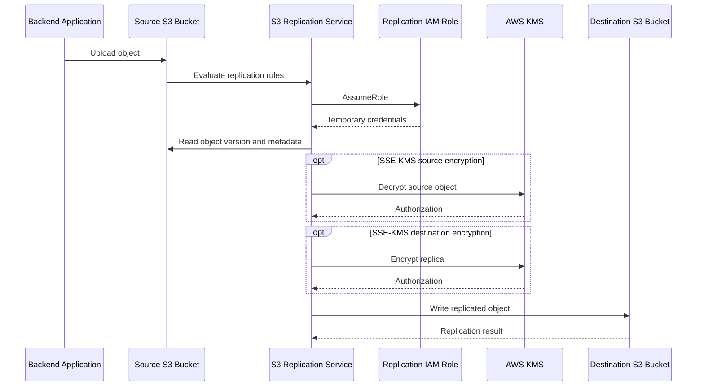
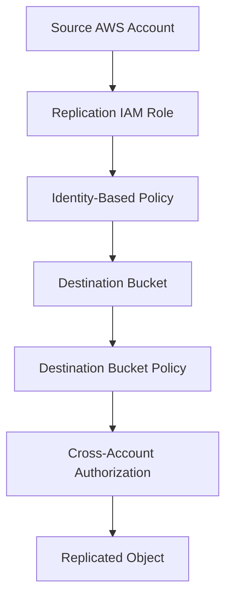
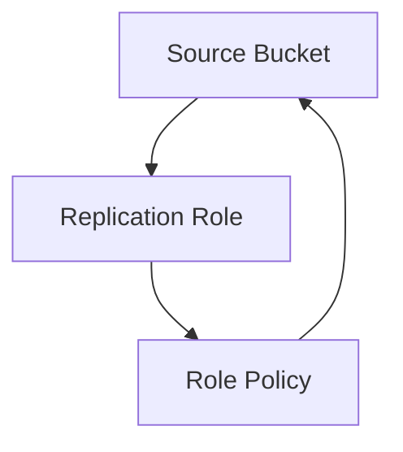

# 06- Replication Roles and Policies

## Overview

Amazon S3 replication automatically copies eligible objects from a source bucket to one or more destination buckets. CloudFormation manages the resources and permissions required to establish this workflow.

A production replication implementation requires more than a replication rule. It must coordinate:

- Source and destination bucket versioning.
- An IAM role trusted by the S3 service.
- Source object read permissions.
- Destination object replication permissions.
- Cross-account bucket authorization, when applicable.
- AWS KMS permissions for SSE-KMS encrypted objects.
- CloudFormation resource dependencies and deployment ordering.

Replication is commonly used for disaster recovery, cross-account data sharing, regional data distribution, centralized storage, and compliance requirements.

This document focuses on the CloudFormation implementation of replication IAM roles, policies, and bucket configuration.

## Replication Architecture

### Core Components

| Component | Responsibility |
|---|---|
| Source bucket | Stores original objects and defines replication rules. |
| Destination bucket | Receives replicated object versions. |
| Replication IAM role | Provides S3 with permissions to read source objects and write replicas. |
| Trust policy | Allows the S3 service to assume the replication role. |
| Source IAM policy | Grants source bucket and object access. |
| Destination bucket policy | Authorizes cross-account replication requests. |
| KMS key policies | Authorize required decryption and encryption operations. |
| CloudFormation | Defines and deploys replication resources and dependencies. |

### Replication Request Flow



The application writes to the source bucket. S3 evaluates the replication configuration and assumes the configured IAM role to perform replication.

The application does not need destination bucket access unless it independently reads or writes objects there.

### Replication Types

| Type | Description | Typical use |
|---|---|---|
| Same-Region Replication (SRR) | Replicates objects between buckets in the same Region. | Account separation, log aggregation, data distribution. |
| Cross-Region Replication (CRR) | Replicates objects between buckets in different Regions. | Disaster recovery and geographic distribution. |
| Cross-account replication | Replicates objects into a bucket owned by another AWS account. | Centralized storage and organizational isolation. |

SRR and CRR can be combined with cross-account ownership boundaries.

## Replication IAM Role

### Why a Dedicated Role Is Required

S3 replication is performed by the S3 service, not by the application uploading the object.

The replication service assumes an IAM role to obtain temporary credentials and perform the required operations.

A dedicated role provides:

- Separation between application and replication permissions.
- Least-privilege access to source and destination resources.
- Independent management of replication authorization.
- Auditable infrastructure and permission changes.
- Support for same-account and cross-account replication.

Avoid reusing an application execution role for replication.

### Trust Policy

The trust relationship allows the S3 service principal to assume the role.

```yaml
AssumeRolePolicyDocument:
  Version: "2012-10-17"
  Statement:
    - Effect: Allow
      Principal:
        Service:
          - s3.amazonaws.com
      Action:
        - sts:AssumeRole
```

The service principal is:

```text
s3.amazonaws.com
```

Optional confused-deputy conditions, such as `aws:SourceAccount` and `aws:SourceArn`, should be added only after validating their compatibility with the intended S3 replication configuration.

### CloudFormation Role Definition

```yaml
Resources:
  S3ReplicationRole:
    Type: AWS::IAM::Role
    Properties:
      Description: IAM role assumed by Amazon S3 for replication.

      AssumeRolePolicyDocument:
        Version: "2012-10-17"
        Statement:
          - Effect: Allow
            Principal:
              Service:
                - s3.amazonaws.com
            Action:
              - sts:AssumeRole
```

For reusable templates, consider allowing CloudFormation to generate the physical role name rather than defining a fixed `RoleName`. This avoids account-wide naming conflicts.

## Source Bucket Permissions

### Required Permissions

The replication role needs permission to inspect the source bucket and read object versions.

Common permissions include:

| IAM action | Purpose |
|---|---|
| `s3:GetReplicationConfiguration` | Read source replication configuration. |
| `s3:ListBucket` | List source bucket objects where required by the workflow. |
| `s3:GetObjectVersionForReplication` | Read object versions for replication. |
| `s3:GetObjectVersionAcl` | Read object ACL information where applicable. |
| `s3:GetObjectVersionTagging` | Read object tags for replication. |

Grant only the permissions required by the replication features being configured.

### Source IAM Policy

Bucket-level actions use the bucket ARN:

```text
arn:aws:s3:::source-bucket
```

Object-level actions use object ARNs:

```text
arn:aws:s3:::source-bucket/*
```

CloudFormation example:

```yaml
Parameters:
  SourceBucketName:
    Type: String

Resources:
  S3ReplicationSourcePolicy:
    Type: AWS::IAM::Policy
    Properties:
      PolicyName: s3-replication-source-access
      Roles:
        - !Ref S3ReplicationRole

      PolicyDocument:
        Version: "2012-10-17"
        Statement:
          - Sid: ReadSourceBucket
            Effect: Allow
            Action:
              - s3:GetReplicationConfiguration
              - s3:ListBucket
            Resource:
              - !Sub arn:${AWS::Partition}:s3:::${SourceBucketName}

          - Sid: ReadSourceObjectVersions
            Effect: Allow
            Action:
              - s3:GetObjectVersionForReplication
              - s3:GetObjectVersionAcl
              - s3:GetObjectVersionTagging
            Resource:
              - !Sub arn:${AWS::Partition}:s3:::${SourceBucketName}/*
```

For prefix-restricted replication, further restrict object resources and applicable bucket-list conditions to the intended key prefixes.

## Destination Bucket Permissions

### Same-Account Replication

The replication role needs permission to write replicated objects into the destination bucket.

Common actions include:

- `s3:ReplicateObject`
- `s3:ReplicateDelete`
- `s3:ReplicateTags`

CloudFormation example:

```yaml
Parameters:
  DestinationBucketName:
    Type: String

Resources:
  S3ReplicationDestinationPolicy:
    Type: AWS::IAM::Policy
    Properties:
      PolicyName: s3-replication-destination-access
      Roles:
        - !Ref S3ReplicationRole

      PolicyDocument:
        Version: "2012-10-17"
        Statement:
          - Sid: WriteReplicatedObjects
            Effect: Allow
            Action:
              - s3:ReplicateObject
              - s3:ReplicateDelete
              - s3:ReplicateTags
            Resource:
              - !Sub arn:${AWS::Partition}:s3:::${DestinationBucketName}/*
```

These permissions should match the features enabled in the replication configuration.

### Cross-Account Replication

Cross-account replication requires authorization in both accounts.

The source account provides the replication role and its identity policy. The destination account must authorize that role through the destination bucket policy.



Example destination bucket policy:

```yaml
Parameters:
  SourceAccountId:
    Type: String

  ReplicationRoleName:
    Type: String

  DestinationBucketName:
    Type: String

Resources:
  DestinationBucketPolicy:
    Type: AWS::S3::BucketPolicy
    Properties:
      Bucket: !Ref DestinationBucketName

      PolicyDocument:
        Version: "2012-10-17"
        Statement:
          - Sid: AllowSourceReplicationRole
            Effect: Allow
            Principal:
              AWS: !Sub arn:${AWS::Partition}:iam::${SourceAccountId}:role/${ReplicationRoleName}
            Action:
              - s3:ReplicateObject
              - s3:ReplicateDelete
              - s3:ReplicateTags
            Resource:
              - !Sub arn:${AWS::Partition}:s3:::${DestinationBucketName}/*
```

The source role's identity policy and destination bucket policy must agree on the intended access.

An identity policy in the source account does not independently grant access to a bucket owned by another account.

### Destination Object Ownership

For modern cross-account replication architectures, use destination bucket ownership enforcement where appropriate.

```yaml
OwnershipControls:
  Rules:
    - ObjectOwnership: BucketOwnerEnforced
```

With `BucketOwnerEnforced`, ACLs are disabled and the destination bucket owner owns objects written to the bucket.

This avoids relying on legacy ACL-based ownership translation.

If a legacy architecture requires explicit ownership translation, configure the applicable replication rule ownership settings and destination permissions deliberately. Do not combine legacy ACL assumptions with Bucket Owner Enforced configuration.

## Replication Configuration in CloudFormation

### ReplicationConfiguration Property

S3 replication is configured through the source bucket's `ReplicationConfiguration` property.

It identifies:

- The IAM role ARN.
- One or more replication rules.
- Destination bucket ARN.
- Optional storage class.
- Filters and rule priorities.
- Delete-marker behavior.
- Optional ownership translation.
- Optional replication metrics and time control settings.

Example:

```yaml
ReplicationConfiguration:
  Role: !GetAtt S3ReplicationRole.Arn

  Rules:
    - Id: ReplicateDocuments
      Status: Enabled
      Priority: 1

      Filter:
        Prefix: documents/

      DeleteMarkerReplication:
        Status: Disabled

      Destination:
        Bucket: !Sub arn:${AWS::Partition}:s3:::${DestinationBucketName}
        StorageClass: STANDARD
```

This rule selects objects under `documents/` and replicates them to the destination bucket.

### Replication Rule Filters

A replication rule can select objects using a prefix, tag, or supported combination of filters.

Prefix filter:

```yaml
Filter:
  Prefix: documents/
```

Tag filter:

```yaml
Filter:
  Tag:
    Key: replication
    Value: enabled
```

Combined filter:

```yaml
Filter:
  And:
    Prefix: documents/
    Tags:
      - Key: environment
        Value: production
      - Key: replication
        Value: enabled
```

Use filters to avoid replicating unrelated application data.

### Rule Priority

Priority resolves overlapping replication rules.

```yaml
Rules:
  - Id: ReplicateCriticalDocuments
    Priority: 10
    Status: Enabled
    Filter:
      Prefix: critical/

  - Id: ReplicateGeneralDocuments
    Priority: 5
    Status: Enabled
    Filter:
      Prefix: documents/
```

Design filters to avoid accidental overlap. When overlap is intentional, validate the resulting priority behavior.

### Delete Marker Replication

Delete-marker replication controls whether delete markers created in the source bucket are replicated.

```yaml
DeleteMarkerReplication:
  Status: Enabled
```

This is useful when the destination must reflect logical deletion behavior from the source.

Delete-marker replication has configuration restrictions, including restrictions involving tag-based filters. Validate the rule combination before deployment.

A delete marker is not the same as permanently deleting a particular historical version. Replication of delete markers should not be interpreted as synchronization of every source deletion operation.

## KMS Permissions for Replication

### Why KMS Permissions Are Separate

S3 authorization and KMS authorization are independent permission layers.

A replication role may have permission to read an object from the source bucket and write to the destination bucket but still fail when the object is encrypted with SSE-KMS.

For the common SSE-KMS replication workflow:

| KMS key | Typical role permission |
|---|---|
| Source key | `kms:Decrypt` |
| Destination key | `kms:Encrypt` |

Additional KMS permissions should be granted only when required by the specific workflow.

### Source KMS Permissions

The source key must permit the replication role to decrypt source objects.

```yaml
- Sid: DecryptSourceObjects
  Effect: Allow
  Action:
    - kms:Decrypt
  Resource:
    - !Ref SourceKmsKeyArn
```

The source key policy must also permit the role or delegate authorization appropriately.

### Destination KMS Permissions

The destination key must permit the replication role to encrypt destination objects.

```yaml
- Sid: EncryptDestinationObjects
  Effect: Allow
  Action:
    - kms:Encrypt
  Resource:
    - !Ref DestinationKmsKeyArn
```

For cross-account replication, the destination KMS key policy must explicitly support the source account replication role or an appropriate delegated authorization model.

The source key policy must also authorize the source-side decryption operation.

### KMS Configuration in the Replication Rule

When the destination uses SSE-KMS, configure the destination encryption key ARN.

```yaml
Destination:
  Bucket: !Sub arn:${AWS::Partition}:s3:::${DestinationBucketName}

  EncryptionConfiguration:
    ReplicaKmsKeyID: !Ref DestinationKmsKeyArn
```

For SSE-KMS source objects, enable replication of those objects in the source rule:

```yaml
SourceSelectionCriteria:
  SseKmsEncryptedObjects:
    Status: Enabled
```

Without the relevant source-selection setting, SSE-KMS encrypted objects are not automatically included in the replication workflow.

### KMS Operational Considerations

- Confirm that both keys are enabled and usable.
- Confirm that the replication role has the required identity permissions.
- Confirm that key policies permit the role.
- Confirm that the destination key is valid for the destination Region.
- Deploy encryption configuration and key policies before enabling replication.
- Align key retention with object retention and disaster recovery requirements.

A retained destination bucket whose KMS key is deleted may contain objects that are no longer decryptable.

## CloudFormation Resource Dependencies

### Dependency Requirements

The replication configuration references an IAM role ARN. The role and its permissions must exist before replication is enabled.

A typical dependency sequence is:

```text
Source and destination buckets
            |
            v
Replication IAM role
            |
            v
IAM permissions
            |
            v
Source replication configuration
            |
            v
Replication enabled
```

CloudFormation can infer dependencies through resource references. However, circular dependencies can arise when the source bucket and replication role policy are defined in the same stack.

### Circular Dependency Example

Consider this design:

- The source bucket references the replication role ARN.
- The replication role policy references the source bucket ARN.
- Both resources are created in the same CloudFormation stack.

The resulting dependency graph can become circular:



CloudFormation cannot resolve a circular resource dependency.

### Recommended Staged Deployment

For complex replication configurations, separate resource creation from replication activation.

**Stage A: Create the buckets**

Deploy source and destination buckets with versioning enabled.

**Stage B: Create the replication role**

Deploy the role and policies using bucket names or ARNs supplied as parameters.

**Stage C: Configure replication**

Update the existing source bucket resource with the replication configuration.

Do not create another bucket resource with the same physical bucket name in a separate stack. The stack that owns the source bucket should remain responsible for updating its configuration.

This staged approach separates resource creation from configuration that depends on those resources.

## Complete Replication IAM Role Template

The following template creates a replication role and its identity policy. It assumes that the source and destination buckets already exist and have versioning enabled.

### `s3-replication-role.yaml`

```yaml
AWSTemplateFormatVersion: "2010-09-09"

Description: >
  S3 replication IAM role and permissions
  for existing source and destination buckets.

Parameters:
  SourceBucketName:
    Type: String
    Description: Existing source bucket name.

  DestinationBucketName:
    Type: String
    Description: Existing destination bucket name.

Resources:
  S3ReplicationRole:
    Type: AWS::IAM::Role

    Properties:
      Description: IAM role assumed by Amazon S3 for replication.

      AssumeRolePolicyDocument:
        Version: "2012-10-17"
        Statement:
          - Effect: Allow
            Principal:
              Service:
                - s3.amazonaws.com
            Action:
              - sts:AssumeRole

      Policies:
        - PolicyName: S3ReplicationAccess

          PolicyDocument:
            Version: "2012-10-17"

            Statement:
              - Sid: ReadSourceBucket
                Effect: Allow
                Action:
                  - s3:GetReplicationConfiguration
                  - s3:ListBucket
                Resource:
                  - !Sub arn:${AWS::Partition}:s3:::${SourceBucketName}

              - Sid: ReadSourceObjectVersions
                Effect: Allow
                Action:
                  - s3:GetObjectVersionForReplication
                  - s3:GetObjectVersionAcl
                  - s3:GetObjectVersionTagging
                Resource:
                  - !Sub arn:${AWS::Partition}:s3:::${SourceBucketName}/*

              - Sid: WriteDestinationReplicas
                Effect: Allow
                Action:
                  - s3:ReplicateObject
                  - s3:ReplicateDelete
                  - s3:ReplicateTags
                Resource:
                  - !Sub arn:${AWS::Partition}:s3:::${DestinationBucketName}/*

Outputs:
  ReplicationRoleArn:
    Description: ARN of the S3 replication role.
    Value: !GetAtt S3ReplicationRole.Arn

  ReplicationRoleName:
    Description: Name of the S3 replication role.
    Value: !Ref S3ReplicationRole
```

This template does not create or configure either bucket.

The bucket owner must ensure that both buckets have versioning enabled and that the source bucket is configured with the returned role ARN.

The deployment principal creating or updating the replication configuration must also have permission to pass the role to S3 using `iam:PassRole`.

This is an operator or CloudFormation execution-role permission, not an additional permission that the replication role needs to perform replication.

A narrowly scoped permission can use the following condition:

```json
{
  "Version": "2012-10-17",
  "Statement": [
    {
      "Effect": "Allow",
      "Action": "iam:PassRole",
      "Resource": "arn:aws:iam::123456789012:role/application-s3-replication-role",
      "Condition": {
        "StringEquals": {
          "iam:PassedToService": "s3.amazonaws.com"
        }
      }
    }
  ]
}
```

Replace the example account ID and role ARN with the actual deployment values.

## Cross-Account Replication Deployment

A cross-account deployment involves separate ownership boundaries.

| Account | Responsibilities |
|---|---|
| Source account | Source bucket, replication role, source IAM permissions, source KMS permissions. |
| Destination account | Destination bucket, destination bucket policy, destination KMS permissions. |
| Deployment identity | Permissions to deploy resources and pass the replication role where required. |

Recommended deployment sequence:

1. Create the destination bucket with versioning enabled.
2. Configure destination Object Ownership.
3. Create or configure the destination KMS key when SSE-KMS is required.
4. Add a destination bucket policy authorizing the source replication role.
5. Create the source replication role and source permissions.
6. Configure source KMS permissions when applicable.
7. Configure the source replication rule.
8. Verify replication using newly uploaded test objects.

Do not assume that successful CloudFormation deployment proves replication is functioning. Test actual object replication and encryption behavior.

## Source Bucket Replication Configuration

After the role exists, configure the source bucket in its owning CloudFormation stack.

```yaml
Parameters:
  ReplicationRoleArn:
    Type: String
    Description: ARN of the existing S3 replication role.

  DestinationBucketName:
    Type: String
    Description: Existing destination bucket name.

Resources:
  SourceBucket:
    Type: AWS::S3::Bucket

    Properties:
      VersioningConfiguration:
        Status: Enabled

      ReplicationConfiguration:
        Role: !Ref ReplicationRoleArn

        Rules:
          - Id: ReplicateDocuments
            Status: Enabled
            Priority: 1

            Filter:
              Prefix: documents/

            DeleteMarkerReplication:
              Status: Disabled

            Destination:
              Bucket: !Sub arn:${AWS::Partition}:s3:::${DestinationBucketName}
              StorageClass: STANDARD
```

This is an illustrative resource fragment. Integrate the replication configuration into the existing source bucket resource rather than defining a duplicate bucket.

The destination bucket must also have versioning enabled.

## Replication with SSE-KMS

For a source bucket containing SSE-KMS encrypted objects and a destination bucket using a customer-managed KMS key, the replication rule requires both source selection and destination encryption configuration.

```yaml
ReplicationConfiguration:
  Role: !Ref ReplicationRoleArn

  Rules:
    - Id: ReplicateEncryptedDocuments
      Status: Enabled
      Priority: 1

      Filter:
        Prefix: documents/

      SourceSelectionCriteria:
        SseKmsEncryptedObjects:
          Status: Enabled

      Destination:
        Bucket: !Sub arn:${AWS::Partition}:s3:::${DestinationBucketName}

        EncryptionConfiguration:
          ReplicaKmsKeyID: !Ref DestinationKmsKeyArn
```

The IAM role must have source-key decryption and destination-key encryption authorization.

The relevant KMS key policies must also permit these operations.

Granting `s3:ReplicateObject` alone is insufficient for SSE-KMS replication.

## Replication of Existing Objects

Replication rules primarily apply to eligible new objects and subsequent updates.

Existing objects are not automatically replicated merely because a replication configuration is enabled.

Use S3 Batch Replication to replicate eligible objects that existed before the rule was configured.

A practical deployment process is:

1. Configure bucket versioning.
2. Configure the replication role and permissions.
3. Deploy the replication rule.
4. Verify replication of a newly uploaded object.
5. Identify existing objects that require replication.
6. Create an S3 Batch Replication job for eligible historical objects.
7. Monitor the job and investigate failures.

Batch Replication requires its own job configuration and permissions. Do not treat it as an automatic consequence of deploying `ReplicationConfiguration`.

## Replication Monitoring and Verification

### Inspect Replication Configuration

```bash
aws s3api get-bucket-replication \
  --bucket source-bucket
```

This returns the configured replication role and rules.

### Verify Bucket Versioning

```bash
aws s3api get-bucket-versioning \
  --bucket source-bucket
```

```bash
aws s3api get-bucket-versioning \
  --bucket destination-bucket
```

Both buckets must have versioning enabled.

### Upload a Test Object

```bash
echo "Replication verification" > replication-test.txt

aws s3api put-object \
  --bucket source-bucket \
  --key documents/replication-test.txt \
  --body replication-test.txt
```

### Inspect Source Replication Status

```bash
aws s3api head-object \
  --bucket source-bucket \
  --key documents/replication-test.txt
```

Inspect the `ReplicationStatus` field when available.

Typical replication statuses include:

| Status | Meaning |
|---|---|
| `PENDING` | Replication is pending. |
| `COMPLETED` | Replication completed. |
| `FAILED` | Replication failed. |
| `REPLICA` | The object is a replica. |

### Verify the Destination Object

```bash
aws s3api head-object \
  --bucket destination-bucket \
  --key documents/replication-test.txt
```

Compare expected metadata, size, and encryption configuration.

Do not use ETag equality as a universal integrity guarantee. ETags can differ for multipart uploads and some encryption configurations.

For stronger integrity verification, use an explicitly configured checksum workflow and compare the relevant checksum values.

## Replication Metrics and Replication Time Control

S3 replication can be monitored through replication metrics.

For workloads with strict replication-time requirements, S3 Replication Time Control can provide a defined replication-time commitment for eligible objects.

Illustrative destination configuration:

```yaml
Destination:
  Bucket: !Sub arn:${AWS::Partition}:s3:::${DestinationBucketName}

  Metrics:
    Status: Enabled
    EventThreshold:
      Minutes: 15

  ReplicationTime:
    Status: Enabled
    Time:
      Minutes: 15
```

Use these settings only when the workload requires the corresponding monitoring and replication-time capabilities.

Replication Time Control has additional charges and service-specific eligibility requirements. Validate current Region and feature availability before deployment.

## CloudFormation Deployment Workflow

### Validate the Template

```bash
aws cloudformation validate-template \
  --template-body file://s3-replication-role.yaml
```

Run CloudFormation linting:

```bash
cfn-lint s3-replication-role.yaml
```

### Deploy the Role Stack

```bash
aws cloudformation create-stack \
  --stack-name s3-replication-role \
  --template-body file://s3-replication-role.yaml \
  --parameters \
    ParameterKey=SourceBucketName,ParameterValue=source-bucket \
    ParameterKey=DestinationBucketName,ParameterValue=destination-bucket
```

### Inspect Stack Resources

```bash
aws cloudformation describe-stack-resources \
  --stack-name s3-replication-role
```

Retrieve the role ARN:

```bash
aws cloudformation describe-stacks \
  --stack-name s3-replication-role \
  --query "Stacks[0].Outputs"
```

Use the returned ARN when updating the source bucket's replication configuration.

### Verify the IAM Role

```bash
aws iam get-role \
  --role-name s3-replication-role
```

Inspect the inline policy:

```bash
aws iam get-role-policy \
  --role-name s3-replication-role \
  --policy-name S3ReplicationAccess
```

### Verify the Source Configuration

```bash
aws s3api get-bucket-replication \
  --bucket source-bucket
```

### Verify Actual Replication

Upload a new test object and inspect both the source and destination objects.

A successful CloudFormation deployment verifies resource provisioning, not end-to-end replication correctness.

## Troubleshooting Replication Permissions

### Replication Role Cannot Be Assumed

**Symptoms**

- Replication does not start.
- Objects remain pending or fail.
- S3 cannot obtain the configured role credentials.

**Likely causes**

- Incorrect trust policy.
- Incorrect service principal.
- Role ARN points to the wrong role.
- Role was deleted or replaced.

**Verification**

```bash
aws iam get-role \
  --role-name s3-replication-role
```

Inspect the trust policy and confirm that the S3 service principal is authorized.

**Corrective action**

Update the role trust policy and verify the role ARN in the source bucket replication configuration.

### AccessDenied on Source Objects

**Symptoms**

- Replication fails for source objects.
- The replication role cannot read object versions or tags.

**Likely causes**

- Missing `s3:GetObjectVersionForReplication`.
- Missing tag or ACL read permissions required by the workflow.
- Incorrect source object ARN.
- Explicit deny in a bucket or organization policy.

**Verification**

Inspect the replication role's effective permissions and the source bucket policy.

**Corrective action**

Grant only the missing source permissions and verify that no explicit deny blocks the operation.

### AccessDenied on Destination Objects

**Symptoms**

- Source objects are eligible for replication but destination objects are not created.

**Likely causes**

- Missing `s3:ReplicateObject`.
- Missing `s3:ReplicateDelete` or `s3:ReplicateTags` for enabled features.
- Missing destination bucket policy authorization.
- Incorrect destination ARN.

**Verification**

Inspect the source role identity policy and destination bucket policy.

**Corrective action**

Align the source role permissions and destination bucket policy with the required replication operations.

### KMS AccessDenied

**Symptoms**

- Unencrypted objects replicate successfully.
- SSE-KMS encrypted objects fail.

**Likely causes**

- Missing source-key `kms:Decrypt`.
- Missing destination-key `kms:Encrypt`.
- Key policy does not authorize the replication role.
- Destination key ARN or Region is incorrect.
- Source encrypted objects are not enabled in the replication rule.

**Verification**

Inspect:

- Source and destination key ARNs.
- Replication rule encryption settings.
- IAM policy statements.
- Source and destination KMS key policies.
- Relevant CloudTrail KMS events.

**Corrective action**

Correct KMS authorization at both the identity-policy and key-policy layers. Verify the source-selection and destination encryption settings.

### CloudFormation Circular Dependency

**Symptoms**

- Stack creation fails with a circular dependency error.

**Likely cause**

The source bucket references the replication role while the role policy references the source bucket resource.

**Corrective action**

Separate bucket creation and role creation into staged deployments. Update the existing source bucket resource in its owning stack after the role has been created.

### Existing Objects Are Not Replicated

**Symptoms**

- Newly uploaded objects replicate.
- Older objects remain only in the source bucket.

**Likely cause**

The replication rule does not automatically backfill existing objects.

**Corrective action**

Use S3 Batch Replication for eligible existing objects and verify the job's completion and failure reports.

## Production Best Practices

- Use a dedicated IAM role for S3 replication.
- Keep the trust relationship limited to the S3 service principal.
- Grant only the source and destination permissions required by the workflow.
- Use separate account ownership boundaries for cross-account replication.
- Enable versioning on both source and destination buckets.
- Prefer `BucketOwnerEnforced` for modern destination ownership designs.
- Configure KMS permissions independently from S3 permissions.
- Use destination KMS keys appropriate to the destination Region.
- Grant deployment identities narrowly scoped `iam:PassRole` permissions.
- Avoid circular CloudFormation dependencies through staged resource deployment.
- Keep source bucket ownership in a single CloudFormation stack.
- Use S3 Batch Replication when existing objects must be copied.
- Verify replication with actual objects rather than relying only on stack status.
- Monitor replication status and investigate persistent pending or failed objects.
- Review replication and destination storage costs before enabling broad replication.

## Key Takeaways

- S3 replication requires a dedicated IAM role trusted by the S3 service, with explicit source-read and destination-write permissions.
- Cross-account replication requires authorization in both the source role's identity policy and the destination bucket policy.
- SSE-KMS replication requires separate source-key decryption and destination-key encryption authorization, including compatible KMS key policies.
- CloudFormation circular dependencies can be avoided by creating buckets and replication roles in stages, then updating the existing source bucket resource.
- Replication configuration deployment does not prove successful data replication; verify new objects, historical-object workflows, encryption, and replication status independently.