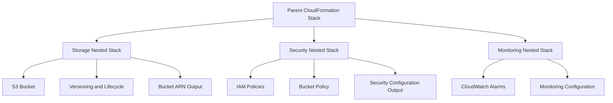
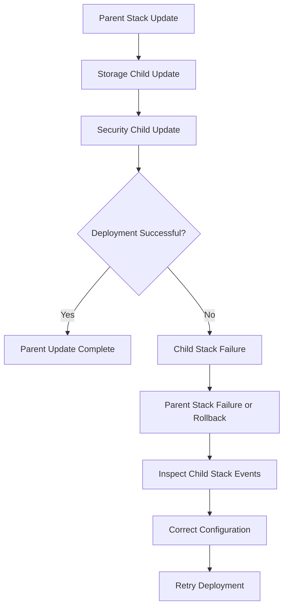

# 07- Nested Stacks and Stack Composition

## Overview

AWS CloudFormation nested stacks provide a mechanism for organizing infrastructure into smaller, reusable templates while maintaining a parent-child deployment relationship.

For Amazon S3 infrastructure, nested stacks are useful when a solution contains multiple related components, such as:

- S3 buckets and their configurations.
- Encryption and access-control resources.
- Lifecycle policies.
- Replication roles and rules.
- Event notifications and Lambda integrations.
- CloudFront distributions and origin access controls.
- Monitoring and operational resources.

Instead of maintaining one large CloudFormation template, infrastructure can be divided into focused child templates and orchestrated through a parent stack.

This improves maintainability, reuse, deployment consistency, and ownership boundaries. However, nested stacks introduce dependencies, parameter-passing requirements, deployment ordering, and lifecycle considerations that must be designed deliberately.

## CloudFormation Stack Composition

### What Is Stack Composition?

Stack composition is the practice of building a larger infrastructure solution from multiple independently structured CloudFormation templates.

Each template represents a logical infrastructure component.

For example:

```text
Amazon S3 Infrastructure
│
├── Parent Stack
│
├── Storage Stack
│   ├── S3 Bucket
│   ├── Versioning
│   └── Lifecycle Configuration
│
├── Security Stack
│   ├── IAM Policies
│   ├── Bucket Policies
│   └── KMS Configuration
│
├── Replication Stack
│   ├── Replication Role
│   ├── Replication Permissions
│   └── Replication Configuration
│
└── Monitoring Stack
    ├── CloudWatch Metrics
    └── Alerts
```

The parent stack coordinates the child stacks and passes configuration between them.

### Why Stack Composition Matters

A single CloudFormation template can become difficult to maintain as infrastructure grows.

Typical problems include:

- Large resource definitions.
- Repeated IAM policy statements.
- Difficult resource dependency management.
- Environment-specific configuration scattered throughout the template.
- Increased risk when updating unrelated resources.
- Limited reuse across projects.

Stack composition addresses these concerns by separating infrastructure according to responsibility.

### Nested Stacks Versus Independent Stacks

CloudFormation supports both nested stacks and independently deployed stacks.

| Characteristic | Nested stacks | Independent stacks |
|---|---|---|
| Deployment | Managed through a parent stack | Deployed separately |
| Lifecycle | Parent manages child stack resources | Each stack has its own lifecycle |
| Parameters | Passed through parent template | Supplied directly during deployment |
| Outputs | Can be exposed through parent outputs | Can be exported or retrieved separately |
| Dependencies | Parent-child dependency relationship | Explicit deployment orchestration |
| Reuse | Child templates can be reused | Templates can be independently reused |
| Ownership | Parent stack coordinates child resources | Separate stack ownership |
| Suitable for | Tightly related infrastructure | Independently managed infrastructure |

Use nested stacks when components form one logical deployment unit.

Use independent stacks when teams, permissions, release schedules, or resource lifecycles need stronger separation.

## Nested Stack Architecture

### Parent and Child Relationships

A nested stack is created using the `AWS::CloudFormation::Stack` resource.

The parent stack references a child template through the `TemplateURL` property.

The child template can receive parameters from the parent and expose outputs that the parent can reference.



The parent stack controls deployment of the child stacks.

CloudFormation resolves dependencies between resources and nested stacks using references and explicit dependency declarations.

### Nested Stack Resource

A typical nested stack definition looks like this:

```yaml
Resources:
  StorageNestedStack:
    Type: AWS::CloudFormation::Stack
    Properties:
      TemplateURL: https://s3.amazonaws.com/cloudformation-artifacts/templates/storage.yaml

      Parameters:
        Environment: production
        BucketName: company-production-data
```

The child template must be accessible to CloudFormation.

For production deployments, store templates in a controlled artifact bucket and use immutable or versioned artifact paths where appropriate.

Do not depend on mutable local file paths or manually changing template files after deployment.

## Designing an S3 Nested Stack Structure

A practical S3 infrastructure deployment can be divided into the following components.

| Child stack | Responsibility |
|---|---|
| Storage | Bucket creation, versioning, encryption, and lifecycle configuration. |
| Security | IAM policies, bucket policies, and access controls. |
| Replication | Replication role, permissions, and replication configuration. |
| Monitoring | CloudWatch metrics, alarms, and operational resources. |

The exact boundaries depend on resource ownership and dependency requirements.

For example, a replication role may need bucket ARNs before it can be created, while the source bucket's replication configuration needs the role ARN. This relationship should influence stack composition.

Avoid creating artificial stack boundaries that introduce more dependencies than they remove.

## Building a Child Stack

### Storage Child Template

The storage child stack creates an S3 bucket and exposes its name and ARN.

File:

`templates/s3-storage.yaml`

```yaml
AWSTemplateFormatVersion: "2010-09-09"

Description: S3 storage resources for an application environment.

Parameters:
  BucketName:
    Type: String
    Description: Globally unique S3 bucket name.

  Environment:
    Type: String
    AllowedValues:
      - dev
      - staging
      - production

Resources:
  ApplicationBucket:
    Type: AWS::S3::Bucket
    DeletionPolicy: Retain
    UpdateReplacePolicy: Retain

    Properties:
      BucketName: !Ref BucketName

      Tags:
        - Key: Environment
          Value: !Ref Environment
        - Key: ManagedBy
          Value: CloudFormation

      OwnershipControls:
        Rules:
          - ObjectOwnership: BucketOwnerEnforced

      PublicAccessBlockConfiguration:
        BlockPublicAcls: true
        BlockPublicPolicy: true
        IgnorePublicAcls: true
        RestrictPublicBuckets: true

      VersioningConfiguration:
        Status: Enabled

      BucketEncryption:
        ServerSideEncryptionConfiguration:
          - ServerSideEncryptionByDefault:
              SSEAlgorithm: AES256

Outputs:
  BucketName:
    Description: S3 bucket name.
    Value: !Ref ApplicationBucket

  BucketArn:
    Description: S3 bucket ARN.
    Value: !GetAtt ApplicationBucket.Arn
```

The child template owns the bucket resource.

The parent stack should not independently define another bucket resource using the same physical bucket name.

### Security Child Template

A security child stack can manage bucket policies and application access permissions.

File:

`templates/s3-security.yaml`

```yaml
AWSTemplateFormatVersion: "2010-09-09"

Description: S3 access-control resources.

Parameters:
  BucketName:
    Type: String

  ApplicationRoleArn:
    Type: String

Resources:
  ApplicationBucketPolicy:
    Type: AWS::S3::BucketPolicy

    Properties:
      Bucket: !Ref BucketName

      PolicyDocument:
        Version: "2012-10-17"

        Statement:
          - Sid: AllowApplicationRead
            Effect: Allow
            Principal:
              AWS: !Ref ApplicationRoleArn
            Action:
              - s3:GetObject
            Resource:
              - !Sub arn:${AWS::Partition}:s3:::${BucketName}/*
```

This example grants read access to the specified application role.

A production policy must be designed around the application's actual access requirements. Add write, delete, multipart, and prefix-specific permissions only when required.

The application role's identity policy must also authorize the intended operations.

## Parent Stack Implementation

The parent stack creates the child stacks and passes their parameters.

File:

`templates/s3-parent.yaml`

```yaml
AWSTemplateFormatVersion: "2010-09-09"

Description: Parent stack for composed Amazon S3 infrastructure.

Parameters:
  BucketName:
    Type: String
    Description: Globally unique S3 bucket name.

  Environment:
    Type: String
    Default: dev
    AllowedValues:
      - dev
      - staging
      - production

  ApplicationRoleArn:
    Type: String
    Description: IAM role ARN used by the application.

Resources:
  StorageStack:
    Type: AWS::CloudFormation::Stack

    Properties:
      TemplateURL: https://s3.amazonaws.com/cloudformation-artifacts/templates/s3-storage.yaml

      Parameters:
        BucketName: !Ref BucketName
        Environment: !Ref Environment

  SecurityStack:
    Type: AWS::CloudFormation::Stack

    Properties:
      TemplateURL: https://s3.amazonaws.com/cloudformation-artifacts/templates/s3-security.yaml

      Parameters:
        BucketName: !GetAtt StorageStack.Outputs.BucketName
        ApplicationRoleArn: !Ref ApplicationRoleArn

    DependsOn:
      - StorageStack

Outputs:
  ApplicationBucketName:
    Description: Name of the application S3 bucket.
    Value: !GetAtt StorageStack.Outputs.BucketName

  ApplicationBucketArn:
    Description: ARN of the application S3 bucket.
    Value: !GetAtt StorageStack.Outputs.BucketArn
```

The parent stack:

1. Creates the storage child stack.
2. Retrieves the bucket name from its output.
3. Passes the bucket name and application role ARN to the security child stack.
4. Exposes selected child outputs to the deployment operator.

`DependsOn` makes the intended deployment order explicit. The output reference also creates a dependency between the stacks.

The example assumes that the child templates have already been uploaded to the artifact bucket and that their URLs are accessible to CloudFormation.

## Passing Parameters Between Stacks

### Parent-to-Child Parameters

Nested stacks receive configuration through the `Parameters` property.

Parent template:

```yaml
Resources:
  StorageStack:
    Type: AWS::CloudFormation::Stack

    Properties:
      TemplateURL: https://s3.amazonaws.com/cloudformation-artifacts/templates/s3-storage.yaml

      Parameters:
        BucketName: !Ref BucketName
        Environment: !Ref Environment
```

Child template:

```yaml
Parameters:
  BucketName:
    Type: String

  Environment:
    Type: String
```

The parameter names supplied by the parent must match the parameter names declared by the child template.

### Parameter Validation

Use parameter constraints to reject invalid configuration early.

```yaml
Parameters:
  Environment:
    Type: String
    AllowedValues:
      - dev
      - staging
      - production

  BucketName:
    Type: String
    MinLength: 3
    MaxLength: 63
```

For S3 bucket names, use additional validation appropriate to S3 naming requirements.

CloudFormation parameter constraints improve input validation but do not replace service-side validation.

### Avoid Excessive Parameter Passing

A parent stack should expose configuration that genuinely needs to vary.

Avoid passing dozens of unrelated parameters through every nested stack.

A better approach is to define clear interfaces for each child stack.

For example:

```text
Storage Stack:
  BucketName
  Environment
  EnableVersioning

Security Stack:
  BucketName
  ApplicationRoleArn

Monitoring Stack:
  BucketName
  AlarmNotificationArn
```

This reduces coupling and makes child templates easier to reuse.

## Sharing Outputs Between Nested Stacks

### Child Stack Outputs

Child stacks expose values through the `Outputs` section.

```yaml
Outputs:
  BucketArn:
    Description: S3 bucket ARN.
    Value: !GetAtt ApplicationBucket.Arn

  BucketName:
    Description: S3 bucket name.
    Value: !Ref ApplicationBucket
```

### Referencing Nested Stack Outputs

The parent accesses child outputs using:

```yaml
!GetAtt StorageStack.Outputs.BucketArn
```

Example:

```yaml
SecurityStack:
  Type: AWS::CloudFormation::Stack

  Properties:
    TemplateURL: https://s3.amazonaws.com/cloudformation-artifacts/templates/s3-security.yaml

    Parameters:
      BucketName: !GetAtt StorageStack.Outputs.BucketName
```

The output value becomes part of the parent-child interface.

Keep output names stable when other child stacks or deployment automation depend on them.

### Parent Stack Outputs

The parent can expose selected values to operators and external deployment workflows.

```yaml
Outputs:
  BucketArn:
    Description: Application bucket ARN.
    Value: !GetAtt StorageStack.Outputs.BucketArn
```

Avoid exposing sensitive values through outputs. CloudFormation outputs are intended for infrastructure references, not secret storage.

## Stack Composition with Replication

Replication introduces more complex dependencies because the source bucket, destination bucket, IAM role, and replication configuration depend on one another.

A typical structure is:

```text
Replication Parent Stack
│
├── Destination Storage Stack
│   ├── Destination Bucket
│   └── Versioning
│
├── Source Storage Stack
│   ├── Source Bucket
│   └── Versioning
│
├── Replication IAM Stack
│   ├── Replication Role
│   └── IAM Permissions
│
└── Source Replication Configuration
    └── Replication Rule
```

The replication role needs source and destination bucket permissions. The source bucket needs the replication role ARN.

This can create circular dependencies if all resources are tightly coupled within one template.

A staged design avoids that problem.

Recommended deployment sequence:

1. Create source and destination buckets.
2. Enable versioning on both buckets.
3. Create the replication role and permissions using bucket names or ARNs.
4. Configure the source bucket replication rule using the role ARN.
5. Verify actual object replication.

For cross-account replication, deploy the destination bucket policy and KMS permissions in the destination account before enabling replication.

Detailed replication IAM policies and configurations belong in the dedicated replication documentation.

## Nested Stack Deployment

### Template Packaging

Nested templates must be available to CloudFormation through accessible template URLs.

A common workflow is to maintain templates locally and upload them to an artifact bucket.

Example structure:

```text
cloudformation/
│
├── parent.yaml
│
└── templates/
    ├── s3-storage.yaml
    ├── s3-security.yaml
    └── s3-monitoring.yaml
```

Upload child templates:

```bash
aws s3 cp templates/ \
  s3://cloudformation-artifacts/templates/ \
  --recursive
```

Upload the parent template:

```bash
aws s3 cp parent.yaml \
  s3://cloudformation-artifacts/parent.yaml
```

The `TemplateURL` values in the parent template must reference the uploaded child templates.

For production, prefer immutable artifact keys tied to a release or commit identifier:

```text
templates/releases/2026-11-01/s3-storage.yaml
templates/releases/2026-11-01/s3-security.yaml
```

This prevents a later template upload from silently changing the source used by a future deployment.

### Deploy the Parent Stack

```bash
aws cloudformation create-stack \
  --stack-name application-s3-infrastructure \
  --template-url https://s3.amazonaws.com/cloudformation-artifacts/parent.yaml \
  --parameters \
    ParameterKey=BucketName,ParameterValue=company-app-data-production \
    ParameterKey=Environment,ParameterValue=production \
    ParameterKey=ApplicationRoleArn,ParameterValue=arn:aws:iam::123456789012:role/application-role
```

The deployment identity must have the permissions required to create the parent and child resources.

It must also be authorized to access the template artifacts.

### Monitor Deployment

```bash
aws cloudformation describe-stacks \
  --stack-name application-s3-infrastructure
```

Inspect stack events:

```bash
aws cloudformation describe-stack-events \
  --stack-name application-s3-infrastructure
```

Inspect nested stack resources:

```bash
aws cloudformation list-stack-resources \
  --stack-name application-s3-infrastructure
```

Nested stack resources are represented by `AWS::CloudFormation::Stack` resources in the parent stack.

Use the nested stack physical resource ID to inspect the child stack directly.

## Updating Nested Stacks

### How Updates Work

When a parent template changes, CloudFormation evaluates the parent and its nested stack resources.

If a nested stack resource receives updated properties or a changed template, CloudFormation updates the child stack.

The child stack then evaluates its own resources and applies the required changes.

An update can affect:

- Child template contents.
- Child parameters.
- Resource properties.
- Resource creation or deletion.
- Resource replacement.
- Nested stack dependencies.

### Update the Parent Template

```bash
aws cloudformation update-stack \
  --stack-name application-s3-infrastructure \
  --template-url https://s3.amazonaws.com/cloudformation-artifacts/parent.yaml \
  --parameters \
    ParameterKey=BucketName,ParameterValue=company-app-data-production \
    ParameterKey=Environment,ParameterValue=production \
    ParameterKey=ApplicationRoleArn,ParameterValue=arn:aws:iam::123456789012:role/application-role
```

Use change sets for production updates, especially when changing S3 bucket properties, lifecycle policies, encryption, or resource dependencies.

### Update Nested Templates Safely

A robust deployment process should:

1. Validate every child template.
2. Upload child templates under immutable release-specific keys.
3. Update the parent template to reference those keys.
4. Create and review a parent change set.
5. Execute the change set.
6. Monitor parent and child stack events.
7. Verify the resulting S3 configuration.

Avoid overwriting a child template at the same artifact URL before reviewing the deployment impact.

## Nested Stack Failure Handling

### Failure Propagation

A nested stack failure can cause the parent stack operation to fail.

For example:



The parent stack's status provides the overall deployment result, but detailed failure information is usually found in the child stack events.

### Diagnose a Failed Nested Stack

Inspect the parent stack:

```bash
aws cloudformation describe-stacks \
  --stack-name application-s3-infrastructure
```

Inspect parent events:

```bash
aws cloudformation describe-stack-events \
  --stack-name application-s3-infrastructure
```

Find nested stack resources:

```bash
aws cloudformation list-stack-resources \
  --stack-name application-s3-infrastructure
```

Inspect the failing child stack:

```bash
aws cloudformation describe-stack-events \
  --stack-name NESTED_STACK_ID
```

Look for:

- Invalid parameters.
- Missing IAM permissions.
- Unavailable template URLs.
- Bucket naming conflicts.
- Invalid resource properties.
- Circular dependencies.
- KMS key policy failures.
- Resource replacement restrictions.

### Preserve Resources During Failure Recovery

CloudFormation may roll back resources when a nested stack operation fails.

For S3 infrastructure, data preservation must be considered separately from stack rollback.

Use:

- `DeletionPolicy: Retain` for resources whose physical deletion would be unacceptable.
- `UpdateReplacePolicy: Retain` when replacement could destroy valuable data.
- Carefully scoped stack policies for protected resources.
- Explicit review of resource replacement in change sets.

Retention policies do not prevent lifecycle expiration or explicit object deletion.

Do not manually delete nested stack resources to resolve a failed deployment unless the resource ownership and recovery procedure are understood.

## Cross-Stack Communication Patterns

### Nested Stack Outputs

Use nested stack outputs when resources belong to the same parent deployment.

Example:

```yaml
Value: !GetAtt StorageStack.Outputs.BucketArn
```

Advantages:

- Direct parent-child relationship.
- No need for global exports.
- Clear ownership within one deployment hierarchy.

### CloudFormation Exports and Imports

Use exports and imports when independently deployed stacks need to share stable infrastructure values.

Producer stack:

```yaml
Outputs:
  BucketArn:
    Value: !GetAtt ApplicationBucket.Arn
    Export:
      Name: application-s3-bucket-arn
```

Consumer stack:

```yaml
Parameters:
  BucketArn:
    Type: String
```

An independently deployed consumer can also use:

```yaml
!ImportValue application-s3-bucket-arn
```

Exports and imports have lifecycle constraints. An exported value cannot normally be changed or removed while another stack imports it.

Use exports for stable cross-stack interfaces, not for frequently changing configuration.

### Choosing a Communication Pattern

| Requirement | Recommended mechanism |
|---|---|
| Parent passes configuration to child | Nested stack parameters |
| Parent reads child resource identifiers | Nested stack outputs |
| Independent stacks share stable values | Export and `ImportValue` |
| Deployment pipeline coordinates multiple stacks | Explicit orchestration |
| Cross-account resource access | IAM and resource policies |

## Reusable CloudFormation Components

### Design Reusable Child Templates

A reusable child template should have:

- A focused responsibility.
- A small and stable parameter interface.
- Clearly documented outputs.
- Environment-independent resource logic where possible.
- Secure defaults.
- Explicit resource dependencies.
- No unnecessary assumptions about parent stack names.

For example, an S3 storage child template should not require knowledge of application-specific API routes or unrelated Lambda functions.

### Avoid Over-Fragmentation

Creating a nested stack for every individual resource increases complexity.

Poor structure:

```text
Parent
├── Bucket Stack
├── Versioning Stack
├── Encryption Stack
├── Tagging Stack
├── Lifecycle Stack
└── Public Access Stack
```

These configurations are tightly related to the bucket and are often better managed together.

A more maintainable structure is:

```text
Parent
├── Storage Stack
│   ├── Bucket
│   ├── Versioning
│   ├── Encryption
│   └── Lifecycle
│
├── Security Stack
│   ├── IAM
│   └── Bucket Policies
│
└── Monitoring Stack
    ├── Metrics
    └── Alarms
```

The goal is meaningful modularity, not the maximum possible number of stacks.

## CI/CD Integration

Nested stacks fit naturally into infrastructure deployment pipelines.

A production pipeline should validate all templates before deploying the parent stack.

### Example Validation Workflow

```yaml
name: Validate CloudFormation

on:
  pull_request:
    paths:
      - "cloudformation/**"

  push:
    branches:
      - main

jobs:
  validate:
    runs-on: ubuntu-latest

    steps:
      - name: Checkout
        uses: actions/checkout@v4

      - name: Install cfn-lint
        run: pip install cfn-lint

      - name: Validate all templates
        run: |
          find cloudformation -name "*.yaml" -o -name "*.yml" \
            | while read -r template; do
                cfn-lint "$template"
              done
```

This workflow performs static linting. It does not deploy infrastructure or prove that AWS accepts every resource configuration.

### Production Deployment Controls

For production:

- Use GitHub Actions OIDC federation instead of long-lived AWS access keys.
- Restrict the deployment role to required CloudFormation, S3 artifact, IAM, and resource operations.
- Require approval before production deployment.
- Use immutable child template artifacts.
- Review change sets before execution.
- Record deployment identifiers and source commit references.
- Verify deployed bucket configuration after completion.
- Preserve deployment logs and CloudFormation events.

The deployment role must have the required permissions to create and update nested stacks and pass any execution roles used by the deployment.

## Security Considerations

Nested stacks do not create an independent security boundary automatically.

A child stack is still deployed through CloudFormation under the permissions of the deployment identity or configured execution role.

Apply the following controls:

- Restrict access to template artifact buckets.
- Use HTTPS for template delivery.
- Avoid embedding credentials or secrets in templates.
- Use Secrets Manager or Systems Manager Parameter Store for sensitive values.
- Restrict CloudFormation deployment permissions.
- Scope `iam:PassRole` to approved roles and services.
- Use least-privilege policies in child templates.
- Protect production buckets against accidental deletion and replacement.
- Review resource policies and IAM policies across all child stacks.
- Avoid exposing sensitive values through outputs or stack parameters.

A nested stack should be treated as an organizational and deployment abstraction, not as a replacement for IAM authorization.

## Cost and Operational Considerations

Nested stacks primarily improve infrastructure organization. They do not reduce the cost of the S3 resources they create.

Operational costs can increase indirectly when excessive stack fragmentation creates additional deployment, monitoring, and maintenance work.

Consider:

| Concern | Production consideration |
|---|---|
| Deployment duration | More nested stacks can increase orchestration time. |
| Failure diagnosis | Investigate both parent and child stack events. |
| Template storage | Keep artifact templates available for future updates. |
| Resource ownership | Ensure every resource has one clear owning stack. |
| Update coordination | Deploy dependent stacks in a controlled order. |
| Change management | Review replacement and deletion effects across the hierarchy. |
| Recovery | Preserve data independently of stack rollback behavior. |

Keep artifact retention long enough to support rollback and reproducible deployments.

## Common Mistakes and Pitfalls

### Defining the Same Bucket in Multiple Stacks

An S3 bucket should have one clear CloudFormation owner.

Defining the same physical bucket name in separate stacks can create resource conflicts and ownership problems.

**Avoidance:** Create the bucket in one stack and expose its ARN and name through outputs.

### Using Mutable Child Template URLs

Overwriting a child template at an existing URL can make deployments difficult to reproduce.

**Avoidance:** Use release-specific artifact keys and update the parent template to reference the intended version.

### Passing Too Many Parameters

Excessive parameter passing tightly couples child templates to the parent.

**Avoidance:** Define small interfaces based on each child stack's responsibility.

### Creating Too Many Nested Stacks

Over-fragmentation increases deployment complexity without providing meaningful reuse.

**Avoidance:** Group resources according to lifecycle, ownership, and responsibility.

### Ignoring Child Stack Failures

The parent stack may show only an overall failure state.

**Avoidance:** Inspect the failing nested stack's events to identify the underlying resource error.

### Assuming Nested Stacks Automatically Solve Circular Dependencies

Nested stacks organize resources, but poorly designed references can still create dependency problems.

**Avoidance:** Design the resource dependency graph before separating templates. Use staged deployment when resources genuinely depend on each other in both directions.

### Removing Exports Used by Other Stacks

CloudFormation exports cannot normally be removed while another stack imports them.

**Avoidance:** Update consumers first, verify dependencies, and then remove obsolete exports.

### Treating Retention Policies as Complete Data Protection

`DeletionPolicy: Retain` protects a resource from CloudFormation-driven deletion. It does not protect object data against lifecycle expiration, application deletion, or privileged manual operations.

**Avoidance:** Combine infrastructure protection with versioning, appropriate retention controls, backups, and recovery testing.

## Production Deployment Checklist

### Template Design

- [ ] Every child template has one clear responsibility.
- [ ] Parent parameters match child parameter definitions.
- [ ] Child outputs expose only required infrastructure values.
- [ ] Resource ownership is unambiguous.
- [ ] Resource dependencies are explicit where necessary.
- [ ] Child template URLs reference immutable artifacts.

### Security

- [ ] Template artifact access is restricted.
- [ ] IAM policies follow least privilege.
- [ ] Deployment roles have only required permissions.
- [ ] `iam:PassRole` is narrowly scoped where applicable.
- [ ] Sensitive values are not embedded in templates.
- [ ] Production buckets have appropriate deletion and replacement protection.

### Deployment

- [ ] All templates pass validation and linting.
- [ ] Parent and child templates are packaged.
- [ ] Production change sets are reviewed.
- [ ] Deployment ordering is documented.
- [ ] Parent and child stack events are monitored.
- [ ] Rollback procedures are documented.

### Verification

- [ ] Nested stacks reach successful completion.
- [ ] S3 bucket configuration is verified.
- [ ] Versioning and encryption settings are correct.
- [ ] Bucket policies and IAM permissions are verified.
- [ ] Lifecycle and replication configurations are checked where applicable.
- [ ] Outputs contain the expected resource identifiers.

## Key Takeaways

- Nested stacks divide large CloudFormation deployments into focused child templates coordinated by a parent stack.
- Parent-child parameters and outputs create explicit interfaces that should remain small, stable, and well-defined.
- Resource ownership and dependency design are essential, particularly for S3 replication and other configurations with circular dependencies.
- Immutable template artifacts, change sets, and child-stack event inspection improve deployment reproducibility and failure diagnosis.
- Nested stacks improve infrastructure organization but do not replace IAM security boundaries, data-retention controls, or independent recovery procedures.