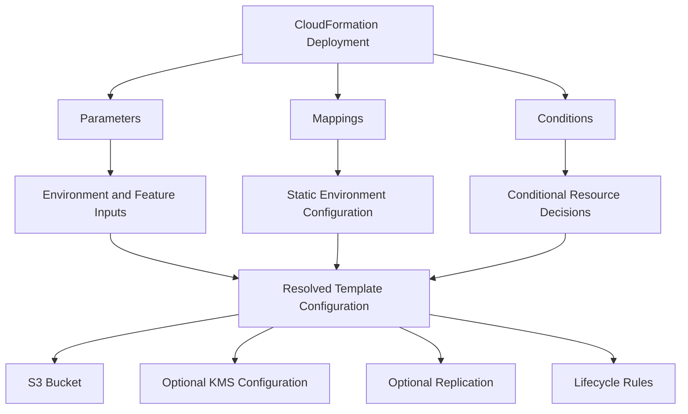

# 08- Parameters Mappings and Conditions

## Overview

CloudFormation parameters, mappings, and conditions are the primary mechanisms for making infrastructure templates reusable across environments and deployment scenarios.

For Amazon S3 deployments, they allow a single CloudFormation template to support development, staging, and production without maintaining separate copies of the infrastructure definition.

Each mechanism has a distinct responsibility:

| Mechanism | Purpose | Typical S3 use case |
|---|---|---|
| Parameters | Accept deployment-time inputs | Bucket name, KMS key ARN, feature configuration |
| Mappings | Define static lookup values | Environment-specific lifecycle settings |
| Conditions | Control resource and property configuration | Enable replication only in production |
| `Fn::If` | Select a value based on a condition | Choose an encryption configuration |
| `AWS::NoValue` | Omit an optional resource property | Exclude replication configuration |

The objective is to separate infrastructure logic from deployment configuration while keeping environment-specific decisions explicit, predictable, and testable.

## CloudFormation Parameters

### What Are Parameters?

Parameters are deployment-time inputs declared in the `Parameters` section of a CloudFormation template.

They allow operators and CI/CD pipelines to supply configuration values without modifying the template.

```yaml
Parameters:
  Environment:
    Type: String
    Default: dev
    AllowedValues:
      - dev
      - staging
      - production

  BucketName:
    Type: String
    Description: Globally unique S3 bucket name.
```

The same template can be deployed with different parameter values.

Development deployment:

```bash
aws cloudformation create-stack \
  --stack-name application-s3-dev \
  --template-body file://s3.yaml \
  --parameters \
    ParameterKey=Environment,ParameterValue=dev \
    ParameterKey=BucketName,ParameterValue=company-app-data-dev
```

Production deployment:

```bash
aws cloudformation create-stack \
  --stack-name application-s3-production \
  --template-body file://s3.yaml \
  --parameters \
    ParameterKey=Environment,ParameterValue=production \
    ParameterKey=BucketName,ParameterValue=company-app-data-production
```

### Why Parameters Matter

Without parameters, environment-specific values are frequently hardcoded into templates.

This leads to:

- Duplicate templates for different environments.
- Configuration drift.
- Manual modifications before deployment.
- Increased CI/CD complexity.
- Higher risk of deploying incorrect infrastructure.

Parameters separate infrastructure definitions from environment-specific inputs.

### Parameter Types

CloudFormation supports several parameter types.

| Type | Purpose | Example |
|---|---|---|
| `String` | Single text value | Environment name |
| `Number` | Numeric value | Retention days |
| `List<String>` | List of strings | Multiple configuration values |
| `CommaDelimitedList` | Comma-separated values | Multiple resource identifiers |
| `AWS::EC2::AvailabilityZone::Name` | Availability Zone selection | Availability Zone |
| `AWS::EC2::Subnet::Id` | Existing subnet identifier | Subnet ID |
| `AWS::EC2::VPC::Id` | Existing VPC identifier | VPC ID |
| `AWS::SSM::Parameter::Value<String>` | Value resolved from Systems Manager Parameter Store | Configuration value |

For S3 infrastructure, `String`, `Number`, and list parameters are commonly used.

### Parameter Properties

Parameters support properties that control input validation and deployment behavior.

| Property | Purpose |
|---|---|
| `Type` | Defines the parameter data type. |
| `Default` | Supplies a value when none is provided. |
| `Description` | Documents the parameter. |
| `AllowedValues` | Restricts input to predefined values. |
| `AllowedPattern` | Validates string input using a regular expression. |
| `MinLength` | Defines minimum string length. |
| `MaxLength` | Defines maximum string length. |
| `MinValue` | Defines minimum numeric value. |
| `MaxValue` | Defines maximum numeric value. |
| `ConstraintDescription` | Provides a custom validation error description. |
| `NoEcho` | Masks parameter values in certain CloudFormation interfaces. |

Example:

```yaml
Parameters:
  Environment:
    Type: String
    Default: dev
    AllowedValues:
      - dev
      - staging
      - production
    Description: Deployment environment.

  LifecycleRetentionDays:
    Type: Number
    Default: 90
    MinValue: 30
    MaxValue: 3650
    Description: Lifecycle expiration period in days.

  BucketName:
    Type: String
    MinLength: 3
    MaxLength: 63
    AllowedPattern: "^[a-z0-9][a-z0-9.-]*[a-z0-9]$"
    ConstraintDescription: Provide a lowercase S3-compatible bucket name.
```

The bucket-name pattern performs basic validation. It does not cover every S3 naming restriction. AWS performs additional service-side validation when creating the bucket.

### Required and Optional Parameters

A parameter without a default value is normally required when creating a stack.

```yaml
Parameters:
  BucketName:
    Type: String
```

A parameter with a default value can be omitted during deployment.

```yaml
Parameters:
  EnableVersioning:
    Type: String
    Default: "true"
    AllowedValues:
      - "true"
      - "false"
```

For string-based Boolean parameters, compare against the corresponding string value in conditions.

```yaml
Conditions:
  EnableBucketVersioning: !Equals
    - !Ref EnableVersioning
    - "true"
```

Use explicit allowed values rather than accepting arbitrary strings for feature switches.

### Referencing Parameters

Use `Ref` to retrieve a parameter value.

```yaml
Parameters:
  BucketName:
    Type: String

Resources:
  ApplicationBucket:
    Type: AWS::S3::Bucket
    Properties:
      BucketName: !Ref BucketName
```

Parameters can also be used in tags and other resource properties.

```yaml
Parameters:
  Environment:
    Type: String
    Default: dev

Resources:
  ApplicationBucket:
    Type: AWS::S3::Bucket
    Properties:
      Tags:
        - Key: Environment
          Value: !Ref Environment
```

### S3-Specific Parameter Design

Common S3 configuration parameters include:

```yaml
Parameters:
  Environment:
    Type: String
    Default: dev
    AllowedValues:
      - dev
      - staging
      - production

  BucketName:
    Type: String

  EnableVersioning:
    Type: String
    Default: "true"
    AllowedValues:
      - "true"
      - "false"

  EnableReplication:
    Type: String
    Default: "false"
    AllowedValues:
      - "true"
      - "false"

  LifecycleRetentionDays:
    Type: Number
    Default: 90
    MinValue: 1
    MaxValue: 36500
```

These parameters provide deployment flexibility, but they do not guarantee that every combination of values is valid.

For example, enabling replication requires additional infrastructure and permissions beyond setting `EnableReplication` to `true`.

## Parameter Files and Environment Configuration

### Why Use Parameter Files?

Passing many parameters directly through deployment commands becomes difficult as templates grow.

Parameter files separate environment configuration from infrastructure definitions.

Recommended structure:

```text
cloudformation/
├── templates/
│   └── s3.yaml
└── parameters/
    ├── dev.json
    ├── staging.json
    └── production.json
```

Development configuration:

File: `parameters/dev.json`

```json
[
  {
    "ParameterKey": "Environment",
    "ParameterValue": "dev"
  },
  {
    "ParameterKey": "BucketName",
    "ParameterValue": "company-app-data-dev"
  },
  {
    "ParameterKey": "LifecycleRetentionDays",
    "ParameterValue": "90"
  },
  {
    "ParameterKey": "EnableVersioning",
    "ParameterValue": "true"
  }
]
```

Production configuration:

File: `parameters/production.json`

```json
[
  {
    "ParameterKey": "Environment",
    "ParameterValue": "production"
  },
  {
    "ParameterKey": "BucketName",
    "ParameterValue": "company-app-data-production"
  },
  {
    "ParameterKey": "LifecycleRetentionDays",
    "ParameterValue": "365"
  },
  {
    "ParameterKey": "EnableVersioning",
    "ParameterValue": "true"
  }
]
```

Deploy using the selected configuration:

```bash
aws cloudformation create-stack \
  --stack-name application-s3-dev \
  --template-body file://templates/s3.yaml \
  --parameters file://parameters/dev.json
```

For production:

```bash
aws cloudformation create-stack \
  --stack-name application-s3-production \
  --template-body file://templates/s3.yaml \
  --parameters file://parameters/production.json
```

### Parameter Files in CI/CD

A deployment pipeline can select the configuration based on the target environment.

```text
Pull Request
    |
    v
Validate CloudFormation Templates
    |
    v
Select Environment
    |
    v
Load Environment Parameters
    |
    v
Create Change Set
    |
    v
Review and Approve
    |
    v
Execute Change Set
    |
    v
Verify S3 Configuration
```

Keep parameter files under version control when they contain non-sensitive configuration.

Do not commit passwords, AWS access keys, private tokens, or other secrets.

### Secure Parameter Handling

Use AWS Secrets Manager or Systems Manager Parameter Store for sensitive configuration.

CloudFormation supports Systems Manager parameter types.

```yaml
Parameters:
  ApplicationConfig:
    Type: AWS::SSM::Parameter::Value<String>
    Default: /application/production/config
```

CloudFormation resolves the parameter value during stack operations.

For secrets, understand the distinction between parameter types, dynamic references, and the way CloudFormation handles resolved values.

`NoEcho` is not a complete secret-management solution. It does not prevent sensitive values from appearing in all resource properties, outputs, logs, or external systems.

Prefer passing a secret reference to a resource that retrieves the secret at runtime.

## CloudFormation Mappings

### What Are Mappings?

Mappings define static key-value lookup tables inside a CloudFormation template.

They are declared in the `Mappings` section.

Mappings are useful when configuration depends on predefined values such as:

- Deployment environment.
- AWS Region.
- Deployment tier.
- Application classification.

Unlike parameters, mapping values are defined inside the template rather than supplied by the deployment operator.

### Why Use Mappings?

Mappings centralize static configuration and reduce repeated conditional expressions.

For example, an S3 deployment may use different lifecycle retention periods for different environments.

```yaml
Mappings:
  EnvironmentConfiguration:
    dev:
      LifecycleDays: 30
    staging:
      LifecycleDays: 90
    production:
      LifecycleDays: 365
```

The mapping can be queried using `Fn::FindInMap`.

### FindInMap

`Fn::FindInMap` retrieves a value using a top-level key and a second-level key.

Syntax:

```yaml
!FindInMap [MapName, TopLevelKey, SecondLevelKey]
```

Example:

```yaml
Parameters:
  Environment:
    Type: String
    Default: dev
    AllowedValues:
      - dev
      - staging
      - production

Mappings:
  EnvironmentConfiguration:
    dev:
      LifecycleDays: 30
    staging:
      LifecycleDays: 90
    production:
      LifecycleDays: 365

Resources:
  ApplicationBucket:
    Type: AWS::S3::Bucket
    Properties:
      LifecycleConfiguration:
        Rules:
          - Id: ExpireTemporaryObjects
            Status: Enabled
            Filter:
              Prefix: temporary/
            ExpirationInDays: !FindInMap
              - EnvironmentConfiguration
              - !Ref Environment
              - LifecycleDays
```

When the environment is `production`, CloudFormation resolves the lifecycle value to `365`.

The same resource definition can therefore support multiple environments without duplication.

### Region-Based Mappings

Mappings can also provide Region-specific configuration.

```yaml
Mappings:
  RegionConfiguration:
    ap-south-1:
      EnvironmentLabel: india
    us-east-1:
      EnvironmentLabel: virginia
    eu-west-1:
      EnvironmentLabel: ireland
```

Retrieve the current stack Region using the `AWS::Region` pseudo parameter.

```yaml
Resources:
  ApplicationBucket:
    Type: AWS::S3::Bucket
    Properties:
      Tags:
        - Key: RegionLabel
          Value: !FindInMap
            - RegionConfiguration
            - !Ref AWS::Region
            - EnvironmentLabel
```

This is useful when a template needs predefined Region-specific values.

The mapping must contain an entry for every Region in which the stack is expected to deploy.

### Mapping Limitations

Mappings are static template data.

Important limitations include:

- Values are embedded in the template.
- Changes require a template update.
- Mappings are not suitable for secrets.
- They are not automatically synchronized with external configuration.
- They are less appropriate for frequently changing values.

For dynamic configuration, use parameters, Systems Manager Parameter Store, or another appropriate configuration service.

### Mapping Versus Parameter

| Characteristic | Parameter | Mapping |
|---|---|---|
| Configuration source | Deployment input | Template definition |
| Changes | Supplied during stack operations | Requires template update |
| Dynamic input | Yes | No |
| Lookup | `Ref` | `FindInMap` |
| Suitable for | Bucket name, role ARN, environment input | Static environment or Region settings |
| Secret handling | Requires careful handling | Not suitable |
| Reuse | Same template with different inputs | Reusable static lookup table |

## CloudFormation Conditions

### What Are Conditions?

Conditions allow CloudFormation to evaluate expressions and make deployment decisions.

They are declared in the `Conditions` section.

Conditions can determine whether:

- A resource is created.
- A resource is removed during an update.
- A resource property receives one of multiple values.
- A resource configuration is enabled for a specific environment.

For example, replication might be enabled only in production.

```yaml
Conditions:
  IsProduction: !Equals
    - !Ref Environment
    - production
```

The condition evaluates to `true` when the environment is `production`.

### Why Conditions Matter

Different environments do not always require identical infrastructure.

Development may require a basic S3 bucket and versioning, while production may additionally require replication and additional monitoring.

Conditions allow these differences to be represented in one template.

### Supported Condition Functions

| Function | Purpose |
|---|---|
| `Fn::Equals` | Compares two values. |
| `Fn::And` | Returns true when all supplied conditions are true. |
| `Fn::Or` | Returns true when at least one supplied condition is true. |
| `Fn::Not` | Reverses a condition result. |
| `Condition` | References another named condition. |
| `Fn::If` | Selects one of two values based on a condition. |

### Equals

Use `Fn::Equals` to compare values.

```yaml
Conditions:
  IsProduction: !Equals
    - !Ref Environment
    - production
```

### And

Use `Fn::And` when multiple conditions must be true.

```yaml
Conditions:
  EnableProductionReplication: !And
    - !Equals
      - !Ref Environment
      - production
    - !Equals
      - !Ref EnableReplication
      - "true"
```

### Or

Use `Fn::Or` when at least one condition must be true.

```yaml
Conditions:
  IsNonProduction: !Or
    - !Equals
      - !Ref Environment
      - dev
    - !Equals
      - !Ref Environment
      - staging
```

### Not

Use `Fn::Not` to reverse a condition.

```yaml
Conditions:
  DisableReplication: !Not
    - !Equals
      - !Ref EnableReplication
      - "true"
```

### Referencing Another Condition

Conditions can reference previously declared conditions.

```yaml
Conditions:
  IsProduction: !Equals
    - !Ref Environment
    - production

  EnableProductionReplication: !And
    - !Condition IsProduction
    - !Equals
      - !Ref EnableReplication
      - "true"
```

This makes more complex deployment logic easier to read and maintain.

## Conditional Resource Creation

### Using the Condition Property

The `Condition` property determines whether CloudFormation creates a resource.

Example:

```yaml
Parameters:
  EnableReplication:
    Type: String
    Default: "false"
    AllowedValues:
      - "true"
      - "false"

Conditions:
  CreateReplicationResources: !Equals
    - !Ref EnableReplication
    - "true"

Resources:
  ReplicationRole:
    Type: AWS::IAM::Role
    Condition: CreateReplicationResources

    Properties:
      AssumeRolePolicyDocument:
        Version: "2012-10-17"
        Statement:
          - Effect: Allow
            Principal:
              Service:
                - s3.amazonaws.com
            Action:
              - sts:AssumeRole
```

When `EnableReplication` is `false`, CloudFormation does not create the role.

When the condition becomes false during a later stack update, CloudFormation removes the resource unless resource-specific retention behavior changes that outcome.

For S3-related resources, this behavior must be reviewed carefully because deleting a bucket or changing its configuration can have significant data implications.

### Conditional S3 Replication Configuration

A source bucket can use a conditional replication configuration.

```yaml
Parameters:
  EnableReplication:
    Type: String
    Default: "false"
    AllowedValues:
      - "true"
      - "false"

  ReplicationRoleArn:
    Type: String
    Default: ""

  DestinationBucketArn:
    Type: String
    Default: ""

Conditions:
  EnableReplicationCondition: !Equals
    - !Ref EnableReplication
    - "true"

Resources:
  ApplicationBucket:
    Type: AWS::S3::Bucket

    Properties:
      VersioningConfiguration:
        Status: Enabled

      ReplicationConfiguration: !If
        - EnableReplicationCondition
        - Role: !Ref ReplicationRoleArn
          Rules:
            - Id: ReplicateApplicationObjects
              Status: Enabled
              Filter:
                Prefix: application/
              Destination:
                Bucket: !Ref DestinationBucketArn
        - !Ref AWS::NoValue
```

`AWS::NoValue` removes the property when the condition evaluates to false.

This is different from assigning an empty value to the property.

When replication is enabled:

- Source bucket versioning must be enabled.
- Destination bucket versioning must be enabled.
- The replication role must exist.
- The role must have the required source and destination permissions.
- Cross-account deployments require appropriate destination bucket authorization.
- SSE-KMS replication requires compatible KMS permissions and configuration.

A staged deployment or nested-stack design may be preferable when these resources have complex dependencies.

## Conditional Resource Properties with Fn::If

`Fn::If` selects one of two values based on a named condition.

Syntax:

```yaml
!If [ConditionName, ValueIfTrue, ValueIfFalse]
```

Example:

```yaml
Parameters:
  EnableVersioning:
    Type: String
    Default: "true"
    AllowedValues:
      - "true"
      - "false"

Conditions:
  VersioningEnabled: !Equals
    - !Ref EnableVersioning
    - "true"

Resources:
  ApplicationBucket:
    Type: AWS::S3::Bucket

    Properties:
      VersioningConfiguration:
        Status: !If
          - VersioningEnabled
          - Enabled
          - Suspended
```

This controls the bucket's versioning state.

For an existing versioned bucket, changing the status to `Suspended` does not remove existing object versions. It changes how subsequent writes are versioned.

### Conditional Encryption Configuration

A conditional property can select an encryption configuration.

```yaml
Parameters:
  EnableKmsEncryption:
    Type: String
    Default: "false"
    AllowedValues:
      - "true"
      - "false"

  KmsKeyArn:
    Type: String
    Default: ""

Conditions:
  UseKmsEncryption: !Equals
    - !Ref EnableKmsEncryption
    - "true"

Resources:
  ApplicationBucket:
    Type: AWS::S3::Bucket

    Properties:
      BucketEncryption:
        ServerSideEncryptionConfiguration:
          - ServerSideEncryptionByDefault: !If
              - UseKmsEncryption
              - SSEAlgorithm: aws:kms
                KMSMasterKeyID: !Ref KmsKeyArn
              - SSEAlgorithm: AES256
```

The KMS key must exist in the appropriate Region, and the relevant principals must have the required KMS permissions and key-policy authorization.

The template should also validate that a usable KMS key ARN is supplied when KMS encryption is enabled. A condition selecting SSE-KMS does not automatically validate the supplied key.

## Combining Parameters, Mappings, and Conditions

These mechanisms are most useful when each has a clearly defined responsibility.

Consider a production S3 deployment:



The mechanisms should not be used interchangeably.

| Requirement | Mechanism | Example |
|---|---|---|
| Supply bucket name during deployment | Parameter | `BucketName` |
| Select lifecycle retention by environment | Mapping | `FindInMap` |
| Enable replication only in production | Condition | `IsProduction` |
| Select encryption configuration | Condition and `Fn::If` | SSE-S3 or SSE-KMS |
| Omit an optional resource property | `AWS::NoValue` | Replication disabled |
| Select a static Region-specific value | Mapping | Region configuration |

A practical design rule:

- Use parameters for values that deployment operators or pipelines supply.
- Use mappings for static values that belong to the template.
- Use conditions for decisions about resource creation or property configuration.

## Complete S3 Template Using Parameters, Mappings, and Conditions

The following example combines all three mechanisms.

It creates:

- An environment-configurable S3 bucket.
- Public access blocking.
- Bucket ownership enforcement.
- Environment-dependent lifecycle configuration.
- Optional versioning state selection.
- Optional KMS encryption.
- Optional replication configuration.
- Environment and configuration outputs.

File: `s3-environment.yaml`

```yaml
AWSTemplateFormatVersion: "2010-09-09"

Description: Environment-aware Amazon S3 infrastructure.

Parameters:
  Environment:
    Type: String
    Default: dev
    AllowedValues:
      - dev
      - staging
      - production
    Description: Deployment environment.

  BucketName:
    Type: String
    Description: Globally unique S3 bucket name.
    MinLength: 3
    MaxLength: 63

  EnableVersioning:
    Type: String
    Default: "true"
    AllowedValues:
      - "true"
      - "false"

  EnableKmsEncryption:
    Type: String
    Default: "false"
    AllowedValues:
      - "true"
      - "false"

  KmsKeyArn:
    Type: String
    Default: ""
    Description: KMS key ARN required when KMS encryption is enabled.

  EnableReplication:
    Type: String
    Default: "false"
    AllowedValues:
      - "true"
      - "false"

  ReplicationRoleArn:
    Type: String
    Default: ""

  DestinationBucketArn:
    Type: String
    Default: ""

Mappings:
  EnvironmentConfiguration:
    dev:
      LifecycleDays: 30
    staging:
      LifecycleDays: 90
    production:
      LifecycleDays: 365

Conditions:
  VersioningEnabled: !Equals
    - !Ref EnableVersioning
    - "true"

  KmsEncryptionEnabled: !Equals
    - !Ref EnableKmsEncryption
    - "true"

  ReplicationEnabled: !Equals
    - !Ref EnableReplication
    - "true"

Resources:
  ApplicationBucket:
    Type: AWS::S3::Bucket

    Properties:
      BucketName: !Ref BucketName

      Tags:
        - Key: Environment
          Value: !Ref Environment
        - Key: ManagedBy
          Value: CloudFormation

      OwnershipControls:
        Rules:
          - ObjectOwnership: BucketOwnerEnforced

      PublicAccessBlockConfiguration:
        BlockPublicAcls: true
        BlockPublicPolicy: true
        IgnorePublicAcls: true
        RestrictPublicBuckets: true

      VersioningConfiguration:
        Status: !If
          - VersioningEnabled
          - Enabled
          - Suspended

      BucketEncryption:
        ServerSideEncryptionConfiguration:
          - ServerSideEncryptionByDefault: !If
              - KmsEncryptionEnabled
              - SSEAlgorithm: aws:kms
                KMSMasterKeyID: !Ref KmsKeyArn
              - SSEAlgorithm: AES256

      LifecycleConfiguration:
        Rules:
          - Id: EnvironmentBasedExpiration
            Status: Enabled
            Filter:
              Prefix: temporary/
            ExpirationInDays: !FindInMap
              - EnvironmentConfiguration
              - !Ref Environment
              - LifecycleDays

      ReplicationConfiguration: !If
        - ReplicationEnabled
        - Role: !Ref ReplicationRoleArn
          Rules:
            - Id: ApplicationReplication
              Status: Enabled
              Filter:
                Prefix: application/
              Destination:
                Bucket: !Ref DestinationBucketArn
        - !Ref AWS::NoValue

Outputs:
  BucketName:
    Description: S3 bucket name.
    Value: !Ref ApplicationBucket

  BucketArn:
    Description: S3 bucket ARN.
    Value: !GetAtt ApplicationBucket.Arn

  Environment:
    Description: Deployment environment.
    Value: !Ref Environment

  LifecycleExpirationDays:
    Description: Configured lifecycle expiration period.
    Value: !FindInMap
      - EnvironmentConfiguration
      - !Ref Environment
      - LifecycleDays
```

### Important Production Validation

This template demonstrates configuration composition. It is not a complete replication deployment.

Before enabling replication:

1. Create the destination bucket.
2. Enable versioning on the destination bucket.
3. Enable versioning on the source bucket.
4. Create the replication role and required IAM permissions.
5. Supply a valid role ARN and destination bucket ARN.
6. Configure destination bucket policies and KMS permissions where required.

The optional KMS parameter also requires validation. When KMS encryption is enabled, `KmsKeyArn` must contain a valid key ARN for the bucket's Region.

Do not deploy with replication enabled and empty replication parameters.

Lifecycle expiration applies to objects matching the configured prefix. In a versioned bucket, expiration of current objects generally creates delete markers; it does not automatically permanently delete all noncurrent versions.

Detailed lifecycle and replication behavior belongs in their dedicated documents.

## Environment Configuration Design

### Avoid Contradictory Parameters

A deployment can accidentally combine production naming with development retention or disabled production controls.

For example:

```text
Environment = production
EnableReplication = false
LifecycleRetentionDays = 30
EnableKmsEncryption = false
```

Such a configuration may be syntactically valid but inconsistent with the intended production architecture.

Where feature decisions are determined by the environment, derive them through conditions or mappings rather than requiring operators to maintain multiple overlapping flags.

Example:

```yaml
Conditions:
  IsProduction: !Equals
    - !Ref Environment
    - production

  EnableProductionReplication: !Condition IsProduction
```

This makes the deployment policy explicit.

However, do not force all environments into identical infrastructure rules. Some production workloads legitimately have different retention, encryption, or replication requirements.

### Test Supported Configuration Combinations

A template with multiple conditions can have many possible deployment paths.

Define and test the combinations that are actually supported.

| Environment | Versioning | Encryption | Replication |
|---|---|---|---|
| Development | Enabled | SSE-S3 | Disabled |
| Staging | Enabled | SSE-KMS | Disabled |
| Production | Enabled | SSE-KMS | Enabled |

Test representative combinations using:

- CloudFormation template validation.
- `cfn-lint`.
- Change sets.
- Non-production deployments.
- Post-deployment AWS API checks.

Do not assume that validating the default parameter values validates every conditional deployment path.

## Deployment and Validation

### Validate the Template

Use CloudFormation validation before deployment.

```bash
aws cloudformation validate-template \
  --template-body file://s3-environment.yaml
```

This checks template validity but does not guarantee that every resource configuration will deploy successfully.

Use `cfn-lint` for additional static validation:

```bash
pip install cfn-lint
```

```bash
cfn-lint s3-environment.yaml
```

### Create a Change Set

For production, review the proposed infrastructure changes before execution.

```bash
aws cloudformation create-change-set \
  --stack-name application-s3-production \
  --change-set-name production-configuration-update \
  --template-body file://s3-environment.yaml \
  --parameters file://parameters/production.json
```

If the template creates IAM resources, specify the appropriate capability acknowledgement:

- `CAPABILITY_IAM` for IAM resources without custom names.
- `CAPABILITY_NAMED_IAM` when named IAM resources require acknowledgement.

Inspect the change set:

```bash
aws cloudformation describe-change-set \
  --stack-name application-s3-production \
  --change-set-name production-configuration-update
```

Execute it after review:

```bash
aws cloudformation execute-change-set \
  --stack-name application-s3-production \
  --change-set-name production-configuration-update
```

### Verify the Deployed Bucket

Inspect encryption:

```bash
aws s3api get-bucket-encryption \
  --bucket company-app-data-production
```

Inspect versioning:

```bash
aws s3api get-bucket-versioning \
  --bucket company-app-data-production
```

Inspect lifecycle configuration:

```bash
aws s3api get-bucket-lifecycle-configuration \
  --bucket company-app-data-production
```

If replication is enabled:

```bash
aws s3api get-bucket-replication \
  --bucket company-app-data-production
```

A successful CloudFormation deployment confirms that the stack operation completed. It does not prove that application workflows, replication operations, or lifecycle outcomes have been functionally verified.

## Production Design Considerations

### Keep Configuration Interfaces Small

Avoid exposing every internal resource property as a deployment parameter.

Too many parameters create a large configuration surface and increase the chance of contradictory values.

Expose only settings that genuinely need to vary across deployments.

### Avoid Excessive Conditions

Conditions are useful for meaningful infrastructure differences.

They become difficult to maintain when every resource property contains multiple nested conditional expressions.

Prefer nested stacks when optional components have substantial independent complexity.

### Treat Parameter Changes as Infrastructure Changes

Changing a parameter can update or replace resources.

For S3 buckets, changing the bucket name generally requires replacement rather than an in-place rename.

Review change sets carefully when modifying:

- Bucket names.
- Encryption configuration.
- Versioning state.
- Replication configuration.
- Resource policies.
- Lifecycle rules.

### Keep Static and Dynamic Configuration Separate

Mappings are appropriate for stable lookup data.

Use parameters or external configuration services when values need to change independently of the template.

Do not use mappings as a substitute for centralized configuration management.

### Protect Sensitive Configuration

Never place AWS access keys, passwords, database credentials, or private tokens in:

- Mappings.
- Parameter defaults.
- Outputs.
- Template metadata.
- CI/CD workflow files.

Use IAM roles and temporary credentials for AWS access. Use Secrets Manager or Systems Manager Parameter Store for application secrets.

### Consider Resource Deletion Behavior

When a condition changes from true to false, CloudFormation can delete the associated resource.

For an S3 bucket, this can have significant consequences.

Review:

- `DeletionPolicy`.
- `UpdateReplacePolicy`.
- Stack policies.
- Bucket versioning.
- Object retention requirements.
- Backup and recovery procedures.

Retention policies do not prevent lifecycle expiration or explicit object deletion.

## Common Mistakes and Pitfalls

### Using a Mapping for Deployment-Time Values

Mappings are static template data. Using them for frequently changing values requires unnecessary template updates.

**Avoidance:** Use parameters or external configuration services for deployment-specific values.

### Assuming Parameter Validation Covers All AWS Constraints

`AllowedPattern` and numeric constraints validate parameter inputs, not every resource property.

A bucket name may pass a simple regular expression but still violate an S3 naming restriction.

**Avoidance:** Combine parameter validation with CloudFormation linting and service-side validation.

### Using String Values as Native Booleans

Parameters of type `String` return string values.

Correct comparison:

```yaml
Conditions:
  EnableFeature: !Equals
    - !Ref EnableFeatureParameter
    - "true"
```

Do not assume that a string parameter is automatically converted into a YAML Boolean.

### Removing a Resource by Changing Its Condition

When a condition changes from true to false, CloudFormation can delete the associated resource.

**Avoidance:** Review deletion and retention behavior before changing production conditions. Protect important S3 data independently of stack retention settings.

### Supplying Empty Values for Optional Properties

An empty string is not equivalent to an omitted property.

**Avoidance:** Use `Fn::If` with `AWS::NoValue` when an optional property should be removed.

### Creating Contradictory Environment Settings

A production deployment can accidentally receive development retention or disabled production controls.

**Avoidance:** Centralize environment decisions and test supported parameter combinations.

### Treating NoEcho as Complete Secret Protection

`NoEcho` masks parameter values in certain CloudFormation interfaces but does not guarantee that secrets cannot be exposed through resource properties, outputs, logs, or other services.

**Avoidance:** Use managed secret storage and runtime retrieval.

### Assuming a Change Set Means Deployment Success

Creating a change set only describes proposed changes. It does not execute them or prove that resources work as intended.

**Avoidance:** Execute the reviewed change set, monitor stack events, and verify actual AWS resource configuration.

## Key Takeaways

- Parameters provide deployment-time inputs, mappings provide static lookup values, and conditions control resource or property decisions.
- Use `FindInMap` for stable environment or Region configuration and `Fn::If` with `AWS::NoValue` for optional resource properties.
- Environment-specific configuration should be predictable, validated, and tested across supported combinations.
- Condition changes can delete resources, so S3 retention and replacement behavior must be reviewed before production updates.
- Validate templates, review change sets, and verify deployed S3 configuration instead of relying only on successful stack creation.