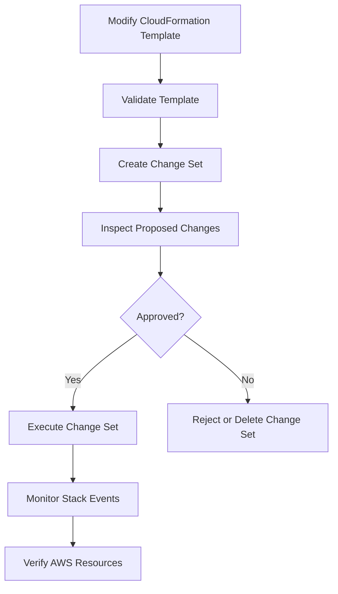
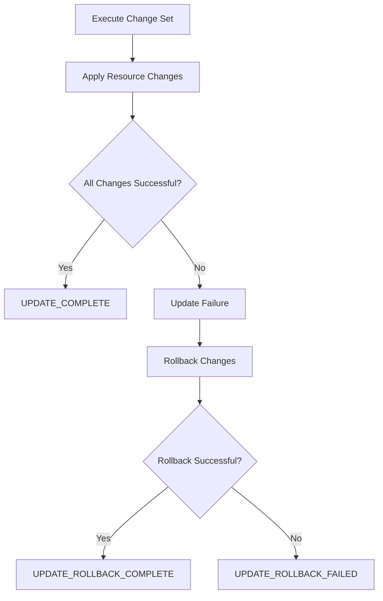
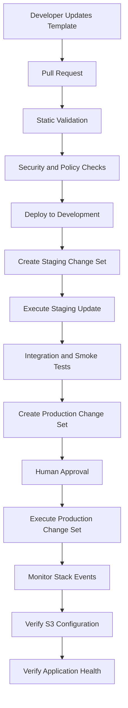

# 09- Change Sets and Stack Updates

## Overview

AWS CloudFormation change sets provide a controlled way to review infrastructure changes before applying them to an existing stack. They allow engineers to inspect proposed resource additions, modifications, removals, and replacements before execution.

For Amazon S3 deployments, this review is particularly important because buckets frequently contain persistent application data. An infrastructure update can affect encryption, versioning, lifecycle configuration, replication, access policies, and resource availability.

A production deployment should not treat successful template validation as proof that an update is safe. CloudFormation must also evaluate the proposed changes, execute them, and verify the resulting AWS resources.

This document covers:

- Change set creation, inspection, and execution.
- CloudFormation stack update behavior.
- Resource modification, replacement, and deletion.
- S3-specific update considerations.
- Rollback and failed deployment recovery.
- Drift detection and infrastructure reconciliation.
- Production deployment workflows and CI/CD integration.

## CloudFormation Stack Update Lifecycle

A CloudFormation stack represents AWS resources managed through a template. When the template changes, CloudFormation compares the proposed configuration with the existing stack and determines which resource operations are necessary.

A controlled update follows this workflow:



| Stage | Responsibility |
|---|---|
| Template modification | Define the desired infrastructure configuration. |
| Validation | Detect template syntax and static configuration problems. |
| Change set creation | Calculate the proposed resource changes. |
| Review | Inspect additions, modifications, removals, and replacement risks. |
| Approval | Authorize the proposed production changes. |
| Execution | Apply the approved changes. |
| Monitoring | Observe resource operations and stack events. |
| Verification | Confirm that deployed resources match the intended configuration. |

A change set is a deployment preview, not a guarantee that execution will succeed. Resource creation can still fail because of permissions, service quotas, resource conflicts, dependencies, or AWS service constraints.

## Understanding Change Sets

### What Is a Change Set?

A change set describes the modifications CloudFormation intends to perform when creating or updating a stack.

It identifies:

- Resources to add.
- Resources to modify.
- Resources to remove.
- Resources that may require replacement.
- Property-level changes where CloudFormation provides that information.

For example, an existing bucket might be defined as:

```yaml
Resources:
  ApplicationBucket:
    Type: AWS::S3::Bucket
    Properties:
      BucketName: company-app-data-production
      VersioningConfiguration:
        Status: Enabled
```

An updated template adds tags:

```yaml
Resources:
  ApplicationBucket:
    Type: AWS::S3::Bucket
    Properties:
      BucketName: company-app-data-production
      VersioningConfiguration:
        Status: Enabled
      Tags:
        - Key: Environment
          Value: production
        - Key: ManagedBy
          Value: CloudFormation
```

A change set allows the engineer to inspect the proposed modification before CloudFormation applies it.

### Why Change Sets Matter for S3

S3 infrastructure changes can have consequences beyond the immediate resource configuration.

| Change | Potential impact |
|---|---|
| Bucket name | May require resource replacement. |
| Versioning | Changes object-version behavior. |
| Encryption | Changes default encryption for future writes. |
| Lifecycle rules | Can transition or expire objects. |
| Replication | Changes cross-bucket data movement. |
| Bucket policy | Can affect application access. |
| Public access configuration | Can change exposure and access behavior. |
| Ownership controls | Can affect object ownership and ACL behavior. |
| Resource deletion | Can affect access to persistent data. |

A production change set should be reviewed for both infrastructure impact and application impact.

### Change Set Types

CloudFormation supports several change set types.

| Type | Purpose |
|---|---|
| `CREATE` | Preview creation of a new stack. |
| `UPDATE` | Preview modifications to an existing stack. |
| `IMPORT` | Preview importing existing resources into a stack. |

Routine S3 infrastructure updates normally use the `UPDATE` type.

## Creating a Change Set

### Prerequisites

Before creating a change set:

- Confirm the target AWS account and Region.
- Confirm that the target stack exists.
- Validate the updated template.
- Review deployment parameters.
- Verify deployment-role permissions.
- Identify required IAM capability acknowledgements.
- Check dependencies between S3 resources.
- Review resource retention and replacement behavior.

Check the active AWS identity:

```bash
aws sts get-caller-identity
```

Check the configured Region:

```bash
aws configure get region
```

Inspect the existing stack:

```bash
aws cloudformation describe-stacks \
  --stack-name application-s3-production
```

### Validate the Template

Run CloudFormation template validation:

```bash
aws cloudformation validate-template \
  --template-body file://s3.yaml
```

For additional static analysis, install and run `cfn-lint`:

```bash
pip install cfn-lint
```

```bash
cfn-lint s3.yaml
```

Template validation and linting identify many structural and configuration problems, but neither guarantees that AWS will successfully execute every resource operation.

### Create an Update Change Set

Assume the existing stack is:

```text
application-s3-production
```

The updated template is:

```text
s3.yaml
```

Create an update change set:

```bash
aws cloudformation create-change-set \
  --stack-name application-s3-production \
  --change-set-name add-production-tags \
  --change-set-type UPDATE \
  --template-body file://s3.yaml
```

If the template introduces IAM resources, acknowledge the appropriate capability.

```bash
aws cloudformation create-change-set \
  --stack-name application-s3-production \
  --change-set-name update-s3-infrastructure \
  --change-set-type UPDATE \
  --template-body file://s3.yaml \
  --capabilities CAPABILITY_IAM
```

Use `CAPABILITY_NAMED_IAM` when the template creates or modifies named IAM resources that require acknowledgement.

Capability acknowledgement is not a substitute for reviewing IAM changes. Inspect the proposed policies and trust relationships before execution.

### Create a Change Set Using Parameter Files

Separate environment configuration from infrastructure definitions.

Recommended structure:

```text
cloudformation/
├── templates/
│   └── s3.yaml
└── parameters/
    ├── dev.json
    ├── staging.json
    └── production.json
```

Create a production change set:

```bash
aws cloudformation create-change-set \
  --stack-name application-s3-production \
  --change-set-name production-s3-update \
  --change-set-type UPDATE \
  --template-body file://templates/s3.yaml \
  --parameters file://parameters/production.json
```

When a parameter should retain its existing value, use `UsePreviousValue=true`.

Example:

```json
[
  {
    "ParameterKey": "Environment",
    "UsePreviousValue": true
  },
  {
    "ParameterKey": "BucketName",
    "UsePreviousValue": true
  }
]
```

Do not use `UsePreviousValue` when a parameter is intentionally changing.

### Wait for Change Set Creation

Change set creation is asynchronous.

Wait for completion:

```bash
aws cloudformation wait change-set-create-complete \
  --stack-name application-s3-production \
  --change-set-name production-s3-update
```

Inspect the resulting status:

```bash
aws cloudformation describe-change-set \
  --stack-name application-s3-production \
  --change-set-name production-s3-update
```

If creation fails, inspect the status and reason:

```bash
aws cloudformation describe-change-set \
  --stack-name application-s3-production \
  --change-set-name production-s3-update \
  --query '{Status:Status,Reason:StatusReason}'
```

A change set can report that no updates are to be performed. This generally means that CloudFormation found no effective difference between the proposed configuration and the existing stack. It is not necessarily an infrastructure failure.

## Inspecting Change Set Output

The `describe-change-set` response provides details about proposed resource operations.

Important fields include:

| Field | Meaning |
|---|---|
| `ChangeSetName` | Change set identifier. |
| `Status` | Change set creation status. |
| `ExecutionStatus` | Whether execution is available, underway, or complete. |
| `Changes` | Proposed resource modifications. |
| `ResourceChange.Action` | Add, modify, or remove. |
| `ResourceChange.LogicalResourceId` | Logical resource identifier. |
| `ResourceChange.ResourceType` | AWS resource type. |
| `ResourceChange.Replacement` | Replacement behavior where available. |
| `ResourceChange.Details` | Property-level change information. |

### Resource Actions

| Action | Meaning | Example |
|---|---|---|
| `Add` | Create a resource | Add an IAM role. |
| `Modify` | Update an existing resource | Modify bucket tags. |
| `Remove` | Delete a resource | Remove an optional resource. |

Inspect the proposed resource actions:

```bash
aws cloudformation describe-change-set \
  --stack-name application-s3-production \
  --change-set-name production-s3-update \
  --query 'Changes[].ResourceChange.[Action,LogicalResourceId,ResourceType,Replacement]'
```

Illustrative output:

```json
[
  [
    "Modify",
    "ApplicationBucket",
    "AWS::S3::Bucket",
    "False"
  ],
  [
    "Add",
    "ReplicationRole",
    "AWS::IAM::Role",
    "False"
  ]
]
```

Actual output depends on the template and current stack configuration.

### Understanding Replacement Behavior

The `Replacement` field can indicate:

| Value | Meaning |
|---|---|
| `True` | The resource will be replaced. |
| `False` | The resource will be modified without replacement. |
| `Conditional` | Replacement depends on the actual update or service behavior. |

Replacement must be reviewed carefully because it can involve creating a new physical resource and handling the old one.

For S3 buckets, replacement is particularly sensitive because:

- Bucket names must satisfy S3 naming and uniqueness requirements.
- Existing buckets can contain persistent application data.
- The new bucket does not automatically inherit the old bucket's objects.
- Applications may continue referencing the old bucket.
- Dependencies and permissions may need to be updated.
- Deletion can fail when the old bucket is not empty.

Do not treat a replacement indicator as a routine configuration change.

## Executing a Change Set

After review and approval, execute the change set:

```bash
aws cloudformation execute-change-set \
  --stack-name application-s3-production \
  --change-set-name production-s3-update
```

Wait for the stack update to complete:

```bash
aws cloudformation wait stack-update-complete \
  --stack-name application-s3-production
```

Inspect the final stack status:

```bash
aws cloudformation describe-stacks \
  --stack-name application-s3-production \
  --query 'Stacks[0].StackStatus'
```

A successful update normally reaches:

```text
UPDATE_COMPLETE
```

### Monitor Stack Events

Stack events provide the execution history.

```bash
aws cloudformation describe-stack-events \
  --stack-name application-s3-production
```

For a focused view:

```bash
aws cloudformation describe-stack-events \
  --stack-name application-s3-production \
  --query 'StackEvents[].{Time:Timestamp,LogicalId:LogicalResourceId,Status:ResourceStatus,Reason:ResourceStatusReason}'
```

Use events to identify:

- The first resource operation that failed.
- Dependent resources that subsequently failed.
- Whether rollback started.
- Missing IAM permissions.
- AWS service configuration errors.
- Resource deletion or replacement problems.

The first meaningful failure is often more useful than the later rollback events.

## S3-Specific Stack Update Considerations

### Bucket Name Changes

Changing an explicitly configured bucket name generally requires replacement.

Before:

```yaml
Resources:
  ApplicationBucket:
    Type: AWS::S3::Bucket
    Properties:
      BucketName: company-app-data-production
```

After:

```yaml
Resources:
  ApplicationBucket:
    Type: AWS::S3::Bucket
    Properties:
      BucketName: company-app-data-production-v2
```

CloudFormation does not rename the existing bucket.

A replacement may fail because:

- The new bucket name is already in use.
- The old bucket contains objects.
- Resource dependencies prevent deletion.
- The replacement conflicts with application references.
- The old bucket is retained or protected.

For production, treat bucket migration as a separate data migration operation.

A controlled migration typically involves:

1. Provisioning the destination bucket.
2. Applying equivalent security and lifecycle configuration.
3. Copying or replicating required objects.
4. Validating object counts, metadata, and integrity.
5. Updating application configuration.
6. Switching application traffic.
7. Monitoring the new bucket.
8. Retaining the old bucket until migration acceptance.

### Versioning Updates

Versioning configuration affects object-write behavior.

Example:

```yaml
VersioningConfiguration:
  Status: Enabled
```

Suspending versioning does not delete existing object versions. It changes how subsequent writes are handled.

For a suspended bucket, new writes use null-version behavior rather than creating new version IDs in the same way as an enabled bucket.

Review application recovery and retention requirements before changing versioning configuration.

### Encryption Updates

Changing the default bucket encryption configuration affects future object writes.

It does not automatically re-encrypt existing objects.

Existing objects may require a separate copy or migration operation.

For SSE-KMS, verify:

- The key exists in the correct Region.
- The key is enabled.
- The relevant IAM permissions exist.
- The KMS key policy authorizes the required principals.
- Application and replication workflows remain authorized.

### Lifecycle Configuration Updates

Lifecycle changes can make large numbers of objects eligible for transition or expiration.

Before executing a lifecycle update:

- Review affected prefixes and tags.
- Check current and noncurrent version behavior.
- Confirm data-retention requirements.
- Evaluate transition eligibility.
- Estimate storage and retrieval cost implications.
- Check for overlapping or conflicting rules.

In versioned buckets, current-version expiration generally creates a delete marker rather than permanently removing all historical versions.

### Replication Configuration Updates

Replication changes affect how new objects and versions are replicated.

Review:

- Source and destination bucket versioning.
- Replication role permissions.
- Destination bucket policy.
- KMS permissions.
- Existing replication rules.
- Destination ownership behavior.
- Replication metrics and failure recovery.

Updating a replication rule does not automatically replicate every previously existing object. Use S3 Batch Replication where appropriate.

Detailed replication configuration and permission requirements belong in the dedicated replication documentation.

## Resource Retention and Replacement Policies

### UpdateReplacePolicy

`UpdateReplacePolicy` controls what CloudFormation does with the existing physical resource when an update requires replacement.

Supported behaviors include:

- `Delete`
- `Retain`
- `Snapshot`, where supported by the resource type

Example:

```yaml
Resources:
  ApplicationBucket:
    Type: AWS::S3::Bucket

    DeletionPolicy: Retain
    UpdateReplacePolicy: Retain

    Properties:
      BucketName: company-app-data-production
```

This protects the old bucket from automatic deletion when it is replaced or the stack is deleted.

However, retention does not migrate data or redirect application traffic. It also does not prevent lifecycle policies or authorized principals from deleting objects.

### DeletionPolicy

`DeletionPolicy` controls what happens when a resource is removed from a stack or the stack itself is deleted.

Example:

```yaml
Resources:
  ApplicationBucket:
    Type: AWS::S3::Bucket
    DeletionPolicy: Retain
```

This is useful for data-bearing resources that should outlive their CloudFormation stack.

### Policy Comparison

| Policy | Trigger | Purpose |
|---|---|---|
| `DeletionPolicy` | Stack deletion or resource removal from template | Controls handling of the resource |
| `UpdateReplacePolicy` | Resource replacement during update | Controls handling of the old physical resource |

For critical buckets, also consider:

- S3 Versioning.
- S3 Object Lock where retention requirements justify it.
- Independent backup and recovery architecture.
- Restricted permissions for destructive operations.
- Explicit data migration and decommissioning procedures.

## Stack Update Failures and Rollback

### How Rollback Works

CloudFormation attempts to roll back a failed stack update to the previous stable state.



A successful rollback normally reaches:

```text
UPDATE_ROLLBACK_COMPLETE
```

If rollback itself fails, the stack reaches:

```text
UPDATE_ROLLBACK_FAILED
```

This state requires investigation and corrective action before normal updates can continue.

### Common Causes of Update Failure

| Cause | Example | Investigation |
|---|---|---|
| IAM permissions | Deployment role cannot modify a resource | Inspect failed resource events and IAM authorization |
| Resource conflict | Bucket name already exists | Check physical resource identifiers |
| Invalid configuration | Unsupported property combination | Inspect service error and template |
| Dependency failure | Replication role is unavailable | Review resource dependencies |
| Resource deletion failure | S3 bucket is not empty | Inspect deletion event and bucket contents |
| Quota or service restriction | Resource creation exceeds a limit | Check service quotas and Region availability |
| KMS authorization | Key policy denies access | Inspect KMS policy and CloudTrail |

### Diagnose a Failed Update

Inspect stack status:

```bash
aws cloudformation describe-stacks \
  --stack-name application-s3-production \
  --query 'Stacks[0].StackStatus'
```

Inspect recent events:

```bash
aws cloudformation describe-stack-events \
  --stack-name application-s3-production
```

Filter failed events:

```bash
aws cloudformation describe-stack-events \
  --stack-name application-s3-production \
  --query 'StackEvents[?contains(ResourceStatus, `FAILED`)].{Resource:LogicalResourceId,Status:ResourceStatus,Reason:ResourceStatusReason}'
```

Identify the first meaningful failure and determine whether subsequent failures are consequences of rollback.

### Recovering from UPDATE_ROLLBACK_FAILED

When rollback fails, CloudFormation may require the affected resources to be repaired before rollback can continue.

Common causes include:

- A resource was manually modified outside CloudFormation.
- A resource was manually deleted.
- A resource cannot be deleted because it contains data.
- An IAM permission was revoked.
- A dependent resource is unavailable.
- A service configuration prevents the rollback operation.

After correcting the underlying issue, continue rollback:

```bash
aws cloudformation continue-update-rollback \
  --stack-name application-s3-production
```

Wait for completion:

```bash
aws cloudformation wait stack-update-complete \
  --stack-name application-s3-production
```

Inspect the resulting status:

```bash
aws cloudformation describe-stacks \
  --stack-name application-s3-production \
  --query 'Stacks[0].StackStatus'
```

If rollback fails again, inspect the new events and identify the remaining blocker.

Do not repeatedly issue rollback commands without resolving the underlying resource failure.

### Skipping Resources During Rollback

CloudFormation supports `--resources-to-skip` with `continue-update-rollback`.

Example:

```bash
aws cloudformation continue-update-rollback \
  --stack-name application-s3-production \
  --resources-to-skip ApplicationBucket
```

This is a recovery mechanism, not a routine deployment technique.

Skipping a resource can leave its physical configuration inconsistent with the template.

After recovery:

1. Inspect the skipped resource.
2. Determine its actual configuration.
3. Compare it with the intended template.
4. Reconcile the resource through a controlled update or import process where appropriate.
5. Verify that the stack and physical resource are consistent.

Do not skip an S3 bucket simply to force rollback completion without understanding its data and configuration state.

## Stack Update Rollback Configuration

CloudFormation supports rollback triggers that monitor specified CloudWatch alarms during a deployment monitoring period.

If a monitored alarm enters the `ALARM` state during the configured period, CloudFormation can initiate rollback.

This is useful when infrastructure changes need application-level health signals.

For an S3-backed application, relevant alarms may monitor:

- API error rate.
- Application health-check failures.
- Lambda processing errors.
- Queue backlog.
- Critical service availability metrics.

The alarms must represent meaningful failure signals and be configured correctly.

CloudFormation rollback does not reverse every external side effect. It does not automatically restore deleted application data, undo arbitrary API operations, or reverse changes performed outside the stack.

## Stack Update Protection

### Stack Policies

A stack policy protects selected resources from specified CloudFormation update operations.

For example, a production S3 bucket can be protected against updates that require replacement.

Illustrative stack policy:

```json
{
  "Statement": [
    {
      "Effect": "Allow",
      "Action": "Update:*",
      "Principal": "*",
      "Resource": "*"
    },
    {
      "Effect": "Deny",
      "Action": "Update:Replace",
      "Principal": "*",
      "Resource": "LogicalResourceId/ApplicationBucket"
    }
  ]
}
```

Apply the policy:

```bash
aws cloudformation set-stack-policy \
  --stack-name application-s3-production \
  --stack-policy-body file://stack-policy.json
```

A stack policy is a CloudFormation update guardrail. It is not an IAM policy and does not replace access control.

It also does not prevent direct modification of an S3 bucket through other AWS APIs.

Review the policy when legitimate replacement or migration is required.

### Temporarily Override a Stack Policy

CloudFormation supports specifying a temporary stack policy during an update.

Use this capability only when a controlled operation requires an otherwise restricted change.

Do not permanently remove production protections simply to simplify deployments.

## Drift Detection and Stack Reconciliation

### What Is Drift?

Drift occurs when the actual AWS resource configuration differs from the configuration expected by CloudFormation.

For example, the template defines:

```yaml
PublicAccessBlockConfiguration:
  BlockPublicAcls: true
  BlockPublicPolicy: true
  IgnorePublicAcls: true
  RestrictPublicBuckets: true
```

An operator manually changes the bucket's public access configuration through the AWS CLI.

The physical bucket configuration may now differ from the template.

This is configuration drift.

### Detect Drift

Start drift detection:

```bash
aws cloudformation detect-stack-drift \
  --stack-name application-s3-production
```

The command returns a drift detection identifier.

Inspect its status:

```bash
aws cloudformation describe-stack-drift-detection-status \
  --stack-drift-detection-id <drift-detection-id>
```

Inspect resource drift:

```bash
aws cloudformation describe-stack-resource-drifts \
  --stack-name application-s3-production
```

Drift detection supports only resource types and properties for which CloudFormation can perform drift detection.

An `IN_SYNC` result does not prove that every AWS setting or application behavior matches the intended architecture.

### Remediate Drift

When drift is detected:

1. Identify the affected logical resource.
2. Compare the template with the actual configuration.
3. Determine whether the manual change was intentional.
4. Update the template if the new configuration is desired.
5. Otherwise, restore the resource to the declared configuration through a controlled process.
6. Run drift detection again.

Avoid treating manual resource modifications as a permanent alternative to CloudFormation.

The template should remain the authoritative infrastructure definition.

## Production Deployment Workflow

A production deployment should separate validation, review, approval, execution, and verification.



### Pre-Deployment Checklist

Before creating a production change set:

- [ ] Confirm the AWS account and Region.
- [ ] Validate the CloudFormation template.
- [ ] Run `cfn-lint`.
- [ ] Review parameter values.
- [ ] Check IAM permissions and capability acknowledgements.
- [ ] Review resource additions, modifications, replacements, and removals.
- [ ] Check S3 bucket retention and replacement policies.
- [ ] Verify encryption and KMS dependencies.
- [ ] Review lifecycle and replication changes.
- [ ] Confirm backup and recovery readiness.
- [ ] Check whether external systems depend on modified resources.

### Post-Deployment Verification

After execution:

- [ ] Confirm stack status is `UPDATE_COMPLETE`.
- [ ] Inspect CloudFormation stack events.
- [ ] Verify bucket existence and Region.
- [ ] Verify versioning configuration.
- [ ] Verify default encryption.
- [ ] Verify public access block settings.
- [ ] Verify bucket ownership controls.
- [ ] Verify lifecycle configuration.
- [ ] Verify replication configuration where applicable.
- [ ] Test application access.
- [ ] Confirm relevant CloudWatch alarms remain healthy.
- [ ] Check for unexpected drift.

## CI/CD Automation for Change Sets

Change sets can be integrated into GitHub Actions or another CI/CD platform.

A typical pipeline separates pull-request validation from deployment.

| Pipeline stage | Responsibility |
|---|---|
| Pull request | Validate templates and inspect proposed changes |
| Development | Deploy to a development stack |
| Staging | Create and execute a staging change set |
| Production preview | Create a production change set |
| Approval | Require explicit production approval |
| Production deployment | Execute the approved change set |
| Verification | Check stack state and deployed resources |

### Example GitHub Actions Workflow

The following example validates a template and creates a production change set.

It assumes:

- GitHub Actions is configured with AWS IAM OIDC federation.
- The deployment role ARN is supplied through GitHub environment configuration.
- The target CloudFormation stack already exists.
- The production parameter file is committed to the repository.
- The production environment has required approval protection.

File: `.github/workflows/deploy-s3-cloudformation.yml`

```yaml
name: Deploy S3 CloudFormation

on:
  workflow_dispatch:

permissions:
  contents: read
  id-token: write

jobs:
  validate:
    runs-on: ubuntu-latest

    steps:
      - name: Checkout repository
        uses: actions/checkout@v4

      - name: Set up Python
        uses: actions/setup-python@v5
        with:
          python-version: "3.12"

      - name: Install cfn-lint
        run: pip install cfn-lint

      - name: Validate template
        run: cfn-lint cloudformation/s3.yaml

  deploy:
    needs: validate
    runs-on: ubuntu-latest

    environment: production

    steps:
      - name: Checkout repository
        uses: actions/checkout@v4

      - name: Configure AWS credentials
        uses: aws-actions/configure-aws-credentials@v4
        with:
          role-to-assume: ${{ vars.AWS_DEPLOYMENT_ROLE_ARN }}
          aws-region: ${{ vars.AWS_REGION }}

      - name: Verify AWS identity
        run: aws sts get-caller-identity

      - name: Create change set
        run: |
          aws cloudformation create-change-set \
            --stack-name application-s3-production \
            --change-set-name "github-${GITHUB_RUN_ID}-${GITHUB_RUN_ATTEMPT}" \
            --change-set-type UPDATE \
            --template-body file://cloudformation/s3.yaml \
            --parameters file://cloudformation/parameters/production.json

      - name: Wait for change set
        run: |
          aws cloudformation wait change-set-create-complete \
            --stack-name application-s3-production \
            --change-set-name "github-${GITHUB_RUN_ID}-${GITHUB_RUN_ATTEMPT}"

      - name: Review change set
        run: |
          aws cloudformation describe-change-set \
            --stack-name application-s3-production \
            --change-set-name "github-${GITHUB_RUN_ID}-${GITHUB_RUN_ATTEMPT}"
```

This workflow intentionally stops after creating and displaying the change set. A separate approved execution step should execute the reviewed change set.

The review output must be made available to the authorized reviewer. A production environment approval gate alone does not guarantee that the reviewer has inspected the actual resource changes.

For a subsequent execution step, use the exact approved change set name:

```bash
aws cloudformation execute-change-set \
  --stack-name application-s3-production \
  --change-set-name <approved-change-set-name>
```

Wait for completion:

```bash
aws cloudformation wait stack-update-complete \
  --stack-name application-s3-production
```

Handle the no-change case explicitly in deployment automation. CloudFormation can report that no updates are to be performed, causing the change set creation waiter to fail.

### CI/CD Security Considerations

Use IAM OIDC federation instead of long-lived AWS access keys.

The deployment role should have only the permissions required to:

- Create and inspect approved change sets.
- Execute change sets.
- Describe stack status and events.
- Pass explicitly authorized IAM roles when required.
- Perform the necessary resource operations through CloudFormation.

Restrict the OIDC trust policy to the intended GitHub organization, repository, branch, or deployment environment.

Do not allow untrusted pull-request workflows to assume a production deployment role.

## Operational Considerations

### Change Set Lifecycle Management

Change sets remain associated with CloudFormation stack metadata until deleted or otherwise removed by the service.

List change sets:

```bash
aws cloudformation list-change-sets \
  --stack-name application-s3-production
```

Delete an obsolete change set:

```bash
aws cloudformation delete-change-set \
  --stack-name application-s3-production \
  --change-set-name old-production-update
```

Delete only change sets that are no longer required for review or execution.

### Concurrent Stack Updates

CloudFormation does not allow arbitrary concurrent updates to the same stack.

Coordinate deployment pipelines to avoid overlapping operations.

Recommended controls:

- Serialize deployments targeting the same stack.
- Prevent a second deployment from assuming the first has completed.
- Use CI/CD concurrency controls.
- Separate environments and stacks where independent deployment lifecycles are required.
- Record the template version associated with each deployment.

This is especially important when multiple teams maintain shared S3 infrastructure.

### Change Auditing

Maintain an auditable record of:

- Template version or commit identifier.
- Change set name.
- Target AWS account and Region.
- Deployment parameters.
- Reviewer or approver.
- Execution time.
- Final stack status.
- Verification results.

CloudTrail provides an API-level audit trail for CloudFormation and related AWS service operations.

Use deployment logs and CloudFormation events alongside CloudTrail when investigating infrastructure changes.

### Cost and Availability

Change sets are a planning mechanism, but the resources created or modified by an update can incur costs.

Evaluate:

- Additional S3 storage during bucket migration.
- Replication data transfer.
- KMS request charges.
- CloudFront distribution changes.
- Temporary duplicate infrastructure.
- Lambda or event-processing activity.
- Backup and retention costs.

For production updates, consider both infrastructure cost and possible service interruption.

## Common Mistakes and Pitfalls

### Executing Without Reviewing the Change Set

Creating a change set does not make a deployment safe by itself.

**Why it happens:** Teams automate execution immediately after creation and treat the preview as approval.

**Avoidance:** Review resource actions, replacement indicators, IAM changes, and S3 data-retention implications before execution.

### Assuming Replacement Is Harmless

A replacement can create a new physical resource and affect the old one.

**Why it happens:** Engineers focus on the logical resource name rather than the physical resource and its data.

**Avoidance:** Inspect replacement behavior and define explicit retention and migration procedures for production buckets.

### Assuming Rollback Restores All Data

CloudFormation rollback restores supported infrastructure state. It does not guarantee restoration of deleted object data or reversal of external application side effects.

**Why it happens:** Infrastructure rollback is confused with application data recovery.

**Avoidance:** Maintain independent backup, versioning, retention, and recovery mechanisms.

### Treating UPDATE_ROLLBACK_FAILED as a Template Syntax Problem

A rollback failure may be caused by a physical resource that cannot be restored or deleted.

**Why it happens:** Engineers repeatedly modify templates without investigating the failed resource operation.

**Avoidance:** Inspect stack events, identify the first failing resource, and repair the underlying AWS resource condition before continuing rollback.

### Using Resource Skipping as a Routine Fix

Skipping resources can leave the stack and actual infrastructure inconsistent.

**Why it happens:** Engineers prioritize reaching a stable stack status over infrastructure consistency.

**Avoidance:** Use skipped-resource recovery only when necessary, then reconcile the resource with the intended template.

### Ignoring S3 Bucket Retention

A stack deletion or replacement can have consequences for persistent data.

**Why it happens:** Infrastructure templates are treated as disposable even when they manage production data.

**Avoidance:** Use appropriate deletion and update-replacement policies, and maintain independent data recovery controls.

### Assuming Drift Detection Covers Everything

Drift detection does not support every resource type and property.

**Why it happens:** An `IN_SYNC` result is interpreted as proof that the entire AWS environment matches the template.

**Avoidance:** Combine drift detection with AWS API checks, security validation, monitoring, and application-level tests.

### Deploying Concurrent Updates to the Same Stack

Overlapping pipelines can cause deployment failures or unexpected sequencing.

**Why it happens:** CI/CD systems run independent jobs without coordinating stack-level changes.

**Avoidance:** Serialize deployments and use environment-specific concurrency controls.

## Key Takeaways

- Change sets preview CloudFormation resource additions, modifications, removals, and potential replacements before execution.
- S3 bucket updates require particular care because replacement, deletion, lifecycle changes, and encryption updates can affect persistent application data.
- CloudFormation rollback restores supported infrastructure state but does not replace object backups or reverse every external side effect.
- Diagnose failed updates through stack events and repair the underlying resource problem before continuing rollback.
- Production deployments should combine change set review, approval gates, drift detection, deployment auditing, and post-update verification.