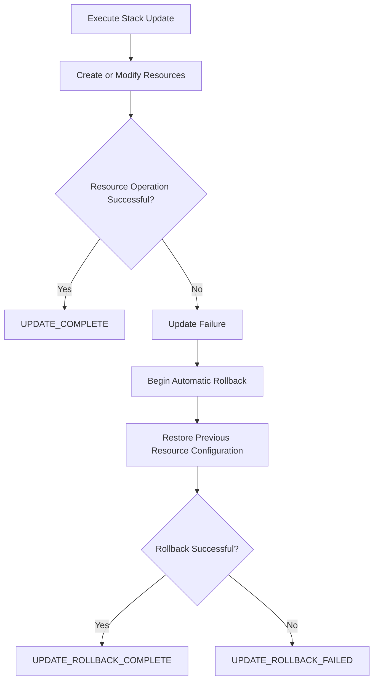
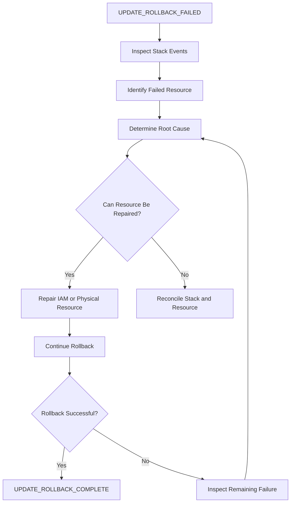
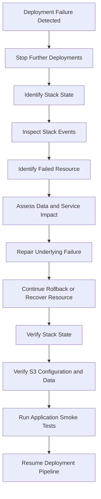

# 10- Stack Rollback and Failure Recovery

## Overview

AWS CloudFormation provides rollback mechanisms to restore a stack after an unsuccessful infrastructure deployment. These mechanisms are essential for production environments where infrastructure changes can affect application availability, data access, security controls, and persistent resources.

For Amazon S3 deployments, failure recovery requires additional care because CloudFormation manages infrastructure configuration, not the complete lifecycle of stored object data.

A failed update may involve:

- A bucket configuration that cannot be applied.
- An IAM role or policy that fails to deploy.
- A KMS permission or key dependency problem.
- A replication configuration failure.
- A resource replacement that cannot complete.
- A bucket deletion blocked by existing objects.
- A rollback operation that cannot restore the previous configuration.

A reliable recovery process must distinguish between infrastructure rollback, resource reconciliation, and application data recovery.

This document covers:

- CloudFormation rollback behavior and stack states.
- Automatic and manual failure recovery.
- `UPDATE_ROLLBACK_FAILED` and `ROLLBACK_FAILED` diagnosis.
- Resource skipping and reconciliation.
- S3-specific recovery scenarios.
- Stack protection and data retention.
- Drift detection and post-recovery verification.
- Production recovery procedures and operational safeguards.

## CloudFormation Stack States

CloudFormation uses stack states to indicate the progress and outcome of deployment operations.

Understanding these states is necessary before attempting recovery.

### Important Stack States

| Stack status | Meaning | Operational response |
|---|---|---|
| `CREATE_IN_PROGRESS` | Initial stack creation is running. | Monitor resource events. |
| `CREATE_COMPLETE` | Stack creation succeeded. | Verify deployed resources. |
| `CREATE_FAILED` | Stack creation failed. | Inspect failed resources and rollback behavior. |
| `ROLLBACK_IN_PROGRESS` | CloudFormation is reversing a failed creation. | Monitor rollback events. |
| `ROLLBACK_COMPLETE` | Failed creation was rolled back successfully. | Correct the cause before retrying. |
| `ROLLBACK_FAILED` | Creation rollback could not complete. | Diagnose and repair the failed resource. |
| `UPDATE_IN_PROGRESS` | Stack update is running. | Monitor resource operations. |
| `UPDATE_COMPLETE` | Stack update succeeded. | Perform post-deployment verification. |
| `UPDATE_FAILED` | Stack update failed. | Inspect failure and rollback behavior. |
| `UPDATE_ROLLBACK_IN_PROGRESS` | CloudFormation is reverting a failed update. | Monitor rollback events. |
| `UPDATE_ROLLBACK_COMPLETE` | Update rollback succeeded. | Verify the restored infrastructure. |
| `UPDATE_ROLLBACK_FAILED` | Update rollback could not complete. | Repair the underlying problem and continue rollback. |
| `UPDATE_COMPLETE_CLEANUP_IN_PROGRESS` | CloudFormation is cleaning up replaced resources after an update. | Monitor cleanup operations. |
| `UPDATE_ROLLBACK_COMPLETE_CLEANUP_IN_PROGRESS` | CloudFormation is cleaning up after rollback. | Monitor until a stable state is reached. |
| `DELETE_IN_PROGRESS` | Stack deletion is running. | Monitor resource deletion. |
| `DELETE_FAILED` | Stack deletion failed. | Inspect resources that could not be deleted. |
| `DELETE_COMPLETE` | Stack deletion succeeded. | Confirm retained resources separately. |

Not every state is recoverable through the same operation. The correct recovery command depends on the current stack status and the operation that failed.

## How CloudFormation Rollback Works

### Automatic Rollback

CloudFormation normally attempts to roll back a failed stack creation or update when rollback is enabled.

For an update, the process is:

1. CloudFormation begins applying resource changes.
2. A resource operation fails.
3. CloudFormation stops or adjusts the remaining deployment operations.
4. CloudFormation attempts to restore the previous stack configuration.
5. CloudFormation records the final rollback status.



Automatic rollback is useful because it reduces the need for manual intervention after an unsuccessful deployment.

However, rollback is not guaranteed to succeed. A resource may no longer be in a state that allows CloudFormation to restore its previous configuration.

### What Rollback Does Not Guarantee

CloudFormation rollback does not provide a transactional rollback of an entire application environment.

It does not necessarily:

- Restore deleted S3 object data.
- Reverse application writes performed during deployment.
- Undo external API operations.
- Restore manually deleted resources.
- Reverse changes made outside CloudFormation.
- Restore every service-side effect.
- Recover data encrypted with a permanently deleted KMS key.

For example, if an S3 lifecycle rule expires objects while a deployment is running, rolling back the CloudFormation template does not restore those objects.

Infrastructure rollback and data recovery must therefore be designed separately.

## Diagnosing a Failed Stack

The first recovery action should be diagnosis, not another deployment attempt.

### Inspect the Stack Status

```bash
aws cloudformation describe-stacks \
  --stack-name application-s3-production \
  --query 'Stacks[0].{Status:StackStatus,Reason:StackStatusReason}'
```

This identifies the current stack state and the stack-level failure reason.

### Inspect Recent Stack Events

```bash
aws cloudformation describe-stack-events \
  --stack-name application-s3-production
```

For a more focused view:

```bash
aws cloudformation describe-stack-events \
  --stack-name application-s3-production \
  --query 'StackEvents[].{Time:Timestamp,Resource:LogicalResourceId,Type:ResourceType,Status:ResourceStatus,Reason:ResourceStatusReason}'
```

Inspect failed events:

```bash
aws cloudformation describe-stack-events \
  --stack-name application-s3-production \
  --query 'StackEvents[?contains(ResourceStatus, `FAILED`)].{Resource:LogicalResourceId,Status:ResourceStatus,Reason:ResourceStatusReason}'
```

### Identify the First Meaningful Failure

A failed deployment can generate several failure events.

For example:

```text
ApplicationBucket     UPDATE_FAILED
ReplicationRole       UPDATE_FAILED
ReplicationConfig     UPDATE_FAILED
```

These failures may not be independent.

The replication configuration might have failed because its IAM role was unavailable. The role might have failed because an IAM permission or dependency was invalid.

Start with the earliest meaningful resource failure and trace subsequent failures through resource dependencies.

### Common Failure Categories

| Failure category | Example | Diagnostic focus |
|---|---|---|
| IAM authorization | Deployment role lacks permission | IAM policy and CloudTrail |
| S3 resource conflict | Bucket name already exists | Bucket name and account/Region |
| Resource deletion | Bucket is not empty | Object versions and delete markers |
| KMS authorization | Key policy denies an operation | IAM and KMS key policy |
| Dependency failure | Replication references an unavailable role | Resource dependencies |
| Invalid configuration | Unsupported property combination | CloudFormation event reason |
| Service quota | Resource creation exceeds a limit | AWS Service Quotas |
| Manual modification | Resource differs from stack configuration | Drift detection and service APIs |

## Recovering from UPDATE_ROLLBACK_FAILED

### What Causes UPDATE_ROLLBACK_FAILED?

`UPDATE_ROLLBACK_FAILED` means CloudFormation attempted to restore the previous stack configuration but could not complete the rollback.

Common causes include:

- A resource was manually deleted.
- A resource was modified outside CloudFormation.
- A resource cannot be deleted or restored.
- An IAM permission required for rollback is missing.
- A resource dependency is unavailable.
- A service configuration prevents the rollback operation.
- A physical resource has entered an incompatible state.

At this point, normal stack updates cannot proceed until the stack is recovered.

### Recovery Workflow



### Step One: Inspect the Failed Resource

Check the stack status:

```bash
aws cloudformation describe-stacks \
  --stack-name application-s3-production
```

Inspect stack events:

```bash
aws cloudformation describe-stack-events \
  --stack-name application-s3-production
```

Identify the logical resource that prevented rollback.

### Step Two: Inspect the Physical Resource

Retrieve the physical resource identifier:

```bash
aws cloudformation describe-stack-resource \
  --stack-name application-s3-production \
  --logical-resource-id ApplicationBucket
```

For an S3 bucket, inspect its actual configuration:

```bash
aws s3api head-bucket \
  --bucket company-app-data-production
```

```bash
aws s3api get-bucket-versioning \
  --bucket company-app-data-production
```

```bash
aws s3api get-bucket-encryption \
  --bucket company-app-data-production
```

```bash
aws s3api get-public-access-block \
  --bucket company-app-data-production
```

Not every bucket has an explicitly configured public access block or encryption configuration. Interpret `NoSuchPublicAccessBlockConfiguration` and similar responses in the context of the intended configuration.

### Step Three: Correct the Underlying Problem

Examples:

| Root cause | Corrective action |
|---|---|
| Missing IAM permission | Restore the required deployment-role permission. |
| Bucket deletion blocked | Inspect bucket contents and retention requirements. |
| KMS key disabled | Restore the key if policy and organizational controls permit. |
| Manually deleted resource | Determine whether it can be safely recreated or imported. |
| Invalid physical configuration | Restore a valid configuration using the appropriate AWS API. |
| Dependency unavailable | Restore the dependency or correct the resource relationship. |

Do not make unrelated changes during recovery. Keep the operation focused on restoring a valid stack state.

### Step Four: Continue Rollback

After correcting the underlying problem:

```bash
aws cloudformation continue-update-rollback \
  --stack-name application-s3-production
```

Monitor stack events:

```bash
aws cloudformation describe-stack-events \
  --stack-name application-s3-production
```

Check the final status:

```bash
aws cloudformation describe-stacks \
  --stack-name application-s3-production \
  --query 'Stacks[0].StackStatus'
```

The expected successful recovery state is:

```text
UPDATE_ROLLBACK_COMPLETE
```

Do not assume the command's successful API response means the rollback itself has completed. Verify the final stack status.

## Skipping Resources During Rollback

### Purpose of Resource Skipping

CloudFormation supports skipping resources when continuing a failed update rollback.

This is intended for situations where a specific resource prevents rollback from completing and cannot be repaired immediately.

Example:

```bash
aws cloudformation continue-update-rollback \
  --stack-name application-s3-production \
  --resources-to-skip ApplicationBucket
```

The resource identifier is the CloudFormation logical resource ID.

For a nested stack resource, the identifier can include the nested stack and its resource path as required by CloudFormation.

### Risks of Skipping Resources

Skipping a resource does not repair it.

It can leave the physical resource inconsistent with the configuration expected by CloudFormation.

For example:

- The template expects versioning to be enabled.
- The physical bucket has versioning suspended.
- The resource is skipped during rollback.
- CloudFormation completes rollback while the bucket remains in the unexpected configuration.

This creates infrastructure drift and can affect application behavior.

### When to Use Resource Skipping

Consider it only when:

- The stack is blocked in `UPDATE_ROLLBACK_FAILED`.
- The failed resource has been identified.
- The impact of skipping is understood.
- A controlled reconciliation plan exists.
- The recovery is approved by the appropriate infrastructure owner.

Avoid skipping data-bearing S3 resources merely to make the stack status appear healthy.

### Reconciliation After Resource Skipping

After the stack reaches a stable status:

1. Inspect the skipped resource's physical configuration.
2. Compare it with the CloudFormation template.
3. Identify configuration and dependency differences.
4. Determine whether the resource should be modified, imported, or replaced.
5. Apply a controlled reconciliation update.
6. Run drift detection.
7. Verify application access and data integrity.

## Recovering from Failed Stack Creation

### CREATE_FAILED and ROLLBACK_COMPLETE

When initial stack creation fails, CloudFormation normally attempts to remove resources created during the failed operation.

A successful rollback reaches:

```text
ROLLBACK_COMPLETE
```

The failed stack remains recorded and may need to be deleted before another stack with the same name can be created.

Inspect the failure:

```bash
aws cloudformation describe-stack-events \
  --stack-name application-s3-production
```

If the stack is in `ROLLBACK_COMPLETE`, delete the failed stack:

```bash
aws cloudformation delete-stack \
  --stack-name application-s3-production
```

Wait for deletion:

```bash
aws cloudformation wait stack-delete-complete \
  --stack-name application-s3-production
```

Before retrying:

- Correct the original template or permission problem.
- Inspect resources retained by policies.
- Check whether manually created resources remain.
- Confirm bucket names are available.
- Verify that no existing data will be overwritten or deleted.

### ROLLBACK_FAILED

If creation rollback itself fails, inspect the resource preventing cleanup.

For example, a bucket created during stack creation may contain objects and therefore cannot be deleted automatically.

Repair the underlying issue where appropriate, then use the supported stack recovery or deletion procedure for its current state.

Do not assume that deleting the CloudFormation stack automatically removes retained resources.

## S3-Specific Failure Recovery

### Bucket Deletion Failure

A common CloudFormation deletion failure occurs when a bucket contains objects.

S3 buckets cannot be deleted while they contain objects or object versions.

A versioned bucket can contain:

- Current object versions.
- Noncurrent object versions.
- Delete markers.
- Objects created by replication.
- Incomplete multipart uploads.

A simple recursive delete does not necessarily remove all historical versions.

Inspect bucket versioning:

```bash
aws s3api get-bucket-versioning \
  --bucket company-app-data-production
```

List object versions and delete markers:

```bash
aws s3api list-object-versions \
  --bucket company-app-data-production
```

For production buckets, do not delete versions simply to make CloudFormation deletion succeed.

First establish:

- Whether the data is required.
- Whether retention policies apply.
- Whether a backup exists.
- Whether another application depends on the bucket.
- Whether the bucket is intentionally retained.

For disposable test environments, use a dedicated cleanup procedure that explicitly handles versions and delete markers.

### Bucket Replacement Failure

A bucket replacement may fail because the new physical resource cannot be created or the old bucket cannot be deleted.

Possible causes:

- The destination bucket name is already in use.
- The old bucket contains data.
- A retention policy prevents deletion.
- Other resources still depend on the bucket.
- A bucket policy or permission prevents cleanup.

For production systems, prefer a controlled bucket migration over attempting to force replacement through CloudFormation.

A migration should provision the destination, copy or replicate data, verify integrity, switch application configuration, and retain the original until acceptance.

### KMS Dependency Failure

S3 operations involving SSE-KMS depend on both S3 authorization and KMS authorization.

A rollback may fail when:

- A KMS key is disabled.
- The key policy no longer authorizes the deployment principal.
- The deployment role lacks required KMS permissions.
- A key dependency was removed or modified.
- A key scheduled for deletion is no longer usable.

Inspect key metadata:

```bash
aws kms describe-key \
  --key-id <kms-key-arn>
```

Inspect the key policy:

```bash
aws kms get-key-policy \
  --key-id <kms-key-arn> \
  --policy-name default
```

Do not delete or replace a KMS key simply to unblock stack rollback. Existing encrypted objects may become inaccessible if their encryption key is permanently unavailable.

### Replication Dependency Failure

Replication infrastructure can involve multiple resources:

- Source bucket.
- Destination bucket.
- Replication IAM role.
- IAM permissions.
- Destination bucket policy.
- KMS keys.
- Replication configuration.

A rollback can fail if one of these dependencies has been removed or modified.

Inspect the replication configuration:

```bash
aws s3api get-bucket-replication \
  --bucket company-app-data-production
```

Inspect the replication role:

```bash
aws iam get-role \
  --role-name s3-replication-role
```

Inspect its attached policies and trust relationship before changing permissions.

For cross-account replication, verify both the source-side role permissions and destination-side resource policy.

Do not assume that restoring the CloudFormation stack configuration automatically repairs objects that were not replicated successfully.

### Lifecycle Configuration Failure

A lifecycle configuration update may be valid at the template level but have unexpected operational effects.

During recovery, inspect the actual lifecycle rules:

```bash
aws s3api get-bucket-lifecycle-configuration \
  --bucket company-app-data-production
```

Verify:

- Rule status.
- Prefix and tag filters.
- Current-version expiration.
- Noncurrent-version expiration.
- Storage-class transitions.
- Incomplete multipart upload cleanup.
- Retention requirements.

Restoring the previous lifecycle configuration does not recover objects already expired or transitioned.

### Notification Configuration Failure

S3 event notification configuration can depend on Lambda permissions, SNS topics, SQS queues, and resource policies.

A stack update may fail because the destination does not authorize S3 to publish or invoke it.

Inspect the notification configuration:

```bash
aws s3api get-bucket-notification-configuration \
  --bucket company-app-data-production
```

Verify:

- Destination resource existence.
- Lambda resource-based permissions.
- SQS queue policy.
- SNS topic policy.
- Notification filters.
- Resource dependencies.

If notification configuration is restored successfully, test the complete event-processing path. A valid notification configuration does not prove that downstream processing is healthy.

## Recovering from DELETE_FAILED

### Common Causes

A stack can enter `DELETE_FAILED` when one or more resources cannot be removed.

For S3, typical causes include:

- Non-empty buckets.
- Retention policies.
- Object Lock retention.
- Insufficient deletion permissions.
- Dependencies on other resources.
- KMS or service configuration constraints.

Inspect the stack events:

```bash
aws cloudformation describe-stack-events \
  --stack-name application-s3-production
```

Inspect the resources:

```bash
aws cloudformation describe-stack-resources \
  --stack-name application-s3-production
```

### Recovery Procedure

1. Identify the resource that failed deletion.
2. Inspect its physical state.
3. Determine whether the resource should be retained or deleted.
4. Verify data ownership and retention requirements.
5. Correct the deletion blocker if deletion is authorized.
6. Retry stack deletion when appropriate.

Retry deletion:

```bash
aws cloudformation delete-stack \
  --stack-name application-s3-production
```

If a resource must remain, use an appropriate retention strategy rather than deleting data to satisfy stack cleanup.

For an existing resource that should survive stack deletion, a deliberate `DeletionPolicy: Retain` design is preferable to discovering this requirement during an incident.

## Stack Protection and Data Retention

### DeletionPolicy

`DeletionPolicy` determines what happens to a resource when it is removed from a stack or the stack is deleted.

Example:

```yaml
Resources:
  ApplicationBucket:
    Type: AWS::S3::Bucket

    DeletionPolicy: Retain

    Properties:
      VersioningConfiguration:
        Status: Enabled
```

The bucket remains after stack deletion.

CloudFormation no longer manages it as an ordinary resource in that stack.

### UpdateReplacePolicy

`UpdateReplacePolicy` controls what happens to the old physical resource when an update requires replacement.

```yaml
Resources:
  ApplicationBucket:
    Type: AWS::S3::Bucket

    DeletionPolicy: Retain
    UpdateReplacePolicy: Retain
```

These policies protect infrastructure resources from automatic removal. They do not provide object-level backup or prevent authorized object deletion.

### Stack Policies

Stack policies can restrict updates to critical resources.

For example, deny replacement of the production bucket:

```json
{
  "Statement": [
    {
      "Effect": "Allow",
      "Action": "Update:*",
      "Principal": "*",
      "Resource": "*"
    },
    {
      "Effect": "Deny",
      "Action": "Update:Replace",
      "Principal": "*",
      "Resource": "LogicalResourceId/ApplicationBucket"
    }
  ]
}
```

Apply the policy:

```bash
aws cloudformation set-stack-policy \
  --stack-name application-s3-production \
  --stack-policy-body file://stack-policy.json
```

Stack policies protect against selected CloudFormation update operations. They do not prevent direct changes through S3 APIs or other infrastructure-management tools.

### Protecting the Data Layer

For important S3 workloads, combine infrastructure protection with data protection.

| Mechanism | Protection provided |
|---|---|
| CloudFormation `DeletionPolicy` | Retains a resource during stack deletion or resource removal. |
| `UpdateReplacePolicy` | Controls handling of the old resource during replacement. |
| Stack policy | Restricts selected CloudFormation update operations. |
| S3 Versioning | Preserves multiple object versions. |
| S3 Object Lock | Provides object retention and legal-hold capabilities when configured. |
| Replication | Maintains copies in another bucket. |
| Independent backup | Supports recovery from selected data-loss scenarios. |

The appropriate design depends on retention requirements, recovery objectives, compliance obligations, and operational cost.

## Drift Detection After Recovery

### Why Drift Detection Matters

Manual recovery often involves direct changes to physical AWS resources.

For example:

- An operator restores bucket versioning.
- A KMS key policy is manually corrected.
- A bucket policy is temporarily modified.
- A resource is skipped during rollback.

These operations can leave the stack configuration and physical resources inconsistent.

Drift detection helps identify differences between the template and supported resource properties.

### Start Drift Detection

```bash
aws cloudformation detect-stack-drift \
  --stack-name application-s3-production
```

Inspect the detection status using the returned detection ID:

```bash
aws cloudformation describe-stack-drift-detection-status \
  --stack-drift-detection-id <drift-detection-id>
```

Inspect resource drift:

```bash
aws cloudformation describe-stack-resource-drifts \
  --stack-name application-s3-production
```

### Reconcile the Stack

When drift is detected:

1. Identify the affected logical resource.
2. Inspect the physical configuration.
3. Compare it with the intended template.
4. Decide whether the manual change should be preserved.
5. Update the template or restore the physical configuration.
6. Apply a controlled stack update.
7. Run drift detection again.

Drift detection does not cover every resource property. Supplement it with service-specific API checks and application-level verification.

## Recovery of Nested Stacks

Nested stacks introduce additional recovery complexity because the parent stack manages child stack resources.

A parent stack may fail because a nested stack cannot create, update, or delete its resources.

### Diagnostic Workflow

Inspect parent stack events:

```bash
aws cloudformation describe-stack-events \
  --stack-name application-s3-production
```

Identify the nested stack logical resource and physical stack identifier.

Inspect the nested stack independently:

```bash
aws cloudformation describe-stacks \
  --stack-name <nested-stack-id>
```

Inspect its events:

```bash
aws cloudformation describe-stack-events \
  --stack-name <nested-stack-id>
```

The child stack often contains the resource-level failure that caused the parent operation to fail.

### Recovery Considerations

- Diagnose the child stack before changing the parent template.
- Check whether child resources were manually modified.
- Restore missing permissions and dependencies.
- Avoid independently modifying child stacks while the parent operation is active.
- Preserve the parent-child resource relationship.
- Verify child outputs and parent references after recovery.

Nested stacks are deployment composition mechanisms, not independent security or failure-isolation boundaries.

## Recovery Testing and Validation

Recovery procedures should be tested before production incidents occur.

### Test Scenarios

| Scenario | Expected validation |
|---|---|
| Invalid resource configuration | Deployment fails and rollback restores the prior state. |
| Missing deployment permission | Failure is identified through stack events and authorization evidence. |
| Non-empty bucket deletion | Deletion failure is understood without deleting protected data. |
| KMS permission failure | S3 and KMS authorization are diagnosed separately. |
| Replication dependency failure | Role, bucket policy, and key permissions are verified. |
| Manual bucket configuration change | Drift detection identifies supported differences. |
| Rollback failure | Recovery procedure restores a stable stack state. |
| Resource skipping | Skipped resource is reconciled afterward. |

Use an isolated development or staging environment for destructive failure tests.

Do not deliberately introduce production data deletion or key destruction to test rollback behavior.

### Post-Recovery Verification

After any recovery operation, verify the stack and the physical AWS resources.

Check stack status:

```bash
aws cloudformation describe-stacks \
  --stack-name application-s3-production \
  --query 'Stacks[0].StackStatus'
```

Check bucket existence:

```bash
aws s3api head-bucket \
  --bucket company-app-data-production
```

Check versioning:

```bash
aws s3api get-bucket-versioning \
  --bucket company-app-data-production
```

Check encryption:

```bash
aws s3api get-bucket-encryption \
  --bucket company-app-data-production
```

Check lifecycle:

```bash
aws s3api get-bucket-lifecycle-configuration \
  --bucket company-app-data-production
```

Check replication when configured:

```bash
aws s3api get-bucket-replication \
  --bucket company-app-data-production
```

Check public access configuration:

```bash
aws s3api get-public-access-block \
  --bucket company-app-data-production
```

Some commands can return errors when the corresponding configuration is not present. Compare results against the intended environment configuration rather than treating every absent optional configuration as a recovery failure.

Finally, test application-level operations:

- Upload an object.
- Read object metadata.
- Download an authorized object.
- Verify encryption behavior.
- Confirm event-driven processing.
- Verify replication status where applicable.
- Confirm that application services can access the expected bucket and prefixes.

## Production Recovery Runbook

A production recovery process should be controlled, auditable, and focused on restoring service without introducing additional data loss.

### Incident Response Procedure



### Recovery Checklist

**Before recovery**

- [ ] Stop concurrent deployments targeting the affected stack.
- [ ] Confirm AWS account and Region.
- [ ] Record stack name and current status.
- [ ] Capture recent stack events.
- [ ] Identify the first meaningful resource failure.
- [ ] Determine whether persistent S3 data is affected.
- [ ] Confirm backup and retention requirements.
- [ ] Obtain approval for destructive operations.

**During recovery**

- [ ] Correct the underlying IAM, resource, or dependency issue.
- [ ] Avoid unrelated infrastructure modifications.
- [ ] Continue rollback only after the blocker is addressed.
- [ ] Use resource skipping only when justified and approved.
- [ ] Record all manual AWS API operations.
- [ ] Monitor stack events until a stable state is reached.

**After recovery**

- [ ] Confirm the final CloudFormation stack status.
- [ ] Verify S3 bucket configuration.
- [ ] Verify encryption and KMS accessibility.
- [ ] Verify lifecycle and replication settings.
- [ ] Check for infrastructure drift.
- [ ] Validate object availability and integrity where relevant.
- [ ] Run application smoke tests.
- [ ] Reconcile skipped or manually modified resources.
- [ ] Document root cause and preventive actions.
- [ ] Re-enable controlled deployments.

## Monitoring and Auditability

### CloudFormation Monitoring

Monitor:

- Stack status transitions.
- Failed resource operations.
- Rollback initiation and completion.
- Repeated deployment failures.
- `UPDATE_ROLLBACK_FAILED` and `ROLLBACK_FAILED` occurrences.
- Long-running resource operations.

CloudFormation stack events provide the primary resource-level deployment history.

### CloudTrail

CloudTrail records relevant AWS API activity, including CloudFormation operations and direct changes to supported AWS resources.

Use it to investigate:

- Who initiated a deployment.
- Which API operations were performed.
- Whether resources were modified outside CloudFormation.
- Which identity changed an IAM policy or KMS key policy.
- Whether direct S3 configuration changes occurred during recovery.

CloudTrail evidence should be correlated with CloudFormation events and application logs.

### Recovery Metrics

Useful operational indicators include:

| Indicator | Why it matters |
|---|---|
| Failed stack updates | Identifies deployment instability. |
| Rollback duration | Indicates recovery time. |
| Rollback failure count | Identifies recurring recovery problems. |
| Manual resource modifications | Highlights drift risk. |
| Time to restore stack stability | Measures infrastructure recovery performance. |
| Application error rate after recovery | Confirms service-level recovery. |
| Data integrity verification failures | Identifies possible data recovery problems. |

A stack reaching `UPDATE_ROLLBACK_COMPLETE` is not sufficient evidence that the application has recovered.

## Common Mistakes and Production Pitfalls

### Repeatedly Retrying a Failed Rollback

**Why it happens:** Engineers assume another rollback request will resolve a transient problem.

**Risk:** The underlying resource or permission failure remains unchanged.

**Avoidance:** Inspect stack events, identify the failed resource, and correct the root cause before continuing rollback.

### Treating Resource Skipping as a Fix

**Why it happens:** Skipping a resource can allow rollback to proceed.

**Risk:** The physical resource may remain inconsistent with the stack template.

**Avoidance:** Use skipping only as a controlled recovery measure and reconcile the skipped resource afterward.

### Deleting S3 Data to Unblock Stack Cleanup

**Why it happens:** CloudFormation cannot delete a non-empty bucket.

**Risk:** Production objects, historical versions, and retained records may be permanently lost.

**Avoidance:** Determine ownership, retention, backup, and migration requirements before deleting any bucket contents.

### Assuming Rollback Restores Object Data

**Why it happens:** Infrastructure rollback is mistaken for transactional data recovery.

**Risk:** Deleted or overwritten objects remain unavailable.

**Avoidance:** Design independent backup, versioning, replication, and recovery procedures.

### Ignoring KMS Dependencies

**Why it happens:** Engineers investigate S3 permissions but overlook encryption-key authorization.

**Risk:** Objects remain inaccessible even after the bucket configuration is restored.

**Avoidance:** Verify IAM permissions, KMS key policies, key state, and key availability separately.

### Making Untracked Manual Changes

**Why it happens:** Direct AWS CLI changes can be faster during an incident.

**Risk:** CloudFormation drift makes future deployments unpredictable.

**Avoidance:** Record every manual change and reconcile the template before normal deployments resume.

### Declaring Recovery Complete Too Early

**Why it happens:** The stack reaches a stable CloudFormation status.

**Risk:** Application access, event processing, encryption, or replication may still be broken.

**Avoidance:** Perform infrastructure checks and application-level smoke tests before closing the incident.

### Confusing Stack Recovery with Regional Disaster Recovery

**Why it happens:** Both processes involve restoring infrastructure.

**Risk:** A stack rollback cannot recover an unavailable AWS Region or independently restore replicated application data.

**Avoidance:** Maintain a separate multi-Region recovery design with tested data recovery, application failover, DNS or traffic management, and explicit RTO/RPO targets.

## Key Takeaways

- CloudFormation rollback restores supported infrastructure state, but it does not guarantee recovery of S3 object data or external application side effects.
- `UPDATE_ROLLBACK_FAILED` requires identifying and repairing the resource that prevents rollback before continuing the recovery operation.
- Resource skipping is an exceptional recovery mechanism that must be followed by physical-resource inspection and stack reconciliation.
- S3 recovery must account for object versions, delete markers, lifecycle behavior, KMS dependencies, and replication configuration.
- A production recovery is complete only after stack stability, infrastructure consistency, data availability, and application health have been verified.