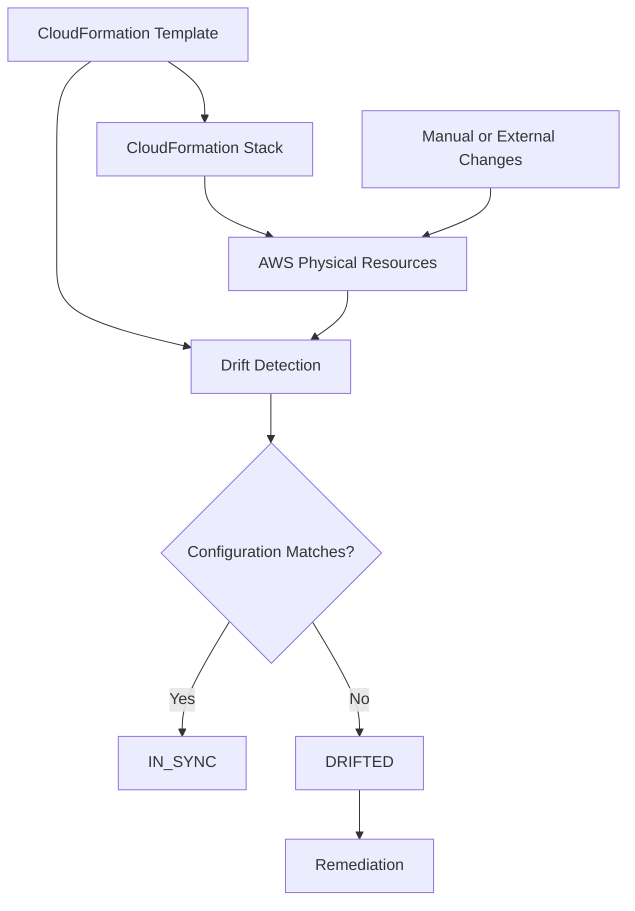
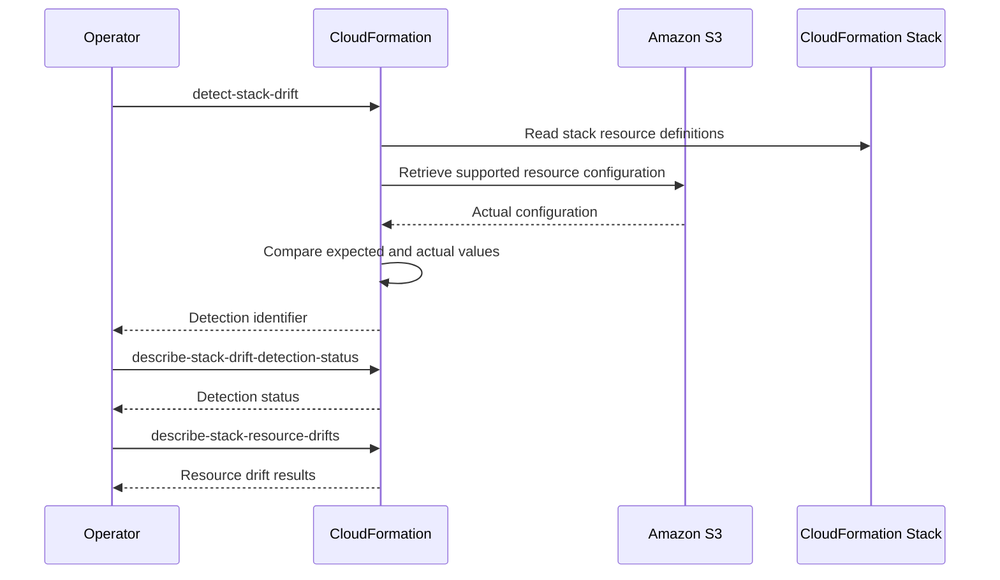
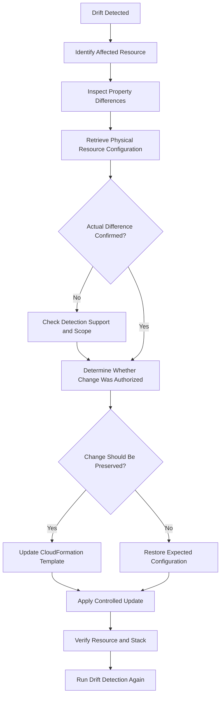
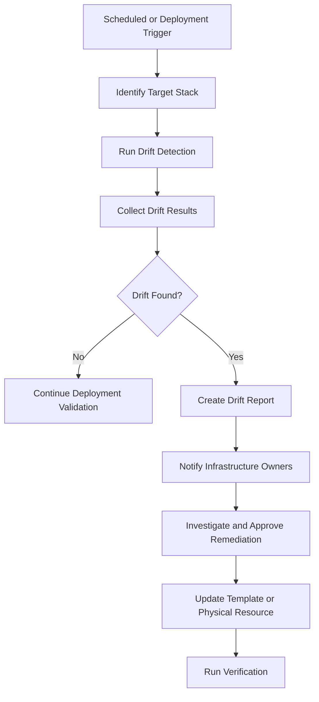

# 11- Drift Detection and Remediation

## Overview

AWS CloudFormation drift detection identifies differences between the configuration declared in a CloudFormation template and the actual configuration of supported AWS resources.

Drift occurs when infrastructure changes outside the CloudFormation deployment workflow or when a physical resource no longer matches the configuration managed by its stack.

For Amazon S3, these differences can introduce security, availability, data-retention, and disaster-recovery risks. An operator might manually disable bucket versioning, modify a bucket policy, change encryption settings, or remove a lifecycle rule without updating the CloudFormation template.

CloudFormation drift detection helps infrastructure teams:

- Identify unmanaged infrastructure changes.
- Detect configuration inconsistencies.
- Investigate unauthorized or accidental modifications.
- Validate infrastructure after incident recovery.
- Maintain consistency between templates and deployed resources.
- Support controlled infrastructure reconciliation.

Drift detection is not a complete configuration audit. It supports specific resource types and properties. An `IN_SYNC` result does not prove that every AWS resource setting, security requirement, or application behavior matches the intended architecture.

## Understanding CloudFormation Drift

### What Is Drift?

Drift occurs when the actual configuration of a resource differs from the configuration expected by CloudFormation.

Consider an S3 bucket defined in a template:

```yaml
Resources:
  ApplicationBucket:
    Type: AWS::S3::Bucket
    Properties:
      VersioningConfiguration:
        Status: Enabled

      PublicAccessBlockConfiguration:
        BlockPublicAcls: true
        BlockPublicPolicy: true
        IgnorePublicAcls: true
        RestrictPublicBuckets: true
```

An operator manually suspends bucket versioning:

```bash
aws s3api put-bucket-versioning \
  --bucket company-app-data-production \
  --versioning-configuration Status=Suspended
```

The physical bucket now differs from the expected configuration.

CloudFormation can report drift for supported properties when it compares the template configuration with the actual bucket configuration.

### Common Sources of Drift

| Source | Example |
|---|---|
| Manual AWS CLI operation | Changing bucket versioning outside CloudFormation |
| AWS Management Console | Modifying encryption configuration manually |
| Another IaC tool | Terraform modifies a resource also managed by CloudFormation |
| Automated script | A scheduled script changes bucket policies |
| Incident recovery | An operator modifies permissions to restore application access |
| Application automation | An application changes resource configuration through AWS APIs |
| Incomplete migration | A resource is changed without updating its CloudFormation template |

A resource can also differ from the template because a property was omitted, changed, or is managed by another process.

### Drift and Infrastructure as Code

Infrastructure as Code establishes a declared configuration that can be reviewed, version-controlled, and deployed consistently.



CloudFormation manages the declared infrastructure, while drift detection compares supported physical resource properties against the expected configuration.

## CloudFormation Drift Detection Architecture

### Detection Process

CloudFormation drift detection compares the expected resource configuration with the actual configuration retrieved from AWS service APIs.

The process is:

1. CloudFormation identifies resources in the stack.
2. It determines which resources and properties support drift detection.
3. It retrieves the actual configuration of supported resources.
4. It compares actual values with expected template values.
5. It reports resource-level and property-level differences where available.



### Important Limitations

Drift detection has important boundaries:

- Not every CloudFormation resource type supports drift detection.
- Not every property of a supported resource is necessarily drift-detectable.
- Some properties are write-only or cannot be reliably compared.
- Nested stacks require appropriate inspection of their own resources.
- Drift detection does not inspect application-level behavior.
- It does not automatically correct differences.
- It does not detect every unauthorized AWS API operation.
- A successful detection does not prove that the entire environment is compliant.

For production systems, combine CloudFormation drift detection with service-specific API checks, AWS Config where appropriate, security monitoring, and application-level validation.

## CloudFormation Drift Statuses

### Stack-Level Status

CloudFormation reports the overall drift status of a stack.

| Status | Meaning |
|---|---|
| `IN_SYNC` | Supported resources match their expected configurations. |
| `DRIFTED` | At least one resource has detected configuration differences. |
| `NOT_CHECKED` | Drift detection has not established a current result. |

A stack-level `DRIFTED` result indicates that one or more resources differ from their expected configurations.

### Detection Operation Status

The detection operation has its own status, separate from the stack's drift status.

| Status | Meaning |
|---|---|
| `DETECTION_IN_PROGRESS` | CloudFormation is checking resources. |
| `DETECTION_COMPLETE` | Detection completed successfully. |
| `DETECTION_FAILED` | Detection could not complete successfully. |

A completed detection can legitimately report that the stack is drifted.

### Resource-Level Status

| Status | Meaning |
|---|---|
| `IN_SYNC` | The resource matches its expected configuration for checked properties. |
| `MODIFIED` | The physical resource differs from the expected configuration. |
| `DELETED` | The physical resource no longer exists. |
| `NOT_CHECKED` | The resource could not be checked or is not supported for drift detection. |

### Property-Level Differences

When CloudFormation can identify a property-level difference, the result can include:

- Property path.
- Expected value.
- Actual value.
- Difference type.

For example:

| Property | Expected | Actual |
|---|---|---|
| `VersioningConfiguration.Status` | `Enabled` | `Suspended` |
| `BucketEncryption` | SSE-KMS | SSE-S3 |
| `LifecycleConfiguration.Rules` | Configured rules | Missing rule |

The actual properties reported depend on the resource type and CloudFormation drift-detection support.

## Detecting Drift with AWS CLI

### Prerequisites

The operator needs permissions to:

- Access the CloudFormation stack.
- Start drift detection.
- Read drift detection results.
- Describe relevant stack resources.
- Read supported AWS resource configurations.

Verify the active identity:

```bash
aws sts get-caller-identity
```

Confirm the AWS Region:

```bash
aws configure get region
```

Inspect the stack:

```bash
aws cloudformation describe-stacks \
  --stack-name application-s3-production
```

### Start Drift Detection

Run:

```bash
aws cloudformation detect-stack-drift \
  --stack-name application-s3-production
```

Example response:

```json
{
  "StackId": "arn:aws:cloudformation:us-east-1:123456789012:stack/application-s3-production/example",
  "StackDriftDetectionId": "example-drift-detection-id"
}
```

The returned `StackDriftDetectionId` identifies the detection operation.

Store this identifier for subsequent inspection.

### Check Detection Status

```bash
aws cloudformation describe-stack-drift-detection-status \
  --stack-drift-detection-id example-drift-detection-id
```

Example response:

```json
{
  "StackDriftDetectionId": "example-drift-detection-id",
  "StackId": "arn:aws:cloudformation:us-east-1:123456789012:stack/application-s3-production/example",
  "DetectionStatus": "DETECTION_COMPLETE",
  "StackDriftStatus": "DRIFTED",
  "DriftedStackResourceCount": 1
}
```

Important fields:

| Field | Meaning |
|---|---|
| `DetectionStatus` | Progress or outcome of the detection operation |
| `StackDriftStatus` | Overall stack drift result |
| `DriftedStackResourceCount` | Number of resources reported as drifted |

Detection status and drift status are different concepts.

A completed detection can return `StackDriftStatus: DRIFTED`.

### Inspect Resource-Level Drift

After detection completes:

```bash
aws cloudformation describe-stack-resource-drifts \
  --stack-name application-s3-production
```

Inspect selected fields:

```bash
aws cloudformation describe-stack-resource-drifts \
  --stack-name application-s3-production \
  --query 'StackResourceDrifts[].{LogicalId:LogicalResourceId,Type:ResourceType,Status:StackResourceDriftStatus,Changes:PropertyDifferences}'
```

This helps identify:

- The affected logical resource.
- Its AWS resource type.
- The drift status.
- The reported property differences.

### Inspect a Specific Resource

```bash
aws cloudformation describe-stack-resource \
  --stack-name application-s3-production \
  --logical-resource-id ApplicationBucket
```

This provides the physical resource identifier and stack resource metadata.

Use the physical identifier to inspect the actual AWS configuration through service-specific APIs.

### Handle Pagination

For large stacks, resource drift results may be paginated.

Use the returned `NextToken` to retrieve additional results.

```bash
aws cloudformation describe-stack-resource-drifts \
  --stack-name application-s3-production \
  --max-results 100
```

When additional results are available:

```bash
aws cloudformation describe-stack-resource-drifts \
  --stack-name application-s3-production \
  --max-results 100 \
  --next-token <next-token>
```

Do not assume the first response contains every drifted resource in a large stack.

## S3-Specific Drift Detection

S3 buckets have multiple independent configuration areas. Drift investigation should inspect the affected configuration rather than treating the bucket as a single indivisible resource.

### Versioning Drift

Expected template configuration:

```yaml
Resources:
  ApplicationBucket:
    Type: AWS::S3::Bucket
    Properties:
      VersioningConfiguration:
        Status: Enabled
```

Inspect the actual configuration:

```bash
aws s3api get-bucket-versioning \
  --bucket company-app-data-production
```

Expected result:

```json
{
  "Status": "Enabled"
}
```

If the actual status is `Suspended`, the bucket does not match the intended template configuration.

Versioning changes can affect:

- Object recovery.
- Historical object availability.
- Delete-marker behavior.
- Application overwrite semantics.
- Replication requirements.

Do not automatically restore versioning without checking the intended operational state and dependencies.

### Encryption Drift

Expected template configuration:

```yaml
Resources:
  ApplicationBucket:
    Type: AWS::S3::Bucket
    Properties:
      BucketEncryption:
        ServerSideEncryptionConfiguration:
          - ServerSideEncryptionByDefault:
              SSEAlgorithm: aws:kms
              KMSMasterKeyID: !Ref S3EncryptionKey
```

Inspect actual encryption:

```bash
aws s3api get-bucket-encryption \
  --bucket company-app-data-production
```

Compare:

- Encryption algorithm.
- KMS key identifier.
- Bucket Key configuration where applicable.

Encryption drift can affect application access and cross-service integrations.

A changed default encryption configuration generally affects future object writes. It does not automatically re-encrypt existing objects.

### Public Access Block Drift

Expected template configuration:

```yaml
PublicAccessBlockConfiguration:
  BlockPublicAcls: true
  BlockPublicPolicy: true
  IgnorePublicAcls: true
  RestrictPublicBuckets: true
```

Inspect actual settings:

```bash
aws s3api get-public-access-block \
  --bucket company-app-data-production
```

A difference in public access configuration can create a significant security exposure.

Prioritize investigation and remediation when public access protections have been weakened.

### Lifecycle Configuration Drift

Expected template configuration:

```yaml
LifecycleConfiguration:
  Rules:
    - Id: ArchiveDocuments
      Status: Enabled
      Filter:
        Prefix: archive/
      Transitions:
        - StorageClass: STANDARD_IA
          TransitionInDays: 30
```

Inspect the physical configuration:

```bash
aws s3api get-bucket-lifecycle-configuration \
  --bucket company-app-data-production
```

Check:

- Rule identifiers.
- Rule status.
- Prefix and tag filters.
- Transition configuration.
- Current-version expiration.
- Noncurrent-version expiration.
- Incomplete multipart upload cleanup.

Lifecycle drift can change storage cost and data availability.

Restoring the previous rule does not reverse transitions or recover objects already expired.

### Bucket Policy Drift

Expected template configuration:

```yaml
Resources:
  ApplicationBucketPolicy:
    Type: AWS::S3::BucketPolicy
    Properties:
      Bucket: !Ref ApplicationBucket
      PolicyDocument:
        Version: "2012-10-17"
        Statement:
          - Sid: DenyInsecureTransport
            Effect: Deny
            Principal: "*"
            Action: s3:*
            Resource:
              - !GetAtt ApplicationBucket.Arn
              - !Sub "${ApplicationBucket.Arn}/*"
            Condition:
              Bool:
                aws:SecureTransport: false
```

Inspect the actual policy:

```bash
aws s3api get-bucket-policy \
  --bucket company-app-data-production
```

Compare the actual policy with the intended template.

Policy differences can affect:

- Application access.
- Cross-account integrations.
- CloudFront access.
- Replication.
- Presigned URL operations.
- Security enforcement.

A policy that is syntactically valid can still be operationally incorrect.

### Replication Configuration Drift

Expected replication configuration may reference a dedicated IAM role and destination bucket.

Inspect the physical configuration:

```bash
aws s3api get-bucket-replication \
  --bucket company-app-data-production
```

Verify:

- Replication role ARN.
- Destination bucket ARN.
- Rule status.
- Prefix or tag filters.
- Storage class overrides.
- Encryption configuration.
- Replication metrics where configured.

Replication drift can interrupt data protection and cross-Region recovery workflows.

A valid replication configuration does not prove that objects are successfully replicating. Inspect replication status and destination object availability separately.

## Drift Investigation Workflow

A reliable investigation should distinguish between actual configuration drift, unsupported properties, missing resources, and expected operational differences.

### Diagnostic Flow



### Investigation Steps

**Identify the resource**

Use `describe-stack-resource-drifts` to identify the logical resource and its drift status.

**Inspect property differences**

Review expected and actual values where available.

**Verify the physical resource**

Use the relevant AWS API to retrieve the current configuration.

**Establish the source of change**

Review deployment history, CloudTrail events, automation logs, and incident records.

**Determine the desired configuration**

Decide whether the actual change is legitimate or should be reverted.

**Select a remediation strategy**

Update the template or restore the physical resource.

**Verify consistency**

Run service-specific checks and CloudFormation drift detection again.

## Drift Remediation Strategies

CloudFormation identifies drift but does not automatically decide which configuration should be authoritative.

There are two primary remediation strategies.

### Update the Template to Match the Actual Resource

Use this approach when the physical change is intentional and should become the new infrastructure standard.

Example:

- An operator intentionally changes the bucket encryption key.
- The new KMS key has been approved.
- Application permissions and key policies have been updated.
- The CloudFormation template still references the old key.

Update the template:

```yaml
BucketEncryption:
  ServerSideEncryptionConfiguration:
    - ServerSideEncryptionByDefault:
        SSEAlgorithm: aws:kms
        KMSMasterKeyID: !Ref NewS3EncryptionKey
```

Then create and review a change set.

```bash
aws cloudformation create-change-set \
  --stack-name application-s3-production \
  --change-set-name reconcile-encryption-key \
  --change-set-type UPDATE \
  --template-body file://s3.yaml
```

Review the proposed changes before execution.

This strategy makes the intentional physical configuration change part of the declared infrastructure.

### Restore the Physical Resource to Match the Template

Use this approach when the actual change was unauthorized, accidental, or inconsistent with the approved infrastructure design.

For example, if versioning was accidentally suspended:

```bash
aws s3api put-bucket-versioning \
  --bucket company-app-data-production \
  --versioning-configuration Status=Enabled
```

This restores the physical configuration to the intended state.

However, the direct AWS API operation does not update the CloudFormation stack's deployment history.

Record the change and verify the result with another drift detection operation.

For high-risk production changes, prefer a controlled CloudFormation update when the resource and operation support the required reconciliation.

### Remediation Decision Table

| Situation | Recommended approach |
|---|---|
| Authorized configuration change | Update the CloudFormation template |
| Unauthorized bucket policy modification | Restore the approved policy |
| Accidental versioning suspension | Restore versioning and verify application behavior |
| Intentional lifecycle redesign | Update the template and review data-retention effects |
| Resource manually deleted | Assess recreation, import, or replacement |
| Unsupported drift property | Use service-specific configuration inspection |
| Resource skipped during rollback | Reconcile the physical resource with the stack |
| Configuration changed by another IaC tool | Establish one authoritative management system |

## Remediating Drift with Change Sets

Change sets provide a controlled way to apply template-based remediation.

A safe process is:

1. Update the template to the desired configuration.
2. Validate the template.
3. Create an update change set.
4. Inspect the proposed resource operations.
5. Confirm that no unintended replacements or deletions are introduced.
6. Obtain approval where required.
7. Execute the change set.
8. Verify the physical resource.
9. Run drift detection again.

Validate the template:

```bash
aws cloudformation validate-template \
  --template-body file://s3.yaml
```

Run static analysis:

```bash
cfn-lint s3.yaml
```

Create the change set:

```bash
aws cloudformation create-change-set \
  --stack-name application-s3-production \
  --change-set-name drift-remediation \
  --change-set-type UPDATE \
  --template-body file://s3.yaml
```

Inspect the change set:

```bash
aws cloudformation describe-change-set \
  --stack-name application-s3-production \
  --change-set-name drift-remediation
```

Execute only after review:

```bash
aws cloudformation execute-change-set \
  --stack-name application-s3-production \
  --change-set-name drift-remediation
```

A change set may identify changes based on the current stack and proposed template, but it should not be treated as a complete inventory of every external configuration difference.

## Handling Deleted Resources

### Resource-Level DELETED Status

A resource can be reported as `DELETED` when the physical resource no longer exists.

For example, an S3 bucket may have been manually deleted outside CloudFormation.

Investigate:

- Whether the resource was intentionally removed.
- Whether the bucket contained data.
- Whether a backup or replica exists.
- Whether the logical resource is still required.
- Whether dependent applications reference the bucket.
- Whether the bucket can be recreated with the same name.

### Recovery Options

| Situation | Recovery approach |
|---|---|
| Resource is still required | Recreate or restore the resource through a controlled deployment |
| Resource was intentionally retired | Update the template and dependency references |
| Resource must be managed from another stack | Plan a controlled ownership transition |
| Data was lost | Execute the relevant data recovery procedure |
| Resource name is unavailable | Investigate ownership and choose an appropriate migration strategy |

Recreating an S3 bucket does not restore its previous objects, object versions, policies, or all historical configuration automatically.

Treat infrastructure recreation and data recovery as separate operations.

## Drift Detection for Nested Stacks

Nested CloudFormation stacks introduce additional levels of resource management.

A parent stack manages a nested stack resource, while the nested stack manages its own AWS resources.

Drift investigation should include both levels.

Inspect the parent stack:

```bash
aws cloudformation describe-stacks \
  --stack-name application-s3-production
```

Identify the nested stack resource:

```bash
aws cloudformation describe-stack-resources \
  --stack-name application-s3-production
```

Inspect the nested stack:

```bash
aws cloudformation describe-stacks \
  --stack-name <nested-stack-id>
```

Run drift detection against the nested stack where appropriate:

```bash
aws cloudformation detect-stack-drift \
  --stack-name <nested-stack-id>
```

Review nested stack resource drift independently.

Do not assume that an acceptable parent-level status proves every child resource is in sync.

## Drift Detection Automation

### Scheduled Drift Checks

For production infrastructure, periodic drift detection can identify configuration changes that are not part of approved deployments.

A scheduled workflow can:

1. Identify managed CloudFormation stacks.
2. Start drift detection.
3. Poll detection status.
4. Collect paginated resource drift results.
5. Publish findings.
6. Notify infrastructure owners.
7. Create remediation work when required.

A scheduled check should not automatically revert every detected difference.

Automatic remediation without determining the intended configuration can destroy legitimate changes or disrupt applications.

### Python Example Using Boto3

The following script starts drift detection for one stack and waits for the detection operation to finish.

It reports the stack-level drift result and affected resource count.

```python
import time

import boto3
from botocore.exceptions import BotoCoreError, ClientError


def detect_stack_drift(
    stack_name: str,
    region_name: str,
    poll_interval: int = 5,
    timeout_seconds: int = 900,
) -> dict:
    client = boto3.client(
        "cloudformation",
        region_name=region_name,
    )

    response = client.detect_stack_drift(
        StackName=stack_name
    )

    detection_id = response["StackDriftDetectionId"]
    deadline = time.monotonic() + timeout_seconds

    while time.monotonic() < deadline:
        result = client.describe_stack_drift_detection_status(
            StackDriftDetectionId=detection_id
        )

        status = result["DetectionStatus"]

        if status == "DETECTION_COMPLETE":
            return {
                "stack_name": stack_name,
                "detection_id": detection_id,
                "drift_status": result.get("StackDriftStatus"),
                "drifted_resource_count": result.get(
                    "DriftedStackResourceCount", 0
                ),
            }

        if status == "DETECTION_FAILED":
            raise RuntimeError(
                result.get(
                    "DetectionStatusReason",
                    "CloudFormation drift detection failed",
                )
            )

        time.sleep(poll_interval)

    raise TimeoutError(
        f"Drift detection timed out for stack {stack_name}"
    )


if __name__ == "__main__":
    try:
        result = detect_stack_drift(
            stack_name="application-s3-production",
            region_name="us-east-1",
        )

        print(result)

    except (
        ClientError,
        BotoCoreError,
        RuntimeError,
        TimeoutError,
    ) as exc:
        raise SystemExit(
            f"Drift detection failed: {exc}"
        ) from exc
```

The script uses the standard Boto3 credential provider chain. It does not require hardcoded AWS access keys.

For production automation, extend it to:

- Handle API throttling with bounded retries.
- Persist detection identifiers.
- Retrieve paginated resource drift results.
- Emit structured logs.
- Send findings to an alerting system.
- Distinguish unsupported resources from actual drift.
- Avoid launching overlapping detection operations unnecessarily.

### Required IAM Permissions

The execution identity needs appropriate CloudFormation drift-detection and read permissions.

Typical CloudFormation actions include:

```json
{
  "Version": "2012-10-17",
  "Statement": [
    {
      "Effect": "Allow",
      "Action": [
        "cloudformation:DetectStackDrift",
        "cloudformation:DescribeStackDriftDetectionStatus",
        "cloudformation:DescribeStackResourceDrifts",
        "cloudformation:DescribeStacks",
        "cloudformation:DescribeStackResources"
      ],
      "Resource": "*"
    }
  ]
}
```

This is an illustrative policy. Production deployments should scope permissions to the required stacks where supported and account for the resource-read permissions needed by the detection process.

## Drift Detection in CI/CD

Drift detection can be integrated into infrastructure deployment pipelines.

A useful deployment workflow is:



### Recommended Pipeline Controls

| Control | Purpose |
|---|---|
| Pull-request validation | Prevent invalid infrastructure templates |
| Scheduled drift detection | Identify out-of-band changes |
| Change set review | Inspect proposed infrastructure updates |
| Production approval | Control high-impact remediation |
| Post-deployment drift detection | Verify supported resource consistency |
| Audit logging | Record detection and remediation history |

Do not automatically block every deployment because a stack reports drift.

Some resource types or properties may be unsupported, and some differences may be intentional but not yet reconciled.

Define environment-specific policies for which drift conditions require deployment blocking.

## Security and Governance Considerations

Drift can indicate accidental changes, configuration mistakes, or unauthorized infrastructure modifications.

For S3, security-sensitive differences deserve priority.

### High-Priority Drift

| Configuration | Risk |
|---|---|
| Public access block | Accidental public exposure |
| Bucket policy | Unauthorized object access |
| Encryption | Weakened encryption controls or unexpected key changes |
| Versioning | Reduced object recovery capability |
| Replication | Reduced disaster recovery protection |
| Lifecycle | Premature object expiration |
| Ownership controls | Unexpected object ownership or ACL behavior |
| Logging configuration | Reduced audit visibility |

### Governance Recommendations

- Restrict direct production infrastructure modifications.
- Use dedicated IAM deployment roles.
- Record manual incident changes.
- Maintain version-controlled templates.
- Use AWS CloudTrail to investigate configuration changes.
- Use AWS Config where broader configuration compliance is required.
- Define approved exception and remediation workflows.
- Review drift findings according to security and operational impact.

CloudFormation drift detection and AWS Config serve different purposes.

CloudFormation compares supported resource properties with a stack template. AWS Config evaluates resource configuration history and compliance against configured rules.

They can complement each other but are not interchangeable.

## Monitoring and Operational Practices

### Recommended Detection Frequency

Detection frequency should reflect infrastructure criticality and change volume.

| Environment | Suggested approach |
|---|---|
| Development | On demand or after significant infrastructure changes |
| Staging | Scheduled checks and pre-release verification |
| Production | Scheduled checks plus incident-driven verification |
| Security-critical infrastructure | More frequent checks and event-driven investigation where justified |

The appropriate schedule depends on operational risk, API limits, stack size, and the cost of detection and investigation.

### Operational Indicators

Track:

- Number of drifted stacks.
- Number of drifted resources.
- Age of unresolved drift findings.
- Time from detection to remediation.
- Number of unauthorized configuration changes.
- Repeated drift on the same resource.
- Number of manual production changes.
- Drift recurrence after remediation.

Repeated drift on the same resource often indicates that an external automation process or operational workflow is still modifying it.

### Cost and Scale Considerations

Drift detection is an API-driven management operation rather than a continuous configuration monitoring service.

For large environments:

- Avoid launching unnecessary overlapping detection operations.
- Schedule checks across stacks in controlled batches.
- Persist detection results for audit and trend analysis.
- Prioritize critical stacks.
- Handle API throttling.
- Avoid repeatedly checking unsupported resources without a clear operational reason.

## Common Mistakes and Pitfalls

### Assuming IN_SYNC Means Complete Compliance

**Why it happens:** Engineers interpret a successful drift check as proof that the entire environment is correct.

**Risk:** Unsupported properties, external dependencies, and application behavior remain unchecked.

**Avoidance:** Combine drift detection with AWS Config, service-specific API checks, security reviews, and application tests.

### Treating Every Drift as Unauthorized

**Why it happens:** Drift is interpreted as evidence of a security incident.

**Risk:** Legitimate operational changes may be reverted unnecessarily.

**Avoidance:** Investigate the source, owner, approval, and purpose of each change before remediation.

### Updating the Template Without Reviewing the Actual Change

**Why it happens:** Engineers assume the physical resource always represents the desired state.

**Risk:** Accidental or malicious changes become part of the infrastructure definition.

**Avoidance:** Establish whether the change is approved before updating the template.

### Restoring the Physical Resource Without Updating Infrastructure Documentation

**Why it happens:** Direct AWS API operations are used for rapid remediation.

**Risk:** The configuration may be restored temporarily, but the operational history and root cause remain unresolved.

**Avoidance:** Record the change, reconcile the template where necessary, and add preventive controls.

### Ignoring Deleted Resources

**Why it happens:** Drift investigations focus on modified properties.

**Risk:** A missing S3 bucket or IAM role can break dependent applications or recovery workflows.

**Avoidance:** Treat `DELETED` as a separate recovery scenario and investigate data availability before recreating resources.

### Running Drift Detection Without Reviewing Pagination

**Why it happens:** The first API response is assumed to contain every affected resource.

**Risk:** Additional drifted resources remain undiscovered.

**Avoidance:** Process `NextToken` until all resource drift results have been retrieved.

### Automatically Reverting Every Drift Finding

**Why it happens:** Automated remediation is treated as equivalent to restoring the declared infrastructure.

**Risk:** Legitimate changes can be removed, application access can break, and incident recovery can be undone.

**Avoidance:** Use approval-based remediation and distinguish intentional configuration changes from unauthorized drift.

## Key Takeaways

- CloudFormation drift detection compares supported physical resource properties with the configuration declared in the stack template.
- S3 drift involving public access, encryption, versioning, lifecycle, and replication can affect security, data protection, and application reliability.
- Remediation requires deciding whether to update the template or restore the physical resource; detection alone does not establish which configuration is correct.
- Large and nested stacks require careful inspection of resource-level results, detection limitations, and pagination.
- Production drift management should combine scheduled detection, CloudTrail investigation, controlled remediation, and post-remediation verification.