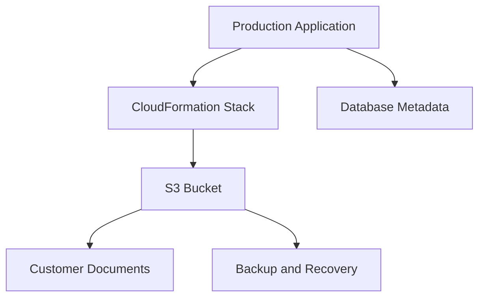
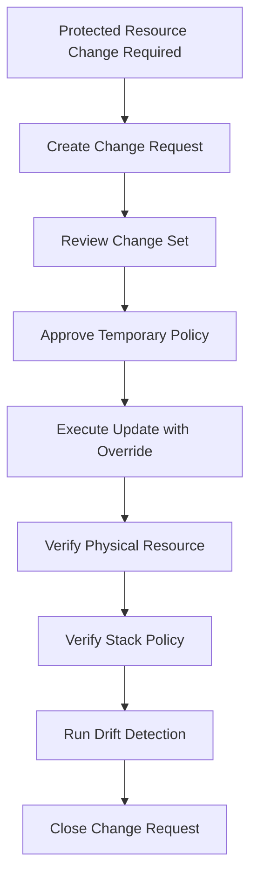
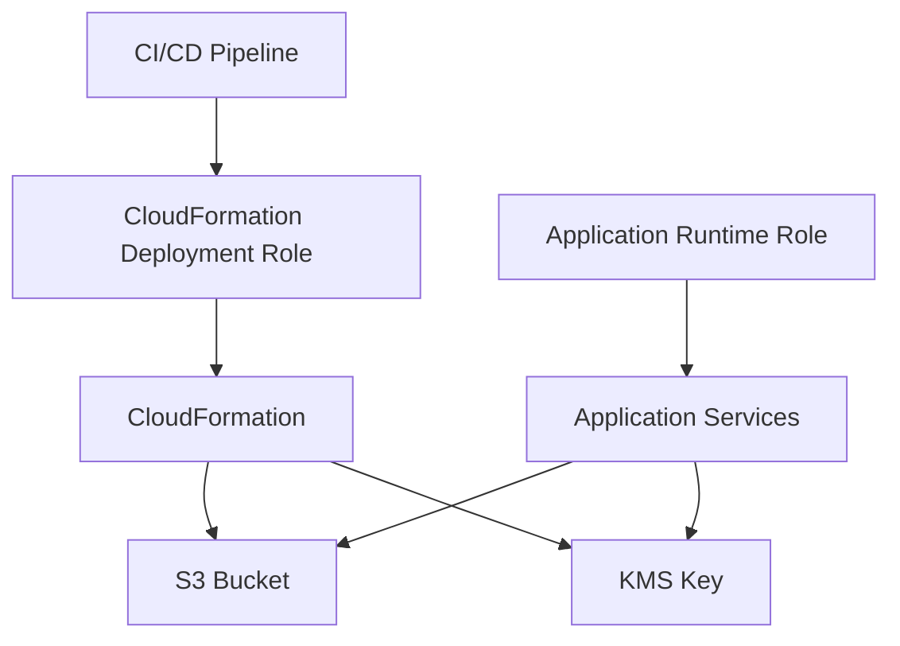
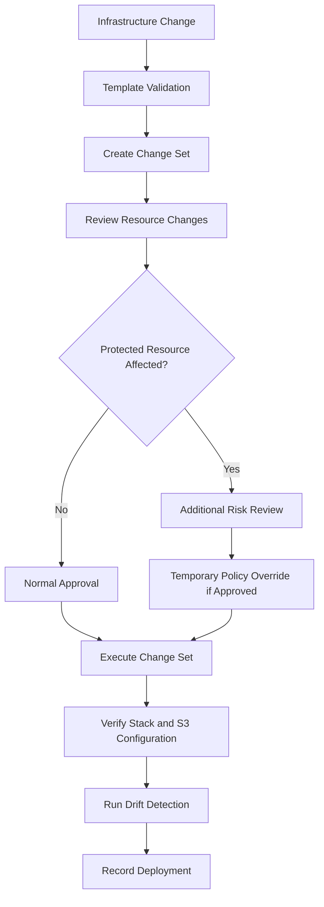

# 12- Stack Policies and Resource Protection

## Overview

AWS CloudFormation stack policies and resource protection mechanisms help prevent accidental or unauthorized changes to critical infrastructure managed by CloudFormation.

For Amazon S3, infrastructure changes can have consequences beyond resource availability. Replacing or deleting a bucket can affect application uploads, customer documents, backups, static website assets, data pipelines, and disaster recovery.

CloudFormation provides several mechanisms to control these risks:

- **Stack policies** restrict which resources CloudFormation can update during stack updates.
- **Deletion policies** determine what happens to a resource when it is removed from a stack or the stack is deleted.
- **Update replacement policies** determine what happens to an existing physical resource when CloudFormation replaces it.
- **Termination protection** prevents accidental deletion of an entire stack.
- **IAM permissions and approval controls** restrict who can perform infrastructure operations.
- **Change sets** provide visibility into proposed changes before execution.

These controls solve different problems. They should be combined rather than treated as interchangeable protections.

## Understanding Resource Protection

### Why S3 Resources Need Protection

An S3 bucket can contain persistent business data even when the CloudFormation stack managing it is temporary or frequently updated.

Consider a production architecture:



An infrastructure deployment might change a bucket property that requires replacement. If the bucket is not protected appropriately, a deployment or stack deletion can create data-loss or service-disruption risks.

Resource protection should address:

- Accidental bucket deletion.
- Unintended bucket replacement.
- Removal of encryption or access controls.
- Changes to lifecycle and retention configuration.
- Destruction of resources during stack cleanup.
- Unauthorized production deployments.
- Infrastructure changes that conflict with application dependencies.

### Protection Mechanisms Compared

| Mechanism | Primary purpose | Scope |
|---|---|---|
| Stack policy | Restricts resource updates through CloudFormation | Individual resources in a stack |
| `DeletionPolicy` | Controls resource behavior when removed from a stack or stack deleted | Individual resources |
| `UpdateReplacePolicy` | Controls what happens to the old physical resource during replacement | Individual resources |
| Termination protection | Prevents stack deletion | Entire stack |
| IAM policies | Controls who can perform AWS and CloudFormation operations | Principals and resources |
| Change sets | Allows review of proposed stack changes | Stack update operation |
| CloudFormation hooks and policy controls | Enforce configured checks before resource operations | Supported provisioning operations |

No single mechanism provides complete protection against every destructive operation.

For example, a CloudFormation stack policy does not prevent someone with direct S3 permissions from deleting objects through the S3 API.

## CloudFormation Stack Policies

### What Is a Stack Policy?

A stack policy is a JSON document that defines which update actions CloudFormation can perform on stack resources.

It is evaluated during CloudFormation stack updates.

A stack policy can:

- Deny updates to selected resources.
- Allow updates to explicitly selected resources.
- Protect critical resources from accidental changes.
- Permit controlled exceptions through temporary policy changes or update overrides.

Stack policies are particularly useful for production buckets, KMS keys, databases, and other resources that should not be modified casually.

### How Stack Policies Work

CloudFormation evaluates the stack policy when an update is performed.

A policy statement contains:

| Element | Purpose |
|---|---|
| `Effect` | Specifies `Allow` or `Deny` |
| `Action` | Specifies the CloudFormation update operation |
| `Principal` | Uses the CloudFormation stack-policy principal format |
| `Resource` | Identifies the logical resource |
| `Condition` | Optional conditions for policy evaluation |

The supported stack policy update actions are:

- `Update:*`
- `Update:Modify`
- `Update:Replace`
- `Update:Delete`

A stack policy uses CloudFormation logical resource identifiers, not S3 bucket ARNs.

### Default Stack Policy

Without an explicit stack policy, CloudFormation does not apply an additional stack-policy restriction to resource updates.

A production stack can establish a default-deny policy for updates and selectively allow changes.

Example:

```json
{
  "Statement": [
    {
      "Effect": "Allow",
      "Action": "Update:*",
      "Principal": "*",
      "Resource": "*"
    }
  ]
}
```

This policy allows all CloudFormation update actions on all resources.

It is equivalent to an unrestricted stack policy and does not provide additional protection.

### Protecting an S3 Bucket

Consider a stack containing an application bucket and supporting resources.

```yaml
Resources:
  ApplicationBucket:
    Type: AWS::S3::Bucket
    Properties:
      BucketName: company-app-data-production
      VersioningConfiguration:
        Status: Enabled

  ApplicationBucketPolicy:
    Type: AWS::S3::BucketPolicy
    Properties:
      Bucket: !Ref ApplicationBucket
      PolicyDocument:
        Version: "2012-10-17"
        Statement:
          - Sid: DenyInsecureTransport
            Effect: Deny
            Principal: "*"
            Action: s3:*
            Resource:
              - !GetAtt ApplicationBucket.Arn
              - !Sub "${ApplicationBucket.Arn}/*"
            Condition:
              Bool:
                aws:SecureTransport: false
```

A stack policy can protect the bucket from updates while allowing other stack resources to change.

```json
{
  "Statement": [
    {
      "Effect": "Allow",
      "Action": "Update:*",
      "Principal": "*",
      "Resource": "*"
    },
    {
      "Effect": "Deny",
      "Action": "Update:*",
      "Principal": "*",
      "Resource": "LogicalResourceId/ApplicationBucket"
    }
  ]
}
```

The second statement denies all CloudFormation update actions for the logical resource `ApplicationBucket`.

The bucket policy resource remains independently updateable.

This distinction matters: protecting a bucket resource does not automatically protect every resource that influences access to the bucket.

### Default-Deny Stack Policy

For stricter production control, deny updates by default and explicitly allow selected resources.

```json
{
  "Statement": [
    {
      "Effect": "Deny",
      "Action": "Update:*",
      "Principal": "*",
      "Resource": "*"
    },
    {
      "Effect": "Allow",
      "Action": [
        "Update:Modify",
        "Update:Replace"
      ],
      "Principal": "*",
      "Resource": [
        "LogicalResourceId/ApplicationLambda",
        "LogicalResourceId/ApplicationLogGroup"
      ]
    }
  ]
}
```

The explicit `Deny` takes precedence over the `Allow` for matching actions and resources.

As written, this policy denies all updates, including updates to the two resources listed in the allow statement. The second statement does not override the explicit deny.

A practical selective policy must avoid an overlapping explicit deny for resources that should be updateable.

For example:

```json
{
  "Statement": [
    {
      "Effect": "Allow",
      "Action": "Update:*",
      "Principal": "*",
      "Resource": [
        "LogicalResourceId/ApplicationLambda",
        "LogicalResourceId/ApplicationLogGroup"
      ]
    },
    {
      "Effect": "Deny",
      "Action": "Update:*",
      "Principal": "*",
      "Resource": "LogicalResourceId/ApplicationBucket"
    },
    {
      "Effect": "Deny",
      "Action": "Update:*",
      "Principal": "*",
      "Resource": "LogicalResourceId/S3EncryptionKey"
    }
  ]
}
```

This policy allows updates to the application resources while protecting the bucket and encryption key.

Resources not explicitly allowed are not protected by a default-deny statement in this example. If the objective is to deny all other resources, construct non-overlapping resource groups and explicitly cover every resource that should be denied.

Stack policy design requires careful review of logical resource identifiers and matching behavior.

### Protecting Multiple Resources

A stack can protect several resources using an array of logical resource identifiers.

```json
{
  "Statement": [
    {
      "Effect": "Allow",
      "Action": "Update:*",
      "Principal": "*",
      "Resource": [
        "LogicalResourceId/ApplicationBucket",
        "LogicalResourceId/ApplicationBucketPolicy"
      ]
    },
    {
      "Effect": "Deny",
      "Action": "Update:Replace",
      "Principal": "*",
      "Resource": [
        "LogicalResourceId/S3EncryptionKey",
        "LogicalResourceId/ReplicationRole"
      ]
    }
  ]
}
```

This example allows bucket and bucket-policy updates while preventing replacement of the encryption key and replication role.

It does not prevent all modifications to those protected resources. It specifically denies replacement.

Choose the action according to the required protection level.

## Stack Policy Update Actions

The update action determines which operations are restricted.

| Action | Meaning | Example |
|---|---|---|
| `Update:Modify` | Modifies an existing physical resource without replacement | Updating a supported bucket configuration |
| `Update:Replace` | Replaces an existing physical resource | Changing an immutable property |
| `Update:Delete` | Deletes a resource as part of a stack update | Removing a resource from the template |
| `Update:*` | Matches all update action types | Protecting a bucket from every update operation |

### When to Use Each Action

**Use `Update:Modify`** when a resource must not have its existing configuration changed through CloudFormation.

**Use `Update:Replace`** when the primary concern is preventing physical resource replacement.

**Use `Update:Delete`** when a resource must not be removed during a stack update.

**Use `Update:*`** when a resource should remain completely unchanged through normal stack updates.

For critical production buckets, `Update:*` is a strong protection choice, but it can also block legitimate configuration changes.

## Applying Stack Policies

### Create a Stack with a Policy

Create a stack using a policy file:

```bash
aws cloudformation create-stack \
  --stack-name application-s3-production \
  --template-body file://s3.yaml \
  --parameters file://production-parameters.json \
  --stack-policy-body file://stack-policy.json
```

For IAM resources, include the appropriate capability:

```bash
aws cloudformation create-stack \
  --stack-name application-s3-production \
  --template-body file://s3.yaml \
  --parameters file://production-parameters.json \
  --stack-policy-body file://stack-policy.json \
  --capabilities CAPABILITY_NAMED_IAM
```

Use `CAPABILITY_IAM` or `CAPABILITY_NAMED_IAM` according to the IAM resources in the template.

### Apply a Policy to an Existing Stack

Use `set-stack-policy`:

```bash
aws cloudformation set-stack-policy \
  --stack-name application-s3-production \
  --stack-policy-body file://stack-policy.json
```

This changes the policy applied to future stack updates.

It does not retroactively undo previous resource modifications.

### Inspect the Current Stack Policy

```bash
aws cloudformation get-stack-policy \
  --stack-name application-s3-production
```

If the stack has no explicitly configured policy, the operation may indicate that no stack policy is associated with it.

Include policy inspection in production deployment reviews.

## Temporary Stack Policy Overrides

A protected resource may occasionally require an approved update.

For example:

- Rotating an S3 encryption key.
- Changing a bucket configuration.
- Updating a replication configuration.
- Correcting a production access policy.
- Replacing a resource as part of a planned migration.

CloudFormation supports temporary stack policy overrides during stack updates through `--stack-policy-during-update-body` or `--stack-policy-during-update-url`.

The override applies to that update operation rather than permanently replacing the stack policy.

Example:

```bash
aws cloudformation update-stack \
  --stack-name application-s3-production \
  --template-body file://s3.yaml \
  --stack-policy-during-update-body file://temporary-stack-policy.json
```

A temporary policy should allow only the intended operation and resources.

After the update, verify that the normal stack policy remains in place:

```bash
aws cloudformation get-stack-policy \
  --stack-name application-s3-production
```

### Temporary Override Workflow



Do not permanently weaken the stack policy to accommodate a one-time deployment.

## DeletionPolicy

### What Is DeletionPolicy?

`DeletionPolicy` controls what CloudFormation does to a resource when:

- The resource is removed from the template during an update.
- The entire stack is deleted.

It is defined on an individual resource.

For S3, this is important because the bucket can contain data that must survive infrastructure teardown.

### Supported Deletion Policies

| Policy | Behavior |
|---|---|
| `Delete` | Deletes the resource according to the resource's deletion behavior |
| `Retain` | Keeps the physical resource after CloudFormation removes it |
| `Snapshot` | Creates a snapshot before deletion for supported resource types |

`Snapshot` is not a general-purpose S3 bucket backup mechanism. Do not use it as a substitute for S3 versioning, replication, or backup design.

### Retaining an S3 Bucket

```yaml
Resources:
  ApplicationBucket:
    Type: AWS::S3::Bucket
    DeletionPolicy: Retain
    Properties:
      BucketName: company-app-data-production
      VersioningConfiguration:
        Status: Enabled
```

When the stack is deleted, CloudFormation retains the physical bucket.

When the resource is removed from the template during an update, CloudFormation also retains it.

The retained bucket is no longer managed by that stack unless it is imported into a stack later.

### Retaining the Bucket and Its Encryption Key

Protecting a bucket without protecting its encryption key can create an inaccessible data store.

Consider an SSE-KMS encrypted bucket.

If the bucket is retained but its KMS key is deleted or scheduled for deletion, the retained objects may become inaccessible.

Protect both resources where their lifecycles are coupled:

```yaml
Resources:
  S3EncryptionKey:
    Type: AWS::KMS::Key
    DeletionPolicy: Retain
    UpdateReplacePolicy: Retain
    Properties:
      Description: Encryption key for production S3 data
      EnableKeyRotation: true
      KeyPolicy:
        Version: "2012-10-17"
        Statement:
          - Sid: EnableAccountAdministration
            Effect: Allow
            Principal:
              AWS: !Sub "arn:${AWS::Partition}:iam::${AWS::AccountId}:root"
            Action: "kms:*"
            Resource: "*"

  ApplicationBucket:
    Type: AWS::S3::Bucket
    DeletionPolicy: Retain
    UpdateReplacePolicy: Retain
    Properties:
      BucketEncryption:
        ServerSideEncryptionConfiguration:
          - ServerSideEncryptionByDefault:
              SSEAlgorithm: aws:kms
              KMSMasterKeyID: !GetAtt S3EncryptionKey.Arn
```

This is an illustrative key policy. Production key policies should define appropriate administrators, key users, service integrations, and deployment permissions.

### Retention Does Not Protect Object Data

`DeletionPolicy: Retain` protects the physical resource from CloudFormation deletion.

It does not prevent:

- Object deletion through the S3 API.
- Lifecycle expiration.
- Version deletion.
- Changes to bucket policies.
- Changes to encryption configuration.
- Deletion by another authorized principal.

Use S3-specific data protection controls for object-level protection.

## UpdateReplacePolicy

### What Is UpdateReplacePolicy?

`UpdateReplacePolicy` controls what happens to the existing physical resource when CloudFormation replaces it during a stack update.

This is different from `DeletionPolicy`.

Consider a resource whose property requires replacement.

CloudFormation may create a new physical resource and then remove the old one after the replacement workflow succeeds.

Without an appropriate replacement policy, the old resource may be deleted.

### Supported Policies

| Policy | Behavior |
|---|---|
| `Delete` | Deletes the old physical resource after replacement |
| `Retain` | Keeps the old physical resource |
| `Snapshot` | Creates a snapshot before replacement for supported resource types |

### Protecting an S3 Bucket During Replacement

```yaml
Resources:
  ApplicationBucket:
    Type: AWS::S3::Bucket
    DeletionPolicy: Retain
    UpdateReplacePolicy: Retain
    Properties:
      BucketName: company-app-data-production
      VersioningConfiguration:
        Status: Enabled
```

Both policies are important:

- `DeletionPolicy` protects the resource when it is removed from the stack or the stack is deleted.
- `UpdateReplacePolicy` protects the old physical resource when replacement occurs.

### Why Replacement Protection Matters

A bucket replacement can affect:

- Object availability.
- Application configuration.
- Presigned URL generation.
- CloudFront origins.
- Event notification destinations.
- Replication configuration.
- IAM and bucket policies.
- Data migration and recovery procedures.

An S3 bucket with a fixed bucket name also cannot be replaced by another bucket with the same name while the original bucket still exists.

For resources with immutable properties, use a migration strategy rather than assuming CloudFormation can transparently replace the bucket.

## Termination Protection

### What Is Termination Protection?

Termination protection prevents a CloudFormation stack from being deleted accidentally.

It is configured at the stack level.

For production S3 stacks, termination protection adds a safeguard against accidental deletion through the AWS CLI, Console, or other CloudFormation deletion workflows.

Enable it:

```bash
aws cloudformation update-termination-protection \
  --stack-name application-s3-production \
  --enable-termination-protection
```

Inspect stack details:

```bash
aws cloudformation describe-stacks \
  --stack-name application-s3-production \
  --query 'Stacks[0].{Name:StackName,TerminationProtection:EnableTerminationProtection}'
```

Disable it only when an approved stack deletion is required:

```bash
aws cloudformation update-termination-protection \
  --stack-name application-s3-production \
  --no-enable-termination-protection
```

Then delete the stack through the approved process.

### Important Limitations

Termination protection:

- Applies to the stack, not individual S3 objects.
- Does not prevent direct AWS API operations.
- Does not prevent resource modifications.
- Does not prevent an authorized operator from disabling termination protection.
- Does not replace resource-level retention policies.

For nested stacks, termination protection is managed at the root stack level rather than independently on nested stacks.

## Combining Resource Protection Mechanisms

Production protection should use multiple independent controls.

### Recommended S3 Protection Model

| Resource or operation | Recommended protection |
|---|---|
| Production S3 bucket | Stack policy, `DeletionPolicy: Retain`, `UpdateReplacePolicy: Retain` |
| KMS encryption key | Stack policy and retention policies |
| Bucket policy | Stack policy and IAM deployment controls |
| Replication role | Stack policy where replacement or modification is sensitive |
| Entire production stack | Termination protection |
| Object data | Versioning, retention controls, backup, and replication as appropriate |
| Infrastructure deployment | Change sets and approval gates |

### Example Production Stack

```yaml
AWSTemplateFormatVersion: "2010-09-09"

Description: Protected production S3 storage resources

Parameters:
  BucketName:
    Type: String
    Description: Globally unique S3 bucket name

Resources:
  S3EncryptionKey:
    Type: AWS::KMS::Key
    DeletionPolicy: Retain
    UpdateReplacePolicy: Retain
    Properties:
      Description: Encryption key for production application data
      EnableKeyRotation: true
      KeyPolicy:
        Version: "2012-10-17"
        Statement:
          - Sid: EnableAccountAdministration
            Effect: Allow
            Principal:
              AWS: !Sub "arn:${AWS::Partition}:iam::${AWS::AccountId}:root"
            Action: "kms:*"
            Resource: "*"

  ApplicationBucket:
    Type: AWS::S3::Bucket
    DeletionPolicy: Retain
    UpdateReplacePolicy: Retain
    Properties:
      BucketName: !Ref BucketName

      VersioningConfiguration:
        Status: Enabled

      BucketEncryption:
        ServerSideEncryptionConfiguration:
          - ServerSideEncryptionByDefault:
              SSEAlgorithm: aws:kms
              KMSMasterKeyID: !GetAtt S3EncryptionKey.Arn
            BucketKeyEnabled: true

      PublicAccessBlockConfiguration:
        BlockPublicAcls: true
        BlockPublicPolicy: true
        IgnorePublicAcls: true
        RestrictPublicBuckets: true

      OwnershipControls:
        Rules:
          - ObjectOwnership: BucketOwnerEnforced

Outputs:
  BucketName:
    Value: !Ref ApplicationBucket

  BucketArn:
    Value: !GetAtt ApplicationBucket.Arn

  EncryptionKeyArn:
    Value: !GetAtt S3EncryptionKey.Arn
```

The template establishes resource-level retention and secure defaults. It does not itself configure a stack policy or termination protection; those are stack-level operations.

Create the stack:

```bash
aws cloudformation create-stack \
  --stack-name application-s3-production \
  --template-body file://s3-protected.yaml \
  --parameters ParameterKey=BucketName,ParameterValue=company-app-data-production
```

Apply the stack policy:

```bash
aws cloudformation set-stack-policy \
  --stack-name application-s3-production \
  --stack-policy-body file://stack-policy.json
```

Enable termination protection:

```bash
aws cloudformation update-termination-protection \
  --stack-name application-s3-production \
  --enable-termination-protection
```

Verify the deployed configuration and protection settings independently.

## IAM and Deployment Permissions

Stack policies are not a replacement for IAM authorization.

IAM controls who can perform CloudFormation operations and which AWS service operations a principal can perform.

A production deployment role should have only the permissions needed for its deployment responsibilities.

### Separate Deployment and Runtime Roles

A common production architecture uses separate roles:



Responsibilities:

| Identity | Responsibility |
|---|---|
| CI/CD identity | Obtains short-lived deployment credentials |
| CloudFormation deployment role | Creates and updates infrastructure |
| Application runtime role | Reads and writes application objects |
| Replication role | Performs configured replication operations |
| Security administration role | Manages approved security and key administration operations |

Do not give application runtime roles broad CloudFormation permissions.

Do not use a general-purpose administrator role for routine deployments.

### IAM Considerations

The deployment principal may require permissions such as:

- `cloudformation:CreateStack`
- `cloudformation:UpdateStack`
- `cloudformation:DeleteStack`
- `cloudformation:CreateChangeSet`
- `cloudformation:ExecuteChangeSet`
- `cloudformation:SetStackPolicy`
- `cloudformation:GetStackPolicy`
- `cloudformation:UpdateTerminationProtection`
- `iam:PassRole` when passing a CloudFormation service role
- Relevant resource provisioning permissions when CloudFormation is not using a service role

Scope permissions to the required stacks and resources where supported.

A stack policy does not prevent an IAM principal with direct S3 permissions from changing bucket configuration outside CloudFormation.

## Change Sets and Approval Controls

Change sets provide visibility into the resource operations CloudFormation plans to perform.

For protected S3 resources, review the following fields:

- Resource logical ID.
- Resource type.
- Action.
- Replacement behavior.
- Details of property changes where available.

Create a change set:

```bash
aws cloudformation create-change-set \
  --stack-name application-s3-production \
  --change-set-name production-storage-update \
  --change-set-type UPDATE \
  --template-body file://s3-protected.yaml
```

Inspect it:

```bash
aws cloudformation describe-change-set \
  --stack-name application-s3-production \
  --change-set-name production-storage-update
```

Execute it after approval:

```bash
aws cloudformation execute-change-set \
  --stack-name application-s3-production \
  --change-set-name production-storage-update
```

A change set is not a substitute for stack policies, retention policies, or IAM controls.

It is a review mechanism that helps operators understand a proposed update before execution.

### Production Deployment Sequence



## Protecting S3 Data Beyond CloudFormation

CloudFormation resource protection protects infrastructure lifecycle operations. It does not provide complete object-data protection.

S3 data protection requires additional controls.

### Versioning

Versioning preserves multiple versions of an object.

It helps recover from accidental overwrites and deletions, subject to version-management and retention practices.

Versioning does not prevent a principal with sufficient permissions from permanently deleting object versions.

### S3 Object Lock

S3 Object Lock can provide WORM-style retention for supported use cases.

It supports:

- Governance retention mode.
- Compliance retention mode.
- Legal holds.

Object Lock is useful for regulatory records, audit evidence, and immutable backups.

Its retention behavior and configuration should be designed before production data is written.

### Replication and Backup

Replication can provide another copy of data in a separate bucket or Region.

However, replication is not equivalent to an independent backup:

- Replication can copy unwanted changes or deletions depending on configuration.
- Replication does not automatically provide application failover.
- Existing objects may require Batch Replication.
- Recovery procedures must account for permissions, encryption keys, and application dependencies.

Use a backup and recovery strategy appropriate to the required RPO and RTO.

Detailed object-level protection, encryption, replication, and recovery design belongs in the corresponding S3 security, advanced features, operations, and architecture documents.

## Resource Import and Ownership Transitions

Retained resources may remain in an account after their original CloudFormation stack is deleted.

If the resource must return to infrastructure-as-code management, consider CloudFormation resource import where supported.

A controlled ownership transition should include:

1. Identify the retained physical resource.
2. Verify that the target resource type supports import.
3. Prepare a template that accurately describes the existing resource.
4. Review resource properties and dependencies.
5. Create an import change set.
6. Execute the import operation.
7. Verify the resource and stack state.
8. Run drift detection.

Do not create a second bucket with the same name or assume that a retained resource is automatically managed by another stack.

For S3, verify the physical bucket configuration before importing it.

## Monitoring and Auditing Resource Protection

Resource protection controls should be reviewed regularly.

Useful evidence includes:

| Source | What to inspect |
|---|---|
| CloudFormation stack description | Termination protection |
| CloudFormation stack policy | Protected logical resources and actions |
| CloudFormation change sets | Proposed modifications and replacements |
| CloudFormation stack events | Update and deletion failures |
| CloudTrail | Stack policy changes, stack deletion attempts, and direct S3 API changes |
| AWS Config | Resource configuration and compliance where supported |
| CI/CD audit logs | Deployment identity, approvals, and release details |

Useful commands:

Inspect termination protection:

```bash
aws cloudformation describe-stacks \
  --stack-name application-s3-production \
  --query 'Stacks[0].EnableTerminationProtection'
```

Inspect the stack policy:

```bash
aws cloudformation get-stack-policy \
  --stack-name application-s3-production
```

Inspect recent stack events:

```bash
aws cloudformation describe-stack-events \
  --stack-name application-s3-production \
  --max-items 30
```

Inspect the bucket's versioning:

```bash
aws s3api get-bucket-versioning \
  --bucket company-app-data-production
```

Inspect public access protection:

```bash
aws s3api get-public-access-block \
  --bucket company-app-data-production
```

Inspect encryption:

```bash
aws s3api get-bucket-encryption \
  --bucket company-app-data-production
```

These checks validate selected controls. They do not replace a complete infrastructure and data-protection review.

## Common Mistakes and Production Pitfalls

### Assuming Stack Policies Prevent Direct AWS API Changes

**Why it happens:** Stack policies are interpreted as universal resource protection.

**Risk:** An operator or automation role can still modify the bucket directly if IAM permits it.

**Avoidance:** Restrict direct production changes through IAM, use dedicated deployment roles, and audit API activity.

### Using DeletionPolicy Without UpdateReplacePolicy

**Why it happens:** Engineers assume `DeletionPolicy: Retain` protects every resource lifecycle operation.

**Risk:** An old physical resource may still be deleted during replacement.

**Avoidance:** Configure both policies when replacement must preserve the old resource.

### Retaining a Bucket but Deleting Its KMS Key

**Why it happens:** Bucket retention is configured independently from encryption-key lifecycle.

**Risk:** Retained encrypted objects can become inaccessible if the key is deleted or unavailable.

**Avoidance:** Align bucket and KMS key retention, permissions, and recovery procedures.

### Assuming Retained Resources Remain Managed

**Why it happens:** Retention is confused with continued stack ownership.

**Risk:** The resource becomes unmanaged and can drift independently.

**Avoidance:** Document retained resources and import them into an appropriate stack when continued IaC management is required.

### Treating Termination Protection as Object Protection

**Why it happens:** Preventing stack deletion is mistaken for preventing data deletion.

**Risk:** Objects can still be deleted through S3 APIs or lifecycle rules.

**Avoidance:** Combine stack protection with versioning, Object Lock where appropriate, backups, and tightly scoped IAM permissions.

### Permanently Weakening a Stack Policy

**Why it happens:** A temporary infrastructure change is easier when the policy is removed or broadly relaxed.

**Risk:** Future deployments can modify critical resources without the intended protection.

**Avoidance:** Use a narrowly scoped temporary update override and verify the original policy after deployment.

### Protecting Only the Bucket

**Why it happens:** The bucket is treated as the only critical resource.

**Risk:** Supporting resources such as KMS keys, bucket policies, replication roles, and notification configurations can still be changed or removed.

**Avoidance:** Identify the complete dependency set and apply protection according to the impact of modifying each resource.

### Assuming a Change Set Guarantees a Safe Update

**Why it happens:** A change set is treated as an automatic safety mechanism.

**Risk:** A reviewed update can still cause application disruption, data-access changes, or unexpected operational behavior.

**Avoidance:** Review replacement behavior, dependencies, service-specific constraints, and recovery procedures before execution.

## Production Readiness Checklist

### Stack-Level Protection

- [ ] Production stack termination protection is enabled.
- [ ] Stack policy is configured and reviewed.
- [ ] Critical logical resources are explicitly protected.
- [ ] Temporary policy overrides require approval.
- [ ] Deployment roles are separated from application runtime roles.

### Resource-Level Protection

- [ ] Critical S3 buckets use an appropriate `DeletionPolicy`.
- [ ] Critical S3 buckets use an appropriate `UpdateReplacePolicy`.
- [ ] KMS key lifecycle is aligned with bucket retention.
- [ ] Bucket policies and replication resources have appropriate controls.
- [ ] Resource replacement and migration procedures are documented.

### Data Protection

- [ ] Versioning is configured where required.
- [ ] Object retention requirements are documented.
- [ ] Backup and replication objectives are defined.
- [ ] Recovery procedures are tested.
- [ ] Lifecycle rules cannot unintentionally remove required data.

### Deployment Governance

- [ ] Templates are validated before deployment.
- [ ] Change sets are reviewed before execution.
- [ ] Production updates have appropriate approval gates.
- [ ] CloudTrail and deployment logs provide an audit trail.
- [ ] Post-deployment resource configuration is verified.

## Key Takeaways

- Stack policies restrict CloudFormation update operations, while IAM controls who can perform operations and resource policies control service access.
- `DeletionPolicy` protects resources when removed from a stack or when the stack is deleted; `UpdateReplacePolicy` controls the old physical resource during replacement.
- Termination protection prevents accidental stack deletion but does not protect S3 objects or prevent direct AWS API changes.
- Retaining an encrypted S3 bucket requires protecting its KMS key and documenting how the retained resource remains managed.
- Production resource protection should combine stack policies, retention controls, IAM restrictions, change-set approvals, auditing, and tested recovery procedures.