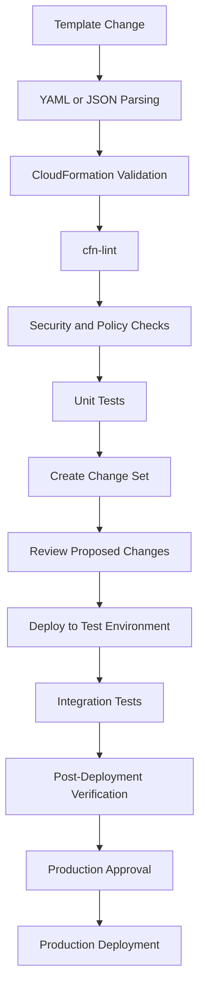
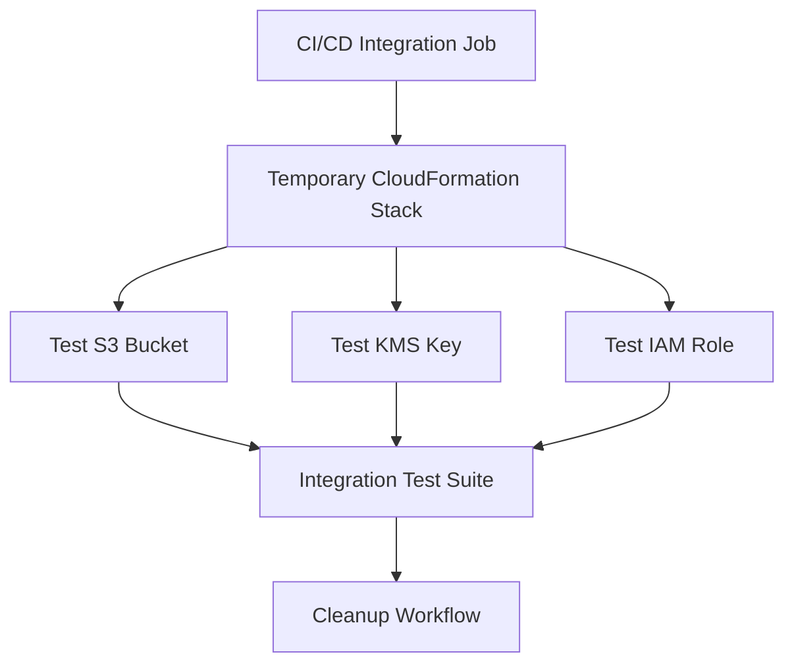

# 13- CloudFormation Validation and Testing

## Overview

CloudFormation validation and testing establish whether infrastructure templates are structurally valid, secure, deployable, and operationally reliable.

For Amazon S3 infrastructure, a template can pass basic syntax validation while still containing configuration errors that affect data protection, encryption, access control, lifecycle management, replication, or application integrations.

A production validation strategy should cover multiple layers:

- **Syntax validation:** Confirm YAML or JSON structure.
- **CloudFormation validation:** Check template structure and intrinsic function usage.
- **Static analysis:** Detect invalid resource properties and configuration problems.
- **Security analysis:** Identify public exposure, weak encryption settings, and excessive permissions.
- **Policy validation:** Enforce organizational infrastructure requirements.
- **Unit testing:** Verify expected resources and properties.
- **Integration testing:** Deploy isolated infrastructure and verify actual AWS behavior.
- **Deployment verification:** Confirm deployed resources match intended configuration.
- **Regression testing:** Ensure infrastructure changes do not weaken existing guarantees.

These checks should run automatically before a change set is approved and before infrastructure reaches production.

## CloudFormation Validation Layers

### Validation Strategy

Different validation tools detect different categories of problems.

| Validation layer | Purpose | Typical tools |
|---|---|---|
| YAML/JSON parsing | Detect malformed syntax | YAML parser, JSON parser |
| CloudFormation validation | Validate template structure | `validate-template` |
| Static analysis | Detect resource configuration issues | `cfn-lint` |
| Security analysis | Identify security weaknesses | Checkov |
| Policy validation | Enforce infrastructure requirements | CloudFormation Guard |
| Unit testing | Verify template properties | pytest, task-specific test frameworks |
| Integration testing | Validate deployed AWS behavior | AWS CLI, Boto3, pytest |
| Drift detection | Compare supported deployed properties with templates | CloudFormation drift detection |

No single tool replaces the others.

For example, `validate-template` can accept a syntactically valid template that creates an S3 bucket without the required public access protections. Static analysis and policy checks are needed to identify that problem.

### End-to-End Validation Workflow



## CloudFormation Template Validation

### Validate Template Syntax and Structure

The AWS CLI provides `validate-template` to validate a CloudFormation template.

```bash
aws cloudformation validate-template \
  --template-body file://s3.yaml
```

The command checks whether CloudFormation can parse the template and recognizes its general structure.

Example response:

```json
{
  "Parameters": [
    {
      "ParameterKey": "BucketName",
      "DefaultValue": "company-app-data-development",
      "NoEcho": false,
      "Description": "S3 bucket name"
    }
  ],
  "Description": "Application S3 infrastructure"
}
```

A successful response does not prove that:

- Every resource property is valid for the intended service behavior.
- IAM permissions are sufficient.
- The deployment principal can create all resources.
- Bucket names are available.
- KMS policies permit application access.
- Resource dependencies are correct.
- The deployed architecture meets security requirements.

Treat this command as an initial validation step.

### Validate Templates from an S3 URL

For templates stored in an accessible S3 location:

```bash
aws cloudformation validate-template \
  --template-url https://s3.amazonaws.com/cfn-artifacts/templates/s3.yaml
```

The template must be accessible to CloudFormation.

For production pipelines, use controlled artifact storage and immutable release-specific template keys.

### Validate Template Size and Structure

CloudFormation templates have service-defined size and structure limits. For large deployments, consider nested stacks or modular stack composition rather than producing one excessively large template.

Validation should also check:

- Resource logical ID uniqueness.
- Parameter declarations.
- Required resource properties.
- Output references.
- Intrinsic function usage.
- Conditions and dependencies.
- Circular resource references.

## YAML and JSON Parsing

A malformed YAML template can fail before CloudFormation evaluates any resource definitions.

Use a local parser to catch basic syntax errors.

### YAML Validation with Python

Install PyYAML:

```bash
pip install PyYAML
```

Example:

```python
from pathlib import Path

import yaml


def validate_yaml(path: str) -> None:
    template_path = Path(path)

    with template_path.open("r", encoding="utf-8") as file:
        template = yaml.safe_load(file)

    if not isinstance(template, dict):
        raise ValueError("CloudFormation template must be a YAML mapping")

    if "Resources" not in template:
        raise ValueError("CloudFormation template must contain Resources")

    print(f"YAML parsing successful: {template_path}")


if __name__ == "__main__":
    validate_yaml("s3.yaml")
```

This script checks YAML structure, not CloudFormation semantics.

### CloudFormation Intrinsic Function Tags

CloudFormation YAML templates use tags such as:

```yaml
BucketName: !Ref BucketName
```

Generic YAML parsers may not recognize CloudFormation-specific tags.

A parser used for local validation must either support these tags or register appropriate constructors.

Do not interpret a parser failure on `!Ref`, `!Sub`, or `!GetAtt` as proof that the CloudFormation template itself is invalid.

For CloudFormation-aware validation, use `cfn-lint`.

## Static Analysis with cfn-lint

### What Is cfn-lint?

`cfn-lint` is a static analysis tool for CloudFormation templates.

It validates resource schemas and checks many CloudFormation-specific rules.

For S3 templates, it can identify issues involving:

- Unsupported resource properties.
- Invalid property values.
- Incorrect property types.
- Invalid intrinsic function usage.
- Resource configuration inconsistencies.
- Some resource dependency and specification errors.

### Installation

Install with pip:

```bash
pip install cfn-lint
```

Verify:

```bash
cfn-lint --version
```

### Validate an S3 Template

```bash
cfn-lint s3.yaml
```

Validate multiple templates:

```bash
cfn-lint templates/*.yaml
```

Validate a specific Region:

```bash
cfn-lint \
  --regions us-east-1 \
  s3.yaml
```

Region-specific validation is useful when resource or feature availability differs by Region.

### Example Invalid Configuration

Consider:

```yaml
Resources:
  ApplicationBucket:
    Type: AWS::S3::Bucket
    Properties:
      VersioningConfiguration:
        Status: Active
```

The valid versioning status values are `Enabled` and `Suspended`.

Correct configuration:

```yaml
Resources:
  ApplicationBucket:
    Type: AWS::S3::Bucket
    Properties:
      VersioningConfiguration:
        Status: Enabled
```

`cfn-lint` can identify invalid resource property values when covered by its resource specifications.

### Configure cfn-lint in a Project

A project can use a configuration file:

```yaml
templates:
  - templates/**/*.yaml

regions:
  - us-east-1
  - ap-south-1

ignore_checks: []

include_checks: []

configure_rules: {}
```

Run:

```bash
cfn-lint --config-file .cfnlintrc
```

Avoid suppressing findings without documenting why the rule does not apply.

## Security and Policy Validation

### CloudFormation Guard

CloudFormation Guard allows teams to define rules that enforce infrastructure configuration requirements.

It is useful when a project needs consistent S3 security requirements across multiple templates.

Example policies can require:

- S3 Block Public Access.
- Bucket versioning.
- Server-side encryption.
- Bucket ownership controls.
- HTTPS-only bucket access.
- Approved storage configuration.
- Resource retention settings.

### Example Guard Rules

Create `s3.guard`:

```text
let s3_buckets = Resources.*[ Type == 'AWS::S3::Bucket' ]

rule s3_bucket_security when %s3_buckets !empty {
    %s3_buckets.Properties.PublicAccessBlockConfiguration.BlockPublicAcls == true
    %s3_buckets.Properties.PublicAccessBlockConfiguration.BlockPublicPolicy == true
    %s3_buckets.Properties.PublicAccessBlockConfiguration.IgnorePublicAcls == true
    %s3_buckets.Properties.PublicAccessBlockConfiguration.RestrictPublicBuckets == true
}

rule s3_bucket_versioning when %s3_buckets !empty {
    %s3_buckets.Properties.VersioningConfiguration.Status == "Enabled"
}

rule s3_bucket_encryption when %s3_buckets !empty {
    %s3_buckets.Properties.BucketEncryption.ServerSideEncryptionConfiguration[*].ServerSideEncryptionByDefault.SSEAlgorithm IN ["AES256", "aws:kms"]
}
```

These rules express baseline requirements. Adapt them to the actual policy language version and project conventions used by the installed Guard release.

### Run Guard Validation

Install CloudFormation Guard according to the AWS distribution instructions, then run:

```bash
cfn-guard validate \
  --rules s3.guard \
  --data s3.yaml
```

A policy failure indicates that the template does not satisfy one or more declared rules.

### Guard Policy Design Considerations

Guard policies should reflect actual architectural requirements.

For example, requiring versioning on every bucket may be appropriate for production data buckets but unnecessary for some temporary test resources.

Use separate policy scopes or explicit exceptions for different resource categories.

Do not create broad exceptions that allow insecure resources to pass validation silently.

## Security Scanning with Checkov

Checkov can scan CloudFormation templates for common security and compliance problems.

It can identify issues such as:

- Publicly accessible S3 buckets.
- Missing encryption configuration.
- Missing versioning.
- Insecure transport policies.
- Overly permissive IAM policies.
- Misconfigured resource protections.

Install:

```bash
pip install checkov
```

Scan a template:

```bash
checkov \
  --file s3.yaml \
  --framework cloudformation
```

Generate JSON output:

```bash
checkov \
  --file s3.yaml \
  --framework cloudformation \
  --output json
```

Use the results as security-review input, not as an automatic guarantee of compliance.

Security scanners may produce findings that require context-specific decisions.

For example, a bucket intentionally serving public content has different requirements from a private document-storage bucket.

## Building a Testable S3 CloudFormation Template

A template should make important configuration decisions explicit and testable.

Consider this example:

```yaml
AWSTemplateFormatVersion: "2010-09-09"

Description: Production-oriented S3 storage bucket

Parameters:
  BucketName:
    Type: String
    Description: Globally unique bucket name
    MinLength: 3
    MaxLength: 63

Resources:
  ApplicationBucket:
    Type: AWS::S3::Bucket
    DeletionPolicy: Retain
    UpdateReplacePolicy: Retain
    Properties:
      BucketName: !Ref BucketName

      VersioningConfiguration:
        Status: Enabled

      BucketEncryption:
        ServerSideEncryptionConfiguration:
          - ServerSideEncryptionByDefault:
              SSEAlgorithm: AES256

      PublicAccessBlockConfiguration:
        BlockPublicAcls: true
        BlockPublicPolicy: true
        IgnorePublicAcls: true
        RestrictPublicBuckets: true

      OwnershipControls:
        Rules:
          - ObjectOwnership: BucketOwnerEnforced

Outputs:
  BucketName:
    Description: S3 bucket name
    Value: !Ref ApplicationBucket

  BucketArn:
    Description: S3 bucket ARN
    Value: !GetAtt ApplicationBucket.Arn
```

This template provides several testable properties:

- Bucket versioning is enabled.
- Server-side encryption is configured.
- Public access is blocked.
- Bucket ownership is enforced.
- CloudFormation retains the bucket during stack deletion.
- CloudFormation retains the old bucket during replacement.

The example uses SSE-S3. If SSE-KMS is required, include the KMS key, key policy, and required application permissions as part of the tested design.

## Unit Testing CloudFormation Templates

### Why Unit Testing Matters

Static analysis validates template rules, but unit tests verify project-specific architectural expectations.

For example, a team may require:

- All production buckets to have versioning enabled.
- Every production bucket to block public access.
- Every persistent bucket to use retention policies.
- Every encrypted bucket to use an approved encryption method.
- No bucket to have a public read policy.
- Required outputs to be present.

These requirements can be tested automatically.

### Python Testing with pytest

Install dependencies:

```bash
pip install pytest pyyaml
```

A generic YAML parser is not sufficient for all CloudFormation templates because it does not automatically understand intrinsic function tags.

For a simple template containing only the constructs shown in the previous example, use a YAML loader that recognizes CloudFormation tags.

Example test helper:

```python
from pathlib import Path

import yaml


class CloudFormationLoader(yaml.SafeLoader):
    pass


def construct_intrinsic(loader, tag_suffix, node):
    if isinstance(node, yaml.ScalarNode):
        value = loader.construct_scalar(node)
    elif isinstance(node, yaml.SequenceNode):
        value = loader.construct_sequence(node)
    else:
        value = loader.construct_mapping(node)

    return {f"Fn::{tag_suffix}": value}


def construct_ref(loader, node):
    return {"Ref": loader.construct_scalar(node)}


CloudFormationLoader.add_multi_constructor(
    "!",
    construct_intrinsic,
)

CloudFormationLoader.add_constructor(
    "!Ref",
    construct_ref,
)


def load_template(path: str) -> dict:
    with Path(path).open("r", encoding="utf-8") as file:
        return yaml.load(file, Loader=CloudFormationLoader)
```

For a full template test suite, extend the loader to handle the intrinsic tags and YAML constructs used by the project. Alternatively, use a CloudFormation-aware parser or testing framework.

### Test S3 Resource Configuration

Create `tests/test_s3_template.py`:

```python
from pathlib import Path

from template_loader import load_template


TEMPLATE_PATH = Path("s3.yaml")


def test_bucket_exists():
    template = load_template(str(TEMPLATE_PATH))

    resources = template["Resources"]

    assert "ApplicationBucket" in resources
    assert resources["ApplicationBucket"]["Type"] == "AWS::S3::Bucket"


def test_bucket_versioning_enabled():
    template = load_template(str(TEMPLATE_PATH))

    bucket = template["Resources"]["ApplicationBucket"]

    assert (
        bucket["Properties"]["VersioningConfiguration"]["Status"]
        == "Enabled"
    )


def test_bucket_blocks_public_access():
    template = load_template(str(TEMPLATE_PATH))

    bucket = template["Resources"]["ApplicationBucket"]

    public_access = bucket["Properties"][
        "PublicAccessBlockConfiguration"
    ]

    assert public_access == {
        "BlockPublicAcls": True,
        "BlockPublicPolicy": True,
        "IgnorePublicAcls": True,
        "RestrictPublicBuckets": True,
    }


def test_bucket_has_encryption():
    template = load_template(str(TEMPLATE_PATH))

    bucket = template["Resources"]["ApplicationBucket"]

    encryption = bucket["Properties"]["BucketEncryption"]

    assert encryption["ServerSideEncryptionConfiguration"]


def test_bucket_is_retained():
    template = load_template(str(TEMPLATE_PATH))

    bucket = template["Resources"]["ApplicationBucket"]

    assert bucket["DeletionPolicy"] == "Retain"
    assert bucket["UpdateReplacePolicy"] == "Retain"
```

Run:

```bash
pytest -v
```

These tests verify the declared template structure. They do not prove that AWS accepts the deployment or that the deployed bucket behaves correctly.

### Testing Intrinsic Functions

CloudFormation templates commonly use:

- `Ref`
- `Fn::GetAtt`
- `Fn::Sub`
- `Fn::Join`
- `Fn::If`
- `Fn::FindInMap`
- `Fn::ImportValue`

Tests should verify that the intended references and conditions are present.

Avoid tests that depend on brittle textual matching of YAML files. Parse the template into a structured representation and inspect resource properties.

## Testing with AWS CloudFormation Change Sets

### Why Change Sets Matter

A template can pass static validation and still result in an unexpected infrastructure update.

Change sets provide a preview of proposed stack changes.

They are particularly important for S3 because certain changes can require replacement or affect data availability.

### Create a Change Set

```bash
aws cloudformation create-change-set \
  --stack-name application-s3-production \
  --change-set-name s3-validation-update \
  --change-set-type UPDATE \
  --template-body file://s3.yaml
```

If the template adds IAM resources, include the required capability:

```bash
aws cloudformation create-change-set \
  --stack-name application-s3-production \
  --change-set-name s3-validation-update \
  --change-set-type UPDATE \
  --template-body file://s3.yaml \
  --capabilities CAPABILITY_NAMED_IAM
```

### Wait for Change Set Creation

```bash
aws cloudformation wait change-set-create-complete \
  --stack-name application-s3-production \
  --change-set-name s3-validation-update
```

A change set containing no changes can enter a failed state with a reason indicating that there are no updates to perform.

A CI/CD pipeline should recognize this as a no-op rather than treating every failed change-set creation as an infrastructure defect.

### Review the Proposed Changes

```bash
aws cloudformation describe-change-set \
  --stack-name application-s3-production \
  --change-set-name s3-validation-update
```

Review:

- Resource actions.
- Resource types.
- Replacement behavior.
- Logical resource identifiers.
- Property changes.
- Parameter changes.

For S3 buckets, investigate any replacement indication carefully.

### Execute Only After Approval

```bash
aws cloudformation execute-change-set \
  --stack-name application-s3-production \
  --change-set-name s3-validation-update
```

Wait for stack completion:

```bash
aws cloudformation wait stack-update-complete \
  --stack-name application-s3-production
```

Inspect stack events if the update fails.

A change set is a deployment preview, not a complete guarantee of successful resource creation or safe application behavior.

## Integration Testing in AWS

### Why Integration Testing Is Necessary

Some infrastructure behavior cannot be fully validated through static analysis or unit tests.

For example:

- Bucket creation depends on actual account and Region state.
- Bucket names must be globally unique.
- IAM permissions depend on the deployment identity and resource policies.
- KMS access depends on key policies and identity permissions.
- S3 event notifications depend on destination resource permissions.
- Replication requires valid source and destination configuration.
- CloudFront access depends on origin configuration and distribution deployment.

Deploy an isolated test stack to verify real AWS behavior.

### Recommended Test Environment

Use separate resources for integration testing.



The test environment should:

- Use a unique bucket name.
- Avoid production data.
- Use dedicated IAM roles.
- Use isolated KMS keys where applicable.
- Have clear ownership and expiration.
- Avoid shared production resources.
- Clean up only resources created by the test.

### Deploy a Test Stack

```bash
aws cloudformation create-stack \
  --stack-name s3-integration-test \
  --template-body file://s3.yaml \
  --parameters \
    ParameterKey=BucketName,ParameterValue=company-s3-integration-test-12345
```

Wait:

```bash
aws cloudformation wait stack-create-complete \
  --stack-name s3-integration-test
```

### Verify Bucket Configuration

Check versioning:

```bash
aws s3api get-bucket-versioning \
  --bucket company-s3-integration-test-12345
```

Check encryption:

```bash
aws s3api get-bucket-encryption \
  --bucket company-s3-integration-test-12345
```

Check public access block:

```bash
aws s3api get-public-access-block \
  --bucket company-s3-integration-test-12345
```

Check ownership controls:

```bash
aws s3api get-bucket-ownership-controls \
  --bucket company-s3-integration-test-12345
```

### Test Object Operations

Upload a test object:

```bash
printf "CloudFormation integration test\n" > test.txt

aws s3api put-object \
  --bucket company-s3-integration-test-12345 \
  --key integration/test.txt \
  --body test.txt
```

Verify the object:

```bash
aws s3api head-object \
  --bucket company-s3-integration-test-12345 \
  --key integration/test.txt
```

Download it:

```bash
aws s3api get-object \
  --bucket company-s3-integration-test-12345 \
  --key integration/test.txt \
  downloaded.txt
```

Compare the contents:

```bash
cmp test.txt downloaded.txt
```

These checks validate basic object operations. Additional tests should verify the intended encryption, authorization, event processing, and lifecycle behavior.

## Integration Testing with Boto3 and pytest

A Python integration test can validate deployed S3 resources through the AWS SDK.

Install:

```bash
pip install boto3 pytest
```

Example:

```python
import os
import uuid

import boto3


BUCKET_NAME = os.environ["TEST_BUCKET_NAME"]
REGION = os.environ.get("AWS_REGION", "us-east-1")


def test_s3_object_round_trip():
    s3 = boto3.client("s3", region_name=REGION)

    key = f"integration-tests/{uuid.uuid4()}.txt"
    content = b"CloudFormation integration test"

    s3.put_object(
        Bucket=BUCKET_NAME,
        Key=key,
        Body=content,
    )

    response = s3.get_object(
        Bucket=BUCKET_NAME,
        Key=key,
    )

    try:
        assert response["Body"].read() == content
    finally:
        response["Body"].close()
        s3.delete_object(
            Bucket=BUCKET_NAME,
            Key=key,
        )
```

Run:

```bash
export TEST_BUCKET_NAME=company-s3-integration-test-12345
export AWS_REGION=us-east-1

pytest -v
```

The test uses the standard AWS credential provider chain.

In CI/CD, use short-lived credentials obtained through an appropriate IAM role or OIDC federation.

### Integration Test Design

Production integration tests should verify:

- Object upload and download.
- Expected encryption configuration.
- Versioning behavior.
- Access-denied behavior for unauthorized identities.
- Bucket policy enforcement.
- Presigned URL behavior where relevant.
- Event notification delivery.
- Replication behavior where configured.
- Lifecycle configuration presence.
- Resource retention and deletion behavior.

Use unique object keys and clean up test data even when assertions fail.

For versioned buckets, deleting an object normally creates a delete marker. A complete test cleanup procedure must account for object versions and delete markers.

## Testing IAM and Bucket Policies

### Policy Validation

S3 access failures frequently originate from incorrect policy evaluation.

Test both allowed and denied operations.

For example:

| Test identity | Expected operation |
|---|---|
| Application role | Upload objects to the application prefix |
| Application role | Read permitted objects |
| Unrelated role | Read application objects |
| Anonymous principal | Read private bucket objects |
| Application role | Modify bucket policy |

The expected outcome should be explicit for each test.

### Validate Bucket Policy Configuration

Inspect the deployed policy:

```bash
aws s3api get-bucket-policy \
  --bucket company-s3-integration-test-12345
```

Inspect the policy status:

```bash
aws s3api get-bucket-policy-status \
  --bucket company-s3-integration-test-12345
```

Test actual requests using the intended IAM identity.

Do not rely exclusively on policy JSON inspection. Effective access can depend on identity policies, resource policies, permissions boundaries, session policies, service control policies, VPC endpoint policies, and explicit denies.

### KMS Authorization Testing

For SSE-KMS, S3 object access and KMS authorization are separate concerns.

An application role may have permission to read an object but still lack the required KMS permissions.

Test:

- S3 object permissions.
- KMS key policy.
- IAM permissions for KMS operations.
- Encryption context requirements where configured.
- Cross-account key access where applicable.

A successful bucket configuration check does not prove that the application can decrypt an object.

## Testing S3 Lifecycle and Versioning

### Lifecycle Configuration Validation

Inspect lifecycle rules:

```bash
aws s3api get-bucket-lifecycle-configuration \
  --bucket company-s3-integration-test-12345
```

Verify:

- Rule status.
- Prefix and tag filters.
- Transition settings.
- Current-version expiration.
- Noncurrent-version expiration.
- Incomplete multipart upload cleanup.

Do not wait for production lifecycle execution to verify every rule.

Use template tests, API inspection, and controlled test environments.

### Versioning Tests

Inspect versioning:

```bash
aws s3api get-bucket-versioning \
  --bucket company-s3-integration-test-12345
```

Upload two versions:

```bash
aws s3api put-object \
  --bucket company-s3-integration-test-12345 \
  --key version-test.txt \
  --body test.txt
```

Update the object and upload again:

```bash
printf "Updated version\n" > test.txt

aws s3api put-object \
  --bucket company-s3-integration-test-12345 \
  --key version-test.txt \
  --body test.txt
```

List versions:

```bash
aws s3api list-object-versions \
  --bucket company-s3-integration-test-12345 \
  --prefix version-test.txt
```

The test should verify that multiple versions exist when versioning is enabled.

Lifecycle behavior is asynchronous and should not be tested by assuming an object expires immediately after deployment.

## Testing Replication Configuration

Replication tests should validate both configuration and actual object replication.

Inspect source replication:

```bash
aws s3api get-bucket-replication \
  --bucket company-s3-source-test
```

Verify versioning on both buckets:

```bash
aws s3api get-bucket-versioning \
  --bucket company-s3-source-test
```

```bash
aws s3api get-bucket-versioning \
  --bucket company-s3-destination-test
```

Upload a test object to the source:

```bash
aws s3api put-object \
  --bucket company-s3-source-test \
  --key replication-tests/sample.txt \
  --body test.txt
```

Inspect the source object's replication status:

```bash
aws s3api head-object \
  --bucket company-s3-source-test \
  --key replication-tests/sample.txt
```

For a replicated object, inspect the destination:

```bash
aws s3api head-object \
  --bucket company-s3-destination-test \
  --key replication-tests/sample.txt
```

Replication is asynchronous. A successful source upload does not mean the destination object is immediately available.

Use bounded polling and explicit timeouts in automated tests.

Do not compare ETags as a universal integrity guarantee. Multipart uploads and encryption configurations can result in ETags that are not equivalent to a simple MD5 digest.

## Testing CloudFormation Resource Dependencies

S3 infrastructure often includes dependencies between:

- Buckets.
- Bucket policies.
- IAM roles.
- KMS keys.
- Lambda functions.
- Event notification destinations.
- Replication configurations.
- CloudFront distributions.

Incorrect dependencies can produce deployment failures.

### Common Dependency Failure

An S3 bucket notification may reference a Lambda function that does not yet have permission to be invoked by S3.

The notification configuration can fail if the destination permissions are not available when CloudFormation validates the notification.

A typical architecture requires:

1. Lambda function creation.
2. Lambda invocation permission for S3.
3. Bucket notification configuration.

Represent dependencies explicitly when necessary.

Example:

```yaml
Resources:
  ImageProcessorPermission:
    Type: AWS::Lambda::Permission
    Properties:
      FunctionName: !GetAtt ImageProcessorFunction.Arn
      Action: lambda:InvokeFunction
      Principal: s3.amazonaws.com
      SourceAccount: !Ref AWS::AccountId
      SourceArn: !GetAtt ApplicationBucket.Arn

  ApplicationBucket:
    Type: AWS::S3::Bucket
    DependsOn:
      - ImageProcessorPermission
    Properties:
      NotificationConfiguration:
        LambdaConfigurations:
          - Event: s3:ObjectCreated:*
            Function: !GetAtt ImageProcessorFunction.Arn
```

This is an illustrative dependency pattern. In a complete template, the Lambda function and bucket must be structured to avoid circular references. A common approach is to pass the bucket name or ARN into the Lambda stack or use staged stack deployment.

### Dependency Testing

Check that:

- All referenced logical resource IDs exist.
- Resource references point to compatible resource attributes.
- Notification permissions exist before notification configuration.
- KMS keys exist before encrypted buckets reference them.
- Replication roles exist before replication configuration is applied.
- Cross-stack outputs are available before dependent stacks deploy.

Static analysis can identify some dependency problems, but integration deployment is required to validate service-level behavior.

## Testing CloudFormation Nested Stacks

Nested stacks should be tested at both parent and child levels.

Validate child templates independently:

```bash
cfn-lint templates/storage.yaml
```

Validate the parent:

```bash
cfn-lint templates/main.yaml
```

Verify:

- Child template URLs are accessible.
- Parent parameters match child parameter declarations.
- Child outputs exist before parent references them.
- Template versions are consistent.
- Deployment permissions cover nested resources.
- Failures can be traced through parent and child stack events.

Nested stack integration tests should deploy the parent stack and inspect the resulting child stacks and physical resources.

## Testing with TaskCat

TaskCat is an AWS CloudFormation testing framework that can deploy templates into test environments and run configured tests.

It is useful for:

- Testing templates in multiple Regions.
- Verifying stack creation.
- Running post-deployment checks.
- Validating reusable infrastructure templates.
- Detecting Region-specific deployment problems.

A typical TaskCat project contains a configuration file, template, and test definitions.

Example project structure:

```text
cloudformation-tests/
├── .taskcat.yml
├── templates/
│   └── s3.yaml
└── tests/
    └── inputs/
        └── default.json
```

Example `.taskcat.yml`:

```yaml
project:
  name: s3-cloudformation-validation

tests:
  s3-default:
    template: templates/s3.yaml
    regions:
      - us-east-1
    parameters:
      BucketName: company-s3-taskcat-test-12345
```

Example parameter file:

```json
{
  "BucketName": "company-s3-taskcat-test-12345"
}
```

The actual TaskCat configuration and test behavior should be checked against the installed TaskCat version.

TaskCat deployments create real AWS resources and can incur charges. Ensure that test cleanup handles retained resources and data-bearing buckets deliberately.

## CI/CD Integration

### Recommended Pipeline Stages

A production CloudFormation pipeline should separate validation, deployment planning, approval, and execution.

| Stage | Checks |
|---|---|
| Pull request | YAML parsing, `cfn-lint`, security scanning, unit tests |
| Merge to deployment branch | Template validation and change-set creation |
| Staging | Stack deployment and integration tests |
| Production approval | Change-set review and risk assessment |
| Production deployment | Approved change-set execution |
| Post-deployment | Resource verification and drift detection |

### GitHub Actions Example

The following workflow validates CloudFormation templates and runs static checks on pull requests.

```yaml
name: CloudFormation Validation

on:
  pull_request:
    paths:
      - "cloudformation/**"
      - ".github/workflows/cloudformation-validation.yml"

permissions:
  contents: read

jobs:
  validate:
    runs-on: ubuntu-latest

    steps:
      - name: Checkout repository
        uses: actions/checkout@v4

      - name: Set up Python
        uses: actions/setup-python@v5
        with:
          python-version: "3.12"

      - name: Install validation tools
        run: |
          python -m pip install --upgrade pip
          pip install cfn-lint checkov pytest

      - name: Validate CloudFormation templates
        run: |
          cfn-lint cloudformation/**/*.yaml

      - name: Scan CloudFormation security
        run: |
          checkov \
            --directory cloudformation \
            --framework cloudformation

      - name: Run template unit tests
        run: |
          pytest tests/cloudformation -v
```

Pin action versions to reviewed commit SHAs in security-sensitive production workflows. Pin Python package versions through a controlled dependency file or lock mechanism.

This workflow performs local validation. It does not deploy resources or verify actual AWS behavior.

### AWS OIDC for Deployment Testing

When integration tests require AWS access, use GitHub Actions OIDC federation instead of storing long-lived AWS access keys.

A deployment workflow should:

1. Request an OIDC token from GitHub Actions.
2. Assume a restricted AWS IAM role.
3. Deploy an isolated test stack.
4. Run integration tests.
5. Collect logs and test results.
6. Clean up temporary resources.

Example authentication step:

```yaml
permissions:
  contents: read
  id-token: write

steps:
  - name: Configure AWS credentials
    uses: aws-actions/configure-aws-credentials@v4
    with:
      role-to-assume: ${{ vars.AWS_TEST_ROLE_ARN }}
      aws-region: us-east-1
```

The IAM trust policy should restrict the GitHub repository and permitted branch or environment claims.

The assumed role should have permissions only for the test deployment scope.

### Deployment and Cleanup Controls

A test pipeline should not blindly execute:

```bash
aws cloudformation delete-stack \
  --stack-name s3-integration-test
```

without understanding the stack's retention policies and data lifecycle.

Before cleanup:

- Confirm the stack is a temporary test stack.
- Verify the account and Region.
- Confirm that no production resources are referenced.
- Identify retained buckets and KMS keys.
- Remove test objects and versions where appropriate.
- Verify that the stack deletion completed.

Use unique stack names and explicit environment identifiers to avoid deleting shared resources.

## Post-Deployment Verification

A successful CloudFormation stack deployment does not prove that the S3 architecture works as intended.

Post-deployment verification should inspect the actual AWS configuration.

### Verify Stack Status

```bash
aws cloudformation describe-stacks \
  --stack-name application-s3-production
```

Check the stack status and outputs.

### Verify S3 Configuration

```bash
aws s3api get-bucket-versioning \
  --bucket company-app-data-production
```

```bash
aws s3api get-bucket-encryption \
  --bucket company-app-data-production
```

```bash
aws s3api get-public-access-block \
  --bucket company-app-data-production
```

```bash
aws s3api get-bucket-ownership-controls \
  --bucket company-app-data-production
```

### Verify Drift

Run drift detection:

```bash
aws cloudformation detect-stack-drift \
  --stack-name application-s3-production
```

Inspect the detection status:

```bash
aws cloudformation describe-stack-drift-detection-status \
  --stack-drift-detection-id <detection-id>
```

Review resource-level drift results after detection completes.

Drift detection only covers supported resource types and properties. Combine it with service-specific verification.

### Verify Application Behavior

For a backend application using S3, test:

- Upload through the intended API.
- Object metadata retrieval.
- Authorized download.
- Unauthorized access denial.
- Presigned URL expiration and access behavior.
- Event-driven processing.
- Application error handling when S3 is unavailable.
- Encryption and KMS permissions.

Use a test identity and test data rather than production customer documents.

## Handling Validation Failures

### Failure Categories

| Failure | Likely cause | Diagnostic approach |
|---|---|---|
| YAML parsing error | Invalid indentation or malformed YAML | Run a YAML-aware parser and inspect the reported line |
| `validate-template` failure | Invalid CloudFormation structure or syntax | Inspect the CloudFormation error message |
| `cfn-lint` error | Invalid resource property or template rule | Inspect the rule identifier and resource path |
| Guard failure | Template violates a declared policy | Identify the failed rule and resource |
| Checkov failure | Potential security or compliance issue | Review the finding and applicable architecture |
| Change set failure | No changes, invalid update, or deployment planning issue | Inspect `describe-change-set` |
| Stack creation failure | AWS resource or permission problem | Inspect stack events and service APIs |
| Integration test failure | Deployed behavior differs from expectation | Inspect AWS configuration, IAM, and application logs |
| Drift detected | Physical resource differs from the template | Inspect resource-level differences |

### Inspect CloudFormation Events

```bash
aws cloudformation describe-stack-events \
  --stack-name application-s3-production \
  --max-items 50
```

Look for:

- `CREATE_FAILED`
- `UPDATE_FAILED`
- `DELETE_FAILED`
- `ROLLBACK_IN_PROGRESS`
- `UPDATE_ROLLBACK_FAILED`

The first failure event often identifies the original cause, while later events may describe dependent resources that also failed.

### Distinguish Template Errors from Permission Errors

A template can be valid but fail during deployment because the deployment role lacks permissions.

For example:

- `iam:PassRole` may be missing.
- The deployment role may not have permission to create a bucket policy.
- A KMS key policy may reject an operation.
- A service-linked role may be unavailable.
- An S3 notification destination may not authorize S3 invocation.

Inspect the exact failed resource and CloudFormation event before changing the template.

Do not weaken IAM permissions simply because a deployment failed.

## Production Validation Best Practices

### Keep Validation Deterministic

- Pin validation tool versions.
- Keep templates and policy rules in version control.
- Use consistent lint configuration.
- Avoid relying on local developer-specific settings.
- Make security exceptions explicit.
- Run the same validation commands locally and in CI/CD.

### Separate Test and Production Accounts

Where possible, use separate AWS accounts for development, staging, and production.

This reduces the risk of test deployments modifying production resources.

Use environment-specific parameters and IAM roles.

### Test Destructive Changes Carefully

S3 infrastructure changes can affect persistent data.

For changes involving:

- Bucket replacement.
- Bucket deletion.
- Lifecycle expiration.
- KMS key replacement.
- Replication removal.
- Access policy modification.

Require additional review and explicit recovery planning.

### Avoid Testing Against Production Data

Use synthetic test data and isolated buckets.

Integration tests should not:

- Delete customer objects.
- Change production lifecycle rules.
- Suspend production versioning.
- Modify production bucket policies.
- Replace production encryption keys.

### Make Cleanup Part of the Test Design

Temporary infrastructure must have a deliberate cleanup strategy.

A test stack with `DeletionPolicy: Retain` may leave resources behind.

A versioned test bucket may also retain object versions and delete markers after ordinary deletion operations.

Cleanup procedures must account for these behaviors rather than assuming stack deletion removes all associated data.

## Key Takeaways

- CloudFormation validation requires multiple layers: syntax checks, `validate-template`, static analysis, policy validation, unit tests, and AWS integration tests.
- `cfn-lint`, CloudFormation Guard, and Checkov identify different classes of template and security problems; use them together where appropriate.
- Unit tests verify declared infrastructure requirements, while integration tests verify actual AWS resource behavior and permissions.
- Change sets, deployment approvals, and post-deployment verification reduce the risk of unintended S3 infrastructure changes.
- Production testing should use isolated AWS resources, short-lived IAM credentials, explicit cleanup procedures, and careful handling of retained or versioned data.