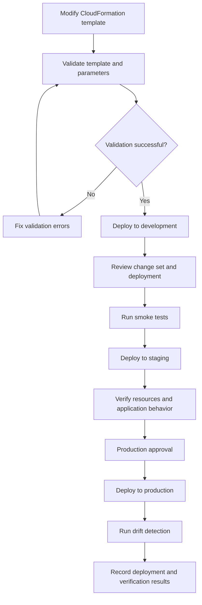

# README

## Overview

This directory contains operational Bash scripts for managing AWS CloudFormation stacks that provision Amazon S3 infrastructure.

The scripts support three primary deployment operations:

- **Template validation:** Validate CloudFormation templates and environment parameter files before deployment.
- **Drift detection:** Identify differences between the deployed stack configuration and its expected CloudFormation template.
- **Stack recovery:** Continue a failed update rollback or deploy a previously saved template through a reviewed change set.

These scripts are designed for controlled development, staging, and production workflows. They use AWS CLI credentials, explicit environment selection, confirmation prompts, and stack-state checks to reduce the risk of unintended infrastructure changes.

## Directory Structure

```text
scripts/
├── README.md
├── validate-template.sh
├── deploy-stack.sh
├── detect-drift.sh
└── rollback-stack.sh
```

## Script Reference

| Script | Responsibility | Operational impact |
|---|---|---|
| `validate-template.sh` | Validates CloudFormation templates and parameter JSON files | Read-only validation |
| `deploy-stack.sh` | Creates and executes a reviewed CloudFormation change set | Creates or updates infrastructure |
| `detect-drift.sh` | Detects configuration drift in an existing stack | Read-only detection |
| `rollback-stack.sh` | Continues a failed rollback or deploys a previous template | Changes stack state or infrastructure |

## Prerequisites

Install and configure the following tools:

| Dependency | Purpose |
|---|---|
| AWS CLI v2 | CloudFormation and STS operations |
| Python 3 | JSON validation and parameter-file processing |
| Bash | Script execution |
| Standard Unix utilities | `date`, `sleep`, `wc`, `tr`, and other shell operations |
| cfn-lint | Additional CloudFormation template validation; optional where supported |

Verify the environment:

```bash
aws --version
python3 --version
bash --version
```

Verify AWS authentication:

```bash
aws sts get-caller-identity
```

The caller must have the required permissions for the operation being performed. Use an environment-specific IAM role or AWS profile rather than embedding credentials in scripts.

## Stack Naming Convention

The scripts use the following stack naming convention:

```text
s3-static-website-<environment>
```

| Environment | Stack name |
|---|---|
| Development | `s3-static-website-dev` |
| Staging | `s3-static-website-staging` |
| Production | `s3-static-website-production` |

The default stack prefix is `s3-static-website`.

Scripts that support a configurable stack prefix can use:

```bash
export STACK_NAME_PREFIX="s3-static-website"
```

Ensure the prefix is consistent across deployment, drift detection, and recovery operations.

## Environment and AWS Configuration

The scripts support explicit AWS Region and profile selection.

Set the default Region:

```bash
export AWS_REGION="ap-south-1"
```

Alternatively:

```bash
export AWS_DEFAULT_REGION="ap-south-1"
```

Use a named profile:

```bash
export AWS_PROFILE="development"
```

You can also pass the Region and profile directly:

```bash
./detect-drift.sh staging \
    --region ap-south-1 \
    --profile staging
```

Explicit command-line options should be preferred when operating across multiple AWS accounts or Regions.

## Template Validation

### `validate-template.sh`

Validates CloudFormation templates and environment-specific parameter files.

Run validation for all templates:

```bash
./validate-template.sh
```

Validate a specific template:

```bash
./validate-template.sh templates/static-website-bucket.yaml
```

The validation workflow includes:

- Checking required command-line dependencies.
- Validating parameter JSON syntax.
- Checking template file size.
- Running AWS CloudFormation template validation.
- Running `cfn-lint` when available.
- Reporting validation failures and warnings.

AWS CLI validation requires valid credentials and the appropriate CloudFormation permissions.

`cfn-lint` provides additional static analysis. AWS template validation and static linting complement each other; neither guarantees that deployment will succeed.

## Deploying a CloudFormation Stack

### `deploy-stack.sh`

Creates a CloudFormation change set, displays proposed infrastructure changes, requests explicit confirmation, and executes the change set.

Deploy to development:

```bash
./deploy-stack.sh dev
```

Deploy to staging:

```bash
./deploy-stack.sh staging \
    --region ap-south-1
```

Deploy to production using a named profile:

```bash
./deploy-stack.sh production \
    --region ap-south-1 \
    --profile production
```

The deployment workflow includes:

1. Validating the environment argument.
2. Checking required tools and configuration.
3. Verifying AWS identity and account information.
4. Validating the CloudFormation template and parameter file.
5. Inspecting the existing stack status.
6. Creating a CloudFormation change set.
7. Displaying proposed resource changes.
8. Requiring explicit confirmation before execution.
9. Waiting for the deployment operation.
10. Displaying stack outputs.

### Change Set Review

Always inspect the proposed change set before approving it.

Pay particular attention to:

- Resource replacement.
- Bucket configuration changes.
- Versioning and encryption changes.
- Bucket policy modifications.
- Lifecycle configuration changes.
- Resource deletion or retention behavior.

A CloudFormation change set describes proposed infrastructure changes. It does not guarantee that every operation will succeed at execution time.

## Detecting Configuration Drift

### `detect-drift.sh`

CloudFormation drift detection identifies supported resource properties whose actual configuration differs from the expected template configuration.

Run drift detection:

```bash
./detect-drift.sh dev
```

For staging:

```bash
./detect-drift.sh staging \
    --region ap-south-1
```

For production:

```bash
./detect-drift.sh production \
    --profile production \
    --region ap-south-1
```

### Detection Workflow

The script:

1. Verifies AWS credentials and account identity.
2. Checks that the target stack exists.
3. Confirms the stack is in a supported stable state.
4. Starts CloudFormation drift detection.
5. Polls until detection completes or times out.
6. Displays the overall drift status.
7. Lists modified and deleted resources.
8. Displays resources that could not be checked.
9. Prints detailed differences for drifted resources.

### Drift Status Reference

| Status | Meaning | Recommended action |
|---|---|---|
| `IN_SYNC` | Evaluated resource properties match the template | No drift remediation required for evaluated properties |
| `DRIFTED` | One or more evaluated resource properties differ | Investigate and reconcile |
| `NOT_CHECKED` | CloudFormation could not fully evaluate drift | Inspect unsupported resources and properties |

A successful drift detection operation does not mean every resource property was evaluated. CloudFormation drift detection supports specific resource types and properties.

### Understanding Drift Details

A drift report can contain:

- Logical resource ID.
- Resource type.
- Drift status.
- Expected property values.
- Actual property values.
- Property-level differences.

Use the report to determine whether the change was:

- An intentional operational modification.
- An unauthorized manual change.
- An incomplete deployment.
- A configuration change that should be incorporated into the template.

Do not automatically overwrite live infrastructure without understanding why the drift occurred.

## Recovering a Failed Stack

### `rollback-stack.sh`

Supports two recovery modes:

| Mode | Purpose | Required stack state |
|---|---|---|
| `continue-update-rollback` | Continues an interrupted CloudFormation update rollback | `UPDATE_ROLLBACK_FAILED` |
| `previous-template` | Applies a previously saved template and parameter file through a new update change set | Stable stack state |

### Continue a Failed Update Rollback

Use this mode when CloudFormation enters:

```text
UPDATE_ROLLBACK_FAILED
```

Run:

```bash
./rollback-stack.sh dev
```

The default mode is `continue-update-rollback`.

For a named profile:

```bash
./rollback-stack.sh staging \
    --mode continue-update-rollback \
    --profile staging \
    --region ap-south-1
```

The script:

1. Verifies the AWS account and stack.
2. Displays recent CloudFormation events.
3. Requires environment confirmation.
4. Requires explicit rollback confirmation.
5. Submits `continue-update-rollback`.
6. Waits for `UPDATE_ROLLBACK_COMPLETE`.
7. Displays recent stack events.

### Skipping Resources During Rollback

CloudFormation supports `--resources-to-skip` when a resource prevents rollback completion.

Example:

```bash
./rollback-stack.sh staging \
    --mode continue-update-rollback \
    --skip-resources StaticWebsiteBucketPolicy
```

Only skip resources after investigating the underlying failure.

Skipped resources can remain inconsistent with the CloudFormation template. After rollback completes:

1. Inspect the skipped resource.
2. Compare its actual configuration with the template.
3. Correct the underlying problem.
4. Reconcile the resource through a controlled stack update.
5. Run drift detection.

Skipping resources is a recovery mechanism, not a normal deployment strategy.

### Deploying a Previously Saved Template

The `previous-template` mode creates a new CloudFormation update using a supplied template and parameter file.

Example:

```bash
./rollback-stack.sh staging \
    --mode previous-template \
    --template ./templates/static-website-bucket.yaml \
    --parameters ./parameters/staging.json \
    --region ap-south-1
```

For production:

```bash
./rollback-stack.sh production \
    --mode previous-template \
    --template ./templates/static-website-bucket.yaml \
    --parameters ./parameters/production.json \
    --profile production \
    --region ap-south-1
```

The workflow:

1. Verifies that the stack is in a stable state.
2. Validates the template and parameter JSON.
3. Displays recent stack events.
4. Creates an update change set.
5. Displays proposed resource changes.
6. Requires explicit execution confirmation.
7. Executes the change set.
8. Waits for `UPDATE_COMPLETE`.
9. Displays stack outputs and recent events.

This is a forward deployment of an earlier desired configuration. It is not equivalent to restoring a historical CloudFormation stack snapshot.

Use the exact parameter values associated with the saved template release. Reusing current parameters with an older template can produce unintended changes.

## Operational Workflow

A recommended workflow for S3 infrastructure changes:



Recommended operating sequence:

| Stage | Operation | Verification |
|---|---|---|
| Development | Validate and deploy | Stack status and resource configuration |
| Staging | Deploy reviewed change set | Application and infrastructure tests |
| Production | Execute approved change set | Outputs, events, and service health |
| Post-deployment | Detect drift | Drift report and resource reconciliation |

## Required IAM Permissions

Use separate IAM permissions for validation, deployment, drift detection, and recovery.

The following table describes the principal API permissions. Resource-level restrictions should be applied where supported.

| Operation | Required permissions |
|---|---|
| AWS identity verification | `sts:GetCallerIdentity` |
| Template validation | `cloudformation:ValidateTemplate` |
| Stack inspection | `cloudformation:DescribeStacks` |
| Stack event inspection | `cloudformation:DescribeStackEvents` |
| Change set creation | `cloudformation:CreateChangeSet` |
| Change set inspection | `cloudformation:DescribeChangeSet` |
| Change set execution | `cloudformation:ExecuteChangeSet` |
| Change set cleanup | `cloudformation:DeleteChangeSet` |
| Drift detection | `cloudformation:DetectStackDrift` |
| Drift detection status | `cloudformation:DescribeStackDriftDetectionStatus` |
| Resource drift inspection | `cloudformation:DescribeStackResourceDrifts` |
| Rollback continuation | `cloudformation:ContinueUpdateRollback` |

Additional permissions may be required for the resources managed by the CloudFormation stack, depending on the deployment model and execution role configuration.

For production environments:

- Use dedicated deployment roles.
- Restrict access to the intended AWS account and Region.
- Limit stack operations to approved stack resources where possible.
- Separate deployment permissions from routine application permissions.
- Use short-lived credentials and IAM role assumption.
- Audit deployment activity through CloudTrail.

## Security and Production Considerations

### Protect S3 Data During Recovery

CloudFormation rollback does not guarantee recovery of S3 object data.

Before making infrastructure changes:

- Confirm whether bucket versioning is enabled.
- Understand bucket deletion and retention policies.
- Verify backup and replication arrangements.
- Check whether lifecycle rules can expire objects or noncurrent versions.
- Review resource replacement and deletion behavior.
- Confirm that production data is protected independently of stack recovery.

A retained bucket can survive stack deletion, but retention alone is not a backup strategy.

### Avoid Unreviewed Infrastructure Changes

Never bypass change-set review for production recovery.

Before executing a recovery change set:

- Confirm the AWS account and Region.
- Review resource replacement actions.
- Inspect bucket policy and encryption changes.
- Check lifecycle and versioning configuration.
- Verify the parameter file belongs to the intended release.
- Confirm the impact on existing S3 objects.

### Drift Remediation

Do not assume that every drifted resource should be reverted.

Determine whether the change was intentional before deciding to:

- Update the CloudFormation template.
- Revert the manual configuration change.
- Import an existing resource into stack management.
- Reconcile a resource through a new deployment.

### Operational Logging

Retain the following information for infrastructure change records:

- AWS account and Region.
- Stack name and environment.
- Deployment or recovery timestamp.
- Change set identifier.
- Template version or Git commit.
- Parameter-file version.
- Operator identity.
- Final CloudFormation stack status.
- Drift detection result.

Do not log credentials, secret parameter values, or sensitive application data.

## Common Mistakes and Pitfalls

| Mistake | Impact | Prevention |
|---|---|---|
| Running rollback continuation on a stack that is not `UPDATE_ROLLBACK_FAILED` | Operation is rejected | Inspect stack status first |
| Skipping resources without investigating | Stack and template remain inconsistent | Skip only when necessary and reconcile afterward |
| Treating an older template deployment as native rollback | Unexpected infrastructure changes | Review it as a new update |
| Reusing incompatible parameter values | Incorrect resource configuration | Use parameters associated with the saved release |
| Assuming `IN_SYNC` means every property was checked | Unsupported properties may remain unverified | Review `NOT_CHECKED` resources |
| Automatically fixing every drifted property | Intentional operational changes may be lost | Investigate before remediation |
| Assuming stack recovery restores deleted S3 objects | Data loss remains possible | Maintain independent recovery mechanisms |
| Running scripts against the wrong AWS profile | Changes affect an unintended account | Verify caller identity and Region |
| Ignoring resource replacement in change sets | Existing resources or data may be affected | Review replacement actions before execution |

## Troubleshooting

### AWS Authentication Failure

Inspect the active identity:

```bash
aws sts get-caller-identity
```

Check the selected profile:

```bash
aws configure list --profile production
```

Verify that the selected credentials are valid and have the required permissions.

### Stack Not Found

Inspect stacks in the selected Region:

```bash
aws cloudformation list-stacks \
    --region ap-south-1 \
    --stack-status-filter CREATE_COMPLETE UPDATE_COMPLETE
```

Check:

- Stack name.
- AWS account.
- AWS profile.
- Region.
- IAM permissions.

### Rollback Cannot Continue

Inspect recent events:

```bash
aws cloudformation describe-stack-events \
    --stack-name s3-static-website-staging \
    --region ap-south-1 \
    --max-items 30
```

Identify the resource responsible for rollback failure before using `--resources-to-skip`.

### Drift Detection Fails

Inspect the stack state:

```bash
aws cloudformation describe-stacks \
    --stack-name s3-static-website-staging \
    --region ap-south-1
```

Confirm that:

- The stack is in a supported stable state.
- The caller has drift detection permissions.
- The stack exists in the selected Region.
- CloudFormation supports drift detection for the resources being evaluated.

### Change Set Creation Fails

Inspect the failure reason:

```bash
aws cloudformation describe-change-set \
    --stack-name s3-static-website-staging \
    --change-set-name <change-set-name> \
    --region ap-south-1
```

Common causes include:

- Invalid template structure.
- Invalid parameter values.
- Missing IAM permissions.
- Resource naming conflicts.
- Unsupported resource updates.
- An existing stack operation still in progress.

## Best Practices

- Validate templates and parameter files before every deployment.
- Use change sets for controlled infrastructure updates.
- Keep environment-specific parameter files under version control without secrets.
- Use explicit AWS profiles and Regions for multi-account deployments.
- Inspect CloudFormation events before recovery operations.
- Prefer native rollback continuation for `UPDATE_ROLLBACK_FAILED`.
- Treat previous-template deployment as a new infrastructure update.
- Review resource replacement and deletion actions carefully.
- Run drift detection periodically and after significant manual operations.
- Reconcile drift through controlled infrastructure changes.
- Protect S3 object data independently of CloudFormation stack retention.
- Record deployment identifiers, template versions, and final stack status.

## Key Takeaways

- CloudFormation validation, deployment, drift detection, and recovery are separate operational workflows.
- Change sets provide visibility into proposed infrastructure modifications before execution.
- `continue-update-rollback` is intended for `UPDATE_ROLLBACK_FAILED` stacks; previous-template deployment is a separate update operation.
- Drift detection evaluates supported resource properties and does not guarantee complete configuration coverage.
- CloudFormation stack recovery does not replace S3 data backup, versioning, replication, or disaster recovery procedures.