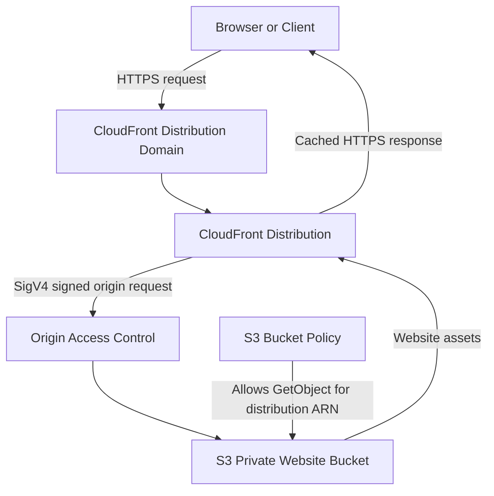

# README

## Overview

This directory contains AWS CloudFormation templates for provisioning and managing Amazon S3 infrastructure.

The templates cover common bucket configurations and deployment patterns, including:

- Foundational S3 bucket provisioning.
- Secure private bucket configuration.
- Versioning and lifecycle management.
- Cross-Region Replication (CRR).
- Static website hosting through Amazon CloudFront.

Each template is designed to be independently deployable and parameterized for development, staging, and production environments where applicable.

The directory focuses on infrastructure definitions. Deployment automation, environment parameter files, validation, drift detection, and rollback procedures are maintained in the sibling `parameters/` and `scripts/` directories.

## Directory Structure

```text
03- AWS CloudFormation/
├── templates/
│   ├── README.md
│   ├── basic-bucket.yaml
│   ├── secure-bucket.yaml
│   ├── versioned-bucket.yaml
│   ├── lifecycle-bucket.yaml
│   ├── replication-buckets.yaml
│   └── static-website-bucket.yaml
├── parameters/
│   ├── dev.json
│   ├── staging.json
│   ├── production.json
│   └── README.md
└── scripts/
    ├── validate-template.sh
    ├── deploy-stack.sh
    ├── detect-drift.sh
    └── rollback-stack.sh
```

## Template Reference

| Template | Purpose | Important capabilities |
|---|---|---|
| `basic-bucket.yaml` | Provisions a foundational S3 bucket | Ownership controls, Block Public Access, encryption, optional versioning |
| `secure-bucket.yaml` | Provisions a private bucket with security controls | Ownership enforcement, public-access blocking, encryption, TLS-only bucket policy, lifecycle configuration |
| `versioned-bucket.yaml` | Provisions a versioned bucket | Versioning, encryption, noncurrent-version expiration, incomplete multipart upload cleanup, TLS enforcement |
| `lifecycle-bucket.yaml` | Configures object lifecycle management | Current and noncurrent version expiration, storage-class transitions, multipart upload cleanup |
| `replication-buckets.yaml` | Configures a source bucket for S3 replication | Versioning, replication IAM role, destination configuration, optional KMS replication, metrics, Replication Time Control |
| `static-website-bucket.yaml` | Provisions a private static website origin | S3 bucket, CloudFront distribution, Origin Access Control, HTTPS redirection, optional access logging |

## Template Selection

Choose a template based on the infrastructure requirement rather than selecting the most feature-rich template by default.

### Foundational bucket

Use `basic-bucket.yaml` when you need a reusable S3 bucket with baseline ownership, public-access, encryption, and optional versioning configuration.

Suitable for:
- Application file storage.
- Development environments.
- General-purpose object storage.
- Infrastructure experiments.

### Secure bucket

Use `secure-bucket.yaml` when the bucket requires explicit transport security and lifecycle management in addition to baseline S3 protections.

Suitable for:
- Private application storage.
- Sensitive document storage.
- Backend-managed uploads and downloads.
- Buckets that must reject insecure transport requests.

### Versioned bucket

Use `versioned-bucket.yaml` when object recovery and historical version management are required.

Suitable for:
- Application assets.
- Document repositories.
- Configuration backups.
- Workloads requiring recovery from accidental overwrites or deletions.

Versioning does not replace backups or replication. Noncurrent versions can continue generating storage charges until they are explicitly expired or removed.

### Lifecycle-managed bucket

Use `lifecycle-bucket.yaml` when objects need automated expiration or storage-class transitions based on age and lifecycle rules.

Suitable for:
- Historical application data.
- Log archives.
- Data ingestion pipelines.
- Storage cost optimization.

Lifecycle actions are asynchronous. A configured transition or expiration date does not guarantee that the action occurs at the exact configured time.

### Replication-enabled bucket

Use `replication-buckets.yaml` when objects must be replicated to another bucket.

Suitable for:
- Cross-Region data copies.
- Regional disaster-recovery architectures.
- Cross-account storage workflows.
- Data distribution between environments.

The template provisions the source bucket and replication role. The destination bucket must be provisioned separately in the target Region and configured with versioning and the required permissions.

Existing objects are not automatically replicated by enabling live replication. Use S3 Batch Replication when existing objects must be included.

### Static website with CloudFront

Use `static-website-bucket.yaml` when hosting static website assets through CloudFront with a private S3 origin.

Suitable for:
- Static frontend applications.
- Documentation websites.
- Static assets and downloadable content.
- Website delivery using HTTPS and CloudFront caching.

The S3 bucket remains private. CloudFront Origin Access Control (OAC) provides the distribution with access to the origin through a bucket policy.

This is preferable to exposing the S3 bucket publicly or using the S3 static website endpoint as the CloudFront origin.

## Shared Infrastructure Design

The templates use several common infrastructure controls.

| Control | Purpose |
|---|---|
| S3 Block Public Access | Prevents public bucket and object access through public ACLs or policies |
| BucketOwnerEnforced | Disables ACL-based ownership management and enforces bucket ownership |
| Server-side encryption | Encrypts objects at rest |
| Versioning | Retains historical object versions |
| Lifecycle configuration | Automates expiration and storage-class transitions |
| IAM roles | Grants AWS services or workloads specific permissions |
| Bucket policies | Defines resource-level access permissions |
| CloudFront OAC | Allows CloudFront to access a private S3 origin |

These controls serve different purposes. Encryption does not grant access, versioning does not provide independent backup, and Block Public Access does not replace least-privilege IAM policies.

## Deployment Workflow

Use the deployment scripts in the parent CloudFormation directory to validate and deploy templates consistently.

### Prerequisites

- AWS CLI installed and configured.
- An AWS account with permission to manage CloudFormation and the resources defined in the selected template.
- An explicit deployment Region.
- Appropriate IAM permissions for the deployment identity.
- Python 3 for parameter-file validation.
- `cfn-lint` recommended for template linting.

Verify the active AWS identity before deployment:

```bash
aws sts get-caller-identity
```

Check the selected Region:

```bash
aws configure get region
```

### Validate templates

From the `03- AWS CloudFormation/` directory:

```bash
./scripts/validate-template.sh
```

Validate an individual template:

```bash
./scripts/validate-template.sh templates/secure-bucket.yaml
```

Validation includes JSON parameter-file syntax checks, CloudFormation template validation, and optional `cfn-lint` checks when the tool is installed.

Template validation does not prove that the deployment identity has all required permissions or that every runtime resource configuration will succeed.

### Deploy the static website stack

The deployment script currently targets `static-website-bucket.yaml`.

Deploy to development:

```bash
./scripts/deploy-stack.sh dev --region ap-south-1
```

Deploy to staging:

```bash
./scripts/deploy-stack.sh staging --region ap-south-1
```

Deploy to production:

```bash
./scripts/deploy-stack.sh production --region ap-south-1
```

The script validates the template and parameter file, checks the AWS identity, creates a CloudFormation change set, and requires explicit confirmation before execution.

Review the proposed changes carefully, particularly when an update replaces resources or modifies access policies.

### Deploy other templates

For templates not targeted by the deployment script, use the AWS CLI directly or extend the deployment automation with an explicit template-selection interface.

Example using `basic-bucket.yaml`:

```bash
aws cloudformation deploy \
  --template-file templates/basic-bucket.yaml \
  --stack-name s3-basic-bucket-dev \
  --parameter-overrides \
    BucketName=your-unique-dev-bucket \
    Environment=dev \
  --region ap-south-1
```

For templates containing IAM resources, provide the appropriate CloudFormation capability flag when required:

```bash
--capabilities CAPABILITY_IAM
```

For named IAM resources, use:

```bash
--capabilities CAPABILITY_NAMED_IAM
```

The replication template creates an IAM role and therefore requires the appropriate IAM capability during deployment.

For `replication-buckets.yaml`, provision and validate the destination bucket separately before deploying the source replication configuration.

## Static Website Deployment Architecture

The static website template creates a private S3 origin and a CloudFront distribution.



### Request flow

1. A client requests the website through the CloudFront distribution domain.
2. CloudFront serves a cached response when the requested object is available in its cache.
3. On a cache miss, CloudFront sends a signed request to the S3 REST origin using OAC.
4. The bucket policy allows `s3:GetObject` only when the request originates from the configured CloudFront distribution.
5. S3 returns the object to CloudFront.
6. CloudFront caches and returns the response to the client.

The template configures:
- Private S3 bucket access.
- CloudFront Origin Access Control using SigV4.
- HTTPS redirection for viewer requests.
- GET and HEAD methods.
- Compression.
- A managed CloudFront cache policy.
- Optional CloudFront standard access logging.

### Important website behavior

The template uses the S3 regional REST endpoint rather than the S3 static website endpoint.

Consequently:
- The S3 website hosting feature is not enabled.
- CloudFront serves `DefaultRootObject` for the distribution root.
- S3 website-specific routing and custom error-document behavior are not provided.
- The configured 403 and 404 custom error responses preserve their respective HTTP status codes.

For single-page applications, configure appropriate routing and error handling separately if client-side routes must resolve to `index.html`.

## Parameter Management

Environment-specific parameter files are maintained in the sibling `parameters/` directory.

```text
parameters/
├── dev.json
├── staging.json
├── production.json
└── README.md
```

The current parameter files are designed for `static-website-bucket.yaml`.

| Parameter | Purpose |
|---|---|
| `BucketName` | Globally unique S3 bucket name |
| `Environment` | Deployment environment |
| `DefaultRootObject` | Default CloudFront object, normally `index.html` |
| `PriceClass` | CloudFront edge location coverage |
| `EnableBucketVersioning` | Enables or disables S3 versioning |
| `EnableCloudFrontAccessLogging` | Controls CloudFront standard logging |
| `LoggingBucketName` | Existing destination bucket for CloudFront logs |

The parameter JSON files use the CloudFormation parameter-array format accepted by AWS CLI commands such as `create-stack` and `update-stack`.

Do not pass these files directly to `--parameter-overrides` with `cloudformation deploy`. That option expects a different command-line representation.

Review `parameters/README.md` for environment-specific configuration and deployment examples.

## Production Considerations

### Security

- Keep Block Public Access enabled unless a documented exception requires otherwise.
- Prefer `BucketOwnerEnforced` ownership controls.
- Use IAM roles and temporary credentials rather than long-lived access keys.
- Apply least-privilege permissions to deployment identities.
- Use TLS-only bucket policies for application buckets where required.
- Restrict CloudFront origin access to the intended distribution.
- Review KMS key policies separately when customer-managed encryption keys are used.
- Do not store credentials or sensitive deployment values in parameter files.

### Reliability and recovery

- Enable versioning when object recovery is a requirement.
- Define lifecycle policies for noncurrent versions and incomplete multipart uploads.
- Use replication or independent backups for recovery requirements that exceed versioning.
- Test restoration procedures rather than assuming that versioning or replication guarantees application recovery.
- Retain critical buckets during stack deletion and use an explicit data-retention procedure.

### CloudFront operations

- Use appropriate cache policies for static assets.
- Prefer content-hashed asset filenames for frontend releases.
- Invalidate CloudFront paths when mutable object names must be refreshed.
- Monitor distribution deployment status and origin errors.
- Configure a suitable logging destination when access logging is enabled.
- Use an ACM certificate in `us-east-1` when adding a custom domain to CloudFront.

### Cost management

Monitor:
- S3 storage consumption and version growth.
- CloudFront data transfer and request volume.
- CloudFront invalidation usage.
- Access logging storage.
- Replication traffic and destination storage.
- Lifecycle transition and retrieval charges.

CloudFront, S3, logging, and replication can incur charges independently. Review the pricing implications before enabling optional features in production.

## Operational Verification

After deployment, retrieve the stack outputs:

```bash
aws cloudformation describe-stacks \
  --stack-name s3-static-website-dev \
  --query 'Stacks[0].Outputs' \
  --output table \
  --region ap-south-1
```

Inspect bucket public-access configuration:

```bash
aws s3api get-public-access-block \
  --bucket your-unique-dev-static-website-bucket \
  --region ap-south-1
```

Inspect bucket encryption:

```bash
aws s3api get-bucket-encryption \
  --bucket your-unique-dev-static-website-bucket \
  --region ap-south-1
```

Inspect versioning:

```bash
aws s3api get-bucket-versioning \
  --bucket your-unique-dev-static-website-bucket \
  --region ap-south-1
```

Inspect the CloudFront distribution:

```bash
aws cloudfront get-distribution \
  --id DISTRIBUTION_ID
```

Verify the distribution endpoint:

```bash
curl -I https://DISTRIBUTION_DOMAIN_NAME
```

A successful stack deployment does not mean website assets have been uploaded. Upload the website build output separately:

```bash
aws s3 sync ./dist \
  s3://your-unique-dev-static-website-bucket/ \
  --region ap-south-1
```

Then verify the deployed content through CloudFront.

```bash
curl -I https://DISTRIBUTION_DOMAIN_NAME/index.html
```

## Drift Detection and Recovery

Detect configuration drift for the static website stack:

```bash
./scripts/detect-drift.sh dev --region ap-south-1
```

Drift detection compares supported resource properties against the deployed stack configuration. It does not guarantee that every AWS resource property is evaluated.

For a stack in `UPDATE_ROLLBACK_FAILED`, use the rollback script's continuation mode after investigating the failed resources:

```bash
./scripts/rollback-stack.sh dev \
  --mode continue-update-rollback \
  --region ap-south-1
```

To restore a previous template and parameter configuration, use the previous-template mode with explicit files:

```bash
./scripts/rollback-stack.sh dev \
  --mode previous-template \
  --template templates/static-website-bucket.yaml \
  --parameters parameters/dev.json \
  --region ap-south-1
```

A CloudFormation rollback does not necessarily restore deleted object data. S3 bucket retention, object versioning, backups, and recovery procedures must be designed independently.

## Common Mistakes

| Mistake | Impact | Prevention |
|---|---|---|
| Making the S3 website bucket public to serve a website | Exposes the origin directly | Use a private REST origin with CloudFront OAC |
| Deploying a replication rule before preparing the destination bucket | Replication configuration or object replication fails | Provision destination versioning, permissions, and encryption first |
| Assuming versioning is equivalent to backup | Account-level or regional incidents may still affect recovery | Define independent backup and recovery procedures |
| Enabling KMS replication without key permissions | Replication fails with authorization errors | Configure IAM permissions and both KMS key policies |
| Treating CloudFormation validation as a deployment guarantee | Runtime permissions or resource constraints can still fail | Review change sets and test deployments in non-production |
| Deleting a stack without checking retained resources | Buckets and their data remain after stack deletion | Maintain an explicit resource inventory and cleanup procedure |
| Assuming uploaded website files are part of the CloudFormation stack | Distribution returns missing objects | Deploy website assets separately and run smoke tests |
| Using mutable asset names with long cache lifetimes | Users may receive stale content | Use content-hashed filenames and controlled invalidations |

## Key Takeaways

- Keep CloudFormation templates focused on reusable infrastructure and manage environment-specific values through parameter files.
- Prefer private S3 buckets with Block Public Access, ownership enforcement, encryption, and narrowly scoped resource policies.
- Use CloudFront OAC for static website delivery instead of exposing the S3 origin publicly.
- Treat versioning, lifecycle management, replication, and backup as separate capabilities with distinct recovery and cost implications.
- Validate templates, inspect change sets, monitor drift, and verify deployed behavior before promoting infrastructure changes to production.