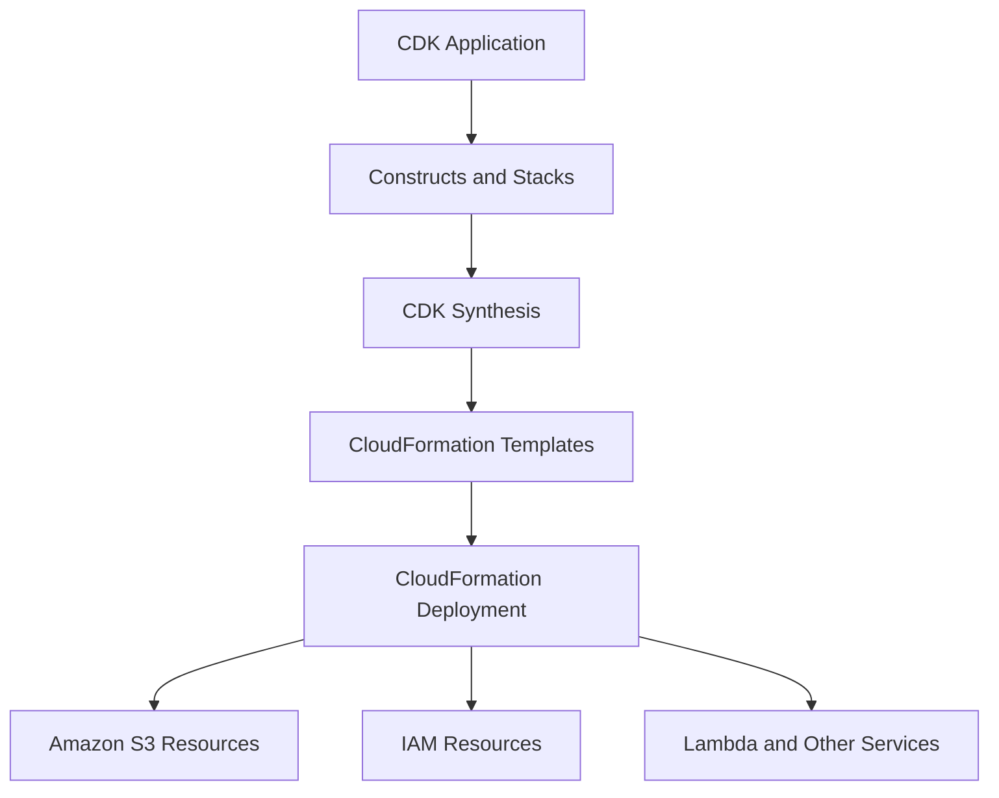
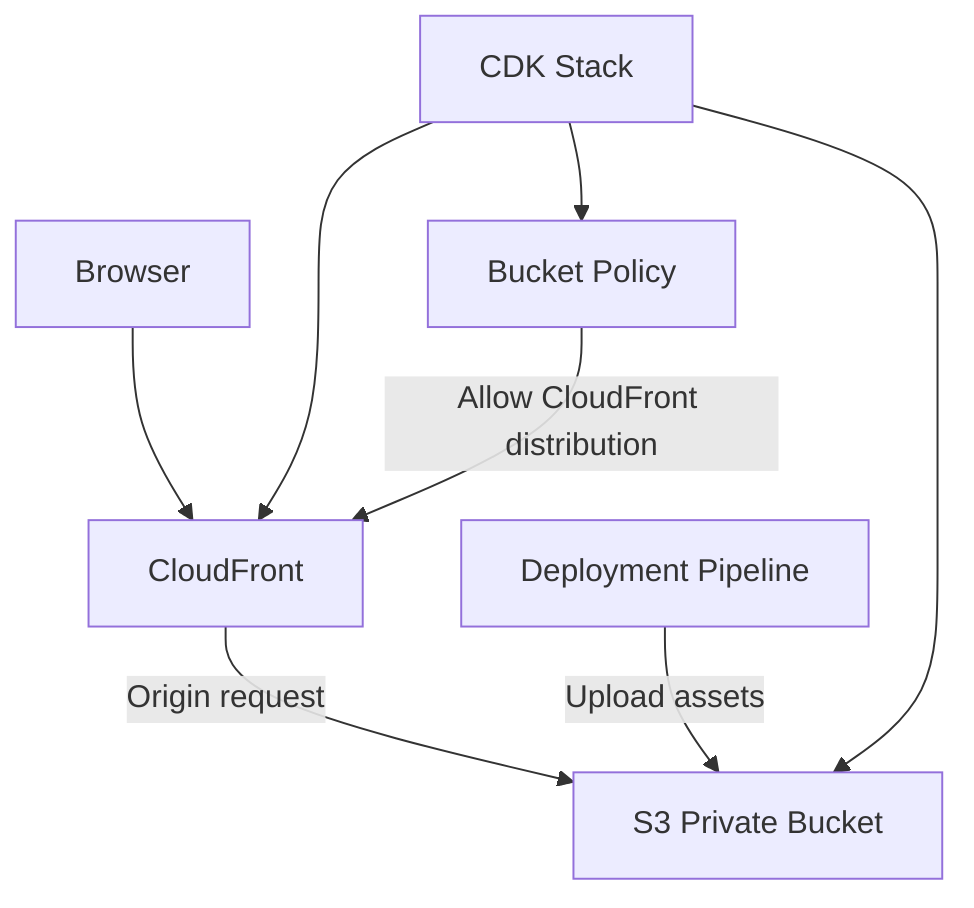
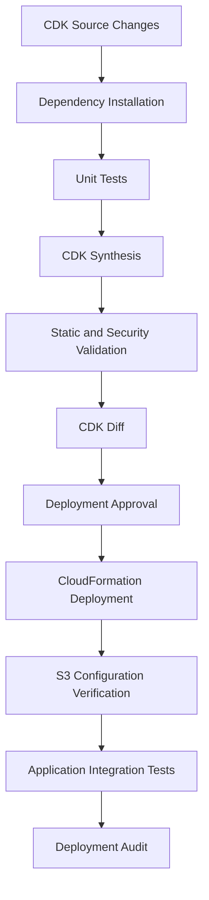

# 01- AWS CDK for S3

## Overview

AWS Cloud Development Kit (CDK) is an infrastructure-as-code framework that allows developers to define AWS resources using familiar programming languages such as Python, TypeScript, Java, and C#.

For Amazon S3, CDK provides reusable constructs for defining buckets, encryption, versioning, lifecycle policies, access controls, replication, event notifications, and integrations with other AWS services.

Instead of maintaining large CloudFormation templates manually, developers define infrastructure using application code. CDK synthesizes that code into CloudFormation templates, which AWS CloudFormation deploys and manages.

CDK is particularly useful when S3 infrastructure must be:

- Reused across multiple applications and environments.
- Composed with Lambda, CloudFront, IAM, SQS, and other AWS services.
- Defined using programming-language abstractions.
- Tested using automated infrastructure assertions.
- Integrated into CI/CD pipelines.
- Maintained alongside application source code.

## AWS CDK Architecture

AWS CDK is not a replacement for CloudFormation. It is a higher-level infrastructure definition framework that generates CloudFormation templates.

The deployment process has three major stages:

1. Define infrastructure using CDK constructs.
2. Synthesize the application into CloudFormation templates.
3. Deploy the generated templates through CloudFormation.



### Main Components

| Component | Responsibility |
|---|---|
| CDK Application | Entry point that defines the infrastructure application. |
| Construct | Reusable abstraction representing one or more AWS resources. |
| Stack | Deployment unit mapped to a CloudFormation stack. |
| App | Root construct containing one or more stacks. |
| Synthesis | Converts CDK constructs into CloudFormation templates and supporting assets. |
| CDK Toolkit | CLI used to synthesize, compare, deploy, and destroy CDK applications. |
| CloudFormation | Provisions and manages the generated AWS resources. |
| Bootstrap Stack | Provides deployment resources required by CDK in an AWS environment. |

## Constructs and Abstraction Levels

CDK constructs are the primary building blocks of infrastructure definitions.

CDK provides three commonly used construct levels.

| Level | Description | Typical use |
|---|---|---|
| L1 | Direct representation of CloudFormation resources. | Accessing resource properties not exposed by higher-level constructs. |
| L2 | Higher-level abstractions with sensible defaults and convenience methods. | Creating and configuring S3 buckets. |
| L3 | Reusable architectural patterns combining multiple resources. | Building an S3-backed application or event-processing workflow. |

### L1 Constructs

L1 constructs represent CloudFormation resources directly.

For S3, the L1 construct is `CfnBucket`.

```python
from aws_cdk import aws_s3 as s3

bucket = s3.CfnBucket(
    self,
    "RawBucket",
    bucket_name="example-raw-data-bucket",
    versioning_configuration={
        "status": "Enabled"
    },
)
```

Use L1 constructs when:

- A CloudFormation property is not exposed by an L2 construct.
- Exact CloudFormation resource configuration is required.
- Working with newly released resource properties before higher-level abstractions support them.

L1 constructs require more explicit configuration and provide fewer convenience methods.

### L2 Constructs

L2 constructs provide higher-level abstractions and encapsulate common configuration.

The `s3.Bucket` construct is the standard choice for most S3 infrastructure.

```python
from aws_cdk import RemovalPolicy
from aws_cdk import aws_s3 as s3

bucket = s3.Bucket(
    self,
    "ApplicationBucket",
    versioned=True,
    encryption=s3.BucketEncryption.S3_MANAGED,
    block_public_access=s3.BlockPublicAccess.BLOCK_ALL,
    enforce_ssl=True,
    removal_policy=RemovalPolicy.RETAIN,
)
```

The construct generates the corresponding CloudFormation resource and associated configuration.

Advantages:

- Less repetitive infrastructure code.
- Strongly typed configuration.
- Reusable defaults and convenience methods.
- Easier integration with other CDK constructs.
- Better maintainability for application-oriented infrastructure.

### L3 Constructs

L3 constructs represent reusable infrastructure patterns.

For example, an application-specific construct could combine:

- An S3 bucket.
- An S3 event notification.
- A Lambda processing function.
- IAM permissions.
- CloudWatch logging.

This allows teams to package repeated infrastructure patterns behind a reusable interface.

Use L3 constructs when multiple applications require the same architectural behavior with controlled configuration differences.

## CDK Project Structure

A Python CDK application commonly uses the following structure:

```text
s3-cdk/
├── app.py
├── cdk.json
├── requirements.txt
├── README.md
├── source/
│   └── s3_cdk/
│       ├── __init__.py
│       └── s3_stack.py
└── tests/
    └── unit/
        └── test_s3_stack.py
```

| File or directory | Purpose |
|---|---|
| `app.py` | CDK application entry point. |
| `cdk.json` | CDK CLI application configuration. |
| `requirements.txt` | Python dependencies. |
| `source/s3_cdk/` | Stack and construct implementations. |
| `tests/` | Infrastructure unit tests. |
| `README.md` | Setup, deployment, and operational instructions. |

For larger applications, separate reusable constructs from stack definitions.

Example:

```text
s3-cdk/
├── app.py
├── cdk.json
├── requirements.txt
├── source/
│   └── s3_cdk/
│       ├── stacks/
│       │   ├── storage_stack.py
│       │   └── processing_stack.py
│       └── constructs/
│           ├── secure_bucket.py
│           └── event_processor.py
└── tests/
    ├── unit/
    └── integration/
```

This separation prevents application-specific deployment logic from becoming tightly coupled to reusable infrastructure definitions.

## Installing and Configuring AWS CDK

### Prerequisites

Install the following tools:

- Python 3.10 or later, compatible with the selected CDK release.
- Node.js and npm for the CDK Toolkit.
- AWS CLI v2.
- AWS CDK Toolkit.
- An AWS account and an appropriately authorized deployment identity.

Install the CDK CLI:

```bash
npm install -g aws-cdk
```

Verify the installation:

```bash
cdk --version
aws --version
python --version
node --version
```

### Create a Python CDK Project

Create a project directory:

```bash
mkdir s3-cdk
cd s3-cdk
```

Create a virtual environment:

```bash
python -m venv .venv
```

Activate it on Windows:

```powershell
.venv\Scripts\Activate.ps1
```

Activate it on Linux or macOS:

```bash
source .venv/bin/activate
```

Initialize the project:

```bash
cdk init app --language python
```

Install dependencies:

```bash
pip install -r requirements.txt
```

The generated project includes the application entry point, stack implementation, CDK configuration, and initial dependencies.

### AWS Account Configuration

Configure an AWS CLI profile for local development:

```bash
aws configure --profile s3-dev
```

Verify the target account:

```bash
aws sts get-caller-identity \
  --profile s3-dev
```

Set the profile and Region:

```bash
export AWS_PROFILE=s3-dev
export AWS_REGION=ap-south-1
```

On PowerShell:

```powershell
$env:AWS_PROFILE = "s3-dev"
$env:AWS_REGION = "ap-south-1"
```

Prefer IAM roles and temporary credentials over long-lived access keys.

## CDK Bootstrap

### What Is Bootstrapping?

CDK bootstrapping prepares an AWS account and Region for CDK deployments.

The bootstrap process creates infrastructure required by the CDK deployment mechanism. Depending on the bootstrap template and deployment configuration, this can include:

- An S3 asset bucket.
- IAM roles for deployment operations.
- Roles used by CloudFormation.
- ECR resources for container assets.
- Supporting deployment infrastructure.

CDK asset publishing and deployment roles depend on this environment.

### Bootstrap an Environment

```bash
cdk bootstrap aws://ACCOUNT_ID/ap-south-1
```

Replace `ACCOUNT_ID` with the target AWS account ID.

Using a named profile:

```bash
cdk bootstrap aws://ACCOUNT_ID/ap-south-1 \
  --profile s3-dev
```

Verify the bootstrap stack:

```bash
aws cloudformation describe-stacks \
  --stack-name CDKToolkit \
  --region ap-south-1 \
  --profile s3-dev
```

### Environment-Specific Bootstrapping

Bootstrap each account and Region where CDK deployments will occur.

For example:

```bash
cdk bootstrap aws://111111111111/ap-south-1 \
  --profile s3-dev

cdk bootstrap aws://222222222222/ap-south-1 \
  --profile s3-staging

cdk bootstrap aws://333333333333/ap-south-1 \
  --profile s3-production
```

These are illustrative account IDs.

### Bootstrap Security Considerations

The bootstrap stack establishes deployment trust relationships. Its permissions should be reviewed before production use.

Production recommendations:

- Use a controlled bootstrap template.
- Restrict deployment roles to approved principals.
- Separate development and production accounts.
- Review trust policies and deployment permissions.
- Avoid granting unrestricted deployment access.
- Protect the bootstrap stack from unauthorized modification.

Do not treat bootstrapping as an ordinary application deployment. Changes to bootstrap resources can affect multiple CDK applications in the same environment.

## Defining an S3 Bucket Using Python CDK

The following implementation creates a private S3 bucket with encryption, versioning, public-access blocking, and retention protection.

### Stack Implementation

`source/s3_cdk/s3_stack.py`

```python
from aws_cdk import (
    RemovalPolicy,
    Stack,
)
from aws_cdk import aws_s3 as s3
from constructs import Construct


class S3Stack(Stack):

    def __init__(
        self,
        scope: Construct,
        construct_id: str,
        **kwargs,
    ) -> None:
        super().__init__(scope, construct_id, **kwargs)

        self.bucket = s3.Bucket(
            self,
            "ApplicationBucket",
            versioned=True,
            encryption=s3.BucketEncryption.S3_MANAGED,
            block_public_access=s3.BlockPublicAccess.BLOCK_ALL,
            enforce_ssl=True,
            removal_policy=RemovalPolicy.RETAIN,
        )
```

### Application Entry Point

`app.py`

```python
#!/usr/bin/env python3

import os

import aws_cdk as cdk

from s3_cdk.s3_stack import S3Stack


app = cdk.App()

account = os.environ.get("CDK_DEFAULT_ACCOUNT")
region = os.environ.get("CDK_DEFAULT_REGION", "ap-south-1")

S3Stack(
    app,
    "S3ApplicationStack",
    env=cdk.Environment(
        account=account,
        region=region,
    ),
)

app.synth()
```

The CDK CLI supplies the default account and Region through the environment when the application is executed with an appropriately configured AWS profile.

### Dependencies

A typical `requirements.txt` contains:

```text
aws-cdk-lib>=2.0.0,<3.0.0
constructs>=10.0.0,<11.0.0
```

For reproducible deployments, pin and maintain tested dependency versions rather than allowing unconstrained upgrades.

### Synthesis

Generate the CloudFormation template:

```bash
cdk synth
```

The generated template can be inspected in the `cdk.out` directory.

Review the synthesized CloudFormation template when:

- Security-sensitive properties are configured.
- Resource replacement is possible.
- IAM policies are generated.
- L1 overrides are used.
- Construct behavior is not obvious.

CDK source code is not the final deployed configuration. The synthesized CloudFormation template is the artifact CloudFormation receives.

## S3 Security Configuration

S3 security should be defined explicitly rather than relying only on construct defaults.

### Public Access Blocking

For private application storage:

```python
block_public_access=s3.BlockPublicAccess.BLOCK_ALL
```

This blocks public access through supported bucket and account-level public-access mechanisms.

It does not replace IAM authorization or bucket policy design.

### Object Ownership

Use bucket-owner-enforced ownership when ACLs are unnecessary:

```python
object_ownership=s3.ObjectOwnership.BUCKET_OWNER_ENFORCED
```

This disables ACL-based access control and establishes bucket-owner ownership for uploaded objects.

It is appropriate for most modern application storage architectures.

### HTTPS Enforcement

```python
enforce_ssl=True
```

This configures a bucket policy that denies insecure transport requests.

Applications should use HTTPS endpoints for all S3 operations.

### Encryption

For SSE-S3:

```python
encryption=s3.BucketEncryption.S3_MANAGED
```

For SSE-KMS:

```python
encryption=s3.BucketEncryption.KMS_MANAGED
```

For a specific customer-managed KMS key:

```python
from aws_cdk import aws_kms as kms
from aws_cdk import aws_s3 as s3

key = kms.Key(
    self,
    "StorageKey",
    enable_key_rotation=True,
)

bucket = s3.Bucket(
    self,
    "EncryptedBucket",
    encryption=s3.BucketEncryption.KMS,
    encryption_key=key,
    block_public_access=s3.BlockPublicAccess.BLOCK_ALL,
    enforce_ssl=True,
)
```

SSE-KMS requires appropriate permissions at both the S3 and KMS authorization layers.

The deployment role, application role, and any service integration roles must have the permissions required for their respective operations.

Detailed encryption and KMS authorization design belongs in the S3 security section.

## Versioning and Object Retention

Versioning preserves multiple versions of an object under the same key.

Enable it through CDK:

```python
bucket = s3.Bucket(
    self,
    "VersionedBucket",
    versioned=True,
    removal_policy=RemovalPolicy.RETAIN,
)
```

Versioning is useful for:

- Recovery from accidental overwrites.
- Recovery from ordinary object deletion.
- Maintaining historical object versions.
- Supporting replication requirements.

However, versioning increases storage consumption and does not replace backup or retention policies.

A bucket with retained CloudFormation resources can still contain objects that are deleted by application code or lifecycle configuration.

For production buckets, evaluate version retention, noncurrent-version expiration, recovery requirements, and deletion controls together.

## Lifecycle Configuration

Lifecycle rules automate transitions and expiration based on object age and other filters.

Example:

```python
from aws_cdk import Duration
from aws_cdk import aws_s3 as s3

bucket.add_lifecycle_rule(
    id="ArchiveApplicationData",
    prefix="archive/",
    transitions=[
        s3.Transition(
            storage_class=s3.StorageClass.INFREQUENT_ACCESS,
            transition_after=Duration.days(30),
        ),
        s3.Transition(
            storage_class=s3.StorageClass.GLACIER,
            transition_after=Duration.days(90),
        ),
    ],
    abort_incomplete_multipart_upload_after=Duration.days(7),
)
```

Use lifecycle policies when object access patterns are predictable.

Consider:

- Minimum storage-duration requirements.
- Retrieval costs.
- Transition request charges.
- Object size and access frequency.
- Noncurrent-version retention.
- Incomplete multipart upload cleanup.

Do not use lifecycle expiration as a substitute for application-level deletion workflows or regulatory retention controls.

## IAM Permissions and Bucket Grants

CDK provides methods to grant common S3 permissions to other constructs.

For example, grant read access to a Lambda function:

```python
from aws_cdk import aws_lambda as lambda_

processor = lambda_.Function(
    self,
    "Processor",
    runtime=lambda_.Runtime.PYTHON_3_12,
    handler="handler.main",
    code=lambda_.Code.from_asset("lambda"),
)

bucket.grant_read(processor)
```

Grant write access:

```python
bucket.grant_write(processor)
```

Grant read and write access:

```python
bucket.grant_read_write(processor)
```

These methods generate IAM permissions associated with the receiving principal.

Use the narrowest suitable permission.

For example, a processing Lambda that reads original images and writes transformed images should ideally use separate input and output buckets or narrowly scoped prefixes.

Avoid granting broad bucket access to every application component.

### Explicit Policy Statements

When a specific action or resource restriction is required, define an IAM policy explicitly.

```python
from aws_cdk import aws_iam as iam

processor.add_to_role_policy(
    iam.PolicyStatement(
        actions=[
            "s3:GetObject",
        ],
        resources=[
            bucket.arn_for_objects("incoming/*"),
        ],
    )
)
```

This restricts object reads to the `incoming/` prefix.

Remember that `s3:ListBucket` applies to the bucket resource, while object operations such as `s3:GetObject` apply to object ARNs.

## S3 Event Notifications

CDK supports integrating S3 events with Lambda, SQS, and SNS.

Example: invoke a Lambda function when a new object is created under the `incoming/` prefix.

```python
from aws_cdk import aws_lambda as lambda_
from aws_cdk import aws_s3 as s3
from aws_cdk import aws_s3_notifications as notifications

processor = lambda_.Function(
    self,
    "ImageProcessor",
    runtime=lambda_.Runtime.PYTHON_3_12,
    handler="handler.main",
    code=lambda_.Code.from_asset("lambda"),
)

bucket.add_event_notification(
    s3.EventType.OBJECT_CREATED,
    notifications.LambdaDestination(processor),
    s3.NotificationKeyFilter(
        prefix="incoming/",
    ),
)
```

CDK configures the notification destination and the necessary Lambda invocation permission.

### Event Processing Considerations

S3 notifications are delivered at least once. Consumers must tolerate duplicate events and should not assume event ordering.

Production processing should implement:

- Idempotency.
- Retry-safe operations.
- Structured logging.
- Failure handling.
- Separate input and output prefixes.
- Event validation.
- Monitoring and alerting.

Avoid configuring the same Lambda to write output into a prefix that triggers the same notification. This can create recursive processing.

For workloads requiring buffering, controlled concurrency, or more advanced retry handling, consider routing events through SQS.

## CloudFront Integration

A private S3 bucket can serve as the origin for CloudFront using Origin Access Control (OAC).

The architecture is:



The S3 bucket remains private. CloudFront receives permission to retrieve objects through its distribution identity.

A production implementation should configure:

- CloudFront distribution.
- S3 REST origin.
- Origin Access Control.
- Bucket policy restricted to the intended distribution.
- HTTPS viewer protocol policy.
- Cache policy.
- Error response behavior where required.
- DNS and TLS configuration for custom domains.

Do not enable public bucket access simply to make CloudFront delivery work.

For production website infrastructure, define CloudFront and S3 as coordinated resources with explicit dependencies and verify the generated bucket policy.

## Environment Configuration

CDK supports environment-specific deployment through stack environments.

A common strategy is to maintain separate accounts for development, staging, and production.

Example:

```python
import os

import aws_cdk as cdk

from s3_cdk.s3_stack import S3Stack


app = cdk.App()

environments = {
    "dev": {
        "account": os.environ["DEV_ACCOUNT_ID"],
        "region": "ap-south-1",
    },
    "staging": {
        "account": os.environ["STAGING_ACCOUNT_ID"],
        "region": "ap-south-1",
    },
    "production": {
        "account": os.environ["PRODUCTION_ACCOUNT_ID"],
        "region": "ap-south-1",
    },
}

for environment_name, configuration in environments.items():
    S3Stack(
        app,
        f"S3-{environment_name}",
        env=cdk.Environment(
            account=configuration["account"],
            region=configuration["region"],
        ),
        description=f"S3 infrastructure for {environment_name}",
    )

app.synth()
```

This example defines one stack per environment. Deploying each stack still requires selecting the intended AWS credentials and deployment environment.

For production systems, avoid deploying all environments through an unrestricted shared identity.

Prefer:

- Separate AWS accounts.
- Environment-specific deployment roles.
- Explicit approval gates.
- Environment-specific configuration.
- Separate application and infrastructure permissions.

Do not hardcode credentials in `app.py`, `cdk.json`, or environment configuration files.

## CDK CLI Commands

The CDK CLI supports the complete infrastructure development lifecycle.

| Command | Purpose |
|---|---|
| `cdk init` | Initialize a CDK application. |
| `cdk bootstrap` | Prepare an AWS account and Region for CDK deployment. |
| `cdk synth` | Generate CloudFormation templates. |
| `cdk diff` | Compare local synthesized infrastructure with deployed infrastructure. |
| `cdk deploy` | Deploy or update stacks. |
| `cdk destroy` | Delete deployed stacks and their eligible resources. |
| `cdk ls` | List stacks in the application. |
| `cdk doctor` | Diagnose common CDK environment and configuration issues. |

### List Stacks

```bash
cdk ls
```

### Synthesize Templates

```bash
cdk synth
```

### Review Changes

```bash
cdk diff S3ApplicationStack
```

Review the output for:

- Resource additions.
- Resource deletions.
- Bucket replacements.
- Encryption changes.
- IAM policy modifications.
- Lifecycle changes.
- Public-access configuration changes.

### Deploy a Stack

```bash
cdk deploy S3ApplicationStack
```

Specify an AWS profile:

```bash
cdk deploy S3ApplicationStack \
  --profile s3-dev
```

### Deploy Multiple Stacks

```bash
cdk deploy --all
```

Use `--all` carefully. It can deploy every stack in the CDK application, including environments or resources that were not intended for the current release.

### Destroy a Stack

```bash
cdk destroy S3ApplicationStack
```

A stack configured with `RemovalPolicy.RETAIN` can leave its S3 bucket behind after the CloudFormation stack is deleted.

Retained resources may continue to incur charges and require separate management.

## Infrastructure Testing

Infrastructure tests validate synthesized CloudFormation templates without requiring an AWS deployment.

CDK provides assertions through `aws_cdk.assertions`.

### Test Dependencies

A typical test environment uses:

```text
pytest
aws-cdk-lib
constructs
```

### Unit Test Example

`tests/unit/test_s3_stack.py`

```python
import aws_cdk as cdk

from aws_cdk import assertions

from s3_cdk.s3_stack import S3Stack


def test_s3_bucket_configuration():
    app = cdk.App()

    stack = S3Stack(
        app,
        "TestS3Stack",
        env=cdk.Environment(
            account="111111111111",
            region="ap-south-1",
        ),
    )

    template = assertions.Template.from_stack(stack)

    template.resource_count_is(
        "AWS::S3::Bucket",
        1,
    )

    template.has_resource_properties(
        "AWS::S3::Bucket",
        {
            "VersioningConfiguration": {
                "Status": "Enabled",
            },
            "PublicAccessBlockConfiguration": {
                "BlockPublicAcls": True,
                "BlockPublicPolicy": True,
                "IgnorePublicAcls": True,
                "RestrictPublicBuckets": True,
            },
            "BucketEncryption": {
                "ServerSideEncryptionConfiguration": [
                    {
                        "ServerSideEncryptionByDefault": {
                            "SSEAlgorithm": "AES256",
                        },
                    },
                ],
            },
        },
    )
```

Run the tests:

```bash
pytest tests/unit -v
```

### What to Test

| Test area | Validation |
|---|---|
| Bucket creation | Expected S3 resources are synthesized. |
| Versioning | Versioning is enabled where required. |
| Encryption | Expected encryption configuration is present. |
| Public access | All required public-access block settings are enabled. |
| Ownership | ACL configuration matches the intended ownership model. |
| HTTPS | The synthesized bucket policy denies insecure transport. |
| Lifecycle | Transition and expiration rules match requirements. |
| IAM | Policies grant only the required actions and resources. |
| Notifications | Event sources and destinations are configured correctly. |
| Retention | Deletion and replacement policies match the environment requirements. |

Unit tests do not prove that AWS will successfully deploy or operate the infrastructure.

Use integration tests in a controlled AWS environment to validate actual permissions, event delivery, encryption, and application behavior.

## Deployment Lifecycle

A production CDK workflow should separate code validation, synthesis, review, deployment, and verification.



### Pre-Deployment Validation

Run:

```bash
python -m pip install -r requirements.txt
pytest tests/unit -v
cdk synth
cdk diff
```

For infrastructure validation, consider:

- CloudFormation template validation.
- `cfn-lint`.
- IAM policy analysis.
- Security scanning.
- CDK assertions.
- Deployment environment verification.

### Deployment Verification

After deployment, verify the actual S3 configuration.

Inspect bucket versioning:

```bash
aws s3api get-bucket-versioning \
  --bucket BUCKET_NAME \
  --region ap-south-1
```

Inspect encryption:

```bash
aws s3api get-bucket-encryption \
  --bucket BUCKET_NAME \
  --region ap-south-1
```

Inspect public-access configuration:

```bash
aws s3api get-public-access-block \
  --bucket BUCKET_NAME \
  --region ap-south-1
```

Inspect ownership controls:

```bash
aws s3api get-bucket-ownership-controls \
  --bucket BUCKET_NAME \
  --region ap-south-1
```

Inspect lifecycle configuration:

```bash
aws s3api get-bucket-lifecycle-configuration \
  --bucket BUCKET_NAME \
  --region ap-south-1
```

Some inspection commands return an error when the corresponding configuration has not been set. Interpret these results in the context of the intended template configuration.

## CI/CD Integration

CDK applications can be deployed through GitHub Actions or other CI/CD platforms.

A typical pipeline contains:

- Dependency installation.
- Unit tests.
- CDK synthesis.
- Static validation.
- Change review.
- Environment-specific deployment.
- Post-deployment verification.

### GitHub Actions Example

The following workflow illustrates validation and synthesis. It does not deploy infrastructure.

```yaml
name: CDK Validation

on:
  pull_request:
    paths:
      - "06- Deployment/05- Amazon S3/04- AWS CDK/**"
  push:
    branches:
      - main

permissions:
  contents: read

jobs:
  validate:
    runs-on: ubuntu-latest

    defaults:
      run:
        working-directory: 06- Deployment/05- Amazon S3/04- AWS CDK

    steps:
      - name: Checkout
        uses: actions/checkout@v4

      - name: Set up Python
        uses: actions/setup-python@v5
        with:
          python-version: "3.12"

      - name: Set up Node.js
        uses: actions/setup-node@v4
        with:
          node-version: "22"

      - name: Install CDK CLI
        run: npm install -g aws-cdk

      - name: Install Python dependencies
        run: |
          python -m pip install --upgrade pip
          pip install -r requirements.txt

      - name: Run unit tests
        run: pytest tests/unit -v

      - name: Synthesize templates
        run: cdk synth
```

Pin third-party GitHub Actions to reviewed immutable commit SHAs in production workflows.

For deployment workflows:

- Use GitHub Actions OIDC federation.
- Restrict the IAM trust policy to the intended repository and branch or deployment environment.
- Use separate deployment roles for each environment.
- Require production approval.
- Run `cdk diff` before deployment.
- Preserve deployment logs and synthesized templates.
- Verify deployed resources after execution.

Do not place AWS access keys in GitHub repository variables or source code when OIDC federation is available.

## Stack Composition and Reusable Constructs

As S3 infrastructure grows, avoid placing every resource in one large stack.

A useful decomposition separates infrastructure by ownership and deployment lifecycle.

Example:

```text
CDK Application
│
├── StorageStack
│   ├── RawBucket
│   ├── ProcessedBucket
│   └── ArchiveBucket
│
├── ProcessingStack
│   ├── Lambda Function
│   ├── IAM Role
│   └── Event Notification
│
└── DeliveryStack
    ├── CloudFront Distribution
    ├── Origin Access Control
    └── DNS Configuration
```

### Cross-Stack References

Stacks can reference resources exported by other stacks in the same CDK application.

For example, a processing stack can receive a bucket reference from a storage stack.

```python
from aws_cdk import Stack
from aws_cdk import aws_s3 as s3
from constructs import Construct


class ProcessingStack(Stack):

    def __init__(
        self,
        scope: Construct,
        construct_id: str,
        source_bucket: s3.IBucket,
        **kwargs,
    ) -> None:
        super().__init__(
            scope,
            construct_id,
            **kwargs,
        )

        self.source_bucket = source_bucket
```

The stack receives an interface rather than creating another bucket.

This improves modularity and makes dependencies explicit.

### Stack Decomposition Considerations

Separate stacks when resources have different:

- Deployment lifecycles.
- Ownership boundaries.
- Permission requirements.
- Environment configurations.
- Change frequencies.
- Operational responsibilities.

Avoid excessive stack fragmentation. Cross-stack references create deployment dependencies and can make resource removal or replacement more complicated.

## Resource Removal and Retention

CDK supports resource removal policies.

```python
from aws_cdk import RemovalPolicy

bucket = s3.Bucket(
    self,
    "ProductionBucket",
    removal_policy=RemovalPolicy.RETAIN,
)
```

Common policies:

| Policy | Behavior |
|---|---|
| `DESTROY` | Deletes the resource when the stack is removed, where supported. |
| `RETAIN` | Keeps the physical resource after stack removal. |
| `SNAPSHOT` | Creates a snapshot before removal where supported by the resource. |

For S3 buckets, `SNAPSHOT` is not a substitute for a backup strategy.

### Development Environment

For disposable development resources, `DESTROY` may be appropriate when the bucket is empty and data is not required.

### Production Environment

For production buckets, prefer retention unless an explicitly approved deletion process exists.

Important considerations:

- A non-empty S3 bucket may prevent stack deletion.
- Versioned buckets can contain historical versions and delete markers.
- Retained buckets become unmanaged by the deleted stack.
- Retained resources can continue to incur storage and request charges.
- Removing a stack does not automatically remove retained resources.

Never make production bucket deletion an ordinary CI/CD cleanup step.

## Rollback and Recovery

CDK deployment failures are managed through CloudFormation.

When a deployment fails:

1. Identify the affected stack.
2. Inspect CloudFormation events.
3. Identify the resource that failed.
4. Determine whether the failure is caused by permissions, resource conflicts, or invalid configuration.
5. Resolve the underlying issue.
6. Review the next synthesized template and change set.
7. Retry deployment after validation.

Inspect stack events:

```bash
aws cloudformation describe-stack-events \
  --stack-name S3ApplicationStack \
  --region ap-south-1
```

Inspect stack status:

```bash
aws cloudformation describe-stacks \
  --stack-name S3ApplicationStack \
  --region ap-south-1
```

For an update that completed successfully but introduced an unwanted configuration, restore the previous CDK source revision or configuration and deploy it through a reviewed change.

CDK does not provide an independent rollback engine. CloudFormation controls the resource update and rollback lifecycle.

For data-bearing S3 resources, infrastructure rollback does not restore deleted object contents. Use versioning, backup, replication, and tested recovery procedures for data protection.

## Common CDK and S3 Pitfalls

| Mistake | Why it matters | Recommended approach |
|---|---|---|
| Treating CDK as a replacement for CloudFormation | CDK deployments still depend on CloudFormation resource behavior. | Understand synthesized templates and CloudFormation lifecycle states. |
| Skipping `cdk diff` | Resource replacements or deletions can go unnoticed. | Review infrastructure differences before deployment. |
| Using L1 constructs for every resource | Creates unnecessary verbosity and maintenance overhead. | Prefer L2 constructs unless lower-level control is required. |
| Assuming L2 defaults meet production requirements | Defaults may not match application security or retention requirements. | Explicitly configure security-sensitive properties. |
| Using broad IAM grants | Increases the impact of compromised application components. | Scope actions and resources to actual workload requirements. |
| Ignoring synthesized templates | Generated policies and resource properties may differ from expectations. | Inspect `cdk synth` output during reviews. |
| Destroying a production stack | Can remove resources or leave retained resources unmanaged. | Apply environment-specific removal policies and deletion approvals. |
| Treating versioning as backup | Versioning does not protect against every deletion or account-level failure scenario. | Define independent backup and recovery controls. |
| Creating circular stack dependencies | Can prevent deployment or resource replacement. | Design stack ownership and dependency direction carefully. |
| Triggering Lambda from its own output prefix | Can create recursive event processing. | Separate input and output prefixes or buckets. |
| Deploying with administrator permissions | Creates an unnecessarily large deployment blast radius. | Use scoped deployment roles and controlled bootstrap trust. |
| Relying only on unit tests | Synthesized templates do not prove runtime integration behavior. | Add deployment verification and integration tests. |

## Production Readiness Checklist

Before deploying an S3 CDK stack to production, verify the following.

### Infrastructure

- [ ] Stack environment explicitly identifies the intended AWS account and Region.
- [ ] Bucket names are globally unique.
- [ ] Versioning is enabled where recovery requirements justify it.
- [ ] Encryption configuration matches data sensitivity requirements.
- [ ] Public access is blocked unless explicitly required.
- [ ] Object ownership is configured appropriately.
- [ ] HTTPS-only access is enforced.
- [ ] Lifecycle policies have been reviewed for data-retention implications.
- [ ] Resource removal policies protect critical buckets.
- [ ] CloudFormation dependencies are explicit and valid.

### Security

- [ ] IAM policies follow least privilege.
- [ ] Application roles are separate from deployment roles.
- [ ] KMS permissions are configured where SSE-KMS is used.
- [ ] Bucket policies restrict access to approved principals.
- [ ] Presigned URL workflows enforce application-level authorization.
- [ ] Secrets are not stored in source code.
- [ ] Bootstrap deployment trust is restricted.

### Reliability and Operations

- [ ] Unit tests validate synthesized infrastructure.
- [ ] `cdk synth` completes successfully.
- [ ] `cdk diff` has been reviewed.
- [ ] Deployment failure and rollback procedures are documented.
- [ ] CloudWatch logging and monitoring are configured where required.
- [ ] Event consumers handle duplicate S3 notifications.
- [ ] Backup and recovery requirements are defined.
- [ ] Post-deployment verification commands are available.
- [ ] Resource deletion and cleanup procedures are documented.

## Key Takeaways

- AWS CDK defines infrastructure through reusable programming-language constructs and synthesizes CloudFormation templates for deployment.
- Prefer L2 constructs for standard S3 resources, using L1 constructs when direct CloudFormation-level control is necessary.
- Configure security, retention, encryption, versioning, and IAM permissions explicitly for production workloads.
- Use `cdk synth`, `cdk diff`, infrastructure assertions, and post-deployment verification as separate validation layers.
- Treat CloudFormation rollback, S3 data recovery, and CDK deployment governance as distinct operational responsibilities.