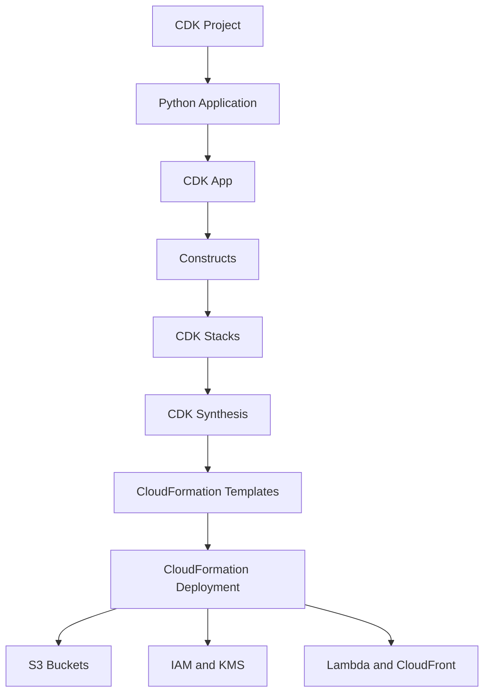
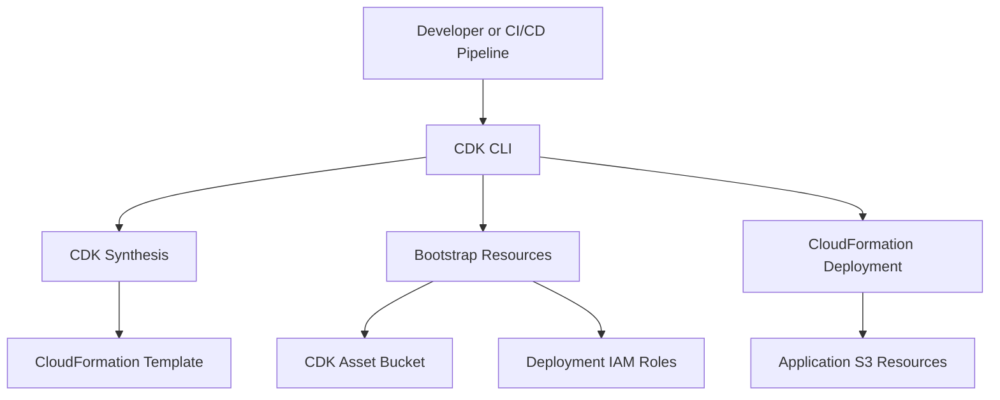
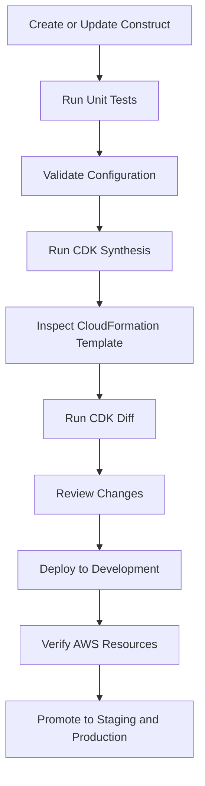

# 02- CDK Project Structure and Bootstrapping

## Overview

AWS Cloud Development Kit (CDK) projects require more than infrastructure definitions. A maintainable implementation needs a predictable project structure, dependency management, environment configuration, reusable constructs, automated testing, and a correctly bootstrapped AWS deployment environment.

For Amazon S3 infrastructure, these concerns become particularly important when managing multiple buckets, encryption keys, lifecycle policies, IAM roles, event notifications, CloudFront distributions, and application integrations across development, staging, and production.

This document covers the structure and initialization of Python-based AWS CDK applications, with emphasis on S3 infrastructure and production deployment practices.

## CDK Project Architecture

A CDK application is a program that defines AWS infrastructure through constructs and stacks.

The application is synthesized into CloudFormation templates. CloudFormation then provisions and manages the resources.



### Application Components

| Component | Responsibility |
|---|---|
| CDK App | Root application containing stacks. |
| Stack | Deployment unit mapped to a CloudFormation stack. |
| Construct | Reusable infrastructure abstraction. |
| Construct Library | Collection of reusable constructs and resource definitions. |
| CDK CLI | Initializes, synthesizes, compares, deploys, and destroys stacks. |
| CloudFormation | Provisions and manages deployed AWS resources. |
| Bootstrap Stack | Supplies deployment resources and roles required by CDK. |
| `cdk.out` | Contains synthesized CloudFormation templates and deployment artifacts. |

### Recommended Project Organization

Keep application entry points, reusable constructs, stacks, configuration, and tests separate.

This prevents infrastructure definitions from becoming tightly coupled to a single deployment environment.

## Python CDK Project Structure

A practical project structure for an S3 infrastructure application:

```text
s3-cdk/
├── app.py
├── cdk.json
├── requirements.txt
├── requirements-dev.txt
├── README.md
├── .gitignore
├── source/
│   └── s3_cdk/
│       ├── __init__.py
│       ├── config.py
│       ├── stacks/
│       │   ├── __init__.py
│       │   ├── storage_stack.py
│       │   └── delivery_stack.py
│       └── constructs/
│           ├── __init__.py
│           └── secure_bucket.py
├── tests/
│   ├── unit/
│   │   ├── test_storage_stack.py
│   │   └── test_secure_bucket.py
│   └── integration/
│       └── test_s3_deployment.py
└── cdk.out/
```

`cdk.out/` is generated during synthesis and should not normally be committed unless the deployment pipeline explicitly requires retaining synthesized artifacts in source control.

### Directory Responsibilities

| Path | Responsibility |
|---|---|
| `app.py` | Creates the CDK application and instantiates stacks. |
| `cdk.json` | Configures the CDK CLI application command and context. |
| `requirements.txt` | Declares runtime dependencies. |
| `requirements-dev.txt` | Declares development and testing dependencies. |
| `source/s3_cdk/config.py` | Loads and validates deployment configuration. |
| `source/s3_cdk/stacks/` | Contains deployable infrastructure stacks. |
| `source/s3_cdk/constructs/` | Contains reusable infrastructure abstractions. |
| `tests/unit/` | Tests synthesized resources and configuration. |
| `tests/integration/` | Validates deployed AWS behavior. |
| `README.md` | Documents prerequisites, setup, deployment, verification, and cleanup. |

## Initialize a Python CDK Project

### Prerequisites

Install and configure:

- Python 3.10 or later, compatible with the selected CDK release.
- Node.js and npm.
- AWS CLI v2.
- AWS CDK Toolkit.
- An AWS account and an authorized deployment identity.

Install the CDK CLI:

```bash
npm install -g aws-cdk
```

Verify the toolchain:

```bash
python --version
node --version
npm --version
aws --version
cdk --version
```

### Create the Project

Create a project directory:

```bash
mkdir s3-cdk
cd s3-cdk
```

Create a virtual environment:

```bash
python -m venv .venv
```

Activate it on Windows:

```powershell
.venv\Scripts\Activate.ps1
```

Activate it on Linux or macOS:

```bash
source .venv/bin/activate
```

Initialize the CDK application:

```bash
cdk init app --language python
```

The CDK CLI generates a Python application with an initial stack, dependency files, and configuration.

Install dependencies:

```bash
python -m pip install --upgrade pip
pip install -r requirements.txt
```

## Dependency Management

CDK projects depend on the CDK library and the Constructs library.

A typical `requirements.txt` contains:

```text
aws-cdk-lib>=2.0.0,<3.0.0
constructs>=10.0.0,<11.0.0
```

Development dependencies can be maintained separately.

`requirements-dev.txt`:

```text
-r requirements.txt
pytest
```

Install development dependencies:

```bash
pip install -r requirements-dev.txt
```

### Version Management

For production repositories:

- Pin tested dependency versions.
- Upgrade CDK dependencies through controlled changes.
- Review CDK release notes before major upgrades.
- Regenerate and inspect synthesized templates after upgrades.
- Run infrastructure assertions before deployment.
- Keep the CDK CLI and project library versions compatible.

Unbounded dependency upgrades can change generated CloudFormation templates or construct behavior without an intentional infrastructure change.

A reproducible dependency lock file or fully pinned requirements file is preferable for controlled CI/CD environments.

## CDK Configuration

The `cdk.json` file configures how the CDK CLI executes the application.

Example:

```json
{
  "app": "python app.py",
  "watch": {
    "include": [
      "source/**/*.py",
      "app.py"
    ],
    "exclude": [
      "README.md",
      "cdk*.json",
      "requirements*.txt",
      "tests/**"
    ]
  }
}
```

The application command should match the actual project layout.

For a project using a `source/` directory, Python must be able to import the package.

One approach is to set `PYTHONPATH` when invoking CDK.

Linux or macOS:

```bash
PYTHONPATH=source cdk synth
```

PowerShell:

```powershell
$env:PYTHONPATH = "source"
cdk synth
```

Alternatively, install the project package in editable mode using a maintained Python package configuration.

For larger projects, package installation is generally more maintainable than relying on shell-specific environment configuration.

### CDK Context

CDK context stores configuration values used during synthesis.

Example:

```json
{
  "app": "python app.py",
  "context": {
    "application": "document-storage",
    "environment": "dev",
    "region": "ap-south-1"
  }
}
```

Context is useful for non-secret configuration such as:

- Application identifiers.
- Environment names.
- Feature flags.
- Resource naming inputs.
- Deployment-specific behavior.

Do not store passwords, access keys, tokens, or other secrets in CDK context.

Context values should be validated before resource creation. An invalid environment name or Region should fail synthesis rather than silently produce unintended infrastructure.

## Environment Configuration

A CDK application should distinguish application configuration from AWS credentials.

Application configuration describes what infrastructure should be created.

AWS credentials determine which identity is authorized to create it.

These are separate concerns.

### Environment Configuration Module

`source/s3_cdk/config.py`

```python
from dataclasses import dataclass
import os


@dataclass(frozen=True)
class DeploymentConfig:
    environment: str
    account: str
    region: str

    @classmethod
    def from_environment(cls) -> "DeploymentConfig":
        environment = os.environ.get("DEPLOYMENT_ENV", "dev")
        account = os.environ.get("CDK_DEFAULT_ACCOUNT")
        region = os.environ.get(
            "CDK_DEFAULT_REGION",
            "ap-south-1",
        )

        if environment not in {"dev", "staging", "production"}:
            raise ValueError(
                f"Unsupported deployment environment: {environment}"
            )

        if not account:
            raise ValueError(
                "CDK_DEFAULT_ACCOUNT is required"
            )

        if not account.isdigit() or len(account) != 12:
            raise ValueError(
                "CDK_DEFAULT_ACCOUNT must be a 12-digit AWS account ID"
            )

        return cls(
            environment=environment,
            account=account,
            region=region,
        )
```

This configuration module:

- Restricts supported environment names.
- Requires an explicit AWS account.
- Provides a default Region.
- Fails early when required deployment information is missing.

For production systems, validate resource naming inputs and environment-specific security requirements here as well.

### Application Entry Point

`app.py`

```python
#!/usr/bin/env python3

import aws_cdk as cdk

from s3_cdk.config import DeploymentConfig
from s3_cdk.stacks.storage_stack import StorageStack


app = cdk.App()

config = DeploymentConfig.from_environment()

StorageStack(
    app,
    f"S3Storage-{config.environment}",
    environment_name=config.environment,
    env=cdk.Environment(
        account=config.account,
        region=config.region,
    ),
    description=(
        f"S3 storage infrastructure for {config.environment}"
    ),
)

app.synth()
```

The entry point is responsible for assembling the application. Resource definitions belong in stacks and constructs rather than in `app.py`.

### Configure the Environment

Linux or macOS:

```bash
export DEPLOYMENT_ENV=dev
export AWS_PROFILE=s3-dev
export AWS_REGION=ap-south-1
```

PowerShell:

```powershell
$env:DEPLOYMENT_ENV = "dev"
$env:AWS_PROFILE = "s3-dev"
$env:AWS_REGION = "ap-south-1"
```

The CDK CLI can use the configured AWS profile to resolve account and Region information.

Verify the identity:

```bash
aws sts get-caller-identity
```

For production deployment, prefer explicitly configured deployment roles and account-specific environments rather than relying on whichever profile happens to be active.

## Account and Region Configuration

CDK distinguishes environment-specific stacks from environment-agnostic stacks.

### Environment-Specific Stack

An environment-specific stack declares its target account and Region.

```python
import aws_cdk as cdk

stack_environment = cdk.Environment(
    account="111111111111",
    region="ap-south-1",
)
```

This is preferable for production infrastructure that depends on account or Region information.

Examples include:

- S3 buckets with Region-specific naming and integration requirements.
- KMS keys.
- CloudFront-related infrastructure.
- Lambda functions.
- Cross-account IAM roles.
- Region-specific service integrations.

### Environment-Agnostic Stack

A stack without an explicitly configured environment can be synthesized without a fixed account and Region.

This can be useful for reusable infrastructure definitions.

However, environment-agnostic stacks have limitations when constructs need account- or Region-specific values during synthesis.

For production S3 infrastructure, explicitly target the intended environment whenever the infrastructure depends on account or Region information.

### Account and Region Separation

A common deployment model uses separate AWS accounts:

| Environment | AWS account | Region |
|---|---|---|
| Development | Development account | `ap-south-1` |
| Staging | Staging account | `ap-south-1` |
| Production | Production account | `ap-south-1` |

Separate accounts provide stronger isolation than relying only on different bucket names or prefixes.

## CDK Bootstrap

### What Bootstrapping Does

CDK bootstrapping prepares an AWS account and Region for CDK deployments.

The bootstrap process deploys a CloudFormation stack named `CDKToolkit` by default.

Depending on the bootstrap template and configuration, it provisions resources such as:

- An S3 bucket for file assets.
- IAM roles used by deployment operations.
- Roles assumed by CloudFormation.
- An ECR repository for container assets.
- Supporting deployment infrastructure.

The CDK application uses these resources when publishing assets and deploying stacks.

### Why Bootstrapping Is Required

CDK applications can synthesize CloudFormation templates locally, but deployment may require publishing assets and assuming deployment roles.

For example, an application may include:

- Lambda deployment packages.
- Static website assets.
- Docker container images.
- Other files required by deployment constructs.

The bootstrap environment provides the resources and permissions needed for these operations.

Bootstrapping is performed per AWS account and Region.

A development account bootstrapped in one Region is not automatically bootstrapped in every other Region.

### Bootstrap Architecture



The bootstrap asset bucket is separate from application S3 buckets.

Do not use the CDK bootstrap bucket as the application's permanent object storage location.

## Bootstrap an AWS Environment

### Identify the Target Account

Use the intended AWS profile:

```bash
aws sts get-caller-identity \
  --profile s3-dev
```

Record the account ID returned by AWS.

### Bootstrap the Account and Region

```bash
cdk bootstrap aws://111111111111/ap-south-1 \
  --profile s3-dev
```

Replace the account ID with the actual target account.

### Bootstrap Staging and Production

```bash
cdk bootstrap aws://222222222222/ap-south-1 \
  --profile s3-staging
```

```bash
cdk bootstrap aws://333333333333/ap-south-1 \
  --profile s3-production
```

These account IDs are illustrative.

Each command prepares the specified account and Region independently.

### Verify the Bootstrap Stack

```bash
aws cloudformation describe-stacks \
  --stack-name CDKToolkit \
  --region ap-south-1 \
  --profile s3-dev
```

Inspect bootstrap resources:

```bash
aws cloudformation list-stack-resources \
  --stack-name CDKToolkit \
  --region ap-south-1 \
  --profile s3-dev
```

Confirm that the stack completed successfully and that the expected resources exist.

### Bootstrap Version

Inspect the bootstrap stack's outputs and parameters to identify its deployed version and configuration.

The CDK CLI also checks bootstrap compatibility during deployment. An outdated bootstrap stack can prevent newer CDK applications from deploying successfully.

Use the CDK CLI's current bootstrap template when upgrading:

```bash
cdk bootstrap aws://111111111111/ap-south-1 \
  --profile s3-dev
```

Review the resulting changes before applying bootstrap updates in production.

## Bootstrap Security and Permissions

The bootstrap stack establishes the deployment trust model.

Its IAM roles can have permissions to publish assets, deploy CloudFormation stacks, and pass execution roles.

An overly permissive bootstrap configuration can create a significant account-level security risk.

### Production Recommendations

- Restrict deployment roles to approved principals.
- Use separate bootstrap environments for separate accounts.
- Review the bootstrap template and generated IAM policies.
- Avoid unrestricted trust relationships.
- Restrict `iam:PassRole` to approved roles.
- Use temporary credentials and OIDC federation for CI/CD.
- Apply organizational permission boundaries where required.
- Audit bootstrap changes through CloudFormation and CloudTrail.

### Trusted Accounts and Deployment Roles

For cross-account deployment, the target account must explicitly trust the intended deployment identity.

The deployment process generally involves:

1. CI/CD obtains short-lived credentials.
2. The deployment identity assumes an authorized role.
3. CDK uses the bootstrap deployment roles.
4. CloudFormation creates or updates application resources.

The exact trust relationships depend on the bootstrap configuration and deployment model.

Do not assume that successfully bootstrapping an account automatically authorizes every developer or CI/CD principal to deploy.

## Reusable S3 Constructs

Reusable constructs prevent repeated bucket configuration across stacks.

For example, multiple application buckets may share:

- Encryption.
- Versioning.
- Public-access blocking.
- Ownership controls.
- HTTPS enforcement.
- Retention behavior.

These requirements can be implemented once in a reusable construct.

### Secure Bucket Construct

`source/s3_cdk/constructs/secure_bucket.py`

```python
from aws_cdk import RemovalPolicy
from aws_cdk import aws_s3 as s3
from constructs import Construct


class SecureBucket(Construct):

    def __init__(
        self,
        scope: Construct,
        construct_id: str,
        *,
        bucket_name: str | None = None,
        retain_on_delete: bool = True,
    ) -> None:
        super().__init__(scope, construct_id)

        removal_policy = (
            RemovalPolicy.RETAIN
            if retain_on_delete
            else RemovalPolicy.DESTROY
        )

        self.bucket = s3.Bucket(
            self,
            "Bucket",
            bucket_name=bucket_name,
            versioned=True,
            encryption=s3.BucketEncryption.S3_MANAGED,
            block_public_access=s3.BlockPublicAccess.BLOCK_ALL,
            object_ownership=s3.ObjectOwnership.BUCKET_OWNER_ENFORCED,
            enforce_ssl=True,
            removal_policy=removal_policy,
        )
```

This construct provides a reusable baseline for private application storage.

It does not attempt to solve every security or operational requirement. Additional controls such as KMS key management, lifecycle rules, access logging, replication, and application-specific IAM permissions should be composed according to workload requirements.

### Storage Stack

`source/s3_cdk/stacks/storage_stack.py`

```python
from aws_cdk import Stack
from constructs import Construct

from s3_cdk.constructs.secure_bucket import SecureBucket


class StorageStack(Stack):

    def __init__(
        self,
        scope: Construct,
        construct_id: str,
        *,
        environment_name: str,
        **kwargs,
    ) -> None:
        super().__init__(
            scope,
            construct_id,
            **kwargs,
        )

        self.environment_name = environment_name

        self.upload_bucket = SecureBucket(
            self,
            "UploadStorage",
            retain_on_delete=True,
        )

        self.processed_bucket = SecureBucket(
            self,
            "ProcessedStorage",
            retain_on_delete=True,
        )
```

The stack composes two reusable constructs while retaining responsibility for the application-specific resource arrangement.

For production use, add explicit lifecycle, monitoring, and access-control configuration based on the data classification and recovery requirements.

## Stack Composition and Dependencies

A larger S3 application may contain multiple stacks.

For example:

```text
S3 CDK Application
│
├── StorageStack
│   ├── Upload Bucket
│   ├── Processed Bucket
│   └── Archive Bucket
│
├── ProcessingStack
│   ├── Lambda Function
│   ├── IAM Role
│   └── S3 Event Notification
│
└── DeliveryStack
    ├── CloudFront Distribution
    ├── Origin Access Control
    └── DNS Configuration
```

Each stack should have a clear deployment responsibility.

### Cross-Stack References

A processing stack can receive an S3 bucket reference from a storage stack.

```python
from aws_cdk import Stack
from aws_cdk import aws_s3 as s3
from constructs import Construct


class ProcessingStack(Stack):

    def __init__(
        self,
        scope: Construct,
        construct_id: str,
        *,
        source_bucket: s3.IBucket,
        **kwargs,
    ) -> None:
        super().__init__(
            scope,
            construct_id,
            **kwargs,
        )

        self.source_bucket = source_bucket
```

The `IBucket` interface allows the stack to work with a bucket defined elsewhere without owning its creation.

The application entry point can pass the bucket reference when constructing the dependent stack.

CDK automatically establishes dependencies for supported cross-stack references.

### Stack Decomposition Guidelines

Separate stacks when resources have different:

- Ownership boundaries.
- Deployment lifecycles.
- Permission requirements.
- Change frequencies.
- Environment requirements.
- Operational responsibilities.

Avoid unnecessary fragmentation. Cross-stack references create deployment dependencies and can complicate resource replacement or stack removal.

## Synthesis and Generated Artifacts

CDK synthesis converts application code into CloudFormation templates.

Run:

```bash
cdk synth
```

The CDK CLI generates the cloud assembly in `cdk.out/`.

Typical contents include:

```text
cdk.out/
├── manifest.json
├── tree.json
├── S3Storage-dev.template.json
└── asset.*.json
```

The exact files depend on the application and its assets.

### Why Synthesis Matters

Synthesis is an important infrastructure validation boundary.

It reveals the actual CloudFormation resources generated by the application.

Review synthesized templates for:

- Bucket configuration.
- Encryption settings.
- Public-access restrictions.
- Ownership controls.
- IAM policies.
- Resource dependencies.
- Lifecycle configuration.
- Event notification destinations.
- Removal and update policies.

Do not assume that the Python source directly reflects the final CloudFormation resource configuration.

The synthesized template is the artifact CloudFormation deploys.

### Validate the Synthesized Template

If the AWS CLI is configured:

```bash
aws cloudformation validate-template \
  --template-body file://cdk.out/S3Storage-dev.template.json \
  --region ap-south-1
```

For additional static validation, use `cfn-lint`:

```bash
pip install cfn-lint
```

```bash
cfn-lint cdk.out/S3Storage-dev.template.json
```

Static validation complements CDK unit tests but does not prove successful deployment.

## Testing the Project Structure

A maintainable CDK project should test both reusable constructs and stack-level behavior.

### Unit Test Dependencies

`requirements-dev.txt`:

```text
-r requirements.txt
pytest
```

### Construct Test

`tests/unit/test_secure_bucket.py`

```python
import aws_cdk as cdk
from aws_cdk import assertions

from s3_cdk.constructs.secure_bucket import SecureBucket


def test_secure_bucket_configuration():
    app = cdk.App()
    stack = cdk.Stack(app, "TestStack")

    SecureBucket(
        stack,
        "TestBucket",
        retain_on_delete=True,
    )

    template = assertions.Template.from_stack(stack)

    template.resource_count_is(
        "AWS::S3::Bucket",
        1,
    )

    template.has_resource_properties(
        "AWS::S3::Bucket",
        {
            "VersioningConfiguration": {
                "Status": "Enabled",
            },
            "PublicAccessBlockConfiguration": {
                "BlockPublicAcls": True,
                "BlockPublicPolicy": True,
                "IgnorePublicAcls": True,
                "RestrictPublicBuckets": True,
            },
            "OwnershipControls": {
                "Rules": [
                    {
                        "ObjectOwnership": "BucketOwnerEnforced",
                    },
                ],
            },
        },
    )
```

Run:

```bash
pytest tests/unit -v
```

### What Unit Tests Should Verify

| Area | Expected validation |
|---|---|
| Project configuration | Invalid environments fail before synthesis. |
| Construct behavior | Expected S3 resources are generated. |
| Versioning | Versioning is enabled where required. |
| Encryption | The expected encryption algorithm is configured. |
| Public access | Public-access block settings are enabled. |
| Ownership | Object ownership configuration matches the design. |
| Retention | Removal and update policies match the environment. |
| IAM | Permissions are scoped to the intended resources. |
| Stack composition | Cross-stack references and dependencies are correct. |

Unit tests validate generated infrastructure definitions. They do not verify actual AWS permissions, S3 operations, or event delivery.

Integration tests should run in a controlled AWS account and Region.

## Git Ignore Configuration

Do not commit virtual environments, caches, credentials, or generated artifacts unintentionally.

Example `.gitignore`:

```gitignore
.venv/
venv/
__pycache__/
*.py[cod]
.pytest_cache/
.mypy_cache/
.ruff_cache/

cdk.out/
*.egg-info/
dist/
build/

.env
.env.*
!.env.example

.idea/
.vscode/

.DS_Store
Thumbs.db
```

If synthesized templates are required as CI/CD artifacts, retain them through the pipeline's artifact storage mechanism rather than committing generated files by default.

## Development Workflow

A consistent local workflow reduces configuration errors and makes infrastructure changes easier to review.



### Common Development Commands

| Command | Purpose |
|---|---|
| `cdk ls` | List application stacks. |
| `cdk synth` | Generate CloudFormation templates. |
| `cdk diff` | Compare local infrastructure with deployed infrastructure. |
| `cdk deploy STACK_NAME` | Deploy a selected stack. |
| `cdk destroy STACK_NAME` | Remove a selected stack. |
| `cdk doctor` | Diagnose CDK environment issues. |

Example:

```bash
pytest tests/unit -v
```

```bash
PYTHONPATH=source cdk synth
```

```bash
PYTHONPATH=source cdk diff S3Storage-dev
```

```bash
PYTHONPATH=source cdk deploy S3Storage-dev
```

Use the appropriate environment credentials for each command.

## CI/CD Project Requirements

A production CDK repository should support automated validation and controlled deployment.

A recommended pipeline separates pull-request validation from deployment.

### Pull Request Validation

Typical steps:

1. Check out the repository.
2. Install the supported Node.js and Python versions.
3. Install pinned dependencies.
4. Run unit tests.
5. Run static analysis.
6. Synthesize CloudFormation templates.
7. Validate generated templates.
8. Publish synthesis artifacts for review when required.

### Deployment Pipeline

A deployment workflow should:

1. Select the target AWS account and Region.
2. Authenticate using OIDC federation or an approved role-assumption mechanism.
3. Verify the deployment identity.
4. Run the required CDK synthesis and validation.
5. Review infrastructure changes.
6. Require approval for production.
7. Deploy the approved stack.
8. Verify deployed S3 configuration.
9. Preserve deployment logs and artifacts.

### CI/CD Security Boundaries

Use separate identities for:

- Application runtime access.
- Infrastructure deployment.
- Asset publishing.
- CloudFormation execution.

Do not reuse an application Lambda role as a CDK deployment role.

Do not grant CI/CD administrator permissions merely to avoid diagnosing missing deployment permissions.

The deployment identity should have only the permissions necessary for the approved infrastructure changes.

## Operational Considerations

### Bootstrap Stack Management

The bootstrap stack is shared infrastructure for CDK deployments within an account and Region.

Changes to it can affect multiple applications.

Manage it separately from ordinary application stacks.

Recommended controls:

- Restrict changes to platform or cloud infrastructure administrators.
- Review bootstrap template changes.
- Monitor bootstrap stack updates.
- Maintain consistent bootstrap versions across environments.
- Document cross-account deployment trust.
- Avoid deleting bootstrap resources while dependent applications still use them.

### S3 Resource Retention

CDK stack deletion and S3 data deletion are separate concerns.

A bucket configured with `RemovalPolicy.RETAIN` remains after its owning stack is deleted.

This protects data from accidental stack deletion but can leave unmanaged resources.

Maintain an inventory of retained buckets, their owners, data classifications, and lifecycle requirements.

### Resource Naming

S3 bucket names are globally unique within the applicable S3 namespace.

For environment-specific naming, use predictable identifiers:

```text
company-application-dev-storage
company-application-staging-storage
company-application-production-storage
```

These names are illustrative and must be checked for availability.

Avoid deriving resource names from arbitrary user input or unstable deployment values.

### Monitoring and Auditability

For production CDK applications:

- Preserve CloudFormation deployment events.
- Monitor deployment failures.
- Audit infrastructure changes.
- Track changes to bucket policies and encryption configuration.
- Monitor unexpected resource creation and deletion.
- Maintain a record of deployed stack versions.

Use CloudTrail and CloudFormation events for infrastructure investigation. Use S3 and CloudWatch operational telemetry for runtime behavior.

## Common Mistakes and Pitfalls

| Mistake | Impact | Prevention |
|---|---|---|
| Putting all infrastructure in `app.py` | Creates tightly coupled application code. | Separate stacks and reusable constructs. |
| Mixing credentials with application configuration | Increases the risk of credential exposure. | Use AWS credential providers and IAM roles. |
| Ignoring the active AWS profile | Can deploy to the wrong account. | Verify `aws sts get-caller-identity` before deployment. |
| Skipping bootstrapping | Deployment can fail because required roles or asset resources are missing. | Bootstrap every target account and Region. |
| Using unrestricted bootstrap trust | Allows unintended principals to deploy infrastructure. | Restrict trust policies and deployment roles. |
| Using broad dependency ranges without testing | Can introduce unexpected synthesis changes. | Pin tested versions and upgrade deliberately. |
| Ignoring `cdk.out` | Hides the actual CloudFormation resources being deployed. | Inspect synthesized templates during review. |
| Creating excessive stacks | Adds deployment dependencies and operational complexity. | Split by ownership and lifecycle boundaries. |
| Storing secrets in context | Can expose sensitive values through source control or synthesized artifacts. | Use managed secret services and approved runtime credential mechanisms. |
| Assuming unit tests prove deployment correctness | Runtime permissions and service integrations remain unverified. | Add controlled AWS integration tests. |
| Destroying the bootstrap stack prematurely | Can break deployment of dependent CDK applications. | Manage bootstrap infrastructure independently. |
| Using `DESTROY` for critical buckets | Can cause unintended data loss. | Apply retention policies and explicit deletion procedures. |

## Production Readiness Checklist

### Project Structure

- [ ] Application entry point is separate from infrastructure definitions.
- [ ] Stacks and reusable constructs have clear responsibilities.
- [ ] Configuration is validated before synthesis.
- [ ] Runtime and development dependencies are separated.
- [ ] Dependency versions are controlled.
- [ ] Generated artifacts and secrets are excluded from source control.

### Environment and Bootstrap

- [ ] AWS account and Region are explicit.
- [ ] Development, staging, and production deployment identities are separated.
- [ ] Every target account and Region is bootstrapped.
- [ ] Bootstrap trust relationships have been reviewed.
- [ ] Deployment roles follow least privilege.
- [ ] Bootstrap stack ownership is documented.

### Testing and Deployment

- [ ] Unit tests cover critical constructs.
- [ ] Stack-level assertions validate security-sensitive properties.
- [ ] CDK synthesis completes successfully.
- [ ] Generated CloudFormation templates are reviewed.
- [ ] Static infrastructure validation is configured.
- [ ] Deployment changes are reviewed before production.
- [ ] Integration tests verify deployed behavior.
- [ ] Deployment and recovery procedures are documented.

### S3 Infrastructure

- [ ] Bucket naming conventions are consistent.
- [ ] Encryption and public-access settings are explicit.
- [ ] Versioning and retention policies match recovery requirements.
- [ ] IAM permissions are scoped appropriately.
- [ ] Lifecycle and deletion behavior have been reviewed.
- [ ] Retained resources have an ownership and cleanup process.

## Key Takeaways

- A maintainable Python CDK application separates its entry point, configuration, stacks, reusable constructs, and tests.
- CDK bootstrapping prepares each AWS account and Region with deployment resources, asset storage, and IAM roles.
- Account configuration, AWS credentials, and application environment settings are separate concerns and must be managed independently.
- Reusable constructs standardize S3 infrastructure, while stack boundaries should reflect ownership, deployment lifecycle, and operational dependencies.
- Production readiness requires controlled dependencies, infrastructure assertions, synthesized-template review, least-privilege deployment roles, and verified recovery procedures.