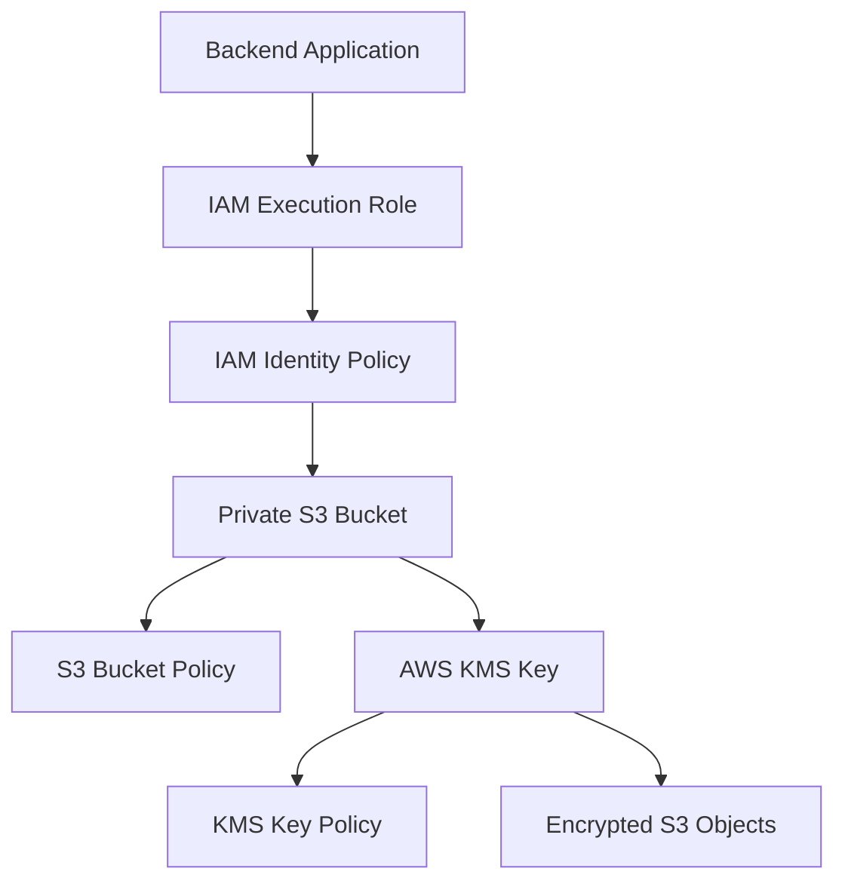
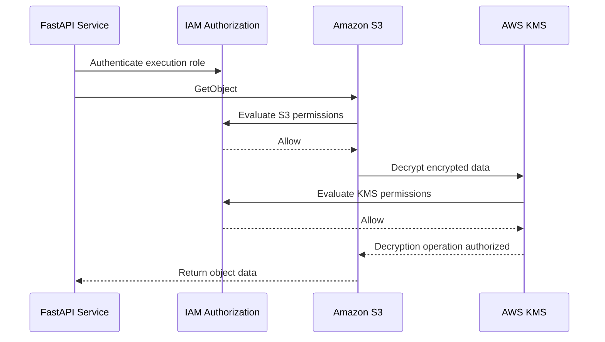
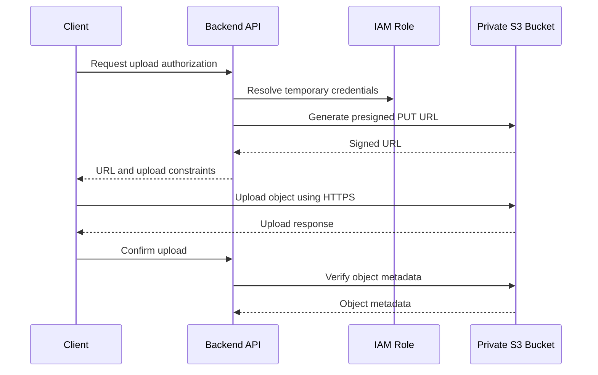

# 04- Encryption and Security Constructs

## Overview

AWS CDK provides Python constructs for defining S3 encryption, KMS keys, bucket access controls, IAM permissions, and resource policies.

Security configuration should be part of the infrastructure definition rather than an operational step performed after bucket creation. This makes security controls repeatable, reviewable, testable, and consistent across development, staging, and production environments.

For an S3-backed backend application, security must be enforced across multiple layers:

- **Identity:** Which IAM principal is making the request?
- **Authorization:** Which S3 operations can that principal perform?
- **Encryption:** Which encryption mechanism protects object data?
- **Key management:** Which principal can use or administer encryption keys?
- **Network transport:** Are requests restricted to HTTPS?
- **Resource exposure:** Can objects or buckets become publicly accessible?
- **Auditability:** Can access and configuration changes be investigated?

This document focuses on implementing these controls using Python CDK constructs.

## Security Architecture

An S3 security design should separate bucket-level access, object-level permissions, encryption, and key management.



The application authenticates through an IAM role. S3 evaluates applicable identity-based and resource-based policies. If the object uses SSE-KMS, KMS authorization must also permit the required cryptographic operation.

A successful S3 authorization decision does not automatically guarantee that the caller can decrypt the object.

## CDK Security Modules

Import the relevant CDK modules:

```python
from aws_cdk import (
    Duration,
    RemovalPolicy,
)
from aws_cdk import aws_iam as iam
from aws_cdk import aws_kms as kms
from aws_cdk import aws_s3 as s3
from constructs import Construct
```

| Module | Responsibility |
|---|---|
| `aws_s3` | Bucket configuration, public-access blocking, encryption, and ownership. |
| `aws_kms` | Encryption keys, key policies, grants, and rotation. |
| `aws_iam` | Identity policies, roles, and permissions. |
| `aws_logs` | CloudWatch Logs resources where required. |
| `aws_cloudtrail` | Audit infrastructure where required. |

## S3 Public Access Protection

### Block Public Access

S3 Block Public Access provides controls that prevent public exposure through bucket policies and ACL-related configurations.

For private application storage, configure all four controls.

```python
bucket = s3.Bucket(
    self,
    "PrivateBucket",
    block_public_access=s3.BlockPublicAccess.BLOCK_ALL,
)
```

`BLOCK_ALL` enables:

- Block public ACLs.
- Ignore public ACLs.
- Block public bucket policies.
- Restrict public bucket policies.

These controls provide an additional protection layer even when an incorrect policy or ACL configuration is introduced.

### Explicit Configuration

The equivalent configuration can be expressed explicitly:

```python
public_access = s3.BlockPublicAccess(
    block_public_acls=True,
    ignore_public_acls=True,
    block_public_policy=True,
    restrict_public_buckets=True,
)

bucket = s3.Bucket(
    self,
    "PrivateBucket",
    block_public_access=public_access,
)
```

Explicit configuration is useful when a project needs to document and test individual controls.

### Production Considerations

For private document and media storage:

- Keep all public-access block settings enabled.
- Do not use public ACLs as an application authorization mechanism.
- Use IAM roles for application access.
- Review bucket policies for unintended public principals.
- Use CloudFront Origin Access Control for controlled public content delivery.
- Validate the deployed public-access configuration independently.

Block Public Access does not replace IAM policies. It prevents certain forms of public exposure but does not grant application permissions.

## Object Ownership and ACL Security

### Bucket Owner Enforced

Modern S3 applications should generally use bucket-owner-enforced object ownership.

```python
bucket = s3.Bucket(
    self,
    "ApplicationBucket",
    object_ownership=s3.ObjectOwnership.BUCKET_OWNER_ENFORCED,
)
```

This disables ACL-based access control and ensures that the bucket owner owns uploaded objects.

Advantages:

- Removes many cross-account ACL ownership problems.
- Simplifies permission management.
- Encourages policy-based authorization.
- Avoids application dependencies on object ACL configuration.

### When ACLs Are Needed

Some legacy integrations or specialized workflows may require ACLs.

Do not enable ACLs merely because an older tutorial uses them.

If ACLs are necessary, verify:

- The ownership configuration supports the required ACL behavior.
- The integration requires the selected ACL.
- Cross-account ownership is handled correctly.
- Bucket policies and IAM permissions remain appropriately restricted.

For new backend applications, bucket-owner-enforced ownership is generally the preferred design.

## Server-Side Encryption

S3 server-side encryption protects object data at rest.

CDK exposes encryption options through `s3.BucketEncryption`.

### Encryption Options

| CDK configuration | Encryption mechanism | Key management |
|---|---|---|
| `S3_MANAGED` | SSE-S3 | Managed by S3 |
| `KMS_MANAGED` | SSE-KMS using an AWS managed KMS key | Managed by AWS KMS |
| `KMS` | SSE-KMS using a customer-managed key | Controlled through customer-managed KMS configuration |
| `DSSE` | Dual-layer server-side encryption with AWS KMS | Uses two layers of server-side encryption |

The appropriate choice depends on data classification, regulatory requirements, key-management requirements, and operational complexity.

### SSE-S3

```python
bucket = s3.Bucket(
    self,
    "S3EncryptedBucket",
    encryption=s3.BucketEncryption.S3_MANAGED,
)
```

SSE-S3 is suitable for general application storage where AWS-managed encryption is sufficient.

Advantages:

- Minimal configuration.
- No customer-managed key administration.
- Automatic server-side encryption for stored objects.
- No application-side encryption implementation required.

Limitations:

- Does not provide customer-managed key policies.
- Does not provide the same key-level administrative controls as SSE-KMS.

### SSE-KMS With an AWS Managed Key

```python
bucket = s3.Bucket(
    self,
    "KmsManagedBucket",
    encryption=s3.BucketEncryption.KMS_MANAGED,
)
```

This uses an AWS managed KMS key for S3 encryption.

It is useful when KMS-based encryption is required but customer-managed key administration is unnecessary.

### SSE-KMS With a Customer-Managed Key

Customer-managed keys provide control over key policies, rotation configuration, grants, and key lifecycle.

Create a key:

```python
key = kms.Key(
    self,
    "ApplicationDataKey",
    enable_key_rotation=True,
    removal_policy=RemovalPolicy.RETAIN,
)
```

Configure the bucket:

```python
bucket = s3.Bucket(
    self,
    "CustomerManagedEncryptedBucket",
    encryption=s3.BucketEncryption.KMS,
    encryption_key=key,
    block_public_access=s3.BlockPublicAccess.BLOCK_ALL,
    object_ownership=s3.ObjectOwnership.BUCKET_OWNER_ENFORCED,
    enforce_ssl=True,
    removal_policy=RemovalPolicy.RETAIN,
)
```

### Why Retain KMS Keys?

A KMS key may be required to decrypt existing S3 objects.

Deleting the key or allowing its scheduled deletion to complete can make encrypted data permanently inaccessible.

For production encryption keys:

- Use an explicit key-retention policy.
- Restrict key administration.
- Review key deletion procedures.
- Avoid coupling key deletion to ordinary application stack removal.
- Document recovery dependencies.
- Ensure backup and replication designs account for key availability.

`RemovalPolicy.RETAIN` protects the key from automatic deletion when the stack is removed. It does not replace a complete key-management process.

## KMS Key Configuration

### Key Rotation

Customer-managed symmetric KMS keys support automatic key rotation.

```python
key = kms.Key(
    self,
    "StorageKey",
    enable_key_rotation=True,
)
```

Automatic rotation changes the backing key material while retaining the logical KMS key.

Existing encrypted objects remain decryptable through the same KMS key identifier.

### Key Description and Alias

A description helps identify the key's purpose.

```python
key = kms.Key(
    self,
    "DocumentStorageKey",
    description="Customer-managed key for document storage",
    enable_key_rotation=True,
    removal_policy=RemovalPolicy.RETAIN,
)

kms.Alias(
    self,
    "DocumentStorageKeyAlias",
    alias_name="alias/document-storage",
    target_key=key,
)
```

Aliases provide readable references to KMS keys.

They are useful for operational identification and configuration, but the key ARN remains the resource identity.

### Key Policy

KMS key policies control which principals can use and administer a key.

CDK can configure key administrators and key users:

```python
key = kms.Key(
    self,
    "ApplicationKey",
    enable_key_rotation=True,
    admins=[
        iam.AccountRootPrincipal(),
    ],
    removal_policy=RemovalPolicy.RETAIN,
)
```

Avoid broad key-administration permissions for application execution roles.

Key administration and cryptographic usage should be separated where practical.

## S3 and KMS Authorization

SSE-KMS introduces two authorization layers.

Consider a FastAPI service downloading an encrypted document.

The request requires:

1. An AWS identity with permission to call S3.
2. An applicable S3 resource policy allowing the request.
3. KMS authorization to decrypt the object's encrypted data.

### Authorization Flow



### Common Permission Requirements

| Operation | S3 permission | Typical KMS permission |
|---|---|---|
| Upload object | `s3:PutObject` | `kms:GenerateDataKey` |
| Download object | `s3:GetObject` | `kms:Decrypt` |
| Multipart upload | Applicable multipart S3 permissions | Applicable `kms:GenerateDataKey` and `kms:Decrypt` permissions |
| Copy encrypted object | Source read and destination write permissions | Permissions required for source decryption and destination encryption |

Exact requirements depend on the operation, encryption configuration, and API behavior.

A KMS key policy must also permit the relevant principal or delegate authorization through IAM according to the key policy configuration.

### Common Authorization Failure

An application might have:

```text
s3:GetObject
```

but receive an access-denied response when downloading an SSE-KMS object.

Possible causes include:

- Missing `kms:Decrypt`.
- A restrictive KMS key policy.
- Missing cross-account KMS authorization.
- An explicit deny in an applicable policy.
- An incorrect KMS key or Region configuration.

Diagnose S3 and KMS permissions independently instead of repeatedly broadening the S3 policy.

## IAM Roles for Backend Applications

Production backend applications should use IAM roles and temporary credentials rather than hardcoded AWS access keys.

The role depends on the runtime:

| Runtime | Typical identity source |
|---|---|
| EC2 | Instance profile |
| ECS | Task execution role or task role, depending on the operation |
| EKS | EKS Pod Identity or IRSA |
| Lambda | Lambda execution role |
| Local development | AWS IAM Identity Center or an approved local credential provider |

The AWS SDK credential provider chain should resolve credentials from the environment.

### Creating an Application Role

```python
role = iam.Role(
    self,
    "DocumentServiceRole",
    assumed_by=iam.ServicePrincipal("lambda.amazonaws.com"),
)
```

This example creates a role trusted by Lambda.

For ECS, EC2, EKS, or another execution environment, configure the appropriate trusted principal and deployment integration.

### Granting Bucket Access

```python
bucket.grant_read_write(role)
```

This is convenient for common application permissions.

However, it grants broader access than a workload that only uploads files may need.

Use narrower grants for production workloads.

### Prefix-Restricted Permissions

```python
bucket.grant_read(
    role,
    "processed/*",
)

bucket.grant_put(
    role,
    "incoming/*",
)
```

This separates input uploads from processed-object reads.

It reduces the impact of an application role compromise.

### Explicit IAM Policy

For workloads requiring explicit action control:

```python
role.add_to_policy(
    iam.PolicyStatement(
        effect=iam.Effect.ALLOW,
        actions=[
            "s3:PutObject",
        ],
        resources=[
            bucket.arn_for_objects("incoming/*"),
        ],
    )
)
```

Bucket listing is a bucket-level permission and should be granted separately if the application requires it.

Do not add `s3:ListBucket` automatically when the application only needs object upload or download operations.

## Granting KMS Usage to Application Roles

CDK provides methods for granting KMS key usage.

```python
key.grant_encrypt_decrypt(role)
```

This grants common encryption and decryption permissions.

For an upload-only application, use a narrower grant where appropriate:

```python
key.grant_encrypt(role)
```

For a download-only application:

```python
key.grant_decrypt(role)
```

The required permissions should be verified against the actual S3 operation, including multipart behavior.

### Complete S3 and KMS Access Example

```python
from aws_cdk import (
    RemovalPolicy,
    Stack,
)
from aws_cdk import aws_iam as iam
from aws_cdk import aws_kms as kms
from aws_cdk import aws_s3 as s3
from constructs import Construct


class SecureStorageStack(Stack):

    def __init__(
        self,
        scope: Construct,
        construct_id: str,
        **kwargs,
    ) -> None:
        super().__init__(
            scope,
            construct_id,
            **kwargs,
        )

        key = kms.Key(
            self,
            "StorageEncryptionKey",
            enable_key_rotation=True,
            removal_policy=RemovalPolicy.RETAIN,
        )

        bucket = s3.Bucket(
            self,
            "SecureDocumentBucket",
            encryption=s3.BucketEncryption.KMS,
            encryption_key=key,
            block_public_access=s3.BlockPublicAccess.BLOCK_ALL,
            object_ownership=s3.ObjectOwnership.BUCKET_OWNER_ENFORCED,
            enforce_ssl=True,
            versioned=True,
            removal_policy=RemovalPolicy.RETAIN,
        )

        application_role = iam.Role(
            self,
            "DocumentApplicationRole",
            assumed_by=iam.ServicePrincipal(
                "lambda.amazonaws.com",
            ),
        )

        bucket.grant_read(
            application_role,
            "processed/*",
        )

        bucket.grant_put(
            application_role,
            "incoming/*",
        )

        key.grant_encrypt_decrypt(
            application_role,
        )
```

This example separates object access by prefix and provides KMS usage permissions.

For a stricter production design, split upload and download responsibilities into separate roles and grant only the required KMS operations.

## Bucket Policies

Bucket policies are resource-based policies attached to S3 buckets.

They control access to bucket and object resources.

CDK allows policies to be added through `add_to_resource_policy()`.

### Enforce HTTPS

CDK's `enforce_ssl=True` provides a convenient way to generate a policy denying insecure transport.

```python
bucket = s3.Bucket(
    self,
    "SecureBucket",
    enforce_ssl=True,
)
```

For an explicit policy:

```python
bucket.add_to_resource_policy(
    iam.PolicyStatement(
        effect=iam.Effect.DENY,
        principals=[
            iam.AnyPrincipal(),
        ],
        actions=[
            "s3:*",
        ],
        resources=[
            bucket.bucket_arn,
            bucket.arn_for_objects("*"),
        ],
        conditions={
            "Bool": {
                "aws:SecureTransport": "false",
            },
        },
    )
)
```

An explicit deny takes precedence over an applicable allow.

This protects the bucket against requests that do not use secure transport.

### Restrict Access to an Application Role

```python
bucket.add_to_resource_policy(
    iam.PolicyStatement(
        effect=iam.Effect.ALLOW,
        principals=[
            iam.ArnPrincipal(application_role.role_arn),
        ],
        actions=[
            "s3:GetObject",
        ],
        resources=[
            bucket.arn_for_objects("processed/*"),
        ],
    )
)
```

A bucket policy can grant access to an external principal, but the final authorization decision still depends on applicable identity policies, resource policies, permissions boundaries, service control policies, and explicit denies.

For same-account access, an identity policy is often sufficient. Do not duplicate policies without a clear architectural requirement.

## Restricting Access Through a VPC Endpoint

For workloads that access S3 through a VPC endpoint, a bucket policy can restrict requests using the `aws:SourceVpce` condition key.

```python
bucket.add_to_resource_policy(
    iam.PolicyStatement(
        effect=iam.Effect.DENY,
        principals=[
            iam.AnyPrincipal(),
        ],
        actions=[
            "s3:*",
        ],
        resources=[
            bucket.bucket_arn,
            bucket.arn_for_objects("*"),
        ],
        conditions={
            "StringNotEquals": {
                "aws:SourceVpce": "vpce-0123456789abcdef0",
            },
        },
    )
)
```

This is an explicit deny for requests that do not use the specified endpoint.

### Operational Caution

Do not deploy this policy without verifying every required access path.

It can block legitimate access through:

- Administrative tools outside the VPC.
- CI/CD deployment environments.
- Cross-account services.
- AWS services that access S3 through service integrations.
- Recovery and incident-response workflows.

For more complex architectures, use carefully scoped conditions and test all required access paths before enforcing the restriction.

## Secure Presigned URL Architecture

Presigned URLs provide time-limited access to S3 operations without exposing AWS credentials to clients.

A backend service generates a presigned URL using its IAM identity.

The client then communicates directly with S3.



### Security Properties

- The URL is time-limited.
- The operation is constrained by the signing principal's permissions.
- The URL does not expose the principal's secret access key.
- The URL can be restricted to a specific object key and operation.
- The URL can be bound to request parameters and signed headers.

A presigned URL is a bearer credential. Anyone possessing it can use it while it remains valid, subject to the signed operation and applicable permissions.

### Generate a Presigned URL With Boto3

```python
import boto3
from botocore.config import Config


session = boto3.Session()

s3_client = session.client(
    "s3",
    region_name="ap-south-1",
    config=Config(
        signature_version="s3v4",
        retries={
            "mode": "standard",
            "max_attempts": 5,
        },
    ),
)


def generate_upload_url(
    bucket_name: str,
    object_key: str,
    content_type: str,
) -> str:
    return s3_client.generate_presigned_url(
        ClientMethod="put_object",
        Params={
            "Bucket": bucket_name,
            "Key": object_key,
            "ContentType": content_type,
            "ServerSideEncryption": "aws:kms",
        },
        ExpiresIn=300,
    )
```

When using SSE-KMS, include the appropriate encryption configuration and ensure that the signing principal has the required permissions.

If a customer-managed KMS key is required, configure its key identifier as part of the request parameters and authorize the signing principal accordingly.

### Presigned URL Security Recommendations

- Generate object keys on the server.
- Use short expiration periods.
- Validate user authorization before signing.
- Do not accept arbitrary bucket names from clients.
- Restrict allowed content types.
- Enforce upload size limits through an appropriate upload design.
- Bind required headers into the signed request.
- Verify uploaded object metadata after upload.
- Avoid logging complete presigned URLs.
- Treat URLs as secrets.

For multipart uploads, design authorization for individual upload operations and ensure incomplete uploads are cleaned up.

## Customer-Managed Encryption and Application Design

### When to Use SSE-KMS

SSE-KMS is appropriate when the application requires:

- Customer-managed key policies.
- Separation between key administrators and data users.
- KMS auditability.
- Cross-account encryption controls.
- Key rotation management.
- Centralized encryption governance.

### When SSE-S3 Is Sufficient

SSE-S3 is appropriate when:

- Standard server-side encryption is sufficient.
- Customer-managed key policies are unnecessary.
- The application does not require KMS-level administrative controls.
- Operational simplicity is a priority.

### Avoid Unnecessary KMS Usage

SSE-KMS introduces:

- Key-management responsibilities.
- Additional authorization requirements.
- KMS request costs.
- Potential request-throughput considerations.
- Cross-account key-policy complexity.

Use it when the requirements justify those additional controls.

## Cross-Account Encryption

Cross-account S3 access with SSE-KMS requires coordination between S3 and KMS permissions.

For example:

- Account A owns the bucket.
- Account B runs the application.
- Account A owns the customer-managed KMS key.

The application role in Account B must be authorized to access the bucket and use the encryption key.

The key policy in Account A must permit the cross-account principal or otherwise delegate authorization appropriately.

The bucket policy in Account A must also allow the intended S3 operations.

### Cross-Account Authorization Layers

| Layer | Required configuration |
|---|---|
| Application role | Identity policy allowing required S3 operations. |
| Bucket policy | Allows the external role to access the required bucket resources. |
| KMS key policy | Allows the external role or delegates the relevant key usage permissions. |
| KMS identity policy | Allows required cryptographic operations. |
| Organization controls | No applicable SCP or permissions boundary denies the request. |

Cross-account KMS permissions should be tested using the actual execution role rather than an administrator identity.

## Security Logging and Auditing

Security controls must be observable.

A production S3 environment should retain enough information to investigate:

- Unauthorized access attempts.
- Object deletion.
- Policy changes.
- Encryption configuration changes.
- KMS key administration.
- Application access failures.
- Unexpected public-access configuration.

### CloudTrail

CloudTrail records supported AWS API activity.

For S3, distinguish between management events and object-level data events.

Management events are useful for tracking bucket and configuration changes.

S3 object-level data events are useful for auditing operations such as object reads and writes, but require explicit data-event configuration and can generate significant event volume and cost.

### CDK CloudTrail Example

```python
from aws_cdk import aws_cloudtrail as cloudtrail

trail = cloudtrail.Trail(
    self,
    "SecurityAuditTrail",
    send_to_cloud_watch_logs=False,
)
```

This creates a trail using the default CDK configuration.

For production auditing, configure the trail's destinations, retention, encryption, and event selectors according to organizational requirements.

Do not assume that creating a trail automatically enables every S3 object-level data event.

### CloudWatch Monitoring

CloudWatch can be used to monitor relevant S3 request metrics and application failures.

For security-sensitive applications, monitor:

- Unexpected increases in denied requests.
- Failed uploads and downloads.
- KMS authorization failures.
- Unusual request patterns.
- Changes to security-related bucket configuration.

CloudTrail and CloudWatch serve different purposes: CloudTrail provides an audit record of supported API activity, while CloudWatch supports operational monitoring and alerting.

## CDK Security Testing

Security configuration should be tested at synthesis time.

CDK assertions can validate generated CloudFormation resources without deploying them.

### Test Public Access Blocking

```python
import aws_cdk as cdk
from aws_cdk import assertions

from secure_storage_stack import SecureStorageStack


def test_bucket_blocks_public_access():
    app = cdk.App()

    stack = SecureStorageStack(
        app,
        "TestSecureStorageStack",
        env=cdk.Environment(
            account="111111111111",
            region="ap-south-1",
        ),
    )

    template = assertions.Template.from_stack(stack)

    template.has_resource_properties(
        "AWS::S3::Bucket",
        {
            "PublicAccessBlockConfiguration": {
                "BlockPublicAcls": True,
                "IgnorePublicAcls": True,
                "BlockPublicPolicy": True,
                "RestrictPublicBuckets": True,
            },
        },
    )
```

### Test Bucket Encryption

```python
def test_bucket_uses_kms_encryption():
    app = cdk.App()

    stack = SecureStorageStack(
        app,
        "TestEncryptionStack",
        env=cdk.Environment(
            account="111111111111",
            region="ap-south-1",
        ),
    )

    template = assertions.Template.from_stack(stack)

    template.has_resource_properties(
        "AWS::S3::Bucket",
        {
            "BucketEncryption": {
                "ServerSideEncryptionConfiguration": [
                    {
                        "ServerSideEncryptionByDefault": {
                            "SSEAlgorithm": "aws:kms",
                        },
                    },
                ],
            },
        },
    )
```

### Test HTTPS Enforcement

```python
def test_bucket_has_secure_transport_policy():
    app = cdk.App()

    stack = SecureStorageStack(
        app,
        "TestTransportStack",
        env=cdk.Environment(
            account="111111111111",
            region="ap-south-1",
        ),
    )

    template = assertions.Template.from_stack(stack)

    template.has_resource_properties(
        "AWS::S3::BucketPolicy",
        {
            "PolicyDocument": {
                "Statement": assertions.Match.array_with(
                    [
                        assertions.Match.object_like(
                            {
                                "Effect": "Deny",
                                "Condition": {
                                    "Bool": {
                                        "aws:SecureTransport": "false",
                                    },
                                },
                            },
                        ),
                    ],
                ),
            },
        },
    )
```

Run the tests:

```bash
pytest tests/unit -v
```

The exact synthesized policy structure can vary with CDK versions and construct configuration. Keep assertions aligned with the actual generated template.

### Additional Security Tests

Test the following properties where applicable:

- KMS encryption is enabled.
- The bucket uses the expected KMS key.
- Public access blocking is enabled.
- ACLs are disabled.
- HTTPS enforcement exists.
- Application roles have only required permissions.
- Object permissions are restricted to expected prefixes.
- KMS permissions are restricted to the intended key.
- Production buckets use appropriate removal policies.
- CloudTrail data-event configuration covers required object activity.

## Deployment Verification

CDK assertions validate the synthesized infrastructure. Verify the actual deployed configuration separately.

### Inspect Bucket Encryption

```bash
aws s3api get-bucket-encryption \
  --bucket BUCKET_NAME
```

### Inspect Public Access Blocking

```bash
aws s3api get-public-access-block \
  --bucket BUCKET_NAME
```

### Inspect Ownership Controls

```bash
aws s3api get-bucket-ownership-controls \
  --bucket BUCKET_NAME
```

### Inspect Bucket Policy

```bash
aws s3api get-bucket-policy \
  --bucket BUCKET_NAME
```

### Inspect KMS Key

```bash
aws kms describe-key \
  --key-id KEY_ID
```

### Inspect Key Rotation

```bash
aws kms get-key-rotation-status \
  --key-id KEY_ID
```

### Verify Application Identity

From the actual application runtime:

```bash
aws sts get-caller-identity
```

This helps confirm which AWS principal the application is using.

For production verification, test representative upload and download operations using the application's execution role rather than a privileged administrator profile.

## Common Security Mistakes

| Mistake | Risk | Recommended approach |
|---|---|---|
| Assuming Block Public Access grants private application access | The application may still receive authorization failures. | Configure IAM and bucket policies separately. |
| Using `grant_read_write()` for every workload | Gives unnecessary permissions. | Use action- and prefix-restricted grants. |
| Granting S3 permissions but ignoring KMS permissions | SSE-KMS operations can fail. | Review S3 and KMS authorization independently. |
| Giving application roles KMS administration permissions | Increases the impact of compromised workloads. | Separate key administration from cryptographic usage. |
| Disabling public-access blocking for convenience | Can expose application data. | Use CloudFront OAC or another controlled delivery mechanism. |
| Using ACLs for new application authorization | Creates ownership and permission complexity. | Prefer bucket-owner-enforced ownership and IAM policies. |
| Allowing unrestricted presigned URL lifetimes | Increases the exposure window if a URL leaks. | Use short-lived URLs and scoped operations. |
| Logging presigned URLs | Exposes bearer credentials through logs. | Redact signed query parameters and complete URLs. |
| Deleting a KMS key with retained encrypted objects | Can make data permanently inaccessible. | Retain keys according to data recovery requirements. |
| Using broad cross-account KMS permissions | Expands the set of principals able to use the key. | Scope key policies to specific roles and operations. |
| Applying VPC endpoint restrictions without testing external access | Can block deployment and recovery workflows. | Validate all legitimate access paths before enforcement. |
| Treating CDK unit tests as complete security validation | Does not verify deployed authorization behavior. | Combine assertions, deployment checks, and runtime integration tests. |

## Production Security Checklist

### S3 Configuration

- [ ] Block Public Access is enabled.
- [ ] Bucket-owner-enforced ownership is configured.
- [ ] ACL-based access is disabled unless explicitly required.
- [ ] HTTPS-only access is enforced.
- [ ] Default encryption is configured.
- [ ] Bucket policies are reviewed for unintended access.
- [ ] Production bucket removal policies protect persistent data.

### IAM and KMS

- [ ] Application workloads use temporary credentials.
- [ ] IAM policies follow least-privilege principles.
- [ ] Object permissions are restricted to required prefixes.
- [ ] Bucket-level and object-level permissions are separated.
- [ ] KMS key policies are reviewed.
- [ ] KMS cryptographic usage is separated from key administration.
- [ ] Cross-account access is tested with the actual application role.
- [ ] Key deletion and recovery procedures are documented.

### Application Security

- [ ] Object keys are generated or validated by the backend.
- [ ] Presigned URLs use short expiration periods.
- [ ] Upload and download permissions are independently scoped.
- [ ] Required request headers are included in signed operations.
- [ ] Uploaded object metadata is verified.
- [ ] Presigned URLs are not exposed in application logs.
- [ ] Client input cannot select arbitrary buckets or KMS keys.

### Auditing and Testing

- [ ] CDK assertions validate security-sensitive resources.
- [ ] CloudTrail records required management activity.
- [ ] Required S3 object-level data events are configured.
- [ ] KMS key usage is auditable.
- [ ] Application authorization failures are monitored.
- [ ] Deployment verification checks actual bucket configuration.
- [ ] Integration tests exercise S3 and KMS access using runtime roles.

## Key Takeaways

- Treat S3 access control, KMS authorization, encryption, and network transport as separate security layers.
- Use Block Public Access, bucket-owner-enforced ownership, HTTPS enforcement, and least-privilege IAM as baseline controls for private application buckets.
- SSE-KMS requires both appropriate S3 permissions and KMS authorization; an S3 allow does not guarantee successful decryption.
- Protect customer-managed KMS keys and persistent S3 data from accidental infrastructure deletion.
- Validate security through CDK assertions, deployed-resource inspection, CloudTrail auditing, and runtime integration tests.