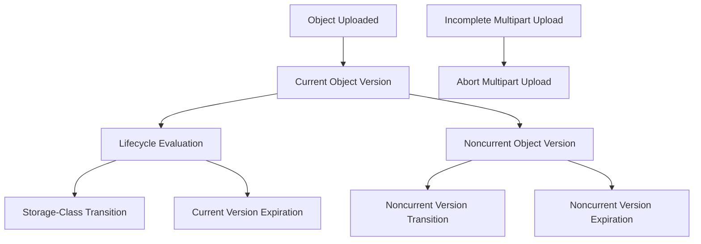
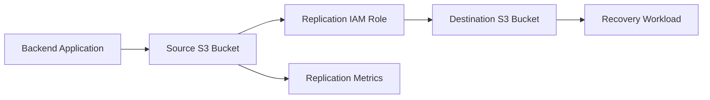

# 05- Lifecycle and Replication Constructs

## Overview

AWS CDK provides Python constructs for defining Amazon S3 lifecycle policies and replication configurations as infrastructure code.

Lifecycle management controls how long objects remain in a storage class, when they transition to another class, and when current or historical versions are expired. Replication asynchronously copies eligible objects between S3 buckets to support disaster recovery, regional distribution, centralized storage, and account-level isolation.

These capabilities address different operational requirements:

| Capability | Primary responsibility | Typical use case |
|---|---|---|
| Lifecycle management | Automates storage transitions and object expiration | Archiving reports and cleaning temporary files |
| Version lifecycle management | Controls historical object versions and delete markers | Managing storage growth in versioned buckets |
| Multipart upload cleanup | Removes abandoned multipart uploads | Recovering storage consumed by incomplete uploads |
| Cross-Region Replication (CRR) | Copies eligible objects to another Region | Regional disaster recovery |
| Same-Region Replication (SRR) | Copies eligible objects within the same Region | Account separation and centralized storage |
| Replication Time Control (RTC) | Provides a defined replication-time commitment for eligible configurations | Workloads with replication latency requirements |

This document focuses on implementing these capabilities using Python CDK v2, testing synthesized infrastructure, and validating deployed behavior.

## Lifecycle Management Architecture

S3 lifecycle rules evaluate objects against configured filters and execute eligible actions asynchronously.

A rule can target objects by prefix, tags, or other supported filters. Its actions can transition objects between storage classes or expire them.



Lifecycle actions are not synchronous operations. A configured transition or expiration date makes an object eligible for processing; S3 does not guarantee execution at that exact time.

## CDK Lifecycle Constructs

The primary construct is `s3.LifecycleRule`.

It is attached to an S3 bucket through the `lifecycle_rules` property.

```python
from aws_cdk import Duration
from aws_cdk import aws_s3 as s3

bucket = s3.Bucket(
    self,
    "ApplicationBucket",
    lifecycle_rules=[
        s3.LifecycleRule(
            id="TransitionToInfrequentAccess",
            enabled=True,
            transitions=[
                s3.Transition(
                    storage_class=s3.StorageClass.INFREQUENT_ACCESS,
                    transition_after=Duration.days(30),
                ),
            ],
        ),
    ],
)
```

This configuration makes eligible objects transition to S3 Standard-IA after 30 days.

### Lifecycle Rule Properties

| Property | Purpose |
|---|---|
| `id` | Identifies the lifecycle rule. |
| `enabled` | Enables or disables the rule. |
| `prefix` | Restricts the rule to an object-key prefix. |
| `tag_filters` | Restricts the rule using object tags. |
| `transitions` | Defines current-version storage-class transitions. |
| `expiration` | Defines current-object expiration. |
| `noncurrent_version_transitions` | Defines transitions for noncurrent versions. |
| `noncurrent_version_expiration` | Defines expiration of noncurrent versions. |
| `expired_object_delete_marker` | Removes eligible expired delete markers. |
| `abort_incomplete_multipart_upload_after` | Aborts incomplete multipart uploads after a configured period. |

Use distinct rule identifiers and clearly defined filters. Avoid overlapping rules whose actions produce unexpected retention or transition behavior.

## Storage-Class Transitions

### Why Transitions Matter

Storage classes have different storage prices, retrieval costs, minimum storage durations, and access characteristics.

Lifecycle transitions allow applications to move older objects into more economical storage classes without maintaining a custom archival scheduler.

Typical workloads include:

- Historical reports.
- User-uploaded documents.
- Application audit exports.
- Archived media.
- Data lake partitions.
- Backup objects.

### Storage-Class Selection

| Storage class | Typical workload | Important consideration |
|---|---|---|
| S3 Standard | Frequently accessed objects | Higher storage cost than archival classes. |
| S3 Intelligent-Tiering | Unpredictable or changing access patterns | Monitoring and automation charges may apply. |
| S3 Standard-IA | Infrequently accessed data requiring millisecond access | Minimum storage duration and retrieval charges. |
| S3 One Zone-IA | Infrequently accessed, recreatable data | Stored in one Availability Zone. |
| S3 Glacier Instant Retrieval | Archive data requiring millisecond retrieval | Minimum storage duration and retrieval charges. |
| S3 Glacier Flexible Retrieval | Archive data where retrieval delays are acceptable | Retrieval options have different delays and costs. |
| S3 Glacier Deep Archive | Long-term archival | Retrieval can take substantially longer. |

Choose a storage class using actual access patterns, retention requirements, and recovery objectives. The lowest storage price does not necessarily produce the lowest total cost.

### Multiple Transitions

```python
lifecycle_rules = [
    s3.LifecycleRule(
        id="DocumentArchival",
        enabled=True,
        prefix="documents/",
        transitions=[
            s3.Transition(
                storage_class=s3.StorageClass.INFREQUENT_ACCESS,
                transition_after=Duration.days(30),
            ),
            s3.Transition(
                storage_class=s3.StorageClass.GLACIER,
                transition_after=Duration.days(90),
            ),
        ],
    ),
]
```

The example transitions eligible documents from Standard to Standard-IA and subsequently to the configured Glacier storage class.

Before deploying a transition chain, verify:

- The source and destination storage classes support the transition.
- Minimum storage-duration requirements are satisfied.
- Minimum object-size considerations are understood.
- Retrieval costs are acceptable.
- The workload can tolerate the target class's retrieval characteristics.

Not every storage-class transition is valid directly from every source class.

### Intelligent-Tiering

Intelligent-Tiering is useful when object access patterns are difficult to predict.

```python
bucket = s3.Bucket(
    self,
    "IntelligentTieringBucket",
    lifecycle_rules=[
        s3.LifecycleRule(
            id="MoveToIntelligentTiering",
            enabled=True,
            transitions=[
                s3.Transition(
                    storage_class=s3.StorageClass.INTELLIGENT_TIERING,
                    transition_after=Duration.days(30),
                ),
            ],
        ),
    ],
)
```

S3 Intelligent-Tiering automatically moves eligible objects between supported access tiers based on observed access patterns.

Consider:

- Monitoring charges.
- Object-size eligibility.
- Retrieval characteristics of archival tiers.
- Whether automatic tier selection benefits the workload.

Intelligent-Tiering is not automatically the cheapest option for every object population.

## Object Expiration

Lifecycle expiration removes objects that have exceeded a configured age.

For a non-versioned bucket, expiration removes the object.

For a versioned bucket, expiration of the current version generally creates a delete marker. Historical versions can remain stored.

### Configure Expiration

```python
bucket = s3.Bucket(
    self,
    "TemporaryFilesBucket",
    lifecycle_rules=[
        s3.LifecycleRule(
            id="ExpireTemporaryFiles",
            enabled=True,
            prefix="temporary/",
            expiration=Duration.days(7),
        ),
    ],
)
```

This is appropriate for temporary exports, intermediate processing files, and short-lived generated artifacts.

### Tag-Based Expiration

Tags allow lifecycle rules to classify objects independently of their key structure.

```python
bucket = s3.Bucket(
    self,
    "TaggedRetentionBucket",
    lifecycle_rules=[
        s3.LifecycleRule(
            id="ExpireTemporaryTaggedObjects",
            enabled=True,
            tag_filters={
                "retention": "temporary",
            },
            expiration=Duration.days(14),
        ),
    ],
)
```

An application can assign tags during upload:

```python
s3_client.put_object(
    Bucket="application-storage",
    Key="exports/report-2026-10.csv",
    Body=report_content,
    Tagging="retention=temporary",
)
```

Tag-based rules are useful when objects within the same prefix require different retention policies.

Incorrect tags can cause unintended archival or deletion. Restrict tag modification permissions and validate application-generated tags.

## Versioned Bucket Lifecycle Management

Versioning changes lifecycle behavior because an object can have multiple versions and delete markers.

A versioned bucket can contain:

- One current version.
- Multiple noncurrent versions.
- Delete markers.

Lifecycle policies should account for all of these states.

### Noncurrent Version Management

When an object is overwritten in a versioned bucket, its previous version becomes noncurrent.

Without noncurrent-version management, old versions can continue consuming storage even when the current object is small or frequently replaced.

```python
bucket = s3.Bucket(
    self,
    "VersionedArchiveBucket",
    versioned=True,
    lifecycle_rules=[
        s3.LifecycleRule(
            id="ManageNoncurrentVersions",
            enabled=True,
            noncurrent_version_transitions=[
                s3.NoncurrentVersionTransition(
                    storage_class=s3.StorageClass.GLACIER,
                    transition_after=Duration.days(30),
                ),
            ],
            noncurrent_version_expiration=Duration.days(180),
        ),
    ],
)
```

This transitions eligible noncurrent versions after 30 days and expires them after 180 days, subject to S3 lifecycle eligibility and service constraints.

### Current and Noncurrent Version Actions

| Lifecycle action | Applies to |
|---|---|
| `transitions` | Current object versions |
| `expiration` | Current objects |
| `noncurrent_version_transitions` | Noncurrent object versions |
| `noncurrent_version_expiration` | Noncurrent object versions |
| `expired_object_delete_marker` | Eligible expired delete markers |

### Expired Delete Markers

In versioned buckets, deleting an object commonly creates a delete marker.

When an object has only an expired delete marker and no remaining object versions, lifecycle configuration can remove that marker.

```python
bucket = s3.Bucket(
    self,
    "VersionedBucket",
    versioned=True,
    lifecycle_rules=[
        s3.LifecycleRule(
            id="RemoveExpiredDeleteMarkers",
            enabled=True,
            expired_object_delete_marker=True,
        ),
    ],
)
```

Ordinary current-object expiration does not permanently delete every historical version.

For retention-sensitive systems, define separate policies for current versions, noncurrent versions, and delete markers.

## Incomplete Multipart Upload Cleanup

Multipart uploads that are never completed can leave uploaded parts consuming storage.

A lifecycle rule can automatically abort incomplete multipart uploads.

```python
bucket = s3.Bucket(
    self,
    "UploadBucket",
    lifecycle_rules=[
        s3.LifecycleRule(
            id="AbortIncompleteUploads",
            enabled=True,
            abort_incomplete_multipart_upload_after=Duration.days(7),
        ),
    ],
)
```

This is useful for backend applications that support large uploads through presigned multipart requests or SDK transfer managers.

The rule does not replace application-level multipart error handling. It provides a cleanup mechanism for abandoned uploads.

## Combining Lifecycle Rules

A production bucket can have multiple lifecycle rules for different object categories.

```python
lifecycle_rules = [
    s3.LifecycleRule(
        id="ArchiveReports",
        enabled=True,
        prefix="reports/",
        transitions=[
            s3.Transition(
                storage_class=s3.StorageClass.INFREQUENT_ACCESS,
                transition_after=Duration.days(30),
            ),
            s3.Transition(
                storage_class=s3.StorageClass.GLACIER,
                transition_after=Duration.days(90),
            ),
        ],
        expiration=Duration.days(365),
    ),
    s3.LifecycleRule(
        id="ExpireTemporaryObjects",
        enabled=True,
        prefix="temporary/",
        expiration=Duration.days(7),
    ),
    s3.LifecycleRule(
        id="CleanupIncompleteUploads",
        enabled=True,
        abort_incomplete_multipart_upload_after=Duration.days(7),
    ),
]
```

Attach the rules:

```python
bucket = s3.Bucket(
    self,
    "LifecycleManagedBucket",
    versioned=True,
    lifecycle_rules=lifecycle_rules,
)
```

For versioned buckets, add noncurrent-version policies where required. Current-version expiration alone does not define complete historical-version retention.

## Lifecycle Design for Backend Workloads

Consider a document-processing service that stores:

- Incoming documents.
- Processed documents.
- Temporary processing artifacts.
- Historical reports.

A possible object-key structure is:

```text
application-data/
├── incoming/
├── processed/
├── temporary/
└── reports/
```

Example retention policy:

| Prefix | Lifecycle policy | Reason |
|---|---|---|
| `incoming/` | Retain according to business requirements | Original submissions may be required for audit or reprocessing. |
| `processed/` | Transition after an inactivity period | Processed documents may be accessed less frequently. |
| `temporary/` | Expire after a short period | Intermediate artifacts are not permanent records. |
| `reports/` | Archive after a defined period | Historical reports may be retained for reference. |

These durations are workload-specific. Define retention using contractual, regulatory, and business requirements.

## Replication Architecture

S3 replication asynchronously copies eligible objects from a source bucket to a destination bucket.

Replication can operate across Regions or within the same Region.



Replication supports:

- Cross-Region disaster recovery.
- Regional data distribution.
- Centralized storage.
- Compliance and data-management requirements.
- Separation of production and analytics workloads.
- Cross-account storage architectures.

Replication is asynchronous. A successful source upload does not guarantee that the destination object is immediately available.

## Replication Types

| Replication type | Description | Typical use case |
|---|---|---|
| Cross-Region Replication (CRR) | Copies objects to a bucket in another Region. | Regional resilience and geographic distribution. |
| Same-Region Replication (SRR) | Copies objects to another bucket in the same Region. | Account separation, centralized storage, and workload isolation. |

Both require versioning to be enabled on the source and destination buckets.

### Important Replication Behavior

- Replication is asynchronous.
- Existing objects are not automatically replicated by enabling a new replication rule.
- New eligible objects are replicated after the rule becomes active.
- Delete-marker replication is configurable.
- Lifecycle configurations are not automatically copied.
- Bucket policies, bucket settings, and KMS keys are not automatically replicated as infrastructure.
- Replication permissions and destination ownership must be configured correctly.

Use S3 Batch Replication where supported and appropriate to backfill existing objects.

Do not treat replication as a complete backup strategy. Accidental deletion or unwanted changes can also be replicated, depending on configuration and operation.

## Replication Prerequisites

Before defining replication in CDK:

1. Enable versioning on both buckets.
2. Create an IAM role trusted by the S3 service.
3. Grant the role access to source objects and versions.
4. Grant the role permission to replicate objects into the destination.
5. Configure destination ownership and encryption requirements.
6. Define the replication rule.
7. Configure monitoring and failure investigation procedures.

The replication role is assumed by the S3 service.

## Replication IAM Role

Create a role trusted by S3:

```python
from aws_cdk import aws_iam as iam

replication_role = iam.Role(
    self,
    "S3ReplicationRole",
    assumed_by=iam.ServicePrincipal("s3.amazonaws.com"),
)
```

Grant source bucket permissions.

```python
replication_role.add_to_policy(
    iam.PolicyStatement(
        actions=[
            "s3:GetReplicationConfiguration",
            "s3:ListBucket",
        ],
        resources=[
            source_bucket.bucket_arn,
        ],
    )
)

replication_role.add_to_policy(
    iam.PolicyStatement(
        actions=[
            "s3:GetObjectVersionForReplication",
            "s3:GetObjectVersionAcl",
            "s3:GetObjectVersionTagging",
        ],
        resources=[
            source_bucket.arn_for_objects("*"),
        ],
    )
)
```

Grant destination replication permissions.

```python
replication_role.add_to_policy(
    iam.PolicyStatement(
        actions=[
            "s3:ReplicateObject",
            "s3:ReplicateDelete",
            "s3:ReplicateTags",
        ],
        resources=[
            destination_bucket.arn_for_objects("*"),
        ],
    )
)
```

The exact permissions depend on the replication configuration, including ownership override, encryption, and delete-marker behavior.

For example, ownership override can require additional destination bucket permissions.

## Replication Rule With CDK

The `ReplicationRule` construct defines the replication destination, priority, filters, and supported replication behavior.

Create versioned buckets:

```python
source_bucket = s3.Bucket(
    self,
    "SourceBucket",
    versioned=True,
    removal_policy=RemovalPolicy.RETAIN,
)

destination_bucket = s3.Bucket(
    self,
    "DestinationBucket",
    versioned=True,
    removal_policy=RemovalPolicy.RETAIN,
)
```

Create the replication role and configure its permissions as described above.

Define the rule:

```python
source_bucket.add_replication_rule(
    destination=destination_bucket,
    role=replication_role,
    priority=1,
    delete_marker_replication=False,
)
```

This demonstrates the CDK replication-rule API. A deployable implementation must ensure that the source and destination buckets satisfy all replication prerequisites and that the role has the complete permission set required by the selected configuration.

## Cross-Region Deployment With CDK

A Cross-Region Replication design normally requires two CDK stacks deployed to different environments.

A CDK stack is deployed into a specific account and Region. A single stack cannot create resources in two Regions merely by assigning a Region to an individual bucket.

A practical project structure is:

```text
s3-replication/
├── app.py
├── source_stack.py
├── destination_stack.py
├── requirements.txt
└── tests/
    └── unit/
```

Configure the destination and source environments explicitly:

```python
import aws_cdk as cdk

from source_stack import SourceStack
from destination_stack import DestinationStack


app = cdk.App()

destination_env = cdk.Environment(
    account="111111111111",
    region="ap-southeast-1",
)

source_env = cdk.Environment(
    account="111111111111",
    region="ap-south-1",
)

destination_stack = DestinationStack(
    app,
    "DestinationStack",
    env=destination_env,
)

source_stack = SourceStack(
    app,
    "SourceStack",
    destination_bucket_arn=destination_stack.bucket_arn,
    env=source_env,
)

app.synth()
```

The `destination_bucket_arn` property represents an explicit stack interface that the destination stack must expose.

For production deployments, separate destination bucket provisioning from source replication configuration. Exchange the destination ARN and required configuration through controlled deployment parameters or pipeline outputs.

For cross-account deployments, configure the destination bucket policy and KMS key policy for the source replication role.

Avoid assuming that ordinary cross-stack references automatically solve cross-Region deployment dependencies.

## Replication With SSE-KMS

When source objects use SSE-KMS, replication requires additional authorization.

The replication role may need:

- `kms:Decrypt` on the source encryption key.
- `kms:Encrypt` and applicable data-key permissions on the destination encryption key.
- Authorization in the source and destination KMS key policies.
- Destination replication encryption configuration.

The source and destination KMS keys can belong to different accounts or Regions.

KMS keys are Regional. A destination bucket in another Region therefore requires an appropriate destination-Region key when using customer-managed SSE-KMS encryption.

### Grant KMS Permissions

```python
source_key.grant_decrypt(
    replication_role,
)

destination_key.grant_encrypt(
    replication_role,
)
```

The corresponding key policies must also support the intended authorization model.

Do not assume that granting S3 replication permissions automatically authorizes KMS operations.

### Encryption Considerations

| Scenario | Consideration |
|---|---|
| SSE-S3 source | Standard replication permissions generally cover encryption handling. |
| SSE-KMS source | Configure source key decryption authorization. |
| SSE-KMS destination | Configure destination key encryption authorization and destination encryption settings. |
| Cross-account destination | Coordinate bucket policy, IAM role, ownership, and KMS key policies. |
| DSSE-KMS | Validate supported replication behavior and required key permissions for the target configuration. |

Verify current S3 replication support and encryption requirements for the selected encryption mode before deployment.

## Filtered Replication

A replication rule can target a prefix or object tags.

This is useful when only selected application data should be replicated.

For example, a backend application may store temporary and permanent objects in the same bucket. Only permanent documents may need cross-Region replication.

### Prefix Filter

```python
source_bucket.add_replication_rule(
    destination=destination_bucket,
    role=replication_role,
    priority=1,
    prefix="permanent/",
    delete_marker_replication=False,
)
```

### Tag Filter

```python
source_bucket.add_replication_rule(
    destination=destination_bucket,
    role=replication_role,
    priority=2,
    tag_filters={
        "replicate": "true",
    },
)
```

When combining multiple filters, use the supported replication filter configuration for the installed CDK version.

Ensure that rule priorities and overlapping filters have deterministic behavior.

## Replication Metrics and Monitoring

Replication is an asynchronous distributed workflow.

A source upload can succeed while replication remains pending or fails.

S3 replication metrics provide visibility into:

- Pending replication bytes.
- Pending replication operations.
- Replication latency.
- Operations that failed replication.

### Replication Time Control

S3 Replication Time Control (RTC) is designed for workloads with defined replication-time requirements.

It provides a service-level commitment for replicating eligible objects within the documented time window, subject to the service's terms and supported configuration.

RTC can be enabled on an eligible replication rule.

```python
source_bucket.add_replication_rule(
    destination=destination_bucket,
    role=replication_role,
    priority=1,
    replication_time_control=s3.ReplicationTimeControl(
        status=s3.ReplicationTimeControlStatus.ENABLED,
    ),
)
```

Validate the exact CDK API and supported configuration against the installed `aws-cdk-lib` version.

RTC introduces additional cost. Enable it when replication latency requirements justify the expense.

### Operational Monitoring

Monitor:

- Pending replication bytes.
- Pending replication operations.
- Maximum replication latency.
- Failed replication operations.
- Destination object availability.
- Replication status on source object versions.

Inspect an object's metadata:

```bash
aws s3api head-object \
  --bucket SOURCE_BUCKET \
  --key documents/report.pdf
```

Check the `ReplicationStatus` field when returned.

Possible statuses include:

- `PENDING`
- `COMPLETED`
- `FAILED`
- `REPLICA` on replicated destination objects

The status depends on which bucket and object version is inspected.

## Delete Marker Replication

In versioned buckets, deleting an object generally creates a delete marker.

Delete-marker replication determines whether eligible delete markers are replicated to the destination.

```python
source_bucket.add_replication_rule(
    destination=destination_bucket,
    role=replication_role,
    priority=1,
    delete_marker_replication=True,
)
```

This affects object visibility in the destination bucket.

Consider the recovery implications:

- Replicating delete markers can reproduce logical deletions in the destination.
- Not replicating delete markers can preserve destination objects after source deletion.
- Permanent deletion of a specific object version is not automatically replicated in the same way as a delete marker.

For disaster recovery, preserving historical versions and preventing accidental deletion propagation may be important.

Define destination deletion behavior before enabling delete-marker replication.

## Replication of Existing Objects

A replication rule primarily applies to eligible objects created after the rule is enabled.

Existing objects require a separate backfill process.

S3 Batch Replication can replicate eligible existing objects.

A practical rollout is:

1. Enable versioning on both buckets.
2. Deploy the replication role and bucket permissions.
3. Configure the replication rule.
4. Verify replication using a newly uploaded object.
5. Identify existing objects requiring replication.
6. Run an S3 Batch Replication job.
7. Monitor the job and investigate failed objects.
8. Verify destination object availability and metadata.

Do not assume that enabling replication automatically copies historical bucket contents.

## Lifecycle and Replication Interaction

Lifecycle policies and replication rules are independent configurations. They should be designed together because lifecycle actions can affect source and destination retention.

Important considerations:

- Lifecycle rules are not automatically copied to the destination bucket.
- Destination lifecycle policies must be configured separately.
- Source expiration can interact with delete-marker replication.
- Noncurrent-version expiration can affect recovery opportunities.
- Replication status should be considered before applying aggressive source retention.
- Destination retention should reflect recovery and compliance requirements.

A source bucket with short retention and a destination bucket with longer retention can provide a useful recovery pattern, but only if delete behavior, version retention, and replication completion are explicitly designed.

## Lifecycle and Replication Testing

CDK assertions validate synthesized CloudFormation resources without deploying them.

They should cover lifecycle configuration, versioning, replication rules, and IAM permissions.

### Test Lifecycle Transitions

```python
import aws_cdk as cdk
from aws_cdk import assertions

from storage_stack import StorageStack


def test_lifecycle_transition():
    app = cdk.App()

    stack = StorageStack(
        app,
        "TestStorageStack",
        env=cdk.Environment(
            account="111111111111",
            region="ap-south-1",
        ),
    )

    template = assertions.Template.from_stack(stack)

    template.has_resource_properties(
        "AWS::S3::Bucket",
        {
            "LifecycleConfiguration": {
                "Rules": assertions.Match.array_with(
                    [
                        assertions.Match.object_like(
                            {
                                "Status": "Enabled",
                                "Transitions": [
                                    {
                                        "StorageClass": "STANDARD_IA",
                                        "TransitionInDays": 30,
                                    },
                                ],
                            },
                        ),
                    ],
                ),
            },
        },
    )
```

### Test Versioning

```python
def test_bucket_versioning_enabled():
    app = cdk.App()

    stack = StorageStack(
        app,
        "TestVersioningStack",
        env=cdk.Environment(
            account="111111111111",
            region="ap-south-1",
        ),
    )

    template = assertions.Template.from_stack(stack)

    template.has_resource_properties(
        "AWS::S3::Bucket",
        {
            "VersioningConfiguration": {
                "Status": "Enabled",
            },
        },
    )
```

### Test Replication Configuration

```python
def test_replication_configuration_exists():
    app = cdk.App()

    stack = StorageStack(
        app,
        "TestReplicationStack",
        env=cdk.Environment(
            account="111111111111",
            region="ap-south-1",
        ),
    )

    template = assertions.Template.from_stack(stack)

    template.has_resource_properties(
        "AWS::S3::Bucket",
        {
            "ReplicationConfiguration": {
                "Rules": assertions.Match.array_with(
                    [
                        assertions.Match.object_like(
                            {
                                "Status": "Enabled",
                                "Destination": assertions.Match.any_value(),
                            },
                        ),
                    ],
                ),
            },
        },
    )
```

These examples assume the stack exposes the relevant bucket resources. Adapt the assertions to the actual construct structure and synthesized template.

### Test IAM Permissions

Verify that the replication role has:

- Source replication configuration access.
- Source object-version access.
- Destination replication permissions.
- Required KMS permissions where applicable.
- A trust policy allowing the S3 service to assume the role.

Avoid testing only that an IAM policy exists. Assert its principal, actions, and resource scope.

### Integration Testing

A deployed integration test should:

1. Upload a uniquely named object to the source bucket.
2. Record its version ID.
3. Poll the source object's replication status.
4. Wait for the destination object to become available.
5. Verify destination metadata and content.
6. Verify encryption configuration.
7. Record elapsed replication time.
8. Clean up test objects according to the test environment's retention policy.

Use bounded polling with a timeout. Replication is asynchronous and should not be tested using an immediate destination read.

## Deployment and Verification

### Synthesize

```bash
cdk synth
```

Inspect the generated CloudFormation template for:

- Lifecycle configuration.
- Versioning configuration.
- Replication configuration.
- IAM role trust relationships.
- Source and destination permissions.
- KMS permissions where applicable.

### Review Changes

```bash
cdk diff
```

Review lifecycle and replication changes carefully. A change to an expiration rule can affect a large number of objects over time.

### Deploy

```bash
cdk deploy
```

For cross-Region deployments, provision and verify destination infrastructure before deploying the source replication configuration.

### Inspect Lifecycle Configuration

```bash
aws s3api get-bucket-lifecycle-configuration \
  --bucket BUCKET_NAME
```

### Inspect Replication Configuration

```bash
aws s3api get-bucket-replication \
  --bucket SOURCE_BUCKET
```

### Inspect Versioning

```bash
aws s3api get-bucket-versioning \
  --bucket BUCKET_NAME
```

### Inspect Replicated Object Status

```bash
aws s3api head-object \
  --bucket SOURCE_BUCKET \
  --key documents/report.pdf
```

Check the returned replication status when available.

### Inspect Destination Object

```bash
aws s3api head-object \
  --bucket DESTINATION_BUCKET \
  --key documents/report.pdf
```

Verify:

- Object availability.
- Content length.
- Encryption configuration.
- Metadata.
- Version information where relevant.

## Operational Considerations

### Lifecycle Operations

Review lifecycle configuration periodically.

Useful checks include:

- Are objects transitioning according to the expected policy?
- Are noncurrent versions accumulating unexpectedly?
- Are expired objects still consuming storage?
- Are incomplete multipart uploads accumulating?
- Are lifecycle rules overlapping?
- Are retention requirements satisfied?

Lifecycle execution is asynchronous. Do not use a configured expiration date as an exact deletion deadline.

### Replication Operations

Replication should be monitored continuously for workloads with recovery objectives.

Useful checks include:

- Is the replication configuration present?
- Does the replication role have the required permissions?
- Are source objects marked as pending or failed?
- Is replication latency within the operational target?
- Are destination objects accessible?
- Are KMS permissions valid?
- Are destination lifecycle rules compatible with recovery requirements?

### Cost Considerations

| Cost area | Lifecycle impact | Replication impact |
|---|---|---|
| Storage | Changes storage-class charges. | Stores additional object copies. |
| Requests | Transitions and lifecycle-related requests may incur charges. | Replication operations can incur request charges. |
| Retrieval | Some archival classes introduce retrieval charges. | Destination access can create additional retrieval costs. |
| Data transfer | Usually not the main lifecycle cost driver. | Cross-Region replication can incur data transfer charges. |
| Monitoring | Lifecycle configuration does not replace monitoring services. | RTC and replication metrics can add charges. |
| KMS | Encryption operations may incur KMS charges. | Cross-Region SSE-KMS replication can require additional KMS operations. |

Evaluate total cost rather than comparing storage prices alone.

## Common Mistakes and Pitfalls

| Mistake | Impact | Prevention |
|---|---|---|
| Assuming lifecycle actions execute at the exact configured time | Retention and cleanup expectations become unreliable. | Treat lifecycle dates as eligibility thresholds. |
| Expiring current versions without managing noncurrent versions | Historical data continues consuming storage. | Define noncurrent-version transitions and expiration. |
| Assuming delete markers mean permanent object deletion | Storage and recovery behavior are misunderstood. | Understand versioning and delete-marker semantics. |
| Forgetting incomplete multipart uploads | Abandoned parts continue consuming storage. | Configure multipart upload cleanup. |
| Applying archival transitions without checking access patterns | Retrieval charges and latency can increase. | Model retrieval frequency and recovery requirements. |
| Enabling replication without source and destination versioning | Replication configuration cannot operate correctly. | Enable versioning on both buckets. |
| Assuming existing objects are automatically replicated | Historical data is missing from the destination. | Use S3 Batch Replication where appropriate. |
| Granting S3 permissions but ignoring KMS permissions | Encrypted objects fail to replicate. | Configure S3 and KMS authorization independently. |
| Replicating delete markers without recovery analysis | Accidental deletion can propagate. | Define destination deletion behavior explicitly. |
| Assuming replication is a synchronous backup | Recovery workflows may encounter missing objects. | Account for asynchronous replication delay. |
| Applying identical lifecycle policies without considering destination recovery | Recovery copies can expire too early. | Design source and destination retention independently. |
| Treating replication as a complete backup strategy | Logical corruption and deletion may propagate. | Use independent recovery controls and retention policies. |
| Deploying replication before the destination exists | Deployment can fail or leave incomplete configuration. | Provision and verify destination resources first. |

## Production Readiness Checklist

### Lifecycle

- [ ] Lifecycle rules have clear identifiers and ownership.
- [ ] Prefix and tag filters match intended object categories.
- [ ] Storage-class transitions reflect measured access patterns.
- [ ] Minimum storage-duration and retrieval charges are understood.
- [ ] Current-version expiration is configured where appropriate.
- [ ] Noncurrent-version retention is explicitly defined.
- [ ] Delete-marker behavior is understood.
- [ ] Incomplete multipart upload cleanup is configured.
- [ ] Lifecycle rules do not conflict with business retention requirements.
- [ ] Destination lifecycle policies are defined independently.

### Replication

- [ ] Source and destination buckets have versioning enabled.
- [ ] The replication role trusts the S3 service.
- [ ] Source object-version permissions are configured.
- [ ] Destination replication permissions are configured.
- [ ] Cross-account permissions are validated where applicable.
- [ ] KMS permissions and key policies are configured where required.
- [ ] Replication filters match the intended workload.
- [ ] Delete-marker behavior is explicitly selected.
- [ ] Existing objects have a backfill strategy.
- [ ] Replication metrics and failure detection are configured.
- [ ] Recovery procedures account for replication delay.
- [ ] Destination retention supports the intended recovery objectives.

### CDK and Deployment

- [ ] Lifecycle and replication configuration are covered by assertions.
- [ ] `cdk synth` completes successfully.
- [ ] `cdk diff` is reviewed before deployment.
- [ ] Destination infrastructure is deployed before source replication configuration.
- [ ] Deployed lifecycle and replication settings are inspected.
- [ ] Runtime integration tests verify object behavior.
- [ ] Destructive lifecycle changes have an approval process.
- [ ] Bucket and KMS key removal policies protect required data.

## Key Takeaways

- Lifecycle rules automate storage transitions, expiration, noncurrent-version management, and incomplete multipart upload cleanup.
- Versioned buckets require explicit retention decisions for current versions, noncurrent versions, and delete markers.
- S3 replication is asynchronous and requires versioning, an S3 service role, appropriate permissions, and destination configuration.
- SSE-KMS replication requires authorization at both the S3 and KMS layers, including appropriate source and destination key permissions.
- Treat lifecycle and replication as coordinated data-management policies, with independent destination retention, monitoring, and recovery verification.