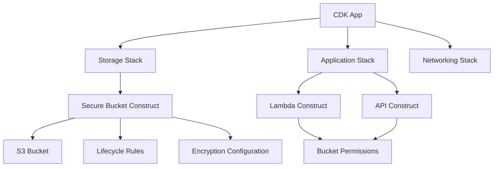
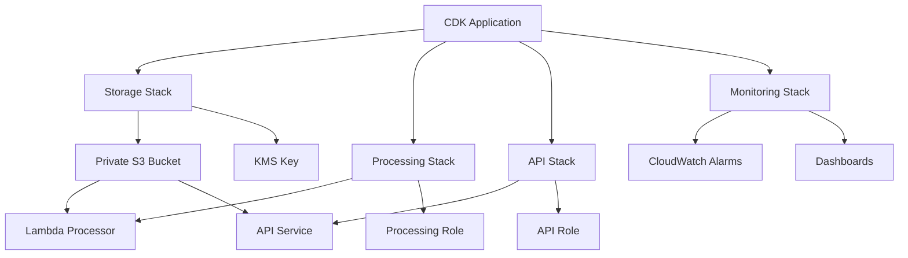
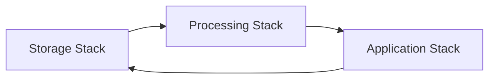
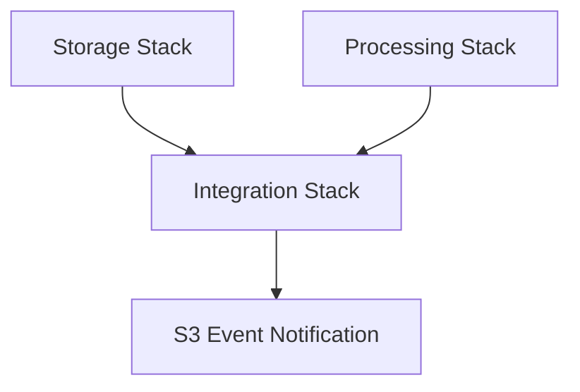
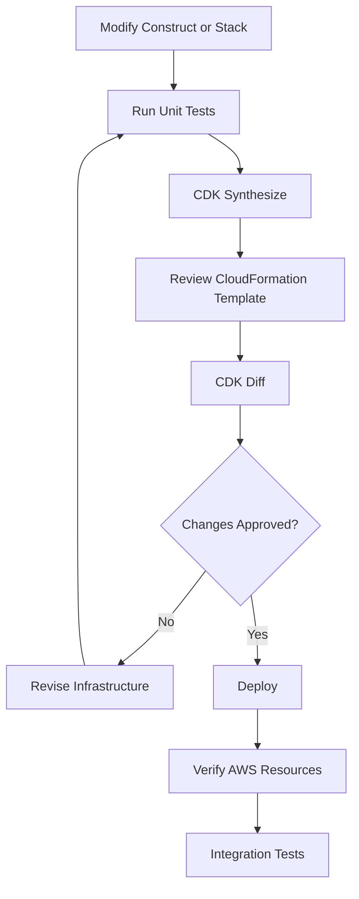
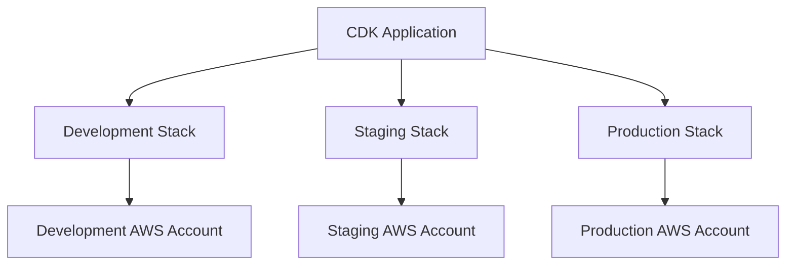

# 06- Reusable Constructs and Stack Composition

## Overview

AWS CDK constructs provide reusable abstractions for defining cloud infrastructure using familiar programming languages. For Amazon S3 deployments, they help standardize bucket configuration, security controls, lifecycle policies, replication settings, and integrations across multiple applications and environments.

As an S3 infrastructure codebase grows, defining every bucket directly inside a stack creates duplication and makes configuration difficult to maintain. Reusable constructs solve this by encapsulating infrastructure patterns behind well-defined interfaces.

Stack composition complements constructs by organizing infrastructure into logical deployment units. A well-designed CDK application separates reusable resource definitions from application-specific stacks and environment configuration.

This document covers:

- Construct hierarchy and abstraction boundaries.
- Reusable S3 bucket constructs.
- Configuration-driven infrastructure.
- Stack composition and cross-stack references.
- Multi-environment and multi-Region deployments.
- Testing, synthesis, deployment, and operational considerations.

The examples use AWS CDK v2 with Python.

## CDK Construct Hierarchy

CDK applications organize infrastructure into a hierarchy of constructs.



### Construct Levels

| Level | Construct type | Description | Typical use |
|---|---|---|---|
| L1 | CloudFormation resources | Direct representation of CloudFormation resources | Fine-grained resource configuration |
| L2 | Curated constructs | Higher-level abstractions with sensible defaults and helper methods | Standard S3 buckets |
| L3 | Patterns | Higher-level combinations of multiple resources | Common architectural patterns |

### L1 Constructs

L1 constructs represent CloudFormation resources directly.

For S3, the L1 construct is `s3.CfnBucket`.

```python
from aws_cdk import aws_s3 as s3
from constructs import Construct


class RawBucketConstruct(Construct):
    def __init__(self, scope: Construct, construct_id: str) -> None:
        super().__init__(scope, construct_id)

        self.bucket = s3.CfnBucket(
            self,
            "RawBucket",
            versioning_configuration={
                "status": "Enabled",
            },
            bucket_encryption={
                "server_side_encryption_configuration": [
                    {
                        "server_side_encryption_by_default": {
                            "sse_algorithm": "AES256",
                        }
                    }
                ]
            },
        )
```

Use L1 constructs when:

- An L2 construct does not expose a required CloudFormation property.
- You need direct control over a CloudFormation resource.
- You are implementing a specialized resource configuration.

L1 constructs require more manual configuration and do not provide all the convenience methods available in L2 constructs.

### L2 Constructs

L2 constructs provide higher-level abstractions and helper methods.

For S3, `s3.Bucket` is the standard L2 construct.

```python
from aws_cdk import RemovalPolicy
from aws_cdk import aws_s3 as s3
from constructs import Construct


class StorageConstruct(Construct):
    def __init__(self, scope: Construct, construct_id: str) -> None:
        super().__init__(scope, construct_id)

        self.bucket = s3.Bucket(
            self,
            "ApplicationBucket",
            encryption=s3.BucketEncryption.S3_MANAGED,
            block_public_access=s3.BlockPublicAccess.BLOCK_ALL,
            enforce_ssl=True,
            versioned=True,
            removal_policy=RemovalPolicy.RETAIN,
        )
```

L2 constructs are generally the preferred choice because they provide:

- Strongly typed configuration.
- Higher-level APIs.
- Sensible defaults.
- Resource relationships and helper methods.
- Easier testing and maintenance.

### L3 Constructs

L3 constructs combine multiple resources into a reusable architectural pattern.

For example, a document storage pattern might include:

- An encrypted S3 bucket.
- Lifecycle configuration.
- An IAM role or permission grants.
- Event notifications.
- A processing Lambda function.

Use L3 constructs when the same complete infrastructure pattern is needed across multiple applications.

Avoid creating an L3 abstraction for every small combination of resources. Abstractions should represent meaningful and reusable architecture.

## Designing Reusable S3 Constructs

A reusable construct should encapsulate infrastructure decisions that need to remain consistent across deployments.

A secure bucket construct can standardize:

- Public access blocking.
- Encryption.
- Versioning.
- TLS enforcement.
- Object ownership.
- Lifecycle policies.
- Resource retention.
- Tags.

### Construct Design Principles

A reusable construct should:

1. Accept configuration through constructor properties.
2. Apply secure defaults.
3. Expose resources that consumers legitimately need.
4. Avoid hardcoding environment-specific values.
5. Avoid embedding application-specific business logic.
6. Keep resource ownership and lifecycle behavior explicit.
7. Be independently testable.

A construct should not expose every internal implementation detail. Its public interface should contain only what consuming stacks need.

### Implementing a Secure Bucket Construct

Create a reusable construct.

```python
# constructs/secure_bucket.py

from dataclasses import dataclass
from typing import Optional

from aws_cdk import (
    Duration,
    RemovalPolicy,
    aws_kms as kms,
    aws_s3 as s3,
)
from constructs import Construct


@dataclass
class SecureBucketProps:
    versioned: bool = True
    removal_policy: RemovalPolicy = RemovalPolicy.RETAIN
    encryption_key: Optional[kms.IKey] = None
    lifecycle_expiration_days: Optional[int] = None


class SecureBucket(Construct):
    def __init__(
        self,
        scope: Construct,
        construct_id: str,
        props: Optional[SecureBucketProps] = None,
    ) -> None:
        super().__init__(scope, construct_id)

        props = props or SecureBucketProps()

        lifecycle_rules = []

        if props.lifecycle_expiration_days is not None:
            if props.lifecycle_expiration_days < 1:
                raise ValueError(
                    "Lifecycle expiration must be at least one day"
                )

            lifecycle_rules.append(
                s3.LifecycleRule(
                    expiration=Duration.days(
                        props.lifecycle_expiration_days
                    ),
                )
            )

        encryption = (
            s3.BucketEncryption.KMS
            if props.encryption_key
            else s3.BucketEncryption.S3_MANAGED
        )

        self.bucket = s3.Bucket(
            self,
            "Bucket",
            encryption=encryption,
            encryption_key=props.encryption_key,
            block_public_access=s3.BlockPublicAccess.BLOCK_ALL,
            object_ownership=s3.ObjectOwnership.BUCKET_OWNER_ENFORCED,
            enforce_ssl=True,
            versioned=props.versioned,
            lifecycle_rules=lifecycle_rules,
            removal_policy=props.removal_policy,
        )
```

The construct provides a consistent baseline while allowing consumers to configure selected behaviors.

Important design decisions:

- SSE-S3 is used by default.
- A customer-managed KMS key can be supplied when required.
- Public access is blocked.
- ACLs are disabled through bucket-owner-enforced ownership.
- TLS is enforced.
- Versioning is enabled by default.
- The bucket is retained by default.

The lifecycle rule in this example expires all current objects after the configured number of days. It is suitable only when that retention behavior is intentional. Production workloads should use lifecycle filters and retention requirements appropriate to their data classification.

### Using the Reusable Construct

```python
# stacks/storage_stack.py

from aws_cdk import (
    Stack,
    RemovalPolicy,
)
from constructs import Construct

from constructs.secure_bucket import (
    SecureBucket,
    SecureBucketProps,
)


class StorageStack(Stack):
    def __init__(
        self,
        scope: Construct,
        construct_id: str,
        **kwargs,
    ) -> None:
        super().__init__(scope, construct_id, **kwargs)

        document_storage = SecureBucket(
            self,
            "DocumentStorage",
            SecureBucketProps(
                versioned=True,
                removal_policy=RemovalPolicy.RETAIN,
                lifecycle_expiration_days=None,
            ),
        )

        self.document_bucket = document_storage.bucket
```

The stack consumes the construct without duplicating its security configuration.

### Exposing Bucket Properties and Methods

Consumers sometimes need access to the underlying bucket.

For example:

```python
storage_construct = SecureBucket(
    self,
    "MediaStorage",
)

bucket = storage_construct.bucket
```

The bucket can then be used for integrations:

```python
bucket.grant_read(application_role)
```

This is preferable to exposing internal resource identifiers or reconstructing resource references in consuming stacks.

For more complex constructs, expose focused methods:

```python
class SecureBucket(Construct):
    # Constructor omitted for brevity.

    def grant_read_access(self, grantee) -> None:
        self.bucket.grant_read(grantee)

    def grant_write_access(self, grantee) -> None:
        self.bucket.grant_put(grantee)
```

These methods provide a controlled interface, although the underlying bucket may still be exposed when consumers need additional CDK functionality.

## Construct Configuration and Reuse

A reusable construct should separate infrastructure behavior from deployment-specific configuration.

### Configuration Through Dataclasses

Python dataclasses provide a structured way to represent construct configuration.

```python
from dataclasses import dataclass
from typing import Optional


@dataclass(frozen=True)
class StorageConfig:
    bucket_name: Optional[str] = None
    versioned: bool = True
    enable_access_logging: bool = False
    lifecycle_expiration_days: Optional[int] = None
```

Using immutable configuration objects reduces accidental changes after configuration has been created.

Validate configuration before constructing resources.

```python
def validate_storage_config(config: StorageConfig) -> None:
    if config.lifecycle_expiration_days is not None:
        if config.lifecycle_expiration_days < 1:
            raise ValueError(
                "lifecycle_expiration_days must be positive"
            )
```

Configuration validation should cover actual deployment requirements, including:

- Required destination configuration for replication.
- KMS key compatibility.
- Valid bucket names.
- Retention and lifecycle constraints.
- Environment-specific resource requirements.

Do not place secrets in CDK context or ordinary configuration files.

### Environment-Specific Configuration

Different environments often require different resource settings.

| Configuration | Development | Staging | Production |
|---|---|---|---|
| Versioning | Enabled | Enabled | Enabled |
| Encryption | SSE-S3 or SSE-KMS | SSE-KMS | SSE-KMS |
| Removal policy | Retain or controlled destroy | Retain | Retain |
| Lifecycle | Short test retention where appropriate | Workload-specific | Business retention policy |
| Logging | Optional | Enabled where required | Enabled where required |
| Replication | Usually disabled | Optional | Based on recovery requirements |

Example configuration:

```python
# config/environments.py

from dataclasses import dataclass


@dataclass(frozen=True)
class EnvironmentConfig:
    environment: str
    bucket_versioning: bool
    enable_replication: bool
    enable_access_logging: bool


ENVIRONMENTS = {
    "dev": EnvironmentConfig(
        environment="dev",
        bucket_versioning=True,
        enable_replication=False,
        enable_access_logging=False,
    ),
    "staging": EnvironmentConfig(
        environment="staging",
        bucket_versioning=True,
        enable_replication=False,
        enable_access_logging=True,
    ),
    "prod": EnvironmentConfig(
        environment="prod",
        bucket_versioning=True,
        enable_replication=True,
        enable_access_logging=True,
    ),
}
```

Use this configuration to create environment-specific stacks.

```python
# app.py

import aws_cdk as cdk

from config.environments import ENVIRONMENTS
from stacks.storage_stack import StorageStack


app = cdk.App()

environment_name = app.node.try_get_context("environment")

if environment_name not in ENVIRONMENTS:
    raise ValueError(
        "Specify a valid environment using -c environment=<name>"
    )

config = ENVIRONMENTS[environment_name]

account = app.node.try_get_context("account")
region = app.node.try_get_context("region")

if not account or not region:
    raise ValueError("Account and Region must be configured")

StorageStack(
    app,
    f"Storage-{environment_name}",
    env=cdk.Environment(
        account=account,
        region=region,
    ),
    config=config,
)

app.synth()
```

The stack constructor must accept and apply the supplied configuration:

```python
class StorageStack(Stack):
    def __init__(
        self,
        scope,
        construct_id,
        config,
        **kwargs,
    ):
        super().__init__(
            scope,
            construct_id,
            **kwargs,
        )

        storage = SecureBucket(
            self,
            "ApplicationStorage",
            SecureBucketProps(
                versioned=config.bucket_versioning,
                removal_policy=RemovalPolicy.RETAIN,
            ),
        )

        self.bucket = storage.bucket
```

This keeps environment selection separate from resource implementation.

## Stack Composition

A CDK stack represents a deployment unit managed through AWS CloudFormation.

A stack can contain multiple constructs and resources. A CDK application can contain multiple stacks.

A practical S3 application may separate infrastructure into:

- Storage stack.
- Processing stack.
- Application stack.
- Networking stack.
- Monitoring stack.

### Why Separate Stacks?

Separating infrastructure into stacks provides:

- Independent deployment boundaries.
- Clear resource ownership.
- Easier infrastructure maintenance.
- Reusable application components.
- More controlled change management.
- Reduced coupling between unrelated resources.

However, excessive stack fragmentation introduces cross-stack dependencies and deployment complexity.

Choose stack boundaries based on ownership, lifecycle, deployment frequency, and operational responsibilities.

### Example Stack Architecture



The storage stack owns the bucket. Other stacks consume the bucket through references and permission grants.

### Creating a Storage Stack

```python
# stacks/storage_stack.py

from aws_cdk import (
    Stack,
    RemovalPolicy,
    aws_s3 as s3,
)
from constructs import Construct

from constructs.secure_bucket import SecureBucket


class StorageStack(Stack):
    def __init__(
        self,
        scope: Construct,
        construct_id: str,
        **kwargs,
    ) -> None:
        super().__init__(
            scope,
            construct_id,
            **kwargs,
        )

        storage = SecureBucket(
            self,
            "ApplicationStorage",
        )

        self.bucket = storage.bucket
```

### Creating a Processing Stack

The processing stack consumes the bucket created by the storage stack.

```python
# stacks/processing_stack.py

from aws_cdk import (
    Stack,
    aws_lambda as lambda_,
)
from constructs import Construct

from aws_cdk import aws_s3 as s3


class ProcessingStack(Stack):
    def __init__(
        self,
        scope: Construct,
        construct_id: str,
        bucket: s3.IBucket,
        **kwargs,
    ) -> None:
        super().__init__(
            scope,
            construct_id,
            **kwargs,
        )

        processor = lambda_.Function(
            self,
            "DocumentProcessor",
            runtime=lambda_.Runtime.PYTHON_3_12,
            handler="handler.main",
            code=lambda_.Code.from_asset(
                "lambda/document_processor"
            ),
        )

        bucket.grant_read(processor)
```

The processing stack receives an `IBucket` interface rather than creating another bucket.

This makes the stack reusable with different bucket implementations.

The example grants read access only. A real processing workflow may require additional permissions for output objects, event consumption, KMS operations, or other integrations.

### Composing Stacks

```python
# app.py

import aws_cdk as cdk

from stacks.storage_stack import StorageStack
from stacks.processing_stack import ProcessingStack


app = cdk.App()

environment = cdk.Environment(
    account="123456789012",
    region="ap-south-1",
)

storage_stack = StorageStack(
    app,
    "StorageStack",
    env=environment,
)

processing_stack = ProcessingStack(
    app,
    "ProcessingStack",
    bucket=storage_stack.bucket,
    env=environment,
)

processing_stack.add_dependency(storage_stack)

app.synth()
```

Passing a resource reference between stacks in the same CDK application and compatible environment allows CDK to establish a CloudFormation cross-stack reference.

The explicit dependency documents the intended deployment order. CDK can also infer dependencies from cross-stack references.

Avoid adding unnecessary dependencies. They can make deployments more restrictive and increase coupling.

## Cross-Stack References

Cross-stack references allow resources in one stack to be consumed by another.

For S3, common examples include:

- Passing a bucket reference to a Lambda stack.
- Granting an API role access to a bucket.
- Sharing a bucket with an event-processing stack.
- Referencing a KMS key from a storage consumer.

### Using IBucket

The `IBucket` interface allows a construct to consume an existing bucket without depending on its concrete implementation.

```python
from aws_cdk import aws_s3 as s3


def configure_storage_access(
    bucket: s3.IBucket,
    role,
) -> None:
    bucket.grant_read(role)
```

This supports both:

- Buckets created in the same CDK application.
- Existing buckets imported into the application.

### Importing an Existing Bucket

Use `Bucket.from_bucket_name()` when a stack needs to reference a bucket that it does not own.

```python
from aws_cdk import Stack
from aws_cdk import aws_s3 as s3
from constructs import Construct


class ConsumerStack(Stack):
    def __init__(
        self,
        scope: Construct,
        construct_id: str,
        **kwargs,
    ) -> None:
        super().__init__(
            scope,
            construct_id,
            **kwargs,
        )

        bucket = s3.Bucket.from_bucket_name(
            self,
            "ExistingBucket",
            "company-document-storage",
        )

        # Use the imported bucket in integrations.
        self.bucket = bucket
```

An imported bucket is a reference, not a newly managed resource.

CDK cannot automatically change its bucket configuration merely because it has been imported.

Some operations on imported resources are limited because the application does not own their CloudFormation definitions.

### Cross-Stack Reference Considerations

| Concern | Engineering consideration |
|---|---|
| Deployment order | Consumer stacks depend on producer stacks |
| Resource ownership | Keep the bucket in one clearly defined owner stack |
| Stack deletion | Removing exports can break dependent stacks |
| Resource replacement | Changes to exported identifiers can affect consumers |
| Environment | Cross-stack references generally require compatible environments |
| Imported resources | Imported resources have limited mutability |
| Coupling | Too many references make stacks difficult to deploy independently |

### Avoiding Circular Dependencies

A circular dependency occurs when stacks depend on each other.



This creates a deployment dependency cycle.

For example:

- Storage stack exports a bucket to the processing stack.
- Processing stack exports a Lambda function to the storage stack.
- Storage stack configures the Lambda notification.

A better design is to assign integration ownership to a separate stack or a single stack that owns the relationship.



The integration stack can receive the bucket and function references and configure the notification.

This separates resource ownership from integration configuration.

## Cross-Region Stack Composition

S3 replication commonly involves buckets in different AWS Regions.

A cross-Region deployment should explicitly configure each stack's environment.

```python
source_environment = cdk.Environment(
    account="123456789012",
    region="ap-south-1",
)

destination_environment = cdk.Environment(
    account="123456789012",
    region="ap-southeast-1",
)
```

Create separate stacks:

```python
source_stack = StorageStack(
    app,
    "SourceStorage",
    env=source_environment,
)

destination_stack = StorageStack(
    app,
    "DestinationStorage",
    env=destination_environment,
)
```

Do not assume ordinary cross-stack references work across Regions. CloudFormation exports and imports are Region-scoped.

For cross-Region resource relationships, use an explicit deployment design. Options include:

- Supplying stable resource identifiers through configuration.
- Using deployment parameters.
- Deploying related resources independently.
- Using a dedicated replication configuration stack where appropriate.

S3 replication itself requires the appropriate source and destination configuration, versioning, IAM permissions, and encryption permissions where applicable.

## Composing Multiple Storage Workloads

A single application may have different storage requirements.

For example:

| Workload | Storage requirements |
|---|---|
| User uploads | Private access, validation, encryption |
| Processed documents | Restricted write access, retention |
| Static assets | CloudFront delivery |
| Application logs | Lifecycle expiration and restricted access |
| Backups | Versioning, retention, replication |

Avoid using one bucket for unrelated workloads simply to reduce resource count.

Separate buckets when workloads require different:

- Security boundaries.
- Retention policies.
- Encryption keys.
- Access permissions.
- Replication behavior.
- Operational ownership.

A stack can compose multiple reusable constructs:

```python
class ApplicationStorageStack(Stack):
    def __init__(
        self,
        scope: Construct,
        construct_id: str,
        **kwargs,
    ) -> None:
        super().__init__(
            scope,
            construct_id,
            **kwargs,
        )

        self.upload_bucket = SecureBucket(
            self,
            "UploadStorage",
        ).bucket

        self.processed_bucket = SecureBucket(
            self,
            "ProcessedStorage",
        ).bucket

        self.backup_bucket = SecureBucket(
            self,
            "BackupStorage",
        ).bucket
```

Each bucket has its own lifecycle and security boundary.

For production, provide separate configuration for each workload rather than assuming all three should use identical policies.

## Higher-Level Storage Patterns

Reusable constructs can encapsulate more than a bucket.

Consider a document storage abstraction that creates a bucket and provides a controlled interface for application workloads.

```python
# constructs/document_storage.py

from aws_cdk import (
    Duration,
    RemovalPolicy,
    aws_s3 as s3,
)
from constructs import Construct


class DocumentStorage(Construct):
    def __init__(
        self,
        scope: Construct,
        construct_id: str,
    ) -> None:
        super().__init__(
            scope,
            construct_id,
        )

        self.bucket = s3.Bucket(
            self,
            "DocumentsBucket",
            encryption=s3.BucketEncryption.S3_MANAGED,
            block_public_access=s3.BlockPublicAccess.BLOCK_ALL,
            object_ownership=s3.ObjectOwnership.BUCKET_OWNER_ENFORCED,
            enforce_ssl=True,
            versioned=True,
            removal_policy=RemovalPolicy.RETAIN,
            lifecycle_rules=[
                s3.LifecycleRule(
                    prefix="temporary/",
                    expiration=Duration.days(30),
                ),
            ],
        )

    def grant_application_access(self, grantee) -> None:
        self.bucket.grant_read_write(
            grantee,
            "documents/*",
        )
```

This construct is useful when multiple applications need the same document-storage pattern.

The example grants read and write access only to the `documents/` prefix. The lifecycle rule applies only to the `temporary/` prefix.

The construct does not implement document validation, retention enforcement, malware scanning, or application-level authorization. Those concerns belong in the application or dedicated infrastructure components.

## Testing Reusable Constructs

Reusable constructs should be tested independently from deployment.

AWS CDK provides assertions through `aws_cdk.assertions`.

Install the required dependencies:

```bash
pip install aws-cdk-lib constructs pytest
```

### Testing Bucket Configuration

```python
# tests/test_secure_bucket.py

import aws_cdk as cdk

from aws_cdk import assertions

from constructs.secure_bucket import (
    SecureBucket,
    SecureBucketProps,
)


def test_secure_bucket_configuration():
    app = cdk.App()
    stack = cdk.Stack(app, "TestStack")

    SecureBucket(
        stack,
        "TestBucket",
        SecureBucketProps(
            versioned=True,
        ),
    )

    template = assertions.Template.from_stack(stack)

    template.resource_count_is(
        "AWS::S3::Bucket",
        1,
    )

    template.has_resource_properties(
        "AWS::S3::Bucket",
        {
            "VersioningConfiguration": {
                "Status": "Enabled",
            },
            "PublicAccessBlockConfiguration": {
                "BlockPublicAcls": True,
                "BlockPublicPolicy": True,
                "IgnorePublicAcls": True,
                "RestrictPublicBuckets": True,
            },
            "BucketEncryption": {
                "ServerSideEncryptionConfiguration": [
                    {
                        "ServerSideEncryptionByDefault": {
                            "SSEAlgorithm": "AES256",
                        }
                    }
                ]
            },
        },
    )
```

### Testing Lifecycle Configuration

```python
def test_lifecycle_configuration():
    app = cdk.App()
    stack = cdk.Stack(app, "LifecycleTestStack")

    SecureBucket(
        stack,
        "TestBucket",
        SecureBucketProps(
            lifecycle_expiration_days=30,
        ),
    )

    template = assertions.Template.from_stack(stack)

    template.has_resource_properties(
        "AWS::S3::Bucket",
        {
            "LifecycleConfiguration": {
                "Rules": [
                    {
                        "Status": "Enabled",
                        "ExpirationInDays": 30,
                    }
                ]
            }
        },
    )
```

### Testing Invalid Configuration

```python
import pytest

from constructs.secure_bucket import (
    SecureBucket,
    SecureBucketProps,
)


def test_invalid_lifecycle_configuration():
    app = cdk.App()
    stack = cdk.Stack(app, "InvalidConfigStack")

    with pytest.raises(ValueError):
        SecureBucket(
            stack,
            "InvalidBucket",
            SecureBucketProps(
                lifecycle_expiration_days=0,
            ),
        )
```

Run tests:

```bash
pytest -v
```

These tests validate synthesized infrastructure templates. They do not prove that AWS deployment, IAM authorization, KMS permissions, or runtime integrations work.

Use integration tests in an AWS test account for behavior that cannot be established through synthesis assertions.

## Synthesis and Deployment Workflow

A disciplined CDK workflow should validate infrastructure before deployment.



### Synthesize the Application

```bash
cdk synth
```

Synthesis converts CDK constructs into CloudFormation templates.

Review the generated templates for:

- Unexpected resource creation.
- Unintended resource replacement.
- Incorrect bucket configuration.
- Missing encryption settings.
- Missing permissions.
- Unexpected public access.
- Incorrect lifecycle rules.
- Unexpected IAM policy changes.

### Review Infrastructure Changes

```bash
cdk diff StorageStack
```

Review the proposed changes before deployment.

Pay particular attention to:

- Bucket replacement.
- Bucket deletion.
- Changes to encryption configuration.
- Changes to versioning.
- IAM policy changes.
- Lifecycle rule modifications.
- Replication configuration changes.

### Deploy Stacks

```bash
cdk deploy StorageStack
```

Deploy dependent stacks in the correct order.

For a multi-stack application:

```bash
cdk deploy StorageStack ProcessingStack ApiStack
```

Use production approval controls in CI/CD. Do not treat a successful synthesis or deployment command as proof that the application is operational.

### Verify Deployed Resources

Inspect the deployed bucket:

```bash
aws s3api get-bucket-location \
  --bucket company-document-storage
```

Check versioning:

```bash
aws s3api get-bucket-versioning \
  --bucket company-document-storage
```

Check encryption:

```bash
aws s3api get-bucket-encryption \
  --bucket company-document-storage
```

Check public access configuration:

```bash
aws s3api get-public-access-block \
  --bucket company-document-storage
```

These commands verify selected bucket properties. Additional checks should cover IAM permissions, KMS authorization, lifecycle configuration, replication, and application-level access.

## CI/CD Considerations

Reusable constructs and stack composition become especially valuable when infrastructure is deployed through automated pipelines.

A typical pipeline should include:

1. Dependency installation.
2. Python linting and static checks.
3. Construct unit tests.
4. CDK synthesis.
5. Infrastructure security checks.
6. Change review.
7. Deployment approval.
8. Deployment.
9. Post-deployment verification.

### Example GitHub Actions Workflow

```yaml
name: CDK Infrastructure CI

on:
  pull_request:
    paths:
      - "cdk/**"
      - ".github/workflows/cdk.yml"
  push:
    branches:
      - main

permissions:
  contents: read

jobs:
  validate:
    runs-on: ubuntu-latest

    defaults:
      run:
        working-directory: cdk

    steps:
      - name: Checkout repository
        uses: actions/checkout@v4

      - name: Configure Python
        uses: actions/setup-python@v5
        with:
          python-version: "3.12"

      - name: Install dependencies
        run: |
          python -m pip install --upgrade pip
          pip install -r requirements.txt
          pip install pytest

      - name: Run tests
        run: pytest -v

      - name: Synthesize CDK application
        run: cdk synth
```

For production deployment:

- Use GitHub Actions OIDC federation with AWS IAM.
- Grant only the required deployment permissions.
- Use short-lived credentials.
- Separate validation and deployment jobs.
- Require approval for production.
- Review synthesized templates and infrastructure changes.
- Pin third-party GitHub Actions to verified commit SHAs in production workflows.
- Record deployment metadata and audit events.

Do not store long-lived AWS access keys in GitHub repository secrets when OIDC federation is available.

The workflow above validates and synthesizes the application. It does not deploy infrastructure.

## Multi-Environment Deployment Strategy

A production CDK application should distinguish between environment configuration and resource implementation.

A common deployment model is:



Separate AWS accounts provide stronger isolation than relying only on stack names or context values.

Recommended practices:

- Use explicit account and Region configuration.
- Prefer separate accounts for production and non-production.
- Keep environment-specific settings outside reusable constructs.
- Use separate deployment roles for each environment.
- Require production approval.
- Avoid hardcoded account IDs in reusable construct implementations.
- Keep bucket names globally unique when explicitly specifying physical names.
- Avoid resource naming strategies that cause collisions across environments.

For environment selection and CDK context behavior, refer to the dedicated CDK context and environment configuration document.

## Operational and Security Considerations

### Resource Lifecycle

S3 buckets can contain business-critical data. Their lifecycle must be considered separately from the lifecycle of the application stack.

Use `RemovalPolicy.RETAIN` for production data buckets unless a controlled deletion workflow is explicitly required.

Avoid enabling automatic object deletion on production buckets as a convenience.

### Encryption and Key Management

Use SSE-S3 or SSE-KMS according to the workload's security and compliance requirements.

When using customer-managed KMS keys:

- Define key ownership clearly.
- Grant required KMS permissions.
- Consider key rotation and key lifecycle.
- Validate cross-account and cross-Region requirements.
- Avoid granting broad KMS permissions to application roles.

S3 permissions and KMS permissions are separate authorization layers.

### IAM Permissions

Use CDK grant methods where appropriate:

```python
bucket.grant_read(application_role)
```

For narrower access:

```python
bucket.grant_read(
    application_role,
    "documents/*",
)
```

Review synthesized IAM policies to ensure permissions are limited to the required actions and resources.

### Observability

For production infrastructure, consider:

- CloudTrail data events for relevant object-level auditing.
- CloudWatch metrics and alarms.
- S3 Storage Lens for usage visibility.
- S3 Inventory for object-level reporting.
- Replication metrics for replicated workloads.
- Application logs for upload and download operations.

Do not enable expensive logging or auditing features without understanding their scope and cost.

### Cost Management

Reusable constructs should not silently enable costly features for every workload.

Evaluate the cost implications of:

- S3 storage classes.
- Version retention.
- Replication.
- KMS requests.
- CloudWatch metrics.
- CloudTrail data events.
- S3 Inventory.
- Data transfer.
- Incomplete multipart uploads.

Make optional features explicit in construct configuration.

## Common Mistakes and Production Pitfalls

| Mistake | Why it causes problems | Recommended approach |
|---|---|---|
| Duplicating bucket definitions | Configuration becomes inconsistent | Use reusable constructs |
| Creating oversized constructs | Abstractions become difficult to maintain | Keep interfaces focused |
| Exposing every internal resource | Consumers become tightly coupled to implementation | Expose only required resources and methods |
| Putting all resources in one stack | Deployment changes become difficult to isolate | Define stacks around ownership and lifecycle |
| Creating too many small stacks | Cross-stack dependencies increase | Use meaningful deployment boundaries |
| Sharing physical resources across stacks | Ownership and replacement behavior become unclear | Maintain one resource owner |
| Hardcoding bucket names | Causes naming conflicts across environments | Generate names or configure them deliberately |
| Using destructive removal policies | Can cause irreversible data loss | Retain production buckets |
| Assuming imported buckets are mutable | CDK does not own their CloudFormation configuration | Manage imported resources through their owner |
| Creating circular dependencies | CloudFormation cannot deploy dependency cycles | Move integrations into a dedicated stack |
| Ignoring synthesized templates | Hidden resource or permission changes can reach production | Review `cdk synth` and `cdk diff` |
| Treating unit tests as deployment verification | Synthesized templates do not prove runtime behavior | Add AWS integration tests |

## Recommended Project Structure

A maintainable Python CDK project can use the following structure:

```text
s3-cdk/
│
├── app.py
├── cdk.json
├── requirements.txt
├── README.md
│
├── config/
│   ├── __init__.py
│   └── environments.py
│
├── constructs/
│   ├── __init__.py
│   ├── secure_bucket.py
│   └── document_storage.py
│
├── stacks/
│   ├── __init__.py
│   ├── storage_stack.py
│   ├── processing_stack.py
│   └── monitoring_stack.py
│
├── lambda/
│   └── document_processor/
│       └── handler.py
│
├── tests/
│   ├── test_secure_bucket.py
│   ├── test_document_storage.py
│   └── test_storage_stack.py
│
└── .github/
    └── workflows/
        └── cdk.yml
```

Keep constructs independent of environment-specific deployment decisions. Keep stacks responsible for composing constructs and defining deployment boundaries.

The project structure should evolve with the application rather than becoming a rigid requirement for every CDK project.

## Production Readiness Checklist

### Construct Design

- [ ] Reusable constructs have clear responsibilities.
- [ ] Secure defaults are applied consistently.
- [ ] Configuration is passed through typed properties.
- [ ] Environment-specific settings are externalized.
- [ ] Construct interfaces expose only required resources and methods.
- [ ] Lifecycle and removal behavior are explicit.

### Stack Composition

- [ ] Every resource has a clear owning stack.
- [ ] Cross-stack references are intentional.
- [ ] Circular dependencies are avoided.
- [ ] Cross-Region relationships are explicitly designed.
- [ ] Stack boundaries reflect deployment and ownership requirements.
- [ ] Imported resources are not treated as resources owned by the consuming stack.

### Testing and Deployment

- [ ] Construct assertions cover important resource properties.
- [ ] Invalid configuration is tested.
- [ ] Synthesized templates are reviewed.
- [ ] `cdk diff` is reviewed before deployment.
- [ ] AWS integration tests cover runtime behavior.
- [ ] CI/CD uses short-lived deployment credentials.
- [ ] Production deployments have approval controls.
- [ ] Post-deployment verification is documented.

### Security and Operations

- [ ] S3 public access is blocked unless explicitly required.
- [ ] Encryption and TLS enforcement are configured.
- [ ] IAM permissions follow least privilege.
- [ ] KMS permissions are validated separately.
- [ ] Production data buckets use appropriate retention controls.
- [ ] Monitoring and auditing are configured according to workload requirements.
- [ ] Cost implications of optional features are understood.

## Key Takeaways

- Reusable CDK constructs standardize S3 infrastructure and prevent configuration duplication across applications.
- Keep constructs focused on resource patterns and stacks focused on deployment boundaries and resource ownership.
- Use `IBucket` interfaces and explicit cross-stack references to share resources without duplicating their definitions.
- Test constructs through synthesized CloudFormation assertions, then use AWS integration tests to validate deployed behavior.
- Production CDK workflows should include infrastructure review, least-privilege deployment permissions, controlled approvals, and post-deployment verification.