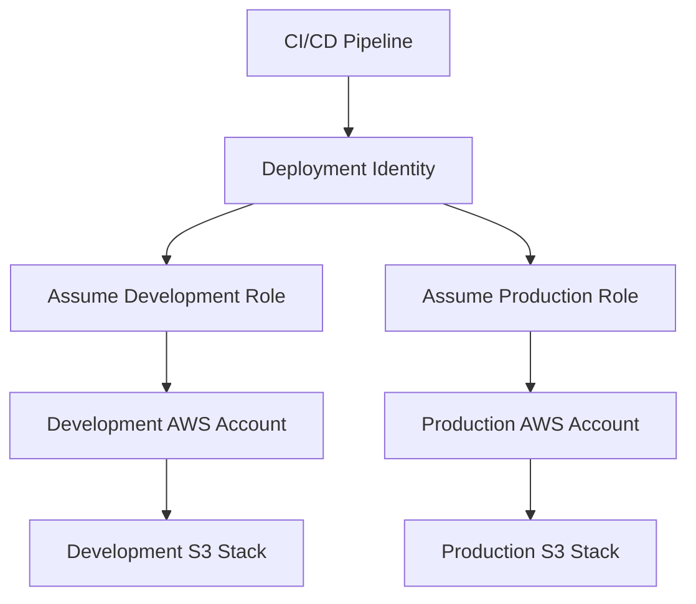
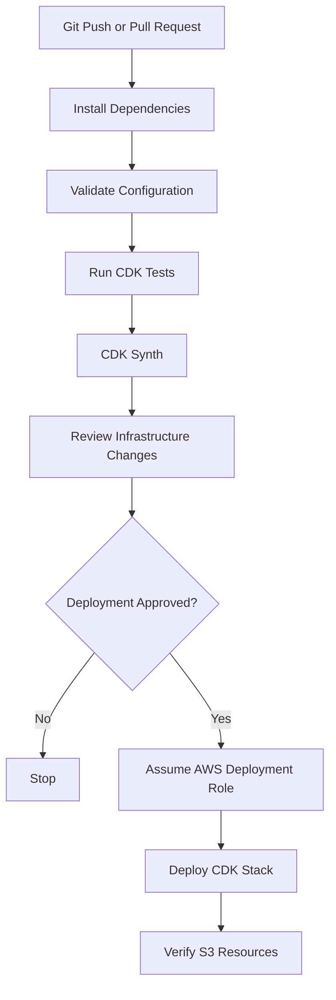

# 07- CDK Context and Environment Configuration

## Overview

AWS CDK context and environment configuration determine how infrastructure applications resolve deployment settings, identify AWS accounts and Regions, and create environment-specific resources.

For Amazon S3 deployments, configuration decisions affect:

- Which AWS account and Region receive the bucket.
- Whether resources are created differently in development, staging, and production.
- How bucket names and other resource identifiers are generated.
- Which security, lifecycle, and replication settings are applied.
- How infrastructure behaves across local development and CI/CD environments.

A production CDK application should separate infrastructure implementation from environment-specific configuration. Reusable constructs should define resource behavior, while application configuration determines the values used by each deployment.

This document covers:

- CDK context and configuration sources.
- Account and Region configuration.
- Environment-specific deployment patterns.
- Configuration validation and precedence.
- Environment variables and secrets.
- Cross-account and cross-Region deployment considerations.
- CI/CD configuration and deployment verification.

## CDK Context Fundamentals

CDK context provides configuration values to a CDK application during synthesis.

Context values are commonly used to select:

- Deployment environment.
- AWS account.
- AWS Region.
- Feature flags.
- Resource naming conventions.
- Optional infrastructure capabilities.
- Environment-specific settings.

Context is useful when the same CDK application must synthesize different infrastructure configurations without changing its implementation.

### Where Context Values Come From

CDK supports several sources of context values.

| Source | Purpose | Example |
|---|---|---|
| `cdk.json` | Application-level configuration | Default environment |
| `cdk.context.json` | Cached context and lookup results | Availability zone lookup data |
| CLI `-c` option | Deployment-specific configuration | `-c environment=prod` |
| Programmatic context | Values supplied through CDK APIs | `app.node.set_context()` |

A simple `cdk.json` configuration:

```json
{
  "app": "python app.py",
  "context": {
    "environment": "dev",
    "region": "ap-south-1",
    "enable_versioning": true
  }
}
```

The application can retrieve these values:

```python
import aws_cdk as cdk

app = cdk.App()

environment = app.node.try_get_context("environment")
region = app.node.try_get_context("region")
enable_versioning = app.node.try_get_context("enable_versioning")

print(environment)
print(region)
print(enable_versioning)
```

`try_get_context()` returns `None` when a value is not available. Validate required configuration before constructing infrastructure.

### Supplying Context Through the CLI

Context values can be supplied at synthesis or deployment time.

```bash
cdk synth -c environment=dev
```

```bash
cdk synth -c environment=staging
```

```bash
cdk deploy -c environment=prod
```

Multiple values can be supplied:

```bash
cdk deploy \
  -c environment=prod \
  -c account=123456789012 \
  -c region=ap-south-1
```

CLI context is useful for selecting deployment environments without editing configuration files.

Do not rely on undocumented assumptions about precedence when the same key exists in multiple configuration sources. Keep configuration ownership clear and avoid defining conflicting values.

## Context Lookup and Caching

CDK context is also used for environment lookups.

For example, CDK may need to discover:

- Availability zones.
- Existing VPCs.
- Hosted zones.
- Security groups.
- Other AWS environment information supported by CDK lookup APIs.

These lookups can require access to AWS account information during synthesis.

CDK caches lookup results in `cdk.context.json`.

Example:

```json
{
  "availability-zones:account=123456789012:region=ap-south-1": [
    "ap-south-1a",
    "ap-south-1b",
    "ap-south-1c"
  ]
}
```

The exact generated cache keys and values depend on the lookup type and CDK version.

### Why Context Caching Matters

Caching makes synthesis more predictable.

Without cached lookup information, synthesis may depend on the current AWS environment and external lookup results.

With cached values:

- Repeated synthesis can use the same lookup results.
- CI/CD can reproduce previously resolved configuration.
- Infrastructure changes caused by updated lookup results become easier to review.

### Managing Context Files

Keep application configuration and lookup cache conceptually separate.

| File | Responsibility | Typical treatment |
|---|---|---|
| `cdk.json` | Application configuration and feature flags | Commit to version control |
| `cdk.context.json` | Cached environment lookup results | Usually commit to version control for reproducibility |
| `.env` | Local environment variables and sensitive local configuration | Exclude from version control |
| `requirements.txt` | Python dependency declarations | Commit to version control |

Do not manually edit generated lookup entries unless you understand the lookup behavior and the consequences.

When refreshing cached lookup information, use the CDK context commands and review the resulting changes rather than deleting context data indiscriminately.

## CDK Environment Configuration

A CDK environment identifies the AWS account and Region where a stack is deployed.

It is represented by `cdk.Environment`.

```python
import aws_cdk as cdk

environment = cdk.Environment(
    account="123456789012",
    region="ap-south-1",
)
```

Use it when creating a stack:

```python
from aws_cdk import Stack
from constructs import Construct


class StorageStack(Stack):
    def __init__(
        self,
        scope: Construct,
        construct_id: str,
        **kwargs,
    ) -> None:
        super().__init__(
            scope,
            construct_id,
            **kwargs,
        )
```

```python
storage_stack = StorageStack(
    app,
    "StorageStack",
    env=environment,
)
```

An explicit environment makes the stack account- and Region-specific.

### Explicit Environment Configuration

An explicitly configured stack has a known account and Region at synthesis time.

```python
environment = cdk.Environment(
    account="123456789012",
    region="ap-south-1",
)

StorageStack(
    app,
    "ProductionStorage",
    env=environment,
)
```

Advantages:

- Environment-specific synthesis.
- Predictable account and Region configuration.
- Support for environment-dependent CDK lookups.
- Clear deployment targeting.
- Easier separation of development and production infrastructure.

For production S3 infrastructure, explicit environment configuration is generally preferable.

### Environment-Agnostic Stacks

A stack can also omit an explicit environment.

```python
StorageStack(
    app,
    "GenericStorage",
)
```

Such a stack is environment-agnostic at synthesis time.

The deployment environment is resolved through the deployment process rather than being fixed in the stack definition.

Environment-agnostic stacks can be useful for portable infrastructure definitions, but they have limitations when infrastructure requires account- or Region-specific information during synthesis.

For example, environment-dependent lookups and certain environment-specific resource decisions may not be available as expected.

Use explicit environments when the application depends on environment-specific configuration.

## Environment Variables and CDK

Environment variables provide configuration outside the CDK source code.

They are useful in:

- Local development.
- Docker-based development environments.
- GitHub Actions.
- Other CI/CD systems.
- Automated deployment environments.

Python can read environment variables through `os.environ`.

```python
import os

environment = os.getenv("DEPLOY_ENV", "dev")
aws_account = os.getenv("CDK_DEFAULT_ACCOUNT")
aws_region = os.getenv("CDK_DEFAULT_REGION", "ap-south-1")
```

For required values, validate explicitly.

```python
def required_environment_variable(name: str) -> str:
    value = os.getenv(name)

    if not value:
        raise ValueError(
            f"Required environment variable is missing: {name}"
        )

    return value
```

Example:

```python
account = required_environment_variable("AWS_ACCOUNT_ID")
region = required_environment_variable("AWS_REGION")
```

### Environment Variables vs CDK Context

| Aspect | Environment variables | CDK context |
|---|---|---|
| Source | Operating environment | CDK configuration and CLI |
| Typical use | Runtime deployment configuration | Application and synthesis configuration |
| CI/CD integration | Directly supported by runners | Supported through CLI arguments |
| Version control | Usually not committed when sensitive | Configuration files are commonly committed |
| Lookup caching | Not provided by itself | Supported through CDK context |
| Secrets | Can carry secrets, but should be handled carefully | Should not contain secrets |

A useful approach is to use context for application-level choices and environment variables for deployment-specific values supplied by the execution environment.

Avoid defining the same configuration in multiple places without a clear ownership rule.

## Managing Development, Staging, and Production

A single CDK application commonly deploys infrastructure into multiple environments.

For S3, environments may differ in:

- Bucket naming.
- Versioning.
- Lifecycle configuration.
- Encryption requirements.
- Replication.
- Logging.
- Removal policies.
- IAM permissions.

### Environment Configuration Model

Use a typed configuration object to represent environment-specific settings.

```python
# config/environments.py

from dataclasses import dataclass
from typing import Optional


@dataclass(frozen=True)
class EnvironmentConfig:
    name: str
    account: str
    region: str
    bucket_name: Optional[str]
    versioned: bool
    enable_replication: bool
    enable_access_logging: bool


ENVIRONMENTS = {
    "dev": EnvironmentConfig(
        name="dev",
        account="123456789012",
        region="ap-south-1",
        bucket_name=None,
        versioned=True,
        enable_replication=False,
        enable_access_logging=False,
    ),
    "staging": EnvironmentConfig(
        name="staging",
        account="234567890123",
        region="ap-south-1",
        bucket_name=None,
        versioned=True,
        enable_replication=False,
        enable_access_logging=True,
    ),
    "prod": EnvironmentConfig(
        name="prod",
        account="345678901234",
        region="ap-south-1",
        bucket_name=None,
        versioned=True,
        enable_replication=True,
        enable_access_logging=True,
    ),
}
```

The account IDs are illustrative. Replace them with the actual account identifiers used by the deployment organization.

This approach keeps environment-specific configuration centralized.

### Selecting an Environment

Use CDK context to select the deployment environment.

```python
# app.py

import aws_cdk as cdk

from config.environments import ENVIRONMENTS
from stacks.storage_stack import StorageStack


app = cdk.App()

environment_name = app.node.try_get_context("environment")

if environment_name not in ENVIRONMENTS:
    raise ValueError(
        "Specify a valid environment using "
        "-c environment=dev|staging|prod"
    )

config = ENVIRONMENTS[environment_name]

StorageStack(
    app,
    f"Storage-{config.name}",
    config=config,
    env=cdk.Environment(
        account=config.account,
        region=config.region,
    ),
)

app.synth()
```

Deploy a specific environment:

```bash
cdk deploy -c environment=dev
```

```bash
cdk deploy -c environment=staging
```

```bash
cdk deploy -c environment=prod
```

### Applying Configuration to an S3 Stack

The stack should consume the configuration rather than independently deciding which environment is active.

```python
# stacks/storage_stack.py

from aws_cdk import (
    Stack,
    RemovalPolicy,
    aws_s3 as s3,
)
from constructs import Construct


class StorageStack(Stack):
    def __init__(
        self,
        scope: Construct,
        construct_id: str,
        config,
        **kwargs,
    ) -> None:
        super().__init__(
            scope,
            construct_id,
            **kwargs,
        )

        self.bucket = s3.Bucket(
            self,
            "ApplicationBucket",
            bucket_name=config.bucket_name,
            encryption=s3.BucketEncryption.S3_MANAGED,
            block_public_access=s3.BlockPublicAccess.BLOCK_ALL,
            object_ownership=s3.ObjectOwnership.BUCKET_OWNER_ENFORCED,
            enforce_ssl=True,
            versioned=config.versioned,
            removal_policy=RemovalPolicy.RETAIN,
        )
```

The example establishes a common secure baseline. Additional configuration such as replication and access logging should be implemented explicitly when enabled by the environment configuration.

Avoid silently accepting configuration flags that the stack does not actually apply.

## Resource Naming Across Environments

S3 bucket names must satisfy S3 naming requirements and be globally unique within the applicable S3 namespace.

Environment-specific naming helps prevent collisions.

Example naming convention:

```text
company-dev-document-storage
company-staging-document-storage
company-prod-document-storage
```

A naming function can centralize the convention.

```python
def build_bucket_name(
    company: str,
    environment: str,
    workload: str,
) -> str:
    return (
        f"{company}-{environment}-{workload}"
        .lower()
    )
```

Use it in the stack:

```python
bucket_name = build_bucket_name(
    company="company",
    environment=config.name,
    workload="document-storage",
)
```

Do not assume that a predictable name is automatically available. Explicit bucket names can collide with buckets owned by other AWS accounts.

For reusable constructs, consider leaving physical naming to CDK and CloudFormation unless a stable name is required by an external integration.

### Naming Considerations

| Resource | Naming recommendation |
|---|---|
| S3 bucket | Include environment and workload where explicit names are required |
| CDK stack | Use a stable environment-specific stack identifier |
| IAM role | Include application or workload identity |
| KMS key | Use a clear purpose-based alias |
| Lambda function | Include environment and processing purpose |
| CloudWatch log group | Use a predictable service and environment convention |

Changing a physical resource name can require replacement. Treat naming changes as infrastructure migrations rather than harmless refactoring.

## Configuration Validation

Configuration should be validated before CDK creates infrastructure.

Invalid configuration should fail during synthesis rather than during deployment.

Example:

```python
def validate_environment_config(config) -> None:
    if not config.account:
        raise ValueError("AWS account is required")

    if not config.region:
        raise ValueError("AWS Region is required")

    if config.enable_replication:
        if config.region == "":
            raise ValueError(
                "A valid source Region is required for replication"
            )
```

For a real replication implementation, validation should also ensure that destination configuration is supplied and compatible with the source configuration.

Additional validation may include:

- Valid AWS account identifiers.
- Supported deployment Regions.
- Bucket naming constraints.
- Required KMS key configuration.
- Lifecycle retention values.
- Required destination bucket details.
- Environment-specific removal policies.

Keep validation close to the configuration model so that invalid settings are rejected consistently.

## Configuration and CloudFormation Parameters

CDK context and CloudFormation parameters solve different problems.

| Feature | CDK context | CloudFormation parameters |
|---|---|---|
| Evaluation | During CDK synthesis | During CloudFormation deployment |
| Purpose | Configure the CDK application | Supply values to a CloudFormation stack |
| Typical use | Environment selection and feature flags | Deployment-time resource parameters |
| Visibility | Available to CDK application code | Available in the synthesized template |
| Dynamic deployment input | Requires synthesis with the selected context | Can be supplied during stack deployment |

Example CloudFormation parameter:

```python
from aws_cdk import (
    CfnParameter,
    Stack,
)
from constructs import Construct


class ParameterizedStorageStack(Stack):
    def __init__(
        self,
        scope: Construct,
        construct_id: str,
        **kwargs,
    ) -> None:
        super().__init__(
            scope,
            construct_id,
            **kwargs,
        )

        environment_parameter = CfnParameter(
            self,
            "EnvironmentName",
            type="String",
            allowed_values=[
                "dev",
                "staging",
                "prod",
            ],
        )

        self.environment_name = environment_parameter.value_as_string
```

CloudFormation parameters are useful when the same synthesized template must accept deployment-time values.

However, CDK cannot use an unresolved CloudFormation parameter as an ordinary Python value during synthesis.

For example, a parameter cannot be used to select a Python configuration dictionary while the application is being synthesized.

Choose the mechanism based on when the value needs to be resolved.

## Secrets and Sensitive Configuration

Infrastructure configuration may contain sensitive values, including:

- Database passwords.
- API credentials.
- Third-party service tokens.
- Application secrets.

Do not store secrets in:

- `cdk.json`.
- `cdk.context.json`.
- Source code.
- GitHub workflow YAML.
- Committed `.env` files.
- CloudFormation outputs.

Use AWS Secrets Manager or Systems Manager Parameter Store for sensitive configuration.

### Retrieving Secrets Through CDK

CDK can reference a secret stored in Secrets Manager.

```python
from aws_cdk import (
    Stack,
    aws_secretsmanager as secretsmanager,
)
from constructs import Construct


class ApplicationStack(Stack):
    def __init__(
        self,
        scope: Construct,
        construct_id: str,
        **kwargs,
    ) -> None:
        super().__init__(
            scope,
            construct_id,
            **kwargs,
        )

        application_secret = (
            secretsmanager.Secret.from_secret_name_v2(
                self,
                "ApplicationSecret",
                "production/application/config",
            )
        )
```

The imported secret reference can be passed to resources that support secret references.

Avoid resolving secret values into ordinary CDK strings during synthesis. Doing so can expose sensitive values in synthesized templates, deployment artifacts, logs, or CloudFormation metadata.

### Environment Variables for Local Development

A local `.env.example` can document required variables without containing actual secrets.

```dotenv
DEPLOY_ENV=dev
AWS_ACCOUNT_ID=123456789012
AWS_REGION=ap-south-1
```

A real `.env` file should be excluded from version control.

For local AWS authentication, prefer the AWS CLI credential provider chain, named profiles, or IAM Identity Center rather than placing access keys in the file.

## AWS Account and Region Resolution

CDK can use account and Region values supplied through the AWS environment.

Common environment variables include:

- `CDK_DEFAULT_ACCOUNT`
- `CDK_DEFAULT_REGION`

These values are useful in deployment pipelines and local environments where AWS credentials are already configured.

Example:

```python
import os
import aws_cdk as cdk


account = os.getenv("CDK_DEFAULT_ACCOUNT")
region = os.getenv("CDK_DEFAULT_REGION")

if not account or not region:
    raise ValueError(
        "CDK account and Region must be available"
    )

environment = cdk.Environment(
    account=account,
    region=region,
)
```

Do not confuse deployment identity with deployment target.

The AWS credentials determine which principal performs the deployment. The stack environment determines which account and Region receive the resources.

These should be deliberately aligned.

### Verifying the Active AWS Identity

Before deployment, inspect the active identity:

```bash
aws sts get-caller-identity
```

Inspect the configured Region:

```bash
aws configure get region
```

Use an explicit profile when needed:

```bash
AWS_PROFILE=development cdk synth
```

On Windows PowerShell:

```powershell
$env:AWS_PROFILE = "development"
cdk synth
```

A correctly configured CDK application can still fail if the active AWS principal lacks the required deployment permissions.

## Multi-Account and Multi-Region Deployments

Larger S3 architectures commonly use multiple AWS accounts and Regions.

Examples include:

- Separate development and production accounts.
- Centralized logging accounts.
- Backup accounts.
- Cross-Region replication.
- Disaster recovery environments.

### Multi-Account Configuration

A configuration model can define account and Region independently for each environment.

```python
ENVIRONMENTS = {
    "dev": {
        "account": "123456789012",
        "region": "ap-south-1",
    },
    "prod": {
        "account": "345678901234",
        "region": "ap-south-1",
    },
}
```

Each environment should use an appropriate deployment role and credential configuration.

Avoid using a single unrestricted deployment identity across all environments.

### Multi-Region Configuration

A multi-Region application can create separate stacks for source and destination resources.

```python
source_environment = cdk.Environment(
    account="123456789012",
    region="ap-south-1",
)

destination_environment = cdk.Environment(
    account="123456789012",
    region="ap-southeast-1",
)
```

The stacks must be configured independently:

```python
source_stack = StorageStack(
    app,
    "SourceStorage",
    config=source_config,
    env=source_environment,
)

destination_stack = StorageStack(
    app,
    "DestinationStorage",
    config=destination_config,
    env=destination_environment,
)
```

Cross-Region relationships require explicit design.

CloudFormation exports and imports are scoped to a Region. Do not assume a normal cross-stack reference can connect resources across different Regions.

For S3 replication, configure the replication relationship using the appropriate source and destination bucket identifiers, IAM role, and encryption permissions.

### Cross-Account Deployment Flow



The pipeline should use short-lived credentials and narrowly scoped deployment roles.

For production, separate approval and deployment stages so that successful validation does not automatically authorize a production release.

## CDK Bootstrap and Environment Readiness

CDK deployment requires a bootstrapped environment.

Bootstrapping provisions resources required by the CDK deployment process, commonly including:

- An S3 asset bucket.
- IAM roles.
- Supporting deployment infrastructure.

Bootstrap each target account and Region as required.

```bash
cdk bootstrap aws://123456789012/ap-south-1
```

For another Region:

```bash
cdk bootstrap aws://123456789012/ap-southeast-1
```

Verify the active identity before bootstrapping or deploying:

```bash
aws sts get-caller-identity
```

Bootstrap configuration and trust should follow the organization's deployment security model.

The bootstrap stack is infrastructure used by CDK deployments; it is separate from the application stacks that create S3 buckets.

## CI/CD Environment Configuration

CI/CD pipelines should supply deployment configuration without embedding credentials in the repository.

A typical workflow:



### GitHub Actions Example

The following workflow demonstrates validation and deployment configuration using GitHub Actions OIDC federation.

```yaml
name: S3 CDK Deployment

on:
  pull_request:
    branches:
      - main
  push:
    branches:
      - main

permissions:
  contents: read

jobs:
  validate:
    runs-on: ubuntu-latest

    steps:
      - name: Checkout
        uses: actions/checkout@v4

      - name: Set up Python
        uses: actions/setup-python@v5
        with:
          python-version: "3.12"

      - name: Install dependencies
        run: |
          python -m pip install --upgrade pip
          pip install -r requirements.txt
          pip install pytest

      - name: Run tests
        run: pytest -v

      - name: Synthesize infrastructure
        run: cdk synth
```

This is a validation workflow. A deployment job should be added separately and granted only the permissions required for the target account and Region.

For a production deployment job, the workflow needs:

- `id-token: write` permission.
- An AWS IAM OIDC provider and trusted role.
- An explicit role ARN.
- Environment-specific deployment configuration.
- A protected GitHub environment with approval requirements where appropriate.

Example deployment step:

```yaml
  deploy:
    if: github.event_name == 'push'
    needs: validate
    runs-on: ubuntu-latest

    environment: production

    permissions:
      contents: read
      id-token: write

    steps:
      - name: Checkout
        uses: actions/checkout@v4

      - name: Set up Python
        uses: actions/setup-python@v5
        with:
          python-version: "3.12"

      - name: Configure AWS credentials
        uses: aws-actions/configure-aws-credentials@v4
        with:
          role-to-assume: ${{ secrets.AWS_DEPLOYMENT_ROLE_ARN }}
          aws-region: ap-south-1

      - name: Install dependencies
        run: |
          python -m pip install --upgrade pip
          pip install -r requirements.txt

      - name: Deploy
        run: cdk deploy StorageStack --require-approval broadening
        env:
          DEPLOY_ENV: prod
```

The example assumes the CDK CLI is installed through the project's dependency configuration or another explicit setup step. Ensure the workflow installs a pinned, compatible CDK CLI version before invoking `cdk`.

For production workflows:

- Pin third-party actions to verified immutable commit SHAs.
- Restrict the OIDC trust policy to the intended repository and branch or GitHub environment.
- Keep deployment roles separate by environment.
- Review infrastructure changes before production deployment.
- Use approval gates.
- Avoid broad administrator permissions.
- Keep secrets out of synthesized templates and logs.

The deployment role ARN is configuration, not an AWS access key. It must still be protected and constrained by the IAM trust policy.

## Configuration Testing

Configuration errors should be caught before infrastructure deployment.

Test environment selection:

```python
import pytest

from config.environments import ENVIRONMENTS


def test_supported_environments():
    assert "dev" in ENVIRONMENTS
    assert "staging" in ENVIRONMENTS
    assert "prod" in ENVIRONMENTS


def test_production_versioning_enabled():
    config = ENVIRONMENTS["prod"]

    assert config.versioned is True
```

Test configuration validation:

```python
def validate_config(config):
    if not config.account:
        raise ValueError("Account is required")

    if not config.region:
        raise ValueError("Region is required")


def test_missing_account_rejected():
    class InvalidConfig:
        account = ""
        region = "ap-south-1"

    with pytest.raises(ValueError):
        validate_config(InvalidConfig())
```

Configuration tests should cover:

- Supported environment names.
- Required account and Region values.
- Bucket naming rules.
- Valid lifecycle settings.
- Required replication configuration.
- Production retention behavior.
- Required deployment roles and permissions where applicable.

### Testing Synthesized Infrastructure

Configuration tests validate Python-level behavior. CDK assertions validate the infrastructure generated from that configuration.

```python
import aws_cdk as cdk

from aws_cdk import assertions

from stacks.storage_stack import StorageStack


def test_storage_stack_versioning():
    app = cdk.App()

    stack = StorageStack(
        app,
        "TestStorage",
        config=test_config,
        env=cdk.Environment(
            account="123456789012",
            region="ap-south-1",
        ),
    )

    template = assertions.Template.from_stack(stack)

    template.has_resource_properties(
        "AWS::S3::Bucket",
        {
            "VersioningConfiguration": {
                "Status": "Enabled",
            }
        },
    )
```

The `test_config` fixture should provide a valid environment configuration for the test.

Use separate tests for each environment when their infrastructure behavior differs.

## Deployment Commands and Verification

Use a consistent command sequence for environment-specific deployments.

### Synthesize

```bash
cdk synth -c environment=dev
```

### Review Changes

```bash
cdk diff -c environment=dev
```

### Deploy

```bash
cdk deploy -c environment=dev
```

### List Stacks

```bash
cdk list
```

### Verify AWS Account

```bash
aws sts get-caller-identity
```

### Verify Bucket Location

```bash
aws s3api get-bucket-location \
  --bucket company-dev-document-storage
```

### Verify Versioning

```bash
aws s3api get-bucket-versioning \
  --bucket company-dev-document-storage
```

### Verify Encryption

```bash
aws s3api get-bucket-encryption \
  --bucket company-dev-document-storage
```

### Verify Public Access Block

```bash
aws s3api get-public-access-block \
  --bucket company-dev-document-storage
```

Deployment verification should confirm that the resources were created in the intended account and Region and that the resulting configuration matches the expected environment.

## Common Mistakes and Troubleshooting

| Problem | Likely cause | Recommended action |
|---|---|---|
| Missing context value | Context key was not supplied | Validate `try_get_context()` results |
| Wrong AWS account | Incorrect credentials or account configuration | Check `aws sts get-caller-identity` |
| Wrong Region | Incorrect environment or Region configuration | Inspect stack `env` and AWS Region |
| Lookup failure | Missing credentials or insufficient lookup permissions | Validate identity and lookup permissions |
| Unexpected synthesis changes | Context cache or configuration changed | Review context files and synthesized templates |
| Stack deployed to wrong environment | Incorrect CLI context or pipeline variables | Validate environment selection before deployment |
| Bootstrap error | Target account and Region not bootstrapped | Bootstrap the intended environment |
| Access denied during deployment | Deployment role lacks required permissions | Review IAM policies and bootstrap trust |
| Secret exposed in template | Secret resolved during synthesis | Use runtime secret references |
| Bucket naming collision | Explicit physical name already exists | Use a unique naming convention or generated name |
| Replication configuration failure | Missing destination or IAM/KMS configuration | Validate replication prerequisites |

### Troubleshooting Workflow

When a deployment uses unexpected configuration, inspect the deployment inputs in this order:

1. Confirm the selected environment.
2. Inspect context values supplied through the CLI.
3. Inspect application configuration in `cdk.json`.
4. Inspect environment variables used by the application.
5. Verify the active AWS identity.
6. Verify the stack's account and Region.
7. Run `cdk synth` and inspect the generated template.
8. Run `cdk diff` before attempting deployment.

Useful diagnostic commands:

```bash
cdk list
```

```bash
cdk synth -c environment=prod
```

```bash
aws sts get-caller-identity
```

```bash
aws configure list
```

Do not troubleshoot a deployment failure by changing multiple configuration sources simultaneously. Isolate the source of the incorrect value first.

## Production Best Practices

### Configuration Management

- Keep environment-specific configuration centralized.
- Use typed configuration objects.
- Validate required values before stack construction.
- Avoid conflicting definitions across context, environment variables, and configuration files.
- Commit configuration and lookup cache files when required for reproducible synthesis.
- Keep secrets outside source-controlled configuration.

### Environment Isolation

- Prefer separate AWS accounts for production and non-production.
- Use explicit account and Region configuration.
- Assign dedicated deployment roles to each environment.
- Protect production deployment environments with approval controls.
- Avoid deploying production resources using developer credentials.

### S3 Resource Configuration

- Apply consistent security defaults through reusable constructs.
- Keep physical bucket naming deliberate.
- Use explicit retention policies for production data.
- Validate encryption and KMS configuration.
- Configure replication only when the recovery requirements justify it.
- Do not assume a configuration flag has an effect unless the stack actually implements it.

### CI/CD and Change Management

- Use OIDC federation and short-lived deployment credentials.
- Pin dependencies and deployment tooling.
- Run configuration tests and CDK assertions.
- Review synthesized CloudFormation templates.
- Use `cdk diff` before deployment.
- Require production approvals.
- Verify deployed resources after release.
- Maintain an auditable deployment history.

## Key Takeaways

- CDK context supplies synthesis-time configuration, while CloudFormation parameters supply deployment-time values.
- Explicit account and Region configuration makes S3 deployments more predictable and supports environment-specific lookups.
- Centralized, typed environment configuration reduces duplication and prevents inconsistent infrastructure settings.
- Keep secrets outside CDK context and synthesized templates; use AWS Secrets Manager or Parameter Store for sensitive values.
- Production deployments should use isolated environments, short-lived credentials, validation, infrastructure review, approval gates, and post-deployment verification.