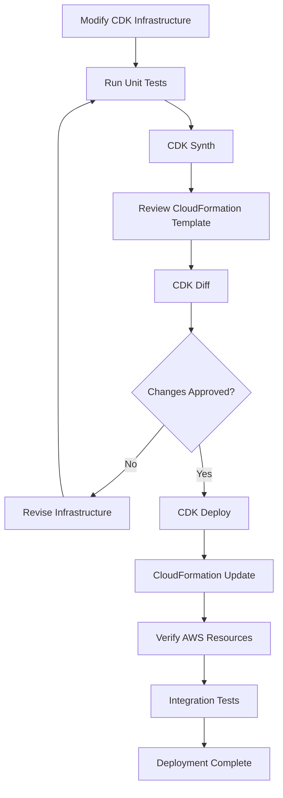
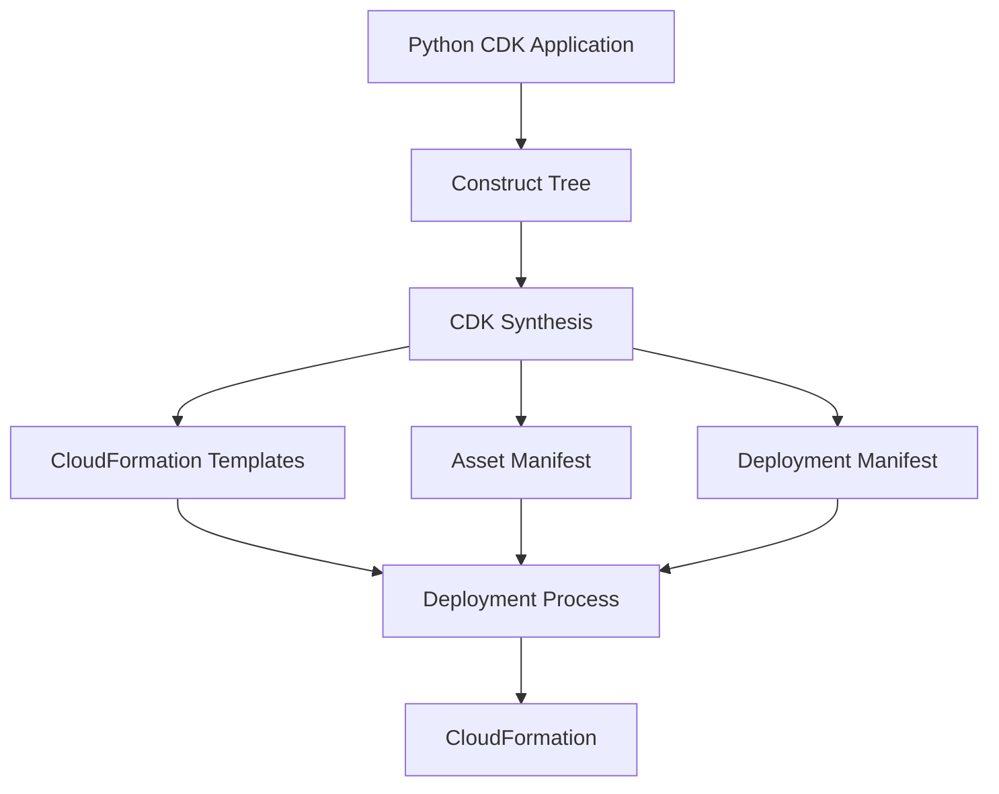
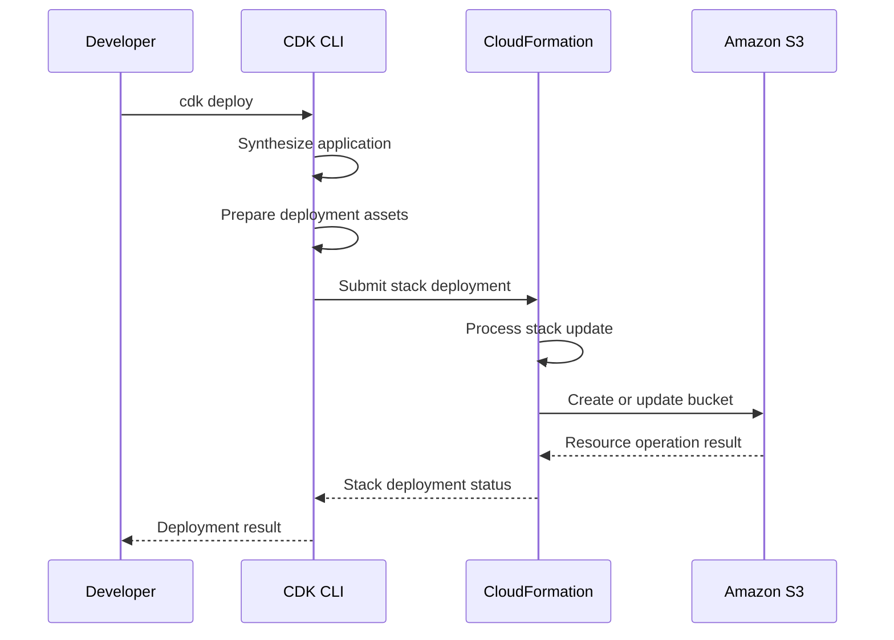
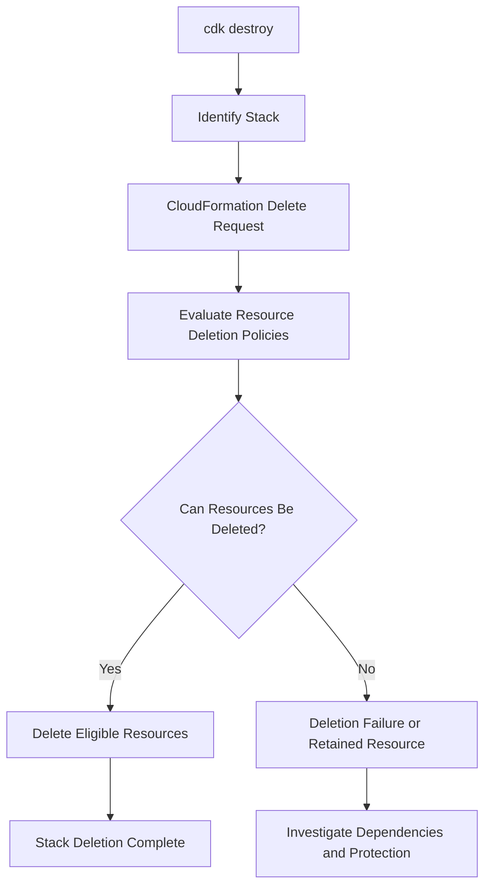
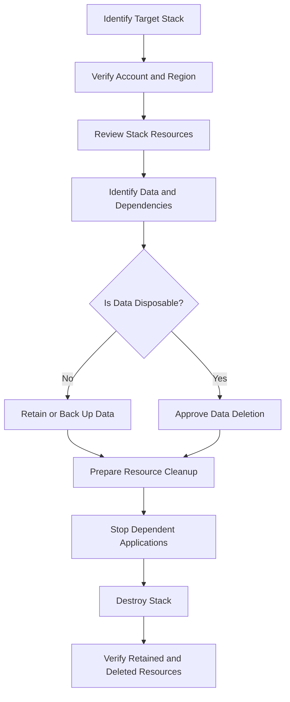
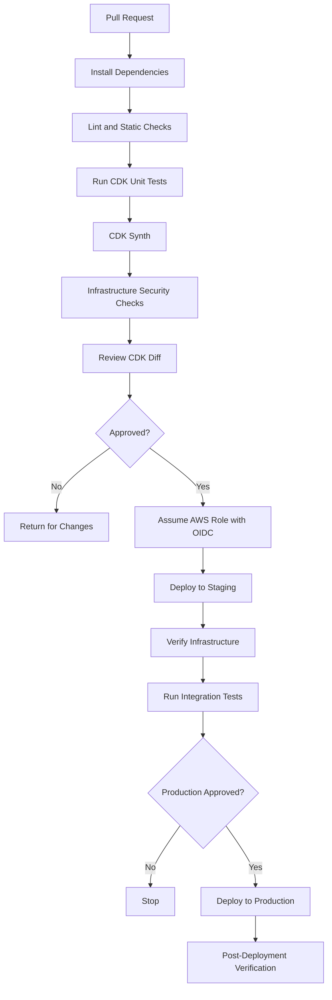

# 08- Synth Diff Deploy and Destroy

## Overview

AWS CDK provides a structured workflow for translating infrastructure code into CloudFormation templates, reviewing proposed changes, deploying resources, and removing stacks.

For Amazon S3 infrastructure, these operations require careful planning because buckets frequently contain persistent business data. A deployment can modify encryption, versioning, lifecycle rules, bucket policies, replication settings, and other resource properties. Some changes can cause resource replacement or affect application access to existing objects.

The core CDK deployment lifecycle consists of:

- **Synthesize:** Convert CDK application code into CloudFormation templates and deployment artifacts.
- **Diff:** Compare the synthesized infrastructure with the deployed stack.
- **Deploy:** Apply infrastructure changes through CloudFormation.
- **Destroy:** Delete a stack and its eligible resources according to their configured deletion policies.

A reliable workflow combines automated tests, template inspection, change review, controlled deployment, post-deployment verification, and safe teardown.



## CDK Synthesis

Synthesis converts the CDK application into one or more CloudFormation templates.

The CDK application describes infrastructure using Python constructs. During synthesis, CDK evaluates the construct tree, resolves configuration and context, and generates CloudFormation-compatible resources, properties, parameters, outputs, and dependencies.

Synthesis does not create S3 buckets or modify AWS resources. It produces deployment artifacts that CloudFormation can use later.

### How Synthesis Works



The synthesis process includes:

1. Loading the CDK application.
2. Creating the construct tree.
3. Resolving configuration and environment context.
4. Applying construct validations and transformations.
5. Generating CloudFormation templates.
6. Producing deployment manifests and asset metadata.

### Running Synthesis

Synthesize the entire application:

```bash
cdk synth
```

Synthesize a specific stack:

```bash
cdk synth StorageStack
```

Synthesize with environment-specific context:

```bash
cdk synth StorageStack -c environment=dev
```

Write the synthesized template to a file:

```bash
cdk synth StorageStack > storage-template.yaml
```

The generated template can be inspected independently of the original Python implementation.

### Synthesis Output Directory

CDK normally writes generated artifacts to `cdk.out/`.

Example structure:

```text
s3-cdk/
│
├── app.py
├── cdk.json
├── cdk.context.json
├── requirements.txt
│
├── constructs/
│   └── secure_bucket.py
│
├── stacks/
│   └── storage_stack.py
│
└── cdk.out/
    ├── manifest.json
    ├── StorageStack.template.json
    ├── tree.json
    └── asset.<hash>/
```

Important artifacts:

| Artifact | Purpose |
|---|---|
| `manifest.json` | Describes synthesized deployment artifacts |
| `*.template.json` | CloudFormation template for a stack |
| `tree.json` | Construct tree metadata |
| Asset directories | Files or other assets required during deployment |

The exact contents depend on the application and CDK version.

Treat `cdk.out/` as generated output. Do not manually modify synthesized templates as a substitute for changing the CDK source.

### Example S3 Stack

Consider a stack that creates a private, versioned S3 bucket.

```python
# stacks/storage_stack.py

from aws_cdk import (
    Stack,
    RemovalPolicy,
    aws_s3 as s3,
)
from constructs import Construct


class StorageStack(Stack):
    def __init__(
        self,
        scope: Construct,
        construct_id: str,
        **kwargs,
    ) -> None:
        super().__init__(
            scope,
            construct_id,
            **kwargs,
        )

        self.bucket = s3.Bucket(
            self,
            "DocumentBucket",
            encryption=s3.BucketEncryption.S3_MANAGED,
            block_public_access=s3.BlockPublicAccess.BLOCK_ALL,
            object_ownership=s3.ObjectOwnership.BUCKET_OWNER_ENFORCED,
            enforce_ssl=True,
            versioned=True,
            removal_policy=RemovalPolicy.RETAIN,
        )
```

Run:

```bash
cdk synth StorageStack
```

The generated CloudFormation template contains an `AWS::S3::Bucket` resource with corresponding configuration.

A simplified representation:

```yaml
Resources:
  DocumentBucket:
    Type: AWS::S3::Bucket
    Properties:
      VersioningConfiguration:
        Status: Enabled
      BucketEncryption:
        ServerSideEncryptionConfiguration:
          - ServerSideEncryptionByDefault:
              SSEAlgorithm: AES256
      PublicAccessBlockConfiguration:
        BlockPublicAcls: true
        BlockPublicPolicy: true
        IgnorePublicAcls: true
        RestrictPublicBuckets: true
```

The actual synthesized logical ID and template properties may differ depending on CDK version and construct configuration.

### Reviewing Synthesized Templates

Before deployment, inspect the generated template for:

- Unexpected resource creation.
- Incorrect bucket encryption.
- Missing versioning.
- Missing public-access restrictions.
- Incorrect lifecycle rules.
- Unintended bucket replacement.
- Unexpected IAM permissions.
- Incorrect replication configuration.
- Unintended removal policies.
- Unexpected CloudFormation outputs or exports.

A successful synthesis proves that CDK generated deployment artifacts. It does not prove that AWS will accept or successfully deploy them.

## CDK Diff

`cdk diff` compares the synthesized infrastructure with the deployed CloudFormation stack.

It helps identify infrastructure changes before deployment. For S3, this is particularly important because seemingly small code changes can affect data retention, resource replacement, access permissions, or bucket configuration.

### Running CDK Diff

Compare a specific stack:

```bash
cdk diff StorageStack
```

Compare using environment-specific context:

```bash
cdk diff StorageStack -c environment=prod
```

Compare all stacks:

```bash
cdk diff --all
```

The command reports differences between the current CDK application and the deployed infrastructure.

### Understanding Diff Output

Common change indicators include:

| Diff indicator | Meaning |
|---|---|
| `+` | Resource or property addition |
| `-` | Resource or property removal |
| `~` | Resource or property modification |

The exact presentation depends on the CDK CLI version and diff output format.

Example:

```text
Resources
[~] AWS::S3::Bucket DocumentBucket
 └─ [~] VersioningConfiguration
     └─ [~] Status
         ├─ "Suspended"
         └─ "Enabled"
```

This indicates a proposed change to bucket versioning.

Review the actual CloudFormation property changes rather than relying only on the summary.

### Reviewing S3-Specific Changes

| Change | Potential impact | Review requirement |
|---|---|---|
| Enable versioning | New object versions are retained | Evaluate storage and recovery requirements |
| Suspend versioning | New objects are no longer versioned normally | Confirm application and recovery implications |
| Change encryption | Existing objects are not automatically re-encrypted | Plan any required object migration separately |
| Add lifecycle rules | Objects may transition or expire | Validate filters, retention, and noncurrent-version behavior |
| Change bucket policy | Application access may change | Review principals, actions, resources, and explicit denies |
| Change bucket name | May require resource replacement | Plan migration and data transfer |
| Change removal policy | Changes behavior when the stack is removed | Verify data-protection requirements |
| Change replication | May alter how new objects are replicated | Validate IAM, KMS, and destination configuration |

### Resource Replacement

Some CloudFormation property changes require resource replacement.

For an S3 bucket, changing its physical bucket name generally requires replacement because bucket names are immutable after creation.

A replacement can be disruptive:

- Existing data remains in the old bucket.
- The new bucket may have a different physical name.
- Applications may still reference the old bucket.
- DNS, configuration, IAM policies, and integrations may need updates.
- Data migration may be necessary.

CDK and CloudFormation do not automatically migrate objects between replacement buckets.

Treat bucket replacement as a controlled migration involving data transfer, application configuration, access policies, and cutover planning.

### Diff Limitations

`cdk diff` is not a complete production safety guarantee.

It cannot reliably establish every runtime consequence of a change.

For example:

- A policy update may unexpectedly block an application principal.
- A lifecycle rule may affect data after deployment.
- A KMS key policy change may prevent object access.
- An S3 notification update may introduce processing failures.
- A replacement may affect external systems not represented in the stack.

Combine diff review with template inspection, tests, application dependency analysis, and deployment planning.

## CDK Deployment

`cdk deploy` deploys synthesized CloudFormation infrastructure into an AWS account and Region.

CDK uses CloudFormation to create, update, and manage resources.

### Deployment Commands

Deploy a specific stack:

```bash
cdk deploy StorageStack
```

Deploy all stacks:

```bash
cdk deploy --all
```

Deploy with environment-specific context:

```bash
cdk deploy StorageStack -c environment=dev
```

Deploy without interactive approval prompts for permission-broadening changes:

```bash
cdk deploy StorageStack --require-approval broadening
```

The approval setting controls CDK's handling of certain permission-broadening changes. It does not replace production approval gates, change review, or security review.

### Deployment Lifecycle



The actual deployment process can include asset publishing, role assumption, change-set creation, and multiple CloudFormation operations depending on the application and bootstrap configuration.

### Deployment Prerequisites

Before deployment, verify:

- AWS credentials are configured.
- The active identity is correct.
- The target account and Region are correct.
- The environment has been bootstrapped.
- The deployment role has the required permissions.
- CDK dependencies are installed.
- Unit tests pass.
- The synthesized template is valid.
- Infrastructure changes have been reviewed.

Verify the active AWS identity:

```bash
aws sts get-caller-identity
```

Inspect the active AWS configuration:

```bash
aws configure list
```

Bootstrap the target environment when required:

```bash
cdk bootstrap aws://123456789012/ap-south-1
```

### Deploying Multiple Stacks

When an application contains multiple dependent stacks, deploy them in a controlled order.

Example:

```python
storage_stack = StorageStack(
    app,
    "StorageStack",
    env=environment,
)

processing_stack = ProcessingStack(
    app,
    "ProcessingStack",
    bucket=storage_stack.bucket,
    env=environment,
)

processing_stack.add_dependency(storage_stack)
```

Deploy both:

```bash
cdk deploy StorageStack ProcessingStack
```

CDK and CloudFormation manage dependencies represented in the application. Avoid unnecessary dependencies because they increase deployment coupling.

### Deployment Failure Handling

A deployment can fail because of:

- Insufficient IAM permissions.
- Missing bootstrap resources.
- Invalid CloudFormation properties.
- S3 bucket naming conflicts.
- Resource limits or service constraints.
- KMS permission errors.
- Invalid resource dependencies.
- Existing resources that conflict with the requested configuration.
- Service-side errors.

Inspect the stack:

```bash
aws cloudformation describe-stacks \
  --stack-name StorageStack
```

Inspect recent stack events:

```bash
aws cloudformation describe-stack-events \
  --stack-name StorageStack
```

Use the first meaningful resource failure to identify the root cause. Later failures may be consequences of an earlier failed operation.

Do not repeatedly deploy without understanding the failure.

### CloudFormation Rollback

CloudFormation may roll back a failed stack creation or update.

For example:

```text
UPDATE_IN_PROGRESS
UPDATE_FAILED
UPDATE_ROLLBACK_IN_PROGRESS
UPDATE_ROLLBACK_COMPLETE
```

A rollback attempts to restore the previous stack state. However, it does not guarantee that every external side effect is reversed.

Examples:

- Objects uploaded during deployment remain in S3.
- External application data may have changed.
- Notifications may already have triggered processing.
- Separately managed resources may not be restored automatically.
- Some resource changes may require manual recovery.

For S3 workloads, distinguish infrastructure rollback from data recovery.

If an update fails, inspect CloudFormation events and resource state before deciding whether to retry, modify the template, or perform a controlled recovery.

## Deployment Verification

A successful `cdk deploy` indicates that the deployment process completed successfully according to CloudFormation. It does not prove that every application workflow works correctly.

Verify important S3 properties after deployment.

### Verify Bucket Existence

```bash
aws s3api head-bucket \
  --bucket company-document-storage
```

A successful command indicates that the caller can access the bucket endpoint for this operation. Authorization failures and missing-bucket responses should be interpreted in the context of the caller's permissions.

### Verify Bucket Region

```bash
aws s3api get-bucket-location \
  --bucket company-document-storage
```

### Verify Versioning

```bash
aws s3api get-bucket-versioning \
  --bucket company-document-storage
```

### Verify Encryption

```bash
aws s3api get-bucket-encryption \
  --bucket company-document-storage
```

### Verify Public Access Block

```bash
aws s3api get-public-access-block \
  --bucket company-document-storage
```

### Verify Bucket Policy

```bash
aws s3api get-bucket-policy \
  --bucket company-document-storage
```

This command returns an error when no bucket policy is configured. That result does not necessarily indicate a deployment failure.

### Verify Lifecycle Configuration

```bash
aws s3api get-bucket-lifecycle-configuration \
  --bucket company-document-storage
```

### Verify Replication Configuration

```bash
aws s3api get-bucket-replication \
  --bucket company-document-storage
```

This command returns an error when replication is not configured. Verify replication only for workloads that are expected to use it.

### Verify an Application-Level Workflow

For a document-storage backend, infrastructure verification should be followed by an application-level test.

Example workflow:

```text
1. Authenticate to the backend API.
2. Request an upload authorization.
3. Upload a test object.
4. Verify object metadata.
5. Download the object.
6. Compare downloaded content.
7. Delete the test object if the test is complete.
```

For event-driven workloads, also verify that the expected event reaches the processing component and that retries and failure handling behave correctly.

## CDK Destroy

`cdk destroy` removes a CDK stack and requests CloudFormation to delete its managed resources.

For S3 infrastructure, destroy operations require particular care because buckets may contain persistent data.

### Basic Destroy Commands

Destroy a specific stack:

```bash
cdk destroy StorageStack
```

Destroy all stacks:

```bash
cdk destroy --all
```

Use environment-specific context where applicable:

```bash
cdk destroy StorageStack -c environment=dev
```

Before destroying a production stack, verify the target account, Region, stack identity, and resource-retention requirements.

### How Destroy Works



CloudFormation deletion behavior depends on resource policies, dependencies, and service-specific deletion requirements.

### RemovalPolicy and S3 Bucket Retention

CDK `RemovalPolicy` controls what happens when a resource is removed from a CloudFormation stack or the stack is deleted, subject to the resource's CloudFormation behavior.

Common policies:

| Policy | Behavior | Typical use |
|---|---|---|
| `RETAIN` | Keeps the resource after stack removal | Production data buckets |
| `DESTROY` | Requests resource deletion | Disposable development infrastructure |
| `SNAPSHOT` | Creates a snapshot where supported | Snapshot-capable resources; not a general S3 backup mechanism |

Example:

```python
from aws_cdk import (
    RemovalPolicy,
    aws_s3 as s3,
)

bucket = s3.Bucket(
    self,
    "ApplicationBucket",
    removal_policy=RemovalPolicy.RETAIN,
)
```

For an S3 bucket, `SNAPSHOT` is not a substitute for versioning, replication, backup, or object-level recovery.

### Destroying a Retained Bucket

If a bucket has:

```python
removal_policy=RemovalPolicy.RETAIN
```

destroying the stack can leave the bucket in AWS.

The CloudFormation stack may be deleted while the bucket continues to exist as an independently managed resource.

This is intentional when data must survive infrastructure teardown.

However, the retained resource must still have an ownership and management plan.

Record:

- Bucket name and ARN.
- Account and Region.
- Encryption configuration.
- Lifecycle configuration.
- Data owner.
- Future management mechanism.
- Dependent applications and policies.

Do not assume that a retained bucket will automatically be managed by a future stack.

### Destroying a Disposable Development Bucket

A development-only bucket may use:

```python
bucket = s3.Bucket(
    self,
    "TemporaryBucket",
    removal_policy=RemovalPolicy.DESTROY,
    auto_delete_objects=True,
)
```

`auto_delete_objects=True` configures CDK to remove objects before deleting the bucket.

This is destructive. It can remove object versions and other stored data as part of the deletion workflow.

Use it only when:

- The bucket is disposable.
- The environment is isolated.
- Data loss is acceptable.
- Deployment and deletion permissions are controlled.

Never apply this pattern indiscriminately to production data buckets.

### Why S3 Bucket Deletion Can Fail

An S3 bucket must be empty before it can be deleted.

A bucket may contain:

- Current objects.
- Noncurrent object versions.
- Delete markers.
- Incomplete multipart uploads.

Versioned buckets require special attention because ordinary object deletion can create delete markers rather than permanently removing all versions.

A bucket may also be protected by:

- Object Lock retention.
- Legal holds.
- Other service or account-level restrictions.

Do not attempt destructive cleanup until data-retention requirements have been checked.

### Inspecting Bucket Contents Before Deletion

List objects:

```bash
aws s3 ls s3://company-dev-document-storage \
  --recursive
```

List object versions and delete markers:

```bash
aws s3api list-object-versions \
  --bucket company-dev-document-storage
```

List incomplete multipart uploads:

```bash
aws s3api list-multipart-uploads \
  --bucket company-dev-document-storage
```

These commands help identify why a bucket may not be eligible for deletion.

For production data, use approved retention and deletion procedures rather than running recursive deletion commands directly.

## Safe S3 Stack Destruction Workflow

A safe destruction process should separate application shutdown, data review, resource cleanup, and infrastructure deletion.



Recommended procedure:

1. Confirm the stack name and deployment environment.
2. Verify the active AWS identity.
3. Inspect CloudFormation stack resources.
4. Identify S3 buckets and their data-retention requirements.
5. Identify external dependencies such as Lambda functions, APIs, and event consumers.
6. Stop or redirect dependent application traffic.
7. Back up or retain data when required.
8. Confirm whether the bucket can be deleted.
9. Execute the approved destruction operation.
10. Verify the resulting CloudFormation and S3 resource state.

### Inspect Stack Resources

```bash
aws cloudformation list-stack-resources \
  --stack-name StorageStack
```

### Inspect Stack Status

```bash
aws cloudformation describe-stacks \
  --stack-name StorageStack
```

### Verify After Destruction

```bash
aws cloudformation describe-stacks \
  --stack-name StorageStack
```

A deleted stack may no longer be returned as an active stack. CloudFormation retains deleted stack information for a limited period.

For retained buckets, verify their existence and configuration separately:

```bash
aws s3api head-bucket \
  --bucket company-document-storage
```

## Resource Protection and Data Safety

S3 data protection should not depend on the assumption that developers will never run `cdk destroy`.

Use multiple safeguards.

### Retention Policies

Use `RemovalPolicy.RETAIN` for important production buckets.

This protects the bucket from automatic deletion during stack teardown, but it does not prevent users or applications with sufficient permissions from deleting objects.

### CloudFormation Deletion Protection

CloudFormation stack termination protection can prevent accidental stack deletion.

Enable it:

```bash
aws cloudformation update-termination-protection \
  --stack-name StorageStack \
  --enable-termination-protection
```

Disable it only through an approved process:

```bash
aws cloudformation update-termination-protection \
  --stack-name StorageStack \
  --no-enable-termination-protection
```

Termination protection is a stack-level safeguard. It does not replace S3 object protection, IAM controls, versioning, or backup strategies.

### S3 Object Protection

For important data, evaluate:

- Versioning.
- Object Lock where retention requirements justify it.
- Replication.
- Independent backups.
- Restricted deletion permissions.
- Recovery testing.

These mechanisms solve different problems and should be selected according to workload recovery requirements.

Detailed security and data-protection mechanisms belong in the dedicated S3 security and operations documentation.

## CDK Command Reference

| Command | Purpose | Operational consideration |
|---|---|---|
| `cdk synth` | Generate CloudFormation templates | Does not deploy resources |
| `cdk synth StackName` | Synthesize one stack | Useful for focused inspection |
| `cdk diff StackName` | Compare local and deployed infrastructure | Review replacement and data-impacting changes |
| `cdk diff --all` | Compare all stacks | Useful for multi-stack applications |
| `cdk deploy StackName` | Deploy one stack | Requires correct account, Region, and permissions |
| `cdk deploy --all` | Deploy all stacks | Check dependency ordering and deployment scope |
| `cdk list` | List application stacks | Confirm stack identifiers |
| `cdk destroy StackName` | Destroy one stack | Check retention and deletion behavior |
| `cdk destroy --all` | Destroy all stacks | High-impact operation; review all resources |
| `cdk bootstrap` | Prepare an AWS environment for CDK deployments | Run for the required account and Region |

## CI/CD Deployment Workflow

A production pipeline should treat synthesis, testing, review, deployment, and verification as separate stages.



### Example Validation Workflow

```yaml
name: CDK Validation

on:
  pull_request:
    branches:
      - main

permissions:
  contents: read

jobs:
  validate:
    runs-on: ubuntu-latest

    steps:
      - name: Checkout
        uses: actions/checkout@v4

      - name: Set up Python
        uses: actions/setup-python@v5
        with:
          python-version: "3.12"

      - name: Install dependencies
        run: |
          python -m pip install --upgrade pip
          pip install -r requirements.txt
          pip install pytest

      - name: Install CDK CLI
        run: npm install --global aws-cdk@2

      - name: Run tests
        run: pytest -v

      - name: Synthesize infrastructure
        run: cdk synth
```

This workflow validates the application. It does not deploy infrastructure. Pin the CDK CLI and GitHub Actions to approved versions or immutable references in a production pipeline.

### Production Pipeline Requirements

For production deployment:

- Use AWS IAM OIDC federation.
- Use short-lived credentials.
- Restrict deployment roles to the required account and Region.
- Separate validation and deployment permissions.
- Require approval before production deployment.
- Review infrastructure changes.
- Pin third-party actions to verified immutable commit SHAs.
- Capture deployment logs and CloudFormation events.
- Verify deployed resources and application workflows.
- Maintain a documented rollback and recovery procedure.

Do not automatically run `cdk destroy` as a routine cleanup step in a production pipeline.

## Testing the Deployment Lifecycle

Infrastructure testing should cover more than whether a template can be synthesized.

### Unit Tests

Use CDK assertions to validate expected resources and properties.

```python
import aws_cdk as cdk

from aws_cdk import assertions
from aws_cdk import aws_s3 as s3
from constructs import Construct


class StorageStack(cdk.Stack):
    def __init__(
        self,
        scope: Construct,
        construct_id: str,
        **kwargs,
    ) -> None:
        super().__init__(
            scope,
            construct_id,
            **kwargs,
        )

        self.bucket = s3.Bucket(
            self,
            "DocumentBucket",
            encryption=s3.BucketEncryption.S3_MANAGED,
            block_public_access=s3.BlockPublicAccess.BLOCK_ALL,
            versioned=True,
            enforce_ssl=True,
        )


def test_storage_bucket():
    app = cdk.App()
    stack = StorageStack(app, "TestStorage")

    template = assertions.Template.from_stack(stack)

    template.resource_count_is(
        "AWS::S3::Bucket",
        1,
    )

    template.has_resource_properties(
        "AWS::S3::Bucket",
        {
            "VersioningConfiguration": {
                "Status": "Enabled",
            },
        },
    )
```

### Deployment Integration Tests

Integration tests should verify actual AWS behavior in a dedicated test account.

Examples:

- Bucket creation and accessibility.
- Encryption configuration.
- Versioning behavior.
- IAM access restrictions.
- Object upload and retrieval.
- Event notification delivery.
- Replication behavior where configured.
- Lifecycle configuration and eventual effects.

Lifecycle transitions and expirations are asynchronous service operations. Do not write tests that assume they happen immediately after deployment.

### Testing Destruction

For disposable test environments, verify:

- The intended stack is deleted.
- Disposable buckets are removed.
- Retained buckets remain available.
- No unintended resources remain.
- External dependencies are not left in an inconsistent state.

Do not test destructive production workflows against production data.

## Common Mistakes and Production Pitfalls

| Mistake | Why it causes problems | Recommended approach |
|---|---|---|
| Deploying without synthesis review | Unexpected resources or configuration can reach AWS | Review synthesized templates |
| Skipping `cdk diff` | Resource replacement or permission changes may go unnoticed | Review infrastructure changes before deployment |
| Assuming successful synthesis means successful deployment | Synthesis does not validate every AWS service constraint | Test deployment in a controlled account |
| Treating diff as a complete safety check | Runtime and external dependencies are not fully represented | Combine diff with tests and dependency analysis |
| Ignoring CloudFormation events | The first meaningful failure may be missed | Inspect stack events and failed resources |
| Repeatedly retrying failed deployments | Can obscure the root cause or worsen resource conflicts | Diagnose the first failure before retrying |
| Destroying production stacks casually | Can remove infrastructure and disrupt applications | Require explicit approval and resource review |
| Assuming retained buckets are deleted | `RETAIN` preserves the bucket after stack removal | Track retained resource ownership |
| Using `auto_delete_objects=True` broadly | Can permanently remove stored data | Restrict to disposable environments |
| Ignoring object versions | Versioned buckets may still contain data after ordinary deletion | Inspect versions and delete markers |
| Treating rollback as data recovery | CloudFormation rollback does not restore all external data changes | Maintain independent recovery procedures |
| Committing generated templates as source of truth | Manual changes can diverge from CDK implementation | Maintain CDK code as the source of truth |

## Production Readiness Checklist

### Before Synthesis

- [ ] Required CDK dependencies are installed and pinned.
- [ ] Environment configuration is validated.
- [ ] Account and Region are explicit where required.
- [ ] Unit tests pass.
- [ ] Sensitive values are not embedded in source code or context files.

### Before Deployment

- [ ] The active AWS identity is verified.
- [ ] The target account and Region are correct.
- [ ] The environment is bootstrapped.
- [ ] `cdk synth` completes successfully.
- [ ] Synthesized templates are reviewed.
- [ ] `cdk diff` is reviewed.
- [ ] Resource replacements and data-impacting changes are understood.
- [ ] IAM and KMS permissions are validated.
- [ ] Production approval requirements are satisfied.

### After Deployment

- [ ] CloudFormation reports successful deployment.
- [ ] S3 bucket existence and Region are verified.
- [ ] Encryption and versioning are verified.
- [ ] Public-access configuration is verified.
- [ ] Lifecycle and replication configuration are checked where applicable.
- [ ] Application-level integration tests pass.
- [ ] Deployment logs and resource changes are recorded.

### Before Destruction

- [ ] The correct stack, account, and Region are confirmed.
- [ ] Dependent applications and integrations are identified.
- [ ] Bucket data-retention requirements are reviewed.
- [ ] Required data is backed up or retained.
- [ ] Object versions and incomplete multipart uploads are considered.
- [ ] Destructive deletion has explicit approval.
- [ ] Retained resources have a documented owner.
- [ ] Post-destruction verification is planned.

## Key Takeaways

- `cdk synth` generates CloudFormation deployment artifacts; it does not create AWS resources.
- `cdk diff` identifies proposed infrastructure changes, but it cannot replace testing, dependency analysis, and manual review.
- `cdk deploy` applies infrastructure through CloudFormation, so deployment failures and rollback behavior must be diagnosed through stack events.
- `cdk destroy` must be treated as a potentially destructive operation, especially when S3 buckets contain versioned or business-critical data.
- Production CDK workflows should enforce testing, change review, approval controls, post-deployment verification, and explicit data-retention procedures.