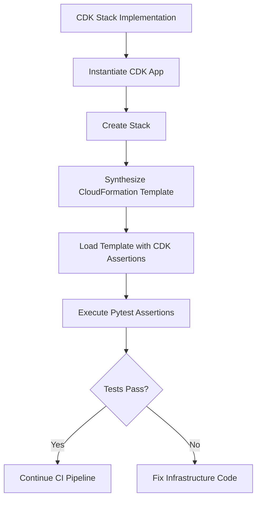
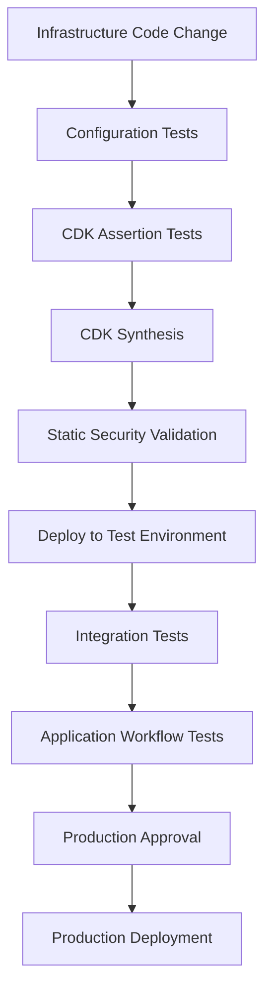

# 09- CDK Assertions and Unit Testing

## Overview

AWS CDK applications define infrastructure using programming languages such as Python. This makes infrastructure reusable, composable, and testable, but it also introduces the possibility of application-level defects that produce incorrect CloudFormation templates.

CDK assertions and unit testing provide a way to validate infrastructure definitions before deployment.

For Amazon S3 infrastructure, tests should verify that critical resource properties are configured correctly, including:

- Bucket encryption.
- Versioning.
- Public access restrictions.
- Object ownership.
- TLS enforcement.
- Lifecycle configuration.
- Replication configuration.
- IAM permissions.
- Resource retention policies.
- CloudFormation outputs and dependencies.

Testing infrastructure before deployment reduces configuration errors and makes infrastructure changes safer to review.

The Python CDK v2 testing approach primarily uses:

- `aws_cdk.assertions` for inspecting synthesized CloudFormation templates.
- `pytest` for organizing and executing tests.
- CDK stack instances for creating isolated test environments.

## Why Test CDK Applications?

Infrastructure code is executable application code. A small change in a construct can modify the resulting CloudFormation template and affect deployed AWS resources.

Consider a production S3 bucket that must remain private and encrypted.

A developer might accidentally remove:

```python
block_public_access=s3.BlockPublicAccess.BLOCK_ALL
```

The application may still synthesize successfully, but the generated infrastructure no longer expresses the intended security configuration.

A unit test can detect this regression before deployment.

### What Infrastructure Tests Should Validate

| Area | What to validate | Example |
|---|---|---|
| Resource creation | Expected resources exist | One S3 bucket is created |
| Encryption | Encryption configuration is present | SSE-S3 or SSE-KMS |
| Versioning | Versioning is enabled | `Status: Enabled` |
| Public access | Public access restrictions are configured | All public-access block settings are enabled |
| Object ownership | Ownership configuration is correct | Bucket owner enforced |
| Transport security | Insecure transport is denied | TLS enforcement |
| Lifecycle | Expected lifecycle rules exist | Expiration and transitions |
| IAM | Permissions are appropriately scoped | Access to a specific bucket |
| Retention | Resource deletion behavior is configured | Retain production buckets |
| Outputs | Required values are exported | Bucket name or ARN |

Unit tests validate synthesized infrastructure properties. They do not prove that the deployed AWS resources behave correctly at runtime.

## CDK Testing Architecture

A CDK unit test generally follows this sequence:

1. Create a CDK application.
2. Instantiate the stack being tested.
3. Synthesize the stack into a CloudFormation template.
4. Load the generated template using `Template.from_stack()`.
5. Assert expected resources and properties.



The tests operate on synthesized CloudFormation rather than requiring an AWS deployment.

This makes them fast, repeatable, and suitable for pull-request validation.

## Project Structure for Testing

A practical CDK project can separate infrastructure implementation from test code.

```text
s3-cdk/
│
├── app.py
├── cdk.json
├── requirements.txt
├── pytest.ini
│
├── stacks/
│   └── storage_stack.py
│
├── constructs/
│   └── secure_bucket.py
│
└── tests/
    ├── conftest.py
    ├── test_storage_stack.py
    ├── test_bucket_security.py
    ├── test_bucket_lifecycle.py
    └── test_iam_permissions.py
```

Responsibilities:

| File or directory | Responsibility |
|---|---|
| `app.py` | CDK application entry point |
| `stacks/` | Infrastructure stack definitions |
| `constructs/` | Reusable infrastructure constructs |
| `tests/` | Unit tests and infrastructure assertions |
| `conftest.py` | Shared pytest fixtures |
| `requirements.txt` | Python dependencies |
| `pytest.ini` | Pytest configuration |

## Installing Testing Dependencies

Install the CDK Python libraries and testing dependencies.

Example `requirements.txt`:

```text
aws-cdk-lib==2.220.0
constructs>=10.0.0,<11.0.0
pytest>=8.0,<9.0
```

The CDK library version is an example pin. Use a version compatible with the project and lock the complete dependency set for reproducible builds.

Install dependencies:

```bash
python -m venv .venv
```

Activate the environment on Windows:

```powershell
.venv\Scripts\Activate.ps1
```

Activate the environment on Linux or macOS:

```bash
source .venv/bin/activate
```

Install dependencies:

```bash
pip install -r requirements.txt
```

The testing module is included in `aws-cdk-lib`.

Import it using:

```python
from aws_cdk import assertions
```

## Understanding CDK Assertions

CDK assertions provide APIs for inspecting the CloudFormation template generated from a stack.

The main APIs include:

| API | Purpose |
|---|---|
| `Template.from_stack()` | Creates a template representation from a CDK stack |
| `resource_count_is()` | Verifies the number of resources of a given type |
| `has_resource_properties()` | Checks whether a resource has specified properties |
| `has_resource()` | Checks resource configuration, including properties and attributes |
| `find_resources()` | Finds resources of a specified CloudFormation type |
| `get_resource_id()` | Retrieves a logical resource ID matching a query |
| `all_resources()` | Matches all resources of a specified type |
| `any_resource()` | Matches at least one resource of a specified type |

### Creating a Template from a Stack

```python
import aws_cdk as cdk

from aws_cdk import assertions
from aws_cdk import aws_s3 as s3
from constructs import Construct


class StorageStack(cdk.Stack):
    def __init__(
        self,
        scope: Construct,
        construct_id: str,
        **kwargs,
    ) -> None:
        super().__init__(
            scope,
            construct_id,
            **kwargs,
        )

        self.bucket = s3.Bucket(
            self,
            "DocumentBucket",
            versioned=True,
        )


app = cdk.App()
stack = StorageStack(app, "StorageStack")

template = assertions.Template.from_stack(stack)
```

`template` now provides access to the synthesized CloudFormation representation.

No AWS deployment is required.

## Testing S3 Resource Creation

The first responsibility of an infrastructure test is verifying that the expected resources exist.

### Verify Bucket Count

```python
def test_bucket_creation():
    app = cdk.App()
    stack = StorageStack(app, "TestStorage")

    template = assertions.Template.from_stack(stack)

    template.resource_count_is(
        "AWS::S3::Bucket",
        1,
    )
```

This verifies that the stack synthesizes exactly one S3 bucket.

### Verify Multiple Buckets

For applications with multiple storage workloads:

```python
template.resource_count_is(
    "AWS::S3::Bucket",
    3,
)
```

This is useful when an application separates:

- Original uploaded documents.
- Processed documents.
- Application-generated exports.

Avoid asserting an exact count when the stack intentionally supports optional or environment-dependent resources.

## Testing Bucket Security Configuration

Security configuration should be tested explicitly rather than assumed from construct defaults.

Consider a reusable secure bucket construct.

```python
# constructs/secure_bucket.py

from aws_cdk import (
    RemovalPolicy,
    aws_s3 as s3,
)
from constructs import Construct


class SecureBucket(Construct):
    def __init__(
        self,
        scope: Construct,
        construct_id: str,
        *,
        versioned: bool = True,
        removal_policy: RemovalPolicy = RemovalPolicy.RETAIN,
    ) -> None:
        super().__init__(
            scope,
            construct_id,
        )

        self.bucket = s3.Bucket(
            self,
            "Bucket",
            encryption=s3.BucketEncryption.S3_MANAGED,
            block_public_access=s3.BlockPublicAccess.BLOCK_ALL,
            object_ownership=s3.ObjectOwnership.BUCKET_OWNER_ENFORCED,
            enforce_ssl=True,
            versioned=versioned,
            removal_policy=removal_policy,
        )
```

### Testing Encryption

```python
def test_bucket_encryption():
    app = cdk.App()
    stack = StorageStack(app, "TestStorage")

    template = assertions.Template.from_stack(stack)

    template.has_resource_properties(
        "AWS::S3::Bucket",
        {
            "BucketEncryption": {
                "ServerSideEncryptionConfiguration": [
                    {
                        "ServerSideEncryptionByDefault": {
                            "SSEAlgorithm": "AES256",
                        },
                    },
                ],
            },
        },
    )
```

This verifies the synthesized encryption configuration.

For SSE-KMS, assert the expected algorithm and KMS key reference rather than checking only that encryption exists.

### Testing Public Access Restrictions

```python
def test_bucket_blocks_public_access():
    app = cdk.App()
    stack = StorageStack(app, "TestStorage")

    template = assertions.Template.from_stack(stack)

    template.has_resource_properties(
        "AWS::S3::Bucket",
        {
            "PublicAccessBlockConfiguration": {
                "BlockPublicAcls": True,
                "BlockPublicPolicy": True,
                "IgnorePublicAcls": True,
                "RestrictPublicBuckets": True,
            },
        },
    )
```

This protects against accidental removal of the public-access block configuration.

### Testing Object Ownership

```python
def test_bucket_ownership():
    app = cdk.App()
    stack = StorageStack(app, "TestStorage")

    template = assertions.Template.from_stack(stack)

    template.has_resource_properties(
        "AWS::S3::Bucket",
        {
            "OwnershipControls": {
                "Rules": [
                    {
                        "ObjectOwnership": "BucketOwnerEnforced",
                    },
                ],
            },
        },
    )
```

This verifies that the bucket uses bucket-owner-enforced object ownership.

### Testing TLS Enforcement

CDK's `enforce_ssl=True` generates a bucket policy that denies insecure transport.

The test should verify the synthesized policy statement.

```python
def test_bucket_enforces_tls():
    app = cdk.App()
    stack = StorageStack(app, "TestStorage")

    template = assertions.Template.from_stack(stack)

    template.has_resource_properties(
        "AWS::S3::BucketPolicy",
        {
            "PolicyDocument": {
                "Statement": assertions.Match.array_with(
                    [
                        {
                            "Effect": "Deny",
                            "Principal": "*",
                            "Action": "s3:*",
                            "Condition": {
                                "Bool": {
                                    "aws:SecureTransport": "false",
                                },
                            },
                        },
                    ],
                ),
            },
        },
    )
```

This validates the policy generated by the CDK construct.

For more complex policies, assert the required statement independently rather than comparing the entire policy document.

## Testing Versioning

Versioning is important for workloads that require object recovery and protection against accidental overwrites or deletions.

A secure bucket construct may enable versioning by default.

Test it:

```python
def test_bucket_versioning_enabled():
    app = cdk.App()
    stack = StorageStack(app, "TestStorage")

    template = assertions.Template.from_stack(stack)

    template.has_resource_properties(
        "AWS::S3::Bucket",
        {
            "VersioningConfiguration": {
                "Status": "Enabled",
            },
        },
    )
```

For an environment where versioning is optional, test both configurations.

```python
def test_versioning_can_be_disabled():
    app = cdk.App()

    stack = StorageStack(
        app,
        "TestStorage",
        versioned=False,
    )

    template = assertions.Template.from_stack(stack)

    template.resource_count_is(
        "AWS::S3::Bucket",
        1,
    )
```

The test should reflect the actual construct implementation and configuration.

Do not assume that omitting `VersioningConfiguration` and explicitly suspending versioning are equivalent in every CloudFormation lifecycle scenario.

## Testing Removal Policies

S3 bucket retention is a critical infrastructure requirement.

A production bucket should generally be retained when its stack is deleted.

Example construct configuration:

```python
bucket = s3.Bucket(
    self,
    "ProductionBucket",
    removal_policy=RemovalPolicy.RETAIN,
)
```

Test the synthesized deletion policy:

```python
def test_bucket_retention_policy():
    app = cdk.App()
    stack = StorageStack(app, "TestStorage")

    template = assertions.Template.from_stack(stack)

    template.has_resource(
        "AWS::S3::Bucket",
        {
            "DeletionPolicy": "Retain",
        },
    )
```

For disposable development resources, test the intended destructive behavior separately.

```python
def test_development_bucket_can_be_destroyed():
    app = cdk.App()

    stack = StorageStack(
        app,
        "DevelopmentStorage",
        removal_policy=RemovalPolicy.DESTROY,
    )

    template = assertions.Template.from_stack(stack)

    template.has_resource(
        "AWS::S3::Bucket",
        {
            "DeletionPolicy": "Delete",
        },
    )
```

The stack implementation must accept and apply the `removal_policy` argument for this test to be valid.

Retention policy tests are particularly valuable because an incorrect deletion policy can cause permanent data loss during stack removal.

## Testing Lifecycle Configuration

Lifecycle rules can transition objects between storage classes, expire objects, and manage noncurrent versions.

These rules should be tested at the CloudFormation template level.

Example stack configuration:

```python
from aws_cdk import Duration
from aws_cdk import aws_s3 as s3


bucket = s3.Bucket(
    self,
    "ArchiveBucket",
    lifecycle_rules=[
        s3.LifecycleRule(
            id="ArchiveOldDocuments",
            enabled=True,
            transitions=[
                s3.Transition(
                    storage_class=s3.StorageClass.INFREQUENT_ACCESS,
                    transition_after=Duration.days(30),
                ),
            ],
            expiration=Duration.days(365),
        ),
    ],
)
```

Test the transition and expiration configuration:

```python
def test_lifecycle_configuration():
    app = cdk.App()
    stack = StorageStack(app, "TestStorage")

    template = assertions.Template.from_stack(stack)

    template.has_resource_properties(
        "AWS::S3::Bucket",
        {
            "LifecycleConfiguration": {
                "Rules": assertions.Match.array_with(
                    [
                        {
                            "Id": "ArchiveOldDocuments",
                            "Status": "Enabled",
                            "Transitions": [
                                {
                                    "StorageClass": "STANDARD_IA",
                                    "TransitionInDays": 30,
                                },
                            ],
                            "ExpirationInDays": 365,
                        },
                    ],
                ),
            },
        },
    )
```

Lifecycle tests should validate:

- Rule identifiers.
- Rule status.
- Prefix or tag filters.
- Transition storage classes.
- Transition timing.
- Expiration timing.
- Noncurrent version expiration.
- Incomplete multipart upload cleanup.

For production lifecycle policies, test the complete rule semantics. A rule with an incorrect prefix or filter can affect more objects than intended.

## Testing IAM Permissions

CDK can generate IAM roles and policies for S3 access.

Infrastructure tests should verify that permissions are scoped to the intended resources and actions.

For example, a Lambda function may require read access to a specific bucket.

```python
from aws_cdk import aws_lambda as lambda_


function = lambda_.Function(
    self,
    "DocumentProcessor",
    runtime=lambda_.Runtime.PYTHON_3_12,
    handler="app.handler",
    code=lambda_.Code.from_asset("lambda"),
)

bucket.grant_read(function)
```

The synthesized template may contain an IAM policy attached to the Lambda execution role.

Test the expected permissions:

```python
def test_processor_has_bucket_read_permission():
    app = cdk.App()
    stack = ProcessingStack(app, "TestProcessing")

    template = assertions.Template.from_stack(stack)

    template.has_resource_properties(
        "AWS::IAM::Policy",
        {
            "PolicyDocument": {
                "Statement": assertions.Match.array_with(
                    [
                        {
                            "Effect": "Allow",
                            "Action": assertions.Match.array_with(
                                [
                                    "s3:GetObject*",
                                ],
                            ),
                            "Resource": assertions.Match.any_value(),
                        },
                    ],
                ),
            },
        },
    )
```

The exact generated actions and resource ARNs depend on the grant method, bucket configuration, and CDK version.

For production tests, verify both:

- The required actions are present.
- Unnecessary actions are absent.

Do not validate only that an IAM policy exists. A policy can exist while granting excessive permissions.

## Testing Reusable Constructs

Reusable constructs should be tested independently from the stacks that consume them.

This helps ensure that security and configuration defaults remain consistent across multiple applications.

Consider the `SecureBucket` construct defined earlier.

A focused test can instantiate it inside a minimal stack and verify its generated bucket configuration.

```python
import aws_cdk as cdk

from aws_cdk import assertions, RemovalPolicy
from constructs import Construct

from constructs.secure_bucket import SecureBucket


class TestBucketStack(cdk.Stack):
    def __init__(
        self,
        scope: Construct,
        construct_id: str,
        **kwargs,
    ) -> None:
        super().__init__(
            scope,
            construct_id,
            **kwargs,
        )

        self.storage = SecureBucket(
            self,
            "DocumentStorage",
            versioned=True,
            removal_policy=RemovalPolicy.RETAIN,
        )


def test_secure_bucket_defaults():
    app = cdk.App()
    stack = TestBucketStack(app, "TestBucketStack")

    template = assertions.Template.from_stack(stack)

    template.resource_count_is(
        "AWS::S3::Bucket",
        1,
    )

    template.has_resource_properties(
        "AWS::S3::Bucket",
        {
            "VersioningConfiguration": {
                "Status": "Enabled",
            },
        },
    )
```

Test reusable constructs for:

- Secure defaults.
- Optional configuration.
- Required properties.
- Resource creation.
- IAM grant behavior.
- Lifecycle configuration.
- Retention behavior.
- Invalid configuration handling.

A construct should have a clear interface and predictable synthesized output.

## Testing Configuration Validation

Infrastructure configuration often varies by environment.

For example:

| Environment | Versioning | Removal policy | Encryption |
|---|---|---|---|
| Development | Enabled | Destroy | SSE-S3 |
| Staging | Enabled | Retain | SSE-KMS |
| Production | Enabled | Retain | SSE-KMS |

Configuration validation should reject invalid combinations before synthesis or deployment.

Example:

```python
from dataclasses import dataclass

from aws_cdk import RemovalPolicy


@dataclass(frozen=True)
class StorageConfig:
    environment: str
    versioned: bool
    removal_policy: RemovalPolicy
    encryption: str


def validate_storage_config(
    config: StorageConfig,
) -> None:
    if config.environment == "prod":
        if not config.versioned:
            raise ValueError(
                "Production buckets must enable versioning."
            )

        if config.removal_policy != RemovalPolicy.RETAIN:
            raise ValueError(
                "Production buckets must use RETAIN."
            )

        if config.encryption != "kms":
            raise ValueError(
                "Production buckets must use KMS encryption."
            )
```

Test invalid production configuration:

```python
import pytest


def test_production_requires_versioning():
    config = StorageConfig(
        environment="prod",
        versioned=False,
        removal_policy=RemovalPolicy.RETAIN,
        encryption="kms",
    )

    with pytest.raises(
        ValueError,
        match="must enable versioning",
    ):
        validate_storage_config(config)
```

Configuration tests are useful because they validate engineering rules independently of CloudFormation resource generation.

## Using Pytest Fixtures

When multiple tests instantiate the same stack, pytest fixtures reduce duplication.

Create `tests/conftest.py`:

```python
import pytest
import aws_cdk as cdk

from stacks.storage_stack import StorageStack


@pytest.fixture
def storage_template():
    app = cdk.App()

    stack = StorageStack(
        app,
        "TestStorageStack",
    )

    return cdk.assertions.Template.from_stack(stack)
```

Tests can reuse the fixture:

```python
def test_bucket_exists(storage_template):
    storage_template.resource_count_is(
        "AWS::S3::Bucket",
        1,
    )
```

```python
def test_bucket_is_versioned(storage_template):
    storage_template.has_resource_properties(
        "AWS::S3::Bucket",
        {
            "VersioningConfiguration": {
                "Status": "Enabled",
            },
        },
    )
```

A fixture should create a fresh stack for each test unless shared state is intentional.

Avoid reusing mutable CDK application or stack instances across unrelated tests.

## Testing Multiple Environments

A CDK application may generate different infrastructure based on environment configuration.

Test each supported environment independently.

Example:

```python
import pytest

from aws_cdk import RemovalPolicy


@pytest.mark.parametrize(
    "environment, expected_policy",
    [
        ("dev", RemovalPolicy.DESTROY),
        ("staging", RemovalPolicy.RETAIN),
        ("prod", RemovalPolicy.RETAIN),
    ],
)
def test_environment_removal_policy(
    environment,
    expected_policy,
):
    app = cdk.App()

    stack = StorageStack(
        app,
        f"{environment.title()}Storage",
        environment=environment,
    )

    template = assertions.Template.from_stack(stack)

    expected_deletion_policy = (
        "Retain"
        if expected_policy == RemovalPolicy.RETAIN
        else "Delete"
    )

    template.has_resource(
        "AWS::S3::Bucket",
        {
            "DeletionPolicy": expected_deletion_policy,
        },
    )
```

This example assumes that `StorageStack` accepts an `environment` argument and applies the corresponding removal policy.

Environment tests should also validate:

- Account and Region configuration.
- Bucket naming.
- Encryption requirements.
- Lifecycle rules.
- IAM permissions.
- Resource retention.
- Optional resources.

## Testing CloudFormation Outputs

CDK stacks often expose resource information through CloudFormation outputs.

For example:

```python
from aws_cdk import CfnOutput

CfnOutput(
    self,
    "BucketName",
    value=bucket.bucket_name,
)
```

Test the output:

```python
def test_bucket_name_output():
    app = cdk.App()
    stack = StorageStack(app, "TestStorage")

    template = assertions.Template.from_stack(stack)

    template.has_output(
        "BucketName",
        {
            "Value": assertions.Match.any_value(),
        },
    )
```

Outputs are useful for connecting infrastructure stacks to application deployment workflows.

Avoid exposing sensitive information through CloudFormation outputs.

Bucket names and ARNs are identifiers, not credentials, but output visibility should still follow the organization's infrastructure information-handling practices.

## Organizing a Complete Test Suite

A practical S3 CDK test suite can be divided by responsibility.

| Test file | Validation focus |
|---|---|
| `test_storage_stack.py` | Stack resources and overall composition |
| `test_bucket_security.py` | Encryption, public access, ownership, TLS |
| `test_bucket_versioning.py` | Versioning configuration |
| `test_bucket_lifecycle.py` | Lifecycle rules and filters |
| `test_iam_permissions.py` | IAM roles, policies, and resource scope |
| `test_bucket_retention.py` | Removal and retention policies |
| `test_environment_config.py` | Environment-specific configuration |
| `test_stack_outputs.py` | CloudFormation outputs |

This organization keeps tests focused and makes failures easier to diagnose.

## Running Tests

Run the complete test suite:

```bash
pytest
```

Run tests with verbose output:

```bash
pytest -v
```

Run one test file:

```bash
pytest tests/test_bucket_security.py -v
```

Run a specific test:

```bash
pytest tests/test_bucket_security.py::test_bucket_blocks_public_access -v
```

Stop after the first failure:

```bash
pytest -x
```

Show print statements and captured output:

```bash
pytest -s
```

Generate a coverage report when coverage tooling is installed:

```bash
pytest --cov=stacks --cov=constructs --cov-report=term-missing
```

Run synthesis after testing:

```bash
cdk synth
```

A typical local validation sequence is:

```bash
pytest -v
cdk synth
cdk diff StorageStack
```

`cdk diff` requires the relevant deployed environment to be accessible when comparing against deployed infrastructure.

## CI/CD Integration

CDK unit tests should run automatically when infrastructure code changes.

A pull-request workflow can validate:

- Python dependencies.
- Formatting and linting.
- Unit tests.
- CDK synthesis.
- Infrastructure security checks.

Example GitHub Actions workflow:

```yaml
name: CDK Unit Tests

on:
  pull_request:
    branches:
      - main
    paths:
      - "stacks/**"
      - "constructs/**"
      - "tests/**"
      - "app.py"
      - "requirements.txt"
      - "cdk.json"
      - ".github/workflows/cdk-tests.yml"

permissions:
  contents: read

jobs:
  test:
    runs-on: ubuntu-latest

    steps:
      - name: Checkout
        uses: actions/checkout@v4

      - name: Set up Python
        uses: actions/setup-python@v5
        with:
          python-version: "3.12"

      - name: Set up Node.js
        uses: actions/setup-node@v4
        with:
          node-version: "22"

      - name: Install dependencies
        run: |
          python -m pip install --upgrade pip
          pip install -r requirements.txt
          pip install pytest
          npm install --global aws-cdk@2

      - name: Run unit tests
        run: pytest -v

      - name: Synthesize infrastructure
        run: cdk synth
```

For production pipelines, pin GitHub Actions to verified immutable commit SHAs and pin the CDK CLI version rather than installing an unrestricted latest release.

This workflow does not require AWS deployment credentials when the application does not perform AWS lookups during synthesis.

If synthesis depends on environment lookups or external deployment context, provide the required context and credentials through an appropriately restricted workflow.

## Unit Tests vs Integration Tests

CDK assertions validate generated infrastructure definitions. They do not replace integration testing.

| Test type | What it validates | Requires AWS account? |
|---|---|---|
| Unit tests | Construct behavior and synthesized template properties | No |
| Configuration tests | Environment validation and application configuration | No |
| Synthesis tests | CloudFormation template generation | Usually no |
| Deployment tests | Actual resource creation and updates | Yes |
| Integration tests | Interaction between deployed resources and applications | Usually yes |
| End-to-end tests | Complete application workflows | Depends on architecture |

For example, a unit test can verify that an S3 bucket has versioning enabled.

An integration test must verify that the deployed bucket actually accepts uploads and creates object versions under the expected permissions.

### Recommended Testing Strategy



Use fast unit tests for every change. Reserve AWS integration tests for workflows that require actual service behavior.

## Testing Limitations and Common Mistakes

| Mistake | Why it is problematic | Better approach |
|---|---|---|
| Testing only resource counts | A bucket may exist with insecure configuration | Assert important resource properties |
| Testing only that encryption exists | The wrong encryption algorithm or key may be configured | Assert the expected algorithm and key reference |
| Ignoring IAM policy scope | A policy may grant excessive permissions | Verify actions and resource ARNs |
| Comparing entire templates unnecessarily | Harmless logical ID or metadata changes can make tests brittle | Assert important properties and relationships |
| Reusing stack instances across tests | Shared mutable state can create unpredictable tests | Create fresh stacks through fixtures |
| Treating unit tests as deployment tests | Synthesized templates do not prove AWS runtime behavior | Add integration tests |
| Ignoring environment differences | Production configuration may differ from tested development configuration | Parameterize environment tests |
| Testing only construct defaults | Explicit overrides may bypass secure defaults | Test supported configuration combinations |
| Assuming lifecycle changes happen immediately | S3 lifecycle execution is asynchronous | Validate configuration and test behavior over an appropriate period |
| Ignoring destructive policies | Stack deletion can remove important infrastructure | Assert retention and deletion policies |

### Avoid Overly Brittle Assertions

Avoid comparing an entire synthesized template unless the test specifically requires exact template equality.

Full-template comparisons can fail because of:

- Logical ID changes.
- Metadata changes.
- CDK version changes.
- Additional generated properties.
- Unrelated infrastructure modifications.

Prefer targeted assertions for security-critical and business-critical properties.

For example:

```python
template.has_resource_properties(
    "AWS::S3::Bucket",
    {
        "VersioningConfiguration": {
            "Status": "Enabled",
        },
    },
)
```

This verifies the requirement without coupling the test to unrelated template details.

## Production Testing Checklist

### Construct and Stack Tests

- [ ] Expected S3 resources are created.
- [ ] Resource counts are validated.
- [ ] Encryption configuration is verified.
- [ ] Public access restrictions are verified.
- [ ] Object ownership is verified.
- [ ] TLS enforcement is verified.
- [ ] Versioning is verified.
- [ ] Lifecycle rules are verified.
- [ ] Removal policies are verified.

### IAM and Environment Tests

- [ ] Required IAM actions are present.
- [ ] Resource permissions are appropriately scoped.
- [ ] KMS references are correct where applicable.
- [ ] Development, staging, and production configurations are tested.
- [ ] Invalid configuration is rejected.
- [ ] Required CloudFormation outputs are present.

### CI/CD and Integration Tests

- [ ] Unit tests run on pull requests.
- [ ] CDK synthesis runs in CI.
- [ ] Dependencies and tool versions are controlled.
- [ ] Infrastructure security validation is included.
- [ ] Integration tests run in a controlled AWS environment.
- [ ] Deployment behavior is verified.
- [ ] Destructive operations are tested only against disposable resources.
- [ ] Production deployment requires appropriate approval.

## Key Takeaways

- CDK assertions validate synthesized CloudFormation resources and properties without requiring an AWS deployment.
- Test S3 security, versioning, lifecycle, IAM permissions, and removal policies explicitly rather than relying only on resource existence.
- Use pytest fixtures and focused test modules to keep infrastructure tests isolated, maintainable, and repeatable.
- Unit tests validate infrastructure definitions; integration and end-to-end tests are still required to verify deployed AWS behavior.
- Run CDK tests and synthesis in CI for every infrastructure change, with production deployment protected by review and approval controls.