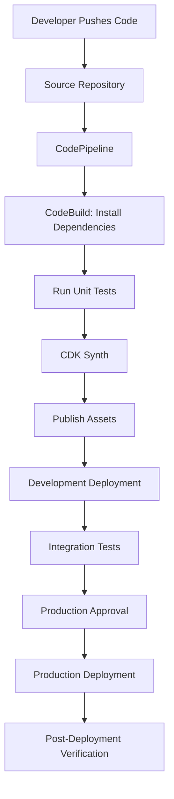
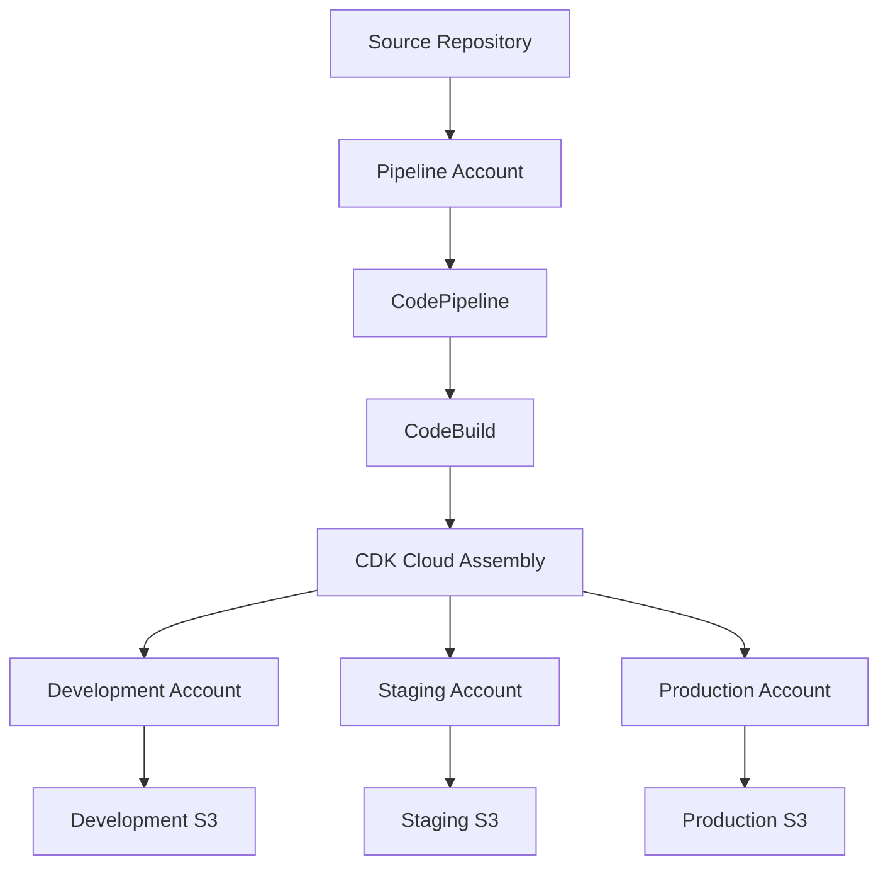

# 10- CDK Pipelines and Automated Deployment

## Overview

AWS CDK Pipelines provides a deployment workflow for applications whose infrastructure is defined using AWS Cloud Development Kit (CDK). It automates the process of synthesizing, validating, and deploying CDK applications across one or more AWS environments.

For Amazon S3 infrastructure, automated deployment is particularly important because infrastructure changes can affect:

- Bucket access policies and permissions.
- Encryption and KMS configuration.
- Versioning and lifecycle rules.
- Replication configuration.
- Event notifications and processing workflows.
- CloudFront origins and distributions.
- Resource retention and deletion behavior.

A production deployment pipeline should ensure that infrastructure changes are reviewed, tested, promoted through controlled environments, and deployed using temporary credentials.

CDK Pipelines is built on AWS CodePipeline and uses AWS CodeBuild for synthesis and deployment activities. It can automatically update itself when the pipeline definition changes.

This document focuses on implementing automated deployment workflows using Python CDK v2.

## CDK Pipelines Architecture

A typical CDK deployment pipeline contains the following stages:

| Component | Responsibility |
|---|---|
| Source | Retrieves application source code |
| Synthesis | Executes the CDK application and generates CloudFormation templates |
| Validation | Runs infrastructure tests and validation commands |
| Assets | Publishes required deployment assets |
| Deployment | Deploys CloudFormation stacks |
| Approval | Pauses deployment for manual authorization |
| Environment promotion | Deploys infrastructure to subsequent environments |

CDK Pipelines uses a self-mutating deployment model. When the pipeline definition changes, the pipeline can update its own structure during execution.

### Deployment Flow



The pipeline should fail before deployment when unit tests, synthesis, or infrastructure validation fail.

## CDK Pipelines vs Traditional CDK Deployment

Traditional CDK deployment uses commands such as:

```bash
cdk synth
cdk diff
cdk deploy
```

These commands are useful for development and controlled manual deployments. However, production environments benefit from a repeatable pipeline that standardizes validation, approvals, and deployment execution.

| Area | Traditional CDK deployment | CDK Pipelines |
|---|---|---|
| Execution | Developer workstation or custom automation | AWS CodePipeline |
| Synthesis | Manual or scripted | Automated |
| Testing | Depends on developer workflow | Integrated into pipeline workflows |
| Deployment | Explicit CDK CLI commands | Automated deployment stages |
| Multi-environment deployment | Manually coordinated | Stage-based promotion |
| Approval gates | External process | Pipeline approval actions |
| Self-updating pipeline | Custom implementation | Supported |
| Auditability | Depends on deployment process | CodePipeline execution history and CloudTrail |

CDK Pipelines does not eliminate the need for infrastructure testing, security validation, or deployment reviews. It provides the orchestration mechanism for those controls.

## Prerequisites

Before implementing a CDK pipeline, prepare the following:

| Requirement | Purpose |
|---|---|
| AWS account | Hosts pipeline and target infrastructure |
| AWS Region | Determines pipeline and stack deployment Region |
| Python 3.12 | Runs the CDK application |
| AWS CDK v2 | Defines infrastructure and pipeline |
| Node.js | Required by the CDK CLI |
| Git repository | Stores infrastructure source |
| AWS CDK bootstrap | Prepares deployment resources |
| IAM permissions | Allows pipeline and deployment operations |

Install the CDK CLI:

```bash
npm install --global aws-cdk@2
```

Verify installation:

```bash
cdk --version
```

Install Python dependencies:

```bash
python -m venv .venv
```

Activate the environment:

```powershell
# Windows
.venv\Scripts\Activate.ps1
```

```bash
# Linux or macOS
source .venv/bin/activate
```

Install dependencies:

```bash
pip install aws-cdk-lib constructs pytest
```

For reproducible deployments, pin dependency versions and commit the appropriate dependency lock file.

## CDK Pipeline Project Structure

A practical project structure separates pipeline definition, application infrastructure, reusable constructs, and tests.

```text
s3-cdk-pipeline/
│
├── app.py
├── cdk.json
├── requirements.txt
├── pytest.ini
│
├── pipeline/
│   └── pipeline_stack.py
│
├── stacks/
│   ├── storage_stack.py
│   └── application_stage.py
│
├── constructs/
│   └── secure_bucket.py
│
├── tests/
│   ├── test_storage_stack.py
│   └── test_pipeline_stack.py
│
└── .github/
    └── workflows/
        └── validate.yml
```

The pipeline stack is responsible for creating the delivery pipeline. Application stages contain the infrastructure that will be deployed.

## Creating an S3 Application Stack

Start with an application stack that defines the S3 resources.

Example `stacks/storage_stack.py`:

```python
import aws_cdk as cdk

from aws_cdk import (
    RemovalPolicy,
    aws_s3 as s3,
)
from constructs import Construct


class StorageStack(cdk.Stack):
    def __init__(
        self,
        scope: Construct,
        construct_id: str,
        *,
        environment_name: str,
        **kwargs,
    ) -> None:
        super().__init__(
            scope,
            construct_id,
            **kwargs,
        )

        production = environment_name == "prod"

        self.bucket = s3.Bucket(
            self,
            "ApplicationStorage",
            encryption=s3.BucketEncryption.S3_MANAGED,
            block_public_access=s3.BlockPublicAccess.BLOCK_ALL,
            object_ownership=s3.ObjectOwnership.BUCKET_OWNER_ENFORCED,
            enforce_ssl=True,
            versioned=True,
            removal_policy=(
                RemovalPolicy.RETAIN
                if production
                else RemovalPolicy.DESTROY
            ),
            auto_delete_objects=not production,
        )

        cdk.Tags.of(self.bucket).add(
            "Environment",
            environment_name,
        )

        cdk.Tags.of(self.bucket).add(
            "Application",
            "document-storage",
        )
```

This stack provides:

- Private S3 bucket configuration.
- Server-side encryption using SSE-S3.
- Public access blocking.
- Bucket-owner-enforced object ownership.
- TLS enforcement.
- Versioning.
- Environment-specific removal behavior.
- Resource tags.

The development configuration permits destructive cleanup. Production retains the bucket and its data.

`auto_delete_objects=True` is destructive: it can remove objects before bucket deletion. Keep it restricted to disposable environments and never use it as a routine production cleanup mechanism.

For production workloads requiring customer-managed encryption keys, replace SSE-S3 with an appropriately configured SSE-KMS design.

## Creating an Application Stage

A CDK Stage groups one or more stacks that represent an application deployment unit.

Create `stacks/application_stage.py`:

```python
from aws_cdk import (
    Environment,
    Stage,
)
from constructs import Construct

from stacks.storage_stack import StorageStack


class ApplicationStage(Stage):
    def __init__(
        self,
        scope: Construct,
        construct_id: str,
        *,
        environment_name: str,
        env: Environment,
        **kwargs,
    ) -> None:
        super().__init__(
            scope,
            construct_id,
            env=env,
            **kwargs,
        )

        StorageStack(
            self,
            "StorageStack",
            environment_name=environment_name,
            env=env,
        )
```

The stage represents the infrastructure that should be deployed to a particular environment.

For example:

- Development stage deploys to a development account.
- Staging stage deploys to a staging account.
- Production stage deploys to a production account.

A stage can contain multiple related stacks, such as storage, application processing, and monitoring infrastructure.

## Creating a CDK Pipeline Stack

CDK Pipelines is provided by the `aws_cdk.pipelines` module.

A pipeline stack defines:

- The source repository.
- The synthesis command.
- The deployment stages.
- The pipeline's IAM roles and supporting infrastructure.

Create `pipeline/pipeline_stack.py`:

```python
import aws_cdk as cdk

from aws_cdk import (
    Stack,
    pipelines,
)
from constructs import Construct

from stacks.application_stage import ApplicationStage


class PipelineStack(Stack):
    def __init__(
        self,
        scope: Construct,
        construct_id: str,
        *,
        repository_owner: str,
        repository_name: str,
        repository_connection_arn: str,
        deployment_account: str,
        deployment_region: str,
        **kwargs,
    ) -> None:
        super().__init__(
            scope,
            construct_id,
            **kwargs,
        )

        source = pipelines.CodePipelineSource.connection(
            f"{repository_owner}/{repository_name}",
            "main",
            connection_arn=repository_connection_arn,
        )

        pipeline = pipelines.CodePipeline(
            self,
            "S3DeploymentPipeline",
            pipeline_name="s3-infrastructure-pipeline",
            synth=pipelines.ShellStep(
                "Synth",
                input=source,
                commands=[
                    "python -m pip install --upgrade pip",
                    "pip install -r requirements.txt",
                    "pytest -v",
                    "npx --yes aws-cdk@2 synth",
                ],
                primary_output_directory="cdk.out",
            ),
            self_mutation=True,
        )

        development = ApplicationStage(
            self,
            "Development",
            environment_name="dev",
            env=cdk.Environment(
                account=deployment_account,
                region=deployment_region,
            ),
        )

        pipeline.add_stage(development)
```

This example uses a CodeConnections source connection.

Create and authorize the connection in AWS before deploying the pipeline stack. The connection ARN must identify the authorized connection.

The synthesis step:

1. Installs Python dependencies.
2. Executes infrastructure unit tests.
3. Synthesizes the CDK application.
4. Produces the CloudFormation assembly in `cdk.out`.

The pipeline then uses the assembly to deploy the application stage.

`npx --yes aws-cdk@2 synth` invokes the CDK CLI. In a production pipeline, pin the CLI to a tested version instead of relying on a floating version range.

### Why Use `primary_output_directory`?

CDK synthesis produces a Cloud Assembly containing:

- CloudFormation templates.
- Asset manifests.
- Deployment metadata.
- References to file and Docker assets.

The default CDK output directory is `cdk.out`.

The pipeline needs this directory to locate the synthesized infrastructure.

### Self-Mutation

When `self_mutation=True`, CDK Pipelines can update its own CodePipeline structure based on changes to the pipeline definition.

For example, adding a production deployment stage to the CDK application can cause the pipeline to update itself during execution.

Self-mutation simplifies pipeline maintenance, but it also means changes to pipeline infrastructure require appropriate review and testing.

## Bootstrapping Deployment Environments

CDK Pipelines uses CDK bootstrap resources to support deployment.

Bootstrap the pipeline account and Region:

```bash
cdk bootstrap aws://111122223333/ap-south-1
```

For cross-account deployments, bootstrap each target account and Region as required.

The bootstrap stack generally creates resources such as:

- An S3 asset bucket.
- An Amazon ECR repository for container assets.
- IAM roles used for deployment.
- CloudFormation execution roles.

The exact resources depend on the bootstrap template and configuration.

### Cross-Account Trust

A typical deployment architecture uses a dedicated pipeline account and separate application accounts.



The pipeline account orchestrates deployments, while the target accounts host the application resources.

Cross-account deployment requires bootstrap trust and IAM role configuration.

For example, a target account can trust the pipeline account during bootstrap:

```bash
cdk bootstrap aws://444455556666/ap-south-1 \
  --trust 111122223333 \
  --cloudformation-execution-policies \
  arn:aws:iam::aws:policy/AdministratorAccess
```

The example uses broad CloudFormation execution permissions for illustration. Production deployments should use a reviewed execution policy with only the permissions required by the application's infrastructure.

The trusted account should also be protected through appropriate IAM policies, organization controls, and deployment-role restrictions.

## Adding Multiple Environments

A production pipeline should promote infrastructure through controlled environments.

Add staging and production stages:

```python
development = ApplicationStage(
    self,
    "Development",
    environment_name="dev",
    env=cdk.Environment(
        account="111122223333",
        region="ap-south-1",
    ),
)

staging = ApplicationStage(
    self,
    "Staging",
    environment_name="staging",
    env=cdk.Environment(
        account="444455556666",
        region="ap-south-1",
    ),
)

production = ApplicationStage(
    self,
    "Production",
    environment_name="prod",
    env=cdk.Environment(
        account="777788889999",
        region="ap-south-1",
    ),
)

pipeline.add_stage(development)

pipeline.add_stage(
    staging,
    pre=[
        pipelines.ManualApprovalStep(
            "ApproveStagingDeployment",
        ),
    ],
)

pipeline.add_stage(
    production,
    pre=[
        pipelines.ManualApprovalStep(
            "ApproveProductionDeployment",
        ),
    ],
)
```

This example uses separate AWS accounts for each environment.

The manual approval steps prevent automatic progression until an authorized reviewer approves the deployment.

In a production design, approval policies should be aligned with the organization's change-management process.

### Environment Isolation

Separate accounts provide stronger isolation than relying only on different bucket names or prefixes.

| Isolation strategy | Advantages | Limitations |
|---|---|---|
| Separate prefixes | Simple and inexpensive | Weak security and operational isolation |
| Separate buckets | Independent bucket policies and configuration | Shared account-level boundaries |
| Separate accounts | Stronger IAM, billing, and governance boundaries | More deployment and administration complexity |
| Separate accounts and Regions | Stronger failure-domain separation | More complex replication and recovery |

For production systems, separate accounts are generally preferable for development, staging, and production.

## Adding Pre-Deployment Validation

A pipeline should validate infrastructure before deployment.

Useful validation steps include:

- Python unit tests.
- CDK synthesis.
- CDK assertions.
- Dependency checks.
- Formatting and linting.
- Infrastructure security scanning.

A more complete synthesis step can run:

```python
synth=pipelines.ShellStep(
    "Synth",
    input=source,
    commands=[
        "python -m pip install --upgrade pip",
        "pip install -r requirements.txt",
        "pip install ruff",
        "ruff check .",
        "pytest -v",
        "npx --yes aws-cdk@2 synth",
    ],
    primary_output_directory="cdk.out",
)
```

For production use:

- Pin the CDK CLI version.
- Lock Python dependencies.
- Pin validation tool versions.
- Fail the pipeline when validation fails.
- Avoid storing credentials in repository files.
- Review changes to deployment permissions.

CDK synthesis is not a substitute for security scanning. Add dedicated infrastructure policy validation where required.

## Testing S3 Infrastructure Before Deployment

The pipeline should execute CDK assertion tests before synthesizing the deployment assembly.

For example, a test can verify that the S3 bucket blocks public access.

```python
import aws_cdk as cdk

from aws_cdk import assertions

from stacks.storage_stack import StorageStack


def test_storage_bucket_blocks_public_access():
    app = cdk.App()

    stack = StorageStack(
        app,
        "TestStorage",
        environment_name="dev",
    )

    template = assertions.Template.from_stack(stack)

    template.has_resource_properties(
        "AWS::S3::Bucket",
        {
            "PublicAccessBlockConfiguration": {
                "BlockPublicAcls": True,
                "BlockPublicPolicy": True,
                "IgnorePublicAcls": True,
                "RestrictPublicBuckets": True,
            },
        },
    )
```

Other important assertions include:

| Test | Expected behavior |
|---|---|
| Encryption | Bucket encryption is enabled |
| Versioning | Versioning status is enabled |
| Public access | All public-access block settings are enabled |
| Ownership | Bucket owner enforced |
| TLS | Insecure transport is denied |
| Retention | Production bucket uses retention policy |
| IAM | Permissions are scoped to required resources |
| Lifecycle | Rules contain the expected filters and transitions |

Keep the test suite independent of AWS deployment credentials whenever possible.

See the dedicated CDK assertions and unit testing document for more detailed testing patterns.

## Deployment of S3-Related Components

A CDK pipeline can deploy more than bucket resources.

It can manage an entire S3-based application architecture.

### Deploying Lambda Functions

For event-driven processing, a stage may contain:

- An S3 input bucket.
- A Lambda function.
- An output bucket or prefix.
- Event notification configuration.
- IAM permissions.
- CloudWatch log resources.

The pipeline should validate the Lambda package and infrastructure before deployment.

For Python Lambda functions, package dependencies according to the deployment method. Native dependencies must be compatible with the Lambda runtime and execution environment.

### Deploying CloudFront Infrastructure

A static website deployment may require:

- A private S3 bucket.
- CloudFront distribution.
- Origin Access Control.
- Bucket policy permitting CloudFront access.
- TLS certificate.
- DNS configuration.

CDK Pipelines can deploy the infrastructure and publish website assets as separate deployment operations.

Keep application asset publication and infrastructure deployment logically separate when they have different release requirements.

### Deployment Dependencies

Resource dependencies must be explicit when deployment ordering matters.

For example:

- The bucket must exist before application configuration references it.
- A Lambda execution role must exist before the function is deployed.
- Event destinations must exist before S3 notification configuration is applied.
- CloudFront must reference an existing origin.

CDK generally infers dependencies from construct references, but explicit dependencies may be required for relationships that are not represented through direct references.

## Deploying the Pipeline Stack

Create `app.py`:

```python
import aws_cdk as cdk

from pipeline.pipeline_stack import PipelineStack


app = cdk.App()

PipelineStack(
    app,
    "S3PipelineStack",
    repository_owner="example-organization",
    repository_name="s3-cdk-pipeline",
    repository_connection_arn=(
        "arn:aws:codeconnections:ap-south-1:"
        "111122223333:connection/example-connection-id"
    ),
    deployment_account="111122223333",
    deployment_region="ap-south-1",
    env=cdk.Environment(
        account="111122223333",
        region="ap-south-1",
    ),
)

app.synth()
```

The repository owner, repository name, connection ARN, account ID, and Region must be replaced with actual deployment values.

Do not commit real credentials or sensitive deployment configuration.

Synthesize the pipeline stack:

```bash
cdk synth S3PipelineStack
```

Review changes:

```bash
cdk diff S3PipelineStack
```

Deploy the pipeline infrastructure:

```bash
cdk deploy S3PipelineStack
```

After deployment, CodePipeline should be available in the configured AWS account and Region.

The first pipeline execution can synthesize and deploy the application stages.

## GitHub Actions for CDK Validation

CDK Pipelines can own the deployment workflow, while GitHub Actions can provide an additional repository validation workflow.

This separation is useful when pull requests require fast feedback before changes are merged.

Example `.github/workflows/validate.yml`:

```yaml
name: CDK Validation

on:
  pull_request:
    branches:
      - main

permissions:
  contents: read

jobs:
  validate:
    runs-on: ubuntu-latest

    steps:
      - name: Checkout
        uses: actions/checkout@v4

      - name: Set up Python
        uses: actions/setup-python@v5
        with:
          python-version: "3.12"

      - name: Set up Node.js
        uses: actions/setup-node@v4
        with:
          node-version: "22"

      - name: Install dependencies
        run: |
          python -m pip install --upgrade pip
          pip install -r requirements.txt
          npm install --global aws-cdk@2

      - name: Run tests
        run: pytest -v

      - name: Synthesize CDK application
        run: cdk synth
```

For production workflows, pin actions to verified commit SHAs and use exact dependency versions.

This workflow does not deploy infrastructure. It validates the pull request before it can be merged.

The deployment pipeline can then retrieve the approved source revision.

## IAM and Security Considerations

CDK Pipelines creates and uses several IAM roles.

These roles may be responsible for:

- Reading source artifacts.
- Running CodeBuild projects.
- Publishing CDK assets.
- Deploying CloudFormation stacks.
- Passing deployment roles.
- Assuming cross-account bootstrap roles.

The deployment permissions should be designed according to the pipeline's actual responsibilities.

### Separate Pipeline and Application Permissions

The pipeline role and application runtime role should not be treated as interchangeable.

| Role | Responsibility |
|---|---|
| Pipeline role | Orchestrates deployment stages |
| Build role | Executes build and synthesis commands |
| Deployment role | Deploys CloudFormation resources |
| CloudFormation execution role | Creates and updates target resources |
| Lambda execution role | Allows application runtime access to S3 |
| CloudFront service access | Allows CloudFront to retrieve objects from its private origin |

A Lambda function should not receive broad infrastructure deployment permissions.

Similarly, the pipeline should not use an application runtime role to deploy infrastructure.

### Avoid Long-Lived Credentials

Do not store AWS access keys in:

- GitHub repository files.
- Environment files committed to source control.
- CDK application code.
- Build scripts.
- Pipeline configuration.

Use temporary credentials and IAM roles.

For external CI systems such as GitHub Actions, configure OIDC federation with an appropriately restricted trust policy.

CDK Pipelines running inside AWS CodeBuild generally uses the IAM roles associated with its AWS deployment environment.

## Monitoring Pipeline Executions

Deployment pipelines need operational monitoring.

Useful indicators include:

| Indicator | What it tells you |
|---|---|
| Pipeline execution status | Whether the release completed |
| Stage failure | Which environment or deployment step failed |
| CodeBuild failure | Whether synthesis, tests, or packaging failed |
| CloudFormation stack status | Whether infrastructure creation or update succeeded |
| Deployment duration | Whether pipeline performance is degrading |
| Approval wait time | Whether manual approval is delaying releases |
| Asset publishing failure | Whether required artifacts could not be published |

Use:

- CodePipeline execution history.
- CodeBuild logs.
- CloudFormation stack events.
- CloudTrail events.
- CloudWatch metrics and alarms.

For production deployments, notifications should be generated for failed deployments and important approval or release events.

Do not treat a successful CodePipeline execution as proof that every application workflow is healthy. Include application-level smoke tests.

## Post-Deployment Verification

After deployment, verify the actual S3 resources.

Inspect the bucket:

```bash
aws s3api head-bucket \
  --bucket example-production-documents
```

Check versioning:

```bash
aws s3api get-bucket-versioning \
  --bucket example-production-documents
```

Check encryption:

```bash
aws s3api get-bucket-encryption \
  --bucket example-production-documents
```

Check public access restrictions:

```bash
aws s3api get-public-access-block \
  --bucket example-production-documents
```

Check object ownership:

```bash
aws s3api get-bucket-ownership-controls \
  --bucket example-production-documents
```

Check lifecycle configuration:

```bash
aws s3api get-bucket-lifecycle-configuration \
  --bucket example-production-documents
```

These commands verify deployed resource configuration. Their results should be evaluated against the expected configuration for the environment.

### Application Smoke Tests

For a backend application that uses the bucket, a smoke test should verify:

1. The application can authenticate using its intended IAM role.
2. The application can upload an approved test object.
3. The object can be retrieved.
4. Metadata is returned correctly.
5. Unauthorized access is rejected.
6. The test object can be removed according to the environment's cleanup policy.

Use a dedicated test prefix or disposable bucket rather than modifying production customer data.

## Rollback and Recovery

CDK Pipelines deploys infrastructure through CloudFormation.

If a deployment fails, CloudFormation may attempt to roll back the affected stack.

However, infrastructure rollback does not guarantee that all application data or external side effects are restored.

For S3 workloads, consider the following:

| Failure | Recovery approach |
|---|---|
| Bucket policy update breaks application access | Restore the previous policy or deploy a corrected policy |
| Lambda deployment fails | Redeploy a known-good function version or artifact |
| CloudFront configuration causes delivery failure | Restore a known-good distribution configuration |
| Lifecycle configuration is incorrect | Correct the rule and evaluate affected objects |
| Bucket replacement is attempted | Stop deployment and review data-retention implications |
| Replication configuration fails | Inspect IAM permissions, destination configuration, and replication status |

### Important S3 Rollback Limitation

CloudFormation rollback does not reverse object-level data changes.

For example:

- A lifecycle rule may expire objects independently of a stack rollback.
- Objects uploaded after deployment remain in the bucket.
- A bucket policy change may interrupt application access.
- A bucket replacement can be destructive if the resource is not protected.

Use `RemovalPolicy.RETAIN` for important production buckets and review resource replacement plans carefully.

Versioning, replication, and backup strategies should be designed separately from infrastructure deployment rollback.

## Safe Pipeline Destruction

Destroying the pipeline stack should not be confused with deleting application data.

A production pipeline stack may contain:

- CodePipeline.
- CodeBuild projects.
- IAM roles.
- Artifact storage.
- Supporting deployment resources.

Application stacks may have separate lifecycles.

Before destroying a pipeline:

1. Stop or complete active executions.
2. Confirm no deployment is in progress.
3. Identify resources owned by the pipeline.
4. Confirm artifact retention requirements.
5. Verify application stacks have their intended retention policies.
6. Review the CDK destruction plan.

Review the stack:

```bash
cdk diff S3PipelineStack
```

Destroy only when authorized:

```bash
cdk destroy S3PipelineStack
```

Do not assume that deleting the pipeline automatically removes all deployed application stacks.

Likewise, do not assume that application resources are safe to delete merely because the pipeline has been removed.

## Common Mistakes and Production Pitfalls

| Mistake | Impact | Prevention |
|---|---|---|
| Not bootstrapping target accounts | Deployment fails because required bootstrap resources are missing | Bootstrap every required account and Region |
| Using broad deployment permissions | Increases the impact of compromised pipeline credentials | Apply least-privilege IAM policies |
| Skipping unit tests | Incorrect infrastructure can reach deployment stages | Run CDK assertions before synthesis |
| Using floating dependency versions | Builds can change unexpectedly | Pin dependencies and tool versions |
| Deploying directly to production | Increases release risk | Promote through controlled environments |
| Not using approval gates | Unreviewed changes may reach production | Add approval steps for sensitive environments |
| Treating rollback as data recovery | S3 object data may not be restored | Maintain independent backup and recovery controls |
| Sharing one account across all environments | Weakens isolation | Use separate AWS accounts where practical |
| Ignoring pipeline permissions | Builds may fail or have excessive access | Review pipeline, build, and execution roles separately |
| Assuming pipeline success means application health | Runtime failures may remain undetected | Run smoke and integration tests |
| Destroying application stacks with the pipeline | Can affect live infrastructure | Separate pipeline lifecycle from application lifecycle |
| Not monitoring deployment failures | Failures may remain unresolved | Configure notifications and operational alerts |

## Production Readiness Checklist

### Pipeline Architecture

- [ ] Source repository and branch are configured.
- [ ] CDK synthesis is automated.
- [ ] Application stages are separated from pipeline infrastructure.
- [ ] Development, staging, and production environments are defined.
- [ ] Target accounts and Regions are explicit.
- [ ] Required accounts and Regions are bootstrapped.
- [ ] Cross-account trust is configured appropriately.

### Validation and Deployment

- [ ] Unit tests run before synthesis.
- [ ] CDK assertions validate critical S3 properties.
- [ ] Dependency versions are controlled.
- [ ] CDK CLI version is pinned.
- [ ] Infrastructure security validation is included.
- [ ] Deployment stages have clear promotion rules.
- [ ] Production approval gates are configured.
- [ ] CloudFormation deployment failures are monitored.

### Security

- [ ] No long-lived AWS credentials are stored in source control.
- [ ] Pipeline and build roles follow least privilege.
- [ ] CloudFormation execution permissions are restricted.
- [ ] Cross-account trust is limited to approved accounts.
- [ ] S3 buckets use private access by default.
- [ ] Encryption and TLS requirements are validated.
- [ ] Production resources use appropriate retention policies.

### Operations and Recovery

- [ ] Pipeline execution logs are retained appropriately.
- [ ] Failed deployment notifications are configured.
- [ ] Post-deployment S3 configuration is verified.
- [ ] Application smoke tests run after deployment.
- [ ] Infrastructure rollback procedures are documented.
- [ ] S3 data recovery is handled independently.
- [ ] Pipeline destruction is separated from application resource deletion.

## Key Takeaways

- CDK Pipelines automates synthesis, validation, asset publishing, and CloudFormation deployment for CDK applications.
- Use separate application stages and AWS accounts to promote S3 infrastructure through development, staging, and production.
- Integrate CDK assertions, unit tests, dependency controls, and security validation before deployment.
- Protect deployment workflows with least-privilege IAM roles, temporary credentials, cross-account trust controls, and production approval gates.
- CloudFormation rollback does not restore S3 object data; resource retention, versioning, replication, and backup must be designed independently.