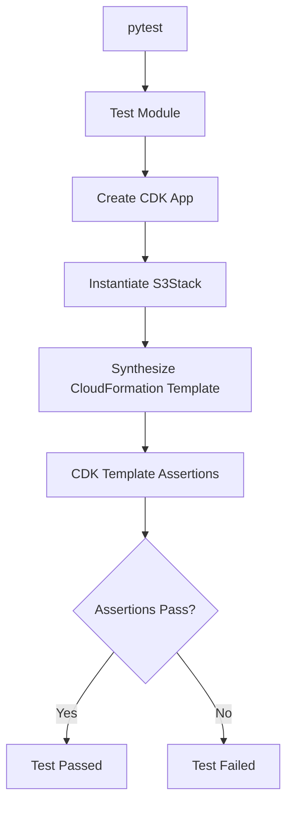

# README

## Overview

This directory contains automated tests for the Python AWS CDK Amazon S3 implementation.

The tests validate the synthesized AWS CloudFormation template rather than deploying resources into an AWS account. This makes infrastructure validation repeatable, fast, and suitable for local development and CI/CD pipelines.

The test suite focuses on two areas:

- **S3 stack behavior:** lifecycle configuration, versioning, outputs, and resource provisioning.
- **Security configuration:** encryption, public-access restrictions, object ownership, and HTTPS enforcement.

The tests use `pytest` and the AWS CDK assertions library.

## Project Structure

```text
tests/
├── README.md
├── test_s3_stack.py
└── test_security_configuration.py
```

| File | Responsibility |
|---|---|
| `test_s3_stack.py` | Validates S3 bucket provisioning, lifecycle rules, configuration parameters, and CloudFormation outputs. |
| `test_security_configuration.py` | Validates bucket security controls and ensures the synthesized infrastructure follows secure defaults. |

## Testing Architecture

The tests instantiate the CDK application in memory, synthesize the stack, and inspect the resulting CloudFormation template.



This approach validates the infrastructure definition without requiring:

- AWS credentials.
- An AWS account.
- CDK bootstrap resources.
- Actual S3 bucket creation.
- CloudFormation deployment.

It does not replace deployment-level verification. IAM permissions, service integrations, and runtime behavior may require separate integration tests.

## Prerequisites

Run commands from the `cdk-python` project root.

Required tools:

| Dependency | Purpose |
|---|---|
| Python 3.10+ | Runtime for the CDK application and tests. |
| AWS CDK v2 | Infrastructure definition and synthesis. |
| pytest | Test execution. |
| pytest-cov | Test coverage reporting. |
| aws-cdk-lib | CDK constructs and assertions. |
| constructs | CDK construct base classes. |

Install dependencies:

```bash
python -m pip install -r requirements-dev.txt
```

Verify the test runner:

```bash
pytest --version
```

## Running Tests

### Run the Complete Test Suite

```bash
pytest
```

### Run a Specific Test Module

Test S3 stack behavior:

```bash
pytest tests/test_s3_stack.py
```

Test security configuration:

```bash
pytest tests/test_security_configuration.py
```

### Run a Specific Test

```bash
pytest tests/test_s3_stack.py::test_bucket_has_secure_configuration
```

### Display Detailed Test Output

```bash
pytest -v
```

### Stop After the First Failure

```bash
pytest -x
```

### Run Tests with Coverage

```bash
pytest --cov=stacks --cov=constructs --cov-report=term-missing
```

Generate an HTML coverage report:

```bash
pytest --cov=stacks --cov=constructs --cov-report=html
```

The report is written to:

```text
htmlcov/
```

## Test Coverage

### S3 Stack Tests

`test_s3_stack.py` validates the synthesized infrastructure.

| Test area | Expected behavior |
|---|---|
| Bucket provisioning | Exactly one S3 bucket is created. |
| Secure configuration | Versioning, encryption, ownership controls, and public-access restrictions are configured. |
| HTTPS enforcement | Insecure transport is explicitly denied by the bucket policy. |
| Storage transition | Objects transition to S3 Standard-IA after the configured period. |
| Noncurrent versions | Noncurrent object versions expire according to the configured retention period. |
| Multipart cleanup | Incomplete multipart uploads are automatically aborted. |
| Custom lifecycle configuration | Custom transition, expiration, and cleanup values reach the synthesized template. |
| Optional expiration | Current-object expiration is omitted when not configured. |
| Optional version cleanup | Noncurrent-version expiration can be disabled. |
| Stack outputs | Bucket name, ARN, and regional domain name are exported. |
| Invalid configuration | Invalid lifecycle periods are rejected. |

### Security Configuration Tests

`test_security_configuration.py` validates the security properties of the synthesized S3 resources.

| Security control | Expected behavior |
|---|---|
| Block Public Access | All four public-access blocking settings are enabled. |
| Object Ownership | BucketOwnerEnforced is configured. |
| Encryption | Default server-side encryption uses SSE-S3. |
| Transport security | Requests using insecure transport are denied. |
| Versioning | Bucket versioning is enabled. |
| Website hosting | Static website configuration is absent. |
| Bucket policy | No wildcard-principal Allow statement is introduced. |
| Custom bucket name | Security defaults remain enabled when a custom bucket name is supplied. |

## Understanding CDK Assertions

The suite uses the CDK assertions library to inspect CloudFormation resources.

### Template.from_stack()

Creates a testable representation of the synthesized stack.

```python
template = Template.from_stack(stack)
```

### resource_count_is()

Verifies the number of resources of a given CloudFormation type.

```python
template.resource_count_is("AWS::S3::Bucket", 1)
```

### has_resource_properties()

Checks whether a resource contains the expected properties.

```python
template.has_resource_properties(
    "AWS::S3::Bucket",
    {
        "VersioningConfiguration": {
            "Status": "Enabled",
        }
    },
)
```

### Match.array_with()

Matches expected elements within an array without requiring the entire array to be identical.

This is useful for lifecycle configurations, where a bucket may contain multiple independent rules.

### Match.object_like()

Matches the specified properties of an object while allowing additional properties.

This reduces test brittleness when CDK adds unrelated CloudFormation properties.

### Match.absent()

Verifies that a property is not present in the synthesized resource.

Use it to test optional configuration behavior.

## Test Execution in CI/CD

Run infrastructure tests before deploying the CDK stack.

A typical GitHub Actions validation sequence is:

```yaml
- name: Install dependencies
  run: python -m pip install -r requirements-dev.txt

- name: Run CDK tests
  run: pytest -v --cov=stacks --cov=constructs --cov-report=term-missing

- name: Synthesize CDK application
  run: cdk synth
```

The workflow should fail when tests or synthesis fail. Deployment should only proceed after the validation stage succeeds.

For production pipelines, also consider:

- Ruff linting and formatting checks.
- Mypy type checking where applicable.
- CDK synthesis validation.
- Security checks on synthesized templates.
- Review of infrastructure changes before deployment.

## Testing Boundaries

These tests validate the generated CloudFormation configuration. They do not prove that AWS has successfully deployed or operates the resources.

| Validation type | Covered here? | Purpose |
|---|---|---|
| Unit tests | Yes | Validate CDK stack configuration and construct behavior. |
| Template assertions | Yes | Inspect synthesized CloudFormation resources and properties. |
| CDK synthesis | Separate command | Verify that the application can synthesize a CloudFormation template. |
| AWS deployment tests | No | Validate actual resource creation in an AWS account. |
| IAM integration tests | No | Verify effective permissions and cross-account access. |
| Runtime S3 tests | No | Validate real uploads, downloads, lifecycle execution, and object operations. |

Lifecycle transitions and expiration are asynchronous S3 operations. Template assertions verify configuration, not the actual execution of lifecycle actions.

## Troubleshooting

### ModuleNotFoundError

**Symptom:** pytest cannot import `stacks` or another project module.

**Checks:**

- Run pytest from the `cdk-python` project root.
- Confirm that the project dependencies are installed.
- Check the package structure and Python import paths.
- Confirm that the relevant modules exist.

### CDK Assertion Failure

**Symptom:** A test fails because an expected CloudFormation property does not match.

**Checks:**

- Inspect the actual synthesized resource.
- Verify the expected CloudFormation property name.
- Check whether the CDK construct changed its defaults.
- Confirm that optional configuration is represented correctly.

Generate the template:

```bash
cdk synth
```

### Dependency Version Conflict

**Symptom:** CDK imports or assertions fail after dependency installation.

**Checks:**

- Confirm that `aws-cdk-lib` and `constructs` use compatible major versions.
- Recreate the virtual environment if necessary.
- Reinstall dependencies from the project requirements files.

### Test Passes but Deployment Fails

A successful unit test does not guarantee deployment success.

Investigate:

- AWS account and Region configuration.
- CDK bootstrap state.
- IAM deployment permissions.
- Globally unique S3 bucket naming requirements.
- CloudFormation resource constraints.
- Existing resource conflicts.
- AWS service-specific configuration requirements.

## Key Takeaways

- CDK assertions validate synthesized infrastructure without deploying AWS resources.
- Stack tests verify lifecycle behavior, bucket configuration, and CloudFormation outputs.
- Security tests enforce private bucket defaults, encryption, ownership controls, and HTTPS-only access.
- Unit tests should run before synthesis and deployment in CI/CD pipelines.
- Template tests complement, but do not replace, AWS integration and deployment verification.