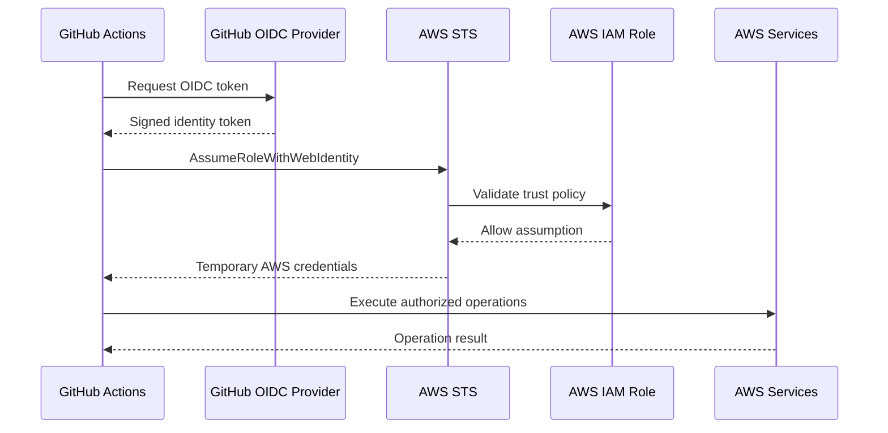

# .github/workflows/README

## Overview

This directory contains GitHub Actions workflows for validating, testing, deploying, and monitoring Amazon S3 infrastructure and related applications.

The workflows use GitHub repository and environment variables for non-sensitive configuration and AWS IAM role ARNs. AWS authentication is performed through OpenID Connect (OIDC), allowing GitHub Actions to obtain short-lived AWS credentials without storing long-lived AWS access keys.

Configuration must be established before running workflows. Missing or incorrect variables can cause validation, authentication, deployment, or verification steps to fail.

## Workflow Inventory

| Workflow | Purpose | Trigger |
|---|---|---|
| `cdk-test-and-deploy.yml` | Installs dependencies, runs CDK unit tests, synthesizes CloudFormation templates, and deploys CDK stacks. | Pull requests, pushes to `main`, manual dispatch |
| `cloudformation-validate.yml` | Validates CloudFormation templates using `cfn-lint` and JSON syntax validation. | Pull requests, pushes to `main`, manual dispatch |
| `infrastructure-drift-detection.yml` | Runs a Terraform refresh-only plan to identify infrastructure drift without applying changes. | Scheduled execution, manual dispatch |
| `terraform-apply-dev.yml` | Generates and applies a Terraform plan for the development environment. | Manual dispatch |
| `terraform-apply-production.yml` | Generates a production Terraform plan and applies the approved plan through a protected production environment. | Manual dispatch |
| `terraform-plan.yml` | Initializes, validates, and generates Terraform execution plans for approved root configurations. | Pull requests, pushes to `main`, manual dispatch |
| `terraform-validate.yml` | Validates Terraform configuration and formatting. | Pull requests, pushes to `main`, manual dispatch |

Workflow triggers and path filters are defined in the individual YAML files. Refer to those files for the exact trigger conditions and execution behavior.

## GitHub Actions Configuration

Configuration values are supplied through GitHub Actions variables. These values are not secrets and should not contain credentials or other sensitive information.

### Repository Variables

Configure the following variables under:

**GitHub Repository → Settings → Secrets and variables → Actions → Variables**

| Variable | Type | Purpose | Required by |
|---|---|---|---|
| `AWS_REGION` | Repository variable | AWS Region used for AWS authentication, infrastructure operations, and deployment commands. | AWS-backed workflows |
| `AWS_TERRAFORM_PLAN_ROLE_ARN` | Repository variable | ARN of the IAM role assumed through OIDC by the Terraform planning workflow. | `terraform-plan.yml` |
| `AWS_TERRAFORM_APPLY_ROLE_ARN` | Repository variable | ARN of the IAM role assumed through OIDC when applying development Terraform infrastructure. | `terraform-apply-dev.yml` |
| `AWS_TERRAFORM_PROD_PLAN_ROLE_ARN` | Repository variable | ARN of the IAM role assumed through OIDC to initialize, validate, and generate the production Terraform execution plan. | `terraform-apply-production.yml` |
| `AWS_TERRAFORM_PROD_APPLY_ROLE_ARN` | Repository variable | ARN of the IAM role assumed through OIDC to apply the previously generated production Terraform plan. | `terraform-apply-production.yml` |
| `AWS_TERRAFORM_DRIFT_ROLE_ARN` | Repository variable | ARN of the IAM role assumed through OIDC for scheduled Terraform infrastructure drift detection. | `infrastructure-drift-detection.yml` |
| `AWS_CDK_DEPLOY_ROLE_ARN` | Repository variable | ARN of the IAM role assumed through OIDC for AWS CDK deployment operations. | `cdk-test-and-deploy.yml` |
| `CDK_WORKING_DIRECTORY` | Repository variable | Repository-relative path to the CDK application directory. The directory must contain `cdk.json`, `requirements.txt`, and the expected `tests/` directory. | `cdk-test-and-deploy.yml` |
| `TF_DEV_WORKING_DIRECTORY` | Repository variable | Repository-relative path to the development Terraform root configuration. | `terraform-apply-dev.yml` |
| `TF_PROD_WORKING_DIRECTORY` | Repository variable | Repository-relative path to the production Terraform root configuration. | `terraform-apply-production.yml`, `infrastructure-drift-detection.yml` |

Use paths relative to the repository root for working-directory variables. Do not include machine-specific absolute paths.

The Terraform and CDK role variables must contain IAM role ARNs, not AWS access keys or IAM user credentials.

The production planning and apply workflows use separate IAM roles. The planning role should have only the permissions required to read infrastructure state and inspect the target resources. The apply role requires the additional permissions necessary to perform the approved infrastructure changes.

### Environment Variables

GitHub Actions environments can provide deployment-specific configuration and enforce environment protection rules.

The production Terraform apply workflow uses the `production` environment for its apply job. The CDK deployment workflow selects its environment according to the event:

- `development` for a push to `main`.
- `production` for a manual dispatch on `main`.

The Terraform development workflow uses the `development` environment.

Configure environment-specific variables when development and production deployments require different AWS accounts, Regions, or IAM roles. If a variable is defined at both repository and environment scope, verify which value the workflow receives before deployment.

## AWS OIDC Federation

The deployment workflows use GitHub Actions OIDC federation to authenticate with AWS.

The workflow requests an OIDC token, and AWS STS exchanges that token for temporary credentials after validating the configured IAM identity provider and role trust policy.



### Required AWS Configuration

For each role referenced by a workflow:

1. Configure the GitHub OIDC identity provider in the relevant AWS account.
2. Configure the role trust policy to trust the expected GitHub repository and permitted branch or environment.
3. Restrict the `sub` claim to the intended repository and deployment environment where applicable.
4. Grant only the AWS permissions required by that workflow.
5. Configure the role ARN in the corresponding GitHub Actions variable.
6. Verify that the role can access the required Terraform state backend, deployment resources, and supporting services.

Use separate roles for planning, applying infrastructure, drift detection, and CDK deployment where their permission requirements differ.

Do not use a broad wildcard trust policy or grant administrative permissions simply to make a workflow succeed.

## Workflow-Specific Configuration

### Terraform Plan

`terraform-plan.yml` uses:

| Variable | Purpose |
|---|---|
| `AWS_TERRAFORM_PLAN_ROLE_ARN` | IAM role used to obtain temporary AWS credentials. |
| `AWS_REGION` | AWS Region for the planning operation. |

The workflow discovers approved Terraform root configurations and executes initialization, validation, and planning against those roots.

Reusable Terraform child modules should not be configured as independent deployment targets. Root configurations must retain their caller-owned variables and module source references.

### Terraform Development Deployment

`terraform-apply-dev.yml` uses:

| Variable | Purpose |
|---|---|
| `AWS_TERRAFORM_APPLY_ROLE_ARN` | IAM role used to apply development infrastructure. |
| `AWS_REGION` | AWS Region for the deployment. |
| `TF_DEV_WORKING_DIRECTORY` | Development Terraform root configuration directory. |

The workflow requires manual confirmation through the `confirm_deployment` input. The expected value is `deploy-dev`.

The workflow generates a saved Terraform plan and applies that plan rather than generating a separate plan during the apply operation.

### Terraform Production Deployment

`terraform-apply-production.yml` separates production planning from production application.

The workflow uses the following variables:

| Variable | Purpose | Job |
|---|---|---|
| `AWS_TERRAFORM_PROD_PLAN_ROLE_ARN` | IAM role used to initialize Terraform, inspect infrastructure, and generate the production execution plan. | `plan` |
| `AWS_TERRAFORM_PROD_APPLY_ROLE_ARN` | IAM role used to apply the approved production execution plan. | `apply` |
| `AWS_REGION` | AWS Region for production infrastructure operations. | `plan`, `apply` |
| `TF_PROD_WORKING_DIRECTORY` | Production Terraform root configuration directory. | `plan`, `apply` |

The workflow requires:

- Manual execution from the `main` branch.
- The exact confirmation input `deploy-production`.
- A valid production Terraform working directory.
- A successful planning job before the apply job can run.
- Approval through the GitHub `production` environment when its protection rules require reviewers.

The planning job generates a saved execution plan and uploads it as a short-retention artifact. The apply job downloads and applies that same plan rather than generating a new plan.

The planning and apply roles should be configured independently:

- The planning role should have the minimum permissions needed to access the state backend and inspect infrastructure.
- The apply role should have the permissions required to execute the approved changes.
- Both roles must use compatible state backend access and target the same AWS account, Region, and Terraform state.

The workflow also runs a post-apply Terraform plan to verify the resulting state. Investigate any non-zero result rather than treating the deployment as successful solely because `terraform apply` completed.

### Infrastructure Drift Detection

`infrastructure-drift-detection.yml` uses:

| Variable | Purpose |
|---|---|
| `AWS_TERRAFORM_DRIFT_ROLE_ARN` | IAM role used to inspect production infrastructure. |
| `AWS_REGION` | AWS Region for the drift-detection operation. |
| `TF_PROD_WORKING_DIRECTORY` | Production Terraform root configuration directory. |

The workflow executes a refresh-only Terraform plan with detailed exit-code handling.

A detected drift condition is reported for investigation. The workflow does not automatically apply infrastructure changes.

### CDK Test and Deployment

`cdk-test-and-deploy.yml` uses:

| Variable | Purpose |
|---|---|
| `AWS_CDK_DEPLOY_ROLE_ARN` | IAM role used for CDK deployment through OIDC. |
| `AWS_REGION` | AWS Region used for CDK deployment and CloudFormation inspection. |
| `CDK_WORKING_DIRECTORY` | CDK application directory containing the project configuration, dependencies, and tests. |

The CDK application directory must contain:

```text
<CDK_WORKING_DIRECTORY>/
├── cdk.json
├── requirements.txt
└── tests/
```

The workflow runs unit tests and synthesizes CloudFormation templates before deployment. Deployment occurs only for non-pull-request executions on `main`.

The workflow uses the `development` environment for pushes and the `production` environment for manual dispatches.

### CloudFormation Validation

`cloudformation-validate.yml` validates templates located in dedicated `templates/` directories.

It uses `cfn-lint` for CloudFormation-aware validation and Python's JSON parser for JSON syntax checks.

This validation workflow does not require AWS deployment credentials.

## GitHub Secrets

The workflows described here use GitHub Actions variables for their documented AWS configuration values and OIDC role ARNs.

Do not store AWS access keys, secret access keys, passwords, private keys, or other credentials in repository variables.

If a future workflow requires a sensitive value that cannot be obtained through OIDC or another short-lived authentication mechanism, store it as a GitHub Actions secret and expose it only to the job or step that requires it.

## Environment Protection and Approval Gates

Use GitHub deployment environments to control access to infrastructure deployment workflows.

Recommended controls:

| Environment | Recommended controls |
|---|---|
| `development` | Restricted deployment branch where appropriate; development-scoped IAM role. |
| `production` | Required reviewers, deployment branch restrictions, production-scoped IAM roles, and controlled deployment access. |

Configure environment protection rules in:

**GitHub Repository → Settings → Environments**

An environment name in a workflow does not automatically create an approval gate. Configure required reviewers and other protection rules explicitly.

For production deployment, ensure the `production` environment is associated with the apply job and that its protection rules are enabled. The planning job should not receive production apply permissions.

## Configuration Validation

Before enabling a workflow, verify that its required variables are configured and that the referenced paths exist in the repository.

Example local checks for working-directory configuration:

```bash
test -d "$CDK_WORKING_DIRECTORY"
test -f "$CDK_WORKING_DIRECTORY/cdk.json"
test -f "$CDK_WORKING_DIRECTORY/requirements.txt"
test -d "$CDK_WORKING_DIRECTORY/tests"

test -d "$TF_DEV_WORKING_DIRECTORY"
test -d "$TF_PROD_WORKING_DIRECTORY"
```

For AWS-backed workflows, verify the configured role ARN, Region, OIDC trust relationship, and required permissions.

After a workflow assumes its role, `aws sts get-caller-identity` should identify the expected AWS account and assumed role.

Never print credentials or OIDC tokens in workflow logs.

## Operational Best Practices

- Use OIDC federation instead of long-lived AWS access keys.
- Maintain separate IAM roles for planning, deployment, and drift detection.
- Apply least-privilege permissions to every workflow role.
- Restrict IAM trust policies to the intended GitHub repository, branch, and environment.
- Use repository-relative paths for Terraform and CDK working directories.
- Keep development and production configuration isolated.
- Protect production deployments with GitHub environment approvals.
- Keep Terraform provider and dependency lock files committed.
- Review Terraform plans and CDK diffs before applying infrastructure changes.
- Treat Terraform plan artifacts as potentially sensitive because plans can contain infrastructure details and sensitive values.
- Retain deployment artifacts only as long as operationally necessary.
- Do not automatically remediate detected infrastructure drift without review.
- Verify deployed CloudFormation stacks and AWS resources after deployment.
- Keep workflow permissions minimal and grant `id-token: write` only to jobs that need OIDC authentication.
- Review workflow logs and artifacts for accidental exposure of sensitive configuration.

## Common Configuration Problems

| Symptom | Likely cause | Corrective action |
|---|---|---|
| Workflow reports a missing variable | Required repository or environment variable is not configured or is unavailable to the job. | Check the variable name, scope, and environment association. |
| AWS role assumption fails | Incorrect role ARN, missing OIDC provider, or invalid trust policy. | Verify the IAM identity provider and role trust conditions. |
| AWS returns `AccessDenied` | The assumed role lacks a required permission or a resource policy denies access. | Inspect IAM policies, resource policies, and explicit-deny conditions. |
| Terraform reports a missing working directory | The configured Terraform path is incorrect or does not exist in the checked-out repository. | Correct the corresponding working-directory variable. |
| Production planning fails to assume its role | `AWS_TERRAFORM_PROD_PLAN_ROLE_ARN` is missing or its trust policy does not allow the workflow identity. | Verify the variable and planning role trust policy. |
| Production apply fails to assume its role | `AWS_TERRAFORM_PROD_APPLY_ROLE_ARN` is missing or its trust policy does not allow the production environment identity. | Verify the variable, apply role permissions, and GitHub environment trust conditions. |
| Production plan artifact cannot be downloaded | The planning job failed, artifact upload failed, or the artifact name/path does not match. | Inspect the planning job and verify artifact upload and download configuration. |
| Production apply reports a stale plan | Infrastructure or state changed after the plan was generated. | Generate a fresh plan and repeat the approval process. |
| CDK configuration validation fails | The configured directory lacks `cdk.json`, `requirements.txt`, or `tests/`. | Verify the CDK project structure and `CDK_WORKING_DIRECTORY`. |
| CDK bootstrap verification fails | The target account and Region have not been bootstrapped or the role cannot inspect the bootstrap stack. | Verify the CDK bootstrap environment and required permissions. |
| Production deployment starts without approval | The GitHub environment does not have required reviewers or protection rules configured. | Configure production environment protection rules. |
| Terraform drift workflow reports an error | State backend, provider credentials, configuration, or resource inspection failed. | Inspect the Terraform error and AWS permissions before treating it as drift. |

## Key Takeaways

- GitHub Actions variables hold non-sensitive workflow configuration; credentials should be obtained through OIDC or another approved authentication mechanism.
- AWS deployment workflows should use narrowly scoped IAM roles with trust policies restricted to the intended repository, branch, and environment.
- Production Terraform planning and application use separate roles: `AWS_TERRAFORM_PROD_PLAN_ROLE_ARN` and `AWS_TERRAFORM_PROD_APPLY_ROLE_ARN`.
- Terraform and CDK working-directory variables must point to valid repository-relative project roots.
- Production deployment safety depends on saved-plan integrity, IAM least privilege, and explicitly configured GitHub environment protection rules.